# Accessibility foundations

This chapter covers the parts of Feeder that every screen depends on. When the route changes, the page title stays "Feeder" and focus stays on the nav link. One focus ring disappears on the accent hero and in forced colours. Controls have no boundary at rest, or a selected state of only 1.1–1.2:1. Focus falls to `<body>` after row actions and sheet steps. Repeated buttons share one name ("Swap", "Pin"). Some hit areas are smaller than 44 px or overlap. There is no skip link, and there are a few smaller items. I reproduced all 19 source findings on my own server (`main` @ 834ea743, Chromium, 7 accents × light and dark, 390/1280/1440). I also found one related defect that nobody reported: the Today hero takes its dark look from the **operating system's** scheme, not the scheme the User chose (A11Y-03).

**Root causes.** Five root causes explain almost all of these findings:
- **No ring token.** About 25 primitives each hard-code `outline: 3px solid var(--color-accent)`, and nine draw `box-shadow: var(--focus-ring)` with `outline: none`. An accent-filled container therefore hides the ring, and forced colours delete the box-shadow ones.
- **No selected-state rule.** Segmented, ChoiceChip and toggle IconButton each pick a fill that is 1.06–1.21:1 from the unselected one.
- **No forced-colours layer.** There is no `forced-colors` rule anywhere in `web/src`.
- **No focus management.** There is none on route change, on row removal or on a sheet re-render. `ui/lib/useModalDialog.ts` only focuses once, on mount.
- **No naming rule for repeated actions.**

**Shape of the fix.** It is a few shared changes, not screen patches:
- one ring token plus a scoped override on accent containers (closes 4 findings);
- one forced-colours file (1);
- one selected-state token set used by Segmented, ChoiceChip and IconButton (4);
- a focus keeper in `ListGroup` and `useModalDialog`, plus a route-focus hook in `AppShell` (4);
- a title hook in `PageHeader` (2);
- a coarse-pointer target rule with an `IconSet` primitive (4);
- small XS fixes for the rest.

Every new colour pair is given below for all 7 accents × 2 schemes, and the pairs are added to `web/src/theme/contrast.test.ts`.

| Item | Severity | Size | Title | Source ids | Status after reproduction |
|---|---|---|---|---|---|
| A11Y-01 | S2 | S | Page title and focus on route change | SHELL-08, CROSS-01 | Confirmed |
| A11Y-02 | S2 | M | One focus ring, visible on every container | SHELL-05, CROSS-02 | Confirmed, wider |
| A11Y-03 | S2 | XS | The Today hero follows the OS scheme, not the chosen one | new in stage 2 | New |
| A11Y-04 | S2 | M | Forced-colours layer for the primitives | CROSS-03 | Confirmed |
| A11Y-05 | S3 (was S2) | S | Field-like controls show their boundary at rest | CROSS-04 | Confirmed, narrower |
| A11Y-06 | S2 | S | One selected / pressed state at 3:1, with a non-colour cue | RECIPES-11, SETTINGS-19, SETTINGS-07 | Confirmed (SETTINGS-07 narrower) |
| A11Y-07 | S2 | M | Where focus goes after a row leaves, a sheet opens or a sheet changes step | SHOP-02, SETTINGS-09 | Confirmed |
| A11Y-08 | S3 | S | Names for repeated row actions and for rows; Pin as one toggle | PLAN-12, SHOP-18 | Confirmed |
| A11Y-09 | S3 | S | Touch targets and spacing on coarse pointers | RECIPES-19, SHOP-19, CROSS-13 | Confirmed, narrower |
| A11Y-10 | S3 | XS | Skip link | CROSS-18 | Confirmed |
| A11Y-11 | S3 | XS | Recipe tiles are links | RECIPES-17 | Confirmed |
| A11Y-12 | S4 | S | Smaller items: board h1, nav and menu names, dark danger fill, textarea grip, app update | CROSS-21 | Confirmed (app update inferred) |

**Shared tokens this chapter adds** (`web/src/styles.css` `:root`). Every item below refers to these by name.

```css
:root {
  --focus-ring-width: 3px;
  --focus-ring-offset: 2px;
  --focus-ring-offset-inset: calc(-1 * var(--focus-ring-width)); /* inside a clipping container */
  --focus-ring-color: var(--color-accent);
  --selected-bg: var(--color-soft);
  --selected-fg: var(--color-accent-text);
  --selected-ring: var(--color-accent-text);
  --selected-ring-width: 1.5px;
  --target-min: 44px;
  --icon-set-gap: var(--space-1);
}
@media (pointer: coarse) { :root { --icon-set-gap: var(--space-3); } }
```

`--focus-ring` (the box-shadow token) is **removed**.

**Contrast of every new pair, for every accent × scheme.** Computed with `generatePalette` from `web/src/theme/palette.ts` and `contrastRatio`:

| Accent | Scheme | Ring (accent) on bg / surface / surface-2 / surface-3 / soft | Ring on hero (light: on-accent on accent; dark: accent on soft-strong) | Outline (option A) on bg / surface / surface-2 | Option B: surface-3 on bg / surface; outline rule on surface-3 | Selected ring (accent-text) on track surface-2 / surface / its soft fill | Today: soft vs surface-2 |
|---|---|---|---|---|---|---|---|
| Basil | light | 5.06 / 5.67 / 4.65 / 4.10 / 4.36 | 5.73 | 4.05 / 4.53 / 3.72 | 1.23 / 1.38; 3.28 | 7.18 / 8.75 / 6.73 | 1.07 |
| Tomato | light | 5.66 / 6.40 / 5.15 / 4.54 / 4.73 | 6.49 | 4.13 / 4.67 / 3.76 | 1.25 / 1.41; 3.31 | 7.89 / 9.81 / 7.26 | 1.09 |
| Saffron | light | 5.40 / 6.10 / 4.95 / 4.37 / 4.56 | 6.19 | 4.07 / 4.60 / 3.73 | 1.24 / 1.40; 3.29 | 7.49 / 9.23 / 6.90 | 1.09 |
| Blueberry | light | 5.48 / 6.15 / 5.00 / 4.42 / 4.63 | 6.25 | 4.09 / 4.60 / 3.74 | 1.24 / 1.39; 3.30 | 7.71 / 9.48 / 7.14 | 1.08 |
| Aubergine | light | 5.61 / 6.34 / 5.10 / 4.48 / 4.66 | 6.42 | 4.13 / 4.66 / 3.75 | 1.25 / 1.41; 3.30 | 7.84 / 9.73 / 7.17 | 1.09 |
| Teal | light | 5.04 / 5.65 / 4.63 / 4.10 / 4.35 | 5.72 | 4.06 / 4.55 / 3.73 | 1.23 / 1.38; 3.30 | 7.15 / 8.73 / 6.72 | 1.06 |
| Slate | light | 5.29 / 5.91 / 4.82 / 4.25 / 4.47 | 6.02 | 4.10 / 4.58 / 3.74 | 1.24 / 1.39; 3.30 | 7.34 / 9.01 / 6.82 | 1.08 |
| Basil | dark | 9.99 / 8.99 / 7.69 / 6.47 / 6.36 | 4.94 | 5.40 / 4.86 / 4.15 | 1.54 / 1.39; 3.50 | 10.09 / 11.80 / 8.35 | 1.21 |
| Tomato | dark | 9.24 / 8.37 / 7.18 / 6.08 / 6.17 | 4.93 | 5.30 / 4.80 / 4.12 | 1.52 / 1.38; 3.49 | 9.64 / 11.23 / 8.28 | 1.16 |
| Saffron | dark | 9.55 / 8.62 / 7.41 / 6.25 / 6.29 | 4.98 | 5.29 / 4.78 / 4.11 | 1.53 / 1.38; 3.46 | 9.73 / 11.32 / 8.26 | 1.18 |
| Blueberry | dark | 9.63 / 8.70 / 7.49 / 6.27 / 6.34 | 5.00 | 5.32 / 4.81 / 4.14 | 1.53 / 1.39; 3.47 | 9.83 / 11.42 / 8.32 | 1.18 |
| Aubergine | dark | 9.23 / 8.35 / 7.23 / 6.06 / 6.20 | 4.96 | 5.28 / 4.78 / 4.13 | 1.52 / 1.38; 3.47 | 9.57 / 11.07 / 8.21 | 1.17 |
| Teal | dark | 10.07 / 9.07 / 7.77 / 6.54 / 6.42 | 5.00 | 5.37 / 4.84 / 4.15 | 1.54 / 1.39; 3.49 | 10.12 / 11.82 / 8.36 | 1.21 |
| Slate | dark | 9.75 / 8.77 / 7.54 / 6.39 / 6.39 | 5.02 | 5.34 / 4.80 / 4.13 | 1.53 / 1.37; 3.50 | 9.81 / 11.41 / 8.31 | 1.18 |

The accent ring on a status or info tile is at least 4.60:1 in light (Teal on spoil) and 6.32:1 in dark (Tomato on success).

## Decisions for the user

The user decided these questions; see [decisions.md](decisions.md).

1. **CHANGED: the boundary of the Search field and the Segmented track.** **Option B** was chosen: a stronger fill (`--color-surface-3`) with a 2 px bottom rule in `--color-outline`. TextField, TextArea, Select, DateField, Stepper field and Checkbox keep their 1.5 px outline. Option A, the 1.5 px outline (recommended), was not chosen.
   - Decided design: [light 1440](shots/a11y-05-after-1440-light.webp), [dark 1440](shots/a11y-05-after-1440-dark.webp), [390 light](shots/a11y-05-after-390-light.webp), [390 dark](shots/a11y-05-after-390-dark.webp).
   - Its states: [390 light](shots/a11y-05-after-states-390-light.webp), [390 dark](shots/a11y-05-after-states-390-dark.webp).
   - Option A, not chosen: [light 1440](shots/a11y-05-opta-1440-light.webp), [dark 1440](shots/a11y-05-opta-1440-dark.webp).
   - Mock with both: [mocks/a11y-05-field-boundaries.html](mocks/a11y-05-field-boundaries.html).
2. **Selected and pressed states.** The accent container with a 1.5 px accent-text ring, plus a Check on text options or the filled icon, as recommended.
   - [light](shots/a11y-06-after-1440-light.webp), [dark](shots/a11y-06-after-1440-dark.webp).
   - The neutral alternative was not chosen: [light](shots/a11y-06-alt-neutral-1440-light.webp), [dark](shots/a11y-06-alt-neutral-1440-dark.webp).
   - Mock: [mocks/a11y-06-selected-states.html](mocks/a11y-06-selected-states.html).
3. **The Exclusions tile.** Titled "Exclusions", with a summary line and an "Excludes <Ingredient>" note on each Member who excludes it, as recommended. Mock: [mocks/a11y-06-selected-states.html](mocks/a11y-06-selected-states.html).
4. **A new version while the app is open.** A toast with Reload, as recommended and the same as RES 3. The RES chapter designs the toast and its rules (RES-10); A11Y-12 keeps only the service-worker side.

## A11Y-01  Page title and focus on route change

**Severity** S2 · **Size** S · **Sources** SHELL-08, CROSS-01 · **Reproduced** Confirmed. 35 of 35 routes have the title "Feeder" (1 distinct title) at 390 and at 1280. After Tab to a nav link and Enter, `document.activeElement` stays on `A.bottom-bar__link` (390) or `A.side-rail__link` (1280) on all 7 nav routes, and nothing is announced.
**Where** every route; every size; both schemes

### Problem
A screen-reader User who follows a nav link hears nothing: focus stays on the link, and the browser tab, history and window switcher all read "Feeder". This fails WCAG 2.4.2 (Page Titled, level A), and the silent route change also misses the practice behind 4.1.3. The only title in the source is in `web/index.html`. Nothing calls `document.title`, and `app/AppShell.tsx` does nothing on a `pathname` change.

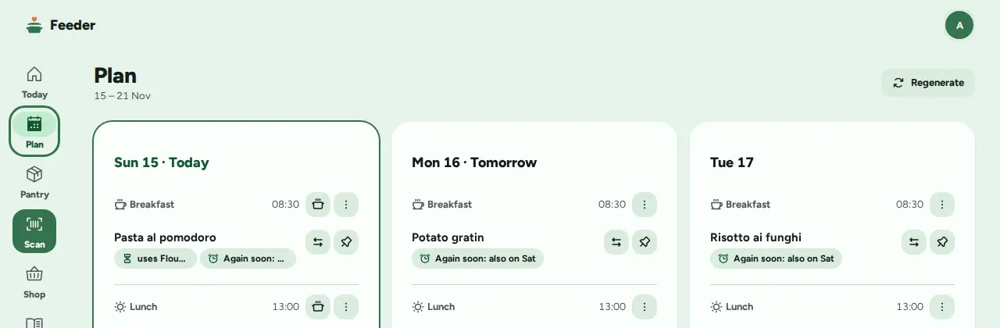

### Design
**Behaviour, every size and scheme.**
- **Title.** Every route sets `document.title` to `<h1> · <parent> · Feeder`. `<parent>` is the breadcrumb just before the current page, left out when the page has no breadcrumbs. Examples (all from the live h1s and breadcrumbs):
  - `/` "Today · Feeder"; `/plan` "Plan · Feeder"; `/shop` "Shop · Feeder"; `/pantry` "Pantry · Feeder"; `/recipes` "Recipes · Feeder"; `/settings` "Settings · Feeder";
  - `/recipes/1` "Pasta al pomodoro · Recipes · Feeder"; `/recipes/1/edit` "Edit Recipe · Pasta al pomodoro · Feeder";
  - `/ingredients/1` "Flour · Ingredients · Feeder"; `/settings/members` "Members · Settings · Feeder";
  - `/plan/couldnt-plan/excluded` "Review Exclusions · Plan · Feeder".
- **Title override.** Where the h1 is a question that changes with the step, the page passes a stable title instead:
  - `/scan`: "Scan · Feeder";
  - `/scan/receipt`: "Receipt · Feeder";
  - `/scan/receipt/review`: "Receipt review · Feeder".
- **Chromeless screens and fixed pages** set their own title:
  - Kitchen board: "Kitchen board · Feeder";
  - Cook Mode: "Cook Mode · <Recipe> · Feeder";
  - sign-in pages: "Sign in to Feeder";
  - Not found: "Page not found · Feeder";
  - the error boundary: "Something went wrong · Feeder".
- **Before the page's h1 renders** (loading, error), the shell sets a provisional title from the route table: the section's nav label, or "Feeder" for an unknown route. The page header replaces it when the h1 mounts.
- **Focus on route change.** On an in-app `pathname` change (link, nav, back/forward), focus moves to the new page's h1, which gets `tabIndex={-1}`. The screen reader then reads the page name.
  - Only a `pathname` change triggers this; a search-param change (filters, sort) never does.
  - It never runs on first load.
  - If no h1 appears within 2 s (a slow or failed load), focus goes to `<main id="main-content" tabIndex={-1}>`.
  - Focus uses `preventScroll: true`; the app's scroll position handling is unchanged.
- **No ring on the h1.** It is not an operable control: `.page-header__title:focus { outline: none }`. The skip link (A11Y-10) uses the same target.

**Copy.** As above. The separator is " · " (U+00B7 with spaces), as the app's eyebrows already use.

**Accessibility.** Satisfies 2.4.2 and 2.4.3. On VoiceOver and NVDA, focusing the h1 announces "<name>, heading level 1". No live region is needed.

No mock: non-visual.

### Build notes
- **New `web/src/ui/lib/useDocumentTitle.ts`.** `useDocumentTitle(parts: (string | undefined)[])` joins the defined parts and "Feeder" with " · ". It is plain: no restore on unmount, the next page sets its own.
- **`ui/PageHeader.tsx`.**
  - Calls `useDocumentTitle([documentTitle ?? title, parentCrumb(breadcrumbs)])`.
  - New optional prop `documentTitle?: string`.
  - `parentCrumb` is a pure function in `ui/lib/pageTitle.ts`: the label of `breadcrumbs.at(-2)`, if present.
  - The h1 gets `tabIndex={-1}` and `id="page-title"`.
- **New `web/src/app/routeTitle.ts`** (pure, unit-tested): `routeTitle(pathname)` returns the provisional title from `nav.ts` labels.
- **New `web/src/app/useRouteFocus.ts`:**
  - watches `useLocation().pathname`;
  - skips the first render;
  - after commit, waits for `#page-title` (MutationObserver, 2 s cap);
  - focuses it, else `#main-content`.
  - Called once in `AppShell`. The chromeless branch calls it too; there the board, Cook Mode and receipt pages render their own h1 with `id="page-title"` (see A11Y-12 for the board's).
- **`app/AppShell.tsx`:** `<main id="main-content" tabIndex={-1} …>` in both branches, and the provisional title.
- **Chromeless screens:** `features/board`, `features/cook` and `features/signin`/`access` call `useDocumentTitle` directly.
- No API change.

### Tests and guard
- Unit:
  - `useDocumentTitle` joins parts and drops `undefined`;
  - `parentCrumb` returns the second-last crumb;
  - `routeTitle` for every route in `app/nav.ts` and an unknown path.
- Unit: `PageHeader.title.test.tsx`, which renders with breadcrumbs and asserts `document.title`.
- Unit: `AppShell.routeFocus.test.tsx`:
  - navigating with a `MemoryRouter` moves focus to `#page-title`;
  - a search-param change does not;
  - first render does not.
- BDD (Gherkin titles):
  - Scenario: Following a nav link names the page and moves focus to its heading
  - Scenario: Changing a filter keeps focus where it was
  - Scenario: A Recipe page's title names the Recipe and its section
- Guard: `scripts/check-page-layout` gets probe P18 "title". On every route of the quick profile, `document.title` ≠ "Feeder", ends with " · Feeder" (or is "Sign in to Feeder"), and starts with the h1 text or the route's `documentTitle` from `pageLayoutRules`.

### Depends on / unblocks
None. Unblocks A11Y-10 (same focus target) and A11Y-12 (board h1).

## A11Y-02  One focus ring, visible on every container, never clipped, overrun or fused

**Severity** S2 · **Size** M · **Sources** SHELL-05, CROSS-02 (also closes the box-shadow ring part of CROSS-03 and the row-ring part of PLAN-12) · **Reproduced** Confirmed, and wider than reported.
- **Light hero, all 7 accents:** the Cook button's and the ⋮'s ring is the accent on the accent, **1.00:1**. For Basil that is `rgb(52,114,78)` on `#34724e`.
- **Wider:** a User who chose Dark on a light-OS device gets the pastel accent hero (A11Y-03), where the ring is again 1.00:1.
- **Dark with a matching OS** is fine: 4.93–5.02:1.

**Where**
- the `/` Today hero, the Kitchen board's Tonight tile and the sign-in heroes;
- every field and Select;
- list rows;
- sheets with a sticky header or footer;
- pills, field frames and tiles with nested controls;
- every size.

### Problem
A keyboard User loses focus on the screen's main action. In light the hero is accent solid and the ring is accent, so the ring vanishes. This fails WCAG 2.4.7 and 1.4.11.

There is no single definition behind the ring:
- `styles.css:384` sets a global accent ring.
- About 25 primitives repeat `outline: 3px solid var(--color-accent)`, for example `ui/Button.css:115`, `ui/IconButton.css:43`, `ui/Chip.css:41`, `ui/fields/Segmented.css:57` and `ui/Tile.css:138`.
- Nine rules draw the ring as `box-shadow: var(--focus-ring); outline: none`:
  - `ui/fields/Field.css:90`, `ui/fields/SearchField.css:16`, `ui/Select/Select.css:34`, `ui/fields/DateField.css:28`, `ui/fields/TimeField.css:19`;
  - `ui/Stepper.css:19`, `WeekdayPicker.css:56`, `PriceKeypad.css:29,96`;
  - `features/shop/shop.css:274,375`, `features/settings/settings.css:205`.
- `features/recipes/recipes.css:1031` (`.picker-row`) only changes the background.

As a result:
- **No container can change the ring's colour.**
- **Forced colours erase the box-shadow rings** (A11Y-04).
- **Rings are clipped** by scroll containers and sticky headers. The user, reviewing PC, said: "hidden by the header".
- **Rings merge.** A field frame rings on `:focus-within` (`Field.css:89`), so a focused stepper button or Clear search draws its own ring inside the frame's ring. This is the same defect the user called "the pause button focus ring merges with the component focus ring, looks amateurish".
- **The Plan row ring touches the title.** It is drawn at `outline-offset: -3px` on the row edge and touches the title's first letter (PLAN-12).

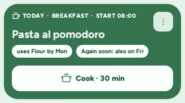

### Design
**Rule.** This is the one text for the focus ring. It includes R-C (round 1) and R-C+ (round 2), and every theme refers to it. It goes in system.md §2 as a new row, "Focus":

> **Focus.** One ring for every control. It is always an outline, never a box-shadow, so forced colours keep it.
> - **Outer ring (the default).** `outline: var(--focus-ring-width) solid var(--focus-ring-color)` at `var(--focus-ring-offset)`: 3 px at a 2 px offset, 5 px from the control's edge in all.
> - **Colour.** `--focus-ring-color` is `--color-accent`. A container whose fill is the accent (the light hero, the sign-in hero, the board's Tonight tile) sets it to `--color-on-accent`; an inverse surface (a toast) sets it to `--color-bg`. Every ring is ≥ 3:1 against what is around it in every palette (`theme/contrast.test.ts`).
> - **Never clipped.** Every scroll container that holds controls keeps 5 px of room on each side of them (sheet and dialog bodies `padding-block: 5px`, horizontal strips `padding: 5px`). A container with a sticky header or footer sets `scroll-padding-block-start / -end` to that bar's height plus 5 px. A full-bleed target inside a clipping container (a ListRow target, a ChoiceChip in a sheet body) draws its ring inside its own edge at `--focus-ring-offset-inset` (−3 px).
> - **Never overrun, never fused (nested controls).** A control inside a container with its own visible boundary and less than 9 px of padding around it (a field frame, a timer pill, a rail timer tile, any pill or chip that holds buttons; such containers carry `data-focus-scope`, field frames are scopes by default) draws its ring **inside itself**: `outline: var(--focus-ring-inner-width) solid var(--focus-ring-color); outline-offset: calc(-1 * var(--focus-ring-inner-width))` (2 px), and its fill becomes `--color-soft` with `--color-accent-text` content while focused. While a child has focus, a container whose boundary is accent-coloured steps it back to its neutral `--color-outline`, so only one accent ring is visible at a time. At least 4 px of the container's fill separates its boundary from the child's edge. The container itself rings (outer ring) only when its own text entry has focus. A container with 9 px or more of padding (a tile at `--tile-pad`, a list row, a sheet header) does not nest: its controls keep the outer ring, which fits inside the padding.
> - **A group with one tab stop** (a Segmented, whose arrows also choose) rings the whole group with the outer ring; its options draw none.

**CSS.** The full block is in the mocks' `<style data-proposed>`.
```css
:root {
  --focus-ring-width: 3px;
  --focus-ring-offset: 2px;
  --focus-ring-offset-inset: calc(-1 * var(--focus-ring-width));
  --focus-ring-inner-width: 2px;
  --focus-ring-color: var(--color-accent);
}
/* styles.css: zero specificity, so a primitive that moves the ring to its frame still wins */
:where(:focus-visible) { outline: var(--focus-ring-width) solid var(--focus-ring-color); outline-offset: var(--focus-ring-offset); }
/* every primitive's own :focus-visible rule: replace var(--color-accent) by var(--focus-ring-color), drop box-shadow rings */
.tile[data-variant='hero'] { --focus-ring-color: var(--color-on-accent); }               /* ui/Tile.css */
[data-scheme='dark'] .tile.plan-hero { --focus-ring-color: var(--color-accent); }        /* TonightHero.css, with A11Y-03 */
.toast { --focus-ring-color: var(--color-bg); }                                         /* ui/Toast.css */
/* a field frame rings only while its text entry has focus */
.ui-field__control:has(:is(input, textarea, [role='spinbutton']):focus),
.search-field__control:has(input:focus),
.select__trigger:focus-visible, .date-field__trigger:focus-visible {
  border-color: var(--color-accent); box-shadow: none;
  outline: var(--focus-ring-width) solid var(--focus-ring-color); outline-offset: 0; }
/* nested controls (R-C+) */
:is(.ui-field__control, .search-field__control, [data-focus-scope]) :is(button, [role='button'], a):focus-visible {
  outline: var(--focus-ring-inner-width) solid var(--focus-ring-color);
  outline-offset: calc(-1 * var(--focus-ring-inner-width));
  background: var(--color-soft); color: var(--color-accent-text); }
[data-focus-scope]:has(:focus-visible) { border-color: var(--color-outline); box-shadow: inset 0 0 0 1px var(--color-outline); }
/* a group with one tab stop */
.segmented__option:focus-visible { outline: none; }
.segmented:has(.segmented__option:focus-visible) { outline: var(--focus-ring-width) solid var(--focus-ring-color); outline-offset: var(--focus-ring-offset); }
/* full-bleed targets in clipping containers */
.list-row__target:focus-visible, .choice-chip:focus-visible, .picker-row:focus-visible {
  outline: var(--focus-ring-width) solid var(--focus-ring-color);
  outline-offset: var(--focus-ring-offset-inset); border-radius: var(--radius-thumb); }
/* never clipped (ui/BottomSheet.css, ui/Dialog.css, any horizontal strip) */
.sheet__body, .dialog__body { padding-block: calc(var(--focus-ring-width) + var(--focus-ring-offset)); scroll-padding-block: calc(var(--focus-ring-width) + var(--focus-ring-offset)); }
```
`[data-focus-scope]:has(:focus-visible)` needs `:has()`. In the rare browser without it, the container keeps its accent boundary, the child's inner ring is still drawn, and nothing is clipped.

**How each nested case resolves.**

| Case | Resolution |
|---|---|
| Stepper field (Yield, Portions), − / + focused | Inner 2 px ring on the soft fill. The frame keeps its neutral outline. The buttons are 36 px (A11Y-09), which leaves 4 px of fill inside the 48 px frame. |
| Stepper field, number focused | Outer ring on the frame. |
| Search field, Clear search focused | Inner ring on the compact button. 6.5 px of fill. The frame's rule stays neutral. |
| Search field, input focused | Outer ring on the frame. The rule turns accent (A11Y-05). |
| DateField and Select | The trigger is the whole frame, so they take the outer ring. Nothing is nested. |
| Segmented | Outer ring round the track. The chosen option keeps its 1.5 px accent-text selected ring 5.5 px inside: a different role and colour, separated by fill. |
| ListRow with a leading tick or a trailing IconButton | The row target and its controls are siblings, not nested. The row has 16 px of padding, so each control takes the outer ring. The row's own ring is drawn inside the row. |
| Removable chip | One button (`ui/Chip.tsx:107`). Outer ring, nothing nested. |
| Plan IconSet | The row is not a scope, so the buttons take the outer ring. The fine-pointer gap is 8 px (A11Y-09), so a ring stops 3 px short of its neighbour. |
| Close in a sheet header | Outer ring, round because the R-B button is round. The header's padding leaves room. |
| Hero ⋮ and Cook | Outer ring in `--focus-ring-color`, which is on-accent on the light hero. The hero has 16 px of padding. |
| Timer pill and rail timer tile (PC-03) | Scopes. PC applies the inner ring. |

**Contrast** (computed for every accent × scheme; the full table is at the head of the chapter):
- **Outer accent ring:**
  - on bg / surface / surface-2 / surface-3 / soft: 5.04–5.66 / 5.65–6.40 / 4.63–5.15 / 4.10–4.54 / 4.35–4.73 in light, and 9.23–10.07 / 8.35–9.07 / 7.18–7.77 / 6.06–6.54 / 6.17–6.42 in dark;
  - on status and info tiles: ≥ 4.60.
- **On the light hero:** 5.72–6.49. **On the dark hero:** 4.93–5.02. **On a toast:** 15.3 / 16.8.
- **Inner accent ring:**
  - on the control's soft fill: **4.35–4.73 (light), 6.17–6.42 (dark)**. PC measured 3.4 / 3.6; the corrected figures are higher, and all reach 3:1.
  - on the surrounding fill: surface-2 4.63–5.15 / 7.18–7.77, and the ruled field's surface-3 4.10–4.54 / 6.06–6.54.
  - The icon (accent-text) on the focused soft fill is 6.72–7.26 / 8.21–8.36.

**Forced colours.** Outlines are system-coloured `Highlight`, both inner and outer (A11Y-04). The step-back is moot because boundaries are `ButtonText`. The soft fill becomes `Canvas`, so the inner ring alone marks the nested control, and it is visible.

**Behaviour.** The same at every size; no motion.

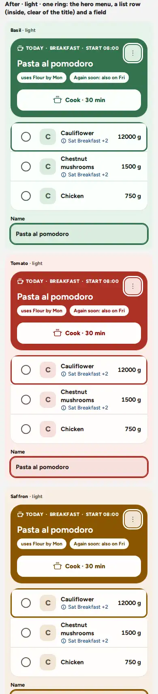
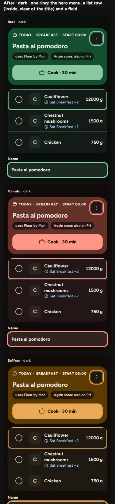
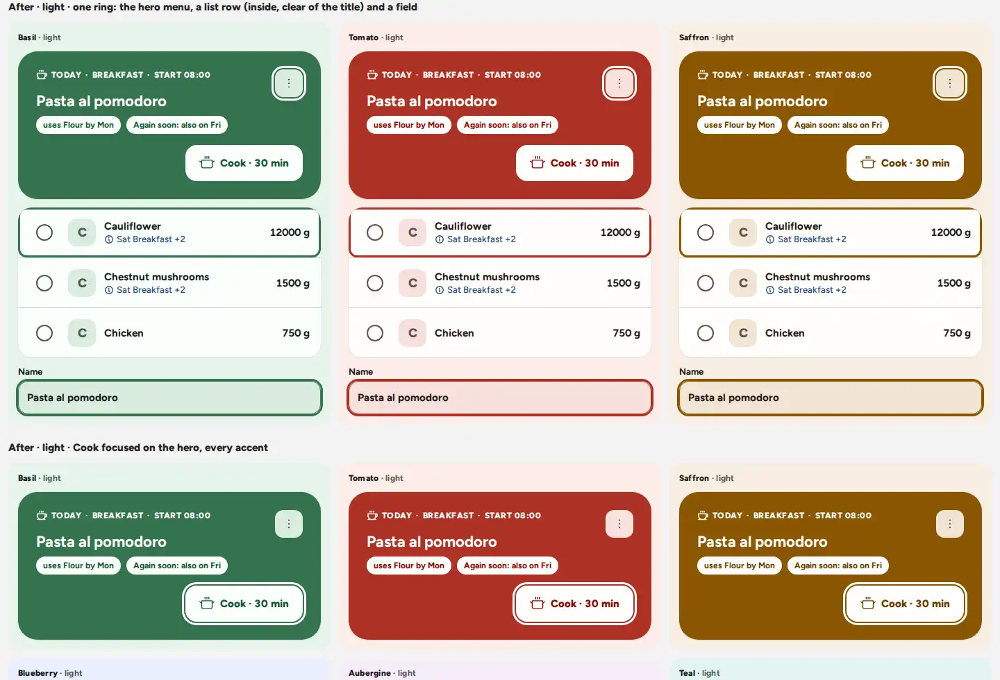
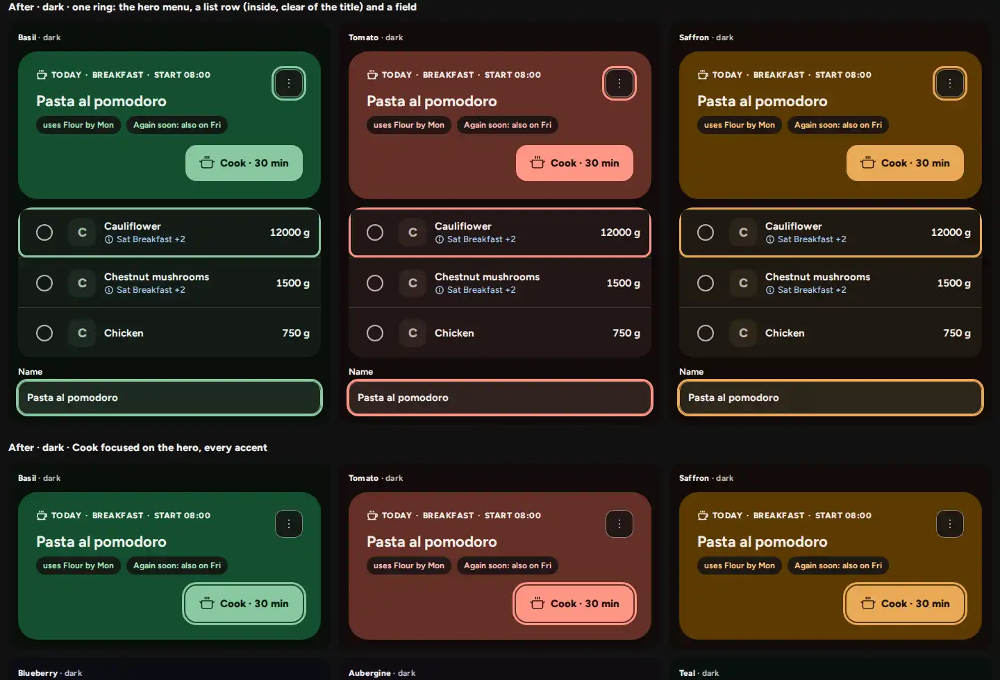
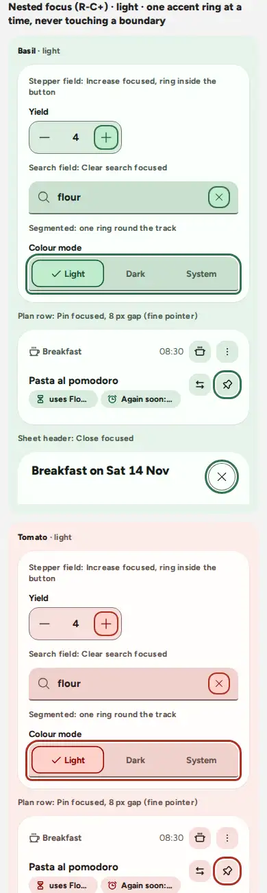
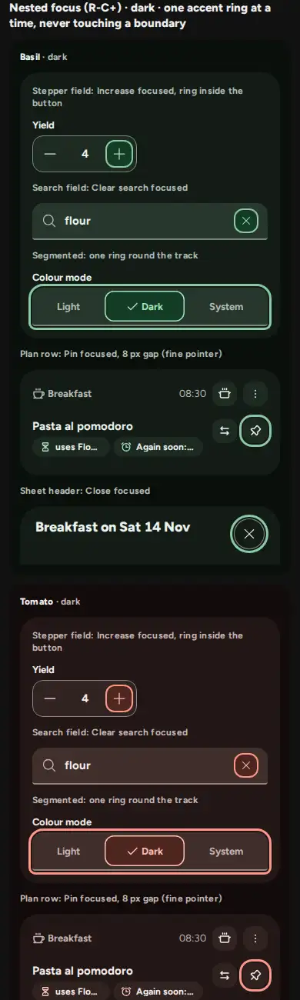
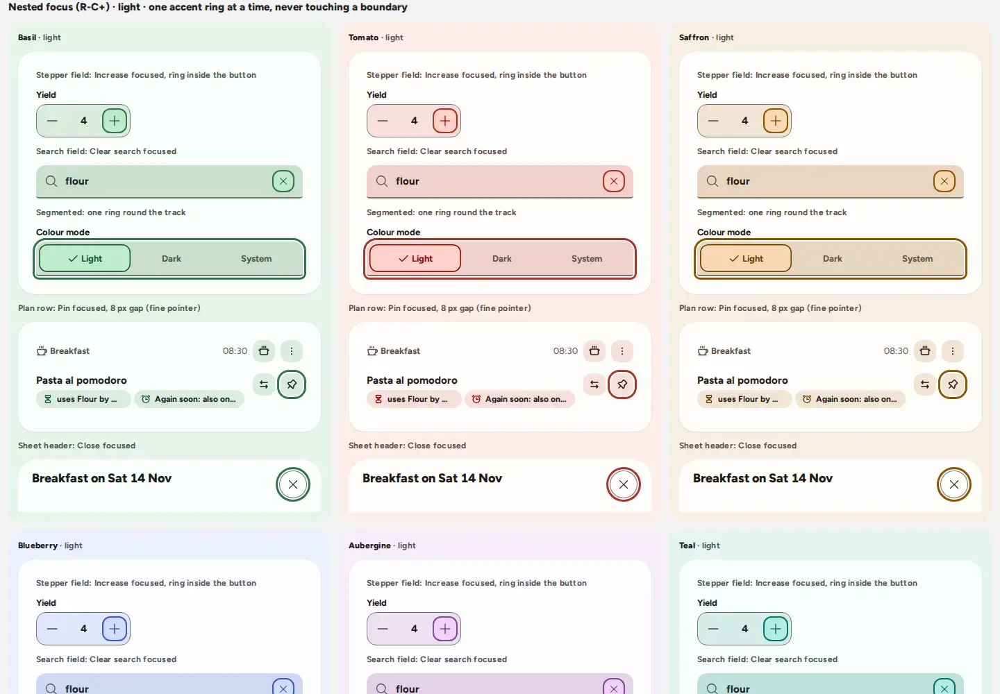
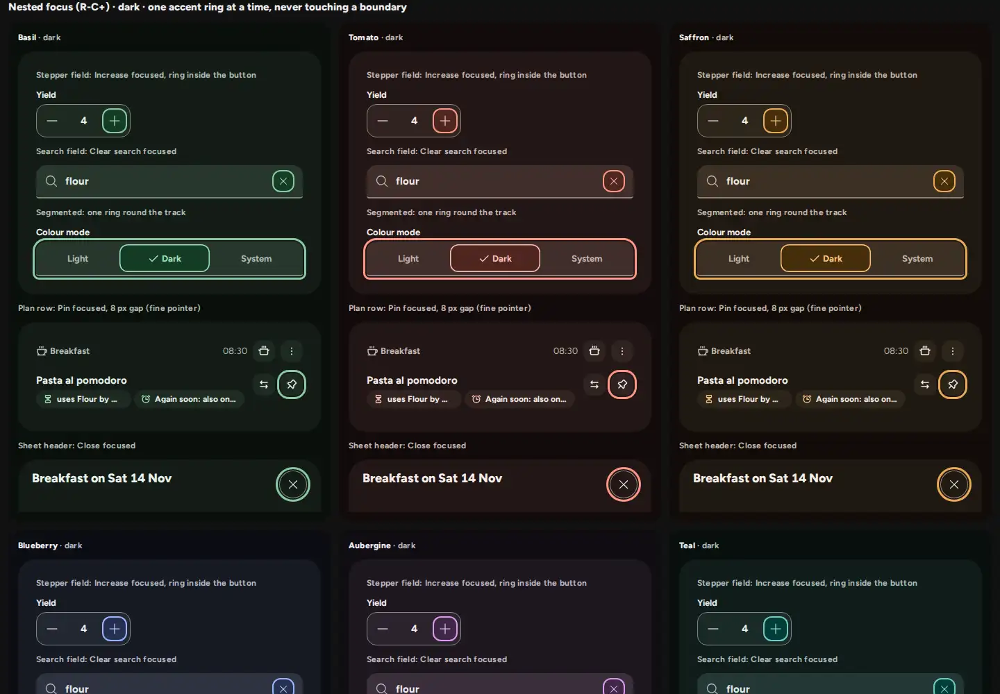

Mocks:
- [mocks/a11y-02-focus-ring.html](mocks/a11y-02-focus-ring.html)
- [mocks/a11y-02-nested-focus.html](mocks/a11y-02-nested-focus.html)

The `data-mock-focus`, `data-mock-focus-inner` and `data-mock-track-focus` attributes only draw several rings at once for the pictures.

### Alternatives considered
- **A two-tone ring everywhere** (an inner `--color-surface` ring plus an outer accent ring). It needs no overrides, but it doubles the ring's footprint and still fuses with a container's boundary.
- **Keep the outer ring on nested controls and enlarge the containers.** It would need 9 px of padding in every pill and field frame. Field frames would grow from 48 to 54 px.

### Build notes
- **`styles.css`:** add the tokens to `:root`; replace line 384 with the `:where(:focus-visible)` rule; remove `--focus-ring` (line 5).
- **`web/src/ui/**.css`:** every `:focus-visible` rule and the 9 box-shadow rings listed above. In particular:
  - `ui/fields/Field.css`, `SearchField.css`, `TimeField.css`: the frame-rings-on-text-entry rule and the nested rule;
  - `ui/fields/Segmented.css`: the track ring;
  - `ui/Tile.css`, `ui/Toast.css`: the colour overrides;
  - `ui/BottomSheet.css`, `ui/Dialog.css`: ring room, shared with DS (serialise);
  - `ui/IconButton.css`: no ring of its own.
- **`data-focus-scope`:** an attribute for primitives that wrap buttons. PC's timer pill and rail tile add it in PC's files.
- **Feature CSS with a ring of its own:** each line becomes the token, or is deleted where the primitive already covers it.
  - `features/shop/shop.css:273–276, 374–377`
  - `features/settings/settings.css:203–206`
  - `features/settings/mealSlotCards.css:200, 238, 317`
  - `features/recipes/recipes.css:1031–1035`
  - `features/import/import.css:119, 394`
  - `features/ingredients/ingredients.css:61`
  - `features/signin/signin.css:50`
- **`features/plan/components/TonightHero.css`:** shared with A11Y-03.
- **Scope:** the shared change touches every screen. Nothing else changes visually.

### Tests and guard
- **Unit, `theme/contrast.test.ts`.** A new block, "Focus ring on every container (A11Y-02)", for every preset × scheme. Each pair must reach ≥ 3:
  - `accent` on `bg`, `surface`, `surface2`, `surface3` and `soft` (the soft pair is also the inner ring on its focused fill);
  - `accent` on each status `bg` and on the info `bg`;
  - `onAccent` on `accent`;
  - `accent` on `softStrong`;
  - `bg` on `text`.
- **Unit, `ui/fields/focusRing.css.test.ts`** (extend):
  - no `box-shadow: var(--focus-ring)` anywhere in `web/src`;
  - no `:focus-visible` rule sets `outline: none` outside the allow-list (`.ui-field__input`, `.search-field__input`, `.ui-field__textarea`, `.time-field__segment`, `.segmented__option`);
  - every `:focus-visible` outline uses `var(--focus-ring-color)`;
  - `.ui-field__control` and `.search-field__control` have no `:focus-within` ring;
  - the nested rule uses `--focus-ring-inner-width` at a negative offset;
  - `.sheet__body` and `.dialog__body` declare the 5 px `padding-block` and `scroll-padding-block`.
- **Real layout, a `ds-layout` fixture.** Stepper field with + focused, Search with Clear focused, and a `data-focus-scope` pill with a focused button:
  - exactly one element has an accent-coloured outline;
  - the container's border colour equals `--color-outline`;
  - the child's box lies at least 4 px inside the container's border box.
- **BDD:**
  - Scenario: The Cook button on the Today hero shows a visible ring when focused by keyboard
  - Scenario: A focused list row's ring does not touch its title
  - Scenario: The first field of a sheet shows its whole ring under the sheet's header
  - Scenario: Focusing the Increase button of a stepper field shows one ring, inside the button
- **Guards:**
  - `scripts/check-ui.sh` rule `focus-ring` (fails in `web/src/ui` and the redone screens, warns elsewhere): a `--focus-ring` box-shadow, or `outline: none` inside a `:focus-visible` block outside the allow-list.
  - Page-layout probe P20, "ring room". In every sheet scenario of the quick profile, Tab through the controls. Each focused control's ring box (grown by 5 px for an outer ring) must lie inside every non-`visible`-overflow ancestor and must not intersect a sticky or fixed bar. Two visible accent-coloured outlines at once is a finding.

### Depends on / unblocks
- Goes with A11Y-03 (same hero file).
- Unblocks A11Y-04 (forced colours need outline rings) and A11Y-05 / A11Y-09 (the field and stepper focus states).
- PC's R-C and R-C+, and DS's sheet primitives, refer to this rule.

## A11Y-03  The Today hero follows the OS scheme, not the chosen one (new in stage 2)

**Severity** S2 · **Size** XS · **Sources** new in stage 2 · **Reproduced** New. Measured with Basil:
- The User chose **Dark** on a light OS: the hero is the pastel accent `#89c8a0` (system.md says soft-strong), the Cook button is the dark surface, and the ring is 1.00:1.
- The User chose **Light** on a dark OS: the hero turns soft-strong `#9addb2` with the text colour, a light-mode hero that system.md does not define.

**Where** `/` Today hero; every size; whenever the User's Colour mode differs from the OS (Light or Dark chosen; System is unaffected)

### Problem
`features/plan/components/TonightHero.css:163–181, 207–215` styles the dark hero under `@media (prefers-color-scheme: dark) :root:not([data-theme='light'])` and `:root[data-theme='dark']`. Nothing in the app ever sets `data-theme`. `theme/apply.ts:9` sets `data-scheme`, and resolves System to light or dark. So the hero obeys the OS, not Your preferences. That breaks system.md §2 "The hero", glares at night for a User who chose Dark, and hides the focus ring (A11Y-02).

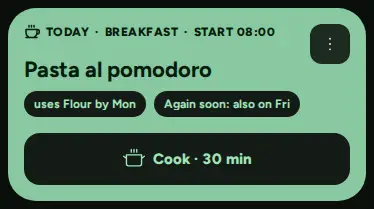
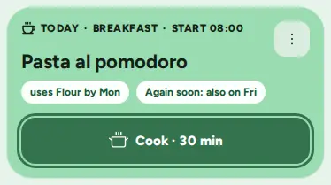

### Design
**Behaviour.** The hero follows the chosen Colour mode, exactly as system.md §2 already says:
- light: accent solid with on-accent text;
- dark: `--color-soft-strong` with `--color-text`, and the Cook button accent solid.

The after picture is the existing documented design, rendered from the app with a matching OS:

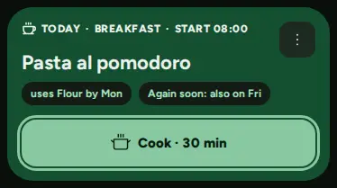

**CSS** (replaces the media-query and `data-theme` blocks):
```css
[data-scheme='dark'] .tile.plan-hero { background: var(--color-soft-strong); color: var(--color-text); --focus-ring-color: var(--color-accent); }
[data-scheme='dark'] .tile.plan-hero .button[data-variant='primary'] { background: var(--color-accent); color: var(--color-on-accent); }
[data-scheme='dark'] .plan-hero .plan-course__caption { color: color-mix(in srgb, var(--color-text) 85%, transparent); }
```
The `.tile.plan-hero` (0,3,0) beats `.tile[data-variant='hero']`, and `.button[data-variant='primary']` (0,5,0) beats `ui/Button.css:76` (0,4,0) regardless of order.

**Accessibility.** The ring on the dark hero is 4.93–5.02:1 (table). The text and on-accent pairs are already covered by `contrast.test.ts` (`accentText/softStrong`, `onAccent/accent`).

No mock beyond the after image: the target is the documented design.

### Build notes
`features/plan/components/TonightHero.css` only. That file belongs to the PC theme's screens, so it is serialised with PC's packages.

### Tests and guard
- Unit: `TonightHero.scheme.css.test.ts` asserts the file contains no `data-theme` and no `prefers-color-scheme`.
- Guard: `scripts/check-ui.sh` rule `scheme-attr` fails any `data-theme` selector in `web/src`. The scheme attribute is `data-scheme`, and a `prefers-color-scheme` query outside `styles.css` is flagged too.
- Guard: page-layout probe on `/` with OS light and `scheme: 'dark'` preferences: the hero's computed background equals `--color-soft-strong`.
- BDD: Scenario: A User who chose Dark sees the dark Today hero on a device set to light

### Depends on / unblocks
Ships with A11Y-02.

## A11Y-04  Forced-colours layer for the primitives

**Severity** S2 · **Size** M · **Sources** CROSS-03 · **Reproduced** Confirmed in Chromium with forced colours emulated (dark scheme, 390 and 1280):
- **Focus is lost.** Focused controls compute to `outline=none, shadow=none`: the Shop tick, the Pantry Sort Select, the Pantry search and the editor's Name field.
- **Accent swatches are invisible.** The 7 swatches compute to `background rgb(0,0,0)` with no border.
- **Choices are invisible.** Light / Dark / System shows no selected option.
- **Buttons lose their shape.** They have `border: none`, so Cooked, Adjust and Save Recipe render as bare words.
- **The current nav item** is shown only by its yellow LinkText colour.

**Where** every screen with a field, Select, Segmented, swatch, Switch, Checkbox or button; every size

### Problem
In forced colours (Windows High Contrast and similar), people cannot see focus, cannot pick an accent, cannot tell which Colour mode or Units is chosen, and cannot see where a button is. This fails WCAG 2.4.7, 1.4.11 and 1.3.1.

The causes:
- There is no `forced-colors` rule anywhere in `web/src`.
- The swatches are drawn only by an inline `background` (`ui/fields/ColorSwatches.tsx`), which forced colours replace.
- The selected states are background-only.

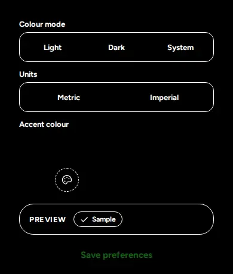
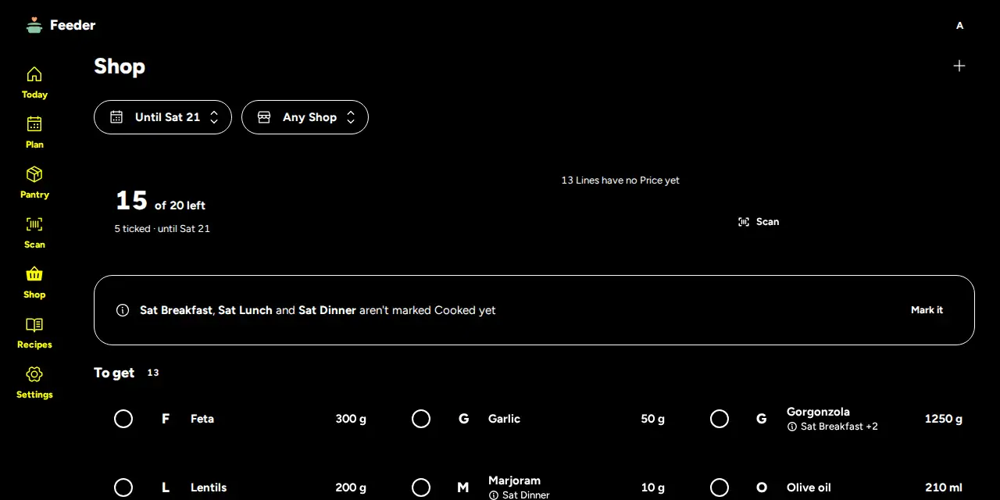

### Design
**Rule** (a new system.md §2 paragraph, "Forced colours"):
> **Forced colours.** The primitives carry one `@media (forced-colors: active)` layer (`ui/forcedColors.css`). Controls get a 1 px `ButtonText` border; the ruled Search field and Segmented track (A11Y-05) keep a 2 px `ButtonText` bottom rule on top of it; tiles, list groups, the bottom bar and toasts get a 1 px `CanvasText` border. A selected, pressed, checked or current state is `Highlight` with `HighlightText`. Colour swatches keep their colour (`forced-color-adjust: none`) with a `CanvasText` border, and the chosen one a `Highlight` ring. Disabled is `GrayText`. Every focus ring, outer or nested (A11Y-02), is an outline in `Highlight`. Features add no forced-colours rules of their own.

**CSS** (key lines; the full block is in the mocks):
```css
@media (forced-colors: active) {
  .button, .icon-button, .chip, .choice-chip, .your-menu-button, .line-row__tick,
  .search-field__control, .segmented, .stepper__value, .price-keypad__key, .switch { border: 1px solid ButtonText; }
  .search-field__control, .segmented { border-block-end: var(--field-rule-width) solid ButtonText; }
  .tile, .list-group, .bottom-bar, .toast { border: 1px solid CanvasText; }
  .segmented__option[aria-checked='true'], .icon-button[aria-pressed='true'], .choice-chip[aria-pressed='true'],
  .chip[aria-pressed='true'], .checkbox__box[data-state='checked'], .checkbox__box[data-state='mixed'],
  .switch[aria-checked='true'] {
    forced-color-adjust: none !important; background: Highlight !important; color: HighlightText !important; border-color: Highlight !important; }
  .colour-swatch { forced-color-adjust: none; border: 1px solid CanvasText; }
  .colour-swatch[aria-checked='true'] { box-shadow: none; outline: 3px solid Highlight; outline-offset: 3px; }
  .bottom-bar__link[aria-current='page'], .side-rail__link[aria-current='page'] .side-rail__pill { forced-color-adjust: none; background: Highlight; color: HighlightText; }
  .switch__thumb { forced-color-adjust: none; background: ButtonText; }
  .switch[aria-checked='true'] .switch__thumb { background: HighlightText; }
  :disabled, [aria-disabled='true'] { color: GrayText; border-color: GrayText; opacity: 1; }
  :focus-visible,
  .ui-field__control:has(:is(input, textarea, [role='spinbutton']):focus),
  .search-field__control:has(input:focus),
  .segmented:has(.segmented__option:focus-visible) { outline-color: Highlight; }
}
```
- `!important` is allowed only in this file. The selected state must beat every variant rule, such as the filter chip's accent fill.
- **Nested controls.** A nested control (stepper − / +, Clear search) keeps its 2 px inner ring, in `Highlight`. Its soft focus fill becomes `Canvas`, so the ring alone marks it, and it is visible.
- **The Check icon** (A11Y-06) also shows in forced colours.

**Behaviour** (390 and 1280):
- every focused control has a `Highlight` ring;
- the chosen Colour mode, Units and Storage Place / Ingredient view are `Highlight`;
- the swatches are visible circles in their own colours, and the chosen one has a ring;
- buttons, ticks, tiles and the current nav item are outlined or highlighted.

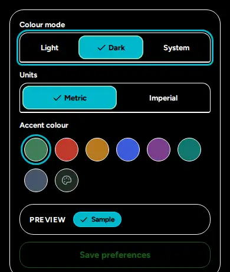
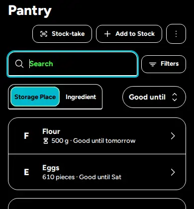
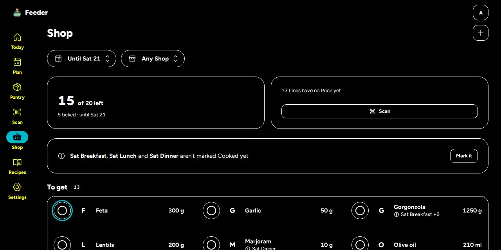

Mocks (render them with forced colours on):
- [mocks/a11y-04-forced-prefs.html](mocks/a11y-04-forced-prefs.html)
- [mocks/a11y-04-forced-pantry.html](mocks/a11y-04-forced-pantry.html)
- [mocks/a11y-04-forced-shop.html](mocks/a11y-04-forced-shop.html)

### Build notes
- **New file:** `web/src/ui/forcedColors.css`, imported last by `ui/index.ts`. No other file changes.
- **Dependencies:** A11Y-02's outline rings, and A11Y-05's `--field-rule-width`.

### Tests and guard
- **Real layout.** `scripts/test/ds-layout_test.sh` gets a fixture, `forced-colors.html`, run in headless Chrome with forced colours set through CDP `Emulation.setEmulatedMedia`. The fixture holds Button, IconButton (pressed and not), Segmented, ColorSwatches, Switch, Checkbox, a TextField, a stepper field, a SearchField and a Select. Assertions:
  - each control focused by keyboard has `outline-style` ≠ `none`, including the stepper's + button and Clear search;
  - the selected Segmented option's background equals `Highlight`;
  - each swatch has a 1 px border and its own background;
  - the SearchField's bottom border is 2 px.
- **Unit.** `ui/forcedColors.css.test.ts`: every `aria-pressed`, `aria-checked` and `aria-current` selector in `ui/*.css` has a counterpart in `forcedColors.css`.
- **BDD.** Scenario: In forced colours the chosen Colour mode and accent are visible

### Depends on / unblocks
- Depends on A11Y-02 and A11Y-05.
- Pairs with A11Y-06, which uses the same selectors.

## A11Y-05  The Search field and the Segmented track show their boundary at rest

**Severity** S3 (corrected from S2) · **Size** S · **Sources** CROSS-04 (its Segmented-selection part is closed by A11Y-06) · **Reproduced** Confirmed, narrower than reported.
- **Most fields already pass.** TextField, TextArea, Select (field), DateField, the Stepper field and Checkbox have a 1.5–2 px `--color-outline` border at rest, at 3.72–4.86:1. The stage-1 probe read `+"1.5px"` as `NaN`, so it reported every bordered field as borderless.
- **The SearchField fails.** It has no border, and its fill is 1.09:1 on bg in light and 1.30:1 in dark.
- **The Segmented track fails.** Its border is `transparent`, and its fill is 1.09–1.30:1.
- **Why the severity drops to S3:** both are still identified by their text (the "Search" placeholder with its magnifier, and the option labels).

**Where** the `/pantry`, `/recipes` and `/shop` toolbars; Your preferences; the editor's Step Kind and Units fields; Import's "Read from"; every size; both schemes

### Problem
In a toolbar, a low-vision User sees a framed Select next to a frameless search box and a frameless Segmented, so the frameless two read as decoration (WCAG 1.4.11 practice). The two outliers are `ui/fields/SearchField.css:2–12` (no border) and `ui/fields/Segmented.css:6` (`border: … transparent`).

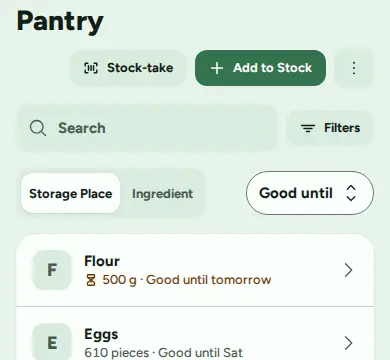
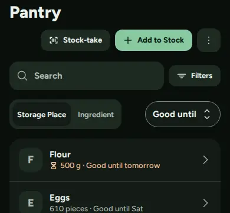

### Design
**Decided (decision 1, option B).** The Search field and the Segmented track become a **ruled** shape: a stronger fill plus a 2 px bottom rule.
- The fill uses the existing palette token `--color-surface-3`, so no new colour is introduced.
- Three semantic tokens go in `ui/fields/Field.css` `:root`, next to `--field-border-width`.

```css
:root {
  --field-fill-strong: var(--color-surface-3);
  --field-rule-width: 2px;
  --field-rule-color: var(--color-outline);
  --field-radius-ruled: var(--radius-control) var(--radius-control) var(--space-1) var(--space-1);
}
.search-field__control,
.segmented {
  background: var(--field-fill-strong);
  border: 0;
  border-block-end: var(--field-rule-width) solid var(--field-rule-color);
  border-radius: var(--field-radius-ruled);
}
.search-field__control:hover,
.segmented:not([data-disabled]):hover { background: color-mix(in oklab, var(--field-fill-strong), var(--color-text) 6%); }
.search-field__control:has(input:focus) { border-block-end-color: var(--color-accent); }
.segmented[data-disabled],
.search-field__control:has(:disabled) {
  background: transparent; border: 0;
  border-block-end: var(--field-rule-width) solid var(--color-line); color: var(--color-muted); }
.segmented[data-disabled] .segmented__option[aria-checked='true'] {
  background: transparent; color: var(--color-text);
  box-shadow: inset 0 0 0 var(--field-border-width) var(--color-outline); }
```

**States of the ruled shape**
- **Rest.** `surface-3` fill with a 2 px `--color-outline` rule along the bottom edge. The top corners use `--radius-control`; the bottom corners are 4 px.
- **Hover** (pointer). The fill darkens by 6 % toward `--color-text`.
- **Focus** (A11Y-02):
  - *Search, input focused:* the outer ring goes round the whole shape at offset 0, and the rule turns accent.
  - *Search, Clear search focused:* a nested control. It gets a 2 px inner ring on a soft fill (6.5 px of fill around it), and the frame stays neutral, so there is one ring.
  - *Segmented:* one outer ring round the track. The options draw none.
- **Disabled.** No fill. The rule is in `--color-line` and the text in `--color-muted`; disabled controls are exempt from 1.4.11. The selected option of a disabled Segmented keeps today's 1.5 px outline ring.
- **Forced colours** (A11Y-04). A 1 px `ButtonText` frame plus the 2 px `ButtonText` bottom rule; the ring is `Highlight`.
- **Error.** These controls have no error state.
- **Sizes.** Every shape stays 48 px high. Nothing differs per size class.

**Next to the bordered fields.** TextField, TextArea, Select, DateField, TimeField, the Stepper field and Checkbox **keep their 1.5 px `--color-outline` frame**.
- A **framed** control means "enter or pick a value". A **ruled** one means "search, or switch between a few views and choices".
- The mock shows both on one form: the Pantry toolbar (ruled Search and Segmented beside the framed "Good until" Select), and the recipe editor (ruled Step Kind beside a framed Ingredient Select, a Checkbox and the framed Details fields).

**Selected option inside the ruled track** (A11Y-06). The `soft` fill is only 1.00–1.06:1 on `surface-3`, but the fill is not what marks the choice. The **1.5 px accent-text ring** carries the state: 6.32–6.96:1 in light and 8.03–8.52:1 in dark. Unselected option text is `--color-muted`, at 5.22–5.29 (light) and 6.30–6.37 (dark).

**Contrast for every accent × scheme.** "Tile" is `surface`, the page is `bg`, and a sheet section is `surface-2`.

| Accent | Scheme | Fill surface-3 on bg / surface / surface-2 (not relied on) | Rule (outline) on its fill surface-3 / page bg / tile surface | Text / muted on surface-3 | Selected ring (accent-text) on surface-3 / soft fill on surface-3 |
|---|---|---|---|---|---|
| Basil | light | 1.23 / 1.38 / 1.13 | **3.28** / 4.05 / 4.53 | 12.35 / 5.22 | 6.32 / 1.06 |
| Tomato | light | 1.25 / 1.41 / 1.13 | **3.31** / 4.13 / 4.67 | 12.20 / 5.28 | 6.96 / 1.04 |
| Saffron | light | 1.24 / 1.40 / 1.13 | **3.29** / 4.07 / 4.60 | 12.24 / 5.29 | 6.61 / 1.04 |
| Blueberry | light | 1.24 / 1.39 / 1.13 | **3.30** / 4.09 / 4.60 | 12.27 / 5.27 | 6.81 / 1.05 |
| Aubergine | light | 1.25 / 1.41 / 1.14 | **3.30** / 4.13 / 4.66 | 12.10 / 5.26 | 6.89 / 1.04 |
| Teal | light | 1.23 / 1.38 / 1.13 | **3.30** / 4.06 / 4.55 | 12.31 / 5.26 | 6.33 / 1.06 |
| Slate | light | 1.24 / 1.39 / 1.13 | **3.30** / 4.10 / 4.58 | 12.22 / 5.25 | 6.48 / 1.05 |
| Basil | dark | 1.54 / 1.39 / 1.19 | **3.50** / 5.40 / 4.86 | 10.90 / 6.30 | 8.49 / 1.02 |
| Tomato | dark | 1.52 / 1.38 / 1.18 | **3.49** / 5.30 / 4.80 | 11.04 / 6.37 | 8.16 / 1.01 |
| Saffron | dark | 1.53 / 1.38 / 1.19 | **3.46** / 5.29 / 4.78 | 10.95 / 6.32 | 8.21 / 1.01 |
| Blueberry | dark | 1.53 / 1.39 / 1.19 | **3.47** / 5.32 / 4.81 | 10.90 / 6.31 | 8.23 / 1.01 |
| Aubergine | dark | 1.52 / 1.38 / 1.19 | **3.47** / 5.28 / 4.78 | 10.96 / 6.35 | 8.03 / 1.02 |
| Teal | dark | 1.54 / 1.39 / 1.19 | **3.49** / 5.37 / 4.84 | 10.92 / 6.35 | 8.52 / 1.02 |
| Slate | dark | 1.53 / 1.37 / 1.18 | **3.50** / 5.34 / 4.80 | 11.03 / 6.36 | 8.32 / 1.00 |

**Palette guard** (`theme/palette.ts:121`). Change the outline guard to `outline: guard(raw.outline, [raw.surface, raw.surface2, raw.surface3, raw.bg], MIN_BOUNDARY)`. For the 7 presets this changes nothing (their minimum is 3.28); it protects custom accents.

**system.md §2.** Add two rows:
- **Field boundary, framed:** `--color-outline`, 1.5 px all round. Used by TextField, TextArea, Select, DateField, TimeField, Stepper field and Checkbox. At least 3:1 on bg, surface and surface-2.
- **Field boundary, ruled:** a `--field-fill-strong` (surface-3) fill plus a 2 px `--field-rule-color` bottom rule. Used by the SearchField and the Segmented track only. The rule is at least 3:1 on surface-3, bg and surface.

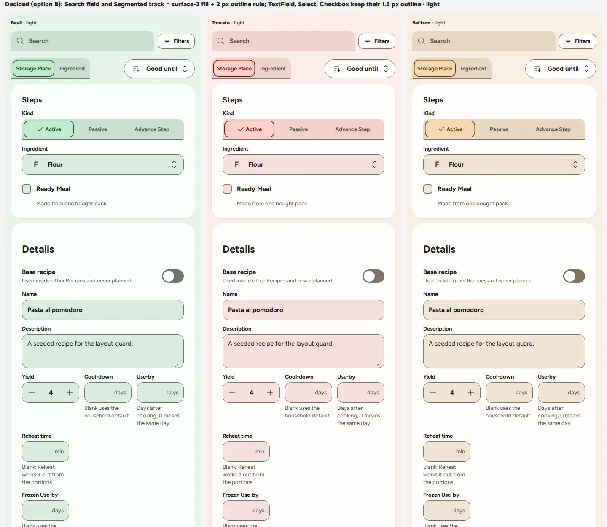
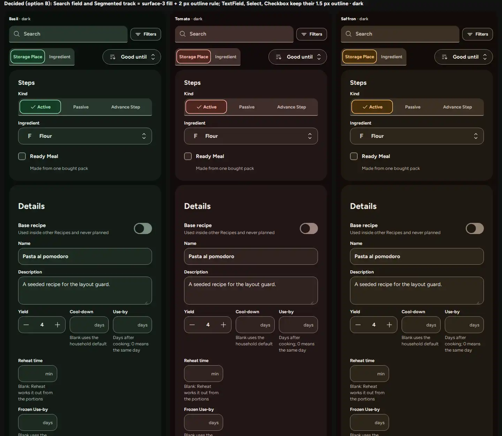
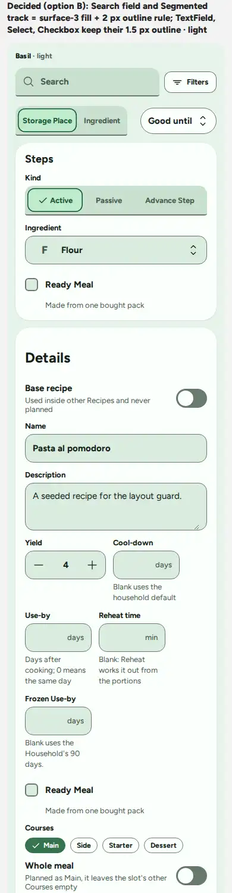
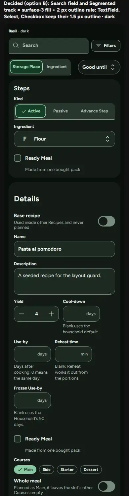
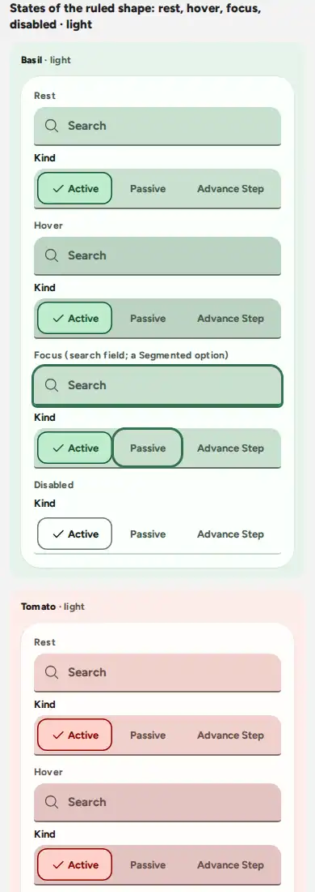
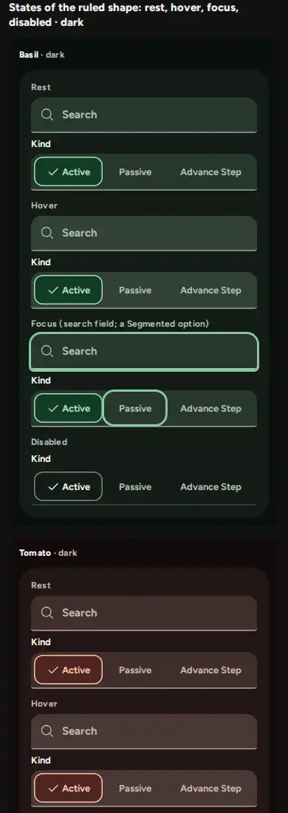

- **State renders at 1440:** [light](shots/a11y-05-after-states-1440-light.webp), [dark](shots/a11y-05-after-states-1440-dark.webp).
- **Nested focus inside the ruled field:** see A11Y-02's nested-focus renders.
- **Mock:** [mocks/a11y-05-field-boundaries.html](mocks/a11y-05-field-boundaries.html).

### Alternatives considered
- **Option A, a 1.5 px outline** (recommended, not chosen): [light](shots/a11y-05-opta-1440-light.webp), [dark](shots/a11y-05-opta-1440-dark.webp).
- **A fill strong enough to reach 3:1 on its own.** It would need oklch L ≈ 0.63 in light and 0.51 in dark, which drops the muted placeholder to 2.1:1. Rejected.

### Build notes
- **Files:** `ui/fields/Field.css` (tokens), `ui/fields/SearchField.css`, `ui/fields/Segmented.css`, `theme/palette.ts`. Shared primitives only.
- **Screens that pick it up:** every toolbar and every Segmented (Pantry, Recipes, Shop, Supplies, Products, Ingredients, Your preferences, the recipe editor, Import, Planning rules).

### Tests and guard
- **Unit, `theme/contrast.test.ts`.** Add to `BENTO_PAIRS`:
  - `['outline', 'surface3', 3, 'ruled field: rule / its surface-3 fill']`
  - `['outline', 'bg', 3, 'ruled field: rule / page']`
  - `['outline', 'surface2', 3, 'outline / surface-2']`
  - `['muted', 'surface3', 4.5, 'Segmented option label / ruled track']`
  - `['text', 'surface3', 4.5, 'search text / ruled fill']`
  - `['accentText', 'surface3', 3, 'selected ring / ruled track']`
  - `['accent', 'surface3', 3, 'focus ring / ruled fill']`
- **Unit, `ui/fields/field-css.test.ts`.**
  - SearchField and Segmented declare the ruled fill, rule and radius at rest.
  - The framed fields keep their `--color-outline` frame.
  - The SearchField's frame rings only on `:has(input:focus)`.
- **Real layout, a `ds-layout` fixture.** A SearchField on `--color-bg` and on `--color-surface` has a 2 px bottom border at ≥ 3:1 against its fill and against the page or tile below it. With Clear search focused, exactly one accent outline is visible.
- **BDD:**
  - Scenario: The Pantry search field and view switch show their bottom rule before they are focused
  - Scenario: The chosen Pantry view is marked by its ring inside the ruled track

### Depends on / unblocks
- Implements decision 1.
- Uses A11Y-02 (focus), A11Y-06 (selected) and A11Y-04 (`--field-rule-width`).

## A11Y-06  One selected / pressed state at 3:1, with a non-colour cue

**Severity** S2 · **Size** S · **Sources** RECIPES-11, SETTINGS-19, SETTINGS-07 · **Reproduced** Confirmed.
- **Segmented:** the selected fill against the track is 1.22:1 in light (`#fafffc` on `#daecdf`) and **1.17:1** in dark (`#131c16` on `#1e2a22`). The selected and unselected text colours are only 2.36:1 (light) and 1.73:1 (dark) apart.
- **Exclusion toggle (SETTINGS-07):** pressed `soft` against unpressed `surface-2` is **1.06–1.09:1 in light and 1.16–1.21:1 in dark** for every accent. This is narrower than stage 1 said: the pressed glyph does change to the Phosphor fill weight (`ui/IconButton.tsx:30`), but no text says who excludes the Ingredient.
- **ChoiceChip** (`ui/ChoiceChip.css:31–35`): it uses the same pair, pressed `soft` on `surface-2`, computed at 1.06–1.21:1.

**Where** Segmented (Colour mode, Units, Recipes / Base recipes, Step Kind, Import "Read from", "Rule is for", the Pantry view); ChoiceChip ("What is this?" Lines, Swap choices); toggle IconButtons (the Ingredient page's Exclusions, the Recipe line's Exclusions); every size; both schemes

### Problem
A sighted User cannot tell which Colour mode is chosen in dark mode, or who excludes an Ingredient, even though the planner acts on it. This fails WCAG 1.4.11 and 1.4.1.

Each primitive invented its own selected look, and none passes 3:1:
- `ui/fields/Segmented.css:51–55`: a surface fill plus `--elev-1`, which is `none` in dark;
- `ui/IconButton.css:31–34`: a soft fill;
- `ui/ChoiceChip.css:31–35`: a soft fill and border.

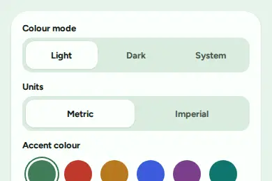
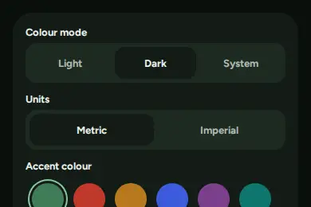
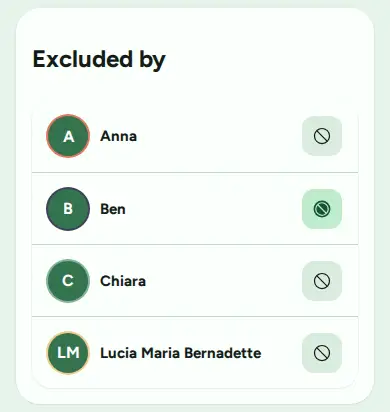
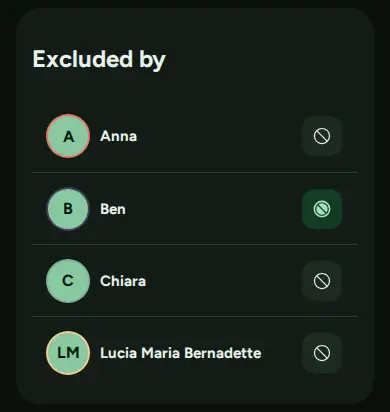

### Design
**Decided (decision 2): accent container, ring, and a Check or filled icon.**

**Rule** (new system.md §2 row "Selected"):
> **Selected / pressed.** A selected Segmented option, a pressed ChoiceChip and a pressed toggle IconButton are the accent container (`--selected-bg` = `--color-soft`, `--selected-fg` = `--color-accent-text`) with a `--selected-ring-width` (1.5 px) ring inside the edge in `--selected-ring` (= `--color-accent-text`). The ring, not the fill, carries the state: it is ≥ 6.3:1 against the soft fill, the surface-2 surround and the surface-3 ruled track (A11Y-05) in every palette. A second, non-colour cue is present wherever it fits: the `selected` Check (Phosphor Check, bold, 16 px) before the label of a full-width Segmented option, the fill weight of the icon on an IconButton. **A Segmented option never wraps onto two lines**: options size to their label (`flex: 1 1 auto; white-space: nowrap`) and share the spare width; when the field is narrower than 18 rem, or the Segmented is compact (a toolbar), the Check is left out and the ring alone marks the choice.

**CSS:**
```css
.segmented__option[aria-checked='true'] {
  background: var(--selected-bg); color: var(--selected-fg);
  box-shadow: inset 0 0 0 var(--selected-ring-width) var(--selected-ring); }
.segmented__option { display: inline-flex; align-items: center; justify-content: center; gap: var(--space-1);
  flex: 1 1 auto; white-space: nowrap; }
.ui-field:has(> .segmented:not([data-compact])) { container-type: inline-size; }
@container (max-width: 18rem) {
  .segmented__check { display: none; }
  .segmented__option { padding-inline: var(--space-2); }
}
.icon-button[aria-pressed='true'], .choice-chip[aria-pressed='true'] {
  background: var(--selected-bg); color: var(--selected-fg); border-color: var(--selected-ring);
  box-shadow: inset 0 0 0 var(--selected-ring-width) var(--selected-ring); }
```
- Remove the `--elev-1` shadow from the selected Segmented option.
- The container query sits on the field, never on a compact Segmented. A compact Segmented is sized `max-content`, and `container-type` would collapse it (system.md §5.2).
- **Inside the ruled track (A11Y-05):** the `soft` fill is 1.00–1.06:1 on `surface-3`, which is acceptable because the ring carries the state. The ring sits inside the option, clear of the track's 2 px bottom rule.
- **Measured** at 390: Step Kind "✓ Active · Passive · Advance Step" and Colour mode both stay on one line. Before, "Advance Step" wrapped.

**Markup.**
- `Segmented.tsx` renders `<Icon name="selected" size={16} weight="bold" className="segmented__check" aria-hidden />` before the checked option's label when the Segmented is not `compact`.
- Add the alias `selected: CheckIcon` to `ui/icons.ts`.
- The radio's name stays the label, and `aria-checked` is unchanged.

**Exclusions** (decision 3, as recommended):
- The tile title "Excluded by" becomes **"Exclusions"**, and so does the section's `aria-label`.
- A one-line summary sits under the title, with the meta role. Its text depends on who excludes the Ingredient:

  | Who excludes it | Summary |
  |---|---|
  | One Member | **"Ben excludes Flour."** |
  | Two Members | **"Ben and Chiara exclude Flour."** |
  | Three or more | **"Ben, Chiara and 2 more exclude Flour."** |
  | Nobody | **"Nobody excludes Flour."** |

- Each excluding Member's row gets the meta **"Excludes Flour"**.
- The toggle is named **"Ben excludes Flour"** with `aria-pressed`.
- The summary comes from a pure function, `exclusionSummary(names, ingredient)`, in `features/recipes/lib/preference.ts`.

**States.** Loading and error keep today's Skeleton and ErrorState. With no Members, the tile shows today's EmptyState. Long Member names wrap per system.md §3.

**Contrast** of the selected ring:
- on the surface-2 track: 7.15–7.89 (light), 9.57–10.12 (dark);
- on the surface-3 ruled track: 6.32–6.96 (light), 8.03–8.52 (dark);
- on its soft fill: 6.72–7.26 (light), 8.21–8.36 (dark).

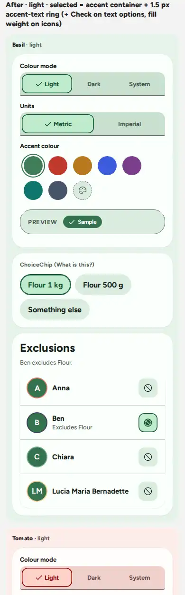
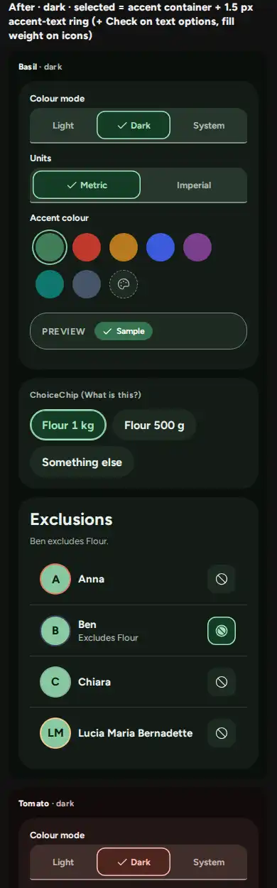
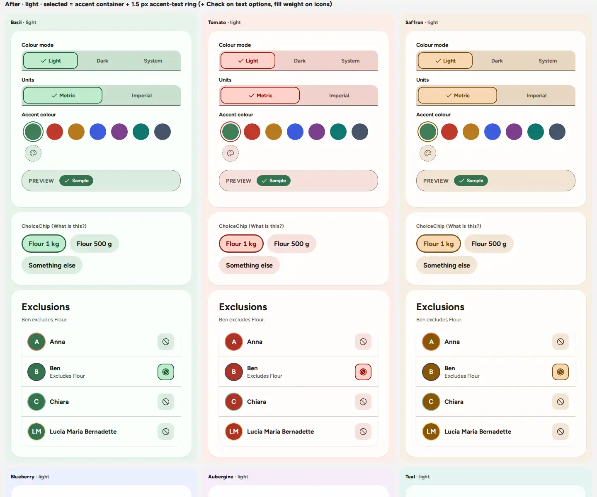
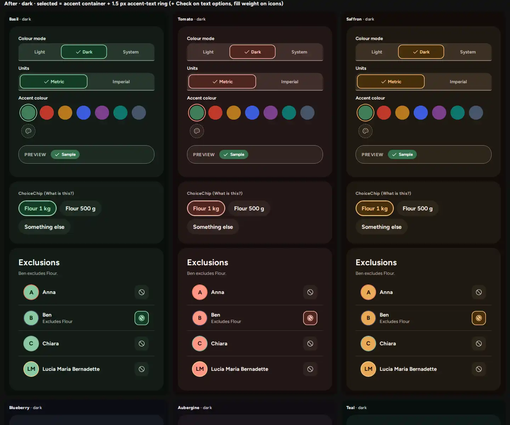

Mock: [mocks/a11y-06-selected-states.html](mocks/a11y-06-selected-states.html). Neutral alternative, not chosen: [light](shots/a11y-06-alt-neutral-1440-light.webp), [dark](shots/a11y-06-alt-neutral-1440-dark.webp).

### Build notes
- **Shared primitives:**
  - `ui/fields/Segmented.css` and `Segmented.tsx`;
  - `ui/IconButton.css` (the pressed state only);
  - `ui/ChoiceChip.css`;
  - `ui/icons.ts`.
- **Feature files:**
  - `features/recipes/components/IngredientExclusionList.tsx`;
  - `features/recipes/lib/preference.ts`;
  - `features/recipes/strings.ts:162` (`excludesToggle` without the colon, plus `excludesMeta` and the summary strings);
  - `features/ingredients/strings.ts:11` (`exclusions: 'Exclusions'`).
- **Reach:** every Segmented, ChoiceChip and toggle IconButton.

### Tests and guard
- **Unit, `contrast.test.ts`:** add `['accentText', 'surface2', 3]`, `['accentText', 'surface', 3]` and `['accentText', 'soft', 3]`. A11Y-05 adds `['accentText', 'surface3', 3]`.
- **Unit, `Segmented.selected.test.tsx`:**
  - the checked option of a full-width Segmented renders the `selected` icon, hidden from assistive technology;
  - a compact Segmented does not;
  - the name stays the label.
- **Unit, `Segmented.css` test:** options declare `white-space: nowrap`, and the `@container (max-width: 18rem)` rule hides `.segmented__check`.
- **Unit, `preference.test.ts`:** `exclusionSummary` for 0, 1, 2 and 4 Members.
- **Unit, `IngredientExclusionList.test.tsx`:** Ben's row shows the meta "Excludes Flour", and the toggle is named "Ben excludes Flour" with `aria-pressed="true"`.
- **BDD:**
  - Scenario: The chosen Colour mode is marked with a ring and a check in dark mode
  - Scenario: The Ingredient page says who excludes it
  - Scenario: At 320 px the Step Kind options stay on one line
- **Guard, `ui/ui-css.test.ts`:** no `[aria-checked='true']`, `[aria-pressed='true']` or `[data-selected='true']` rule in `web/src/ui` sets a background without `--selected-ring`. The ListRow selected row is exempt.
- **Guard, page-layout P11** (clipped or broken text): extend it to Segmented options, so an option whose text box is taller than one line is a finding.

### Depends on / unblocks
- Decisions 2 and 3.
- Ships with or after A11Y-02, and with A11Y-05.
- Unblocks A11Y-04's selected-state tests.

## A11Y-07  Where focus goes after a row leaves, a sheet opens or a sheet changes step

**Severity** S2 · **Size** M · **Sources** SHOP-02, SETTINGS-09 (this item also closes the focus part of PLAN-12, Pin; see A11Y-08) · **Reproduced** Confirmed at 1280, by keyboard:
- `/shop`: after Tick → "Tick and add to Stock", focus is on `BODY`. After Not needed from the row sheet, focus is on `BODY`.
- `/plan`: after Pin, focus is on `BODY`; after Unpin, again `BODY`.
- `/scan` "What is this?" for an unknown barcode: after More Lines, and after Something else, focus is on `BODY` **while the modal is open**.
- Settings › Meal Slots › Change a date: on open, focus goes from the title to the Date trigger and then to `BODY` (focus events traced).
- Pantry Throw out was not re-run, because my seed has no Stock Lot past its Good until date. The code has no focus handling (`features/stock/components/SpoiledTile.tsx`), and stage 1 measured `BODY`.

**Where** Shop, Pantry, Scan (and its sheets), Plan, Settings › Meal Slots; every size

### Problem
A keyboard or screen-reader User is thrown to the top of the page after every Tick, or left on `<body>` behind an open modal. This fails WCAG 2.4.3. The causes:
- **Row removal.** The focused element is removed and nothing picks a successor. The row moves to Ticked, a row is marked Not needed, or the Pin button is replaced by an Unpin button (`features/plan/components/PlanCourseRow.tsx:80–82`).
- **Sheet step change.** "What is this?" swaps its step content (`features/scan/components/NewProductLines.tsx`, `NewProductKind.tsx`), and the focused chip goes with it.
- **Remount in Change a date.** `features/settings/components/DateAttendancePanel.tsx:43–45` keys `DateForm` on the attendance answer, so the form remounts when the data arrives. The Date trigger that `useModalDialog` had just focused is replaced.
- **One-shot focus.** `ui/lib/useModalDialog.ts:35` focuses once, on mount, and never checks again.

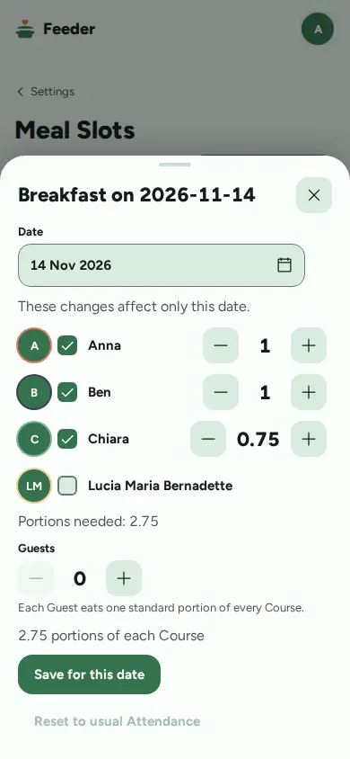

### Design
**Rules** (a new system.md §3 bullet and §11 text):

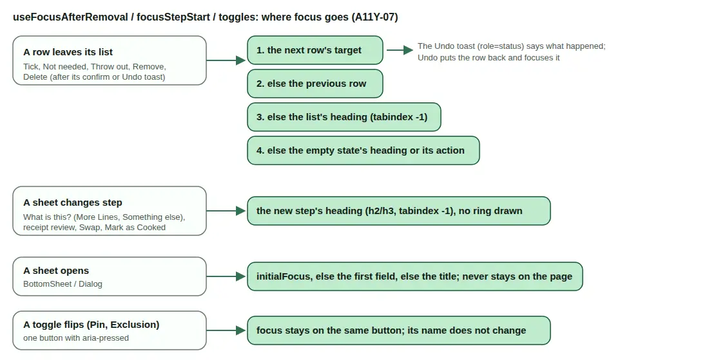

- **A row leaves its list** (Tick, Not needed, Throw out, Remove, Delete after its confirm). Focus goes to the first that exists:
  1. the next row's target in the same list;
  2. the previous row;
  3. the list's heading (`tabIndex=-1`);
  4. the empty state's heading.

  The SAFE theme's Undo toast says what happened. Undo puts the row back and focuses it.
- **A sheet changes step.** Focus goes to the new step's heading (`h2`/`h3`, `tabIndex=-1`, no ring drawn).
- **A sheet or dialog opens.** Focus goes to `initialFocusRef`, else the first field, else the title, as today. In addition, **while a modal is open, focus never rests on `<body>` or outside it**. If it does (after a remount), it returns to the same `initialFocus` target on the next frame.
- **A toggle flips** (Pin, Exclusion). It is one button with `aria-pressed`, so focus stays on it (A11Y-08).
- **The new focus is visible and unclipped** (A11Y-02 "never clipped").
  - The newly focused row or control is scrolled into view with `focus()` (no `preventScroll`).
  - Its scroll container's `scroll-padding` keeps it clear of sticky bars, so a focused row never lands under the Shop's sticky controls or a sheet's footer.
  - Programmatic focus on a heading has `preventScroll: false` too, but no ring.
- **Change a date.**
  - The sheet opens with focus on the Date field.
  - The title is formatted like the field: "Breakfast on Sat 14 Nov", not "Breakfast on 2026-11-14".
  - Close is the R-B circular outline button.
  - "Reset to usual Attendance" is an outlined secondary button, never bare text (R-A). Its behaviour is unchanged.
- **Sizes and schemes:** identical everywhere. The focused row shows the A11Y-02 ring.

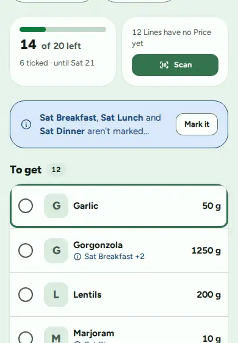
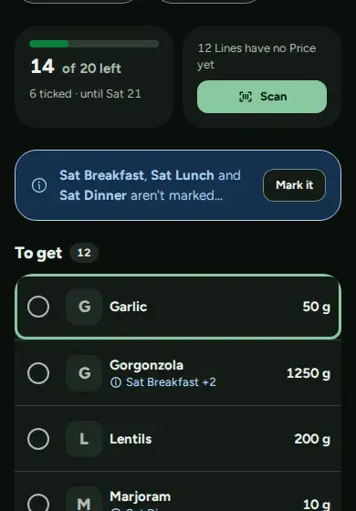
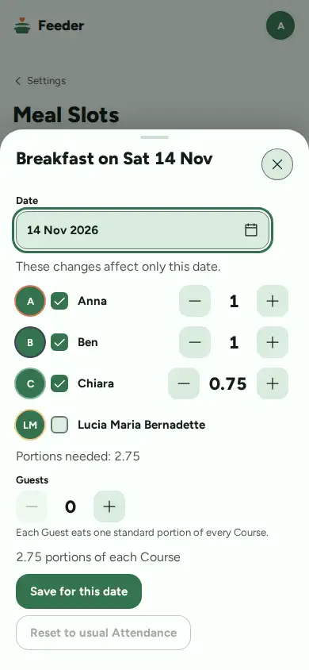
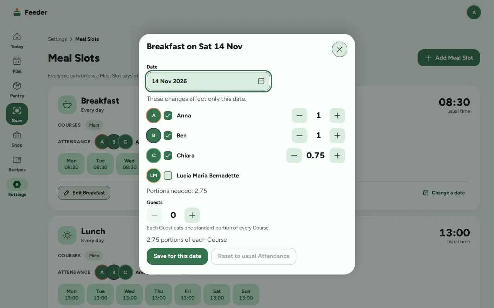

Mocks:
- Shop after a Tick: [light](mocks/a11y-07-shop-after-tick-light.html), [dark](mocks/a11y-07-shop-after-tick-dark.html).
- Change a date: [390](mocks/a11y-07-change-date-390.html), [1280](mocks/a11y-07-change-date-1280.html).
- Diagram: [mocks/a11y-07-focus-rules.html](mocks/a11y-07-focus-rules.html).

**Accessibility.** Meets 2.4.3. No ring is drawn on a heading that received programmatic focus.

### Build notes
- **`ui/ListRow.tsx`, `ListGroup`:** a built-in focus keeper.
  - On `focusin` it records the focused row's index and key.
  - After its children change, if `document.activeElement` is `body` or detached and that row is gone, it focuses index, else index − 1, else the group's heading.
  - The heading comes from a new optional prop, `headingId`. Without it, the group itself takes focus (`tabIndex=-1`, with its `aria-label`).
  - Helpers: a pure `ui/lib/focusSuccessor.ts` and a hook `ui/lib/useFocusKeeper.ts`.
- **`ui/lib/useModalDialog.ts`:** a `focusout` guard. On `relatedTarget === null`, it checks on the next animation frame and re-runs `initialFocus(dialog)` if focus has left the open dialog.
- **New `ui/lib/focusStepStart.ts`:** called on step change by `NewProductSheet` (SSP's files `features/scan/components/NewProductLines.tsx` and `NewProductKind.tsx`), and by stepped sheets elsewhere.
- **`features/settings/components/DateAttendancePanel.tsx`:** pass `initialFocusRef` to the Date trigger, and switch "Reset to usual Attendance" to `variant="secondary"`.
- **`features/settings/strings.ts:170`:** `dateTitle` takes a formatted date.
- The Close and sheet-body padding come from the shared sheet primitive (A11Y-02 for the padding, DS for R-B).
- No API change.

### Tests and guard
- **Unit:**
  - `focusSuccessor.test.ts`: the next row, the previous row, the heading, and the empty-state heading.
  - `ListRow.focusKeeper.test.tsx`: removing the focused row of three focuses the next; the last focuses the previous; the only row focuses the heading.
  - `useModalDialog.focusGuard.test.tsx`: when the focused child remounts, focus returns inside the dialog.
  - `DateAttendancePanel.focus.test.tsx`: focus is on the Date trigger after open and after the data arrives; the title reads "Breakfast on Sat 14 Nov"; Reset is a secondary button.
- **BDD:**
  - Scenario: After ticking a Line, focus is on the next Line to get
  - Scenario: After the last Line is ticked, focus is on the To get heading
  - Scenario: Choosing More Lines in "What is this?" keeps focus in the sheet, on the new step's heading
  - Scenario: Change a date opens with focus on the Date field
- **Guard:** a `check-ui.sh` Playwright scenario. It runs Tick and Not needed on `/shop` and More Lines on `/scan`, and after each asserts that `document.activeElement !== document.body` and that the focused element is not covered by a sticky bar (the same check as P20).

### Depends on / unblocks
- Uses SAFE's Undo-toast pattern, DS's sheet header (R-B) and A11Y-02's ring room.
- The scan sheet files are SSP's (serialised).
- Unblocks A11Y-08's Pin toggle test.

## A11Y-08  Names for repeated row actions and for rows; Pin as one toggle

**Severity** S3 · **Size** S · **Sources** PLAN-12 (its targets part is in A11Y-09, its ring part in A11Y-02, its focus-after-Pin part in A11Y-07), SHOP-18 · **Reproduced** Confirmed. `/plan` at 390:
- 28 buttons are named "Swap", 27 "Pin" and 3 "Cook";
- the slot menus are named "Breakfast actions" ×7, "Lunch actions" ×7 and "Dinner actions" ×7;
- Pin has no `aria-pressed`; it is replaced by a separate "Unpin" button.

Pantry rows are named "Flour", "Eggs", "Flour"… with `aria-describedby=null` (two different Flour Stock Lots read the same).

**Where** `/plan` (day tiles and Today's hero), `/pantry`, `/shop`, `/scan`, Settings lists; every size

### Problem
A screen-reader User's list of buttons is "Swap, Pin, Swap, Pin…" with no Recipe or day. Rows with the same Ingredient are indistinguishable. This fails WCAG 2.4.6 and 4.1.2. The slot menu name also breaks system.md §5.1, which requires a ⋮ named "More for <label>". The causes:
- `features/plan/components/PlanCourseRow.tsx:80–82` uses fixed `s.swap`, `s.pin` and `s.unpin`;
- `SlotHeader.tsx:33` uses `s.cook`, and `SlotMenu` is labelled "<slot> actions";
- `ui/ListRow.tsx` names the target by `title` only and does not link `meta` or `value`.

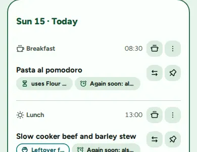

### Design
**Names** (copy, GLOSSARY terms; `<Day>` is the Plan's day label without "Today", e.g. "Sun 15"):
- Swap: **"Swap Pasta al pomodoro, Sun 15 Breakfast"**.
- Pin: **"Pin Pasta al pomodoro, Sun 15 Breakfast"**. It is one button with `aria-pressed="true|false"`; the icon is `pin` with the fill weight when pressed (A11Y-06 styling); the name does not change.
- Empty Course: **"Choose a Recipe for Side, Sun 15 Dinner"**.
- Slot header Cook: **"Cook Sun 15 Breakfast"**.
- Slot ⋮: **"More for Sun 15 Breakfast"** (system.md §5.1).
- Today's hero uses the same names as the Plan.
- **Rows** (`ListRow`): the target's name stays the title. `aria-describedby` points at the meta, value and sub-value (ids from `useId`). A Pantry row then reads "Flour, button, 500 g · Good until tomorrow", and a Shop Line "Cauliflower, button, 12000 g · Sat Breakfast +2".

**Behaviour.** No visual change. A sighted User sees nothing new except the pressed Pin styling from A11Y-06. Focus stays on Pin when it toggles (A11Y-07).

No mock: non-visual.

### Build notes
- `features/plan/components/PlanCourseRow.tsx`: one `pin` IconButton with `pressed`; labels come from `features/plan/lib/actionNames.ts`. That module is new, pure and unit-tested: `actionName('swap', { recipe, day, slot })` and the others.
- `features/plan/components/SlotHeader.tsx`, `SlotMenu.tsx`, `TonightHero.tsx` (the hero's ⋮ and Course rows), and `features/plan/strings.ts`.
- `ui/ListRow.tsx`: ids on `.list-row__meta`, `.list-row__value` and `.list-row__sub-value`, joined into the target's `aria-describedby`, merged with any caller-supplied one.

### Tests and guard
- Unit, `actionNames.test.ts`: every action's name includes the Recipe (or the Course for Choose), the day and the Meal Slot.
- Unit, `PlanCourseRow.names.test.tsx`:
  - no two buttons in a rendered week share a name;
  - Pin is a single button whose `aria-pressed` flips and that keeps focus.
- Unit, `ListRow.ds.test.tsx` (extend): the target's `aria-describedby` resolves to the meta and value text.
- BDD:
  - Scenario: Each Swap button names its Recipe, day and Meal Slot
  - Scenario: Pinning a Course keeps focus on the Pin button and announces it pressed
- Guard: page-layout probe P19 "unique names". Within `main`, no two visible buttons share an accessible name unless both are row targets with different `aria-describedby` text. It warns first, and fails in `web/src/ui` fixtures.

### Depends on / unblocks
The Plan files are shared with PC, so this is serialised with PC's Plan packages. Unblocks A11Y-09's Plan picture (same rows).

## A11Y-09  Touch targets and spacing on coarse pointers

**Severity** S3 · **Size** S · **Sources** RECIPES-19, SHOP-19, CROSS-13 (and the target part of PLAN-12) · **Reproduced** Confirmed, but narrower than reported. Census at 390 px with a touch profile:
- **Most small controls already have a 44 px hit area through `::after`:**
  - Button `sm`: 36 px drawn, 44 px hit (`Button.css:31`);
  - IconButton: 40 → 52 px;
  - compact IconButton: 32 → 44 px (`IconButton.css:23`);
  - filter Chip: 26 → 44 px (`Chip.css:79`).
- **Still short:**
  - Segmented options: 40 px;
  - Your menu: 40 px;
  - colour swatches: 40 px;
  - Switch: 52 × 32 px;
  - non-filter chips, such as Cook Mode's Course chips: 26 px;
  - the receipt-review checkbox: 22 px, and its row is not a target.
- **Overlap:** on Plan, compact IconButtons are **4 px apart**, so their 44 px hit areas overlap by 8 px. The 5 px focus ring of one also reaches its neighbour.
- **Not re-measured:** the Scan tabs (40 px) and the price keypad's close (39 × 40 px) are stage 1's figures.

**Where** `/plan` (and Today's hero), the `/recipes` and `/pantry` toolbars, Your preferences, Scan, Cook Mode, receipt review, stepper fields; phone and tablet with touch

### Problem
In a scrolling Plan list, Swap sits next to Pin and their hit areas overlap, so a tap in the gap can hit the wrong action. A few controls are under the brief's 44 px expectation, although all pass WCAG 2.5.8's 24 px.

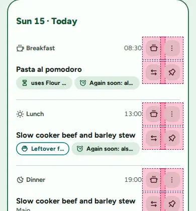

### Design
**Rule** (new system.md §11, "Targets"):
> **Targets.** On a coarse pointer (`@media (pointer: coarse)`) every control has a hit area of at least `--target-min` (44 px) in both directions; a control whose visual box is smaller draws it with its own `::after` (`position: absolute`, negative `inset`), never by growing the visual. Hit areas of neighbouring controls never overlap, and a focus ring never reaches a neighbour: icon actions on a row form one **icon set** (`ui/IconSet`) whose gap is `--icon-set-gap`: 8 px on a fine pointer (the 5 px outer ring stops 3 px short of the neighbour), 12 px on a coarse one (32 px compact buttons + 12 px = a 44 px pitch). A button nested in a field frame or pill (A11Y-02, R-C+) is sized to leave 4 px of the container's fill around it and keeps its 44 px target through `::after`: the stepper field's − and + are 36 px in the 48 px frame. A row whose leading control is a checkbox makes the whole row the target (ListRow `control` + `onActivate` toggles it). Targets agree with R-A and R-B: an icon button on a tinted container (a status or soft tile, the dark Today hero) has a `--color-surface` fill and a 1 px `--color-outline` inset boundary (≥ 3.7:1 on every tint), which changes neither its visual size nor its hit area; Close is the 40 px circular outline IconButton whose `::after` gives a 52 px target, alone at the header's end; a hit area may extend past its container, but the control's visual and its focus ring may not.

**CSS:**
```css
:root { --icon-set-gap: var(--space-2); }
@media (pointer: coarse) { :root { --icon-set-gap: var(--space-3); } }
.icon-set { display: inline-flex; flex: none; align-items: center; gap: var(--icon-set-gap); } /* new ui/IconSet.css */
.ui-field--stepper .icon-button { inline-size: 36px; block-size: 36px; }                      /* ui/fields/Field.css */
.ui-field--stepper .icon-button::after { inset: -4px; }                                       /* 44 px target */
.tile[data-variant='status'] .icon-button, .tile[data-variant='soft'] .icon-button,
[data-scheme='dark'] .tile.plan-hero .icon-button {                                            /* R-A, ui/IconButton.css */
  background: var(--color-surface); box-shadow: inset 0 0 0 1px var(--color-outline); }
@media (pointer: coarse) {
  .segmented__option { position: relative; }
  .segmented__option::after { content: ''; position: absolute; inset: calc(-1 * var(--space-1)) calc(-0.5 * var(--space-1)); } /* 48 high, abutting */
  .your-menu-button, .colour-swatch, .switch { position: relative; }
  .your-menu-button::after, .colour-swatch::after { content: ''; position: absolute; inset: -2px; }  /* 44 */
  .switch::after { content: ''; position: absolute; inset: -6px 0; }                                 /* 52 × 44 */
  button.chip::after { content: ''; position: absolute; inset: -9px 0; }                             /* every button chip */
}
```

**Behaviour**
- **Phone and tablet with touch:**
  - The icon set gap on Plan rows is 12 px. A set of three compact buttons goes from 104 to 120 px.
  - The slot header and the Course rows stay aligned, because both use `IconSet`.
  - The stepper field's − and + look 4 px smaller, and their targets are unchanged.
- **Desktop with a mouse:** the icon set gap is 8 px (it was 4 px).
- **Today hero in dark:** the icon set's buttons are outlined (R-A).
- **Receipt review:** the whole Line row toggles its checkbox.

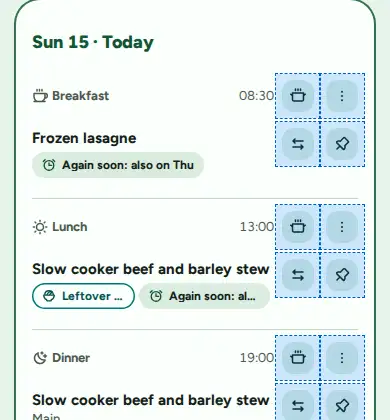
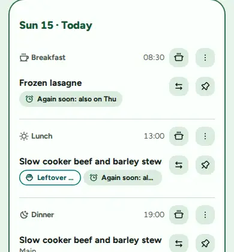

Mock: [mocks/a11y-09-plan-targets.html](mocks/a11y-09-plan-targets.html). It uses a touch profile, and `body.show-hit` draws the hit areas. The stepper and the fine-pointer gap are shown in A11Y-02's nested-focus renders.

### Alternatives considered
- **40 px compact buttons on a coarse pointer, with an 8 px gap.** The set grows to 136 px, which takes 32 px from the Recipe title on a 390 px Plan row. Not chosen.

### Build notes
- **New:** `web/src/ui/IconSet.tsx` and `.css`, used by:
  - `features/plan/components/PlanCourseRow.tsx` (`.plan-row__actions`);
  - `SlotHeader.tsx` (`.plan-slot-head__actions`);
  - `TonightHero.tsx` and `CourseRow` (`.plan-course__actions`).

  The `gap` rules in `plan.css:122, 189` and `CourseRow.css:27` are removed.
- **Stepper field:** `ui/fields/Field.css` (button size and `::after`).
- **Coarse-pointer blocks:** `ui/fields/Segmented.css`, `ui/fields/ColorSwatches.css`, `ui/fields/Switch.css`, `ui/Chip.css`, and `app/shell.css` (`.your-menu-button`).
- **The R-A line in `ui/IconButton.css`:** coordinate with DS, which owns R-A for `Button`.
- **Close (R-B):** DS's `BottomSheet` / `Dialog`.
- **Receipt review row:** SSP's file.

### Tests and guard
- **Unit:**
  - `ui/IconSet.test.tsx`: renders its children inline, with the gap from the token.
  - `ui/ui-css.test.ts`: every control class in `web/src/ui` under 44 px declares a coarse `::after` hit area; an IconButton inside a status or soft tile declares the outline boundary; the stepper field's IconButton is 36 px with `inset: -4px`.
- **BDD:**
  - Scenario: On a phone, tapping between Swap and Pin hits neither by mistake
  - Scenario: The Close button of a sheet is a round outlined button with a 52 px target
- **Guard:** page-layout rule P17, "targets", on touch profiles. A control's hit rectangle is its box united with its `::after` box.
  - Warn under 44 px.
  - Fail when two hit rectangles overlap by more than 1 px.
  - Fail when an icon button in a status or soft tile has a boundary below 3:1.
  - Fail when a focused control's 5 px ring box intersects a neighbouring control. This shares the P20 probe from A11Y-02.

### Depends on / unblocks
- Comes after A11Y-02 (nested focus), A11Y-06 (same Segmented and IconButton CSS) and A11Y-10 (`shell.css`).
- Coordinated with DS for R-A and R-B.
- The Plan files are serialised with PC and A11Y-08.

## A11Y-10  Skip link

**Severity** S3 · **Size** XS · **Sources** CROSS-18 · **Reproduced** Confirmed: on `/shop` it takes **9 Tabs at 1280** to reach `<main>` and 2 at 390. The first Tab lands on the Your menu button.
**Where** every route with the shell; every size

### Problem
On desktop a keyboard User tabs through the brand, the Your menu button and seven rail links on every page. WCAG 2.4.1 is technically met by the landmarks, but the cost is real for keyboard users without a screen reader.

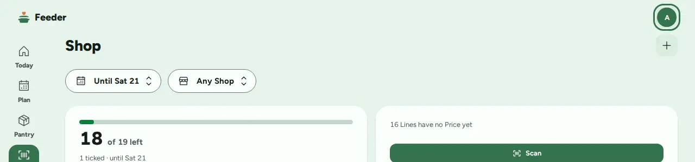

### Design
- The first focusable element of the shell is a link, **"Skip to content"**, hidden above the viewport until it is focused.
- On focus it slides into the top-start corner: accent solid pill, on-accent text, `body-strong`, 12/16 px padding, `--radius-button`. Its ring is `--color-text`, 2 px outside the accent pill: the text ring on the bg is ≥ 4.5 everywhere, and it is visible against the pill.
- Activating it focuses the page's h1 (`#page-title`, as A11Y-01), else `#main-content`.
- Not rendered on chromeless screens.
- With reduced motion it appears without the slide.
- Same at every size: on a phone it covers the brand while focused.

```css
.skip-link { position: fixed; inset-block-start: var(--space-2); inset-inline-start: var(--space-2); z-index: 100;
  padding: var(--space-3) var(--space-4); border-radius: var(--radius-button); background: var(--color-accent); color: var(--color-on-accent);
  font-size: var(--text-body-strong-size); font-weight: var(--text-body-strong-weight); text-decoration: none;
  transform: translateY(calc(-100% - var(--space-4))); }
.skip-link:focus-visible { transform: none; --focus-ring-color: var(--color-text); }
@media (prefers-reduced-motion: no-preference) { .skip-link { transition: transform var(--dur-1) var(--ease-out); } }
```

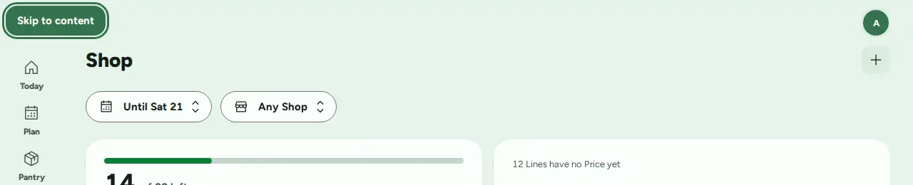
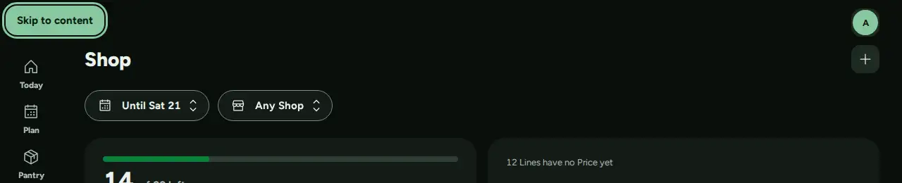
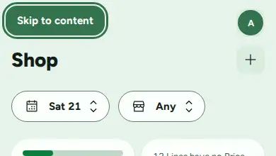
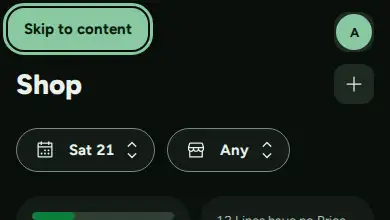

Mocks: [1280 light](mocks/a11y-10-skip-link-1280-light.html), [1280 dark](mocks/a11y-10-skip-link-1280-dark.html), [390 light](mocks/a11y-10-skip-link-390-light.html), [390 dark](mocks/a11y-10-skip-link-390-dark.html).

### Build notes
- `app/AppShell.tsx`: `<a className="skip-link" href="#main-content" onClick={focusPageStart}>`, the first child of `.app-shell`. `focusPageStart` comes from `app/useRouteFocus.ts` (A11Y-01).
- `app/shell.css` and `app/strings.ts` (`skipToContent: 'Skip to content'`).

### Tests and guard
- Unit, `AppShell.skipLink.test.tsx`: it is the first focusable element; activating it focuses `#page-title`; it is absent in chromeless screens.
- BDD: Scenario: A keyboard User skips the navigation with the first Tab
- Guard: a page-layout probe on the desktop profile: the first Tab focuses `.skip-link` and it is inside the viewport.

### Depends on / unblocks
A11Y-01 (shared focus target).

## A11Y-11  Recipe tiles are links

**Severity** S3 · **Size** XS · **Sources** RECIPES-17 · **Reproduced** Confirmed: the stretched target of a Recipe tile on `/recipes` is a `BUTTON.tile__stretch` named "Bean chilli" with no `href`. `features/recipes/components/RecipeTile.tsx:39` passes `onActivate`, although `ui/Tile.tsx:96` supports `href`.
**Where** `/recipes`; every size

### Problem
A Recipe tile cannot be opened in a new tab, middle-clicked or copied as a link, and a screen reader calls it a button although it navigates (WCAG 4.1.2; CLAUDE.md semantics).

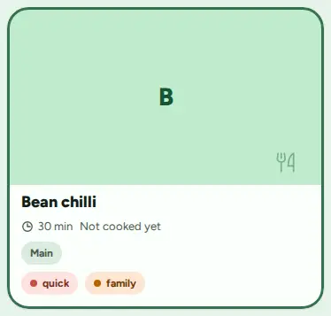

### Design
- The tile's stretched target becomes a router link to `/recipes/:id`, named by the Recipe.
- Its ring and look are unchanged; the hover state is the same.
- Modifier clicks behave like any link.

No mock: non-visual.

### Build notes
`features/recipes/components/RecipeTile.tsx`: `href={recipePath(id)}` instead of `onActivate`. `ui/Tile` already renders a link with `useLinkClickHandler` semantics; check it does, as `ListRow` does.

### Tests and guard
- Unit, `RecipeTile.test.tsx`: the target is an `a` with `href="/recipes/1"` and the Recipe's name.
- Guard: `ui/Tile.test.tsx`: a Tile with `href` renders an anchor.
- BDD: Scenario: A Recipe tile opens in a new tab with a modifier click

### Depends on / unblocks
None. RX owns `features/recipes`, so this is serialised with RX's list work.

## A11Y-12  Smaller items: board h1, nav and menu names, dark danger fill, textarea grip, app update

**Severity** S4 · **Size** S · **Sources** CROSS-21 · **Reproduced**
- **Confirmed:**
  - `/board` has no h1; it is the only one of 35 routes without one.
  - The nav landmarks are named "Bottom bar" and "Side rail"; only one is exposed at each size.
  - The Your menu `role="menu"` has no name: `aria-label` and `aria-labelledby` are both null.
  - The dark `--status-danger-solid` `#ab413e` is **2.95–2.99:1 on surface and 2.52:1 on surface-2** across the 7 accents.
  - TextArea shows the native resize grip, in Chromium as well as Firefox (`ui/fields/Field.css:173`, `resize: vertical`).
- **Inferred, not reproduced:** `sw/sw.ts:51, 64` calls `skipWaiting()` and `clients.claim()` with no prompt.

**Where** `/board`; the shell; Your menu; confirm dialogs with a danger button (dark); every TextArea (the Recipe editor's Description, notes); every open tab when a new version ships

### Problem
- The board has no page heading for screen-reader navigation.
- The nav names describe the shape, not the purpose.
- The open menu is announced without a name.
- A danger button in dark has a weak shape. Its white text identifies it, so this is polish, not a 1.4.11 failure.
- The resize grip is native browser UI, which CLAUDE.md forbids.
- A silent service-worker takeover can swap assets under an open page.


### Design
- **Board.** Add a visually hidden `<h1 id="page-title" className="visually-hidden">Kitchen board</h1>` in `features/board`. The page title becomes "Kitchen board · Feeder" (A11Y-01).
- **Nav names.** Both `<nav>` elements get `aria-label="Main"`. Only one is rendered at each size (the other is `display: none`), so screen readers announce "Main navigation".
- **Your menu.** The `role="menu"` element gets `aria-labelledby` pointing at the Your menu button, so it is named "Your menu".
- **Dark danger fill.** `STATUS_PALETTE.danger.dark.solid` changes from `#ab413e` to **`#ba4f4b`**: same hue, oklch L 0.52 → 0.565.
  - White text on it is **4.87:1** (≥ 4.5).
  - It is **≥ 3.06:1** on every dark surface, surface-2 and bg of the 7 accents.
  - Light is unchanged.
  - The other status solids are 2.58–2.88 on dark surfaces. They are fills behind white text or icons, not a button's only shape, so they are left alone; this is noted for DS.
- **TextArea.** It gets `resize: none` and grows with its text from 3 lines.
  - Where `field-sizing: content` is supported, it is used, with a `min-block-size` of 3 lines plus padding.
  - Elsewhere a small `useAutoGrow` hook sets the height from `scrollHeight` on input.
  - It stops growing at 12 lines and scrolls after that.
- **App update** (decision 4, decided).
  - The toast, its copy, its persistence and the Reload behaviour are designed in **RES-10**; this item does not restate them.
  - What stays here is the service-worker side the toast needs: `sw/sw.ts` stops calling `skipWaiting()` on install and instead waits for a `SKIP_WAITING` message. `clients.claim()` runs only after that message.
  - RES-10's Reload action posts `SKIP_WAITING`, and the page reloads on `controllerchange`.


Mock: [mocks/a11y-12-danger-textarea.html](mocks/a11y-12-danger-textarea.html). No mock for the board h1, the names or the service worker: they are non-visual (the toast is RES-10's).

### Build notes
- `features/board/components/*` for the h1.
- `app/AppShell.tsx` and `app/strings.ts`: add `mainNav: 'Main'` and remove `bottomBar` and `sideRail`.
- `app/YourMenu.tsx:61`.
- `theme/palette.ts`, the two dark blocks of `styles.css` (`--status-danger-solid`) and the `STATUS` table in `contrast.test.ts`.
- `ui/fields/Field.css`, `ui/fields/TextArea.tsx` and a new `ui/lib/useAutoGrow.ts`.
- `sw/sw.ts`, changing the install handler and adding the message listener. Coordinate with RES-10, which owns the page-side registration and the toast.

### Tests and guard
- **Unit.**
  - The board renders one h1, "Kitchen board".
  - `AppShell.test.tsx`: both navs are named "Main".
  - `YourMenu.test.tsx`: the open menu's accessible name is "Your menu".
- **Unit, `contrast.test.ts`.** The dark danger solid is ≥ 3 on surface, surface-2 and bg for every preset, and white on it is ≥ 4.5.
- **Unit, `TextArea.test.tsx`.** The CSS sets `resize: none`, and the field grows with its text up to the 12-line limit.
- **Unit, `sw` test.** On install the worker does not call `skipWaiting`. A `SKIP_WAITING` message makes it call `skipWaiting`, then `clients.claim`. The toast's own tests belong to RES-10.
- **Guard.** Run axe on `/board` in the page-layout quick profile (`page-has-heading-one`).

### Depends on / unblocks
- A11Y-01 (the board's page title).
- Decision 4 and RES-10 (the update toast).

## Review round 1 (2026-11-14)

- **What changed across the theme.** Every A11Y mock now loads the PC mocks' shared rules block (R-A to R-D), unchanged except for one line: the toast ring is now a token, `.toast { --focus-ring-color: var(--color-bg) }`. On top of that:
  - Close in the Change a date sheet is the R-B 40 px circular outline button.
  - "Reset to usual Attendance" is now an outlined secondary button. It was a bare text action in a sheet.
  - The ⋮ on the dark Today hero (a soft-strong, tinted container) gets the R-A surface fill and outline.
  - Secondary buttons ("Mark it", "Keep it", "Filters") are outlined everywhere.
- **Re-rendered under the same file names:** 16 HTML mocks and 37 WebP shots (A11Y-02, 04, 05, 06, 07, 09, 10, 12). The focus-rules diagram is unchanged. I looked at every one.
- **Focus ring reconciled.** I reconciled R-C with my A11Y-02 token. The final rule is stated once, in A11Y-02:
  - The ring's colour, width and offset stay mine. `--focus-ring-color` is accent; on an accent fill it is on-accent; on an inverse surface it is bg.
  - From R-C I adopted the 5 px ring room, `scroll-padding` under sticky bars, and inset, shaped nested controls.
  - A11Y-07 and A11Y-09 now point at that rule.
- **Beyond the four rules.** The Step Kind Segmented ("Active · Passive · Advance Step") wrapped "Advance Step" onto two lines at 390. The user's round-1 taste forbids a wrapped Segmented option, and my Check icon made it tighter.
  - Options are now `white-space: nowrap; flex: 1 1 auto`.
  - Below 18 rem of field width the Check is dropped and only the ring carries the choice. All renders now show one-line options.
- **Left as is:**
  - The "Before" half of the A11Y-12 danger mock also shows the outlined "Keep it". The item is about the danger fill and the textarea grip only.
  - No A11Y mock contains a toast, so R-D needed no change here.

## Review round 2 (2026-11-14)

- **R-C+ (nested focus rings) adopted.** It is now part of A11Y-02's one ring rule.
  - A control nested in a bounded container draws a 2 px ring inside itself on a soft fill. The container's accent boundary steps back while a child has focus.
  - I checked it against every nested case I own:
    - field frames with inner buttons (stepper − / +, Clear search);
    - the Segmented track;
    - ListRow targets with a leading tick or trailing IconButton;
    - the Plan IconSet;
    - the sheet Close;
    - the removable chip;
    - forced colours.
  - **Correction to PC's figures.** The accent ring on the soft fill is **4.35–4.73:1 in light and 6.17–6.42:1 in dark** across all 7 accents, not 3.4 / 3.6.
- **Three defects that R-C+ exposed, now fixed in the design:**
  - The field frame used to ring on `:focus-within`, so a focused Clear search or stepper button showed two fused rings. The frame now rings only while its text entry has focus.
  - The stepper's 40 px buttons left 2.5 px of fill inside the 48 px frame. They are now 36 px, which leaves 4 px of fill, and the 44 px target is kept.
  - On fine pointers, the IconSet's 4 px gap let a focused button's 5 px ring reach its neighbour. The gap is now 8 px, which leaves 3 px clear.
- **Segmented.** Arrows choose the option, so the ring goes round the whole track and the option draws none. Nothing nests.
- **New mock.** [mocks/a11y-02-nested-focus.html](mocks/a11y-02-nested-focus.html) shows all 7 accents in light and dark. Every other mock was re-rendered under its own file name because the shared CSS changed: 18 HTML mocks and 41 WebP shots in all. I looked at each one.
- **Other round-2 rules.** R-D+, R-E and R-F touch none of my mocks: they have no toast, no bottom bar under 360 px, and no structured data set as a bullet list.
- **Left as is.** A selected option inside a focused Segmented track shows its accent-text selected ring 5.5 px inside the accent focus ring. The two rings have different roles and colours and are separated by fill, so they do not fuse.

## Work packages for this theme

| Package | Items | Files owned | Size | Must merge first | Can run in parallel with |
|---|---|---|---|---|---|
| **A11Y-P1 Focus ring and hero** | A11Y-02, A11Y-03 | see list below | M | none | P4, P5 |
| **A11Y-P2 Forced colours** | A11Y-04 | new `ui/forcedColors.css`; one import line in `ui/index.ts`; the `scripts/test/ds-layout` fixture | M | P1, P3 (uses `--field-rule-width`) | develop alongside P3; merge after it |
| **A11Y-P3 Ruled fields, selected states, danger and textarea** | A11Y-05, A11Y-06, and the danger and TextArea parts of A11Y-12 | see list below | M | P1 (same CSS files and `contrast.test.ts`) | P4, P5 |
| **A11Y-P4 Titles, skip link, shell names, service worker** | A11Y-01, A11Y-10, and the board, nav, menu and service-worker parts of A11Y-12 | see list below | M | none; the SW change coordinates with RES-10 | P1, P3 |
| **A11Y-P5 Focus management and row names** | A11Y-07, and the ListRow part of A11Y-08 (SHOP-18) | see list below | M | none | P1, P3, P4 |
| **A11Y-P6 Plan names, targets and links** | the Plan part of A11Y-08 (PLAN-12), A11Y-09, A11Y-11 | see list below | S–M | P1, P3 (Segmented and IconButton CSS), P4 (`shell.css`) | P5; serialised with PC's Plan packages, RX's Recipes list work and SSP's receipt work |

**Files owned by each package**

- **A11Y-P1**
  - `styles.css`: the `:root` tokens, the global ring, and removal of `--focus-ring`.
  - Every `:focus-visible` rule in `web/src/ui/**.css`, and `ui/Tile.css`.
  - `features/plan/components/TonightHero.css`.
  - The focus lines of `features/shop/shop.css`, `settings/settings.css`, `settings/mealSlotCards.css`, `recipes/recipes.css`, `import/import.css`, `ingredients/ingredients.css` and `signin/signin.css`.
  - The ring block of `theme/contrast.test.ts`, and `ui/fields/focusRing.css.test.ts`.
  - `scripts/check-ui.sh` and `check-ui.rules`: the new `focus-ring` and `scheme-attr` rules.
- **A11Y-P3**
  - `ui/fields/Field.css`: the ruled tokens `--field-fill-strong`, `--field-rule-width`, `--field-rule-color` and `--field-radius-ruled`, plus the textarea rule.
  - `ui/fields/SearchField.css`, `Segmented.css` and `Segmented.tsx`.
  - `ui/IconButton.css` (pressed state), `ui/ChoiceChip.css` and `ui/icons.ts`.
  - `ui/fields/TextArea.tsx` and a new `ui/lib/useAutoGrow.ts`.
  - `theme/palette.ts`: the outline guard now includes surface-3 and bg, and the dark danger solid changes.
  - The dark blocks of `styles.css`, `theme/contrast.test.ts` and `ui/fields/field-css.test.ts`.
  - `features/recipes/components/IngredientExclusionList.tsx`, `features/recipes/lib/preference.ts`, `features/recipes/strings.ts` and `features/ingredients/strings.ts`.
- **A11Y-P4**
  - `app/AppShell.tsx`, `app/shell.css` (the skip link), `app/strings.ts` and `app/YourMenu.tsx`.
  - New: `app/routeTitle.ts` and `app/useRouteFocus.ts`.
  - `ui/PageHeader.tsx` and `.css`, plus new `ui/lib/useDocumentTitle.ts` and `ui/lib/pageTitle.ts`.
  - `features/board` (h1 and title), and the Cook Mode and sign-in title calls.
  - `sw/sw.ts`.
  - Page-layout probe P18.
- **A11Y-P5**
  - `ui/ListRow.tsx` and `ui/lib/useModalDialog.ts`.
  - New: `ui/lib/focusSuccessor.ts`, `ui/lib/useFocusKeeper.ts` and `ui/lib/focusStepStart.ts`.
  - `features/settings/components/DateAttendancePanel.tsx` and `features/settings/strings.ts`.
  - The step-focus calls in `features/scan/components/NewProductLines.tsx` and `NewProductKind.tsx`. These are SSP's files, so this work is serialised with SSP.
- **A11Y-P6**
  - `features/plan/components/PlanCourseRow.tsx`, `SlotHeader.tsx`, `SlotMenu.tsx`, `TonightHero.tsx` and `CourseRow.tsx`/`.css`.
  - `features/plan/plan.css`, `features/plan/strings.ts` and a new `features/plan/lib/actionNames.ts`.
  - New `ui/IconSet.tsx`/`.css`.
  - The coarse-pointer blocks of `ui/fields/Segmented.css`, `ColorSwatches.css`, `Switch.css`, `ui/Chip.css` and `ui/IconButton.css`.
  - `.your-menu-button` in `app/shell.css`.
  - `features/recipes/components/RecipeTile.tsx`.
  - The receipt-review row, which is SSP's file.
  - Page-layout rules P17 and P19.

**Order.** P1, P4 and P5 start together. P3 follows P1, and P2 follows P1 and P3. P6 goes last.

## Not reproduced / dropped

- **CROSS-04, for TextField, TextArea, Select (field variant), DateField, Stepper field and Checkbox.** The claim was that these have a 1.00 boundary (border transparent). Not reproduced: all six draw a 1.5–2 px `--color-outline` border at rest, at 3.72–4.86:1. The stage-1 probe parsed `"1.5px"` with unary `+` (`NaN`) and treated every border as absent. The rest of CROSS-04 (SearchField, Segmented track, Segmented selection) is A11Y-05 and A11Y-06.
- **SETTINGS-07, "the same ⊘ glyph in both states".** Not reproduced: the pressed toggle renders the Phosphor fill weight (`ui/IconButton.tsx:30`). The rest of the finding stands (A11Y-06).
- **RECIPES-19 and SHOP-19, for Button `sm`, IconButton and filter chips.** These controls were reported as under 44 px. Their visual boxes are, but each already has a 44 px or larger hit area through `::after`, so they are dropped from the defect list. The controls without a hit area are in A11Y-09.

## What could not be checked

- **Real forced-colours themes.** Only Chromium's emulated forced colours (dark) were rendered. Windows High Contrast with a real theme, Firefox and Safari forced colours were not run.
- **Real assistive technology.** No NVDA, JAWS, VoiceOver or TalkBack session was run. Announcements are inferred from the accessibility tree (names, roles, `aria-pressed`, `aria-describedby`, focus targets).
- **Pantry Throw out.** Focus after it was not re-run: my seeded data has no Stock Lot past its Good until date, so the tile did not appear. It is confirmed from the code and the stage-1 measurement.
- **Scan tabs and the price keypad.** Their sizes (40 px; 39×40) were not re-measured; the figures are stage 1's.
- **App update.** The service-worker takeover risk (A11Y-12) is inferred from `sw/sw.ts`. A real update was not staged.
- **Mock renders.** Panels in the contact-sheet mocks are slightly narrower than the real page at 390 px because of the mock's labels. The Pantry toolbar was checked to fit with the compact Segmented, which has no Check icon.

