# Design system and responsive rules

This theme covers the system under the screens: the type roles, the colour tones, the breakpoints, the shared primitives, and how they behave at 320 px, with long content, with a larger browser text size and with WCAG text spacing. Fifteen stage-1 findings are assigned to it. I reproduced all fifteen on the d-ds server (`main` @ 834ea743) and they make eleven items. One item is S1. A Menu in a ListRow's trailing slot renders its phone BottomSheet **inside the row**. The sheet then inherits the row's `pointer-events: none` and `text-align: end`, and a ListRow rule meant for the row's own trailing buttons turns every sheet row's whole-row target into a 0×0 box. The result: on a phone the Leftover actions (Had it, Threw it out, Freeze it, Take out) cannot be tapped on Today, Plan or Pantry.

The other items come from four root causes:
- **The system was never finished at its edges.**
  - There is no body role and no base heading style, so unclassed text and `<h2>` fall back to the browser's styles.
  - There is no warn tone, so rule conflicts borrow spoil or danger.
  - There is no breakpoint table, so there are 16 width conditions and a column seam at the 1024 px rail handover.
  - Type tokens are in px, so a browser text-size preference does nothing except to stray rem text.
- **Feature CSS acts as a shared primitive.** `features/products/products.css` `.pg__*` is used by 29 files in six folders, with its own sizes and opacity muting.
- **The 320–359 px band is untested.** The page-layout guard starts at 360, so the bottom bar, the Pantry PageHeader and the Tag field all overflow or collide there unseen.
- **Screens override primitives.** One example is the Leftovers tile's `overflow: visible` on a clamped title.

The fix is mostly shared:
- Portalling modal sheets and menus to `document.body`, plus two lines of ListRow and BottomSheet CSS, closes FLOW-02 and SHOP-10 everywhere.
- One **narrow band** rule (`width < 22.5em`) closes the bottom bar, PageHeader and FilterBar items.
- One breakpoint table written in **em** closes CROSS-11 and makes the layout follow the text size, which CROSS-10's rem tokens need.
- Four small primitives (`SectionTitle`, `TileHeader`, `Muted`, `Overline`) plus `Stack`/`Cluster` replace `.pg__*` and the six "muted" classes.
- One new `warn` status gives the misused spoil and danger call sites a home.
- Each rule gets a guard: new `check-ui` rules (`raw-spacing`, `raw-radius`, `media-width`, `status-tone`, a wider `opacity-muting`), 320 px in both page-layout profiles, and page-layout rules P24 to P27.

| Item | Severity | Size | Title | Source ids | Status after reproduction |
|---|---|---|---|---|---|
| DS-01 | S1 | S | A Menu's phone sheet inherits its row: Leftover actions cannot be tapped | FLOW-02, SHOP-10 | Confirmed (targets 0×0, `pointer-events: none`, Close 20×40 px); SHOP-10 raised to S1; one related defect new in stage 2 |
| DS-02 | S2 | S | Bottom bar at 320–359 px: overlapping targets, touching labels | SHELL-06, CROSS-12 | Confirmed (links overlap up to 3.8 px, label gap 0.1 px at 320) |
| DS-03 | S2 | S | PageHeader actions and the FilterBar at 320 px (Pantry scrolls sideways) | SHOP-03 | Confirmed (`scrollWidth` 327 vs 320; Sort shows 36 of 74 px) |
| DS-04 | S2 | XS | A Chip can exceed its line: the Recipe editor's Tags at 320 px | RECIPES-07 | Confirmed (`scrollWidth` 354 vs 320) |
| DS-05 | S2 | XS | Leftovers tile on Today: the Recipe name paints over its meta line | SHELL-02 | Confirmed, narrower (Today only; Plan clips correctly) |
| DS-06 | S3 | M | A real warn status tone; spoil and danger kept for food and destruction | PLAN-14 | Confirmed, narrower and wider (the shortfall notice is spoil, not danger; four more call sites found) |
| DS-07 | S3 | L | Type roles: body role, base headings, SectionTitle/TileHeader/Muted/Overline, `.pg__*` into `ui` | CROSS-09, SETTINGS-21 | Confirmed |
| DS-08 | S3 | S | Type tokens in rem: the browser text size scales every role | CROSS-10 | Confirmed (h1 stays 28 px at 20 and 24 px text; `.pg__tile-title` grows to 30 px) |
| DS-09 | S3 | M | One breakpoint table (em, min-width only) and the 1024 px rail handover seam | CROSS-11 | Confirmed (Today: 2 columns at 960–1020, 1 at 1040, 2 from 1060) |
| DS-10 | S3 | S | Text-spacing resilience: Settings descriptions and the Sort value | CROSS-16 | Confirmed, wider (5 of 11 Settings descriptions are cut at the default spacing, 11 with WCAG spacing) |
| DS-11 | S4 | S | Opacity muting, raw radii and raw spacing | CROSS-19, CROSS-20 | Confirmed (7 opacity-muting violations plus 3 the guard's range misses; 10 raw radii; 53 raw spacing values) |
| DS-12 | S2 | M | Actions look like actions: Button, IconButton, Close, Toast and sheet room as system rules | round-1 mock review (R-A, R-B, R-D, sheet part of R-C) | New in round 1 |

The user's decisions in docs/design/ui-review-3/decisions.md change two designs:
- **DS 3:** the Advance Steps tiles use the **info** tone, not warn. This covers Today, Cook Mode and the Kitchen board, including an overdue Advance Step.
- **DS 6:** the Pantry's Sort chip never wraps to a second line. When it cannot show its value in full, it becomes icon-only and its value moves into its accessible name.

DS-03, DS-06, DS-10, the system.md text and the work packages below are revised to match. I re-rendered their mocks and shots and checked them.

Mock review round 1 adds one item to this theme. **DS-12 (S2 · M)**, "Actions look like actions: Button, IconButton, Close, Toast and sheet room as system rules", takes the four round-1 rules (rules-round1.md R-A, R-B, R-D and the sheet part of R-C) into the primitives DS owns. Add this row to the overview table:

| DS-12 | S2 | M | Actions look like actions: Button, IconButton, Close, Toast and sheet room as system rules | (round-1 review; rules-round1.md R-A, R-B, R-D, sheet part of R-C) | New in round 1 |

## Decisions for the user
The user has decided all six (docs/design/ui-review-3/decisions.md). The plan follows these choices.

1. **The bottom bar below 360 px (DS-02):** icons only, and each label stays the link's accessible name. Mock: `mocks/ds-02-bottom-bar-320-light.html`. The rejected option B was icons plus the current destination's label: `mocks/ds-02-bottom-bar-option-b-settings-320-light.html`.
2. **Breakpoints (DS-09):** em everywhere, and the type tokens in rem. Diagram: `mocks/ds-09-breakpoints.html`.
3. **Warn tone (DS-06) — changed from my recommendation.** The mustard warn tone is adopted as proposed, with one exception: the Advance Steps tiles use **info** (blue), not warn. That covers Today, Cook Mode, the Timeline and the Kitchen board, overdue Advance Steps included. Specimen: `mocks/ds-06-tone-specimen.html`.
4. **Settings hub descriptions (DS-10):** navigation rows may use two lines. Mock: `mocks/ds-10-settings-390-light.html`.
5. **Leftover meta order (DS-05):** "Use by Tue · 1.25 portions". Mock: `mocks/ds-05-today-leftovers-320-light.html`.
6. **The Pantry Sort chip when it cannot show its value (DS-03, DS-10) — changed from my recommendation.** It does not wrap to a second line. It becomes icon-only, with its value in its accessible name, and pantry-filter.md §3 ("every row is one line") stands. Mocks: `mocks/ds-03-pantry-header-320-light.html`, `mocks/ds-10-pantry-spacing-390-light.html`, `mocks/ds-10-pantry-390-font24.html`.

## DS-01  A Menu's phone sheet inherits its row: Leftover actions cannot be tapped

**Severity** S1 · **Size** S · **Sources** FLOW-02, SHOP-10 · **Reproduced** Confirmed.

The same measurements hold on Today ("Leftovers to use" tile), on Plan ("Leftovers to use"), and on the Pantry (a frozen Leftover, grouped by Storage Place), at 390 and 320 px, light and dark:
- the open `dialog.sheet` has `pointer-events: none` and `text-align: end`, and its parent is `.list-row__trailing`;
- each `.list-row__target` (Had it, Threw it out, Freeze it or Take out) measures **0×0**, with `position: relative`;
- `elementFromPoint` at a sheet row's centre returns `<html>`, and a tap there does nothing;
- the sheet's Close is 20×40 px.

The only ways out are that 20 px Close or Escape, and the only way to choose an action is the keyboard. The popover from 768 px works (224×48 px). SHOP-10 is the same defect, so it rises from S3 to S1.

**New in stage 2:** a BottomSheet's Close shrinks beside **any** long title, because `IconButton` is a shrinkable flex item.

**Where** `/`, `/plan` and `/pantry` (Storage Place view), at every size below 768 px, light and dark. Every other row Menu (Meal Slot menus, To confirm ⋮, Recipe and editor menus) sits outside a trailing slot, measures 350×64 px targets, and works.

### Problem
On a phone, tapping ⋮ on a Leftover opens a right-aligned sheet titled "Actions for Cauliflower al gorgonzola with chestnut mushrooms", and nothing in it responds to a tap. A Leftover cannot be marked Had it, Threw it out or Freeze it from any screen.

The cause in code:
- `ui/Menu/Menu.tsx:84` renders `<Sheet>` inline.
  - Lines 224–263 render a `BottomSheet` as a child of the trigger's parent. Here that parent is `ListRow`'s trailing slot (`ui/LeftoverActions/LeftoverRow.tsx:33`).
  - The Popover is portalled (`Menu.tsx:152`); the Sheet is not.
- `ui/BottomSheet.tsx:49` renders the `<dialog>` where it is mounted. `showModal()` lifts it into the top layer, but CSS inheritance still follows the DOM.
- `ui/ListRow.css:72-76` gives every child of a row `pointer-events: none`, which the dialog inherits.
- `ListRow.css:218-225` gives the trailing slot `text-align: end`, which the sheet also inherits.
- `ui/ListRow.css:78-86`: `.list-row__trailing button { position: relative }` (specificity 0,1,1) beats `.list-row__target { position: absolute; inset: 0 }` (0,1,0) in the sheet's own rows. Their targets therefore collapse to 0×0.
- `ui/BottomSheet.css:41-47`: the header is a flex row, and the `IconButton` shrinks to its 20 px glyph.

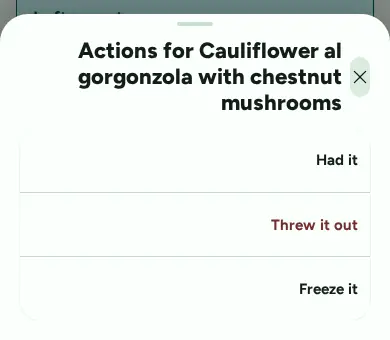 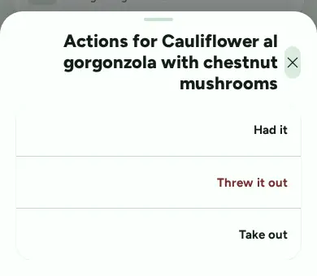

### Design
**Behaviour.**
- On a phone, ⋮ on a Leftover opens the same sheet as every other row Menu: start-aligned, one 64 px row per choice, and the whole row is the target.
- **The sheet's title is the Recipe name**, wrapped and start-aligned. The trigger keeps its accessible name, "Actions for <Recipe name>".
- **Close is the system Close (DS-12, R-B):** a 40 px circular outline button. It never shrinks and is top-aligned with the title's first line. Its boundary is `--color-outline` on the sheet surface (4.5–4.9:1). A Menu sheet has no Cancel, so it keeps Close.
- The choices are Had it, Threw it out (in danger text), then Freeze it (before the Use-by, not frozen) or Take out (frozen).
- A choice closes the sheet and opens the matching Leftover sheet, as today.
- Nothing changes from 768 px.

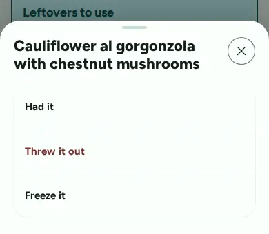 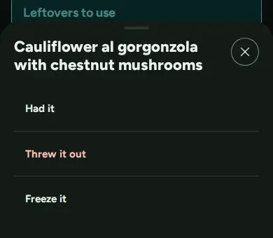 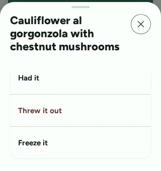 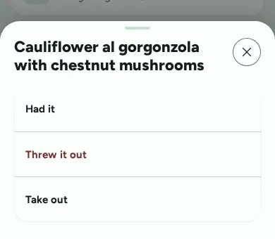

Mocks: `mocks/ds-01-menu-sheet-today-390x844-light.html`, `mocks/ds-01-menu-sheet-today-390x844-dark.html`, `mocks/ds-01-menu-sheet-today-320x568-light.html`, `mocks/ds-01-menu-sheet-pantry-390x844-light.html`.

Measured after the fix:
- targets: 350×64, 350×63 and 350×63 at 390 px; 280×64 at 320 px;
- Close: 40×40;
- the sheet: `pointer-events: auto` and `text-align: start`;
- the hit test at a row's centre lands on `.list-row__target`.

**Rules.**
- **`ui/BottomSheet.tsx`**
  - A **modal** sheet renders through `createPortal(…, document.body)`. A non-modal sheet stays where it is mounted (it is docked from 768 px).
  - The portal root stops `click`, `pointerdown` and `keydown` from bubbling through React to the trigger's ancestors. This runs after the dialog's own backdrop handler.
- **`ui/BottomSheet.css`:** the header and Close follow DS-12 (`CloseButton`, `.sheet__header { align-items: flex-start }`, `.sheet__title { min-inline-size: 0; text-align: start; }`).
- **`ui/ListRow.css`** (hardening):
  ```css
  .list-row > .list-row__target { position: absolute; }   /* (0,2,0): beats the trailing lift */
  ```
  Scope the lift to the row's own trailing slot: `.list-row > .list-row__trailing :is(button, a, input, select, [role='button'])`.
- **`ui/Dialog.tsx`** (and so `ConfirmDialog`) gets the same portal.
- **`LeftoverRow`** passes `title={leftover.recipeName}`.

**Accessibility.**
- The sheet is a `<dialog>` named by its title.
- Each choice is a row button named by its label.
- Focus goes to the first choice on open and returns to ⋮ on close.
- Escape, Close and a backdrop tap all close the sheet.
- Targets are 64 px high. Close's hit area is 52 px.
- No new colour pairs.

**Where it lives.**
- `ui/BottomSheet.tsx/.css`, `ui/ListRow.css`, `ui/Dialog.tsx`, `ui/LeftoverActions/LeftoverRow.tsx`.
- Every modal sheet moves its DOM parent, including Select and Popover on phones. Their content is unchanged.

### Alternatives considered
- Portal only the Menu's Sheet. A Select or Popover in a trailing slot would still break.
- Only `text-align: start` on `.sheet`. That fixes neither the 0×0 targets nor the inherited `pointer-events`.

### Build notes
- Testing-library queries `document.body`, so portalled sheets are still found.
- `useModalDialog`'s `initialFocus` query runs on the dialog element.
- `Menu.tsx`'s link-row close handler (`closest('a')`) still works inside the portal.

### Tests and guard
- **Unit**
  - `BottomSheet.portal.test.tsx`: a modal sheet's `dialog.parentElement` is `document.body`; a `modal={false}` sheet stays in place.
  - `Menu.test.tsx`: below 768 px the sheet is not inside the trigger's row.
  - `LeftoverRow.test.tsx`: the sheet title is the Recipe name, and the trigger keeps "Actions for …".
  - `ListRow.css.test.ts`: `.list-row > .list-row__target` is `position: absolute`.
- **BDD**
  - *Scenario: On a phone, marking a Leftover "Had it" from Today's Leftovers tile takes one tap on the row.*
  - *Scenario: On a phone, the Pantry's frozen Leftover offers Take out in a start-aligned sheet.*
  - *Scenario: A sheet with a long title keeps a round 40 px Close button.*
- **Real layout:** `scripts/test/ds-layout_test.sh` adds a Menu inside a ListRow trailing slot at 390 px. Every sheet row's target must be at least 44×44, and the hit test at its centre must land on it.
- **Page-layout:**
  - scenario `leftover-menu-sheet` (`/`, widths `[320, 390]`);
  - rule **P25**: a visible target in an open sheet under 44 px, or overlapping another target;
  - the seed adds a Leftover.

### Depends on / unblocks
- Depends on DS-12, which defines the Close primitive and merges first.
- Unblocks the Leftover flows of PC (FLOW-04, the Leftover sheets) and SSP (Pantry Leftovers).

## DS-02  Bottom bar at 320–430 px: one squircle system, icons only below 360 px

**Severity** S2 · **Size** S · **Sources** SHELL-06, CROSS-12 (the bar half; DS-03 designs the Pantry half), round-2 review (R-F) · **Reproduced** Confirmed. I measured the bar on `/pantry` at 640 and 740 px heights.

| Width | Track | Neighbouring links | Labels | Current-page highlight | Scan |
|---|---|---|---|---|---|
| 320 | 41 px; links forced to 44 px | overlap by up to 3.8 px | Recipes→Settings 0.1 px apart; "Pantry" runs under the Scan pill | 44×54 | 44×58 |
| 340 | — | links touch | 2 px apart | — | — |
| 360 | 44.9 px | clear | 4.9 px apart | 44.9×54 | 44.9×58 |
| 390 | 49.1 px | clear | clear | 49.1×54 | 49.1×58 |
| 430 | 54.9 px | clear | clear | 54.9×54 | 54.9×58 |

Below 430 px the highlight and Scan are upright rectangles stretched to the track, not shapes of their own. The user's verdict on 320: "should be icons only, and check the outlines of the scan and active page to make them squircles that don't overflow the bar".

**Where** the floating bottom bar on every route below 1024 px, both themes.

### Problem
At 320 px the seven destinations do not fit: targets overlap (WCAG 2.5.8) and "Recipes" and "Settings" read as one word. At every phone width the current-page highlight and Scan take the shape of their track, so they look squashed or stretched rather than designed.

The causes are all in `app/shell.css:96-160`:
- seven `minmax(0, 1fr)` tracks with a 2 px gap, `--space-1` padding and a 12 px inset;
- `.bottom-bar__link { min-width: 44px; height: 54px; }`, where the highlight is the link's own background;
- `.bottom-bar__link[data-accent='true'] { width: min(58px, 100%); height: 58px; }`.

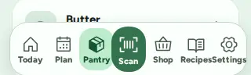 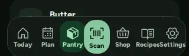 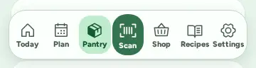 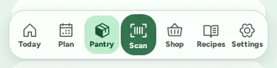 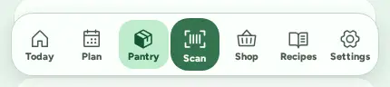

### Design
**Behaviour (R-F, decision DS 1).**
- **At every phone width:**
  - Each link is the whole track: the tap target is 43.6×68 at 320, 44.9×68 at 360 and 49.1×68 at 390.
  - Inside the link, the icon sits in a **40×40 px squircle** (`.bottom-bar__icon`, 12 px radius), centred in the track. Only two squircles are filled:
    - the **current page**: `--color-soft` fill, `--color-accent-text` icon;
    - **Scan**: always `--color-accent` fill, `--color-on-accent` icon. When Scan is the current page it keeps its fill and has no ring; its label turns `--color-accent-text`.
  - Other destinations show a bare icon in `--color-muted`.
- **From 360 px (the labelled band):** the label sits under the squircle. It is `--color-accent-text` on the current page and `--color-text` under Scan. Every label shares one baseline.
- **In the narrow band (`width < 22.5em`: below 360 px at the default text size, 450 px at 20 px, 540 px at 24 px):**
  - icons only;
  - the bar's side inset drops to `--space-1` and the bar gets 6 px inline padding with no gap, so a track is 43.6 px at 320;
  - the squircles sit 15 px from the bar's top and at least 7 px inside its rounded corners. Nothing overlaps and nothing pokes out of the bar.

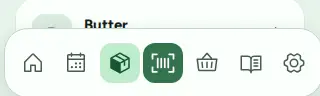 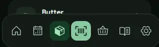 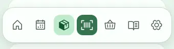 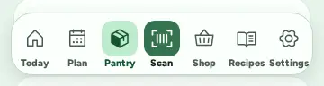 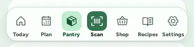 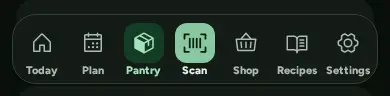 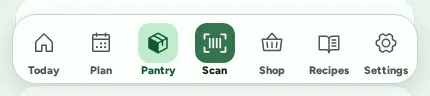

Mocks: `mocks/ds-02-bottom-bar-320-light.html`, `mocks/ds-02-bottom-bar-320-dark.html`, `mocks/ds-02-bottom-bar-340-light.html`, `mocks/ds-02-bottom-bar-360-light.html`, `mocks/ds-02-bottom-bar-390-light.html`, `mocks/ds-02-bottom-bar-390-dark.html`, `mocks/ds-02-bottom-bar-430-light.html`. The option not taken (icons plus the current label) remains in `mocks/ds-02-bottom-bar-option-b-settings-320-light.html`.

Measured after the fix:

| Width | Squircles | Position in the bar | Gap between links |
|---|---|---|---|
| 320 | 40.0×40.0 | 15.0 px from the top | 0 (no overlap) |
| 360 | 40.0×40.0 | 8.5 px from the top | 2 px |
| 390 | 40.0×40.0 | 8.5 px from the top | 2 px |

**Rules.**
- **Markup:** the bar's link component in `app/` wraps the icon as `<span class="bottom-bar__icon" aria-hidden="true">{icon}</span>`. The label span is unchanged.
- **`app/shell.css`:**
```css
.bottom-bar__link, .bottom-bar__link[aria-current='page'], .bottom-bar__link[data-accent='true'] {
  align-self: stretch; justify-self: stretch; inline-size: 100%; block-size: auto; min-width: 0; gap: 2px;
  background: none; box-shadow: none; border-radius: var(--radius-button);   /* the focus ring follows the whole target */
}
.bottom-bar__icon { display: grid; place-items: center; flex: none; inline-size: 40px; block-size: 40px; border-radius: var(--radius-thumb); }
.bottom-bar__link[aria-current='page'] { color: var(--color-accent-text); }
.bottom-bar__link[aria-current='page'] .bottom-bar__icon { background: var(--color-soft); color: var(--color-accent-text); }
.bottom-bar__link[data-accent='true'] { color: var(--color-text); }
.bottom-bar__link[data-accent='true'] .bottom-bar__icon { background: var(--color-accent); color: var(--color-on-accent); }
.bottom-bar__link[data-accent='true'][aria-current='page'] { color: var(--color-accent-text); }
@media (width < 22.5em) {
  .bottom-bar { left: calc(var(--space-1) + env(safe-area-inset-left, 0px)); right: calc(var(--space-1) + env(safe-area-inset-right, 0px)); column-gap: 0; padding-inline: 6px; }
  .bottom-bar__label { /* visually hidden: still the link's accessible name */ position: absolute; inline-size: 1px; block-size: 1px; overflow: hidden; clip-path: inset(50%); white-space: nowrap; }
}
```
- `--nav-height` and `--nav-clearance` are unchanged.
- The old 3 px soft ring on a current Scan is removed.

**Accessibility.**
- Each link keeps its name from its label ("Today", "Plan", "Pantry", "Scan", "Shop", "Recipes", "Settings") and `aria-current="page"`.
- Targets are ≥ 43.6×68 px and never overlap.
- The focus ring outlines the whole link (`--radius-button`), never the squircle alone.
- Contrast across all seven accents:

| Pair | Light | Dark |
|---|---|---|
| current icon (`--color-accent-text` on soft) | 6.7–7.3 | 8.2–8.4 |
| Scan icon (on-accent on accent) | 5.7–6.5 | 8.7–9.3 |
| Scan fill against the bar | 5.7–6.4 | 8.4–9.1 |
| current label on the bar | 8.7–9.8 | 11.1–11.8 |
| other icons (muted) on the bar | 7.2–7.4 | 8.7–8.8 |

- The soft highlight is 1.3–1.4:1 against the bar. It is not the only cue: the icon colour changes, the label colour changes from 360 px, and `aria-current` is set. A11Y may add a ring if its state-indicator rule needs 3:1.

**Where it lives.** `app/shell.css` and the bottom-bar link markup in the app shell component.

### Alternatives considered
- Option B (icons plus the current label below 360 px) was declined by the user.
- A 44 px Scan put its label 2 px off the others' baseline. A 58 px Scan cannot be square in a 44.9 px track.

### Tests and guard
- **Unit.** `shell.css.test.ts` asserts:
  - the `.bottom-bar__icon` squircle is 40×40;
  - the link carries no fill;
  - the narrow-band labels are visually hidden.
- **Unit.** `AppShell.test.tsx`: every bottom-bar link contains `.bottom-bar__icon` and keeps its label as its name.
- **BDD:**
  - *Scenario: At 320 px every bottom-bar destination is reachable and none overlaps another.*
  - *Scenario: At every phone width the current page and Scan are square shapes inside the bar.*
  - *Scenario: At 320 px a screen reader still announces each bottom-bar destination by name.*
- **Page-layout:**
  - 320×568 is added to both profiles.
  - **P25** reads `.bottom-bar__link` boxes (overlap) and labels less than 4 px apart.
  - New **P31** (always fail): the current link's and Scan's `.bottom-bar__icon` must be square (±0.5 px) and lie at least 6 px inside the bar's box. Message: `P31 ${sel} is ${w}x${h} px at ${dx}/${dy} px inside the bar; the bar's highlight and Scan are 40 px squircles inside the bar (system.md 8)`. It runs at 320, 360, 390 and 430.

### Depends on / unblocks
- Depends on DS-09 (the em narrow band).
- Every theme's mocks under 360 px use this bar. PC's R-F CSS should take the inner-span form so the tap target stays the whole track.
- SHORT designs the bar on short viewports.

## DS-03  PageHeader actions and the FilterBar at 320 px (Pantry scrolls sideways)

**Severity** S2 · **Size** S · **Sources** SHOP-03 · **Reproduced** Confirmed at 320×640, in light and dark:
- `/pantry` has `scrollWidth` 327 against a 320 px viewport.
- `.page-header__actions` ends at 321 px, so no gutter is left.
- The Sort chip's value "Good until" shows only 36 of its 74 px ("Go…").
- A sweep of all 34 routes at 320 px finds only this one and `/recipes/1/edit` (DS-04).
- At 360 and 390 px the Pantry is clean.

This item also closes the Pantry half of CROSS-12.

**Where** `/pantry` at 320–359 px at the default text size. With WCAG text spacing or a larger text size the same happens at wider widths (DS-10). The rule protects every PageHeader with more than one labelled action, and every FilterBar's Sort.

### Problem
The Pantry header holds Stock-take (a secondary Button with icon and label), Add to Stock (primary) and ⋮. Together they take 305 px in a 288 px column, so the page pans sideways. In the FilterBar, the view control (Storage Place | Ingredient) and Sort share one line that never wraps, so Sort shrinks and cuts its value.

The causes in code:
- `ui/PageHeader.css:19-30`: `.page-header__actions` is `flex: none` and never wraps.
- `ui/FilterBar/FilterBar.css:42-46`: `.filter-bar__sort` is `flex: 0 1 auto`, so the Sort chip's value is what gives way.

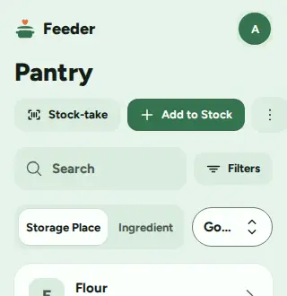 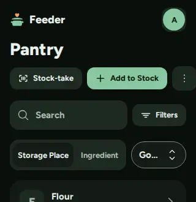

### Design
**Behaviour.**
- **PageHeader**
  - The actions never extend past the gutter. When they do not fit beside the title they take their own line, end-aligned, as they already do from 12 rem. If they still do not fit, they wrap.
  - A secondary or tertiary Button marked `iconOnly="narrow"` shows only its icon in the narrow band (`width < 22.5em`). It is 40×40 px with a 44 px hit area, and its label stays its accessible name.
  - At 320 px the Pantry reads: [Stock-take icon] [+ Add to Stock] [⋮], 232 px wide in total.
- **FilterBar view row (decision 6)**
  - The row is always one line, as pantry-filter.md §3 says.
  - Sort shows its value in full whenever the value fits beside the view control.
  - When the value would be cut, the chip becomes **icon-only**: its sort glyph and chevron, about 86 px wide. Its accessible name and tooltip become "Sort: Good until". It stays a combobox, and opening it lists every sort with the current one ticked.
  - The chip shows its value again as soon as the value fits: after a resize, a shorter value, or less text spacing.
  - At the default text size this happens only in the narrow band. It also happens at 390 px with WCAG text spacing and at a 20 or 24 px browser text size (DS-10).
  - The 420 px rule that drops Sort's leading icon while its value is shown stays.
- The light and dark themes are unchanged.

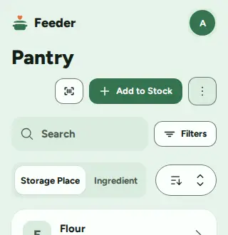 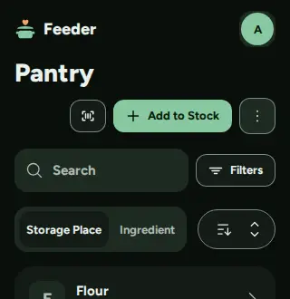 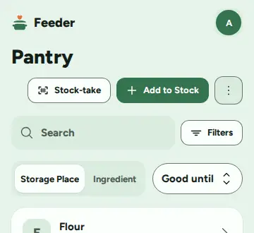 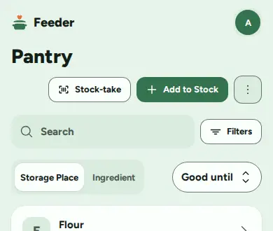

Mocks: `mocks/ds-03-pantry-header-320-light.html`, `mocks/ds-03-pantry-header-320-dark.html`, `mocks/ds-03-pantry-header-360-light.html`, `mocks/ds-03-pantry-header-390-light.html`.

Measured after the change:
- At 320 px: `scrollWidth` 320; the actions end at 304 px (a 16 px gutter); Sort is icon-only and named "Sort: Good until"; the view row is still one line, 50 px high.
- At 360 and 390 px: Sort shows "Good until" in full (74 of 74 px).

**Rules.**
- `ui/PageHeader.css`:
  ```css
  .page-header__actions { flex-wrap: wrap; justify-content: flex-end; min-inline-size: 0; max-inline-size: 100%; }
  ```
- `ui/Button.tsx`: a new prop `iconOnly?: 'narrow'`, which requires `icon`. The Button renders its children inside `<span class="button__label">` and sets `data-icon-only="narrow"`.
- `ui/Button.css`:
  ```css
  @media (width < 22.5em) {
    .button[data-icon-only='narrow'] { inline-size: 40px; min-inline-size: 40px; padding-inline: 0; justify-content: center; }
    .button[data-icon-only='narrow'] .button__label { /* visually hidden */ }
  }
  ```
- `ui/Select/Select.tsx`: a new prop `iconOnly?: boolean`, which needs a `leading` icon. When it is set, the trigger:
  - gets `data-icon-only="true"`;
  - gets `aria-label={`${label}: ${valueLabel}`}` and a `title` with the same text, in place of `aria-labelledby`;
  - keeps the value text, visually hidden.
- `ui/Select/Select.css`:
  ```css
  .filter-bar__sort .select__trigger[data-icon-only='true'] .select__leading { display: inline-grid; }
  .filter-bar__sort .select__trigger[data-icon-only='true'] .select__value { /* visually hidden */ }
  ```
- `ui/FilterBar`: a new hook, `useSortFits(rowRef)` in `ui/FilterBar/useSortFits.ts`.
  - A ResizeObserver watches the view row, and a hidden copy measures Sort's natural width with its value shown, as `filter-chips__measure` does.
  - It returns `fits` from the pure function `sortFits({ row, view, natural, gap })` in `ui/FilterBar/lib/sortFits.ts`: `natural <= row - view - gap`.
  - The FilterBar passes `iconOnly={!fits}` to the Sort Select. No logic goes into the component.
- `features/stock/screens/StockScreen.tsx`: Stock-take gets `iconOnly="narrow"`.
- In the narrow band a PageHeader holds at most one labelled Button that never collapses, the region's primary. Any other labelled Button in it sets `iconOnly="narrow"` (system.md §11).

**Accessibility.**
- The icon-only Stock-take is a `<button>` named "Stock-take" by its visually hidden label. Its focus ring is unchanged, and it is 40 px visually with a 44 px hit area.
- The icon-only Sort is a combobox named "Sort: Good until". The name updates when the value changes, so a screen reader announces the new sort after a choice. Focus returns to the chip when its listbox closes. Its target is 86×40 px.
- The glyph and chevron use the chip's existing colours, so there is no new colour pair.
- The reading and Tab order is unchanged: view control, then Sort.

**Where it lives.** `ui/PageHeader.css`, `ui/Button.tsx/.css`, `ui/Select/Select.tsx/.css`, `ui/FilterBar/FilterBar.tsx`, `ui/FilterBar/useSortFits.ts`, `ui/FilterBar/lib/sortFits.ts` and `features/stock/screens/StockScreen.tsx`. The Recipes header uses the same FilterBar and gets the same behaviour; it fits at 320 today. pantry-filter.md is unchanged.

### Alternatives considered
- Wrapping Sort to a second line was declined by the user (decision 6).
- Moving Stock-take into ⋮ below 360 px would hide a main Pantry action.

### Tests and guard
- **Unit tests**
  - `sortFits.test.ts`: the boundaries — fits exactly, 1 px short, and the gap counted.
  - `FilterBar.test.tsx`: with no room, Sort is named "Sort: Good until" and shows no visible value; with room, it is named "Sort" and shows the value.
  - `Select.test.tsx`: `iconOnly` requires a leading icon and sets `aria-label` and `title`.
  - `Button.test.tsx`: `iconOnly="narrow"` keeps the accessible name and requires an icon.
  - `PageHeader.css.test.ts`: the actions wrap and are capped at 100%.
  - `FilterBar.css.test.ts`: the view row stays `flex-wrap: nowrap`.
- **BDD**
  - *Scenario: At 320 px the Pantry does not scroll sideways and Add to Stock is in reach.*
  - *Scenario: At 320 px the Pantry's Sort is an icon named "Sort: Good until" and opens the sort list.*
  - *Scenario: At 360 px the Pantry's Sort shows "Good until".*
- **Page-layout guard**
  - With 320 px in both profiles, P1 sees the sideways scroll.
  - **P22** changes from "a chip Select's value is cut" to "a chip Select's value is cut **and** the chip is not icon-only". An icon-only chip passes only if its accessible name contains its value. Message: `P22 ${sel} "${label}" shows ${shown} px and cuts ${px} px of its value; a chip Select shows its value in full or, when it cannot, is icon-only with its value in its name (system.md 6)`.
  - The `pantry-filtered` RESIZE_WALK starts at 320 (`from: 320`).

### Depends on / unblocks
- Depends on DS-09 (the narrow band).
- DS-10 relies on the same Sort rule.

## DS-04  A Chip can exceed its line: the Recipe editor's Tags at 320 px

**Severity** S2 · **Size** XS · **Sources** RECIPES-07 · **Reproduced** Confirmed. I added "HEARTY HOMEMADE MUSHROOM WELLINGTONS" to Recipe 1. At 320×640, `/recipes/1/edit` has `scrollWidth` 354 against 320: the selected-Tag chip spans 32–354 px and its label is not cut (280/280). At 360 and 390 px there is no page overflow, but the chip overflows the Tag field's own 320 px box.

**Where** `/recipes/:id/edit`, `/recipes/new` at 320–359 px, both themes. The rule applies to every chip line.

### Problem
The page pans sideways and the bottom bar's Settings is cut off. The Chip primitive already caps itself (`ui/Chip.css`: `max-inline-size: 100%; min-inline-size: 0` and an ellipsis on `.chip__label`). The cause is its container: `features/recipes/recipes.css:527-532`.
- `.tag-input` is `display: grid` with an implicit `auto` track. An auto track grows to the min-content of a `nowrap` chip, so the chip's 100% is the chip itself.
- `max-inline-size: 320px` is a fixed width that is wider than the 288 px column at 320.

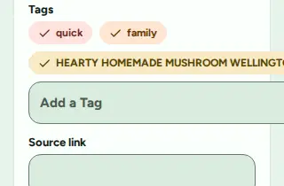 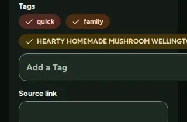

### Design
**Behaviour.**
- A selected Tag chip never runs past the Tag field. A long Tag ends in an ellipsis ("HEARTY HOMEMADE MUSHROOM …").
- The full name stays in the chip's `title` and accessible name ("Remove Tag HEARTY HOMEMADE MUSHROOM WELLINGTONS").
- At 390 px the long Tag shows in full, as today.
- Both themes unchanged.

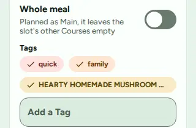 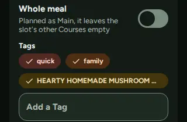 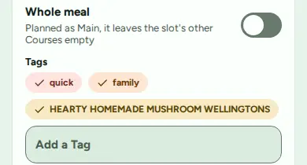

Mocks: `mocks/ds-04-editor-tags-320-light.html`, `mocks/ds-04-editor-tags-320-dark.html`, `mocks/ds-04-editor-tags-390-light.html`. Measured after at 320: `scrollWidth` 320, chip 32–288 px, label 214/280 px.

**Rules.**
- `features/recipes/recipes.css`: `.tag-input { grid-template-columns: minmax(0, 1fr); max-inline-size: min(24rem, 100%); }`. 24 rem rather than 320 px, so the long Tag still fits whole at 390 px.
- New system.md §6 rule (text below): **a chip never exceeds its line**, and its container must give it a definite width.

**Accessibility.** No change to names. The chip's remove button keeps its 44 px hit area, and P18 still checks that its ring is not clipped.

**Where it lives.** `features/recipes/recipes.css` only.

### Tests and guard
- Unit: `recipes.css.test.ts`: `.tag-input` has `grid-template-columns: minmax(0, 1fr)`.
- BDD: *Scenario: At 320 px a Recipe with a 36-character Tag can be edited without sideways scrolling.*
- Page-layout:
  - 320 in the profiles (DS-02), plus the seed adds the long Tag to the seeded Recipe; P1 catches a regression;
  - a new probe line for P13: a `.chip` whose box ends past its parent's content box, with no scroll container between them.

### Depends on / unblocks
None.

## DS-05  Leftovers tile on Today: the Recipe name paints over its meta line

**Severity** S2 · **Size** XS · **Sources** SHELL-02 · **Reproduced** Confirmed, narrower: the tile on Today only.

| Width (Today) | Title box | Painted title | Meta line | Overlap |
|---|---|---|---|---|
| 320 | 40 px, `overflow: visible` | 4 lines (80 px) | 2 lines (36 px) | 39 px |
| 360 | 40 px | 3 lines | 2 lines | 19 px |
| 390 | — | — | — | clean |

The Plan's "Leftovers to use" section uses the plain ListRow and clips correctly at every width (`overflow: hidden`).

**Where** `/` Leftovers tile at 320–389 px, light and dark.

### Problem
"Cauliflower al gorgonzola with chestnut mushrooms" overprints "1.25 portions · Use by Tue", so neither can be read. The cause is the N2 override in `features/plan/plan.css:330-339` (applied through `.plan-leftovers` in `TodayTiles.tsx:126`):
- `.plan-leftovers .list-row__title { overflow: visible; text-overflow: clip; }` keeps the 2-line clamp's box but paints every line;
- `.plan-leftovers .list-row__meta { flex-wrap: wrap }` breaks the one-line meta.

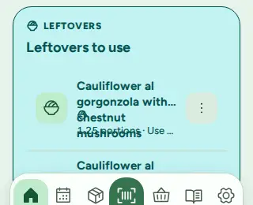 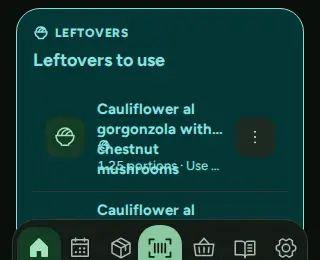 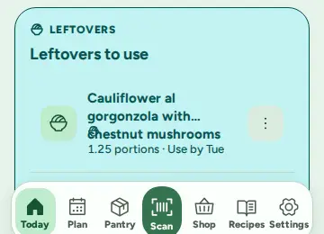

### Design
**Behaviour.**
- The tile's rows follow the ListRow anatomy (system.md §3): the Recipe name on at most 2 lines, then an ellipsis; one meta line, then an ellipsis.
- The row is 74 px at every phone width.
- **The meta reads "Use by Tue · 1.25 portions"** (decision 5), so the deciding fact survives the cut. Its spoil tone (Use-by within a day) and icon are unchanged.
- The full Recipe name stays in the row's accessible name and in the ⋮ trigger "Actions for <Recipe name>".
- Leftover questions are a separate component (`LeftoverQuestion`) and are unchanged.

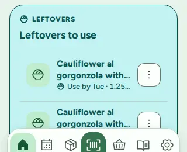 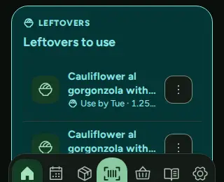 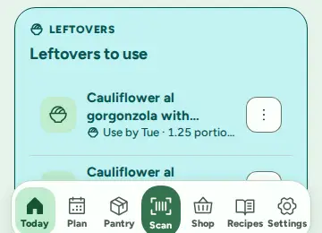 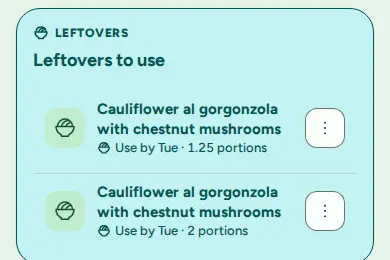

Mocks: `mocks/ds-05-today-leftovers-320-light.html`, `mocks/ds-05-today-leftovers-320-dark.html`, `mocks/ds-05-today-leftovers-360-light.html`, `mocks/ds-05-today-leftovers-390-light.html`.

**Rules.**
- Delete the two `.plan-leftovers .list-row__title` / `__meta` blocks from `features/plan/plan.css` (keep the row-height block at 324–329).
- `lib/leftovers/rows.ts:36`: `text: \`${useByPhrase(l.useBy, today)} · ${portionsLabel(l.portions)}\``. This applies on Today, Plan and Pantry.
- New system.md §3 sentence: "A screen never overrides the title clamp or the one-line meta of a ListRow; a row that needs more uses `wrapTitle` or `metaLines={2}` (§3)."

**Accessibility.** No new pairs. The meta tone contrast is already covered by `contrast.test.ts`.

**Where it lives.** `features/plan/plan.css`, `lib/leftovers/rows.ts` (+ `rows.test.ts`).

### Tests and guard
- Unit:
  - `rows.test.ts`: the text starts with the Use-by phrase;
  - `TodayTiles.test.tsx`: no `.plan-leftovers .list-row__title` override (a CSS test asserting that plan.css has no `overflow: visible` on `.list-row__title`).
- BDD: *Scenario: At 320 px Today's Leftovers tile shows each Recipe name on two lines and its Use-by on one.*
- Page-layout: new rule **P24** (always fail). For every visible `.list-row`, the title's painted bottom is `top + scrollHeight` when its `overflow` is visible, else `clientHeight`. A painted bottom more than 1 px below the meta's top is a finding. It runs at every size, with the seed's Leftover from DS-01.
- `check-ui`: none; the rule is about a measured overlap.

### Depends on / unblocks
None. PC references this for its Leftover work.

## DS-06  A real warn status tone; spoil and danger kept for food and destruction

**Severity** S3 · **Size** M · **Sources** PLAN-14 · **Reproduced** Confirmed, with corrections:
- "Not cooked" is a danger state chip. I marked today's Breakfast Not cooked on `/plan` at 390 px (`rowChips.ts:38`).
- The Couldn't plan warn causes render as spoil:
  - `couldntGroups.ts:58-79` marks `slot_rule`, `excluded`, `advance_step` and `no_fit` as warn, and `toneStyle` at lines 229–232 maps warn to `status: 'spoil'`.
  - The Dessert info cause reproduced live. The warn cause was drawn with the same component and `data-status="spoil"`.
- The Advance Steps tiles are spoil (`AdvanceStepsTile.tsx:21`, `TimelineAdvanceTile.tsx:22`). This is from the code, not seen live.
- The Stock-shortfall notice is spoil, not danger as stage 1 said (`ShortfallNotice.tsx:19`). That part of the finding is narrower.
- New sites, so the finding is also wider:
  - The Scan warning banner uses the danger foreground (`features/scan/scan.css:15-17`).
  - The Recipe Assistant's missing-key tile and its model warning chip are spoil (`SecretKeyMissingTile.tsx:8`, `AssistantToggleTile.tsx:21`, `ModelTile.tsx:27`).
  - The import's generic problems tile and its Ingredient conflict chip are spoil (`ImportScreen.tsx:201`, `IngredientMatchTile.tsx:28`).
  - The Kitchen board's overdue Advance Step is spoil (`BoardTiles.tsx:106,113`).

**Where** `/plan` and `/` (Couldn't plan, Advance Steps), Cook Mode and its Timeline, `/board`, `/scan`, `/settings/recipe-assistant` and `/recipes/import`, in light and dark, at all sizes.

### Problem
"We had takeaway" is shown in red, as if it were a failure. A rule conflict ("Every Recipe is excluded for someone who eats it") and an Advance Step are drawn in the same peach as food going off. system.md §2 reserves spoil and danger for "Use soon, went off, Throw out", and says a screen must not look alarmed. When the same colour stands for a rule, a reminder and rotting food, it stops meaning anything.

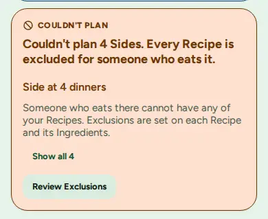 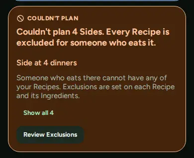 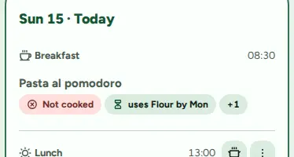

### Design
**The warn status.** Warn is fixed like every status, never derived from the accent. Its hue is 95 in OKLCH (mustard): 40° from spoil (55) and 70° from danger (25). It uses the same lightness steps as every other status.

| Token | Light | Dark |
|---|---|---|
| `--status-warn-fg` | `#564700` (L 0.40, C 0.085) | `#e4d188` (L 0.86, C 0.095) |
| `--status-warn-bg` | `#f4e8bb` (L 0.93, C 0.06) | `#362d07` (L 0.30, C 0.055) |
| `--status-warn-solid` | `#766200` (white text on it is 5.97:1) | `#766200` |

Contrast of the warn foreground for every accent preset, from `theme/palette.golden.ts`. Every pair passes AA. A status tile's border is its fg, so its contrast against the page is the "on page" figure.

| Accent | Light: fg on page / surface / surface-2 | Dark: fg on page / surface / surface-2 |
|---|---|---|
| Basil | 8.07 / 9.04 / 7.42 | 12.70 / 11.43 / 9.77 |
| Tomato | 7.97 / 9.02 / 7.25 | 12.78 / 11.57 / 9.93 |
| Saffron | 7.98 / 9.01 / 7.31 | 12.75 / 11.51 / 9.90 |
| Blueberry | 8.02 / 9.00 / 7.32 | 12.74 / 11.51 / 9.91 |
| Aubergine | 7.99 / 9.02 / 7.26 | 12.74 / 11.53 / 9.97 |
| Teal | 8.06 / 9.04 / 7.40 | 12.70 / 11.44 / 9.80 |
| Slate | 8.04 / 8.98 / 7.32 | 12.76 / 11.47 / 9.87 |

- The fg on its own bg is 7.45:1 in light and 8.97:1 in dark.
- The tinted fill alone is only 1.07:1 against the page in light and 1.42:1 in dark. That is why every status tile has a border (system.md §2).
- The difference from spoil (OKLab ΔE) is 0.040 for the bg and 0.062 for the fg.
- Warn is never the only cue: a warn tile carries its cause icon, and a warn chip carries an icon.

**Who uses which tone (decision 3).**

| Situation | Tone |
|---|---|
| Food going off: Use soon, a Leftover's Use-by within a day, the Pantry's Use soon filter | spoil |
| Went off, Throw out, a destructive action (Delete, Threw it out), an error that loses or blocks data (import read and validation errors) | danger |
| A rule or a setting that needs a decision: the Couldn't plan warn causes (Slot Rule, Exclusions, Advance Step, no fit), the Scan warning banner, the Recipe Assistant's missing key and model warning, the import's non-blocking problems and Ingredient conflicts | **warn** |
| An open question or a fact to know: To confirm, "not marked Cooked yet", the Couldn't plan info causes, the Stock-shortfall notice after Cooked, **the Advance Steps tiles on Today, in Cook Mode, on the Timeline and on the Kitchen board, overdue ones included** | **info** |
| A record, not a problem: **Not cooked** | **neutral state chip**: a `surface-2` fill, a `text` label and a muted `notCooked` (XCircle) icon |

**The Advance Steps in info.**
- **A tile with Advance Steps to do** (Today, Cook Mode, the Timeline) is the info status tile: `--color-info-bg` fill, a 1 px `--color-info-fg` border and `--color-info-fg` text. Its overline is the `advanceStep` (Alarm) icon with "Advance Steps". Copy and actions are unchanged.
- **The board's next Advance Step** is a surface tile while it is not overdue, as today.
- **An overdue Advance Step** becomes the info status tile, so it stands apart from a step that is not yet due:
  - An **"Overdue" chip** sits on its own line above the step name: a surface chip with a 1 px `--color-info-fg` ring, `--color-info-fg` text and the Alarm icon. It replaces the spoil chip.
  - The step name is `body-strong`.
  - The due line is `body-strong`: "Was due 14:00 · start now". The words are TB's and PC's; only their weight is set here.
  - Overdue steps sort first.
  - Lateness is carried by the chip, the order and the words, never by red, peach or mustard.
- Contrast of the Overdue chip:
  - its text and ring on surface: 8.94–9.00:1 in light and 10.81–10.95:1 in dark, across all seven accents;
  - its ring against the info fill: 7.37:1 in light and 8.37:1 in dark.

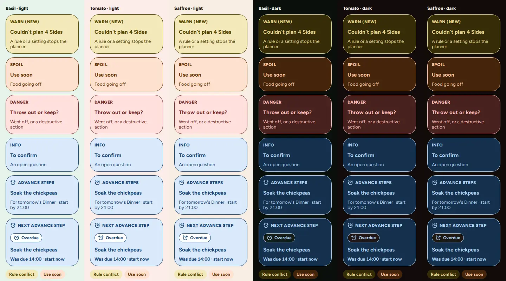

**Behaviour on the other sites.**
- The Couldn't plan tile for a warn cause becomes mustard, with its cause icon. Its copy, layout and actions are unchanged. PC redesigns the notice in PLAN-06 and uses this tone.
- "Not cooked" on a Course row becomes a neutral chip with the XCircle icon.
- Every other site in the table changes only its `status`.

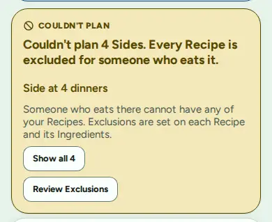 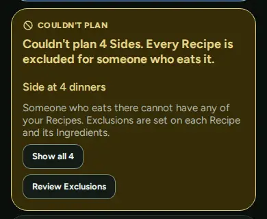 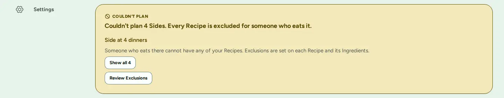 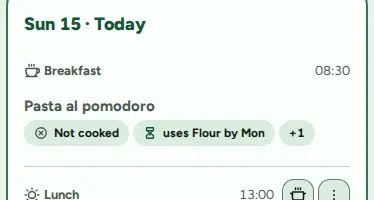 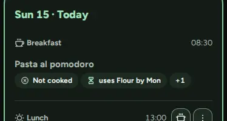

Mocks: `mocks/ds-06-warn-tone-plan-390-light.html`, `mocks/ds-06-warn-tone-plan-390-dark.html`, `mocks/ds-06-warn-tone-plan-1440-light.html`, `mocks/ds-06-tone-specimen.html`. In the Plan mocks the warn tile is the app's Dessert tile, cloned with the Exclusions copy and icon, because the seed has no Exclusion conflict.

**Rules.**
- `theme/palette.ts`: add `'warn'` to `STATUS_NAMES`, and add this to `STATUS_PALETTE`: `warn: { light: { fg: '#564700', bg: '#f4e8bb', solid: '#766200' }, dark: { fg: '#e4d188', bg: '#362d07', solid: '#766200' } }`.
- `styles.css`: add the three tokens to the light `:root` block and to both dark blocks, so the first paint has them.
- `ui/Chip.tsx`:
  - `ChipStatus` gains `'warn' | 'neutral'`. `neutral` is allowed only with `kind="state"`.
  - A new prop `overdue?: boolean` writes `data-overdue`. It is allowed only with `status="info"`.
- `ui/Tile.css`:
  ```css
  .tile[data-variant='status'][data-status='warn'] { border: 1px solid var(--status-warn-fg); background: var(--status-warn-bg); color: var(--status-warn-fg); }
  ```
- `ui/Chip.css`:
  ```css
  .chip[data-kind='state'][data-status='warn'], .chip[data-kind='status'][data-status='warn'] { background: var(--status-warn-bg); color: var(--status-warn-fg); }
  .chip[data-kind='state'][data-status='neutral'] { background: var(--color-surface-2); color: var(--color-text); }
  .chip[data-kind='state'][data-status='neutral'] > svg { color: var(--color-muted); }
  .chip[data-status='info'][data-overdue='true'] { background: var(--color-surface); color: var(--color-info-fg); box-shadow: inset 0 0 0 1px var(--color-info-fg); }
  ```
- Call sites:
  - `couldntGroups.ts`: `toneStyle('warn')` returns `status: 'warn'`.
  - `rowChips.ts:38`: `{ kind: 'state', status: 'neutral', icon: 'notCooked', label: s.skipped }`.
  - `ShortfallNotice.tsx:19`: `status="info"`.
  - `AdvanceStepsTile.tsx:21` and `TimelineAdvanceTile.tsx:22`: `status="info"`.
  - `BoardTiles.tsx:106`: `status={next?.overdue ? 'info' : undefined}`. Line 113: `<Chip kind="status" status="info" overdue icon="advanceStep">`.
  - The other warn sites in the table get `'warn'`.
  - `scan.css:15-17` uses `--status-warn-fg`.

**Accessibility.**
- Every new colour pair is listed above and passes AA.
- The neutral chip is the existing why-chip pair, which is already tested.
- The Overdue chip says its meaning in words.
- Forced colours keep the status border; A11Y designs the forced-colour borders.

**Where it lives.**
- Theme and tokens: `theme/palette.ts`, `theme/contrast.test.ts`, `theme/palette.golden.ts` (it gains warn) and `styles.css`.
- Primitives: `ui/Tile.css`, `ui/Chip.tsx/.css` and `ui/Tile.statusBorder.test.ts`.
- Plan: `features/plan/lib/couldntGroups.ts` and `features/plan/lib/rowChips.ts`.
- Cook: `features/cook/components/AdvanceStepsTile.tsx` and `TimelineAdvanceTile.tsx`.
- Pantry: `features/stock/components/ShortfallNotice.tsx`.
- Board: `features/board/components/BoardTiles.tsx`.
- Scan: `features/scan/scan.css`.
- Recipe Assistant: `features/recipe-assistant/components/SecretKeyMissingTile.tsx`, `AssistantToggleTile.tsx` and `ModelTile.tsx`.
- Import: `features/import/screens/ImportScreen.tsx` and `features/import/components/IngredientMatchTile.tsx`.

### Alternatives considered
- Info for every warn would merge "needs a decision" with "for your information".
- An amber nearer hue 75 collides with the Saffron accent (hue 70) and with spoil.
- Warn for the Advance Steps was proposed and declined by the user (decision 3).

### Tests and guard
- **Unit tests**
  - `contrast.test.ts`:
    - the warn pairs for every preset and scheme: fg on bg, page, surface and surface-2; the border on the page at 3:1 or more; the solid with white at 4.5:1 or more;
    - the Overdue chip pairs: info fg on surface at 4.5:1 or more, and the ring on the info bg at 3:1 or more.
  - `palette.test.ts`: the warn hue is at least 30° from spoil and from danger.
  - `couldntGroups.test.ts`: `toneStyle('warn')` returns warn.
  - `rowChips.test.ts`: Not cooked is a neutral state chip with the notCooked icon.
  - `AdvanceStepsTile.test.tsx` and `TimelineAdvanceTile.test.tsx`: the tile is info.
  - `BoardTiles.test.tsx`: an overdue next step is an info tile with an Overdue info chip; a step that is not yet due is a surface tile.
  - `Chip.ds.test.tsx`: neutral is allowed only on state chips, and overdue only on info chips.
- **BDD**
  - *Scenario: A Course marked Not cooked shows a neutral "Not cooked" chip, not a red one.*
  - *Scenario: A Couldn't plan cause from an Exclusion is shown in the warn tone, apart from Use soon.*
  - *Scenario: An Advance Step due today shows in the blue info tile on Today.*
  - *Scenario: On the Kitchen board an overdue Advance Step is a blue tile marked "Overdue", not a peach one.*
- **`check-ui`**: a new rule, **`status-tone`** (rule 16). It flags `status="spoil"`, `status="danger"`, `status: 'spoil'` and `status: 'danger'` in feature `.tsx` and `.ts` files outside `scripts/check-ui.allow-tones`. That file has the same form as `allow-colours`: `<path substring>   # reason`.
  - It lists the stock go-off views, the spoiled tile, the leftover rows, the Pantry filters, the board's Use soon chips, the import read and validation errors, and the confirm dialogs' danger tone.
  - The Advance Steps files are not listed.

### Depends on / unblocks
- Unblocks work in PC: PLAN-06 (the Couldn't plan notice), the Stock-shortfall notice (SHELL-14, PLAN-07, FLOW-23) and the Advance Steps tiles, which use these tones.
- The board change touches TB's board work, so serialise it with TB.

## DS-07  Type roles: body role, base headings, SectionTitle/TileHeader/Muted/Overline, `.pg__*` into `ui`

**Severity** S3 · **Size** L · **Sources** CROSS-09, SETTINGS-21 · **Reproduced** Confirmed. Census at 390 px:
- `/ingredients/1`: an unclassed `<h2>` "Picture" and "Unit Conversions" at the UA 24/normal/700, and unclassed `<p>`/`<span>` at the UA 16/normal/400.
- `/settings/shops/1` and `/products/1`: `.pg__tile-title` 20/normal/700 and `.pg__muted` 13.6/normal/400 at opacity 0.8.
- `/settings`: `.settings__overline` 12.8/normal/600 at opacity 0.75.
- `/settings/notifications`: `.notifications__muted` 14.4 px.
- Code:
  - `styles.css:372-376` gives `body` no type role;
  - `features/products/products.css:2-41` defines `.pg__*`, and **29 files** use it: products 9, shops 12, stock 5, settings 1, tags 1, ui 1;
  - unclassed `<h2>` appears in 10 places, including `PhotoPicker.tsx:17`, `ImportSource.tsx:40` and `RecipeDetailScreen.tsx:137-214`;
  - the section title has four rules besides title-3 (`.today__tile-title`, `.plan__tile-title`, `.to-confirm__heading`, `.pg__tile-title`), and "muted" has six classes;
  - `check-ui.sh` lists 18 `type-scale` violations outside the board.

**Where** every route; most visible on Ingredient, Supply, Shop and Product pages, the Recipe editor, Settings and import.

### Problem
The same element looks different from screen to screen: a section title is 18, 20 or 24 px; muted text is 13, 13.6, 14.4, 15 or 16 px, by colour or by opacity; a sentence with no class is 16 px next to 13 px meta. This is the beta.5 complaint ("all different sizes, bad typesetting") coming back through gaps the system never closed: no body role, no base headings, and a feature stylesheet acting as a shared primitive.

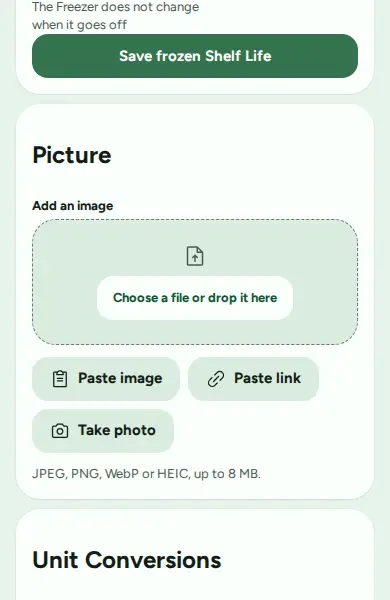 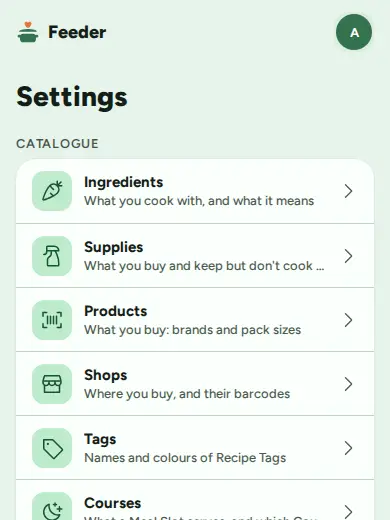 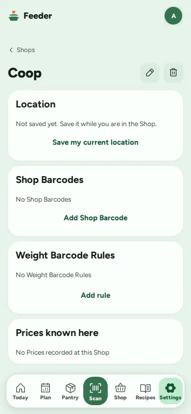

### Design
**Behaviour.**
- Unclassed text is `body` (15/22, 500).
- Every section heading inside a tile is title-3 (18/22, 800) with `--space-3` below it.
- A third-level heading is body-strong.
- Every muted line is meta (13/18, 500) in `--color-muted`.
- Every overline is the Tile overline's look (12/16, 800, caps, tracking 0.04em) in `--color-muted` where it is not inside a tone.
- Tile header rows ("To confirm", "Leftovers to use", "To get") come from one primitive.

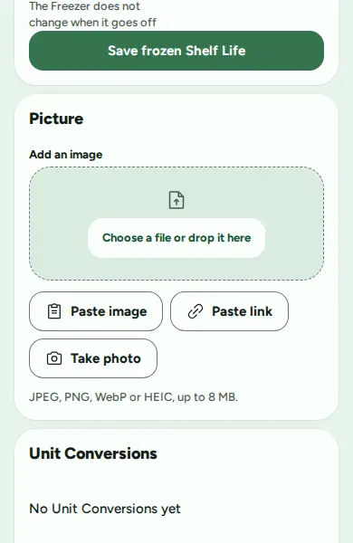 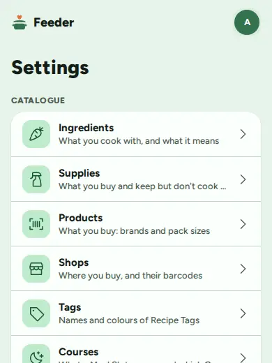    

Mocks: `mocks/ds-07-type-ingredient-390-light.html`, `mocks/ds-07-type-settings-390-light.html`, `mocks/ds-07-type-shop-390-light.html`, `mocks/ds-07-type-shop-390-dark.html`, `mocks/ds-07-type-product-1440-light.html`.

**Rules.**
- `styles.css` (base, zero specificity so any class rule wins):
  ```css
  body { font-size: var(--text-body-size); line-height: var(--text-body-line); font-weight: var(--text-body-weight); }
  :where(h1, h2, h3, h4) { margin: 0; }
  :where(h2) { margin-block-end: var(--space-3); font-size: var(--text-title-3-size); line-height: var(--text-title-3-line); font-weight: var(--text-title-3-weight); }
  :where(h3, h4) { font-size: var(--text-body-strong-size); line-height: var(--text-body-strong-line); font-weight: var(--text-body-strong-weight); }
  ```
- New primitives in `web/src/ui` (each a component plus CSS, exported from the barrel, shown in the Gallery in both schemes):

| Primitive | Renders | Replaces |
|---|---|---|
| `SectionTitle` (`as="h2"|"h3"`, default h2) | title-3, `margin-block-end: var(--space-3)` | `.pg__tile-title`, `.today__tile-title`, `.plan__tile-title`, unclassed `<h2>` in tiles |
| `TileHeader` (`icon`, `tone`, `title`, `count?`, `action?`) | the To confirm title row (system.md §9): a 32 px icon badge in the tile's tone or neutral, the SectionTitle, a count Chip, an optional trailing IconButton or Menu | `.to-confirm__heading` and the hand-built title rows on Today, Plan and Shop |
| `Muted` (`as="p"|"span"`) | meta in `--color-muted` | `.pg__muted`, `.settings__muted`, `.access__muted`, `.ra__muted`, `.plan__muted`, `.notifications__muted`, `.read-step__muted` |
| `Overline` | the overline role in `--color-muted` (Tile's `overline` keeps rendering it inside a tone) | `.settings__overline`, `.access__overline` |
| `Stack` (`gap="2|3|4"`) and `Cluster` (wrapping row, `gap="2"`) | grid and flex containers on the spacing tokens | `.pg`, `.pg__stack`, `.pg__group`, `.pg__row` |

- `.pg__error` becomes the field-error pattern (SAFE designs it). `.pg__subhead` becomes `<SectionTitle as="h3">` or the `label` role. `.pg__add-price` becomes `Cluster` with `align-self: flex-start` on the Button.
- Delete `features/products/products.css` `.pg*` (keep `.shop-location`).
- The TileHeader has no new visual: it reproduces the To confirm title row, which system.md §9 already specifies, so it needs no mock.

**Accessibility.**
- Heading levels stay as authored. The base styles change only the look, so a document outline is unaffected. `SectionTitle` requires a level.
- Muted text is `--color-muted`, which the theme already guards at 4.5:1 on surface and surface-2, instead of opacity, which measured 4.39:1 (notifications) and lower.

**Where it lives.**
- `styles.css`, `ui/SectionTitle.*`, `ui/TileHeader.*`, `ui/Muted.*`, `ui/Overline.*`, `ui/Stack.*`, `ui/index.ts`, `ui/Gallery.tsx`.
- The 29 `.pg__*` files in `features/products`, `features/shops`, `features/stock`, `features/settings`, `features/tags` and `ui`.
- CSS: `features/settings/settings.css`, `features/notifications/notifications.css`, `features/access/access.css`, `features/recipe-assistant/recipe-assistant.css`, `features/plan/plan.css` (`.plan__muted`, `.plan__tile-title`), `features/today/today.css`, `features/plan/components/TonightHero.css` (`.to-confirm__heading`), `features/import/import.css`, `features/signin/signin.css` (`.signin__title` becomes title-1).

### Alternatives considered
Keep `.pg__*` and only fix its values. That leaves a feature stylesheet as the de-facto primitive that 23 other files import, which is what CLAUDE.md forbids ("shared primitives over per-screen markup").

### Tests and guard
- Unit tests:
  - `SectionTitle.ds.test.tsx`, `Muted.ds.test.tsx`, `TileHeader.ds.test.tsx`: role, level, class and tone;
  - `tokens.css.test.ts`: `body` uses the body tokens; `:where(h2)` uses title-3;
  - a source test that no file outside `features/products` imports `products.css`.
- BDD: *Scenario: Every section heading on the Shop, Product and Ingredient pages is the same size.*
- `scripts/check-ui.rules`:
  ```
  type-scale.fail_paths=web/src/ui web/src/app web/src/features/shop web/src/features/today web/src/features/plan web/src/features/tags web/src/features/products web/src/features/shops web/src/features/settings web/src/features/notifications web/src/features/signin web/src/features/stock web/src/features/access web/src/features/recipe-assistant web/src/features/ingredients web/src/features/recipes web/src/features/import web/src/features/scan web/src/features/receipt
  opacity-muting.fail_paths=(the same list)
  ```
  Board and Cook stay warn until TB and PC give the board clock and the Cook step text their roles (new `--text-board-*` and `--text-cook-step-*` tokens; their themes).
- Page-layout: a new census probe and rule **P27** under the font-size scenario (DS-08): every visible text node's computed size is one of the role sizes at the current root size (board and Cook excluded), and no heading is larger than the page's `h1`.

### Depends on / unblocks
- Unblocks DS-08: rem tokens only scale everything once unclassed text has a role.
- Coordinate `features/plan/plan.css` with DS-05 (A merges first) and with PC.

## DS-08  Type tokens in rem: the browser text size scales every role

**Severity** S3 · **Size** S · **Sources** CROSS-10 · **Reproduced** Confirmed in Firefox with the real text-size preference at 390×844:
- At 20 and 24 px text, Today and Shop keep h1 28 px, row title 15 px and meta 13 px.
- On `/settings/shops/1` at 24 px text, `.pg__tile-title` (1.25rem) is 30 px, **larger than the 28 px h1**, and unclassed body text is 24 px beside 13 px meta.

**Where** all routes, any browser text size other than 16 px.

### Problem
Someone who sets a larger default text size gets nothing from it, while the stray rem text grows and inverts the hierarchy. It is not a WCAG 1.4.4 failure, because zoom still works, but the preference is ignored. The cause is `styles.css:6-36`: every `--text-*` token is px.

   

### Design
**Behaviour.**
- Every type role scales with the browser text size: at 24 px text the h1 is 42 px, a row title 22.5 px and meta 19.5 px, and the hierarchy holds.
- Spacing, radii, icon sizes and the nav height stay px, so extra size goes to text, not to padding.
- Rows, buttons and chips grow with their text: they use minimum heights, never fixed ones.
- Layout follows through the em breakpoints (DS-09). With 20 px text, a 390 px phone is in the narrow band and the bottom bar shows icons only (DS-02).

   

Mocks: `mocks/ds-08-rem-today-390-font20.html`, `mocks/ds-08-rem-today-390-font24.html`, `mocks/ds-08-rem-shop-390-font24.html`, `mocks/ds-08-rem-shop-page-390-font24.html`. The mocks include DS-02 and DS-07, the end state; render them in a browser with the text size preference set.

**Rules** (`styles.css`; 1rem = 16 px at the default):

| Role | Size | Line |
|---|---|---|
| display | 2.125rem | 2.375rem |
| title-1 | 1.75rem | 2rem |
| title-2 | 1.375rem | 1.625rem |
| title-3 | 1.125rem | 1.375rem |
| body-strong | 0.9375rem | 1.25rem |
| body | 0.9375rem | 1.375rem |
| meta | 0.8125rem | 1.125rem |
| label | 0.8125rem | 1rem |
| overline | 0.75rem | 1rem |
| chip | 0.75rem | — |
| nav | 0.6875rem | — |

- Weights and tracking are unchanged.
- `ui/Chip.css`: `block-size: 26px` becomes `min-block-size: 1.625rem; block-size: auto`, so a 24 px text size does not clip a chip label.
- **Never set `font-size` on `html` or `:root`.** The User's preference is the root.

**Accessibility.** Honours the User's text-size setting (WCAG 1.4.4 intent). Contrast is unchanged. Large text gains the 3:1 allowance only where a role's computed size reaches 18.66 px bold or 24 px, and no pair relies on it.

**Where it lives.** `styles.css`, `theme/tokens.css.test.ts`, `ui/Chip.css`, `ui/Chip.ds.test.tsx` (the height contract). Every screen follows from the tokens.

### Tests and guard
- Unit:
  - `tokens.css.test.ts`: every `--text-*-size` and `--text-*-line` ends in `rem`, with the values above; the 11 px floor becomes "≥ 0.6875rem"; no `font-size` on `html` or `:root`.
  - `Chip.ds.test.tsx`: a chip's height is a minimum.
- BDD: *Scenario: With a 24 px browser text size, the page title is larger than every section title on the Shop page.*
- Page-layout: a scenario `font-24` (CDP `Page.setFontSizes({ fontSizes: { standard: 24 } })`) on `/`, `/shop`, `/settings/shops/:id` and `/recipes/:id` at 390 and 1440.
  - P1 (no overflow) and P27 (role census, heading order) run there.
  - P27's message: `P27 ${sel} is ${px} px, larger than the page title (${h1} px); headings follow title-1 > title-3 > body-strong (system.md 1)`.

### Depends on / unblocks
Depends on DS-07 (body role, base headings, `.pg__*` gone) and DS-09 (em breakpoints), or larger text crowds the phone layouts.

## DS-09  One breakpoint table (em, min-width only) and the 1024 px rail handover seam

**Severity** S3 · **Size** M · **Sources** CROSS-11 · **Reproduced** Confirmed.

The census:

| Kind | Conditions in use |
|---|---|
| CSS media widths | 599/600, 559, 419 / `width < 420px`, 767 / 767.98 / 768, 820, 900, 1024, 1200, 1280, 1440 |
| Container queries | 35rem, 25rem, 340px |
| JS `useMediaQuery` | 420, 600, 768, 820, 1280 |

The seam: walking `/` from 900 to 1320 px in 20 px steps, the Bento grid has 1 column at 900–940, **2 at 960–1020, 1 at 1040**, then 2 from 1060. "Leftovers to use" goes from half to full to half width. Plan, Shop and Recipes keep or gain columns.

**Where** all routes. The seam is visible on Today at 1024–1050 px.

### Problem
The 88 px rail appears at 1024 px and takes 88 px from the content. A two-up `min="wide"` tile needs 2 × 28 rem + gap = 908 px, but at 1040 the content box is 1040 − 88 − 48 = 904 px, so Today drops to one column just as the window gets wider. Disagreeing pairs (`max-width: 767px` against `min-width: 768px`, and `max-width: 419px` against `width < 420px`) leave sub-pixel bands where neither rule applies. Gutters step at 1200, the rail at 1024 and 1440, and two-column details at 1280.

 

### Design
**The table** (diagram: `shots/ds-09-breakpoints-diagram.webp`, `mocks/ds-09-breakpoints.html`):

| Name | Condition | px at 16 px text | What changes there, and only there |
|---|---|---|---|
| narrow | `(width < 22.5em)` | < 360 | bottom bar icons only (DS-02); PageHeader `iconOnly="narrow"` Buttons (DS-03) |
| phone | base | 360–599 | the phone layout: bottom bar with labels, sheets from the bottom, `--row-value-min` 4.25rem |
| tablet | `(min-width: 37.5em)` | 600 | two-up form tiles, FormActions inline, the board wall, the Shop card grid's value column |
| md | `(min-width: 48em)` | 768 | sheets become centred dialogs; Menu, Select and Popover become popovers; Cook Mode tap zones; gutter 24, bento gap 12, tile pad 20 |
| desktop | `(min-width: 64em)` | 1024 | the 88 px rail replaces the bottom bar; `--nav-clearance` 0 |
| desktop-wide | `(min-width: 80em)` | 1280 | two-column details (Recipe, Pantry); gutter 32, bento gap 16, tile pad 26 (moved from 1200) |
| wide | `(min-width: 90em)` | 1440 | the rail expands to 240 px with labels |

**Behaviour.**
- Today keeps two columns from 940 px upward with no dip at 1024 (after: 1 column at 900–920, 2 from 940).
- Plan, Shop and Recipes are unchanged.
- With a larger text size every band starts proportionally later (decision 2).

 

Mock: `mocks/ds-09-today-1040-light.html`.

**Rules.**
- `styles.css`:
  - `--tile-min-wide: 27rem` (from 28rem);
  - the gutter, bento-gap and tile-pad step moves from `(min-width: 1200px)` to `(min-width: 80em)`;
  - every media query is rewritten to the table.
- The handover rule: at desktop, n·min + (n − 1)·gap ≤ 1024 − 88 − 48 = 888 px must hold for every tile minimum and every n that fits at 1023 px. It holds for metric (3 × 152 + 20 = 476), card (2 × 320 + 12 = 652), day (684) and wide (2 × 432 + 12 = 876). The ratio holds at 20 and 24 px text because the bands are em.
- `ui/lib/breakpoints.ts` (new):
  ```ts
  export const BREAKPOINTS = { tablet: 37.5, md: 48, desktop: 64, desktopWide: 80, wide: 90 } as const // em
  export const NARROW = 22.5 // em, used as (width < 22.5em)
  export function useBreakpoint(name: keyof typeof BREAKPOINTS): boolean // useMediaQuery(`(min-width: ${em}em)`)
  export function useNarrow(): boolean
  ```
  `useMediaQuery` stays as the internal implementation and is no longer called by features.
- **Component-fit thresholds become container queries in rem** on the component's own container (named `container-type: inline-size`):

| Today | Becomes |
|---|---|
| `ingredients.css:127` `max-width: 559px` | `@container ingredient-tiles (width < 34rem)` |
| `recipes.css:931` `min-width: 900px` | `@container ingredient-lines (min-width: 52rem)` |
| `mealSlotCards.css:87` `min-width: 820px` | `@container ms-card (min-width: 44rem)` |
| `plan.css:347` `min-width: 820px` | `@container plan-hero (min-width: 44rem)` |
| `shop.css:217` `width < 420px` and `FilterBar.css:49` `max-width: 419px` | `@container (width < 24rem)` on the header and the FilterBar |
| `SpoiledTile.tsx:31` `useMediaQuery('(min-width: 820px)')` | the tile's container query |
| `useNarrowChips.ts:7` | the Shop header's container query, no JS |
| `PriceKeypad.css:115` `@container (max-width: 340px)` | `21.25rem` |

- `max-width: 767px` / `767.98px` (Breadcrumbs, CoursePicker, scan, Toast) becomes `(width < 48em)`. `max-width: 599px` (BentoGrid, Button, FormActions, settings, access, styles) becomes `(width < 37.5em)`.
- **Landscape phones and the bottom bar** (CROSS-11's last bullet) belong to SHORT; SHORT's height condition sits beside this table.

**Accessibility.** No change of its own. The em table is what lets DS-08's larger text get room.

**Where it lives.**
- `styles.css`, `ui/lib/breakpoints.ts` (+ test), `app/shell.css`.
- Every CSS file in the census above, and every `useMediaQuery` caller: `BoardScreen.tsx:55`, `CookScreen.tsx:72`, `TimelineCookScreen.tsx:83`, `RecipeDetailScreen.tsx:52`, `useNarrowChips.ts`, `StockScreen.tsx:87`, `SpoiledTile.tsx:31`, `Menu.tsx:57`, `Select.tsx:135`, `Popover.tsx:26`.

### Alternatives considered
- Move the gutter step to 1024 (stage 1). With 32 px gutters the desktop content box is 872 px, which breaks the 27 rem two-up again; it would need `--tile-min-wide: 26.5rem`.
- px breakpoints: decision 2.

### Tests and guard
- Unit:
  - `breakpoints.test.ts`: the values, and `useBreakpoint` builds `(min-width: Xem)`;
  - `tokens.css.test.ts`: `--tile-min-wide` is 27rem, and the handover inequality for every `--tile-min-*` (computed in the test from the tokens, rail 88, gutter 24, bento gap 12).
- BDD: *Scenario: Widening the window from 900 to 1300 px never takes a column away from Today.*
- `check-ui`: new rule **`media-width`** (rule 15).
  - CSS: every `S` line from `css_scan` that starts with `@media` and has a width condition must be `(min-width: Xem)` or `(width < Xem)` with X in {22.5, 37.5, 48, 64, 80, 90}.
  - TS/TSX: `useMediaQuery\('\((min|max)-width` outside `web/src/ui/lib/` is a violation ("use useBreakpoint").
  - Container queries are exempt but must use rem.
  - Mode `warn`, with `fail_paths=web/src/ui web/src/app` at once, then each feature as its team converts it.
- Page-layout: rule **P26** (always fail) on a new `RESIZE_WALKS` entry `{ scenario: 'today-columns', route: '/', from: 900, to: 1320, step: 20 }`. For every `.bento-grid`, the column count at width w+20 is not below the count at w. Message: `P26 ${sel} drops from ${from} to ${to} columns between ${w0} and ${w1} px; size the tile minimum so the columns survive the rail (system.md 11)`.

### Depends on / unblocks
Unblocks DS-02 and DS-03 (narrow band) and DS-08. It touches CSS in almost every feature, so it is the last package (see Work packages).

## DS-10  Text-spacing resilience: Settings descriptions and the Sort value

**Severity** S3 · **Size** S · **Sources** CROSS-16 · **Reproduced** Confirmed, and wider than reported:
- **At the default spacing**, 5 of the 11 Settings hub descriptions at 390 px are already cut by their one-line ellipsis. For example, "What you buy and keep but don't cook with…" shows 242 of its 474 px.
- With WCAG 1.4.12 spacing (line-height 1.5, letter-spacing 0.12em, word-spacing 0.16em), all 11 are cut.
- On `/pantry` the Sort value "Good until" shows 68 of its 94 px.
- With the rem type tokens (DS-08) in Firefox at a 20 or 24 px text size, Sort is also cut at 390 px. At 24 px the header overflows too (`scrollWidth` 398).
- No route overflows sideways at the default text size.

**Where** `/settings` at every phone width, and the `/pantry` and `/recipes` FilterBars with text spacing or a larger text size.

### Problem
The Settings hub is a list of descriptions, and cutting them hides what each destination is. The Sort chip's job is to show the current sort, so a cut value loses content. That fails WCAG 1.4.12 and the guard's P22.

The causes in code:
- `ui/ListRow.css:171-191`: the meta line is one line by rule. That suits a status and fails a description.
- `ui/FilterBar/FilterBar.css:42-46`: Sort is allowed to shrink until its value is cut.

    

### Design
**Behaviour.**
- **Settings hub (decision 4)**
  - Each description takes up to two lines, then an ellipsis. Rows with a two-line description gain `--space-2` of block padding. A row whose description fits on one line stays 64 px high.
  - With text spacing, only the longest description, "What you buy and keep but don't cook with: toilet paper, batteries, laundry pods", is still cut at its second line. SET may shorten it: copy of at most 60 characters keeps two lines at 320 px.
- **Pantry and Recipes headers (decision 6, from DS-03)**
  - The view row stays one line.
  - When Sort cannot show its value in full, it becomes icon-only (sort glyph and chevron), named and titled "Sort: Good until". This happens at 390 px with text spacing, and at a 20 or 24 px browser text size.
  - At 24 px Stock-take is icon-only too, because at that size the narrow band (22.5em) reaches 540 px. The header then fits with no sideways scroll.
- **Status rows** (Stock Lots, Supplies, Leftovers) keep their one-line meta with an ellipsis, by design (system.md §3). The full text is in the row's accessible name, and the row opens its sheet with every detail.

     

Mocks: `mocks/ds-10-settings-390-light.html`, `mocks/ds-10-settings-390-dark.html`, `mocks/ds-10-settings-spacing-390-light.html`, `mocks/ds-10-pantry-spacing-390-light.html`, `mocks/ds-10-pantry-390-font20.html`, `mocks/ds-10-pantry-390-font24.html`. View the two font mocks in a browser with that text-size preference set.

Measured after the change:
- Cut Settings descriptions go from 5 to 0 at the default spacing, and from 11 to 1 with text spacing.
- The Pantry's Sort is icon-only and named "Sort: Good until" with text spacing and at 20 and 24 px text.
- The Pantry's `scrollWidth` is 390 at 24 px text.

**Rules.**
- `ui/ListRow.tsx`: a new prop `metaLines?: 1 | 2` (default 1), written as `data-meta-lines`. Only navigation rows (a chevron and an `href`) may set 2.
- `ui/ListRow.css`:
  ```css
  .list-row[data-meta-lines='2'] { padding-block: var(--space-2); }
  .list-row[data-meta-lines='2'] .list-row__meta { white-space: normal; align-items: flex-start; }
  .list-row[data-meta-lines='2'] .list-row__meta-text { white-space: normal; display: -webkit-box; -webkit-box-orient: vertical; -webkit-line-clamp: 2; overflow: hidden; }
  ```
- The Settings hub screen passes `metaLines={2}`.
- Sort uses DS-03's icon-only rule and its `useSortFits` hook. The hook measures in rendered px, so it follows text spacing and the browser text size with no extra rule.

**Accessibility.**
- WCAG 1.4.12 is met for the Settings descriptions.
- The Sort value is always available: shown in full, or carried in the accessible name and the tooltip.
- Each description stays part of its row link's accessible name.

**Where it lives.** `ui/ListRow.tsx/.css`, the Settings hub screen (the hub's rows), and `ui/Select` and `ui/FilterBar` (DS-03).

### Tests and guard
- **Unit tests**
  - `ListRow.ds.test.tsx`: `metaLines={2}` writes the attribute, and is refused on a row without an `href`.
  - `ListRow.css.test.ts`: the clamp is 2.
  - `sortFits.test.ts` (DS-03) covers the switch to icon-only.
- **BDD**
  - *Scenario: With WCAG text spacing, the Pantry's Sort keeps its value in its name "Sort: Good until".*
  - *Scenario: With a 24 px browser text size, the Pantry does not scroll sideways.*
  - *Scenario: Every Settings description is readable at 390 px.*
- **Page-layout guard**
  - A new scenario, `text-spacing`, injects the 1.4.12 spacing on `/settings`, `/pantry` and `/recipes` at 390 px.
  - The `font-24` scenario (DS-08) adds `/pantry` at 390 px.
  - P22 (revised in DS-03) and P1 run in both.
  - A new rule, **P28**: a `.list-row[data-meta-lines='2'] .list-row__meta-text` cut at the default spacing is a finding. Message: `P28 ${sel} "${label}" is cut at its second line; shorten the description (system.md 3)`.

### Depends on / unblocks
- Depends on DS-03 (the Sort rule) and DS-08 (rem tokens).
- SET owns the Settings copy.

## DS-11  Opacity muting, raw radii and raw spacing

**Severity** S4 · **Size** S · **Sources** CROSS-19, CROSS-20 · **Reproduced** Confirmed.

**Opacity.**
- `check-ui.sh` reports 7 `opacity-muting` violations: `board.css:282`, `cook.css:277`, `products.css:24`, `mealSlotCards.css:257`, `settings.css:17`, `settings.css:31` and `settings.css:223`.
- Its 0.5–0.95 range misses a pressed state shown only by opacity: `settings.css:201`, `.course-eaters__pill[aria-pressed="false"] { opacity: 0.45 }`. The faded name measured about 2.8:1 in light and 3.8:1 in dark, which fails 4.5:1.
- It also misses two decorative glyphs: `cook.css:81` (0.45) and `RecipeThumb.css:51` (0.4).

**Radii.** There are 10 raw values:
- `mealSlotCards.css:32,223` (16px);
- `receipt.css:107,116` (2px);
- `shell.css:313` (14px);
- `Toast.css:48` (16px);
- `ViewfinderStrip.css:4,13,48` (24, 20, 12px);
- `Checkbox.css:36` (6px).

**Spacing.** There are 53 raw gap, padding and margin values in feature and app CSS. They include off-scale 2 (15 times), 3, 6, 10, 14, 18 and 22 px. The worst files are `settings.css` (12), `board.css` (11) and `products.css` (6).

**Where** Meal Slot editor ("Who eats it"), Settings, Products and Shops, Cook Mode, the board, Toasts, the scanner viewfinder, the Checkbox.

### Problem
Opacity fades the background and the border as well as the text, and it makes contrast depend on what is behind the element. The "Who eats it" pill shows "Ben does not eat the Side" only by fading the pill to illegibility. Raw radii and spacing are why tiles and rows differ by a few pixels from screen to screen.

 

### Design
**Behaviour.**
- A Member who does not eat the Course is an outlined pill: transparent fill, 1 px `--color-outline` ring, muted name struck through, avatar on surface-2 with a muted letter. A Member who eats it keeps the filled MemberPill.
- The name measures 7.2:1 in light and 8.8:1 in dark.
- Other opacity uses become `--color-muted` text: the settings overline and muted text, the Meal Slot time, Cook's course and clock, the board's cooked Course. The archived Courses list uses the `Muted` look and keeps its "Archived" heading.
- Decorative glyphs (`aria-hidden`) may keep an opacity under a named exemption (below).

 

Mocks: `mocks/ds-11-course-eaters-390-light.html`, `mocks/ds-11-course-eaters-390-dark.html`. Radii and spacing produce no visible change beyond 1–2 px, so they need no mock (non-visual clean-up).

**Rules.**
- `features/settings/settings.css`:
  ```css
  .course-eaters__pill[aria-pressed='false'] .member-pill { background: transparent; border-inline-start-color: var(--color-line); box-shadow: inset 0 0 0 1px var(--color-outline); color: var(--color-muted); text-decoration: line-through; }
  .course-eaters__pill[aria-pressed='false'] .avatar { background: var(--color-surface-2); color: var(--color-muted); box-shadow: none; }
  ```
  The same pattern is offered as `MemberPill selected={false}` in `ui/MemberPill`, so other pressed pills reuse it. A11Y owns the general selected-state rule and this item follows it.
- **Radii:** a new token `--radius-tick: 6px` for the Checkbox. `--radius-thumb` replaces 12px; `--radius-button` replaces 16px (mealSlotCards, Toast); `--radius-control` replaces 14px (shell); `--radius-tile` and `--radius-tile-sm` replace 24px and 20px (ViewfinderStrip). The receipt's 2 px crop corners become a new `--radius-hairline: 2px`. `50%` (a circle) stays allowed.
- **Spacing:** a new token `--space-half: 2px` for icon-to-label micro gaps (the bottom bar, the MemberPill padding). 6 px becomes `--tile-overline-gap` where it is that gap, else `--space-2`. 10 px becomes `--bento-gap` where it is that gap, else `--space-2`/`--space-3`. 14, 18 and 22 px become the nearest `--space-*`. `1px` hairlines and `0` stay allowed.

**Accessibility.** The pressed state is no longer carried by contrast alone. It has a shape (outline), a decoration (strike-through) and `aria-pressed`.

**Where it lives.**
- Settings: `features/settings/settings.css`, `features/settings/mealSlotCards.css`.
- Other features: `features/products/products.css`, `features/cook/cook.css`, `features/board/board.css`, `features/receipt/receipt.css`, `features/signin/signin.css`, `features/notifications/notifications.css`.
- App: `app/shell.css`.
- ui: `ui/Toast.css`, `ui/ViewfinderStrip.css`, `ui/fields/Checkbox.css`, `ui/MemberPill/*`, `ui/RecipeThumb.css` (exempt glyph).
- Tokens: `styles.css` (new radius and space tokens).

### Tests and guard
- Unit tests:
  - `MemberPill.ds.test.tsx`: an unselected pill is outlined, not faded;
  - `tokens.css.test.ts`: the new tokens.
- BDD: *Scenario: In the Meal Slot editor, a Member who does not eat the Side is shown outlined and struck through.*
- `scripts/check-ui.sh`:
  - **`opacity-muting`**: the range becomes 0.05–0.95. It exempts selectors whose last compound is a pseudo-element (`::before`, `::after`), `@keyframes` steps (`from`, `to`, `N%`), and selectors whose last compound names `__glyph` or `__icon` (decorative, `aria-hidden`).
  - **`raw-radius`** (rule 13): `border-radius` with a px or rem number other than `0` outside a token block. `50%` is allowed.
  - **`raw-spacing`** (rule 14): `gap|row-gap|column-gap|padding(-*)?|margin(-*)?|inset(-*)?` with a px or rem number other than `0` and `1px` outside a token block, including inside `calc()`. Example awk, in the form of rule 11:
    ```awk
    $1 != "D" { next }
    alltok($3) { next }
    $4 ~ /^(gap|row-gap|column-gap|padding(-[a-z-]+)?|margin(-[a-z-]+)?|inset(-[a-z-]+)?)$/ {
      v = $5; gsub(/var\([^)]*\)/, "", v)
      if (v ~ /(^|[^0-9.a-z-])([2-9]|[1-9][0-9]+|0?\.[0-9]+|1\.[0-9]+)(px|rem)/) print "raw-spacing\t" F "\t" $2 "\t" $4 ": " $5 " on \047" $3 "\047; use a --space-* token (system.md 8)"
    }
    ```
- `scripts/check-ui.rules` additions:
  ```
  raw-radius=warn
  raw-radius.fail_paths=web/src/ui web/src/app web/src/features/settings web/src/features/products web/src/features/shops
  raw-spacing=warn
  raw-spacing.fail_paths=web/src/ui web/src/app web/src/features/settings web/src/features/products web/src/features/shops
  media-width=warn
  media-width.fail_paths=web/src/ui web/src/app
  status-tone=warn
  status-tone.fail_paths=web/src/features/plan web/src/features/cook web/src/features/scan web/src/features/recipe-assistant web/src/features/import web/src/features/board
  ```
  `RULE_NAMES` in `check-ui.sh` gains `raw-radius raw-spacing media-width status-tone`. A WP that cleans a folder adds it to the rule's `fail_paths`.

### Depends on / unblocks
- Shares files with DS-07: same package.
- Board and Cook CSS are shared with TB and PC: serialise.

## The text to add to or change in docs/design/system.md

**§1 Type.** Replace the opening paragraph, then add the blocks after the table:

> Feature CSS never sets a `font-size` other than a `--text-*` token. Muted text uses `--color-muted`, never `opacity`. **The tokens are in rem** (1rem = the User's browser text size, 16 px by default; the table shows px at the default). Never set `font-size` on `html` or `:root`.
>
> **The base.** `body` is the `body` role, so text without a class is a sentence, never the browser's 16 px. `h2` is `title-3` with `--space-3` below; `h3` and `h4` are `body-strong`; headings have no other margin. These base styles have zero specificity (`:where()`), so a class always wins.
>
> **The type primitives.** A section or tile heading is `SectionTitle`; a tile's title row (icon badge, title, count, action) is `TileHeader`; a muted line is `Muted`; an overline outside a Tile is `Overline`. Feature CSS adds no title, muted or overline class of its own.
>
> **Display text read at length is not extra-bold.** The Cook Step text keeps its size and is weight 500, Medium (`--text-step-weight: 500`).

**§2 Colour roles.** Replace the "Spoil / danger" and "Info" rows:

> | Spoil | `--status-spoil-*` | Food going off: Use soon, a Leftover's Use-by within a day |
> | Danger | `--status-danger-*` | Went off, Throw out, a destructive action, an error that loses or blocks data |
> | Warn | `--status-warn-*` | A rule or a setting that needs a decision: Couldn't plan's warn causes, the Scan warning, a missing Recipe Assistant key, import problems that do not block |
> | Info | `--color-info-*` | Open questions and facts to know: the To confirm badge, the "not marked Cooked yet" notice and its row hints, the Couldn't plan info causes, the Stock-shortfall notice, **the Advance Steps tiles** (Today, Cook Mode, the Timeline, the Kitchen board). An **overdue** Advance Step stays info: an "Overdue" chip (surface fill, 1 px `--color-info-fg` ring, Alarm icon) above its name, a `body-strong` due line, sorted first. |
> | Neutral state | `--color-surface-2` / `--color-text`, muted icon | A record that is not a problem: Not cooked |

Then add:

> **Status tones are not interchangeable.** spoil means food, danger means loss, warn means a decision, info means a question or a time to know. A feature uses spoil or danger only where `scripts/check-ui.allow-tones` lists it.

**§3 List rows.** Add after "The meta line":

> - **A navigation row** (a chevron and `href`, as on the Settings hub) may let a description meta take **two** lines (`metaLines={2}`), then an ellipsis. A status meta is always one line.
> - **A screen never overrides the clamp.** No feature CSS sets `overflow`, `text-overflow`, `white-space` or `flex-wrap` on `.list-row__title` or `.list-row__meta`; a row that needs more uses `wrapTitle` or `metaLines`.
> - **A row's meta leads with the fact that decides** ("Use by Tue · 1.25 portions"), so the cut keeps it. Secondary information about the row's subject (a Storage Place, a date) is meta: smaller and muted, under the thing it belongs to.
>
> **Structured rows, not bullet lists (R-E).** When the items of a list have a key, a state and detail, they are never a bullet list of sentences. They are a `DetailList` of `DetailRow`s:
> - the **key** in `body-strong`, `--color-text`;
> - the **state** at the row's end in `body-strong`, tabular figures, `nowrap`, in the tone of its tile (`--color-info-fg` in an info notice, `--color-text` on surface);
> - the **detail** under the key in `meta`, `--color-muted`, tabular figures.
>
> Rows have `--space-2` above and below and a 1 px divider of the tone's fg at 18 %. On a tint they sit on the tint; in a disclosure, on `--color-surface`. A DetailRow is read-only; an item the User acts on is a `ListRow`.

**§5 Actions.** Rename the section to "Actions", keep the ActionGroup text, and add:

> **Buttons look like buttons (R-A).**
> - Every action has a visible shape. A **secondary** button is a `--color-surface` fill with a 1 px `--color-outline` boundary (`box-shadow: inset 0 0 0 1px var(--color-outline)`) on every surface: 3.6–4.9:1 on surface, surface-2, the page and every status tint, warn included, for every accent in both schemes.
> - On an **accent container** (`--color-soft`, `--color-soft-strong`: a soft tile, the dark hero) the boundary is `--color-accent-text`, because the outline is only 2.7–3.5:1 there. On the light accent hero the surface fill is the boundary.
> - An **IconButton** has the same boundary; on a tinted tile its fill is `--color-surface`.
> - A destructive action that is not primary is **`danger-secondary`**: surface fill, `--status-danger-fg` text and boundary.
> - There is **no tertiary action**. The only bare-text Button is `variant="link"`: a link inside a sentence, always underlined, never an action of a tile, notice, toast, sheet footer, dialog or banner.
> - In a tile, buttons take their natural width and start-align; nothing takes a whole line it does not need.
>
> **Close (R-B).**
> - Every sheet and dialog closes with `CloseButton`: a 40 px circular outline button (transparent fill, 1 px `--color-outline`, 20 px X, 52 px target). It never stretches or squashes and is top-aligned with the title, whatever the title's length.
> - A sheet or dialog whose footer has **Cancel** (`onCancel`) shows **no** Close; Esc, the scrim and the grip still dismiss it.
> - A dialog asks **one question** in its title and offers one decision: Cancel and one primary. A long explanation becomes a one-line summary that opens to a `DetailList`.
>
> **Toasts (R-D, R-D+).**
> - A toast of one sentence is one line.
> - A toast that says more has, in order:
>   - a **headline** (`body-strong`);
>   - a **muted subline** (`meta`, `--color-bg` mixed 72 % toward the toast fill: 7.4–8.4:1);
>   - an optional **body** (`body`);
>   - its actions as **outline pills**: 40 px, transparent, `--color-bg` text, a 1 px boundary of `--color-bg` at 70 % (6.9–8.0:1).
> - A **success toast has no icon.** An icon that carries a status the words might not (error, warning, offline, waiting to sync) is 16 px, the first item of the headline line, centred on its text — never a column of its own. Its colour is the status background on the toast fill: danger, warn or info (11.6–14.2:1).
> - Dismiss is a 32 px circular outline, top-aligned with the headline. The toast grows as tall as it needs; its focus ring is `--color-bg`.
>
> **Ring room (R-C, sheets and dialogs).** A sheet or dialog body keeps 5 px of room on every side for a focus ring (3 px ring + 2 px offset) and sets `scroll-padding` to any sticky footer's height. A control nested inside a container with its own boundary follows the nested-ring rule (R-C+, owned by A11Y): its ring is inside itself and the container's accent boundary steps back, so two rings never touch.

**§6 Chips and Segmented.** Add:

> - **A chip never exceeds its line.** It is at most 100% of its container, and its container gives it a definite width: a grid track that holds chips is `minmax(0, 1fr)`, a flex item that holds them has `min-inline-size: 0`. A fixed `max-inline-size` in px is not a definite width on a narrow phone.
> - A chip is at least 1.625rem high, never a fixed height, so a larger text size does not clip it.
> - **A chip Select** (a toolbar picker: Sort, Shop) shows its value in full. When its row has no room for the value (narrow band, text spacing, a larger text size) it becomes **icon-only**: its leading glyph and chevron, its value moved into its accessible name and tooltip ("Sort: Good until"). It never shows a cut value, and its row never wraps (`useSortFits`).
> - **A count badge** ("+1") is its own round shape (pill radius, 1 px outline), never text inside another shape's edge.
> - **Segmented.** An option's label is one line. The control spans its container before any label wraps; if the labels still do not fit, the screen shortens them. An option never wraps onto two lines.

**§8 Spacing and the nav.** Add:

> - **Radii** come only from `--radius-*` (`50%` for a circle is allowed). **Gaps, padding, margins and insets** come only from `--space-*` (`--space-half` is 2 px for an icon-to-label gap); `0` and a `1px` hairline are allowed.
> - **The bottom bar (R-F).**
>   - Each destination's link is its whole track: the tap target, at least 43 × 64 px.
>   - The icon sits in a **40 × 40 px squircle** (`.bottom-bar__icon`, `--radius-thumb`), centred in the track. The current page's squircle is `--color-soft` with an `--color-accent-text` icon; Scan's is always `--color-accent` with an `--color-on-accent` icon. No other destination has a fill, and no link box is ever filled or stretched.
>   - From 360 px the label sits under the squircle on one shared baseline. In the narrow band the bar shows icons only (labels stay the accessible names), with `--space-1` side insets and 6 px inline padding.
>   - Every squircle sits at least 6 px inside the bar.

**New §11 Breakpoints and responsive rules.** Add the DS-09 table, then:

> - **min-width only**, written in **em** from the table (`(min-width: 48em)`). The one exception is the narrow band, written `(width < 22.5em)`; the larger case of the same split is `(min-width: 22.5em)`, never `max-width: X-1`.
> - A viewport breakpoint changes the **frame**: the nav, sheet versus dialog, the page's columns, the gutter. A component that adapts to **its own width** uses a container query in rem on its own named container, or, where only a measurement can tell (a chip Select's value), a measuring hook in `ui`.
> - JS reads the table through `useBreakpoint()` / `useNarrow()` in `ui/lib/breakpoints.ts`; features never call `useMediaQuery` with a width.
> - **The rail handover never takes a column away.** For every `--tile-min-*` and every column count n that fits at 1023 px, n·min + (n−1)·`--bento-gap` ≤ 1024 − 88 − 2·`--gutter`. Columns never fall as the window widens (P26).
> - **The narrow band** (below 360 px at the default text size):
>   - the bottom bar shows icons only (§8);
>   - a PageHeader holds at most one labelled Button that never collapses, and any other labelled Button in it sets `iconOnly="narrow"`;
>   - a FilterBar row stays one line and its Sort turns icon-only rather than cut its value (§6);
>   - nothing scrolls sideways at 320 px.
> - **Text spacing** (WCAG 1.4.12) and a 24 px browser text size cut no navigation description, cut no chip Select value (it turns icon-only), wrap no Segmented option, and invert no heading order.

**New §12 Overlays.**

> - A modal BottomSheet, a Dialog and a Menu's popover render into `document.body`, never inside the row, tile or slot that opened them, so they inherit nothing from it (pointer events, alignment, containment). A non-modal sheet is docked where it is mounted from 768 px.
> - A sheet's header is the title (wrapping, start-aligned) and `CloseButton` (§5), or no Close when the footer has Cancel.

**§10 Enforcement.** Change the folder list in the `check-ui.rules` row to the DS-07 list, and add these rows:

> | `button-variant` | `scripts/check-ui.sh` | `variant="tertiary"`, `"danger-tertiary"` or `"accent-secondary"` (§5). |
> | `close-button` | `scripts/check-ui.sh` | `<IconButton icon="close">` outside `ui/CloseButton`, `ui/Toast`, `ui/Chip` (§5). |
> | `sheet-cancel` | `scripts/check-ui.sh` | A file rendering `<BottomSheet>` or `<Dialog>` that passes its own `uiStrings.cancel` button instead of `onCancel` (§5). |
> | `bullet-notice` | `scripts/check-ui.sh` | A hand-written `<ul>`/`<li>` in a Tile, Notice, Toast or Dialog file; use `DetailList` (§3). |
> | `raw-radius`, `raw-spacing` | `scripts/check-ui.sh` | A radius or spacing length that is not a token (§8). |
> | `media-width` | `scripts/check-ui.sh` | A width media query not in the §11 table, or `useMediaQuery` with a width outside `ui/lib`. |
> | `status-tone` | `scripts/check-ui.sh` | `status="spoil"` or `"danger"` outside `scripts/check-ui.allow-tones` (§2). |
> | `opacity-muting` | `scripts/check-ui.sh` | Now 0.05–0.95, exempting pseudo-elements, keyframes and `__glyph`/`__icon`. |
> | Action contracts | `ui/Button.context.test.tsx`, `ui/*.cancel.test.tsx`, `ui/Toast.test.tsx`, `ui/DetailList.ds.test.tsx`, `theme/contrast.test.ts` | A `link` Button inside an action surface; Cancel removes Close; the toast anatomy and its icon rule; the DetailRow order and tones; every boundary, icon and row pair for every preset and scheme. |
> | Page-layout 320 | `scripts/lib/page-layout-rules.mjs` | 320×568 is in both profiles. **P22** a chip Select whose value is cut and that is not icon-only; **P24** a row's title paints over its meta; **P25** a target under 44 px in an open sheet, two overlapping targets, or bottom-bar labels under 4 px apart; **P26** a BentoGrid loses a column as the window widens; **P27** at a 24 px text size, a text size off the roles or a heading larger than the page title; **P28** a two-line navigation description cut; **P29** an action in a tile, toast, sheet footer, dialog or banner whose boundary is under 3:1; **P30** a Segmented option on two lines; **P31** a bottom-bar squircle that is not square or not 6 px inside the bar. P22, P24–P26 and P29–P31 are in `ALWAYS_FAIL`. |

**`scripts/lib/page-layout-rules.mjs`.**

The exact changes:
- `PROFILES.quick` and `PROFILES.full` start with `{ width: 320, height: 568, mobile: true }`.
- `SCENARIO_VIEWPORTS` gains `320` and `430: { width: 430, height: 932, mobile: true }`.
- `ALWAYS_FAIL` gains `'P24', 'P25', 'P26', 'P29', 'P30', 'P31'`.
- `SCENARIOS` gains:
  - `leftover-menu-sheet` (`/`, 320 and 390);
  - `text-spacing-settings`;
  - `text-spacing-pantry`;
  - `font-24` (`/settings/shops/:id`, 390 and 1440);
  - `font-24-pantry`;
  - `bottom-bar` (`/pantry`, widths 320, 360, 390 and 430).
- `RESIZE_WALK.from` becomes 320. `RESIZE_WALKS` gains `today-columns` (900–1320, step 20).
- `cutSelectProbe` exempts an icon-only Select whose name contains its value.
- `evaluateMetrics` adds these lines:
  ```js
  for (const c of m.cutSelects ?? []) add('P22', `${c.sel} "${c.label}" shows ${c.shown} px and cuts ${c.px} px of its value; a chip Select shows its value in full or, when it cannot, is icon-only with its value in its name (system.md 6)`)
  for (const o of m.rowTextOverlap ?? []) add('P24', `${o.sel} "${o.label}": its title paints ${o.px} px over its meta line; keep the 2-line clamp (system.md 3)`)
  for (const t of m.badTargets ?? []) add('P25', t.why === 'small' ? `${t.sel} "${t.label}" is ${t.w}x${t.h} px; a sheet row or nav target is at least 44 px` : `${t.sel} "${t.label}" overlaps "${t.other}" by ${t.px} px`)
  for (const s of m.columnDrops ?? []) add('P26', `${s.sel} drops from ${s.from} to ${s.to} columns between ${s.w0} and ${s.w1} px; size the tile minimum so the columns survive the rail (system.md 11)`)
  for (const h of m.headingInversions ?? []) add('P27', `${h.sel} is ${h.px} px, larger than the page title (${h.h1} px); headings follow title-1 > title-3 > body-strong (system.md 1)`)
  for (const c of m.cutDescriptions ?? []) add('P28', `${c.sel} "${c.label}" is cut at its second line; shorten the description (system.md 3)`)
  for (const b of m.weakBoundaries ?? []) add('P29', `${b.sel} "${b.label}" has a ${b.ratio}:1 boundary on ${b.surface}; actions have a visible boundary (system.md 5)`)
  for (const s of m.wrappedSegments ?? []) add('P30', `${s.sel} "${s.label}" wraps onto ${s.n} lines; a Segmented option is one line (system.md 6)`)
  for (const q of m.barShapes ?? []) add('P31', `${q.sel} is ${q.w}x${q.h} px at ${q.dx}/${q.dy} px inside the bar; the bar's highlight and Scan are 40 px squircles inside the bar (system.md 8)`)
  ```
- The seed adds a Leftover, a frozen Leftover and the long Tag.

**`scripts/check-ui.rules` additions.**
```
type-scale.fail_paths=web/src/ui web/src/app web/src/features/shop web/src/features/today web/src/features/plan web/src/features/tags web/src/features/products web/src/features/shops web/src/features/settings web/src/features/notifications web/src/features/signin web/src/features/stock web/src/features/access web/src/features/recipe-assistant web/src/features/ingredients web/src/features/recipes web/src/features/import web/src/features/scan web/src/features/receipt
opacity-muting.fail_paths=(the same list)
button-variant=fail
close-button=fail
sheet-cancel=fail
bullet-notice=warn
bullet-notice.fail_paths=web/src/ui
raw-radius=warn
raw-radius.fail_paths=web/src/ui web/src/app web/src/features/settings web/src/features/products web/src/features/shops
raw-spacing=warn
raw-spacing.fail_paths=web/src/ui web/src/app web/src/features/settings web/src/features/products web/src/features/shops
media-width=warn
media-width.fail_paths=web/src/ui web/src/app
status-tone=warn
status-tone.fail_paths=web/src/features/plan web/src/features/cook web/src/features/scan web/src/features/recipe-assistant web/src/features/import web/src/features/board
```
`RULE_NAMES` in `check-ui.sh` gains `button-variant close-button sheet-cancel bullet-notice raw-radius raw-spacing media-width status-tone`.

## Review round 1 (2026-11-14)
- **Mocks re-rendered.** I re-rendered every DS mock under its existing file name: 42 mock HTML files and 44 "after" WebP shots. Each mock now carries the round-1 rules in its `<style data-proposed>` block, using the same values as PC's `RULES_CSS`. The two left unchanged are the tone specimen and the breakpoint diagram, which have no actions.
- **What changed on screen:**
  - Secondary and icon buttons now have a 1 px `--color-outline` boundary.
  - Former tertiary actions in tiles become secondary buttons at their natural width:
    - the Shop page: Save my current location, Add Shop Barcode, Add rule;
    - Couldn't plan: Show all 4, Review Exclusions.
  - The Leftover ⋮ on the tinted Leftovers tile has a surface fill and the outline.
  - The Menu sheet's Close is the 40 px circular outline button.
  - Sheet bodies keep 5 px of ring room.
  - The Not cooked and Overdue chips are unchanged.
- **Corrections to PC's numbers, checked against all seven accents in light and dark:**
  - The outline holds 3:1 or better on surface, surface-2, the page and every status tint. My final warn tone (DS-06) also passes: 3.7–3.9 in light, 3.7–3.8 in dark.
  - The outline **fails on the accent containers**: 2.7–2.9 on `--color-soft-strong` (the dark hero) and 3.4–3.5 on `--color-soft`. There the boundary becomes `--color-accent-text` (5.6–8.4). On the light accent hero, the surface fill is the boundary (5.7–6.4).
  - The toast's action ring in dark is 6.9, not "above 8".
  - PC's provisional warn values (`#6b4a00`/`#fdf0c4`, `#f5d27a`/`#3a2e08`) give way to DS-06's.
- **Tertiary** is retired as an action. Only `variant="link"` stays, for a link inside a sentence, always underlined. Cancel becomes secondary, and `danger-tertiary` becomes `danger-secondary`.
- **Segmented.** The rule "an option's label is one line; the control spans its container before any label wraps" is now system text (§6), with a guard rule (P30).
- **Left as is:**
  - Couldn't plan's two buttons still stack. That tile's layout is PC's (PLAN-06).
  - Today's Use soon tile stretches to its neighbour's height at 1040 px. That is Bento row stretch, TB's item.
  - At a 24 px text size the Shop page's Edit and Delete take their own line. This is the existing 12 rem title rule working as designed.

## DS-12  Actions look like actions: Button, IconButton, Close, Toast, detail rows and sheet room as system rules

**Severity** S2 · **Size** M · **Sources** mock-review rounds 1 and 2 (build/ui-review-3/rules-round1.md R-A, R-B, R-D, the sheet part of R-C; rules-round2.md R-D+, R-E) · **Reproduced** Confirmed in code and on the DS renders:
- `ui/Button.css:65-68`: the secondary button is a `--color-surface-2` fill with no boundary, about 1.2:1 on surface.
- `ui/Button.css:86-103`: `tertiary` and `danger-tertiary` are bare text.
- Variant usage: 97 `variant="tertiary"` in features and 7 in `ui`; 14 `danger-tertiary`; 2 `accent-secondary`.
- `ui/IconButton.css:2-14`: no boundary.
- `ui/BottomSheet.tsx:64`: Close is a default IconButton that shrinks (DS-01).
- `ui/Toast.css:42-79`:
  - one label line;
  - an icon in a column of its own;
  - a tertiary action in `--color-soft`;
  - a raw 16 px radius.
- Notices that list items with a key, a state and detail set them as sentences or bullets. Examples: the Stock-shortfall notice and the Away summary (PC-02, PC-08).

**Where** every tile action, notice, toast, banner, sheet and dialog, in both themes, for every accent.

### Problem
The user's mock reviews:
- Round 1: "dismiss doesn't even look like a button", "buttons should look like buttons, actionable", the Close is "squished", and a toast with detail needs a headline, a muted subline, a body and real buttons.
- Round 2: a status icon in its own column beside a toast reads as clutter, and structured information set as a bullet list of sentences has no "hierarchy of information ... use typesetting, spacing, font weights and colors to present the information".

Every theme's mocks now assume these rules, so they belong in the primitives.

### Design
**R-A: buttons look like buttons.**
- **Secondary:** a `--color-surface` fill, a `--color-text` label and a 1 px boundary (`box-shadow: inset 0 0 0 1px var(--color-outline)`) on every surface.
  - On an accent container (`--color-soft` or `--color-soft-strong`: a soft tile, the dark hero) the boundary is `--color-accent-text`.
  - On the light accent hero, the surface fill itself is the boundary.
- **IconButton:** the same boundary. Its fill is surface-2 on surface and `--color-surface` on any tinted tile.
- **`danger-secondary`** replaces `danger-tertiary`: a surface fill with `--status-danger-fg` text and boundary.
- **No tertiary action.**
  - Every `tertiary` becomes `secondary`. That includes Cancel in FormActions, ConfirmDialog, PhotoEditSheet and PriceKeypad, and Clear in the Filters panel.
  - A new `variant="link"` exists only for a link inside running text: always underlined and `--color-accent-text`.
  - `accent-secondary` becomes `secondary`.
- Buttons in a tile take their natural width and align to the start.

Contrast for all seven accents (ranges across the accents):

| Boundary | Light | Dark |
|---|---|---|
| `--color-outline` on surface | 4.5–4.7 | 4.8–4.9 |
| … on surface-2 | 3.7–3.8 | 4.1–4.2 |
| … on the page | 4.0–4.1 | 5.3–5.4 |
| … on the info, leftover, success, spoil, danger and pinned tints | 3.7–3.9 | 3.6–3.9 |
| … on the warn tint | 3.7–3.9 | 3.7–3.8 |
| … on soft-strong | **2.7–2.9: fails** | **2.7–2.8: fails** |
| `--color-accent-text` on soft / soft-strong (the correction) | 6.7–7.3 / 5.6–5.9 | 8.2–8.4 / 6.5–6.6 |
| surface fill on the light accent hero | 5.7–6.4 | n/a |
| `--status-danger-fg` on surface | 9.5–9.6 | 11.1–11.2 |

**R-B: Close.**
- `ui/CloseButton` is a 40 px circle: transparent fill, 1 px `--color-outline` boundary (4.5–4.9:1 on the sheet surface), a 20 px X and a 52 px target.
- It has `flex: none` and is top-aligned with the title.
- Sheets and dialogs take `onCancel` and `cancelLabel`. With `onCancel`, Cancel is a secondary button at the footer's start and **there is no Close**. Esc, the scrim and the grip still dismiss.
- A dialog asks one question in its title and offers one decision.

**R-C (the sheet part; A11Y owns the ring and R-C+).**
- `.sheet__body` and `.dialog__body` keep 5 px of block padding and `scroll-padding`, plus the existing 8 px inline room.
- A sticky footer sets `scroll-padding-block-end` to its height.
- A control nested inside a bounded container follows A11Y's R-C+ (A11Y-02): its ring is drawn inside itself, the container's accent boundary steps back, and the two rings never meet.

**R-D: the toast.**
- `showToast({ status, title, subline?, body?, actions?, undo? })`. A toast of one sentence passes `title` only and stays one line.
- The anatomy:
  - `.toast__title` (body-strong);
  - `.toast__subline` (meta, `color-mix(in srgb, var(--color-bg) 72%, var(--color-text))`);
  - `.toast__body` (body);
  - `.toast__actions`: outline pills, 40 px, `--radius-pill`, transparent, `--color-bg` text and a 1 px ring of `--color-bg` at 70 %;
  - `.toast__dismiss`: a 32 px circle with a 55 % ring.
- The radius becomes `--radius-button`. The focus ring on a toast is `--color-bg`.

**R-D+: the toast's status icon.**
- A plain **success toast has no icon**: its headline already says what happened.
- An icon appears only when it carries a status the words might not. It is 16 px, **the first item of the headline line** (`.toast__title { display: flex; align-items: center; gap: var(--space-2) }`), and centred on the headline's 20 px line box. It never sits in a column of its own.
- The `.toast__dismiss` circle is top-aligned with the headline.
- Icon colours on the toast fill (`--color-text`), all seven accents:

| Status | Icon colour | Light | Dark |
|---|---|---|---|
| error | `--status-danger-bg` | 13.9–14.1 | 12.0–12.1 |
| warning | `--status-warn-bg` | 14.0–14.2 | 11.7–11.9 |
| offline, waiting to sync | `--color-info-bg` | 13.9–14.1 | 11.6–11.7 |

**R-E: structured rows, not bullet lists.**
- A new primitive, **`ui/DetailList`**, carries it: `<DetailList tone="info|warn|spoil|danger|leftover|success|neutral">` with `<DetailRow label state detail />` rows.
- It is not a ListRow. A ListRow is a 64 px tappable row with a whole-row target. A DetailRow is read-only, dense, and sits on a tint, in a toast body or in a disclosure. A row that needs an action is a ListRow.
- It renders `<ul role="list">` with one `<li>` per row, in the DOM order key, state, detail, so a screen reader reads "Flour, 200 g short, The Recipe used 300 g · Stock showed 100 g".
- Tokens:
  - row: `grid-template-columns: minmax(0, 1fr) auto; column-gap: var(--space-3); row-gap: 2px; padding-block: var(--space-2)`;
  - **key:** body-strong, `--color-text`;
  - **state:** body-strong, tabular figures, end-aligned, `nowrap`, in the tone's fg (`--color-text` for neutral);
  - **detail:** spans both columns, meta, `--color-muted`, tabular figures;
  - divider: 1 px `color-mix(in srgb, <tone fg> 18%, transparent)` between rows. It is decorative (1.3–1.6:1);
  - fill: none on a tint; `--color-surface` inside a disclosure.
- Contrast for all seven accents:

| Tone | Key (light / dark) | State | Detail |
|---|---|---|---|
| info | 13.9–14.1 / 11.6–11.7 | 7.4 / 8.4 | 5.9–6.1 / 6.7–6.8 |
| warn | 14.0–14.2 / 11.7–11.9 | 7.4 / 9.0 | 6.0–6.1 / 6.8–6.9 |
| spoil | 13.8–14.0 / 11.9–12.0 | 7.7 / 8.9 | 5.9–6.1 / 6.9–7.0 |
| danger | 13.9–14.1 / 12.0–12.1 | 7.8 / 8.9 | 5.9–6.1 / 6.9–7.0 |
| leftover | 14.2–14.4 / 11.5–11.7 | 7.3 / 9.1 | 6.1–6.2 / 6.7–6.8 |
| success | 14.2–14.4 / 11.4–11.6 | 7.3 / 9.0 | 6.1–6.2 / 6.6–6.7 |
| surface | 17.0–17.2 / 15.1–15.2 | — | 7.2–7.4 / 8.7–8.8 |

**Segmented** (system text; the selected state is A11Y's): an option's label is one line. The control spans its container before any label wraps. If the labels still do not fit, the screen shortens them.

After images (every DS mock carries these rules):

    

The toast, R-D+ and R-E anatomy appear in PC's mocks:
- `shots/pc-08-after-tile-390x844-light.webp`: a success toast with no icon;
- `shots/pc-02-after-cooked-390x844-light.webp`: shortfall rows;
- `shots/pc-08-after-away-open-390x844-light.webp`: the Away rows;
- `shots/pc-13-after-freeze-1440x900-dark.webp`: one question, Cancel plus a primary.

### Build notes
- **`ui/Button.tsx`**: the variants become `primary | secondary | danger | danger-secondary | link`.
- **`ui/lib/actionSurface.ts`**: a context provided by Tile, Toast, the BottomSheet footer, Dialog, OfflineBanner and notices. A `link` Button inside it logs `console.error`.
- **`ui/Button.css`**:
```css
.button[data-variant='secondary'] { background: var(--color-surface); color: var(--color-text); box-shadow: inset 0 0 0 1px var(--color-outline); }
.tile[data-variant='soft'] .button[data-variant='secondary'],
[data-scheme='dark'] .tile[data-variant='hero'] .button[data-variant='secondary'] { box-shadow: inset 0 0 0 1px var(--color-accent-text); }
.button[data-variant='danger-secondary'] { background: var(--color-surface); color: var(--status-danger-fg); box-shadow: inset 0 0 0 1px var(--status-danger-fg); }
.button[data-variant='link'] { background: none; padding: 0; min-block-size: auto; color: var(--color-accent-text); text-decoration: underline; }
```
  The hover and pressed states layer over the boundary: `box-shadow: inset 0 0 0 1px <boundary>, inset 0 0 0 999px <overlay>`.
- **`ui/IconButton.css`**: the boundary, a surface fill on tints, the accent-container rule, and `shape="circle"`.
- **`ui/CloseButton.*`**: new.
- **`ui/BottomSheet.*` and `ui/Dialog.*`**: CloseButton, `onCancel`, `align-items: flex-start`, and the 5 px body room.
- **`ui/ConfirmDialog.tsx` and `ui/FormActions.tsx`**: Cancel becomes secondary through `onCancel`.
- **`ui/Toast.tsx/.css`**:
  - the R-D API and anatomy;
  - the R-D+ icon rule: `status: 'success'` renders no icon, and `error`, `warning`, `offline` and `syncing` render a 16 px icon inside `.toast__title`;
  - remove `.toast > svg` and `.toast .button[data-variant='tertiary']`.
- **`ui/DetailList.tsx/.css`**: new, with `ui/index.ts` and Gallery entries for both schemes.
- **Feature sweep** (mechanical): it touches only these attributes and calls:
  - button variants: `tertiary` (97), `danger-tertiary` (14), `accent-secondary` (2);
  - `uiStrings.cancel` footers move to `onCancel`;
  - multi-sentence `showToast` calls;
  - notice lists of key, state and detail move to `DetailList`. Today these are the shortfall notice, Away and Couldn't plan "Show all"; each owning theme applies them.

### Tests and guard
- **Unit tests:**
  - `Button.css.test.ts`, `Button.context.test.tsx`, `IconButton.css.test.ts`, `CloseButton.test.tsx`;
  - `BottomSheet.cancel.test.tsx`, `Dialog.cancel.test.tsx`;
  - `Toast.test.tsx`:
    - with `subline` and `body` it renders the anatomy;
    - `status="success"` renders no `svg` in the toast;
    - an error toast's `svg` is inside `.toast__title`;
    - Dismiss is 32 px;
  - `DetailList.ds.test.tsx`: the list role, DOM order key → state → detail, the state's tone class, and that tabular figures are on.
  - `theme/contrast.test.ts`, for every preset and scheme:
    - the outline is ≥ 3 against surface, surface-2, the page and every status background;
    - accent-text is ≥ 3 against soft and soft-strong;
    - danger-fg is ≥ 4.5 on surface;
    - the toast pairs and toast icon colours are ≥ 3;
    - the DetailRow key, state and detail are ≥ 4.5 on every tone background.
- **BDD:**
  - *Scenario: Every action on a tinted tile has a visible outline.*
  - *Scenario: A sheet with a Cancel button has no Close button.*
  - *Scenario: A success toast has no icon; an error toast shows its icon before its headline.*
  - *Scenario: The Stock shortfall after Cooked lists each Ingredient as a row with its shortfall at the end.*
- **`check-ui`:**
  - rule 17 `button-variant`;
  - rule 18 `close-button`;
  - rule 19 `sheet-cancel`;
  - new rule 20, **`bullet-notice`**: a `<ul>` or `<li>` written by hand in a feature `.tsx` inside a Tile, Notice, Toast or Dialog file. Message: "use DetailList for items with a key, a state and detail" (warn, failing in `ui` and in each migrated folder).
- **Page-layout:**
  - P29: an action's boundary under 3:1;
  - P30: a Segmented option on two lines;
  - P18 extended to sheet and dialog bodies.

### Depends on / unblocks
- Depends on DS-06 (the warn tokens).
- Unblocks every theme's mocks and DS-01 (CloseButton).
- It merges first.

## Review round 2 (2026-11-14)

**DS-02 is redesigned under R-F.**
- **Before the fix:** the current-page highlight was the link box. It measured 44×54 px at 320, 44.9×54 at 360, 49.1×54 at 390 and 54.9×54 at 430. Scan was 44×58, 44.9×58, 49.1×58 and 54.9×58 at the same widths: stretched upright everywhere below 430, and only 6 px from the bar's top and bottom edges.
- **Now:** at every phone width the highlight and Scan are 40×40 px squircles (12 px radius) drawn around the icon only (`.bottom-bar__icon`). The link stays the full track, so the tap target is 43.6×68 at 320 and 49.1×68 at 390.
- **Position in the bar:** 15 px from the top and 7–8.5 px from the side in the narrow band; 8.5 px from the top with labels.
- **Correction to PC's R-F CSS:** PC shrinks the link itself to 40 px, which would shrink the tap target. I draw the shape on an inner span instead.
- **Scan size:** a 44 px Scan put its label 2 px below the others, so Scan is 40 px like the rest. It is made prominent by its accent fill, not by size.

**R-D+ and R-E** are adopted into DS-12 and system.md. R-E is carried by a new `DetailList` / `DetailRow` primitive, not by ListRow. I re-measured PC's numbers against all seven accents:
- toast icons on the toast fill: 13.9–14.2 in light, 11.6–12.1 in dark. PC had 10.9 and 9.6 for danger; mine are higher, so it still passes;
- R-E rows: the key is 13.8–14.4 / 11.4–12.1, the state 7.3–7.8 / 8.4–9.1, and the detail 5.9–6.2 / 6.6–7.0;
- the bar icon, `--color-accent-text` on soft: 6.7–7.3 in light. PC measured 7.6; 6.7 still passes;
- on-accent on accent: 5.7–6.5 / 8.7–9.3.

The Cook Step text weight is now **500**, and the system.md §1 sentence and `--text-step-weight` say so. R-C+ (nested focus rings) belongs to A11Y and is referenced in system.md.

**Re-rendered:** 20 mocks under their existing names, all with the new bar:
- DS-02: 320 light and dark, 340, 360, 390 light and dark, and 430. 390 and 430 are new and come with their before images.
- DS-01: 4. DS-07: 5. DS-08: 4.

**Craft defect fixed:** in DS-08's Today mock at 20 and 24 px text, the Leftover title painted over its meta line. That mock now includes DS-05's fix.

**Left as is:**
- DS-02's option B shots stay as the record of the option the user did not take.
- At 360–379 px the labels "Recipes" and "Settings" are 4.9 px apart. That is clear of the 4 px P25 limit and does not touch.
- The hero overline "TODAY · LUNCH · START 07:00" wraps at 24 px text. The hero is TB's.
- The two stacked buttons on Couldn't plan belong to PC (PLAN-06).

There are no toasts, bullet lists or nested focus states in the DS mocks.

## Work packages for this theme

| Package | Items | Files owned | Size | Merges after | Runs in parallel with |
|---|---|---|---|---|---|
| **DS-R Action primitives (first)** | DS-12 | `ui/Button.tsx/.css`, `ui/IconButton.tsx/.css`, new `ui/CloseButton.*`, new `ui/DetailList.*`, `ui/lib/actionSurface.ts`, the header, footer and `onCancel` part of `ui/BottomSheet.tsx` and `ui/BottomSheet.css`, `ui/Dialog.tsx/.css`, `ui/ConfirmDialog.tsx`, `ui/FormActions.tsx`, `ui/Toast.tsx/.css`, `ui/Tile.tsx` (provides `ActionSurface`), `ui/OfflineBanner.tsx`, `ui/Gallery*.tsx`, `ui/index.ts`, `theme/contrast.test.ts`. The one-attribute sweep of button variants, `uiStrings.cancel` footers and multi-sentence `showToast` calls across `features/*`. `scripts/check-ui.sh` and `.rules` (button-variant, close-button, sheet-cancel, bullet-notice). Page-layout P29 and P30. | M (primitives) + S (sweep) | — (before every other theme's UI branch; their mocks assume it) | Nothing: the sweep touches every feature folder |
| **DS-A Overlays and rows** | DS-01, DS-05 | The portal part of `ui/BottomSheet.tsx` and `ui/Dialog.tsx`, `ui/Menu/*`, `ui/ListRow.css` (target and lift), `ui/LeftoverActions/LeftoverRow.tsx`, `lib/leftovers/rows.ts`, `features/plan/plan.css` (lines 330–339), `scripts/lib/page-layout-rules.mjs` and `scripts/check-page-layout.mjs` (P24, P25, `leftover-menu-sheet`, the 320 profile), `scripts/test/fixtures/page-layout-seed.mjs` | M | DS-R | DS-C |
| **DS-C Tones** | DS-06 | `theme/palette.ts`, `theme/palette.test.ts`, `theme/palette.golden.ts`, `styles.css` (status tokens only), `ui/Tile.css`, `ui/Chip.tsx/.css`, `ui/Tile.statusBorder.test.ts`, `features/plan/lib/couldntGroups.ts`, `features/plan/lib/rowChips.ts`, `features/cook/components/AdvanceStepsTile.tsx`, `features/cook/components/TimelineAdvanceTile.tsx`, `features/stock/components/ShortfallNotice.tsx`, `features/board/components/BoardTiles.tsx`, `features/scan/scan.css`, `features/recipe-assistant/components/*Tile.tsx`, the import tone sites, `scripts/check-ui.sh` (status-tone), `scripts/check-ui.allow-tones` | M | DS-R | DS-A. Coordinate with PC and TB. |
| **DS-B Narrow band and bar** | DS-02, DS-03, DS-04 | `app/shell.css` (the bottom bar, R-F), the bottom-bar link markup in the app shell component (`.bottom-bar__icon`), `ui/PageHeader.css`, `ui/Button.tsx/.css` (`iconOnly` prop only), `ui/Select/Select.tsx/.css` (`iconOnly`), `ui/FilterBar/FilterBar.tsx`, `ui/FilterBar/useSortFits.ts`, `ui/FilterBar/lib/sortFits.ts`, `features/stock/screens/StockScreen.tsx` (one prop), `features/recipes/recipes.css` (`.tag-input`), page-layout P22, P31, the `bottom-bar` scenario and the 430 viewport | M | DS-R (Button) and DS-A (guard files) | DS-C |
| **DS-D Type and clean-up** | DS-07, DS-11 | `styles.css` (body, base headings, radius and space tokens, `--text-step-weight: 500`), new `ui/SectionTitle`, `ui/TileHeader`, `ui/Muted`, `ui/Overline` and `ui/Stack`, `ui/MemberPill/*`, `ui/ViewfinderStrip.css`, `ui/fields/Checkbox.css`, the 29 `.pg__*` files, `features/products/products.css`, `features/settings/*.css`, `features/notifications/notifications.css`, `features/access/access.css`, `features/recipe-assistant/recipe-assistant.css`, `features/plan/plan.css` (muted and title), `features/today/today.css`, `features/plan/components/TonightHero.css`, `features/import/import.css`, `features/signin/signin.css`, `features/receipt/receipt.css`, `scripts/check-ui.sh` (raw-radius, raw-spacing, opacity), `scripts/check-ui.rules` | L | DS-R, DS-A, DS-C | — |
| **DS-E Scale and breakpoints** | DS-08, DS-09, DS-10 | `styles.css` (rem tokens, `--tile-min-wide`, gutter step), `theme/tokens.css.test.ts`, `ui/lib/breakpoints.ts`, every CSS file with a width media query, the ten `useMediaQuery` callers, `ui/Chip.css` (min height), `ui/ListRow.tsx/.css` (`metaLines`), the Settings hub screen, `scripts/check-ui.sh` (media-width), page-layout P26–P28 and the text-spacing and font-24 scenarios | L | DS-R, DS-A, DS-B, DS-C, DS-D | — |

**Merge order:**
1. DS-R merges first, alone.
2. DS-A and DS-C merge next, in parallel.
3. DS-B merges after DS-A.
4. DS-D merges after DS-A and DS-C.
5. DS-E merges last.

**Shared files, edited in sequence:**
- `styles.css`: C → D → E
- `ui/Button.tsx`: R → B
- `ui/BottomSheet.tsx`: R → A
- `app/shell.css`: B → E (E only converts B's media query, which is already in em)

## Not reproduced / dropped
None. Every source finding reproduced. Corrections to stage 1:
- SHOP-10 is the same defect as FLOW-02 and is S1, not S3.
- SHELL-02 affects Today only; the Plan's section clips correctly.
- PLAN-14's Stock-shortfall notice is spoil, not danger.
- CROSS-16 is wider: five Settings descriptions are cut even without text spacing.

## What could not be checked
- **No live state for these tones.** The seed has no Advance Step or Exclusion conflict, so the Advance Steps tiles and the warn-cause Couldn't plan tile are drawn by changing the real component's `data-status`; the Dessert info cause is live. The tone changes for Cook Mode, the board, Scan, the Recipe Assistant and import are from code, not seen.
- **Text size only in Firefox.** I checked it with Firefox's real preference. I did not check Chrome's (`Page.setFontSizes`, which the proposed guard scenario uses), Safari's or iOS Dynamic Type.
- **The em band shift is not rendered.** At 20 and 24 px text, the mocks inject the narrow-band bottom-bar rule in em, but the other media queries are still px, so the full em table's layout shift is shown in the diagram, not on rendered screens.
- **No WebKit or real touch.** Nothing was rendered in WebKit. The S1 fix was verified in Chromium with touch emulation, not on a device.

