# Planning the week and cooking

This theme covers the two main jobs of the app: planning the week (the Plan's week grid, day tiles and Course rows, the Planned Meal sheet, Swap, Choose a Recipe, Couldn't plan, Who's eating) and cooking it (Cook Mode, timers, the Cooked confirmation, Stock shortfalls, Leftovers and Reheat). All 21 source findings reproduced on the theme server (http://127.0.0.1:18567, seeded, `main` @ 834ea743). For the Couldn't plan states I added a Dessert Course to every Dinner. For the photo and timer Steps I added a fixture Recipe (id 16) with a long Step, a photo, an Advance Step and two Passive timers. Two findings reproduced narrower than stage 1 reported (PLAN-15's initial focus, PLAN-17's count). One was reproduced only through its cause (FLOW-32: the 6 h stew sits at Lunch in this seed, not at Breakfast). I found one closely related risk while reproducing FLOW-04: Swap's Undo works by replanning again, not by restoring. It is folded into PC-01.

Five root causes sit behind most items:
1. **The planner changes other days and never says so.** Swap and Choose clear every unpinned meal after the target (`internal/plan/runner/snapshot.go:158-179`). The write returns no list of what changed, although `plan.Reconcile` computes one inside the transaction and throws it away (`internal/plan/plan.go:355`). That makes trust the weakest part of the Plan (PC-01).
2. **The row and the tile primitives have no room for long content.** The chip line sits inside the text column beside the icon set (`.plan-row__chips` in `features/plan/plan.css:172`). Cook Mode is one column with an uncapped photo (`features/cook/cook.css:67-71`). Timer labels inherit the Tile overline's upper case (`ui/Tile.css:106`). The week grid is auto-fill only (`PlanGrid.tsx`). These cause PC-03, PC-06 and PC-11.
3. **Things that apply to many rows are said once per row.** There is one danger tile per Stock shortfall (`ShortfallNotice.tsx`), one cause sentence per unfilled Course row, and a Couldn't plan tile as tall as a day. That is PC-02 and PC-07.
4. **Context is lost between screens.** Sheets don't name the day. Cook Mode always returns to Today (`CookScreen.tsx:78`, `TimelineCookScreen.tsx:86`, `ReheatScreen.tsx:28`). Couldn't plan's fix lands on an unexplained Recipes list. Timers vanish outside Cook Mode. Re-entry starts at Step 1. That is PC-02, PC-04, PC-07, PC-09, PC-10 and PC-12.
5. **Defaults that strand food or time.** Freeze it keeps back 0.25 of 1.25 portions. A 6 h Recipe may start at 02:30. That is PC-13 and PC-14.

**The shape of the fix:**
- **A change-feedback contract** for every write that replans: `changes[]` plus an `undoToken` in the response, one toast with Review and Undo, and a Review sheet (PC-01).
- **Three shared changes:**
  - a `below` slot on `ListRow` (PC-06; it also serves Swap and Choose);
  - a `TimerPill` primitive in the shell (PC-04);
  - a single `ShortfallNotice` that takes a list (PC-02, used by Cook Mode and Today).
- **A two-column Cook Mode** from 1024 px with a timer rail, and a sticky timer strip below that (PC-03).

Seven package-sized pieces of work close all 21 findings (see "Work packages").

| Item | Severity | Size | Title | Source ids | Status after reproduction |
|---|---|---|---|---|---|
| PC-01 | S2 | L | Plan edits change other meals silently: show what changed, with Review and Undo, and hold what should not move | FLOW-04 | Confirmed (one Swap moved 8 other cells) |
| PC-02 | S2 | M | The Cooked confirmation and Stock shortfalls: a friendly moment, one notice, one Correct Stock sheet, back to where you started | SHELL-14, PLAN-07, FLOW-23 | Confirmed (1 danger tile in Cook Mode, 3 at the bottom of Today) |
| PC-03 | S2 | M | Cook Mode Step layout: capped photo, long Step text, timers in a strip or rail, 44 px controls, safe Cancel | PLAN-04, PLAN-10 | Confirmed (the gating timer at y 1552 on a 900 px screen) |
| PC-04 | S2 | M | Timers outside Cook Mode: a shell timer pill, an in-app finish alert, resume at the last Step | FLOW-06 | Confirmed (no signal after 196 s on /plan) |
| PC-05 | S2 | M | From a Planned Meal to its Recipe, and a "Get ready" Ingredient list scaled to the planned portions | FLOW-13 | Confirmed |
| PC-06 | S2 | S | Why chips cut to stubs on Plan rows | PLAN-03 | Confirmed (10 of 23 chips cut at 390) |
| PC-07 | S2 | M | Couldn't plan as one compact tile, unfilled Course rows, and a fix that stays on the Plan | PLAN-06, PLAN-17, FLOW-18 | Confirmed; PLAN-17's "6 counted, 7 shown" not reproduced (7 and 7) |
| PC-08 | S2 | M | Who's eating on the day tile, and marking a Member away for several days at once | FLOW-12 | Confirmed |
| PC-09 | S3 | S | Planned Meal sheet: context header, one primary and one secondary, Open Recipe, Leftovers on a Cooked meal | PLAN-15 | Confirmed, narrower (initial focus is on Cook for a fresh meal) |
| PC-10 | S3 | S | Swap, Choose a Recipe and Who's eating name the day, Meal Slot and Course; real chips; no ISO dates | PLAN-11 | Confirmed |
| PC-11 | S3 | M | The week grid at every size: 7 columns from an 1100 px container, no orphan day | PLAN-08 | Confirmed (1440: 3/3/1; 1920: 4/3; 820: 2/2/2/1) |
| PC-12 | S3 | S | The last Step of a meal on a future date is a dead end | PLAN-09 | Confirmed |
| PC-13 | S3 | S | Leftover defaults strand portions; Leftovers of one Recipe show twice | FLOW-24 | Confirmed (Freeze it defaults to 1 of 1.25) |
| PC-14 | S3 | M | The planner has no earliest start: long Recipes can be planned for an early Meal Slot | FLOW-32 | Confirmed in code; seen as a 6 h stew starting 07:00 for Lunch |
| PC-15 | S4 | S | Reheat: ±30 s buttons wrap raggedly; two filled primaries | PLAN-18 | Confirmed |
| PC-16 | S4 | XS–S | Polish in the Plan and Cook Mode | PLAN-19 | Confirmed (each part checked) |

## Decisions for the user

The user decided every question on 2026-11-14 ([decisions.md](decisions.md), PC 1–8). Each line gives the choice and the mocks of the options.

1. **How far an edit may change the week (PC-01). Decided as recommended.** The planner replans only what the edit breaks, and a Bought meal never moves as a side effect of another meal's change. Every such edit shows the "What changed" toast with Review and Undo. The "Keep the next days as planned" setting is **not built**; its design is kept as an appendix note in PC-01 ([pc-01-hold-options.html](mocks/pc-01-hold-options.html)).
2. **Week grid on wide screens (PC-11). Changed after the mock review: B.** The grid auto-fills by `min="day"` (at most 4 columns), and the days of an incomplete last row share it. 7 compact columns (A) is the option not taken. system.md §4 is amended. Mocks: [pc-11-grid-b.html](mocks/pc-11-grid-b.html); not taken: [pc-11-grid-a-seven.html](mocks/pc-11-grid-a-seven.html).
3. **A Member away for several days (PC-08). Changed: option (b).** Away is a new record on the Member, with a date range that may reach past the Planning Horizon or have no last day yet: [pc-08-away-sheet.html](mocks/pc-08-away-sheet.html), [pc-08-member-away.html](mocks/pc-08-member-away.html), [pc-08-whos-eating.html](mocks/pc-08-whos-eating.html).
4. **Marking a future meal Cooked (PC-12). Decided as recommended.** A meal cannot be marked Cooked before its date ([pc-12-future-last-step.html](mocks/pc-12-future-last-step.html)).
5. **Earliest start (PC-14). Decided as recommended.** A Household setting "Earliest start", default 06:30. A Pinned meal is only flagged, never refused ([pc-14-earliest-start.html](mocks/pc-14-earliest-start.html)).
6. **How Cook Mode opens (PC-05). Decided as recommended.** A Planned Meal opens on a "Get ready" tile with the Ingredients scaled to the planned portions ([pc-05-get-ready.html](mocks/pc-05-get-ready.html)).
7. **Leftovers of one Recipe with the same Use-by (PC-13). Decided as recommended.** They show as one row ([pc-13-leftovers.html](mocks/pc-13-leftovers.html)).
8. **Undo after Cooked (PC-02, PC-09). Decided by SAFE 2.** Cooked and Not cooked can be undone from the toast and from the Planned Meal sheet until the end of the household day (SAFE-03). The secondary place is **Undo Cooked**.
9. **Related decision, DS 3.** Advance Steps tiles use the **info** tone on Today, in Cook Mode and on the board.

## PC-01  Plan edits change other meals silently: show what changed, with Review and Undo, and hold what should not move
**Severity** S2 · **Size** L · **Sources** FLOW-04 · **Reproduced** Confirmed: one Swap moved 8 other cells (`d-plancook/scripts/diff.mjs`).
**Where** `/plan` (Swap, Choose a Recipe, Pin and Unpin, Who's eating, Away, Not served, Regenerate) and any second User's edit; all sizes; light and dark

### Problem
**What I measured:**
- I swapped Mon 16 Dinner Main through the API that the Swap sheet uses (`PUT /api/plan/2026-11-16/3/1`). Eight other cells changed between Tue 17 and Sat 21. Examples:
  - Tue Lunch went from Lentil soup to Chicken curry;
  - a Leftover meal on Thu Dinner became a fresh Batch;
  - Fri Breakfast became a Leftover of the stew.
- The app said only "Swapped · Undo".
- Stage 1 also saw:
  - Choose a Recipe change 8 cells, with no toast;
  - a second User's Swap change 6 cells;
  - a new Recipe add 6 Shopping List lines after the list was complete;
  - Regenerate give no feedback at all.

**Why it matters:** someone who has planned and shopped cannot trust that tomorrow is still what they bought for, and cannot see what moved.

**Cause in code:**
- **Swap, Choose and confirm clear too much.** They set `runOpts.after` (`internal/plan/runner/runner.go:96`), which clears every unpinned meal after the target (`runner/snapshot.go:158-179`).
- **The changes are never reported.** The response is `SetResult{Meal, Covered}` (`httpapi/handlers.go:247`), and the event carries no changes (`runner.go:154`).
- **The list of changes already exists, then is thrown away.** `plan.Reconcile` computes `Changes{Upserts, Deletes,…}` inside the write (`plan/types.go:256`, `plan.go:355`), next to the before-Snapshot (`runner.go:175-201`).
- **Swap's Undo works by chance (new in stage 2).** It replans twice (`usePlanActions.ts:61-65`). It worked in my run only because the planner is seeded by the generation counter (`plan.go:59`).
- **Bought meals are only held for automatic replans** (`planner/state.go:313-315`), so a Swap can move them.

### Design
**Behaviour, all sizes:**
1. **Every write that can replan returns what it changed beyond its own target:**

   ```
   changes: [{date, mealSlotId, courseId, before:{recipeId, recipeName, servedFromLeftover}, after:{…}, why:[…]}]
   undoToken
   shoppingDelta: {added, removed}
   ```
2. **No other change:** a one-line toast, "Swapped", with Undo. It has no icon (R-D+).
3. **Other meals changed:** the toast follows R-D and R-D+. It has role status, stays 10 s, and pauses while focused or hovered.
   - **Swap:**
     - headline **"Swapped Tue Breakfast"**, with no icon, because it is a success;
     - muted subline **"2 other meals changed"**;
     - body **"Tue Lunch is now Chicken curry. Wed Dinner is now Lentil soup."** (up to 3 meals, then "and 4 more");
     - outline buttons **Review** and **Undo**;
     - Dismiss as a top-aligned circle.
   - **Other edits** follow the same pattern:
     - "Recipe chosen for Sun Dessert" / "3 other meals changed";
     - "Attendance saved for Tue Dinner" / "1 other meal changed";
     - "Ben is away" (PC-08);
     - "Tue Dinner not served";
     - "Plan regenerated" / "22 meals changed".
   - **A second User's edit:** "Anna swapped Thu Dinner" / "2 other meals changed", with Review only.
   - **A failed Undo** is an error toast. The 16 px warning icon sits in the headline line: "Nothing was undone" / "The plan changed since your Swap" / "Anna swapped Thu Dinner after you. Review the week and change it by hand."
4. **Changed rows** keep an info-tone bar on their start edge and the meta "was Lentil soup" (with the ArrowsClockwise icon). The marks stay until the person leaves the Plan or opens Review.
5. **Review** opens "What changed": a sheet on a phone, a dialog from 600 px. It has:
   - the context line "After your Swap · 2 other meals";
   - a lede;
   - R-E rows grouped by day:
     - key: the new Recipe;
     - detail: "Lunch · Main · was Lentil soup";
     - the first why chip;
   - the Shopping List delta;
   - footer: **Undo all** (secondary) and **Keep the changes** (primary);
   - the R-B Close.
6. **Undo** calls `POST /api/plan/restore {undoToken}`. It writes the Snapshot back exactly, in one transaction, with no replan. A stale token answers 409, which shows the error toast above.
7. **Holding (decided):**
   - Swap, Choose and confirm keep every later meal that is still valid.
   - A Bought meal is never changed by another meal's edit.
   - Spec §7.3 becomes "replans the later unpinned cells that the change makes invalid".

**States:**
- Loading: the toast appears after the response.
- Offline: RES's treatment.
- More than 10 changes: Review scrolls, and its footer stays sticky (SHORT).

**Rules:**
- The changed bar is `inset 3px 0 0 var(--color-info-fg)`; info-fg on surface is 9.0 (light) and 10.8 (dark).
- The toast follows R-D and R-D+, buttons R-A, Close R-B, rows R-E.
- On a phone under 360 px, the bottom bar follows R-F.

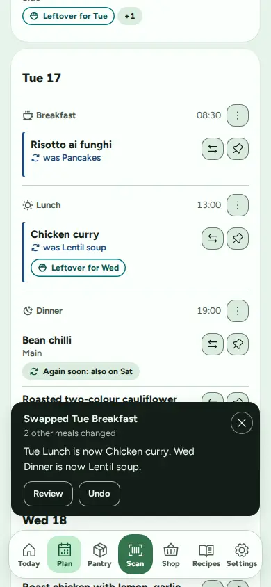 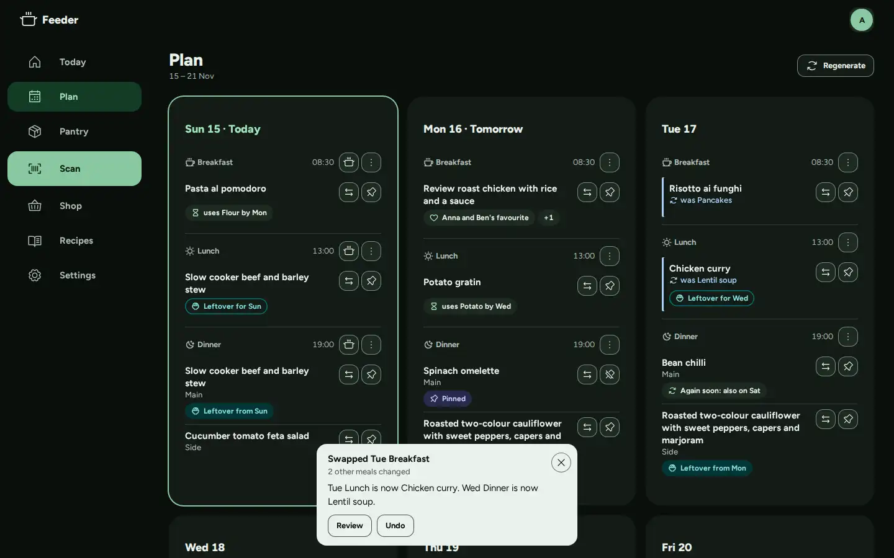
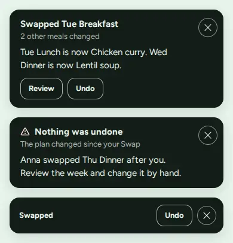 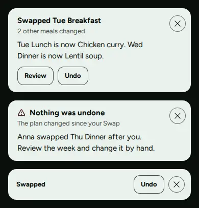
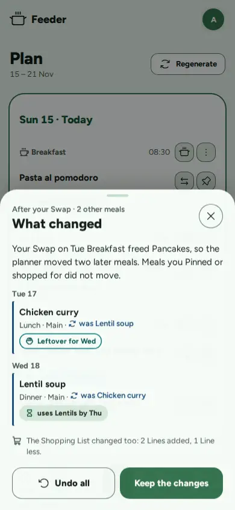 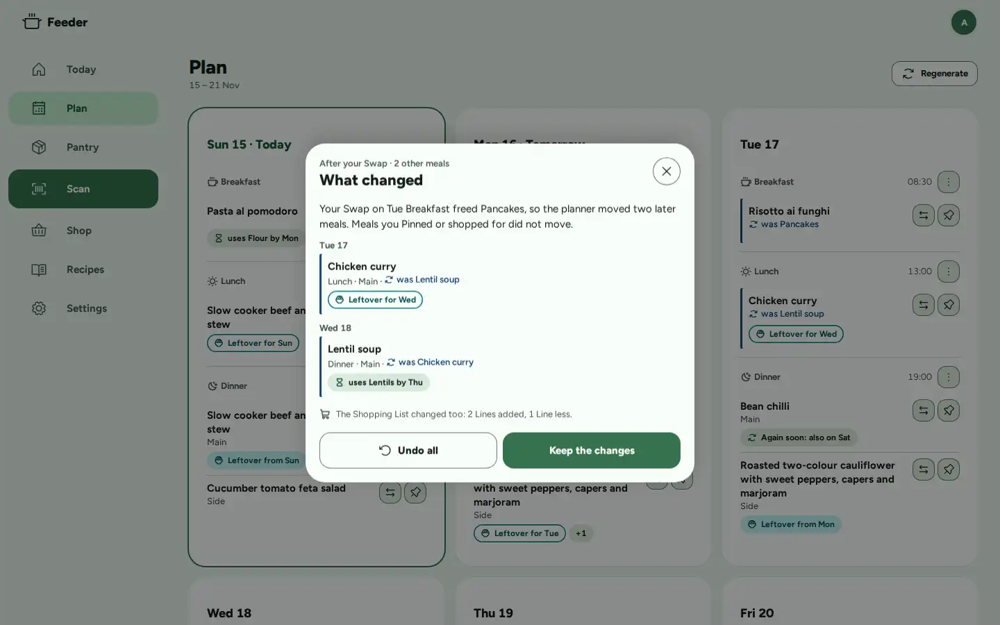
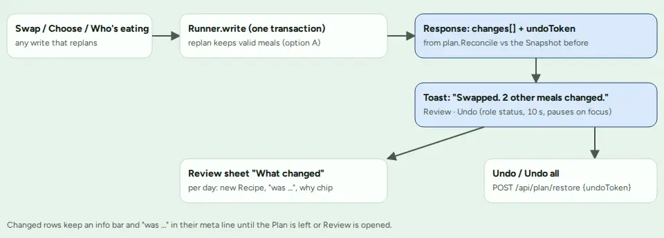
Mocks: [pc-01-replan-toast.html](mocks/pc-01-replan-toast.html), [pc-01-toast-variants.html](mocks/pc-01-toast-variants.html), [pc-01-replan-review.html](mocks/pc-01-replan-review.html), [pc-01-replan-flow.html](mocks/pc-01-replan-flow.html).

**Accessibility:**
- **Toast:**
  - role status;
  - buttons named "Review 2 changed meals" and "Undo the Swap and 2 other changes";
  - its ring is `--color-bg` (R-C);
  - the error icon is `aria-hidden`, because the headline carries the meaning.
- **Review** focuses its title. Closing it returns focus to the edited row.
- **"was …"** is part of the row's accessible name.

### Alternatives considered
- **A dry-run preview for each Swap alternative.** Rejected for cost.
- **A "Put back" button on each Review row.** Kept out of v1.

**Appendix note: "Keep the next days as planned" (designed, not built).**
- A Planning rules setting: Off, Today, 2 days, 3 days.
  - The Segmented control spans the tile, and each option is one line.
  - **Segmented rule (DS):** options share the width equally and never wrap. When they cannot fit at 320, the control becomes our Select.
- **At 320** the page shows the R-F icon-only bottom bar, with the Settings highlight as a squircle inside the bar.
- **Building it** is still an open question with the user.

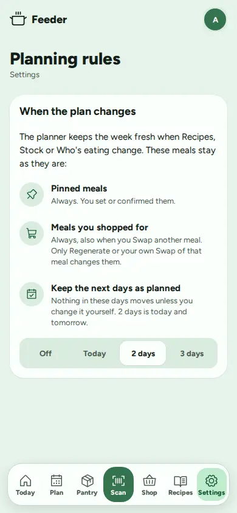 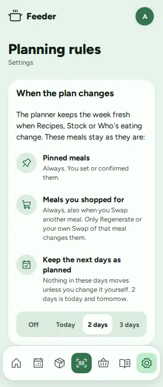 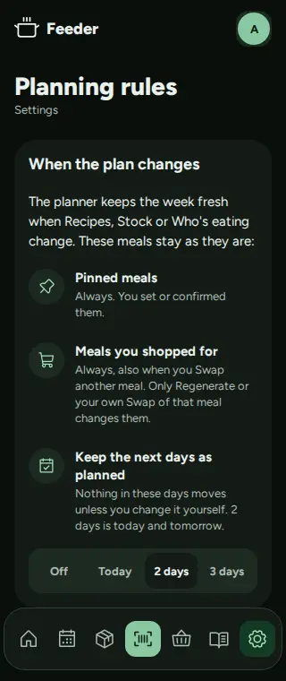 · [pc-01-hold-options.html](mocks/pc-01-hold-options.html)

### Build notes
- **Backend, runner and planner:**
  - `internal/plan/runner` (`write`, `planIn`) maps `Changes` and the before-Snapshot to `[]CellChange` and stores an `undoToken`. Away (PC-08) registers its before-state under the same token.
  - The writes that return changes are:
    - the Planned Meal PUT, `…/unpin` and `…/confirm`;
    - the attendance PUT and the slot-date PATCH;
    - the Away endpoints;
    - Regenerate.
  - New endpoint: `POST /api/plan/restore`.
  - The `plan.invalidate` event gains `by` and `changes`.
  - `runner/snapshot.go:158-179` keeps valid cells.
  - `planner/state.go:288-327` holds Bought meals under `after`.
- **Web:**
  - `api.ts` and `hooks/usePlanActions.ts`;
  - new `lib/replan.ts`, pure: headline, subline, body and status;
  - `hooks/useReplanReview.ts` and `components/ReplanReviewSheet.tsx`;
  - `PlanCourseRow.tsx` and `hooks/usePlanLiveUpdates.ts`;
  - the toast is DS's rich `Toast` (R-D, R-D+);
  - the bottom bar is DS-02 (R-F).
- **Spec:** amend §7.3.

### Tests and guard
- **Go:**
  - "Swap returns the cells it changed beyond its target."
  - "Restore with a fresh token writes back the Snapshot exactly."
  - "Restore with a stale token answers 409."
  - "A Bought meal is not changed by another meal's Swap."
  - "A valid later meal is kept after a Swap."
- **Web:**
  - `replan.ts`: copy and status for 0, 1, 3 and many changes, for each kind of edit;
  - a success toast renders no icon, and an error toast renders it inside `.toast__head`;
  - `ReplanReviewSheet` groups changes by day.
- **BDD:**
  - *Swapping a meal tells me which other meals changed.*
  - *Undo after a Swap puts every changed meal back.*
  - *Undo after another edit says nothing was undone.*
  - *A second User's Swap shows me what changed.*
  - *Meals I shopped for do not move when I swap another meal.*
  - *Meals that still fit stay where they are after a Swap.*
- **Guard:** page-layout scenario "plan-after-swap" at 390 and 1440.
  - The toast has a headline, a subline and two bordered buttons.
  - A success toast contains no status `svg`.
  - Every `[data-changed]` row has a "was" text.
  - At 320, every `.bottom-bar__link` box lies inside `.bottom-bar`, and the current link's box is square.

### Depends on / unblocks
- **Depends on:**
  - SAFE's Undo pattern;
  - DS's `Toast` (R-D, R-D+);
  - DS-02 (R-F).
- **Unblocks:** PC-07 and PC-08.

## PC-02  The Cooked confirmation and Stock shortfalls: a friendly moment, one notice, one Correct Stock sheet, back to where you started
**Severity** S2 · **Size** M · **Sources** SHELL-14, PLAN-07, FLOW-23 · **Reproduced** Confirmed.
- In Cook Mode, one danger tile sits inside the success tile, and the only way out is "Back to Today".
- From Today, cooking Sat Breakfast gave 3 danger tiles at y 1129–1417 on an 844 px screen, plus two identical toasts.
- Stage 1 counted 5 danger tiles on a two-Course Dinner.

**Where** Cook Mode after Mark as Cooked or Mark all Cooked (also Reheat); Today after Cooked; all sizes; light and dark

### Problem
- **Success becomes an error page.** There is one red `ShortfallNotice` per Ingredient (`ShortfallNotice.tsx`, `status="danger"`, each with role alert), inside `CookedConfirmation`.
- **The sentence repeats** as a toast (`useCookFlow.ts:62`).
- **Every way out leads to Today.** `CookScreen.tsx:78`, `TimelineCookScreen.tsx:86` and `ReheatScreen.tsx:28` all call `navigate('/')`.
- **Correct Stock is ambiguous.** It asks for a total without saying before or after cooking, and it summed two Recipes (FLOW-23).
- **The buttons don't look like buttons.** Round 1: "dismiss doesn't even look like a button" (R-A).
- **The list has no structure.** Round 2, on the shortfall bullets: "the ingredient is key, what's up with it then the detail information" (R-E).

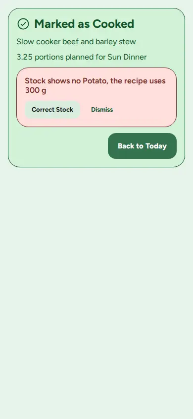 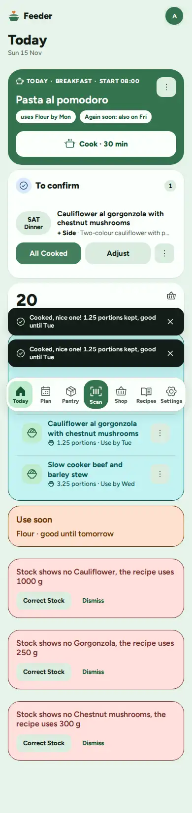

### Design
**Cook Mode:**
- After Mark as Cooked, a full-height confirmation replaces the Step:
  - a 96 px success check that pops in; with reduced motion it simply appears;
  - **"Cooked, nice one!"** (`title-1`, focused);
  - the Recipe name and "Sat Dinner".
- Then up to two tiles:
  1. **Where the Leftover went.** A leftover tile: "1.25 portions kept" / "Planned for Mon Dinner · Use by Tue".
  2. **One Stock-shortfall notice.** An info tile with role status:
     - title "Stock was short for 3 Ingredients" (with one shortfall: "Stock was short for Cauliflower");
     - **one R-E row per Ingredient and Recipe line**:

       | Key (`body-strong`, text) | State (end, `body-strong`, info-fg, tabular) | Detail (`meta`, muted, tabular) |
       |---|---|---|
       | Cauliflower | none in Stock | The Recipe used 1000 g |
       | Gorgonzola | none in Stock | The Recipe used 250 g |
       | Chestnut mushrooms | 200 g short | The Recipe used 300 g · Stock showed 100 g |

       Rows sit on the info tint, divided by 1 px info-fg at 18 %. With two Recipes, the detail names the Recipe: "Chicken curry used 500 g". Amounts are never summed across Recipes.
     - the line "Stock stays where it is. Correct it if some was left." (`meta`, muted);
     - **Correct Stock** and **Dismiss**, as outlined secondary buttons on surface (R-A).
- **Footer:** an ActionGroup with primary **Back to Plan** or **Back to Today** (from the origin), and secondary **Undo Cooked**, outlined (SAFE-03). Undo reopens the meal, gives back its Stock, removes the Leftover and the notice, and returns to the last Step.
- No toast is shown in Cook Mode.

**Today and Plan:**
- **Toast** (R-D, R-D+): headline "Cooked, nice one!" with no icon, subline "Sat Dinner", body "1.25 portions kept for Mon Dinner.", and an outlined **Undo** (SAFE-03).
- **One shortfall notice:**
  - title "Stock was short for 3 Ingredients";
  - subline "Sat Dinner · Stock stays where it is";
  - the same R-E rows;
  - **Correct Stock** and **Dismiss**.
- **Placement:** Today puts it after the hero and To confirm (TB's call). Several Cooked meals merge into one notice, grouped by meal.

**Correct Stock:**
- One sheet, with the R-B Close.
  - Title "Correct Stock", context "After cooking Cauliflower al gorgonzola".
  - Lede: "How much of each is left now, after cooking? Leave 0 if it is all gone."
- **One R-E row per Ingredient:**
  - key: the name;
  - detail: "The Recipe used 1000 g · Stock showed none";
  - at the end: a `Stepper` with its unit, in place of the state.
- **Save** writes one Stock-take per changed row and toasts "Stock corrected for 2 Ingredients".

**Return to origin:**
- Entries pass `state.from`.
- Exit and the confirmation use it and its label.
- With no origin, Cook Mode returns to Today.

**Sizes:**
- Phone: the actions sit at the bottom.
- From tablet: a centred column of at most 40 rem.
- Landscape is SHORT's.

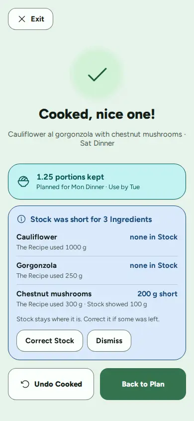 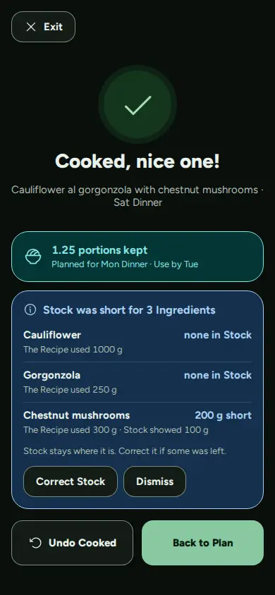
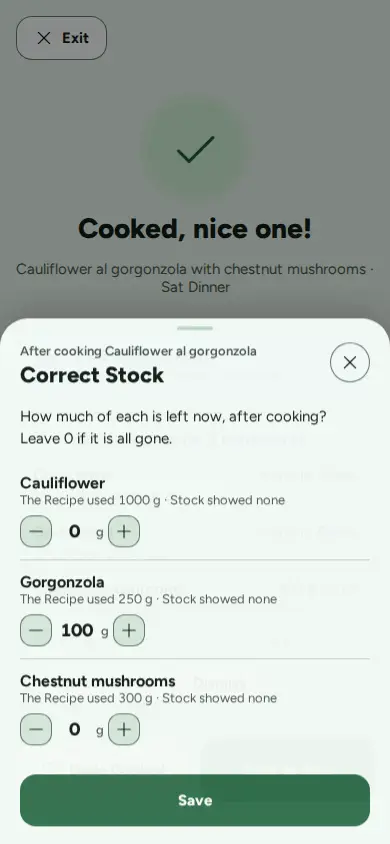 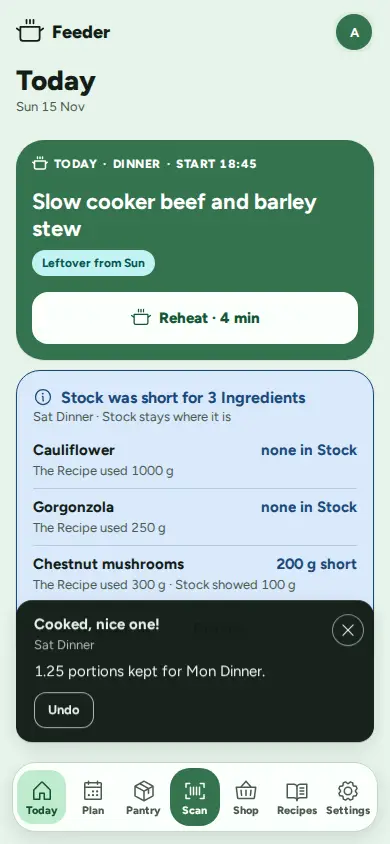
Mocks: [pc-02-cooked.html](mocks/pc-02-cooked.html), [pc-02-correct-stock.html](mocks/pc-02-correct-stock.html), [pc-02-today.html](mocks/pc-02-today.html).

**Accessibility:**
- The heading takes focus.
- The notice is role status.
- The shortfall rows are a `list`. Each item reads "Cauliflower, none in Stock. The Recipe used 1000 g".
- Undo Cooked is named "Undo Cooked for Sat Dinner".
- Targets are 44 px.
- Contrast:

  | Element | Light | Dark |
  |---|---|---|
  | key on info-bg | 15.0 | 11.4 |
  | state, info-fg | 7.4 | 8.4 |
  | detail, muted | 6.1 | 6.7 |
  | button boundaries | 3.7 | 3.8 |

### Build notes
- **Notice and its library:** `ShortfallNotice.tsx` takes `warnings[]` and renders `ListRow`-style notice rows (R-E, DS). New `lib/shortfall.ts`, pure: key, state ("none in Stock" / "N g short"), detail, and grouping by meal.
- **Correct Stock:** `StockCorrectionSheet.tsx` and `useStockCorrection.ts`.
- **Confirmation:** `CookedConfirmation.tsx` gets `onLeave`, `leaveLabel` and `onUndo`.
- **Toasts:** `useCookFlow.ts` shows no toast in Cook Mode. Undo uses SAFE-03's reopen.
- **Origin:** `lib/cook.ts`; `navigate(from)`; entry points pass `state.from`.
- **Backend:** none. The warnings already carry used and in-Stock amounts. If "Stock showed 100 g" is missing, add `stockBefore` to the warning, as a one-field handler change.

### Tests and guard
- **Unit:**
  - `ShortfallNotice` renders one tile and one row per line.
  - `shortfall.ts`: the state text for zero Stock and for a partial shortfall, and amounts are never summed across Recipes.
  - The confirmation names the origin.
  - No toast in Cook Mode.
  - Undo calls reopen.
- **BDD:**
  - *After cooking, I see one notice listing each short Ingredient with what is missing.*
  - *I correct Stock for all short Ingredients in one sheet.*
  - *Cook Mode returns me to the Plan when I started there.*
  - *A Cooked confirmation never shows a danger tile.*
  - *I undo a Cooked from the confirmation.*
- **Guard:** "cooked-confirmation" at 390 and 1440.
  - No `[data-status=danger]`.
  - No `ul > li` with free text inside `.cook-confirmation` (R-E).
  - The primary is in the viewport.

### Depends on / unblocks
- SAFE-03.
- TB.
- SHORT.
- DS (R-A, R-D, R-D+, R-E).

## PC-03  Cook Mode Step layout: capped photo, long Step text, timers in a strip or rail, 44 px controls, safe Cancel
**Severity** S2 · **Size** M · **Sources** PLAN-04, PLAN-10 · **Reproduced** Confirmed on Recipe 16, Step 2 of 5.
**Where** `/cook/*` on a phone in portrait, a tablet and a desktop (landscape and short screens are SHORT's PLAN-01); light and dark

**Measured:**
- At 1440×900:
  - the 50-word Step fills 8 lines at 58 px;
  - the photo is 1016×635;
  - the only timer is at y 1552;
  - the held line names a timer that is two screens down.
- At 390 the timer is at y 957.
- Pause and Cancel are 32×32, 8 px apart.
- Timer labels are 12 px, weight 800, upper case and cut off.
- Cancel acts at once.

### Problem
**Causes:**
- The photo has no maximum height (`cook.css:67-71`).
- Step text has one size for every length.
- Timers sit under the Step, labelled with upper-case Tile overlines (`ui/Tile.css:106`).
- The Advance Steps tile repeats on every Step, in the spoil tone.

**What the user said:**
- Round 1: "I like the large font, but bold is a bit too much" and "The pause button overflows the focus ring".
- Round 2: "The pause button focus ring merges with the component focus ring, looks amateurish. Make it look designed."
- Follow-up: the user asked "Are the recipe steps still in bold?" and chose **Medium (500)** for the Step text.

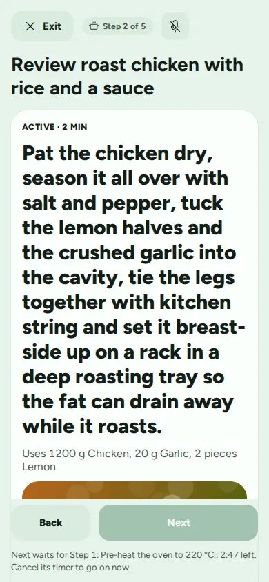 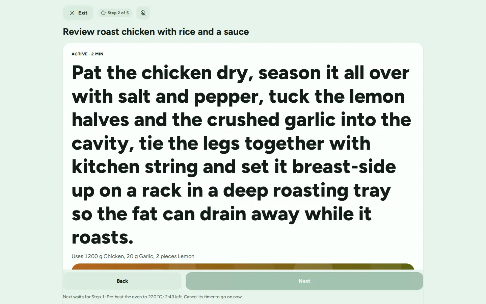

### Design
**Phone and tablet portrait (< 1024 px):**
- **Top row:** Exit … Ingredients · Voice.
  - Icon buttons are 40 px circular outline buttons (DS-12).
  - Ingredients is icon-only below 600 px.
  - The Step count moves into the overline: "Step 2 of 5 · Active · 2 min".
- **Advance Steps:** after Step 1 they collapse to one **info**-tone line (DS 3).
- **Step text:**
  - Sizes come from `stepTextSize`:
    - up to 25 words: 30/36 on a phone, 58/64 from 768;
    - longer: `title-2` on a phone, `display` from 768.
  - Weight is **Medium (500)** at every size (the user's choice). New token: `--text-step-weight: 500`. SHORT-01's landscape Step uses the same token.
  - Numbers and units are joined by no-break spaces (PC-16).
- **Step photo:**
  - Capped at `min(32dvh, 22rem)`.
  - **Enlarge the photo** (44 px) opens a full-screen `<dialog>`.
- **Timer strip:** sticky inside `.cook-nav`. It scrolls sideways, with 5 px of room for focus rings (R-C).
  - **Each pill:**
    - 52 px high, with 6 px inner padding and a 1 px `--color-outline` boundary;
    - timer icon, sentence-case label, and the time (`title-3`, tabular);
    - a 40 px round Pause or Resume button (44 px target).
  - **The timer that holds Next** has a 2 px accent boundary and comes first.
  - **Focus on Pause (R-C+):**
    - the ring is drawn inside the button: 2 px accent at offset −2 px, on a `--color-soft` fill;
    - while the button has focus, the pill's accent boundary steps back to its neutral 1 px outline;
    - exactly one accent ring shows, with 4 px of the pill's fill between it and the pill's edge.
  - **Tapping a pill** opens the timer sheet, with the R-B Close:
    - **Add 1 minute** (secondary);
    - **Cancel timer** (danger secondary), which shows the Undo toast "Timer cancelled" / "Pre-heat the oven".
- **Held line:** "Next waits for the oven: 2:43 left. Cancel that timer to go on now."

**From 1024 px:**
- **Layout:** the Step column, plus a 22 rem sticky rail.
- **Rail timer tiles:**
  - a 2-line `body-strong` label and a place line;
  - the time in `display`;
  - 44 px circular outline Pause and ⋮ buttons. Their focus follows R-C+: an inset ring on a soft fill.
- **Get ready** (PC-05) sits below the timers.
- **The photo cap** rises to `min(40dvh, 26rem)`.

**States:**
- No timers: no strip and no rail block.
- Finished: success tone with Dismiss (PC-04).
- Paused: surface-2.
- Wide screens: the layout is at most 1480 px wide.

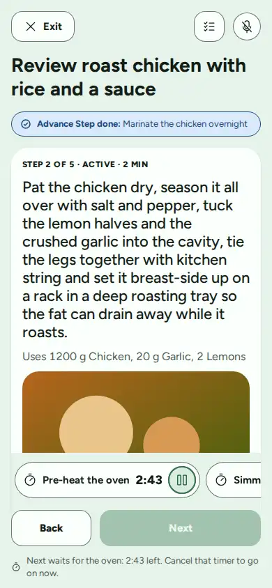 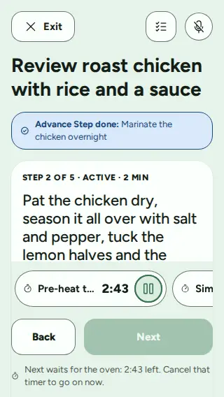 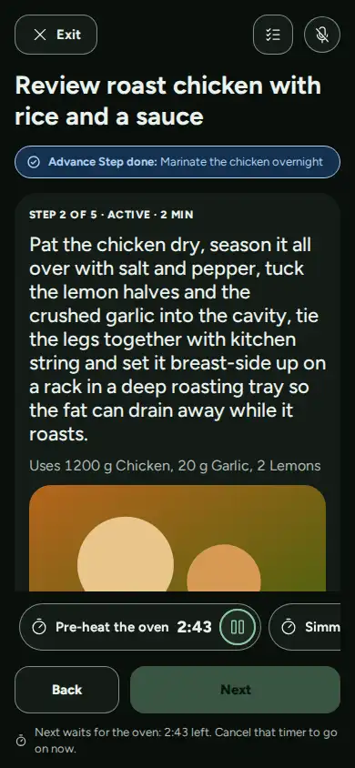 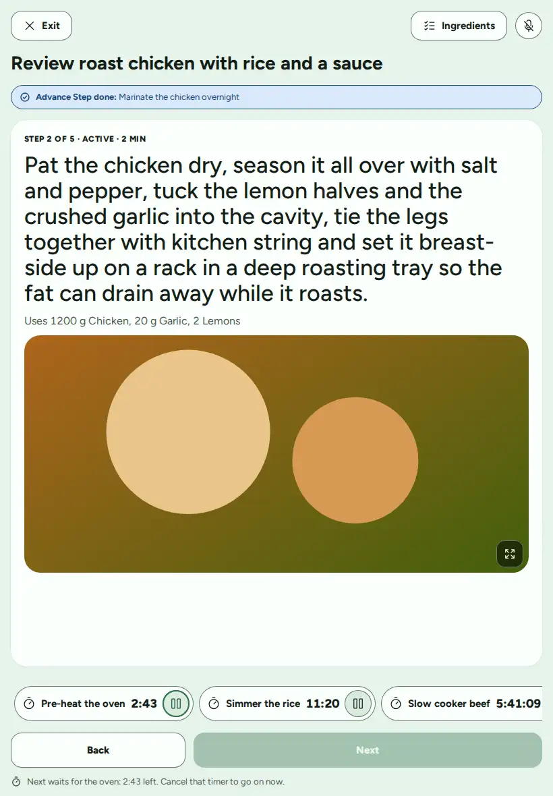 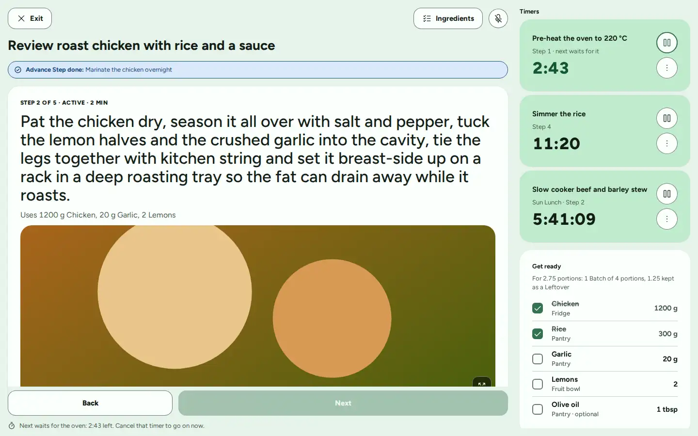
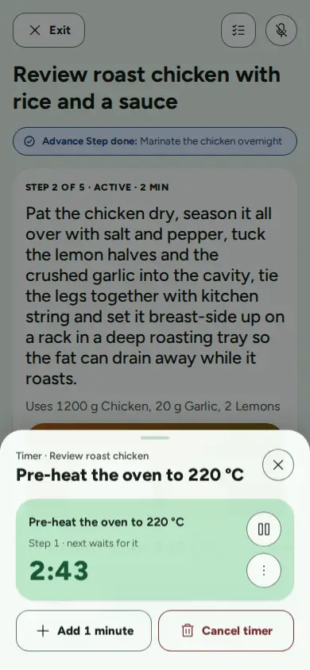 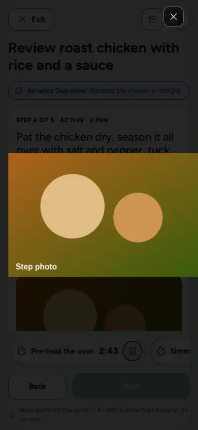
Mocks: [pc-03-cook-step.html](mocks/pc-03-cook-step.html), [pc-03-timer-sheet.html](mocks/pc-03-timer-sheet.html), [pc-03-photo.html](mocks/pc-03-photo.html).

**Accessibility:**
- Timers are `role="timer"`.
- Targets are 44 px.
- **Focus rings:** the nested ring on the soft fill is 3.4 (light) and 3.6 (dark); the outer ring on surface is 5.7 and 9.0. No ring is clipped (R-C) or fused with another (R-C+).
- **Step text:** weight 500, at least 30 px, 17:1 contrast. That is large text, well above 4.5:1.
- **The Advance Step line:** 7.4 (light) and 8.4 (dark).

### Alternatives considered
- **Cancel on the tile, behind a confirm dialog.** Rejected: Undo interrupts cooking less.
- **Step text at 600.** Shown in round 2; the user chose 500.
- **A gap ring for the nested Pause.** Rejected: inside a 6 px padding it still touches the pill's boundary.
- **Keeping both accent lines.** Rejected by the user.

### Build notes
- **`cook.css`:** the grid, the photo cap, the strip padding, and the pill's `:has(:focus-visible)` boundary step-back.
- **Components:**
  - `StepTile.tsx`: `font-weight: var(--text-step-weight)` and `StepPhotoDialog`;
  - `CookTimerStrip.tsx`, split into `TimerStrip` and `TimerRail`;
  - `CookTopRow.tsx`;
  - `AdvanceStepsTile.tsx`: info tone, compact.
- **Libraries:** `lib/steps.ts`, `lib/timers.ts`.
- **Shared primitives:**
  - `ui/TimerTile`: md size, 44 px outline controls, nested focus;
  - new `ui/TimerPill`: 52 px high, 6 px padding, round 40 px controls, R-C+.
- **Token:** `--text-step-weight: 500` in `styles.css`, shared with SHORT-01.
- **R-C+ belongs to A11Y.** Its CSS goes in the shared focus layer.

### Tests and guard
- **Unit tests:**
  - `stepTextSize`.
  - `TimerPill` has no Cancel.
  - Cancel shows Undo.
  - Targets are at least 44 px.
  - `AdvanceStepsTile` uses the info tone.
  - A CSS test: `--text-step-weight` is 500 and `.cook-step__text` uses it.
  - A CSS test: `.timer-pill :focus-visible` has `outline-offset: -2px`.
- **BDD:**
  - *The timer that holds Next is visible with the Step.*
  - *A long Step with a photo still shows Back and Next.*
  - *I can undo a cancelled timer.*
  - *I can enlarge a Step photo and close it.*
- **Guard:** on the photo Step at 390, 820 and 1440:
  - the gating timer and the held line intersect the viewport;
  - the image is at most 40 % of the viewport;
  - with Pause focused, the outline box lies inside the button's box, and the pill's computed boundary is `--color-outline`.

### Depends on / unblocks
- **Depends on:**
  - SHORT (PLAN-01, which uses the same weight token);
  - SAFE (Undo);
  - DS (R-A, DS-12);
  - A11Y (R-C, R-C+).
- **Unblocks:** PC-04 and PC-05.

## PC-04  Timers outside Cook Mode: a shell timer pill, an in-app finish alert, resume at the last Step
**Severity** S2 · **Size** M · **Sources** FLOW-06 · **Reproduced** Confirmed.
- I started Recipe 16's 3-minute timer, opened `/plan` and waited 196 s.
  - `/plan` showed no alert, toast or timer text.
  - The board showed "STEP 1: PRE-HEAT THE OVEN TO 220 °C. 0:00", with no Recipe.
- Re-entering Cook Mode opened at Step 1.

**Where** the shell on every route except Cook Mode; the board (TB); all sizes; light and dark

### Problem
- **Timers vanish outside Cook Mode.** Only Cook Mode (`useTimers`) and the board (`BoardScreen.tsx:49`) poll timers, so leaving Cook Mode hides them.
- **A finished timer gives no sign on the phone.**
- **The session forgets its Step:** `useCookSession.ts` starts at 0.
- **Round 1:** "Dismiss button is not readable".
- **Round 2:** "The +1 is not rounded, it touches the focus ring around the timer." The "+1" was a square-ish count chip pressed against the pill's edge.

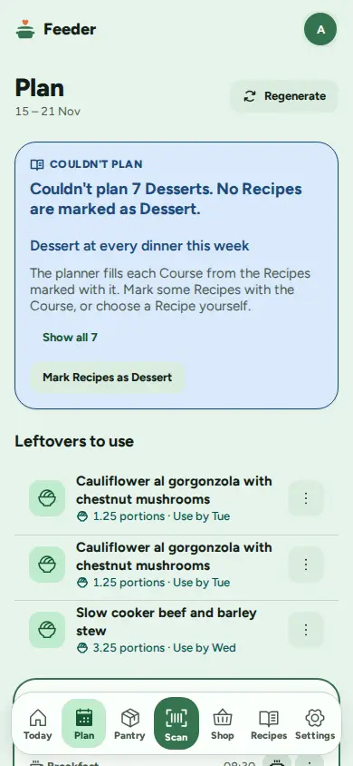 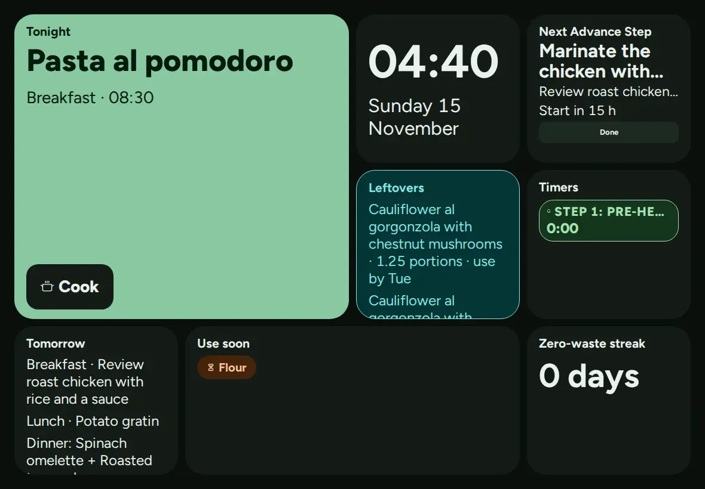

### Design
**Timer pill** (new shared `ui/TimerPill`, mounted by `app/AppShell`):
- **When it shows:** whenever a running, paused or finished timer exists, on every route except Cook Mode.
- **Where it sits:**
  - phone and tablet: fixed at the inline end, 16 px above the bottom bar plus the safe area, never over a sticky bar;
  - landscape: above the safe area (SHORT);
  - desktop: in the top bar, before Your menu.
- **What it shows:**
  - a surface fill, a 1 px `--color-outline` boundary and a shadow;
  - padding: 16 px at the start, 10 px at the end;
  - timer icon, the soonest timer's sentence-case label, and its time (`title-3`, tabular).
- **The "+N" badge**, when more timers exist:
  - its own rounded badge: `min-inline-size: 28px`, `block-size: 28px`, `border-radius: 999px`;
  - `--color-surface-2` fill, a 1 px `--color-outline` boundary, `meta` 700 tabular text;
  - 10 px from the pill's end and 8 px from the time, so it never touches the pill's edge or any ring;
  - `aria-hidden`, because the count is in the pill's accessible name.
- **The pill's focus ring** is the outer ring (R-C): 3 px at a 2 px offset. The shell keeps 16 px around the pill, so the ring is never clipped.
- **Tap:** opens Cook Mode at that timer's Step. With several scopes, it opens a "Timers" sheet.

**When a timer finishes:**
- **The pill** turns to the success tone (7.3 / 9.0), shows BellRinging and "finished", and its badge turns to a surface fill.
- **A banner** appears, role alert:
  - headline "Timer finished: Roast the chicken";
  - subline "Review roast chicken with rice and a sauce · Step 3";
  - **Open Cook Mode** (primary);
  - **Dismiss**: secondary, surface fill, 1 px outline (boundary 3.8:1 on success-bg, label 17:1).
- **The alarm** plays (`adapters/alarm.ts`).
- **It stays** until acted on. Several finished timers share one banner.
- **Never native:** no native alert, no Notification prompt.

**Resume:**
- Cook Mode reopens at the last Step shown, stored per device in `localStorage` with try/catch.
- From a finished timer, it opens at the next Step.
- Cooked clears the stored Step.

**Board:** TB's. Finished timers come first, labels are in sentence case, and the Recipe is named.

**States:**
- Offline: a local countdown (RES).
- No timers: nothing shows.

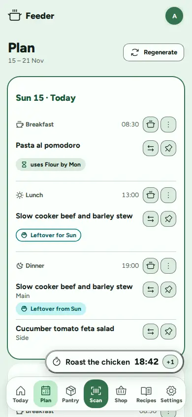 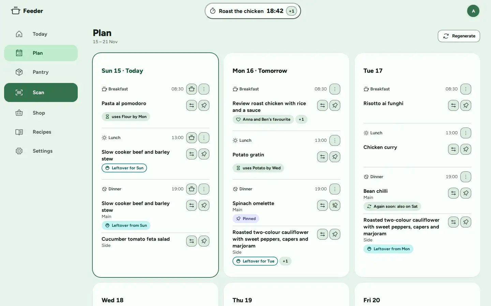
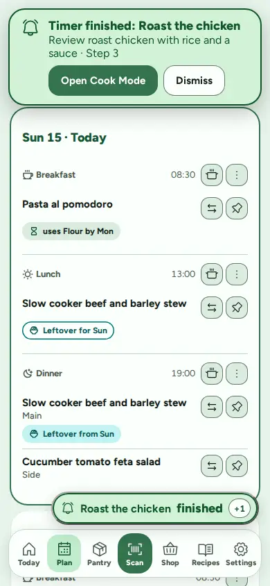 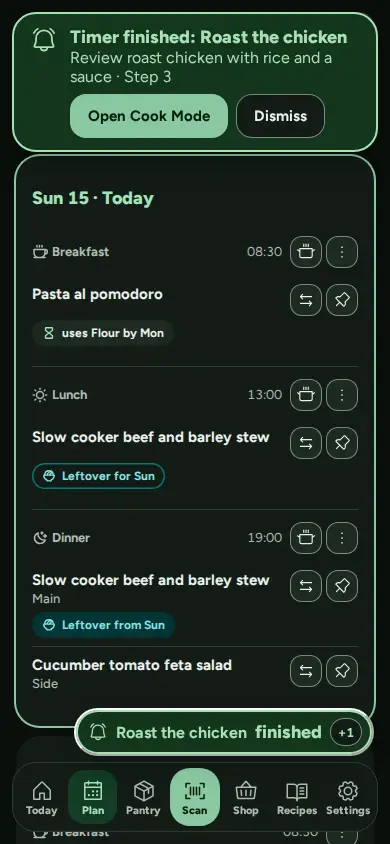
Mocks: [pc-04-timer-pill.html](mocks/pc-04-timer-pill.html), [pc-04-timer-done.html](mocks/pc-04-timer-done.html).

**Accessibility:**
- **The pill** is a button named "Timer: Roast the chicken, 18:42, and 1 more. Open Cook Mode". Its name updates once a minute.
- **The banner** is role alert and does not move focus; Esc dismisses it.
- **Sizes:** the pill is 52 px high; targets are at least 44 px.
- **Badge contrast:** text 13.5:1 (light) and 12.0:1 (dark) on surface-2; boundary 3.7 and 4.2.
- **Reduced motion:** the pill does not slide in.

### Build notes
- **New primitive:** `ui/TimerPill`, with the pill, its badge and the finished state.
- **Shell:** `app/AppShell.tsx` uses `useHouseholdTimers()` (poll every 15 s, live events, local countdown).
- **Cook hooks:**
  - `useTimers.ts` is split;
  - `useCookSession.ts` resumes;
  - new `lib/resume.ts`.
- **Alarm:** reuses `adapters/alarm.ts`.
- **Banner buttons** follow R-A.
- **Backend:** none.

### Tests and guard
- **Unit:**
  - `resume.ts`;
  - the pill's name includes the count;
  - the pill is hidden on `/cook/*`;
  - the badge is `aria-hidden` and rounded (`border-radius` at least half its height);
  - the banner's Dismiss is secondary.
- **BDD:**
  - *A timer keeps showing when I leave Cook Mode.*
  - *A timer finishing on another screen alerts me in the app.*
  - *Tapping the timer pill reopens Cook Mode at the Step I left.*
- **Guard:** with a running timer on `/plan` at 390 and 1440:
  - the pill does not cover the bottom bar or a sticky bar;
  - the badge's box is at least 6 px inside the pill's box;
  - the pill's focus outline box is not clipped by any ancestor.

### Depends on / unblocks
- **Depends on:** PC-03, TB, SHORT, RES, DS (R-A).

## PC-05  From a Planned Meal to its Recipe, and a "Get ready" Ingredient list scaled to the planned portions
**Severity** S2 · **Size** M · **Sources** FLOW-13 · **Reproduced** Confirmed.
- The Planned Meal sheet has no way to the Recipe.
- Cook Mode opens on Step 1, with no Ingredients.
- The only amounts in Cook Mode are each Step's "Uses …" line.

**Where** Planned Meal sheet; Cook Mode; all sizes

### Problem
- **The cook can't see the planned amounts.** They need the Ingredient list at the planned portions (2.75 from 1 Batch of 4). Today they have to leave the Plan and scale the Recipe in their head.
- **In code:** `PlannedMealSheet.tsx` has no link to the Recipe; `CookScreen.tsx` and `TimelineCookScreen.tsx` have no Ingredient list.
- **Round 1 comment** on the Ingredients sheet: "A better distinction of font and weight for the ingredient and the location, location should be smaller and muted".

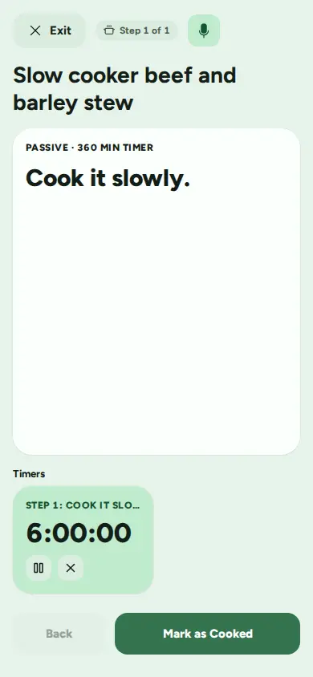

### Design
**Planned Meal sheet:**
- An **Open Recipe** row with the meta "Ingredients for 2.75 portions, Steps, Notes". It opens `/recipes/:id?portions=2.75&from=plan`, which is RX's screen.

**Cook Mode opens on Get ready (decided):**
- **The Get ready tile:**
  - title "Get ready" (`title-3`);
  - meta "For 2.75 portions: 1 Batch of 4 portions, 1.25 kept as a Leftover".
- **Each Ingredient row,** 52 px minimum:
  - our own checkbox;
  - the **Ingredient name** as the row title (`body-strong` 15/20, 700);
  - under the name, the **Storage Place** of its soonest Lot, in the `meta` role (13/18, 500, `--color-muted`), with "· optional" where the line is optional;
  - the **scaled quantity** at the row's end (`body-strong`, tabular, right-aligned).
  - Ticking a row mutes it and strikes the name through. This is local to the device and changes no Stock.
- **Above the tile:** the Advance Step status, in an **info** tile (DS 3).
- **Navigation:** Back is disabled; Next reads **Start cooking**.
- **A timeline with several Courses** groups the Ingredients under a subheader per Course.
- **During cooking,** the Ingredients button opens the same list:
  - in a sheet with the R-B Close, on a phone;
  - in the rail, from 1024 px.
- **Other entries:**
  - A resumed session skips Get ready.
  - A Recipe opened from its own page uses its Yield.

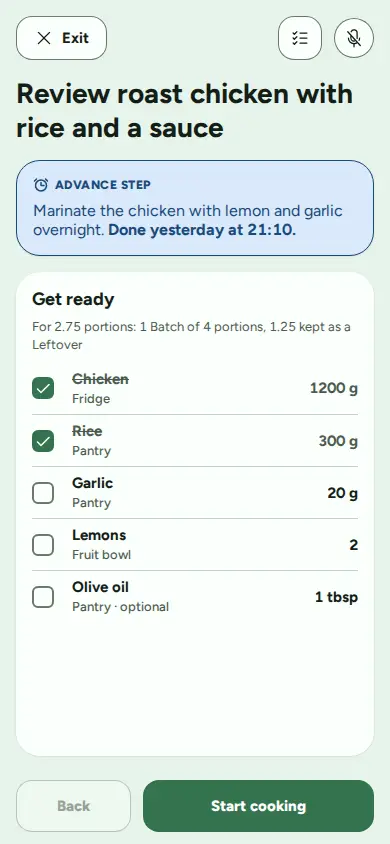 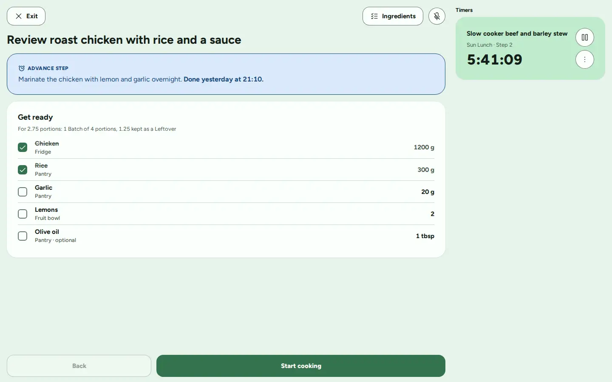 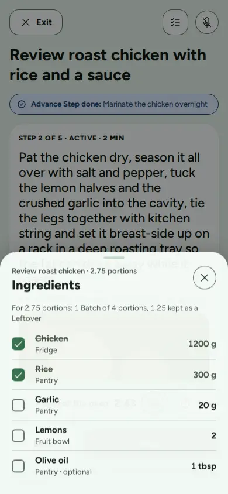
Mocks: [pc-05-get-ready.html](mocks/pc-05-get-ready.html), [pc-05-ingredients-sheet.html](mocks/pc-05-ingredients-sheet.html). The Open Recipe row is in [pc-09-meal-sheet.html](mocks/pc-09-meal-sheet.html).

**Accessibility:**
- The tile is an `article` named "Get ready".
- Each checkbox is named "Chicken, 1200 g".
- Contrast: muted on surface is 7.2 (light) and 8.8 (dark); text is 17.1 and 15.2.
- Start cooking moves focus to Step 1.

### Build notes
- `features/cook/lib/ingredients.ts`: pure; does the scaling.
- **Data:** the Recipe lines, from `/api/recipes/:id` or `lines` on `/api/cook/…`.
- **New components:** `GetReadyTile.tsx` and `IngredientsSheet.tsx`. Their row is a `ListRow` with the Storage Place in `meta` and the quantity in the value column, plus the shared `Checkbox`.
- **`useCookSession`** gets a `ready` step.

### Tests and guard
- **Unit:**
  - the scaling;
  - Get ready is skipped on resume;
  - a row puts the Storage Place in `.list-row__meta`.
- **BDD:**
  - *Cook Mode shows the Ingredients for the planned portions before the first Step.*
  - *I can open the Recipe from a Planned Meal.*
  - *I can see the Ingredients while cooking.*

### Depends on / unblocks
- RX (the scaled Recipe detail);
- DS 3;
- PC-03, PC-04, PC-09.

## PC-06  Why chips cut to stubs on Plan rows
**Severity** S2 · **Size** S · **Sources** PLAN-03 · **Reproduced** Confirmed.
- At 390, **10 of 23** row chips are cut: "Anna and Ben'…", "Again soo…", "Leftover f…".
- The chip line is **246 px** inside a **326 px** row.
- At 1440 the chips on 368 px tiles are cut too.

**Where** `/plan` day tiles; all sizes; light and dark

### Problem
- The chips live in `.list-row__extra` inside the text column, beside the Swap and Pin icon set (`PlanCourseRow.tsx`; `features/plan/plan.css:172-186`).
- Each chip may shrink (`flex: 0 1 auto`), so two half-chips show instead of one whole one.
- "Leftover for" and "Leftover from" differ only by outline and the cut word.
- A row with no chips keeps an empty line ("Frozen lasagne", PLAN-19).

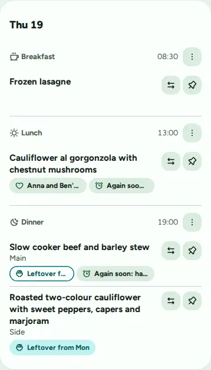

### Design
**Behaviour:**
- The chip line moves to a new `below` slot of `ListRow`. It spans the whole row under the title and the icon set, which gains 80 px at 390.
- Fitting is decided in a pure library (`lib/rowChips.ts` `fitChips(chips, widths, available)`); `usePlanCourseRow` measures with a ResizeObserver. The rules:
  1. Chips keep their priority order (state, Leftover, whole meal, why, relaxed).
  2. Show as many **whole** chips as fit, then "+N" for the rest (the sheet shows all).
  3. A **Leftover** chip is never cut. If it does not fit beside the first chip, it goes first and the other becomes "+1".
  4. Only a lone chip longer than the whole row may end in an ellipsis.
- A row with no chips renders no line.
- **320–1023:** as mocked. **≥ 1100 container:** see PC-11 (compact glyph chips).

**Rules (system.md §6 addition):** "In a row, chips sit on their own line under the row's text and its icon set; a chip is shown whole or counted in '+N'; only a lone chip wider than the row may end in an ellipsis; a Leftover chip is never cut."

**Accessibility:**
- "+N" is a chip named "2 more: Again soon: had Sat, uses Flour by Mon" (as today).
- The icon set keeps its place and order (system.md §5.5).
- No new colours.

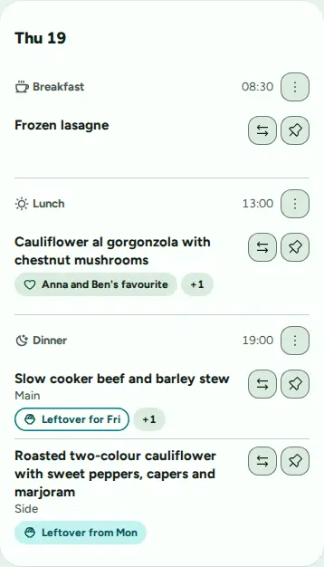 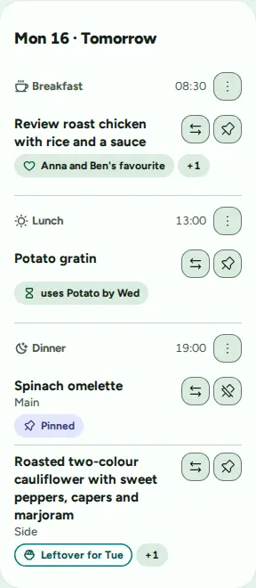 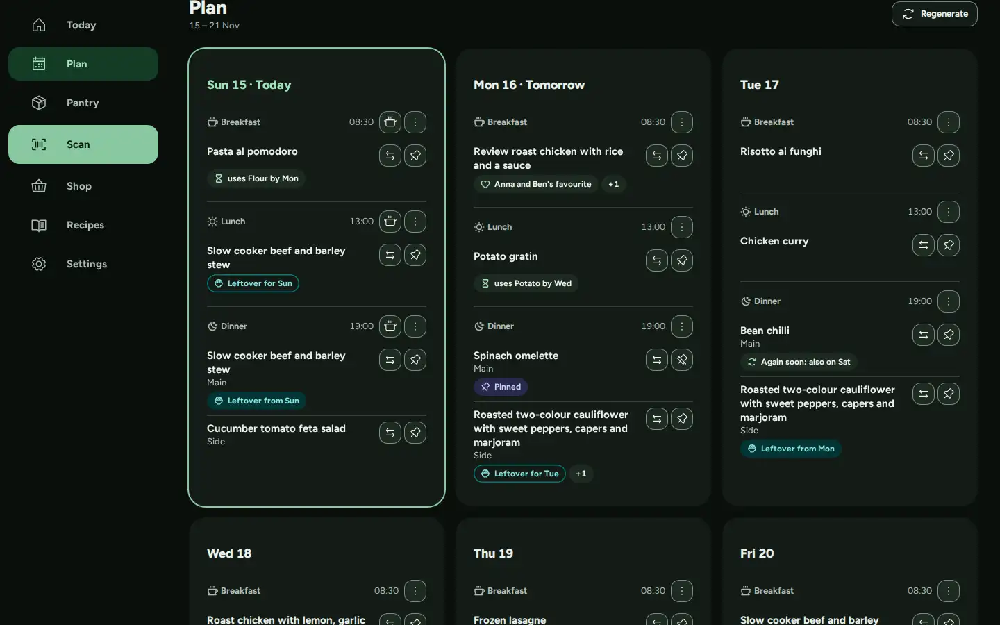
Mock: [pc-06-chip-line.html](mocks/pc-06-chip-line.html).

### Build notes
- `ui/ListRow.tsx` gains a `below?: ReactNode` prop, rendered after the trailing slot as `.list-row__below`. `ListRow.css` adds:
  - `.list-row[data-has-below]{flex-wrap:wrap;row-gap:var(--space-1)}`
  - `.list-row__below{order:3;flex:1 0 100%}`
- This is a shared primitive. Other callers keep `children` in the text column until they opt in. Swap and Choose (PC-10) opt in.
- `features/plan/components/PlanCourseRow.tsx`, `hooks/usePlanCourseRow.ts`, `lib/rowChips.ts` (`fitChips`).
- `plan.css`: the chip-line rules move.

### Tests and guard
- **Unit tests:** `fitChips` never returns a cut Leftover chip; it returns `+N` when the second does not fit; a lone long chip may be cut. `ListRow` renders `below` after `trailing`.
- **BDD:** *Plan rows never show a cut chip next to another chip.*
- **Guard:** a new P-chip rule in `scripts/lib/page-layout-rules.mjs` on `/plan`. A `.plan-row__chips .chip__label` with `scrollWidth > clientWidth` fails unless it is the only chip of its line.

### Depends on / unblocks
- A11Y (PLAN-12) for row names and targets.
- Unblocks PC-10 and PC-11.

## PC-07  Couldn't plan as one compact tile, unfilled Course rows, and a fix that stays on the Plan
**Severity** S2 · **Size** M · **Sources** PLAN-06, PLAN-17, FLOW-18 · **Reproduced** Confirmed. With Dessert added to every Dinner (one cause, `no_course_recipes`):
- **The notice:** a single cause renders a **295 px** info tile at 390. "Leftovers to use" follows as bare rows, and the first day tile starts at **y 749** of 844 (390) and **y 711** of 900 (1440). Stage 1 had two causes and no day of the Plan visible at 1440.
- **Unfilled rows:** **7** dashed rows titled "No Recipes for this Course." captioned "Dessert", with "Not planned". Stage 1's "6 counted, 7 shown" did not reproduce: the notice counted 7.
- **The fix:** "Mark Recipes as Dessert" goes to `/recipes?notCourse=4`, a plain Recipes list with no purpose shown and no way back.
- **Tone:** the warn tone maps to the spoil status (`features/plan/lib/couldntGroups.ts:224-231`).

**Where** `/plan`; Today's Couldn't plan tile (TB references); all sizes; light and dark

### Problem
- The week, the reason for the screen, is pushed down by a sentence-heavy tile.
- The same sentence is the title of 7 rows. system.md §3 says such a sentence is said once.
- The fix leaves the Plan and does not return.
- Causes are in `CouldntPlanNotice.tsx` and `CouldntPlanTile.tsx`, `PlanCourseRow.tsx` (unfilled branch, `empty.title`), `PlanScreen.tsx` (`onMarkRecipes` navigates), and `PlanLeftovers.tsx` (bare rows).

 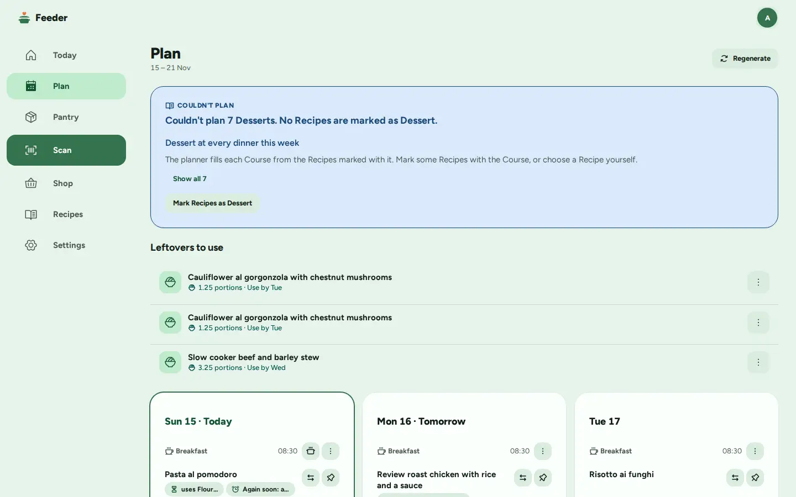 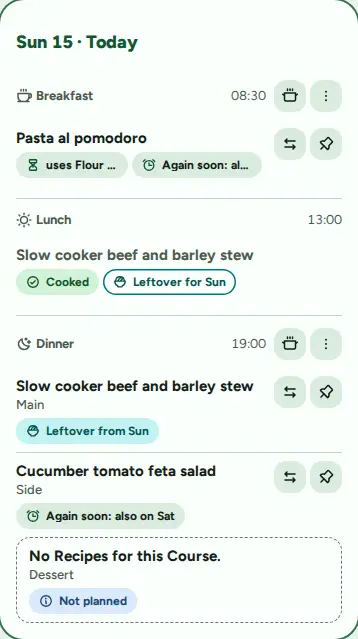 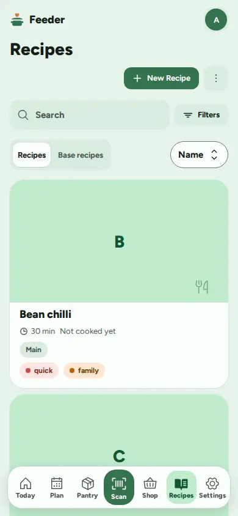

### Design
**The notice:**
- One tile, `Tile` status info, overline "Couldn't plan", with **Show which meals** (tertiary) in its header.
- One compact row per cause:
  - the cause icon, in info, or in warn for rule conflicts;
  - title "7 Desserts", or "4 Sides";
  - meta "No Recipes are marked as Dessert." or "Every Side has an Ingredient Chiara excludes.";
  - one fix button: Mark Recipes, Review Exclusions, Planning rules, or Choose a Recipe.
- Below 22 rem of tile width, the fix button drops under the text.
- Show which meals opens a sheet listing the affected meals by day, each with Choose a Recipe.
- The long explanation ("The planner fills each Course from the Recipes marked with it…") moves into that sheet and the Mark Recipes sheet.

**Leftovers to use:**
- Becomes the same bordered leftover tile as Today (PLAN-19).
- Below 1024 it shows one summary row: "3 Leftovers", "Cauliflower al gorgonzola, Slow cooker beef… · first Use by Tue", and **Show** opening the Leftovers sheet.
- At 1024 and wider it lists its rows.

**Layout:**
- The two tiles sit in one `BentoGrid min="wide"`: two-up from 1024 (system.md §4), stacked below.
- Rule: the first day tile starts inside the first viewport at 390 and 1440.

**Unfilled Course row:**
- Title **"Not planned"** (`body-strong`, muted), meta **"Dessert"** (the Course, `meta`).
- One info chip naming the short cause: "No Dessert Recipes", "Excluded for Chiara", "Slot Rule unmet", or "Too late for its Advance Step".
- A trailing 44 px **Choose a Recipe for Dessert** icon button (MagnifyingGlass).
- The row keeps its dashed outline. A resolved slot (Cooked or Not cooked) shows no unfilled row.

**The fix stays on the Plan (FLOW-18):**
- **Mark Recipes** opens a sheet titled "Mark Recipes as Dessert", context "Couldn't plan 7 Desserts":
  - lede "The planner fills Dessert only from Recipes marked with it. Tick the ones you would serve as Dessert.";
  - a search field;
  - Recipes with our own checkbox, meta "Main · 30 min" or "No Course yet · 50 min";
  - primary **Mark 2 Recipes as Dessert**.
- Saving refills the plan, and PC-01's toast reports it: "2 Recipes marked as Dessert. 7 meals planned." with Review.
- **Tone:** warn uses the DS warn tokens (`--status-warn-*`, DS's item). The mock carries provisional values only so that it renders.

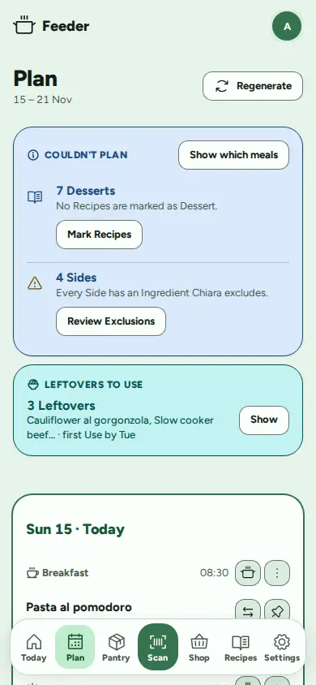 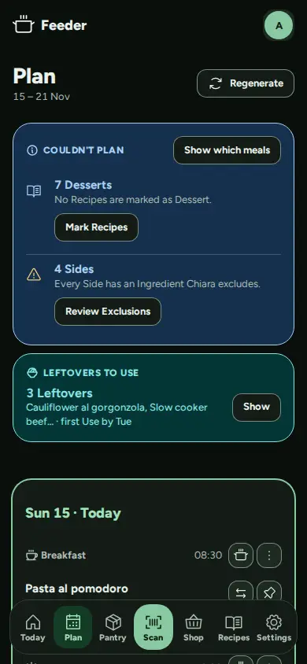 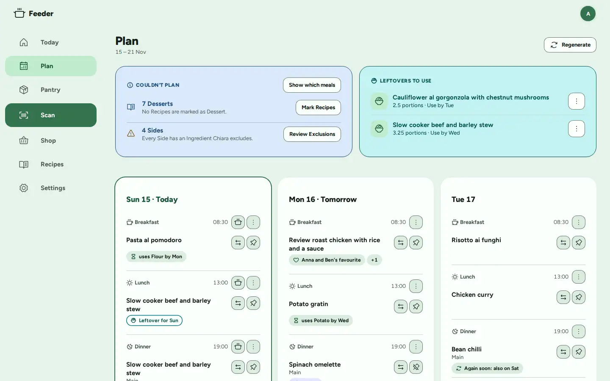
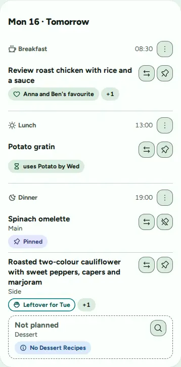 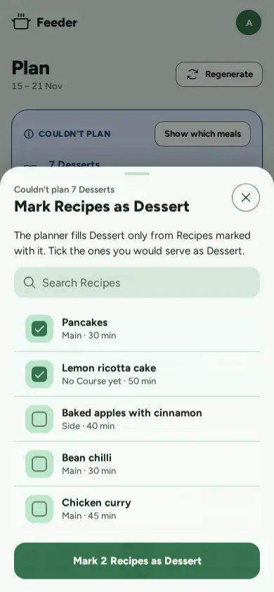 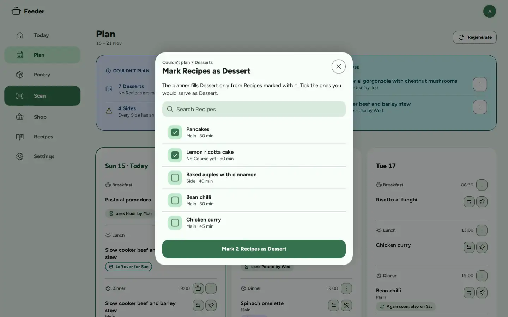
Mocks: [pc-07-couldnt-notice.html](mocks/pc-07-couldnt-notice.html), [pc-07-mark-recipes.html](mocks/pc-07-mark-recipes.html).

**Accessibility:**
- The tile is a section named "Couldn't plan". Each cause row is a group named by its title.
- Fix buttons say what they act on: "Mark Recipes as Dessert".
- The unfilled row's target is named "Choose a Recipe for Sun Dinner, Dessert". Its chip text is part of its description.
- Checkboxes are our own primitive with `role=checkbox`, `aria-checked` and 44 px rows.

### Build notes
- **Notice:** `features/plan/components/CouldntPlanNotice.tsx` and `CouldntPlanTile.tsx` (compact cause row); `lib/couldntGroups.ts` (short cause labels; warn maps to `warn` once DS adds it).
- **Leftovers:** `components/PlanLeftovers.tsx` becomes a Tile.
- **Unfilled row:** `PlanCourseRow.tsx` (unfilled branch) and `components/CourseRow.css`.
- **Mark Recipes:**
  - new `components/MarkCourseRecipesSheet.tsx` with `hooks/useMarkCourseRecipes.ts`;
  - `PlanScreen.tsx` opens the sheet instead of navigating;
  - backend: `POST /api/courses/{id}/recipes {recipeIds}`, which adds the Course to each Recipe in one transaction with one replan and returns PC-01's changes. A thin handler over the recipe service.
- Today's Couldn't plan tile uses the same compact tile (TB places it).

### Tests and guard
- **Unit tests:**
  - `couldntGroups` gives one row per cause and never the spoil status.
  - The unfilled row has the Course in meta and title "Not planned".
  - `useMarkCourseRecipes` sends the ids.
- **BDD:**
  - *The week is on the first screen even when meals could not be planned.*
  - *I mark Recipes as Dessert without leaving the Plan.*
  - *Each unfilled Course says its cause once, as a chip.*
- **Guard:** a page-layout scenario `/plan` with a Couldn't-plan seed (Dessert on every Dinner). Rule: the first `.plan-day` top is below the viewport height … *inverted*: it must be **less than** the viewport height at 390 and 1440. A P-rule fails when more than 3 rows on `/plan` share an identical title.

### Depends on / unblocks
- DS (PLAN-14, the warn tone).
- PC-01 (toast after marking).
- PC-06 (`below` slot).
- TB for Today.

## PC-08  Who's eating on the day tile, and an Away record for a Member who is away for days
**Severity** S2 · **Size** L · **Sources** FLOW-12 · **Reproduced** Confirmed.
- Who's eating works per Meal Slot and date. Its title shows "2026-11-17".
- With Ben off and 2 Guests added on Tue 17 Dinner (2.75 → 3.75 portions), the day tile does not change.
- Stage 1 counted about 84 taps to mark a Member away for a week.

**Where** `/plan` day tiles and the Meal Slot ⋮; Who's eating; Settings > Members > a Member's page; all sizes; light and dark

### Problem
- **Causes:**
  - `SlotHeader.tsx` shows no attendance.
  - `features/settings/strings.ts:180` formats an ISO date.
  - The only tool is the per-date override (`PUT /api/meal-slots/{id}/attendance?date=`): one Meal Slot, one date, inside the horizon only.
- **Round 1 comments:**
  - the toast needs a headline, a muted subline, plain body text and buttons;
  - the summary paragraph should be a collapsed disclosure;
  - the From and Through controls wrapped.
- **Approved in round 2.** It changed afterwards only through the shared rules R-D+ (no success icon) and R-E (rows in the disclosure).

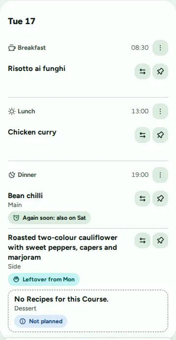

### Design
**The domain: Away (decided, PC 3, option b).**
- **The record:** an **Away** belongs to one Member. It runs from a **first day** to a **last day**, or has "No last day yet". It may start at a **first Meal Slot missed** and end at a **last Meal Slot missed**; by default both are the whole day.
- **The horizon:** it may reach past the Planning Horizon.
- **Proposed GLOSSARY entry** (after **Attendance**; it uses no word from any `_Avoid_` list):

  > **Away**:
  > A run of dates on which a Member eats at no Meal Slot: a first day and, when known, a last day, each optionally starting or ending at a named Meal Slot. The planner leaves the Member out of Attendance on those dates, also past the Planning Horizon; Who's eating can still bring them to one Meal Slot ("Eats here anyway").
  > _Avoid_: Absence, holiday, leave, vacation, out of office

**Who eats at a Meal Slot on a date, step by step:**
1. Start from the usual Attendance.
2. That date's override, if any, replaces it.
3. An **Away removes the Member**, unless that date marks them **Eats here anyway** (`despiteAway`).
4. Course opt-outs apply.
5. Guests are added.
6. Portions follow from `PortionsWithGuests`.
   - When nobody is left and there are no Guests, the "nobody attends" rule applies, with the chip "Everyone is away" (PC-07).

**Rules:**
- **Started or resolved Meal Slots never change.**
- **Days past the horizon** are applied when the horizon reaches them.
- **One replan per write.** Each write returns PC-01's `changes` and `undoToken`.
- **Validation:**
  - the first day is today or later;
  - the last day is not before the first;
  - no overlap with another Away of the same Member: "Ben is already away Fri 20 – Sun 22 Nov. Change that Away instead.";
  - a running Away cannot move its first day;
  - errors follow SAFE's field-error pattern.
- **Undo, never a confirm** (SAFE).

**The Away toast** (R-D, R-D+):
- headline **"Ben is away"**, with no icon;
- muted subline **"Tue 17 Breakfast – Thu 19 Dinner"**;
- body **"6 meals changed to 1.75 portions: Tue Breakfast, Lunch and Dinner; Wed Dinner; Thu Lunch and Dinner."**;
- outline buttons **Review** and **Undo**;
- Dismiss at the top end.
- **For other writes:**
  - "Ben's Away ended" / "Back from Dinner today";
  - "Ben's Away deleted".

**Where an Away is created, edited and ended:**
- **The Member's page** has an **Away** tile, with **Add an Away** (SET owns the page).
- **The Plan:**
  - the Meal Slot ⋮ offers "Someone is away…";
  - the day tile's Away line opens that Away.
- **Who's eating:** each away row opens its Away, and **Add an Away** adds one.

**The Away sheet** (a dialog from 600 px; R-B Close):
- **Title and context line:**
  - "Someone is away", with "From Tue 17 Breakfast";
  - or "Ben is away", with "New Away" or "Tue 17 – Thu 19 Nov".
- **Who:** single-choice Member pills.
- **When:**
  - **First day:** a `DateField`, with a labelled **From** select under it showing "Breakfast (whole day)".
  - **Last day:** a `DateField` with `rangeStart`, and **Through** "Dinner (whole day)" under it.
  - Each field is full width in its column, side by side from 600 px. Nothing wraps.
  - A Switch, "No last day yet".
- **What changes,** a collapsed info-tone disclosure:
  - **Summary row, 48 px:** "9 Meal Slots without Ben · 6 meals change", with a chevron.
  - **When opened:** R-E rows on surface. Key is the day, state is the count (info-fg), detail is muted:

    | Key | State | Detail |
    |---|---|---|
    | Tue 17 | 3 meals | Breakfast, Lunch, Dinner · 2.75 → 1.75 portions |
    | Wed 18 | 1 meal | Dinner · 2.75 → 1.75 portions |
    | Thu 19 | 2 meals | Lunch, Dinner · 2.75 → 1.75 portions |
    | Unchanged | 3 meals | Wed Breakfast and Lunch, Thu Breakfast: Leftovers already sized for 1.75 |

  - **Past the horizon:** "Nothing in this week's plan changes" / "From Tue 1 Dec the planner plans without Ben."
  - It comes from a dry run, debounced 300 ms.
- **Footer:**
  - new: **Save Away**;
  - editing: **Save**, **End today** (or Delete before the Away starts), and ⋮.

**On the day tile:**
- **A whole-day Away** is said once, under the day's name: "Ben away all day · 1.75 portions" (info-fg).
- **A part-day Away** shows "Ben away" on the Meal Slots it covers.
- **Per-date changes** keep their own words ("Without Chiara", "+2 Guests · 3.75 portions", "Ben eats here (away this week)").

**In Who's eating:** an away row shows "Away Tue 17 – Thu 19", a disabled switch, and **Eats here anyway**.

**States:**
- 320: the sheet scrolls, with a sticky footer.
- Loading: "Checking the plan…".
- Offline: RES's treatment.
- No Away: "Ben has no Away planned".

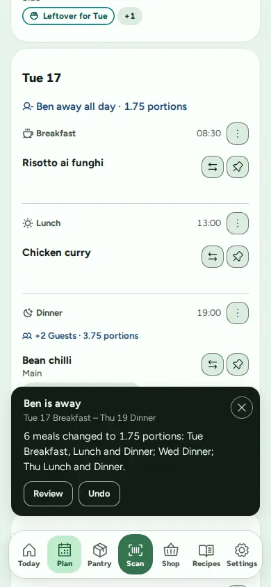 
  
   
 
Mocks: [pc-08-attendance.html](mocks/pc-08-attendance.html), [pc-08-away-sheet.html](mocks/pc-08-away-sheet.html), [pc-08-away-sheet-open.html](mocks/pc-08-away-sheet-open.html), [pc-08-away-calendar.html](mocks/pc-08-away-calendar.html), [pc-08-away-open.html](mocks/pc-08-away-open.html), [pc-08-away-edit.html](mocks/pc-08-away-edit.html), [pc-08-whos-eating.html](mocks/pc-08-whos-eating.html), [pc-08-member-away.html](mocks/pc-08-member-away.html).

**Accessibility:**
- **Controls:**
  - Who is a `radiogroup`;
  - the `DateField` keys work, and range days have names;
  - the selects are listboxes;
  - the Switch is `role=switch`.
- **The disclosure** is a `<details>`. Its rows are a `list` and read as "Tue 17, 3 meals. Breakfast, Lunch, Dinner, 2.75 to 1.75 portions".
- **Focus** returns to where the sheet was opened from. On an error, it moves to the first invalid field.
- **Contrast:**

  | Pair | Light | Dark |
  |---|---|---|
  | Info-fg on info-bg | 7.4 | 8.4 |
  | Row key on surface | 17.1 | 15.2 |
  | Row detail on surface | 7.2 | 8.8 |

### Alternatives considered
- **(a) A bulk sheet of per-date overrides.** Rejected by the user: it does not reach past the horizon and leaves no record.
- **Whole days only.** Misses the case of someone who leaves after lunch.

### Build notes
**Backend:**
- **New package `internal/away`**, domain only:
  - `Away`, `Validate`, `Covers`, `Apply`, `End`;
  - `Summarise`, which returns the per-day rows: key, count, detail.
- **`internal/away/store`.**
- **`internal/away/httpapi`**, thin handlers:
  - `GET` and `POST /api/members/{id}/away` (`?dryRun=1`);
  - `PATCH /api/away/{id}`;
  - `POST /api/away/{id}/end`;
  - `DELETE /api/away/{id}` (409 `away_started`).
- **Changes elsewhere:**
  - `internal/plan/runner/sources.go` calls `away.Apply`;
  - the slot-date read and attendance PUT carry `despiteAway`;
  - `GET /api/plan` adds `away`;
  - the event `household {changed:"away"}` triggers a replan.
- **Migration:** the `member_away` table and `attendance_override_attendees.despite_away`.
- **ADR** (after SAFE's 0020): "Away is kept on the Member and subtracted from Attendance".
- **Docs:** spec §3 and GLOSSARY.

**Web:**
- **Pure libraries:**
  - `features/plan/lib/away.ts` (wording, summary, R-E rows);
  - `lib/slotDate.ts`.
- **Hooks:** `hooks/useAway.ts`, `hooks/useMemberAways.ts`.
- **Components:**
  - `components/AwaySheet.tsx` (DS's `Disclosure` and R-E rows);
  - `DayTile.tsx`, `SlotHeader.tsx`, `SlotMenu.tsx`;
  - `ui/fields/DateField` (`rangeStart`).
- **SET's files** (Who's eating, the Member page) are changed with SET's review.

### Tests and guard
- **Go:**
  - `internal/away`:
    - `Validate`: past first day, last before first, overlap, running Away;
    - `Covers` with Meal Slots;
    - `Apply`: Guests, and Eats here anyway;
    - `End`;
    - `Summarise` gives rows by day, plus the Unchanged row.
  - Integration:
    - one replan per write;
    - past-horizon days applied later;
    - started Meal Slots kept;
    - 409 on deleting a running Away;
    - Member delete cascades to its Aways;
    - restore.
- **Web:**
  - `away.ts` wording and rows;
  - `DateField` `rangeStart`;
  - the sheet hides Last day when "No last day yet" is on;
  - the toast has no icon and has a headline, subline, body and two buttons.
- **BDD:**
  - *I mark a Member away for three days in one step.*
  - *A Member's Away reaches past the plan and is used when those days are planned.*
  - *An Away with no last day lasts until I end it.*
  - *The day tile says who is away.*
  - *A Member who is away can still eat at one Meal Slot.*
  - *I cannot add an Away that overlaps another.*
  - *I see which meals an Away changes before I save it.*
  - *I undo an Away and the plan is as it was.*
  - *Ending an Away today brings the Member back from the next Meal Slot.*
- **Guard:** `/plan` with a seeded Away at 390 and 1440.
  - The Away line takes one line.
  - The From and Through values do not wrap.
  - The opened disclosure has no free-text `li` (R-E).

### Depends on / unblocks
- PC-01, PC-10.
- SAFE, SHORT, SET.
- DS (`DateField`, `Disclosure`, `Toast`, R-D+, R-E).
- TB may show "Ben away" on Today.

## PC-09  Planned Meal sheet: context header, one primary and one secondary, Open Recipe, Leftovers on a Cooked meal
**Severity** S3 · **Size** S · **Sources** PLAN-15 · **Reproduced** Confirmed, narrower.
- A fresh meal's sheet stacks 5 full-width actions.
- Initial focus here was on Cook. Stage 1 saw it on an "Add Recipes" link, on a sheet with a relaxed hint.
- A Cooked meal's sheet shows only chips.

**Where** the Planned Meal sheet from the Plan and Today; all sizes

### Problem
- **Too many full-width actions.** system.md §5 allows one primary and one secondary, with the rest under ⋮. The 252 px footer is the root of PLAN-02 in landscape (SHORT).
- **Leftovers and Undo are missing on a Cooked meal.** A Cooked meal's Leftovers and its Undo are missing here (spec §8, SAFE-03).
- **The Close button looked squished** in round 1 ("Does this close button - squished - really belong here?"). It stretched next to a two-line title (R-B).
- **Code:** `PlannedMealSheet.tsx`.


### Design
**Header:**
- the context line (PC-10), **"Sun 15 · Dinner 19:00 · Side"**;
- the Recipe name as the title;
- the R-B **Close**: a 40 px circular outline button, top-aligned with the title's first line, never stretched.
  - The sheet keeps Close because its footer has no Cancel; Esc, the scrim and the grip also close it.

**Body:**
- the facts line "1 Batch · 2.75 portions · 45 min · start 18:15";
- avatars, with away Members left out (PC-08);
- every why chip;
- **Open Recipe** (PC-05).

**Footer:** an ActionGroup (`1fr 1fr 44px`):
- primary **Cook**;
- secondary **Mark as Cooked** (outlined, R-A);
- ⋮ More:
  - Swap, Pin/Unpin, Choose a Recipe, and Not cooked (SAFE-03: acts at once, with Undo);
  - on a phone it opens as a sheet (DS); from 600 px, as a popover.

**States:**
- **Served from a Leftover:** primary **Reheat**.
- **Future date (PC 4):** Cook and Swap. Mark as Cooked moves under More, disabled, "from Mon 16".
- **Cooked** (SAFE-03):
  - a success chip and "Marked Cooked today at 13:40 by Anna.";
  - a leftover-tone block, "2.5 portions left · Use by Tue" / "1.25 portions planned for Mon Dinner. 1.25 not planned yet.", with outlined **Had it**, **Freeze it** and ⋮ (R-A, so its icon button has a surface fill and outline);
  - Open Recipe;
  - the hint "Undo Cooked puts back the Stock it used and removes its Leftover. You can undo it until the end of today, while nobody has had any of the Leftover.";
  - footer: **Undo Cooked** (secondary, outlined, full width).
  - When Undo is no longer allowed, the hint says why and the button is gone.
- **Not cooked:** a danger chip, then **Cooked after all** (primary) and **Undo Not cooked** (secondary).

**Focus:** on open, focus goes to the title.

  
 
Mocks: [pc-09-meal-sheet.html](mocks/pc-09-meal-sheet.html), [pc-09-meal-sheet-more.html](mocks/pc-09-meal-sheet-more.html), [pc-09-meal-sheet-cooked.html](mocks/pc-09-meal-sheet-cooked.html).

**Accessibility:**
- The ActionGroup is named "Sun Dinner Side".
- Undo Cooked is named "Undo Cooked for Sun Lunch".
- After Undo, focus goes to Cook.
- Close's boundary has 4.5:1 (light) and 4.9:1 (dark) against surface.
- Focus returns to the row on close.

### Build notes
- **`PlannedMealSheet.tsx`:** ActionGroup, plus `ui/LeftoverActions`.
- **Resolved state:** comes from SAFE-03's `lib/resolved.ts`.
- **Actions:** `lib/rowActions.ts` gets `sheetActions(meal, today, resolved)`, which is pure.
- **Close:** from DS's `BottomSheet` (R-B).
- **No new API.** SAFE-03's package merges first.

### Tests and guard
- **Unit:**
  - at most 2 buttons in every state;
  - focus on the title;
  - the Cooked state shows Had it, Freeze it and Undo Cooked;
  - no Undo after the household day, with the reason shown.
- **BDD:**
  - *The Planned Meal sheet shows one main action and one other.*
  - *I handle a Cooked meal's Leftover from its sheet.*
  - *I undo a Cooked from the Planned Meal sheet the same day.*
- **Guard:**
  - at most 3 controls in `.sheet__footer`;
  - the Close box is square (width equals height) at 320 and 1440, with a long title.

### Depends on / unblocks
- DS (Menu as a sheet; R-A, R-B);
- SAFE-03;
- SHORT (PLAN-02);
- PC-05, PC-08, PC-10, PC-12.

## PC-10  Swap, Choose a Recipe and Who's eating name the day, Meal Slot and Course; real chips; no ISO dates
**Severity** S3 · **Size** S · **Sources** PLAN-11 · **Reproduced** Confirmed.
- Swap's title is "Swap for…", and its reasons are plain meta text: "Again soon: also on Thu · +1.25 portion Leftover".
- Choose a Recipe has no target, and its search is not focused.
- The Planned Meal sheet shows "Lunch · 13:00" with no day.
- Who's eating says "Dinner on 2026-11-17".

**Where** Swap, Choose a Recipe, the Planned Meal sheet, Who's eating, Time; all sizes

### Problem
After scrolling a 4,447 px week, the person cannot tell which day a sheet is for. Spec §7.5 asks for "Tue Dinner · Side". The cause is in four places:
- `SwapSheet.tsx`, `RecipeChooserSheet.tsx` and `PlannedMealSheet.tsx`;
- `features/settings/strings.ts:180`.

In round 1, on Choose a Recipe, the user wrote: "The focus ring hidden by the header, the close button is large, maybe it would look better as a simple circular outline button?" Two things caused it:
- the sheet body is a scroll container with no padding, so it cut the focused search field's ring;
- the Close button was a 40 px filled square.


### Design
**A context line above every sheet title opened from a Course or slot.**
- It uses the `meta` role at weight 600, muted, on one line; an ellipsis cuts a long Recipe name.
- Copy:
  - Swap: "Tue 17 · Breakfast · Main", title "Swap Risotto ai funghi".
  - Choose a Recipe: "Sun 15 · Dinner · Dessert", title "Choose a Recipe".
  - Who's eating: "Who's eating Tue 17 Dinner".
  - Time: "Time for Tue 17 Dinner".

**Close:** the R-B 40 px circular outline button, top-aligned.

**Focus room:**
- The sheet body keeps 5 px of padding on every side (R-C). The focused search field's full ring (3 px at a 2 px offset) shows under the header.
- `scroll-padding-top` keeps a focused row clear of the sticky header while scrolling.

**Swap:**
- "Now" shows the current Recipe; "Instead" lists the alternatives.
- Each alternative row has:
  - a neutral monogram;
  - the name;
  - why chips in the `below` slot, aligned with the text column, not under the picture;
  - the Leftover gain in the value column ("+1.25 Leftover").
- A note: "Meals that no longer fit may move. You can review and undo them."
- **Keep it**, secondary, outlined, full width.

**Choose a Recipe:**
- Search is focused on open and shows the ring.
- Groups:
  - "Marked as Dessert";
  - "From the freezer";
  - "Other Recipes", each with the info chip "Not marked as Dessert".

  
Mocks: [pc-10-swap.html](mocks/pc-10-swap.html), [pc-10-choose.html](mocks/pc-10-choose.html).

**Accessibility:**
- The dialog's accessible name is the context line plus the title.
- Each row's name includes its chips.
- The search field is labelled "Search Dessert Recipes".
- The focus ring has 5.7:1 (light) and 9.0:1 (dark) against surface, and is never clipped.

### Build notes
- **Shared primitives (DS):** `ui/BottomSheet` and `ui/Dialog` gain a `context?: string` prop, the R-B Close, and the R-C body padding and `scroll-padding`.
- **`lib/days.ts`:** `slotContext` (pure).
- **Call sites:** `SwapSheet.tsx`, `RecipeChooserSheet.tsx`, `PlannedMealSheet.tsx`, `SlotDateSheets.tsx`.
- **`features/settings/strings.ts`:** `whosEatingTitle` (SET, one line).
- **`useAlternatives.ts`:** passes the chips.

### Tests and guard
- **Unit:**
  - `slotContext`;
  - no plan string interpolates an ISO date;
  - Swap renders chips.
- **BDD:** *Every sheet opened from a meal names its day, Meal Slot and Course.*
- **Guard (R-C):** in Choose a Recipe at 390, focus the search field. The field's outline box (+5 px) lies inside `.sheet__body`'s client box and below `.sheet__header`.

### Depends on / unblocks
- A11Y (R-C);
- DS (R-B);
- PC-06.

## PC-11  The week grid at every size: auto-fill by day, with an incomplete last row shared by its days
**Severity** S3 · **Size** M · **Sources** PLAN-08 · **Reproduced** Confirmed.
- **Columns per row, measured:**
  - 3/3/1 at 1440 (368 px tiles);
  - 4/3 at 1920;
  - 2/2/2/1 at 820;
  - 1 at 390.
- **Fold:** at 1440×900 only the first row is fully visible.
- **Cause:** the grid is `BentoGrid min="day"` only (`PlanGrid.tsx`).

**Where** `/plan` from 600 px

### Problem
- **The last day sits alone** next to an empty track, so the week doesn't read as a week.
- **Decision PC 2 is reversed.** It first chose 7 compact columns (ui-review-2 L-05). After the mock review the user preferred the option I had listed as not taken: auto-fill, with the orphan day spanning its row ("I like the options considered more, maybe make it work"). That is now the design.

 

### Design
**The rule** (for `usePlanGrid` and system.md):
- **Columns:** `columns = min(4, floor((container + gap) / (21rem + gap)))`. That gives:
  - 1 below 684 px of container;
  - 2 up to 1031 px;
  - 3 up to 1379 px;
  - 4 from 1380 px.
- **Tracks:** the grid has 12 tracks, and each day spans `12 / columns`.
- **The incomplete last row:** its `r` days each span `12 / r`. With at most 4 columns, `r` is at most 3, so the division is always whole.
- **No hole:** a week never ends with an empty track.

**Per size, for a 7-day week:**

| Container | Columns | Last row |
|---|---|---|
| Phone (< 684) | 1 | Nothing to fill |
| Tablet, e.g. 820 (772 px) | 2 | Sat has the full row |
| Laptop 1180 (rail 88) | 2 (≈ 1044 px) | Sat has the full row |
| Desktop 1440 (rail 240, 1136 px) | 3 | Sat has the full row |
| 1920 and 2560 (`--page-wide` caps the container at 1480) | 4 | Thu, Fri and Sat share the last row: 4 tracks each (≈ 488 px), slightly wider than the 358 px days above |

**A day that has the whole row** lays out its Meal Slots side by side:
- one column per Meal Slot (`repeat(3, minmax(0,1fr))`, column gap `--space-6`);
- a 1 px `--color-line` divider between columns;
- every column top-aligned under one day title.

It reads as a horizontal day, not a stretched tile: each Meal Slot column is about 350 px at 1440 and 240 px at 820, close to a normal day tile's width.

**Today's tile** is always first (the week starts today) and keeps its accent ring.

**Above the fold at 1440×900:**
- The header and the first row (Sun–Tue) are fully visible, up to about y 815, with the Wed–Fri titles beginning.
- At 1920×1080, the first row (Sun–Wed) and the top of the second row are visible.

**New system.md text** (§4, replacing the Plan decision):
> Plan is a week grid by `min="day"`: 1 column on a phone, 2 on a tablet, up to 4 on wide screens. The grid has 12 tracks; a day spans 12 ÷ columns. The days of an incomplete last row share it equally (12 ÷ their count), and a day that has a whole row lays its Meal Slots side by side, one column each. A day never sits alone beside an empty track.

**Option A, not taken:** 7 compact columns from an 1100 px container (ui-review-2 L-05). It needs glyph chips and hides Swap and Pin on rows. Its mock is kept for reference:  · [pc-11-grid-a-seven.html](mocks/pc-11-grid-a-seven.html).

 ([pc-11-columns-diagram.html](mocks/pc-11-columns-diagram.html))
    
Mock: [pc-11-grid-b.html](mocks/pc-11-grid-b.html). It is responsive, and its container queries implement the rule above for a 7-day week.

**Accessibility:**
- **Reading order is unchanged.** The days follow DOM order, and a full-row day's Meal Slots still read Breakfast, Lunch, Dinner.
- **Rows keep their Swap and Pin** icons and names.
- **Reflow:** at 200 % zoom the container drops to 1 column.
- **No glyph chips** are needed.

### Alternatives considered
- **A: 7 compact columns** (above). Not taken after the mock review.
- **Making the last row's day span only the empty tracks** (system.md §4's first idea). Rejected: at 4 columns that leaves 3 days of 4 tracks beside one empty one, or a day 3 tracks wide.

### Build notes
- **`PlanGrid.tsx`:** a wrapper with `container-type: inline-size`, and `grid-template-columns: repeat(12, minmax(0,1fr))`.
- **New `hooks/usePlanGrid.ts`:** a ResizeObserver that computes the column count and each day's span. It works for any Planning Horizon, not only 7 days.
- **`lib/days.ts`:** `daySpans(count, columns)`, pure.
- **`DayTile.tsx`:** `data-row` when a day has the whole row.
- **`plan.css`:** the side-by-side Meal Slot layout.
- **docs:** the system.md §4 text.
- **Not needed now:** the glyph chip form and the compact rows (option A).

### Tests and guard
- **Unit tests:**
  - `daySpans(7, 2)` gives six days of 6 and one of 12.
  - `daySpans(7, 3)` gives six days of 4 and one of 12.
  - `daySpans(7, 4)` gives four days of 3 and three of 4.
  - `daySpans(5, 3)` gives three days of 4 and two of 6.
  - Every row sums to 12.
- **BDD:** *The week never ends with a lone day beside an empty space.*
- **Guard:** page-layout rules on `/plan` at 820, 1180, 1440, 1920 and 2560.
  - Every row's spans sum to 12.
  - No `.plan-day` is wider than 3 × the narrowest day, unless it has the whole row and lays its Meal Slots side by side.

### Depends on / unblocks
- DS (breakpoint table; system.md §4).
- PC-06.

## PC-12  The last Step of a meal on a future date is a dead end
**Severity** S3 · **Size** S · **Sources** PLAN-09 · **Reproduced** Confirmed.
- `/cook/meal/2026-11-16/3` (tomorrow's Dinner, 2 Courses): Step 3 of 3 shows **Next, disabled**, with no held line and no explanation.
- The title is "Dinner" with no day.
- The Course menu was not re-opened in my run. Stage 1 saw "Mark Main as Cooked" there for the same future meal.

**Where** Cook Mode timeline and single Course; all sizes

### Problem
- `TimelineCookScreen.tsx:149` sets `markable = canMarkDate(...)` (`features/cook/lib/timeline.ts:190`, `mayResolve`). When false, `CookNavTiles.tsx:40` renders a bare disabled Next.
- Someone prepping a day ahead meets a button that does nothing, with no reason given.


### Design
On the last Step of a meal whose date is after today (decision 4):
- Next becomes primary **Back to Plan** (or the origin, as in PC-02).
- The held line reads, with the Calendar icon: **"This meal is for tomorrow. Mark it Cooked from Mon 16, on Today or the Plan."** For a later date: "This meal is for Wed 18. …".
- The title names the day: **"Mon 16 Dinner"**. Today's meal keeps "Dinner".
- The Course menu follows the same rule: Mark <Course> as Cooked is hidden for a future date, and Not cooked stays.
- The Step count is in the overline (PC-03).

 
Mock: [pc-12-future-last-step.html](mocks/pc-12-future-last-step.html).

**Accessibility:** the line is role status and is the button's `aria-describedby`.

### Build notes
- `components/CookNavTiles.tsx`: a `finishFuture` variant.
- `TimelineCookScreen.tsx` and `CookScreen.tsx`: `headerTitle` with the day.
- `components/CourseMenu.tsx`: filter by `canMark`.
- `strings.ts`.

### Tests and guard
- **Unit test:** `CookNavTiles` never renders a disabled Next without a held line.
- **BDD:** *The last Step of tomorrow's meal tells me when I can mark it Cooked.*

### Depends on / unblocks
- Decision 4.
- PC-02 (origin).

## PC-13  Leftover defaults strand portions; Leftovers of one Recipe show twice
**Severity** S3 · **Size** S · **Sources** FLOW-24 · **Reproduced** Confirmed.
- **Freeze it on a 1.25-portion Leftover defaults to 1.** `freezeDefaultPortions` rounds down to a 0.5 step (`web/src/lib/leftovers/portions.ts:29-33`).
- **Leftovers of the same Recipe show twice.** After two Cooked meals of the same Recipe, two rows appear.
- **Nothing says a 1.25 Leftover can never fill a 2.75-portion slot.**

**Where** the Leftover sheets (Today, Plan, Planned Meal sheet, Pantry) and the Leftovers tiles; all sizes

### Problem
- **The defaults strand portions** (above).
- **Round 1 comments on the Freeze sheet:**
  - "This dialog looks disorganized, with no visual hierarchy, I wouldn't know what it wants from me."
  - "Does this really need a whole line?" This refers to the full-width Storage Place select and the separate Use-by line. Both state a consequence, not a decision, yet each takes a whole row.

  

### Design
**Freeze it, redesigned around one question:**
- **Title:** **"How many portions to freeze?"**
- **Context line:** "Cauliflower al gorgonzola with chestnut mushrooms · 1.25 left". It is one line and ends in an ellipsis when it is too long.
- **The one decision:** a large centred stepper.
  - 56 px circular outline − and + buttons (R-A);
  - the value in `display` (34/38, tabular), with "portions" under it in `meta`;
  - steps of 0.25, and the maximum is always reachable.
- **Default:** every spare portion, meaning what is left minus what Planned Meals need. The hint under it, in `meta` and muted:
  - "All of it. None of it is planned.", or
  - "1.25 of 2.5. The rest is planned for Mon Dinner."
- **Consequences, on one compact meta line:** snowflake icon, "Goes to **Garage Freezer** · Use by 13 Feb", then a small outlined **Change** button.
  - Change opens our own Storage Place select, listing freezers only.
  - Use-by follows the Recipe's Frozen Use-by.
- **Footer:** **Cancel** (secondary, outlined) and **Freeze 1.25 portions** (primary, snowflake icon). The label follows the stepper.
- **No Close button**, because the sheet has Cancel (R-B).
- **Sizes:** a bottom sheet on a phone, a dialog from 600 px. The layout is centred in both.

**Other defaults:**
- **Had it** keeps `min(1, left)`.
- **Threw it out** keeps all.
- The same stepper and hint rules apply.

**One row per Recipe and Use-by (decided):**
- The merged row reads "2.5 portions · Use by Tue".
- Actions take from the soonest Leftover first.
- Frozen and not-frozen Leftovers stay apart.

**Too few for a meal:** a second meta line, **"1.25 for Mon Dinner · 1.25 spare: have it or freeze it"**. The row's ⋮ is outlined (R-A).

**Mark as Cooked sheet:** the Leftover hint adds where the portions go ("→ Mon Dinner" or "not planned yet").

  
Mocks: [pc-13-freeze.html](mocks/pc-13-freeze.html), [pc-13-leftovers.html](mocks/pc-13-leftovers.html).

**Accessibility:**
- **Stepper:** a group named "Portions to freeze". Its spinbutton carries `aria-valuemin` 0.25, `aria-valuemax` set to what is left, and `aria-valuenow`, and is described by the hint.
- **Change** is named "Change Storage Place".
- **Focus:** opening the sheet focuses the title; the stepper comes next in Tab order.
- **Contrast:** the stepper buttons' boundary has 4.5:1 (light) and 4.9:1 (dark) against surface.

### Build notes
- **`web/src/lib/leftovers/portions.ts`:** `freezeDefaultPortions`, and `portionBounds` with a step of 0.25 that snaps to the maximum.
- **`lib/leftovers/rows.ts`:** `mergeRows` and `spareHint`.
- **`lib/leftovers/sheetModel.ts`:** the title, hint and primary label, all pure.
- **`ui/LeftoverActions/LeftoverSheet.tsx`:** the new layout. It is a shared component: the Pantry's frozen-Leftover sheet (SSP) gets the same layout.
- **`ui/Stepper`:** a size `lg` (shared with PC-15).
- **Backend:** none.

### Tests and guard
- **Unit:**
  - `freezeDefaultPortions(1.25, 0) === 1.25`;
  - `portionBounds` reaches 1.25;
  - the primary label follows the value;
  - `mergeRows` never joins frozen and not-frozen Leftovers;
  - `spareHint`.
- **BDD:**
  - *Freezing a Leftover offers every spare portion.*
  - *The Freeze sheet asks one question and says where the portions go.*
  - *Two Leftovers of one Recipe show as one row.*
- **Guard:** the Leftover sheet at 390 has exactly one primary, and no full-width select.

### Depends on / unblocks
- DS (FLOW-02, the Leftover action targets; R-A, R-B);
- SSP (the Pantry uses the same sheet);
- PC-09.

## PC-14  The planner has no earliest start: long Recipes can be planned for an early Meal Slot
**Severity** S3 · **Size** M · **Sources** FLOW-32 · **Reproduced** Confirmed in code and data, narrower.
- On this seed the 6 h "Slow cooker beef and barley stew" is planned for Sun Lunch 13:00 with `startBy 07:00`, and for Thu Dinner (13:00). Stage 1 had it at Breakfast 08:30 with "START 02:30". On this seed it happens to land at Breakfast only as a Leftover.
- **The cause holds:**
  - the planner's only time check is `advanceBlocked` (`internal/planner/candidates.go:266-274`);
  - the start time is computed afterwards, with no bound: `StartAt = At − TotalMinutes` (`internal/cook/service/timeline.go:157-158`).

**Where** the planner; the Plan, Today and board show the start time

### Problem
Nothing stops a plan that asks someone to start cooking at 02:30. Part of stage 1's case came from the seed (the Breakfast slot serves the Main Course), but a real Household with Breakfast and a slow cooker meets it too.

### Design
**A Household setting (decision 5):** Settings > Planning rules > "Cooking times", **Earliest start**: a time picker, our own control, default 06:30, with an "Off" option.
- Copy: "The planner won't plan a Recipe in a Meal Slot if cooking would have to start before this time. Advance Steps the day before are not affected."
- An example line computed from a real long Recipe: "Slow cooker beef and barley stew (6 h) can be planned for Lunch at 13:00 or later, not for Breakfast."

**Planner:**
- A candidate whose `slotAt − totalMinutes` falls before the earliest start on that date is filtered like `advanceBlocked`.
- A cell left empty for that reason gets a Couldn't plan cause "too_early" (PC-07 chip "Starts before 06:30").
- **Pinned meals are never refused.** A Pinned meal that breaks the rule shows a warn chip "Start 02:30, before 06:30" on its row and sheet.

 
Mock: [pc-14-earliest-start.html](mocks/pc-14-earliest-start.html). No before image: the problem is a planning rule, shown in the data above.

**Accessibility:** the time control is the shared time picker (DS or A11Y), labelled "Earliest start".

### Build notes
- **Backend:**
  - Household settings: a field `earliestStart` (time or null).
  - `internal/planner/candidates.go`: a `tooEarly` filter next to `advanceBlocked`, with total minutes from the Recipe (`runner/sources.go` already loads Step durations).
  - `planner/explain.go`: a new unfilled reason.
  - `internal/plan/httpapi`: expose it.
- **Web:**
  - `features/plan/screens/PlanningRulesScreen.tsx`;
  - `lib/couldntGroups.ts` (new cause);
  - `lib/rowChips.ts` (warn chip).

### Tests and guard
- **Go:**
  - "A 6 h Recipe is not planned for an 08:30 slot with earliest start 06:30";
  - "A Pinned one stays";
  - "Off restores today's behaviour".
- **BDD:** *The plan never asks me to start cooking before my earliest start.*

### Depends on / unblocks
- Decision 5.
- PC-07 (cause row).
- SET (Planning rules screen layout, if SET owns it).

## PC-15  Reheat: ±30 s buttons wrap raggedly; two filled primaries
**Severity** S4 · **Size** S · **Sources** PLAN-18 · **Reproduced** Confirmed at 390.
- The buttons wrap raggedly:
  - "Remove 30 seconds" is 175×44 at y 283, alone on its line;
  - "Add 30 seconds" (148×44) and "Start timer" (140×44) share y 339;
  - "Mark as Cooked" is 358×44 at y 415.
- **Start timer** and **Mark as Cooked** are both filled accent.

**Where** `/cook/reheat/:date/:slot/:course`; all sizes; light and dark


### Design
**The Reheat tile:**
- overline "Leftover from Sun Lunch";
- Recipe name (`title-2`);
- meta "2.75 portions · Sun Dinner 19:00";
- **one stepper**: − (56 px IconButton, "Remove 30 seconds") · **4:00** (3.5 rem, tabular, `role=timer`) · + ("Add 30 seconds");
- **Start timer** as the tile's one primary, full width.

**Footer:**
- **Mark as Cooked** is secondary, full width, at the bottom. When the timer finishes, it becomes primary and Start timer becomes "Restart".
- The return goes to the origin (PC-02).

This layout is the same at every width: the tile is a column with a maximum width of 40 rem.

  
Mock: [pc-15-reheat.html](mocks/pc-15-reheat.html).

**Accessibility:** the stepper is a group named "Reheat time". The value is announced on change. The controls are 56 px.

### Build notes
- `features/cook/screens/ReheatScreen.tsx`.
- `cook.css` (`.reheat-*`).
- It uses `ui/Stepper` with a `size="lg"` variant: a new size on a shared primitive, with no other screen affected.
- `hooks/useReheat.ts` gains `finished`, which drives which button is primary.

### Tests and guard
- **Unit test:** one primary before and after the timer ends.
- **BDD:** *Reheat has one main action at a time.*
- **Guard:** a ds-layout test for `.reheat-tile` at 320 (no wrapped control row).

### Depends on / unblocks
- PC-02 (origin).
- PC-04 (the Reheat timer shows in the pill).

## PC-16  Polish in the Plan and Cook Mode
**Severity** S4 · **Size** S together (XS each) · **Sources** PLAN-19 · **Reproduced** each part checked on the theme server.

The user asked "What's the plan here?". Below is the concrete list. Each entry gives what is wrong, where in the code, the exact change, and a before and after picture. All after pictures come from [pc-16-polish.html](mocks/pc-16-polish.html). I dropped two points that were not changes of their own:
- the timeline title without a day, which PC-12 covers;
- the bare "Leftovers to use" rows, which PC-07 covers.

**1. "220 °C" breaks between the number and the unit, and the coach mark shows on every Step.**
- **Change:**
  - When rendering Step text, join each number to its unit with a no-break space: `lib/steps.ts` gets `nbspUnits`, and `StepTile.tsx` uses it.
  - Show the tap-zone coach mark once per device. `hooks/useCoachMark.ts` already stores it; it should also store it when the person first taps a zone.
- **Pictures:**
  - Before: 
  - After: 

**2. The held line has double punctuation and a long label.** It reads "Next waits for Step 1: Pre-heat the oven to 220 °C.: 2:56 left. Cancel its timer to go on now.", built from the full Step label (`features/cook/strings.ts:7`).
- **Change:** use the timer's short label (`shortTimerLabel`): "Next waits for the oven: 2:43 left. Cancel that timer to go on now."
- **Pictures:**
  - Before: 
  - After: 

**3. "PASSIVE · 360 MIN TIMER".** `stepOverline` formats minutes only (`lib/steps.ts:62-65`).
- **Change:** format hours and minutes ("6 h timer", "1 h 30 min"), in sentence case, with the Step count in front (PC-03): "Step 2 of 4 · Passive · 6 h timer".
- **Pictures:**
  - Before: 
  - After: 

**4. The planned time "18:30" stands alone on timeline Steps** (`cook-step__clock`).
- **Change:** show it as a meta line with a Clock icon: "Start at 18:30".
- **Pictures:**
  - Before: 
  - After: 

**6. The relaxed chip ("Again soon") uses the Advance Step alarm glyph** (`features/plan/lib/rowChips.ts:30`, `cooldown_relaxed: 'advanceStep'`).
- **Change:** use `repeat` (ArrowsClockwise) instead.
- **Pictures:**
  - Before: 
  - After: 

**8. Recipe monograms in Swap and Choose a Recipe are accent-soft.**
- **Change:** use the neutral monogram (surface-2 with a muted letter, system.md §2 and §7) through the shared `RecipeThumb`.
- **Pictures:**
  - Before: 
  - After: 

**9. A row with no chips keeps an empty chip line** (Frozen lasagne).
- **Change:** render no chip line when there are no chips (part of PC-06's `below` slot).
- **Pictures:**
  - Before: 
  - After: 

**Tests:**
- unit tests on `nbspUnits` ("220 °C" stays together);
- `stepOverline` (360 → "6 h timer", 90 → "1 h 30 min");
- `nextHeld` (no ".:");
- `WHY_ICON` (relaxed is not `advanceStep`);
- `useCoachMark` (hidden after the first tap on a zone);
- the chip line is absent with no chips.

**Owner:** P4 for items 1–4, P2 for items 6 and 9, P3 for item 8.

## Review round 1 (2026-11-14)

**What the user said.** The user reviewed all 16 PC items on the mock review page.
- **Approved as they were:** PC-06, PC-07, PC-12, PC-14 and PC-15.
- **Sent back with comments:** the other eleven.
- **Four things came up in several places:**
  - Some buttons don't read as buttons: "dismiss doesn't even look like a button", "buttons should look like buttons, actionable".
  - The Close button looks wrong: "squished", "maybe … a simple circular outline button".
  - Focus rings are clipped or overrun: "hidden by the header", "the pause button overflows the focus ring".
  - The Away toast needs a structure: headline, muted subline, plain body text, real buttons.
- **Grid:** the user prefers the grid I had kept as the option not taken (B: auto-fill with the orphan day spanning its row). That reverses decision PC 2.
- **Polish:** for PC-16 the user asked "What's the plan here?"

**What changed, per item** (all PC mocks re-rendered; same file names where the view is the same):

| Item | Change |
|---|---|
| PC-01 | The toast now follows R-D (headline "Swapped Tue Breakfast", subline "2 other meals changed", body, outline buttons). The not-built setting's Segmented now spans the tile with one-line options (Off, Today, 2 days, 3 days). |
| PC-02 | Correct Stock, Dismiss and Undo Cooked are outlined buttons (R-A). The Today toast follows R-D. |
| PC-03 | The Step text keeps its size; its weight drops from 800 to 600. Timer pill controls are 40 px round buttons inside the pill's 6 px padding, so a focus ring never overruns. The strip keeps 5 px of ring room. The top-row icon buttons are outlined. |
| PC-04 | Dismiss on the finished-timer banner is an outlined button on surface: label 17:1, boundary 3.8:1 (R-A). |
| PC-05 | An Ingredient row is now: the name as the row title (`body-strong`), the Storage Place under it (`meta`, muted, smaller), and the quantity at the end. Same in Get ready and in the Ingredients sheet. |
| PC-08 | The Away toast follows R-D. The dialog's summary is a collapsed disclosure ("9 Meal Slots without Ben · 6 meals change") that opens to a list by day. "From" and "Through" are labelled selects with short values ("Breakfast (whole day)"), so nothing wraps. |
| PC-09 | Close is the R-B circular outline button. The ⋮ on the Leftover block is outlined. |
| PC-10 | Close follows R-B. The search field's focus ring keeps 5 px of room in the sheet body, so the header no longer clips it. Chips line up with the row text under a picture. |
| PC-11 | **Grid B is now the design.** Twelve tracks, each day spans 12 ÷ columns, and the days of an incomplete last row share it equally. A lone last day lays its Meal Slots side by side. Option A is kept as the option not taken. |
| PC-13 | The Freeze sheet is redesigned around one question, "How many portions to freeze?", with one large stepper. Storage Place and Use-by become one meta line with a small Change button (no more full-width select). The primary reads "Freeze 1.25 portions". No Close button, because the sheet has Cancel. |
| PC-16 | Rewritten as a list of concrete changes, each with its before picture, the change, and an after picture. |
| Approved items | Their designs are unchanged, but the shared rules change how they look. Secondary buttons now carry an outline everywhere: PC-07's "Show which meals" is now a secondary button, not a bare text button. Back and the Reheat Mark as Cooked are outlined (PC-12, PC-15). |

### The four shared rules (proposed system.md text)

Contrast was measured against the default (Sage) theme values that are set inline on `<html>` (light / dark).

**R-A Buttons look like buttons** (system.md §5, new paragraph; **DS owns `Button` and `IconButton`**)
> Every action has a visible shape. A **secondary** button has a fill and a 1 px `--color-outline` boundary (`box-shadow: inset 0 0 0 1px var(--color-outline)`) on every surface. On a tinted tile (status or soft) its fill is `--color-surface`. Icon buttons on a tinted tile follow the same rule. A **tertiary** (bare text) button is never an action in a tile, notice, toast, sheet footer or banner; it is kept for links inside sentences, underlined. A danger action that is not primary is a secondary button with `--status-danger-fg` text and boundary.

Measured: the outline boundary has 3:1 or more against every surface it sits on.

| Surface | Light | Dark |
|---|---|---|
| surface | 4.5 | 4.9 |
| surface-2 | 3.7 | 4.2 |
| page | 4.1 | 5.4 |
| info | 3.7 | 3.8 |
| leftover | 3.8 | 3.7 |
| success | 3.8 | 3.7 |
| spoil | 3.7 | 3.9 |
| warn (provisional) | 4.0 | 3.7 |

The label is `--color-text` on surface: 17.1 (light) and 15.2 (dark).

**R-B The Close button** (system.md §5; **DS owns `BottomSheet` and `Dialog`**)
> Close is one control in every sheet and dialog: a circular outline icon button, 40 px (`border-radius: 999px`, transparent fill, 1 px `--color-outline` boundary, 20 px X; the existing `::after` gives a 52 px target). It never stretches or squashes (`flex: none`) and is top-aligned with the title, whatever the title's length. A sheet whose footer has Cancel shows no Close; Esc, the scrim and the grip still close it.

**R-C Focus rings are never clipped or overrun** (**A11Y owns the focus ring**)
> The ring is 3 px `--color-accent` at a 2 px offset (5 px in all); on an inverse surface (a toast) it is `--color-bg`. Every scroll container that holds controls keeps 5 px of room on each side (sheet bodies `padding-block: 5px`, horizontal strips `padding: 5px`). A container with a sticky header or footer sets `scroll-padding` to that height. A control nested in a shaped container (a pill, a tile corner) is inset inside the container's padding by at least the ring's 5 px, and takes the container's shape (round in a pill), so neither the control nor its ring paints outside it.

Measured: the accent ring on surface is 5.7 (light) and 9.0 (dark). `--color-bg` on a toast is 15.3 and 16.8.

**R-D A toast with detail** (system.md §5, Toast; **DS owns `Toast`**)
> A toast that says more than one sentence has an anatomy:
> - the status icon;
> - a **headline** (`body-strong`);
> - a **muted subline** (`meta`, `--color-bg` mixed 72 % toward the toast fill);
> - an optional **body** (`body`, plain text);
> - then its actions as real buttons: outline pills, 40 px high, a transparent fill, `--color-bg` text, and a 1 px boundary of `--color-bg` at 70 %.
>
> Dismiss is a 32 px circular outline at the top end. The toast grows as tall as it needs. A one-sentence toast keeps one line with outline buttons.

Measured: toast text is 15.3 (light) and 16.8 (dark); the subline is 8.8 and 7.0; the button boundary is above 8:1.

Applied in every PC mock through one shared `RULES_CSS` block in `<style data-proposed>`.

## Review round 2 (2026-11-14)

**What the user said.** After the round-1 rework, 12 of the 16 PC items are approved (PC-05 to PC-16). Five comments remained on PC-01 to PC-04:
- **PC-04:** "The +1 is not rounded, it touches the focus ring around the timer."
- **PC-03:** "The pause button focus ring merges with the component focus ring, looks amateurish. Make it look designed."
- **PC-02:** "We can organize the information better than a simple bullet list … hierarchy of information, the ingredient is key, what's up with it then the detail information."
- **PC-01, on the toast:** "Is this checkmark needed? Anyhow: it should move to the header, left of the title."
- **PC-01, at 320:** "At this size should be icons only … squircles that don't overflow the bar."

Two follow-ups came after that:
- **Step weight.** The user asked "Are the recipe steps still in bold?" and chose **Medium (500)** for the Cook Mode Step text.
- **Plan icon buttons.** The main session noticed that the Plan rows' icon buttons in the PC mocks were still borderless, unlike DS-12.

**What changed, per item:**
- **PC-01.** A success toast has no status icon. Any other status shows a 16 px icon at the start of the headline line, centred on its text. New view: [pc-01-toast-variants.html](mocks/pc-01-toast-variants.html). Every PC mock under 360 px uses the corrected icon-only bottom bar (R-F).
- **PC-02.** The shortfall notice is now a set of rows, on the Cooked confirmation and on Today. Each row has:
  - the Ingredient in `body-strong`;
  - the state at the end, in info-fg with tabular figures: "none in Stock" or "200 g short";
  - the detail in muted `meta`: "The Recipe used 300 g · Stock showed 100 g".
- **PC-03.** A focused Pause inside the timer pill draws its ring inside itself, on a soft fill. While Pause has focus, the pill's accent boundary steps back to its neutral outline, so only one accent ring shows. The rail tiles' controls work the same way.
- **PC-04.** "+1" is its own 28 px rounded badge with a 1 px outline. It sits 10 px inside the pill's edge, clear of any ring. The pill's boundary is now `--color-outline`.
- **Follow-up 1, Step text weight: Medium (500).** `--text-step-weight` is 500, not 600, in every PC mock that shows a Step: PC-03, PC-05 (Get ready and the Ingredients sheet behind it), PC-12, PC-15's Cook shell and the PC-16 polish cards. The sizes are unchanged. Re-rendered under the same file names, with dark views for the Step mocks: `pc-03-after-step-390x844-dark`, `pc-05-after-ready-390x844-dark`, `pc-12-after-390x844-dark`.
- **Follow-up 2, every IconButton in the Plan follows DS-12.** Each now has a 1 px `--color-outline` boundary:
  - on the day tile's surface, the fill is surface-2;
  - on a tinted tile, the fill is `--color-surface`;
  - on the light accent hero, there is no boundary.
  - This covers Cook, ⋮, Swap, Pin and Unpin on Plan rows and Meal Slot headers, the Leftover ⋮, and Today's hero ⋮.
  - Re-rendered under the same names: all PC mocks that show the Plan or Today. The large views were re-encoded at quality 55 to stay near the budget (2.65 MB for the theme).

**Approved pictures that changed** (shared rules only; no design changes):
- **PC-08, the toast** (`pc-08-after-tile-390x844-light`, `-1440x900-dark`): the success check is gone (R-D+), and Dismiss is top-aligned.
- **PC-08, the open disclosure** (`pc-08-after-away-open-390x844-light`): its list is now R-E rows. Key "Tue 17", state "3 meals", detail "Breakfast, Lunch, Dinner · 2.75 → 1.75 portions".
- **The Plan and Today icon buttons (DS-12, follow-up 2)** now have their outline, in every PC picture of those screens:
  - PC-06: chip line;
  - PC-07: notice, unfilled rows and the Mark Recipes background;
  - PC-09, PC-10 and PC-13: sheet backgrounds;
  - PC-11: grid B views and A at 1440;
  - PC-14: Planning rules.
- **The Step weight, now 500 (follow-up 1),** shows in PC-05 (`pc-05-after-ready-*`, `pc-05-after-sheet-*`), PC-12 (`pc-12-after-*`), and PC-16 (`pc-16-after-p1` to `p4`).
- **No approved picture shows the bottom bar under 360 px**, so R-F changed none of them.
- **Removed to stay near the 2.5 MB budget:**
  - `pc-02-after-cooked-1440x900-light`;
  - `pc-04-after-done-1440x900-light`;
  - `pc-11-after-b-1180x820-light`;
  - `pc-08-after-away-open-1440x900-dark`.

**DS-02 has the same flaw.** Please send it back to DS. Its own render (`shots/ds-02-after-320x640-light.webp`, mock `mocks/ds-02-bottom-bar-320-light.html`) shows two problems:
- The current-page highlight is 44 × 54 px, not square: the narrow band keeps `.bottom-bar__link{height:54px}` on a 44 px track.
- The Scan button is stretched to 44 × 58 px (`[data-accent=true]{width:min(58px,100%);height:58px}`).

R-F below fixes both. My mocks override them with R-F; DS-02's file is untouched.

### The four rule additions (proposed system.md text)

**R-C+ Nested focus rings** (system.md §8, the focus-ring rule; **owner A11Y**, to adopt into A11Y-02)
> A control nested inside a container that has its own visible boundary draws its focus ring **inside itself**: `outline: 2px solid var(--color-accent); outline-offset: -2px`. Its fill becomes `--color-soft` while focused. Examples of such containers: a timer pill, a rail timer tile, a status tile, a chip with a remove button.
> While a child has focus (`:has(:focus-visible)`), a container whose boundary is accent-coloured steps that boundary back to its neutral 1 px `--color-outline`. So only one accent ring is visible at a time.
> At least 4 px of the container's fill always separates the container's boundary from the child's edge.
> A control that is not nested keeps the outer ring: 3 px at a 2 px offset, with 5 px of room around it (R-C).

Measured:
- the accent ring against the soft fill: 3.4 (light) and 3.6 (dark);
- the accent ring against surface: 5.7 (light) and 9.0 (dark);
- the outline boundary against surface: 4.5 (light) and 4.9 (dark).

**R-D+ The toast's status icon** (system.md §5, Toast; **owner DS**)
> A toast shows a status icon only when the icon carries a status the words might not: warning or error, offline, waiting to sync. A plain success toast has no icon; its headline already says what happened.
> When shown, the icon is 16 px and comes first in the headline line (`display:flex; align-items:center; gap: var(--space-2)`), vertically centred on the headline's 20 px line box. It never sits in a column of its own.
> For an error, the icon uses `--status-danger-bg` on the toast fill: 10.9 (light) and 9.6 (dark).
> The Dismiss circle is top-aligned with the headline.

**R-E Structured rows, not bullet lists** (system.md §3, List rows; **owner DS**, for `ListRow` and the rows inside notices)
> When the items of a list have a key, a state and detail, never set them as a bullet list of sentences. Each item is a row:
> - the **key** in `body-strong`, `--color-text`;
> - the **state** at the row's end, in `body-strong`, tabular, right-aligned, in the tone of its tile (`--color-info-fg` in an info notice);
> - the **detail** on a second line under the key, in `meta`, `--color-muted`, tabular.
>
> Rows are separated by a 1 px line of the tone's fg at 18 %, with `--space-2` above and below each row. Inside a tinted tile the rows sit on the tint; inside a disclosure they sit on `--color-surface`.

Measured on info-bg:

| Part | Light | Dark |
|---|---|---|
| Key | 15.0 | 11.4 |
| State (info-fg) | 7.4 | 8.4 |
| Detail (muted) | 6.1 | 6.7 |

**R-F The bottom bar under 360 px** (system.md §8; **owner DS**, as DS-02, decision DS 1)
> Below 22.5 em (360 px at the default text size), the bottom bar shows icons only. Each link keeps its label as its accessible name.
> The bar keeps `--space-1` side insets and has 6 px inline padding, so each track is 42.9 px at 320.
> The current-page highlight and the Scan button are squircles: 40 × 40 px, `border-radius: 12px`, centred in their track, at least 7 px from the bar's rounded edge. Nothing pokes out of the bar.
> Scan keeps its accent fill and drops its 3 px ring when it is the current page.
> The whole track (43 × 64 px) remains the tap target.

Measured: accent-text on the soft highlight is 7.6 (light) and 8.1 (dark); on-accent on accent is 5.7.

## Work packages for this theme

| Package | Items | Files owned | Size | Merges after | Runs in parallel with |
|---|---|---|---|---|---|
| **P0 Shared rules (adopted by DS and A11Y)** | R-A to R-D, as used by every PC item | Not PC's files. DS: `ui/Button.css`, `ui/IconButton.css`, `ui/Toast.*` (rich anatomy), `ui/BottomSheet.*` and `ui/Dialog.*` (Close, body padding, scroll-padding), `Segmented`, a `Disclosure` primitive. A11Y: the focus-ring room rule. PC packages consume them. | — | — | — |
| **P1 Plan change feedback** | PC-01 (the "keep the next days" setting is not built) | `internal/plan/runner/*` (except `sources.go`), `internal/plan/httpapi/*`, `internal/planner/state.go`; web `lib/replan.ts`, `hooks/useReplanReview.ts`, `components/ReplanReviewSheet.tsx`, `hooks/usePlanActions.ts`, `hooks/usePlanLiveUpdates.ts`, `api.ts`; spec §7.3 | L | SAFE's Undo pattern; P0's rich Toast | P2, P4, P6, P7 |
| **P2 Week grid and rows** | PC-06, PC-07, PC-11 (grid B), PC-16 items 6 and 9 | `ui/ListRow.*` (`below` slot), `features/plan/plan.css`, `PlanGrid.tsx`, `DayTile.tsx` (`data-row` only), `PlanCourseRow.tsx`, `CourseRow.css`, `hooks/usePlanCourseRow.ts`, `hooks/usePlanGrid.ts`, `lib/rowChips.ts`, `lib/days.ts` (`daySpans`), `CouldntPlan*.tsx`, `lib/couldntGroups.ts`, `PlanLeftovers.tsx`, `MarkCourseRecipesSheet.tsx`; backend `POST /api/courses/{id}/recipes`; system.md §4 | L | DS warn tone; P1 for the toast after marking | P1, P4, P5, P7 |
| **P3 Plan sheets** | PC-09, PC-10, PC-16 item 8 | `ui/BottomSheet` and `ui/Dialog` `context` prop (coordinated with P0), `PlannedMealSheet.tsx`, `SwapSheet.tsx`, `RecipeChooserSheet.tsx`, `SlotDateSheets.tsx`, `lib/rowActions.ts`, one line in `features/settings/strings.ts` | M | P2; SAFE-03's package; P0 (R-B, R-C) | P1, P4, P5, P7 |
| **P8 Away** | PC-08 | `internal/away/**`, `internal/plan/runner/sources.go`, household slot-date read and attendance PUT, migration, ADR, GLOSSARY, spec §3; web `lib/away.ts`, `lib/slotDate.ts`, `hooks/useAway.ts`, `hooks/useMemberAways.ts`, `components/AwaySheet.tsx`, `SlotHeader.tsx`, `SlotMenu.tsx`, the day Away line in `DayTile.tsx` (after P2); `ui/fields/DateField.*` (`rangeStart`); SET's Who's eating and Member page, reviewed with SET | L | P1, P3, P2 (`DayTile.tsx`), P0 (`Disclosure`, rich Toast) | P4, P5, P6, P7 |
| **P4 Cook Mode** | PC-03, PC-05, PC-12, PC-15, PC-16 items 1–4 | `features/cook/cook.css`, `StepTile.tsx`, `CookTimerStrip.tsx`, `CookTopRow.tsx`, `CookNavTiles.tsx`, `CourseMenu.tsx`, `AdvanceStepsTile.tsx`, new `GetReadyTile.tsx`, `IngredientsSheet.tsx`, `StepPhotoDialog.tsx`, `ReheatScreen.tsx`, `lib/steps.ts`, `lib/ingredients.ts`, `lib/timers.ts`, `strings.ts`, `hooks/useCoachMark.ts`, `ui/TimerTile`, new `ui/TimerPill`, `ui/Stepper` (lg), token `--text-step-weight` in `styles.css` (shared with SHORT-01) | L | SHORT's PLAN-01 (same `cook.css` and the weight token) | P1, P2, P3, P7, P8 |
| **P5 After cooking** | PC-02, PC-13 | `CookedConfirmation.tsx`, `ShortfallNotice.tsx`, `lib/shortfall.ts`, `StockCorrectionSheet.tsx`, `hooks/useStockCorrection.ts`, the no-toast change in `hooks/useCookFlow.ts`, `lib/cook.ts`, Cook entry points (`state.from`), `web/src/lib/leftovers/{portions,rows,sheetModel}.ts`, `ui/LeftoverActions/*` (the Freeze sheet; SSP's Pantry uses it too) | M | SAFE-03's package; P4 for `navigate(from)` in the Cook screens; P4's `Stepper lg` | P1, P2, P3, P7, P8 |
| **P6 Timers in the shell** | PC-04 | `app/AppShell.tsx`, `hooks/useHouseholdTimers.ts`, `features/cook/hooks/useTimers.ts`, `useCookSession.ts` (resume), `lib/resume.ts`, the pill and banner CSS | M | P4 (`TimerPill`, `TimerTile md`) | P1, P2, P3, P5, P7, P8 |
| **P7 Earliest start** | PC-14 | `internal/planner/candidates.go`, `explain.go`, Household settings, `PlanningRulesScreen.tsx` | M | None | All |

Shared primitives first: `ui/ListRow` (P2), `ui/fields/DateField` (P8), `ui/TimerTile`, `TimerPill` and `Stepper` (P4) each land in their package's first commit with their tests. The R-A to R-D rules (P0) are DS's and A11Y's to adopt. Until they land, the PC packages apply them through those owners' primitives, never with screen-local CSS.

## Not reproduced / dropped
- **PLAN-17, "6 counted, 7 visible":** not reproduced. With Dessert on every Dinner the notice counted 7 and 7 rows showed. The rest of PLAN-17 (the repeated title) is confirmed and designed in PC-07.
- **PLAN-15, initial focus on the "Add Recipes" link:** not reproduced on a fresh meal; focus went to Cook. It depends on the sheet's content. PC-09 sets focus to the title for every sheet, which covers both.
- **FLOW-32, Breakfast placement:** not reproduced on this seed. The stew lands at Lunch, starting 07:00. The missing bound is confirmed in code and designed in PC-14.
- None dropped.

## What could not be checked
- **Sound and alerts:** the alarm sound, push notifications and Wake Lock. Headless Chromium has no audio check or push, so PC-04's sound path is designed from `adapters/alarm.ts` only.
- **Other browsers:** WebKit and Firefox (Chromium only in this stage).
- **Real devices:** real touch, and the on-screen keyboard over Choose a Recipe's focused search (SHORT's).
- **Timer sync:** between two devices for the shell pill (stage 1 saw phone-to-board sync work).
- **PC-01 Undo:** Undo after a second User's edit, and how restore behaves with real concurrent writes. These need the new endpoint.
- **The Course menu on a future meal:** my script opened the wrong control. Stage 1's observation stands, and the code path is cited in PC-12.
- **The mocks use provisional warn values;** the final tokens are the DS theme's.
- **The PC-11 option A rows hide Swap and Pin.** Whether that suits keyboard and mouse users at 1440 needs one session with a real user.

