# Recipes: list, detail, editor, Import and Export, Recipe Assistant

This theme covers every Recipe screen: the Recipes list, Recipe detail (including Base recipes), the Recipe editor, Import (the Recipe Assistant's read and the Recipe File path), Import Review, its result, and Export. It also covers the Choose a Recipe sheet's time format and focus, which the workflow reviewer raised under the Recipe picker finding. All 17 source findings were reproduced on `main` @ 834ea743, on the RX server (127.0.0.1:18569). Before reproducing, I added the stage-1 reviewer's Photos, description, Source and Advance Step to Recipe 1, plus a Base recipe "Tomato passata base" (800 g) and a Recipe "Green salad" whose two Steps have no Duration. Every finding was confirmed. Two came out wider than reported: Steps in the editor are 600 to 1,000 px each on a phone, not about 600, and the Base recipe page states the wrong unit in three places, not one.

Behind the findings there are four root causes.
1. **Layout decisions from ui-review-2 were only half carried out.** E-01 and E-02 (a short editor) and D-01 and D-02 (the detail at large sizes) were built as a single centred column with fixed viewport breakpoints. The result is an editor of 6,000 to 8,000 px, a hero capped at 820 px that does not line up with the tiles under it, and a Cook entry 1,196 px down on a laptop.
2. **The screens hide or never show data they hold.** Description, Source and Attribution are only in the editor. Import Review never lists the Recipes it imports. The Import result does not name them. Untimed Steps read "No Steps".
3. **The editor uses a different control for each similar decision.** It has a checkbox and two switches for kind flags, "Optional" only inside a menu, a Tag combobox whose list runs under the sticky bar, and minutes-only Lead times.
4. **The phone list uses the desktop card.** The 16:9 picture card gives one Recipe per phone screen.

The fix comes in five packages that share a few new pieces:
- a **container-width layout rule** for detail (two columns from 45 rem of page width) and list (a compact card below two card tracks);
- a new **`ui/Disclosure`** section for the editor's optional fields;
- a new **`ui/fields/DurationField`** (minutes, hours, days), plus `formatMinutes` moved to a shared library so every screen says "6 h";
- a **create row on the shared `OptionList`**, so the Tag chooser reuses the Filters panel's Tag list;
- one **API addition each** for Import Review (a preview of each Recipe) and the Recipe list (`stepCount`).

Measured on the mocks with the real stylesheet:
- the editor for 4 lines and 4 Steps is 3,073 px at 390 (7,633 px today for 3 lines and 5 Steps) and 2,395 px at 1440 (6,196 px today);
- the phone list shows 4 names in the first viewport instead of 1;
- Start Cook Mode is at y = 715 at 1280×800 instead of 1,196.

| Item | Severity | Size | Title | Source ids | Status after reproduction |
|---|---|---|---|---|---|
| RX-01 | S2 | L | Import Review shows the Recipes it imports; questions are reachable; the result names them | RECIPES-08, FLOW-21 | Confirmed |
| RX-02 | S2 | L | The Recipe editor as a faster flow | RECIPES-09 | Confirmed, wider |
| RX-03 | S2 | M | Recipes list: a compact card on phones, New Recipe on the title row | RECIPES-10 | Confirmed |
| RX-04 | S2 | M | Recipe detail layout: the Cook entry in reach and the hero aligned at every size | RECIPES-05, RECIPES-16 | Confirmed |
| RX-05 | S2 | S | Recipe detail shows the description, Source and Attribution | RECIPES-03 | Confirmed |
| RX-06 | S2 | XS | Base recipe detail states its Yield with its unit | RECIPES-06 | Confirmed, wider |
| RX-07 | S3 | S | Untimed Steps are not "No Steps" | FLOW-22 | Confirmed |
| RX-08 | S3 | S | Focus moves to Quantity after a pick; Lead time and Duration in min, h or d; Choose a Recipe says "6 h" | FLOW-25 | Confirmed (Choose a Recipe from code) |
| RX-09 | S3 | M | Tag chooser with an Add Tag row that opens clear of the sticky bar | RECIPES-14 | Confirmed |
| RX-10 | S3 (was S4) | S | One control style for kind and flags; a visible Optional control | RECIPES-23 | Confirmed |
| RX-11 | S3 | S | Import starts with a choice of two paths, not four numbered steps | RECIPES-20 | Confirmed |
| RX-12 | S3 | S | Import Review: Ingredient matches as rows with their answer | RECIPES-21 | Confirmed |
| RX-13 | S3 | XS | Detail metric tiles on surface; the Ready Meal chip moves to the chip line | RECIPES-12 | Confirmed |
| RX-14 | S4 | XS | Ingredient line actions at the row's end | RECIPES-22 | Confirmed |
| RX-15 | S4 | S | No-result and Export give a next step | RECIPES-24 | Confirmed |

Out of scope here and referenced from the items below:
- **SAFE**: the unsaved-changes guard, Cancel behaviour, validation focus, and Undo after removing a Step or line (RECIPES-01, 02, 13, 15).
- **SHORT**: sticky bars on short viewports, and Cancel and Save on one row (RECIPES-04, 25).
- **A11Y**: the Segmented selected state, tiles as links, and touch targets (RECIPES-11, 17, 19).
- **DS**: the 320 px Tag chip and the PageHeader wrap (RECIPES-07).
- **TB**: the nav's current item on detail pages (RECIPES-18).
- **PC**: replanning after an import (FLOW-04).

## Decisions for the user

> **Decided on 2026-11-14.** The user chose the recommended option in every decision below. The record is in [decisions.md](decisions.md); the options stay here for reference.

1. **The Recipes list on a phone (RX-03).**
   - Options:
     - A: keep today's 16:9 picture card ([before](shots/rx-03-before-390x844-light.webp)).
     - B: a compact card with an 88 px Photo at the start, the name, meta and one chip line, 112 px high ([mock](mocks/rx-03-list-compact.html), [390](shots/rx-03-after-compact-390x844-light.webp)).
     - C: a two-up grid of 4:3 picture cards with no chips ([mock](mocks/rx-03-list-grid2.html), [390](shots/rx-03-after-grid2-390x844-light.webp)).
   - **Recommendation: B.** A library is scanned by name, and B keeps the Course and Tag chips that C has to drop. B shows 4 names per screen, C shows 6, A shows 1.
   - Default: B.
2. **The Cook entry on wide screens (RX-04).**
   - Options:
     - A: a Cook tile right under the hero whenever the side rail shows (1024 px and up), and the sticky Cook bar below that ([mock](mocks/rx-04-detail.html), [1440](shots/rx-04-after-1440x900-light.webp)).
     - B: the sticky Cook bar at every width ([mock](mocks/rx-04-detail-stickybar.html), [1440](shots/rx-04-after-stickybar-1440x900-light.webp)).
   - **Recommendation: A.** The desktop has room. The Batches stepper sits beside the Photo and the Ingredients, which is where the person decides to cook. No bar covers the Steps.
   - Default: A.
   - This also moves the two-column detail down from 1280 px to 45 rem of page width (a 768 px viewport). That changes ui-review-2 D-01's "single column below 1280", which was a review recommendation, not a §3.7 decision.
3. **Correcting a Recipe the Recipe Assistant misread (RX-01).**
   - Options:
     - A: Import Review shows each Recipe read-only (lines, Steps, Yield, Courses), and the result offers Edit on every imported Recipe.
     - B: "Edit before importing" opens the full editor on the file's Recipe, then sends the edited Recipe back for a new review.
     - C: light inline edits in the review (Name, Yield, one quantity).
   - **Recommendation: A.** The editor already handles everything. B re-runs Ingredient matching and doubles the save model. C would be a second, partial editor.
   - Default: A.
4. **The Recipe's kind in the editor (RX-10).**
   - Options:
     - A: one Segmented "Kind: Recipe | Ready Meal | Base recipe", with Whole meal staying a Switch.
     - B: three Switches.
   - **Recommendation: A.** Ready Meal and Base recipe exclude each other: turning Base recipe on clears Ready Meal (`lib/baseRecipe.ts` `setBaseRecipe`), and three switches suggest they are independent.
   - Default: A.
5. **Collapsed editor sections (RX-02).**
   - Options:
     - A: "Description and source" and "Planning" are collapsed for new and saved Recipes alike, each with a one-line summary.
     - B: collapsed only on New Recipe.
   - **Recommendation: A.** Each section opens itself when it holds an error or when the person opened it before on this device.
   - Default: A.
6. **The Tag field (RX-09).**
   - Options:
     - A: chosen Tags as removable chips plus "Add Tag", which opens the shared Tag OptionList (a sheet on phones, a popover from 768 px) with an "Add Tag "…"" row ([mock](mocks/rx-09-tag-chooser.html)).
     - B: keep the inline combobox, flip its list above the field when there is no room, and add a create row.
   - **Recommendation: A.** It is the same Tag list as the Filters panel, it lives in its own layer so no bar can cover it, and there is one Tag picker in the app instead of two.
   - Default: A.

## RX-01  Import Review shows the Recipes it imports; open questions are reachable; the result names them
**Severity** S2 · **Size** L · **Sources** RECIPES-08, FLOW-21 · **Reproduced** Confirmed. I pasted `docs/spec/examples/recipe-file-example.json` at 390×844:
- The review shows 9 Ingredient tiles and "Confirm import".
- "Chicken tikka traybake" never appears in `main`. "Lasagne" appears only as the Ingredient "Lasagne ready meal".
- The page is 2,263 px.
- After Confirm, the result reads "Imported 2 Recipes", with one link to `/recipes` and no names.

**Where** /recipes/import while reviewing and when done; all sizes; both themes

### Problem
Someone who has the Recipe Assistant read a web page cannot see what it read before saving: not the quantities, the Steps, the Yield, nor even how many Recipes will be created. A misread is saved unseen. Recipe names show only on a conflict tile at the bottom of the page. "2 things left to answer" in the bar cannot be acted on. Afterwards, nothing links to the new Recipes. FLOW-21 also notes that the imported Recipes are planned at once; that is PC's FLOW-04.

Cause:
- `ImportScreen.tsx:212-278` renders Ingredient, Base recipe line, Unit, Course and conflict tiles, but no Recipe rows.
- The plan carries only `RecipeStatus {index, name, status, action}` (`internal/recipefile/plan.go:320`).
- `ConfirmTile.tsx:248` prints the open count as text.
- The done phase (`ImportScreen.tsx:99-111`) prints `s.done(n)` and one `Link to="/recipes"`.

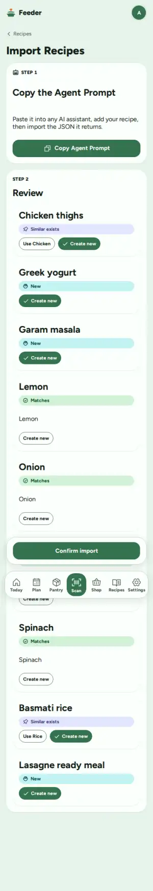 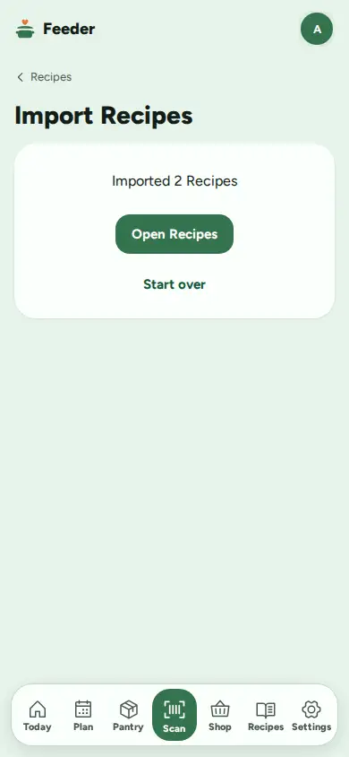

### Design
**Order of the review**, top to bottom, one column at every size inside `Page width="default"`:
1. **Notice** (info status tile, `role="status"`):
   - With open questions: "2 Recipes and 9 Ingredients. **2 questions** to answer before importing." and an outlined secondary button "Go to the first question".
   - With none: success-toned "2 Recipes and 9 Ingredients, ready to import." and no button.
2. **Recipes** tile: title "Recipes" (`title-3`) and a meta count ("2 to import", "2 to import, 1 skipped"). One `ListRow` per Recipe, set as an R-E row:
   - **Key** (the title): the Recipe name, with a RecipeThumb monogram at 40 px. The review does not serve file Photos yet; when it does, show the Photo.
   - **Detail** (meta, muted, one line):
     - plannable Recipe: "4 portions · 7 Ingredients · 5 Steps · Main";
     - Ready Meal: "Ready Meal · 2 portions";
     - Base recipe: "Base recipe · 1 l".
   - **State** at the row's end, in `body-strong`: "New", "Replaces yours", "Kept as Lasagne (2)" or "Skipped". It is "Choose", in the info tone, while a conflict is unanswered. Never a coloured chip: today's teal "New" misuses the Leftover tone (system.md §2).
   - Then an outlined expand IconButton.
   - **Expanded panel**, all on surface:
     - "Ingredients": rows with the name as key, the quantity as state, and the note or "Optional" as muted detail;
     - "Steps": numbered rows with the text at weight 600, the time as state ("4 h before", "25 min"), and the kind as muted detail. All Steps are shown;
     - a meta line: "Courses: Main · Tags: chicken, traybake · Source: example.test".
   - The first Recipe starts expanded when the file holds one or two Recipes. All rows start collapsed when it holds three or more.
   - **A conflict sits on its row:**
     - detail (info tone, question icon) "Already exists";
     - a footer row of ChoiceChips "Replace", "Keep both", "Skip" (pressed state with a check icon, none pressed until answered);
     - a secondary sm button-link "Open the existing Recipe" (new tab).
   - The separate `RecipeConflictTile` goes.
3. **Base recipe lines, Courses**: unchanged tiles, in today's order.
4. **Ingredients**, as R-E rows (RX-12). A unit question sits on its Ingredient's row. The closing "5 match your Ingredients" row has its caret in a 40 px circular outline.
5. Image warnings, Photo choice: unchanged.

**Questions and jumping**:
- `openQuestions(plan)` returns the unanswered questions in page order: Recipe conflicts, Base recipe lines, Courses, then Ingredient and unit questions.
- "Go to the first question" and the bar's "Next question" scroll to the question's row (`scroll-margin-block` = the sticky bar height + `--space-4`) and move focus to the row's title, which gets `tabindex="-1"`.
- "Next question" goes to the first unanswered question after the one that has focus, and wraps around.
- An answered question drops out at once, and the count updates in the notice and the bar.

**Sticky bar** ("Import actions"), one row at every width:
- meta "2 questions left" (hidden at 0);
- secondary "Next question". Below 600 px it is a 44 px icon-only button, still named "Next question";
- primary "Import 2 Recipes" (one Recipe: "Import 1 Recipe").
- The primary stays enabled while questions are open. Pressing it then moves focus to the first open question, and the bar's note becomes "Answer the 2 questions first" (`role="status"`). This is SAFE's field-error pattern.
- Short viewports: SHORT's rule for sticky bars applies.

**PageHeader action while reviewing**: secondary sm "Start over". SAFE's discard confirm applies once any answer was given.

**Result** ([mock](mocks/rx-01-import-result.html)):
- Focus moves to the success heading "Imported 2 Recipes" (CheckCircle in `--status-success-fg`).
- One R-E `ListRow` per imported Recipe. The whole row is a link to `/recipes/:id`, with a trailing outlined IconButton "Edit <name>" to `/recipes/:id/edit`. There is no chevron.
  - Key: the Recipe name.
  - State: "Created", "Replaced", "Kept as Lasagne (2)" or "Now a Base recipe".
  - Detail: "Main · 4 portions · 5 Steps", or "Ready Meal · 2 portions".
- Then **Also added** as rows:
  - "Ingredients created" with state "3" and detail "Chicken thighs, Basmati rice, Greek yogurt";
  - "Unit Conversions added" with state "1" and detail "Garam masala: 1 tbsp = 6 g";
  - Course lines likewise, when they apply.
- Actions: secondary "Import more" and secondary "Open Recipes".
- `ImportFollowUps` ("Read it next") stays below.
- The result is a page, not a toast. If a toast is ever added for a background import, it follows R-D+: no icon on success, and a 16 px icon in the headline line on failure.

**States**:
- Loading the review: a Skeleton of 3 rows in the Recipes tile.
- A file with 0 kept Recipes (all skipped): the primary is replaced by "Nothing to import", and the notice says "Every Recipe is skipped."
- Offline: RES's failed-request pattern.
- Long names wrap to 2 lines.
- Many Recipes: all rows collapsed.

**Accessibility**:
- Expand button: `aria-expanded`, `aria-controls`, named "Show <Recipe name>" or "Hide <Recipe name>".
- ChoiceChips: `aria-pressed`, in a group named "What to do with Lasagne (ready meal)".
- The notice is `role="status"`.
- Focus after each jump goes to the row title.
- `prefers-reduced-motion`: the jump scrolls instantly.
- Contrast:
  - info-fg state and detail on surface are already checked in `theme/contrast.test.ts`;
  - R-E text on surface: key 17.1 / 15.2, muted detail above 4.5;
  - button outlines per R-A: 4.5 / 4.9 on surface.

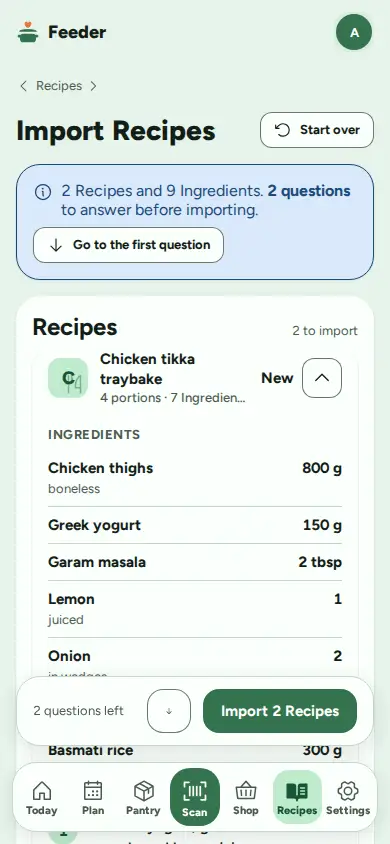 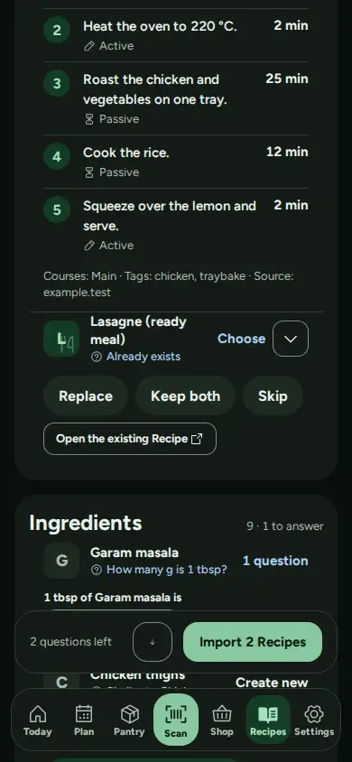 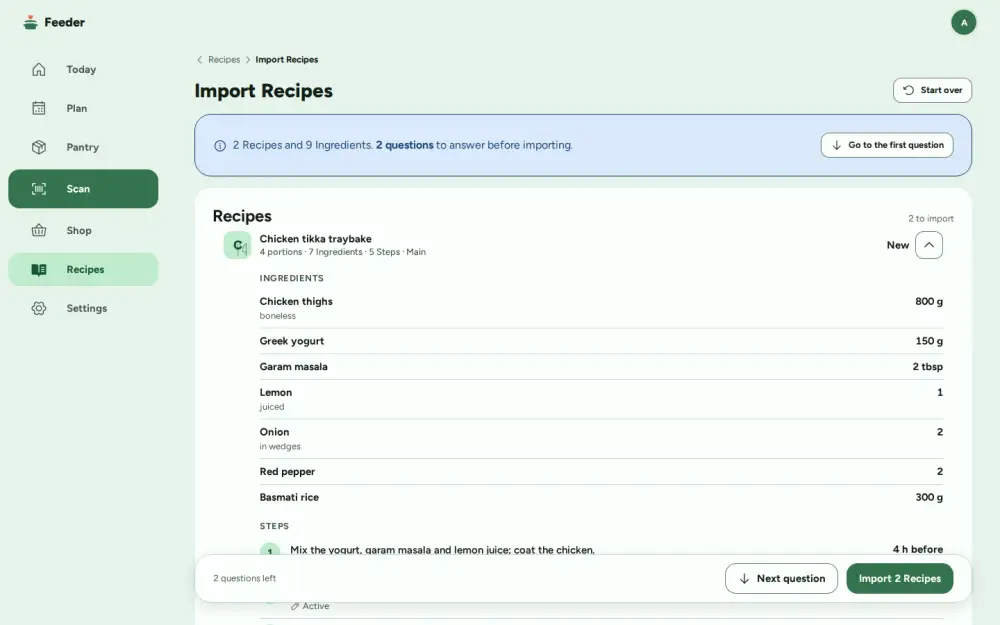 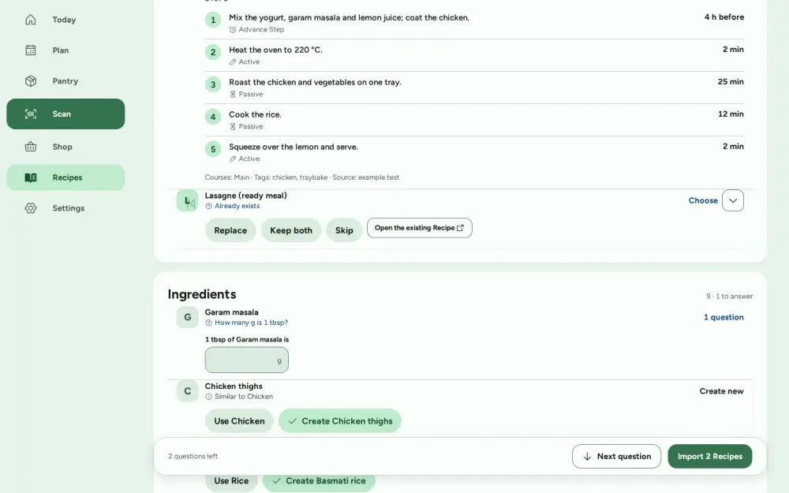 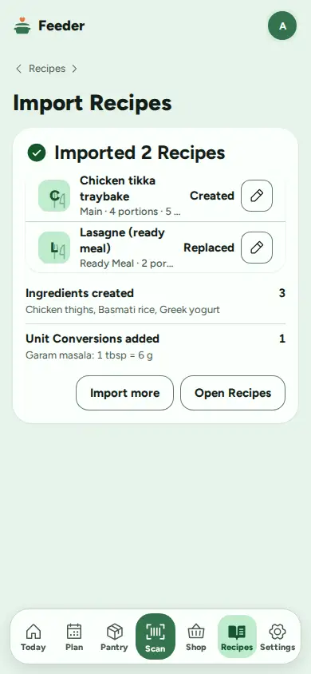 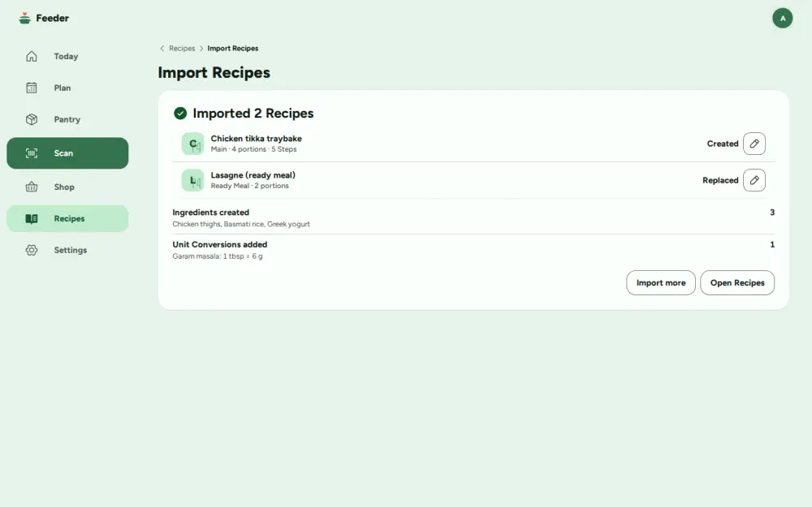

Mocks: [mocks/rx-01-import-review.html](mocks/rx-01-import-review.html), [mocks/rx-01-import-result.html](mocks/rx-01-import-result.html). Full page: [shots/rx-01-after-full-390-light.webp](shots/rx-01-after-full-390-light.webp).

### Alternatives considered
Decision 3 (decided): a read-only review, with Edit on each Recipe after the import.

### Build notes
- **API (Go)**:
  - `internal/recipefile/plan.go` `RecipeStatus` gains `Preview RecipePreview` (`json:"preview"`): `yield`, `yieldUnit`, `readyMeal`, `baseRecipe`, `courses`, `tags`, `description`, `source`, `lines [{quantity, unit, ingredient, note, optional, recipe}]`, `steps [{text, kind, durationMinutes, leadTimeMinutes}]` and `hasImage`.
  - Built in `BuildPlan`; domain only, the handler unchanged.
  - Mirror the type in `features/import/types.ts`.
- **Web**:
  - `screens/ImportScreen.tsx`.
  - New `components/ImportReviewNotice.tsx`, `RecipePreviewList.tsx`, `RecipePreviewPanel.tsx` (shares RX-04's R-E line and Step rows, read-only) and `ImportResult.tsx`.
  - `ConfirmTile.tsx` becomes `ImportBar.tsx`. `RecipeConflictTile.tsx` folds into the row footer.
  - `lib/reviewSummary.ts`: `openQuestions`, `recipeRowState`, `recipeRowMeta`, `resultRowState`, `resultRowMeta`, `addedRows(result)`.
  - `hooks/useImportReview.ts`: `questions`, `goToQuestion`.
  - `strings.ts`.
- **Shared**: the R-E row is DS's `ListRow` and notice-row rule. Buttons follow DS's R-A.

### Tests and guard
- Unit:
  - `openQuestions` order and count;
  - `recipeRowState`, `recipeRowMeta` and `resultRowState` for each case;
  - `addedRows` counts;
  - Go `BuildPlan` fills `Preview` in file order.
- BDD:
  - "Import Review lists each Recipe of the file with its Yield, Ingredients and Steps"
  - "A Recipe that already exists shows Replace, Keep both and Skip on its own row"
  - "Go to the first question moves focus to the first unanswered question"
  - "Import with open questions moves focus to the first one and says how many are left"
  - "The import result links to each imported Recipe and its editor"
- Guard:
  - in the page-layout import scenario, every `recipes[].name` is in `main` while reviewing and after the import;
  - the Import actions bar is one row at 390×844.

### Depends on / unblocks
RX-12 (same package). SAFE's discard confirm. SHORT (bar on short viewports). PC's FLOW-04. DS (R-A, R-E). §3.7: `features/import/**` is serialised.

## RX-02  The Recipe editor as a faster flow
**Severity** S2 · **Size** L · **Sources** RECIPES-09 · **Reproduced** Confirmed, wider. Recipe 1 (3 lines, 5 Steps):
- Page height: 7,633 px at 390, 6,699 at 820 and 6,196 at 1440.
- Ingredient lines are 258 px each below 900 px of viewport, and 73 to 103 px at 1440.
- Steps are 698 to 1,010 px at 390 and 564 to 806 px from 820.
- 10 FileDrop elements are drawn for 5 Steps.
- Ingredients start at y 2,227 at 390 and y 2,120 at 1440.
- The "Advance Step" segment is 79 px wide and wraps.

The workflow reviewer counted about 37 clicks and 19 fields for a 4-line, 4-Step Recipe on desktop (flows §H).

**Where** /recipes/new, /recipes/:id/edit; all sizes; both themes

### Problem
Adding a Recipe by hand means scrolling past 14 optional or rarely changed fields before the first Ingredient. Every line is a 3-row card up to a 900 px viewport. Every Step carries an always-open Photo drop zone.

Cause:
- Section order in `RecipeEditorScreen.tsx:179-271`.
- `recipes.css:931` switches lines to one row by a 900 px viewport query, not by the list's width.
- `StepsEditor.tsx:175-179` always renders the full `ImagePicker`.
- `StepsEditor.tsx:35-39` labels the segment "Advance Step".

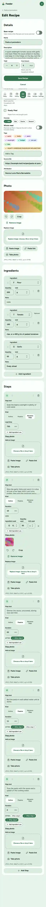 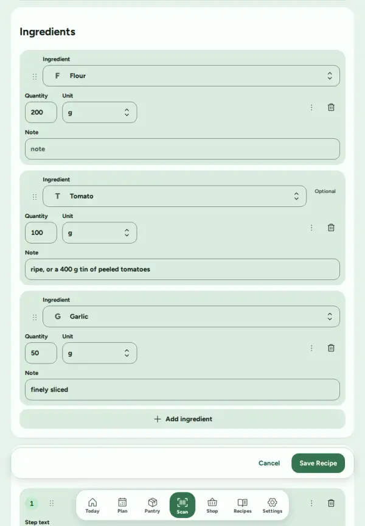 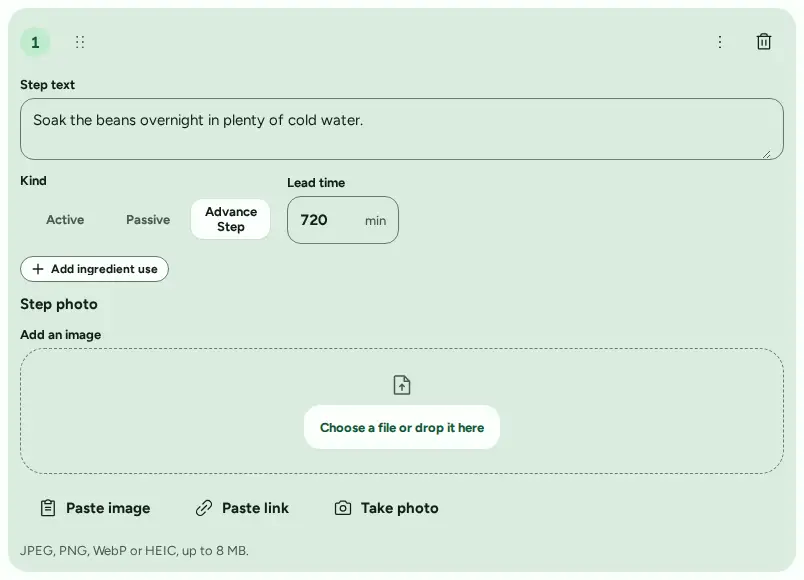

### Design
**Section order**:
1. **Recipe**: Name (`TextField size="full"`, autofocus on New Recipe), a 96 px **Photo** button beside it (opens today's ImagePicker in a sheet or dialog), and the **Kind** Segmented (RX-10). Options never wrap.
2. **Ingredients**:
   - Head row: "Ingredients" (`title-3`) and the Yield in context:
     - plannable: "For one Batch of [– 4 +] portions" (`Stepper size="sm"`, label "Yield");
     - Base recipe: "One Batch makes [800] [g]" (`YieldField`);
     - Ready Meal: "One pack is [2] portions".
   - Then the lines and "Add ingredient".
3. **Steps**: compact Step cards, then "Add Step".
4. **Description and source** (`ui/Disclosure`, collapsed). Summary: the first 60 characters of the description and the Source host, or "Optional" when empty.
5. **Planning** (`ui/Disclosure`, collapsed): Courses, Whole meal, Tags (RX-09), Cool-down, Leftover Use-by, Reheat time, Frozen Use-by, then one footnote.
   - Summary: Courses · up to three Tags (+N) · overrides set. A Base recipe's summary is "Never planned · <Tags>".
   - Footnote: "Leave a field blank to use the Household's setting: Cool-down 7 days, Leftover Use-by 2 days, Frozen Use-by 90 days. Reheat time without a value is worked out from the portions." The values are the Household's own.

**New Recipe defaults**:
- One empty line and one empty Step (today both lists are empty: `lib/draft.ts:115-116`), Yield 4 and the main Course.
- An untouched empty line or Step is dropped on Save.
- `/recipes/new?name=…` prefills Name (RX-15).

**Ingredient line** (container `rx-lines` on the list):
- **List narrower than 42 rem (phone)**:
  - row 1: drag handle (32), Ingredient picker, outlined ⋮;
  - row 2: Quantity (`xs`), Unit (`sm`, stretches), Optional checkbox with its visible label;
  - row 3: Note, only when the line has one.
  - The ⋮ menu holds Move up, Move down, Add note, Link to a Base recipe or Use as a plain Ingredient, and Remove (SAFE's Undo toast).
  - Target **≤ 140 px**, ≤ 190 px with a Note (measured 136 to 137, and 185).
- **From 42 rem of list width** (a 720 px viewport):
  - one row under visible captions (Ingredient · Quantity · Unit · Note · Optional);
  - tracks `32px minmax(9rem, 1.6fr) 88px 112px minmax(6rem, 1fr) 64px 88px`; the last track holds ⋮ and Trash, both outlined;
  - target **≤ 64 px** (measured 64 to 65).
- **Fast entry**:
  - picking an Ingredient moves focus to Quantity (RX-08);
  - Enter in the last field of the last line (Note from 42 rem; Quantity on a phone) adds a line and focuses its picker.

**Step card**:
- Lead column (44 px): number badge, drag handle, and on a phone the ⋮.
- Body:
  - the text (`TextArea`, 2 rows, grows with its content);
  - one timing row: the compact Kind Segmented ("Active", "Passive", "Advance"; accessible name "Advance Step"; never wraps), and a `DurationField` (RX-08);
  - "After" chips, only when there are earlier Steps;
  - a chip row: each Ingredient use as a removable chip, then the outline ChoiceChips "+ Ingredient use" and "+ Photo".
  - Once a Photo is set it shows at 72 px with a secondary sm "Change Photo".
- From 42 rem: ⋮ and Trash at the row's end. On a phone, Remove Step is in the ⋮ (SAFE's Undo).
- The icon buttons on the tinted card have a surface fill and an outline (R-A).
- Add Step focuses the new Step's text.
- Target **≤ 250 px** from 42 rem with Uses or a Photo (measured 212 to 246), **≤ 280 px** on a phone without them (measured 270), ≤ 340 px with them.

**Focus on nested controls (R-C+)**: the line's ⋮, the Step's drag handle and a Tag chip's remove button each sit inside a container with its own shape. Each draws its ring inside itself: `outline: 2px solid var(--color-accent); outline-offset: -2px` on a `--color-soft` fill. At least 4 px of the container's fill separates the ring from the container's edge, so the ring never touches the line, the Step card or the chip's edge. Fields and buttons that are not nested keep the outer ring (R-C).

**Section index** (from 1280 px): Recipe · Ingredients · Steps · Description and source · Planning. Choosing a collapsed section opens it.

**`ui/Disclosure`** (new primitive):
- The heading is a `<button aria-expanded aria-controls>` holding the title (`title-3`), a one-line summary (`meta`, ellipsis), and the CaretDown inside a 40 px circular outline. The caret turns when open.
- It opens by itself when a field inside has an error (SAFE's `focusFirstInvalid` calls `open()`), when the hash names it, or when the person left it open before on this device (`localStorage` key `feeder.recipeEditor.open`, guarded by try/catch).
- Only which sections are open is remembered.
- Reduced motion: no rotation.

**Sticky bar**: secondary "Cancel" and primary "Save Recipe" on one row (SHORT's bar). Leaving with unsaved changes opens SAFE-01's blocking "Leave without saving?" dialog (Keep editing / Discard changes). A draft survives only a reload or a crash.

**Clicks**: about 37 before and 22 after with a pointer; about 11 keyboard-first ([shots/rx-02-click-count.webp](shots/rx-02-click-count.webp), [mocks/rx-02-click-count.html](mocks/rx-02-click-count.html)). The split of the 37 is this review's reconstruction of stage 1's total.

**Page height** (mock, 4 lines, 4 Steps):
- 3,073 px at 390 (today 7,633 for 3 lines and 5 Steps);
- 2,395 px at 1440 (today 6,196);
- Ingredients start at y 428 at 390.

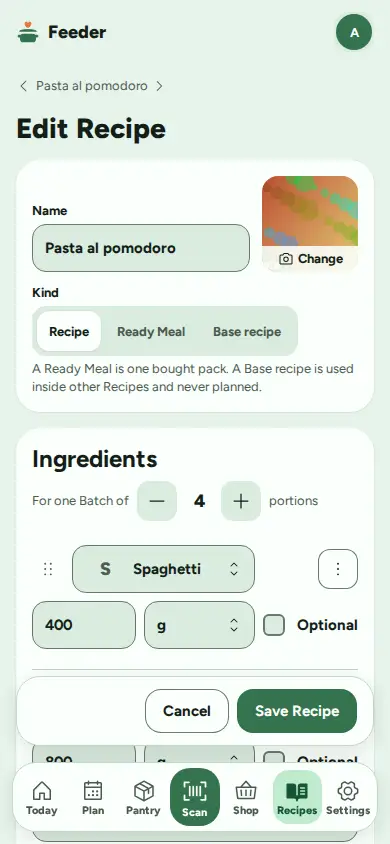 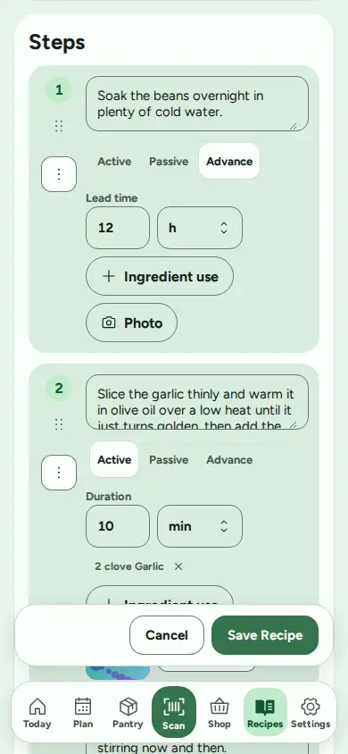 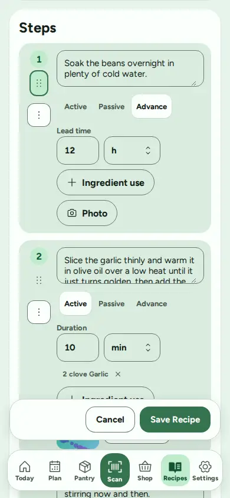 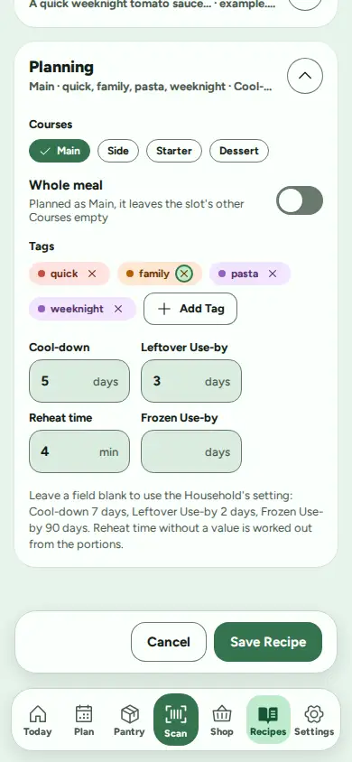 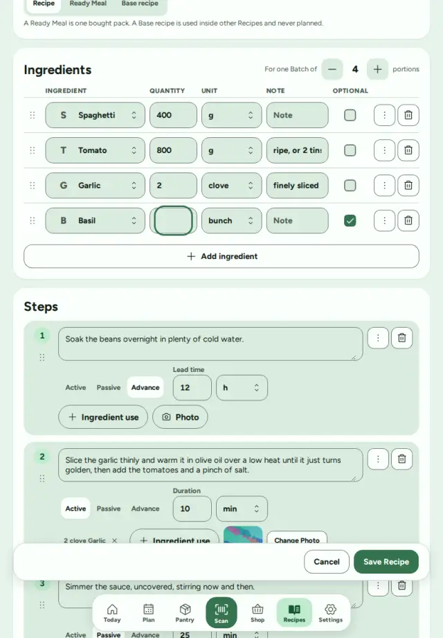 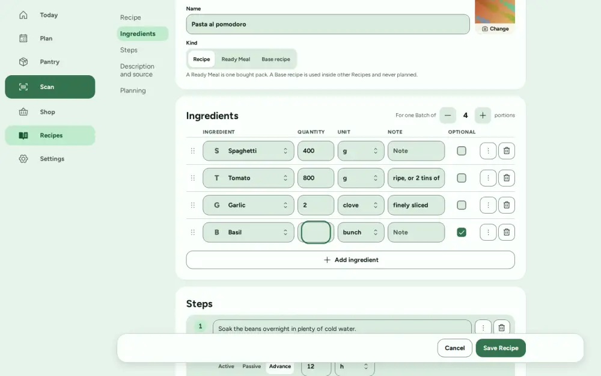 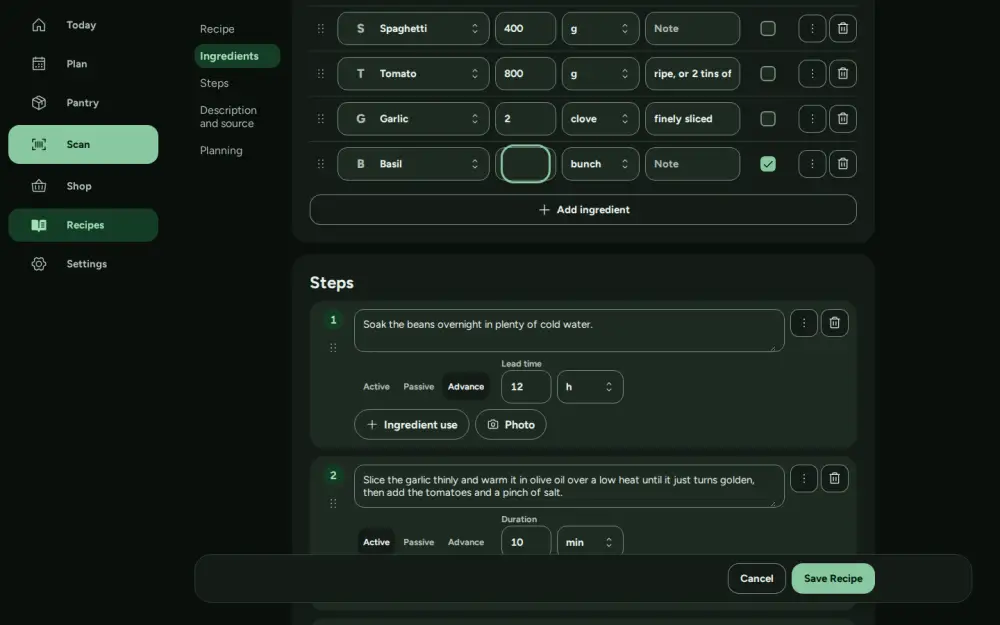 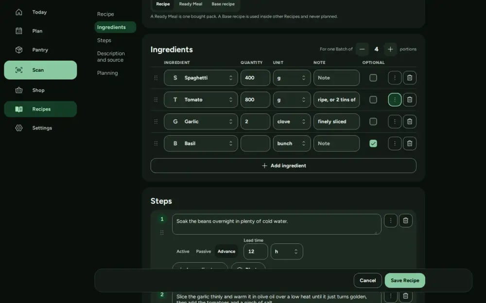 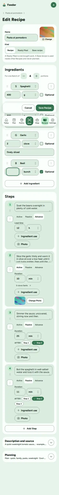

Mocks: [mocks/rx-02-editor.html](mocks/rx-02-editor.html), [mocks/rx-02-editor-planning.html](mocks/rx-02-editor-planning.html).

**Accessibility**:
- Hidden field labels stay in the accessible name ("Quantity", "Unit", "Note", "Optional: Basil"). Captions are `aria-hidden`.
- The Photo button is named "Photo of the Recipe: add" or "Photo of the Recipe: change".
- Targets are at least 44 px.
- Focus order follows the visual order.
- Ring contrast: the inner ring on soft is 3.4 (light) and 3.6 (dark); the outer ring on surface is 5.7 and 9.0.

### Alternatives considered
A two-column editor was rejected again (E-01's reasoning). Details left open below Steps was not chosen. Decision 5 (decided): both optional sections are collapsed for new and saved Recipes.

### Build notes
- `features/recipes/`:
  - `screens/RecipeEditorScreen.tsx`;
  - `components/RecipeDetailsFields.tsx` split into `RecipeBasicsFields`, `RecipeAboutFields` and `RecipePlanningFields`;
  - `IngredientLineRow.tsx`, `StepsEditor.tsx`, `StepPhoto.tsx` (the "+ Photo" chip, then the 72 px image with "Change Photo"), `PhotoPicker.tsx` (the 96 px button);
  - `lib/draft.ts` (`emptyDraft`, `isUntouched`);
  - `hooks/useRecipeEditor.ts` (focus targets, Enter adds a line);
  - editor CSS: `@container rx-lines (min-width: 42rem)` replaces the 900 px media query.
- **New shared primitives**: `ui/Disclosure` and `ui/fields/DurationField`.
- **New system.md rule** (§8): "A long form puts the fields that most Users fill first and the optional ones in Disclosure sections; a closed Disclosure states what it holds in its summary line, and it opens itself when a field inside it has an error."
- The R-C+ inner ring is A11Y's rule (A11Y-02).
- No API change.

### Tests and guard
- Unit:
  - `emptyDraft` has one line and one Step;
  - untouched lines and Steps are dropped before validation;
  - `Disclosure` toggles, opens on `open()`, and survives a throwing `localStorage`;
  - a Step without a Photo renders no `.file-drop`;
  - Enter on the last field adds a line.
- BDD:
  - "Adding a Recipe needs no scrolling past optional fields before the Ingredients"
  - "An Ingredient line is one row from a 720 px wide screen"
  - "A Step shows a Photo drop zone only after Add Photo"
  - "Planning opens itself when one of its fields has an error"
- Guard (page-layout, "RX height budget"), at 390×844, 820×1180 and 1440×900:
  - `.line-row` ≤ 64 px from 42 rem;
  - a Step ≤ 250 px from 42 rem and ≤ 280 px below;
  - no `.file-drop` in a Step without a Photo;
  - no `.segmented__option` taller than one line;
  - a focused nested control's ring lies inside its container (R-C+).

### Depends on / unblocks
- SAFE's editor items first: SAFE-01's dialog with a draft kept only across a reload or a crash, Cancel, validation focus, Undo.
- SHORT's StickyActionBar.
- A11Y: Segmented selected state, R-C+.
- DS: R-A.
- WP-RX-C, with RX-08, RX-09 and RX-10.

## RX-03  Recipes list: a compact card on phones, New Recipe on the title row
**Severity** S2 · **Size** M · **Sources** RECIPES-10 · **Reproduced** Confirmed, 16 Recipes:
- Card height: 341 px at 390, 302 at 320, 505 at 680 and 387 at 844×390.
- Names in the first viewport: 1 at 390, 320 and 680; 0 at 844×390.
- Page height: 6,154 px at 390.
- New Recipe sits on its own row (title at y 64, button at y 110).

**Where** /recipes and /recipes?kind=base; phone portrait and landscape, small tablet; both themes

### Problem
A Recipe library is scanned by name. On a phone, the 16:9 picture card gives one Recipe per screen, and the header takes 280 px.

Cause:
- `RecipeTile.tsx:35-73` renders the same `media` Tile at every width, with a 16:9 `hero` RecipeThumb.
- `BentoGrid min="card"` gives one column below 720 px.
- `ui/PageHeader.css` `.page-header__text { flex: 1 1 12rem }` sends the actions to a second line.

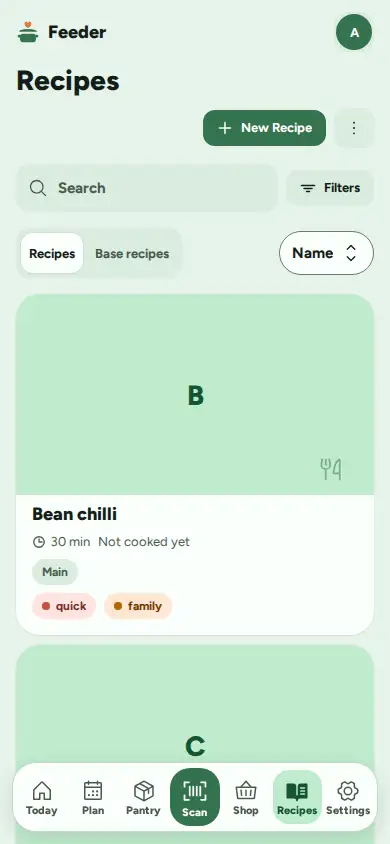

### Design
**Compact card** (Decision 1, decided). When the list is narrower than two card tracks (container `recipe-list`, `max-width: 40.99rem`), a card is a grid `88px minmax(0, 1fr)` with `--space-3` padding:
- an 88 px square Photo or RecipeThumb (`--radius-thumb-lg`) spanning three rows;
- the name in `body-strong`, 2 lines;
- the meta line in `meta`, one line with an ellipsis;
- **one chip line**: Courses, Ready Meal, Base recipe, Archived, then up to 2 Tags, with no wrap.
  - Chips that do not fit are left out whole, never cut to a letter (`useFittingChips`, as in the Filters chip line). At 320 the line shows the Course and one Tag.
- Height 112 px. The card stays one link (A11Y, RECIPES-17).

**From two card tracks**: today's media card, with Courses and Tags on one chip line.

**Base recipes tab**: meta "800 g · Used in 2 Recipes", and the Base recipe badge in the chip line.

**Header**: "Recipes", "New Recipe" and ⋮ share one row from 360 px. This needs PageHeader's title basis at 8 rem instead of 12 rem (DS-owned). At 320 the actions still wrap, which is DS's 320 rule.

**Under 360 px**: the bottom bar is icon-only, with 40 px squircles for the current page and Scan (R-F, DS-02).

**States**:
- Loading: `Skeleton variant="row"` × 6 at 112 px in compact; tiles × 4 otherwise.
- Error and empty Household: unchanged.
- No result: RX-15.
- Long names: 2 lines.
- Phone landscape keeps the media cards (two tracks). Its bars are SHORT's.

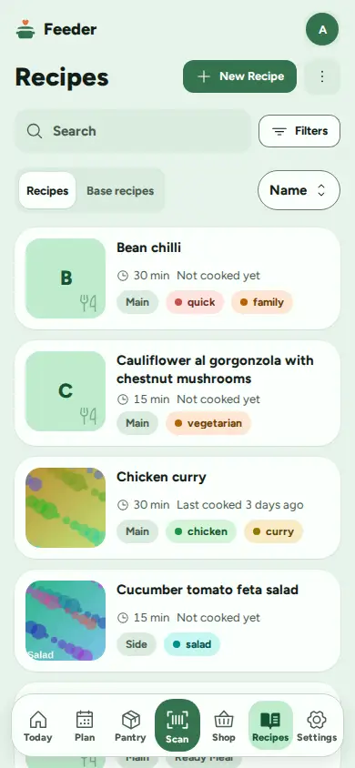 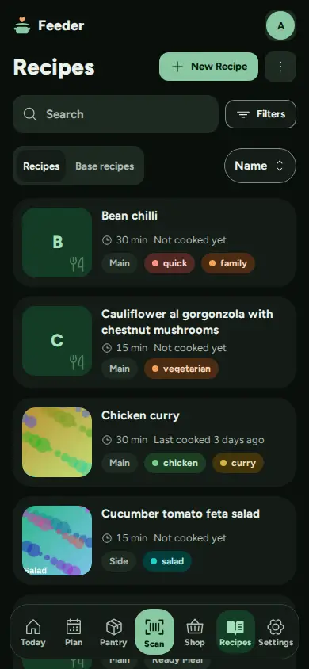 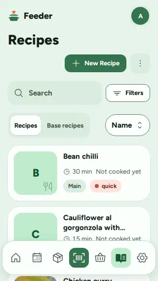 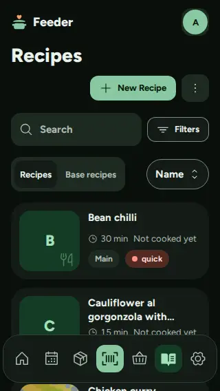 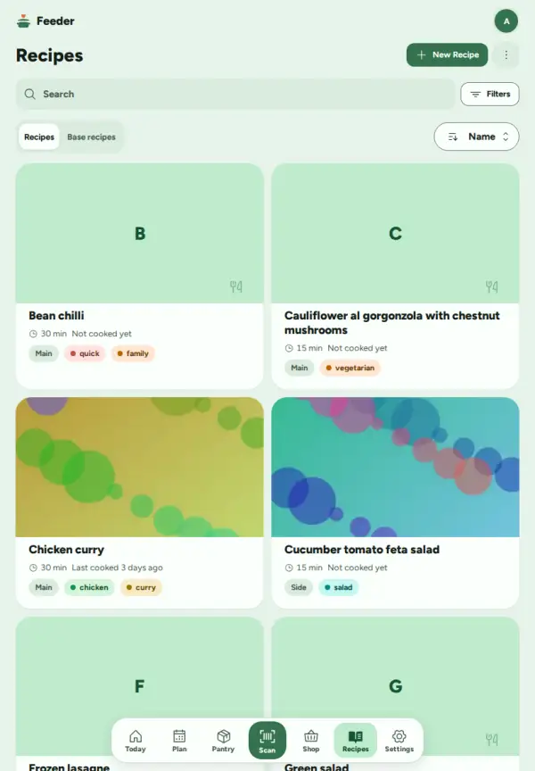 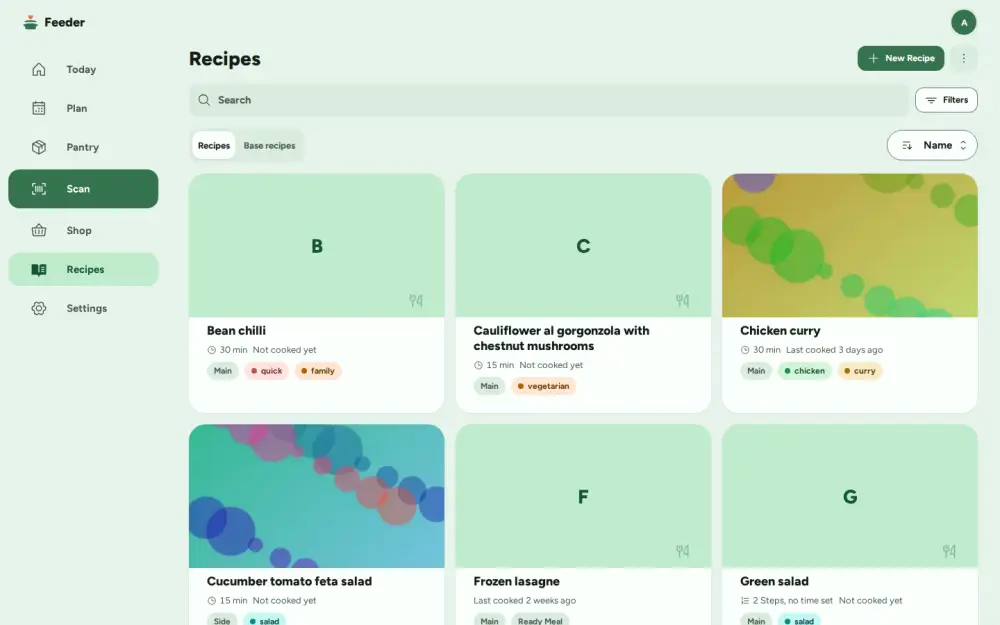 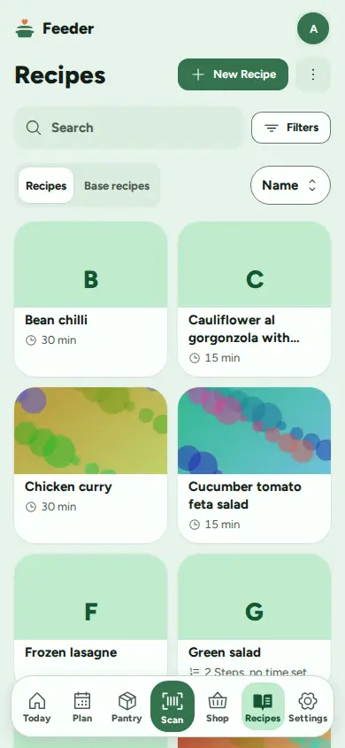

Mocks: [mocks/rx-03-list-compact.html](mocks/rx-03-list-compact.html) (decided), [mocks/rx-03-list-grid2.html](mocks/rx-03-list-grid2.html) (option C).

Measured at 390×844: 4 names in the first viewport (today 1), and 124 px per Recipe including the gap (today 357).

**Accessibility**: the card's name is the Recipe name. The chips are `aria-hidden` inside the link, with their text in the card's description. No new contrast pair.

### Alternatives considered
Decision 1: A (today), B (compact, decided), C (two-up grid).

### Build notes
- `RecipeTile.tsx`: one `ul.recipe-tile__chips` fitted by `useFittingChips`.
- The list CSS: the container rules from the mock.
- `ui/PageHeader.css` (DS): the 8 rem basis.
- The bottom bar's R-F rule is DS-02's.
- New system.md rule (§4): "A list of media cards whose list is narrower than two `card` tracks shows each card compact: an 88 px picture at the start, the title, one meta line and one chip line beside it. No card in a one-column list is taller than 120 px."

### Tests and guard
- Unit: one chip list with Courses first and at most 2 Tags; no chip narrower than its label plus padding.
- BDD:
  - "On a phone the Recipes list shows at least four Recipe names on the first screen"
  - "New Recipe is on the title row at 390 px"
- Guard (page-layout):
  - at 390×844, 3 or more names lie fully above the bottom bar;
  - `.recipe-tile` is ≤ 120 px below 41 rem;
  - at 320, no `.chip` is clipped by its line.

### Depends on / unblocks
DS (PageHeader, DS-02 / R-F), A11Y (RECIPES-17, 19), WP-RX-B with RX-07's tile line.

## RX-04  Recipe detail layout: the Cook entry in reach and the hero aligned at every size
**Severity** S2 · **Size** M · **Sources** RECIPES-05, RECIPES-16 · **Reproduced** Confirmed:
- "Start Cook Mode" top is at y 1,196 at 1280×800, 1440×900 and 1920×1080. `.recipe-detail__aside` is 1,080 px tall with `position: sticky`, so it never sticks.
- At 1000×800 the hero spans x 90 to 910 against the metric grid at 24 to 976. The Photo is 820×461 and the Steps heading is at y 1,204.
- At 1240 the hero spans 254 to 1,074 against 120 to 1,208, and the Steps are at y 1,240.

**Where** /recipes/:id; all sizes; both themes

### Problem
On a laptop the main action sits below the fold while the Steps column is half empty. Between 720 and 1240 px, the hero and the tiles do not share edges, and the Photo pushes the Steps about 1,000 px down.

Cause:
- `RecipeDetailScreen.tsx:52` (`min-width: 1280px`) puts the Cook entry last in the aside (`:146`).
- `recipes.css:242-259` makes the aside sticky.
- `recipes.css:210-215` caps the hero at 820 px.

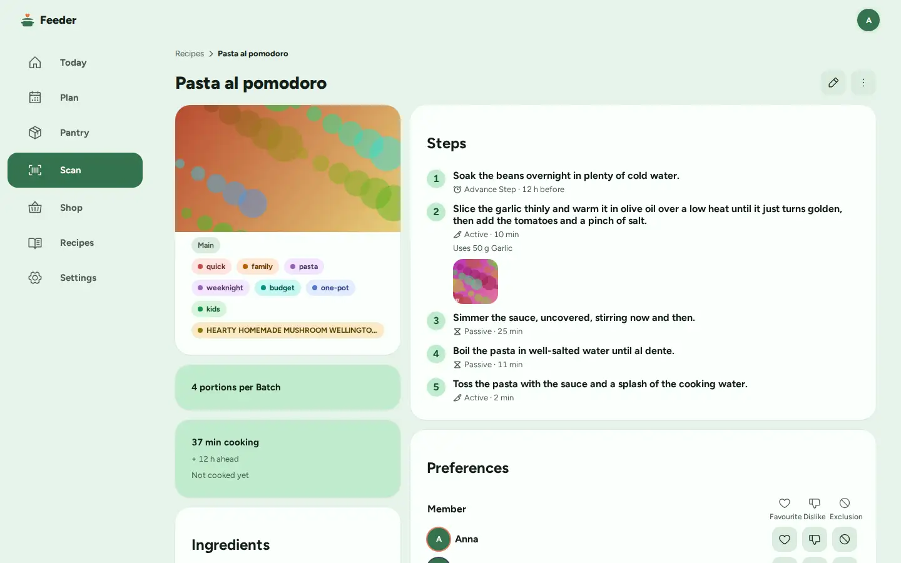 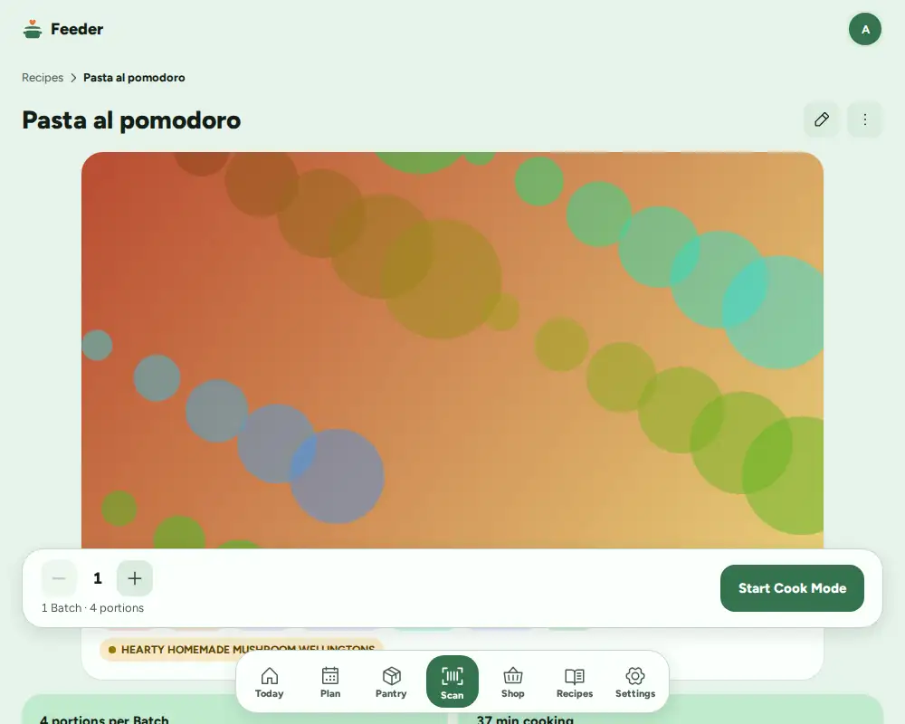

### Design
**Layout by the detail's own width** (container `recipe-detail`):
- **Below 45 rem**: one column, in this order:
  - lede (RX-05);
  - hero: Photo 16:9 with `max-block-size: 40vh`, plus the chip line;
  - metric strip (RX-13), Ingredients, Steps, Preferences;
  - the Cook entry in the sticky bar (SHORT owns short viewports).
  - Metric values use `title-2` here and never wrap.
- **From 45 rem** (768 px): two columns `minmax(17rem, 22.5rem) minmax(0, 1fr)`:
  - side column: hero, Cook tile (from 1024 px), metric strip, Ingredients;
  - main column: Steps, Preferences;
  - nothing is sticky, and every tile shares its edges.
- **Hero chip line**:
  - Courses, Ready Meal, Archived and Tags share one line, fitted so the outlined "+N" chip is never cut. It expands in place (`aria-expanded`, named "Show all 8 Tags").
  - The line keeps 5 px of ring room.
  - Without a Photo, the band is 4:1.
- **Ingredients and Steps as R-E rows**:
  - **Ingredient line**: key = name (`body-strong`); state at the end = quantity (`body-strong`, tabular); detail underneath = "Optional · <note>" in muted `meta`; then the outlined ⋮ (RX-14).
  - **Step**: number badge; key = the Step text at weight 600; state at the end = its time ("10 min", "12 h before"; "No time" in muted for an untimed Step); detail = kind icon and kind, plus "Uses 50 g Garlic" or "After Step 2" in muted `meta`; the Step Photo (72 px) under it.
  - Rows are separated by 1 px `--color-line`, with `--space-2` (lines) or `--space-3` (Steps) padding.
- **Cook entry** (Decision 2, decided):
  - From 1024 px of viewport (the side rail's breakpoint), a **Cook tile** sits under the hero: heading "Cook" (`title-3`), the Batches Stepper with its hint, and a full-width primary "Start Cook Mode".
  - Below 1024 px, the StickyActionBar.
  - Never both.
  - Option B (sticky bar at every width) was not chosen.
- **Header**: outlined Edit and ⋮ (R-A).
- **Under 360 px**: R-F's icon-only bottom bar. The sticky Cook bar still stacks the stepper over the button at 320; its one-row rule is SHORT's.
- **Toasts** (R-D+):
  - "Archived Pasta al pomodoro" with Undo, and "Deleted Pasta al pomodoro" (Delete is confirmed first, per SAFE), are plain one-sentence success toasts: no icon, with the outline Undo.
  - A failed Archive or Delete ("Couldn't archive Pasta al pomodoro") shows a 16 px warning icon at the start of the headline line, centred on its text, with Retry. Dismiss is top-aligned with the headline.
- **Measured on the mock**:
  - Start Cook Mode top: y 723 at 1280×800 and 1440×900 (bottom 771); y 624 at 1000×800 in the bar; y 676 at 390×844.
  - Steps heading: y 378 at 1280 and 1440; y 372 at 820 and 1000.
- **States**:
  - Loading: Skeleton in two columns.
  - Archived: a chip; the Cook entry stays.
  - Base recipe: RX-06.
  - Ready Meal: unchanged.
  - Long names wrap.
- **Accessibility**:
  - The Cook tile is a `section` named "Cook"; the bar is a group "Cook". DOM order equals the visual order.
  - The Ingredient list stays a `dl` (name `dt`; quantity, note and actions `dd`); Steps stay an `ol`.
  - R-E contrast on surface: key 17.1 / 15.2, muted detail above 4.5.

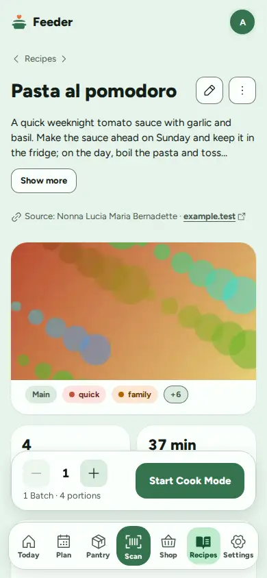 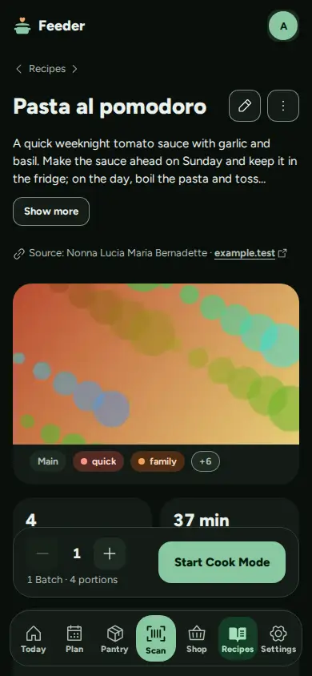 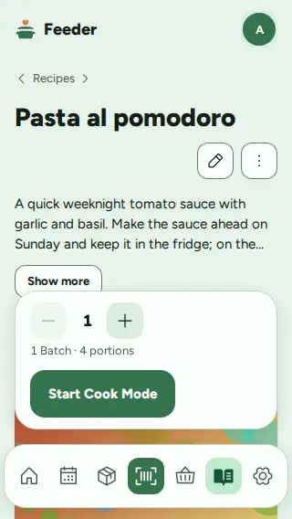 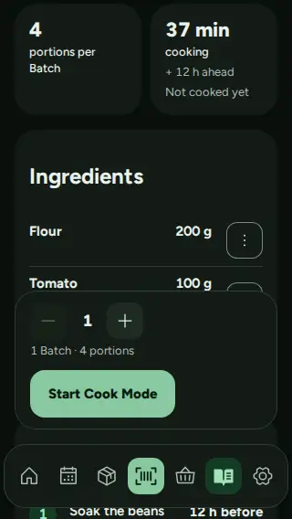 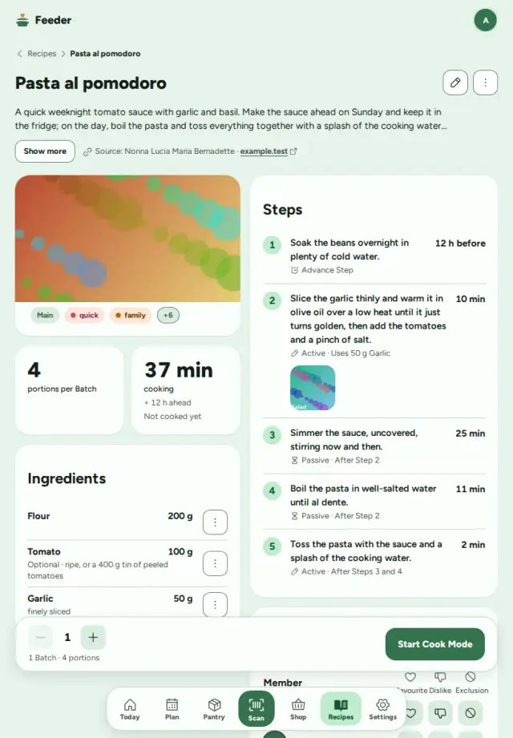 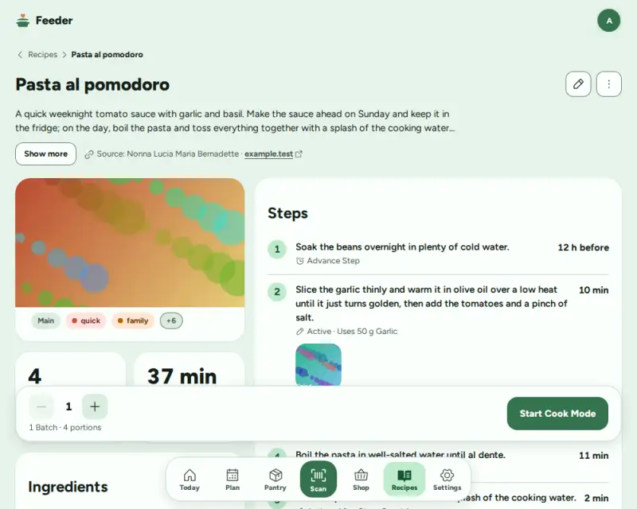 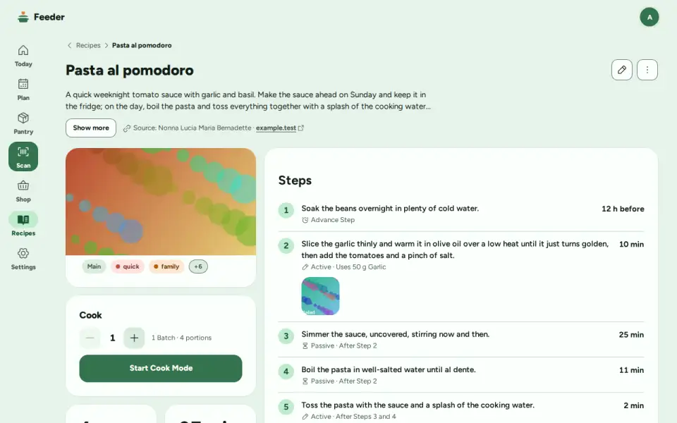 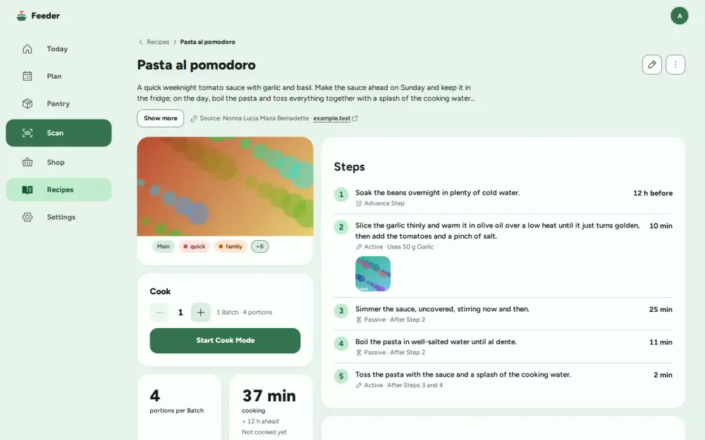 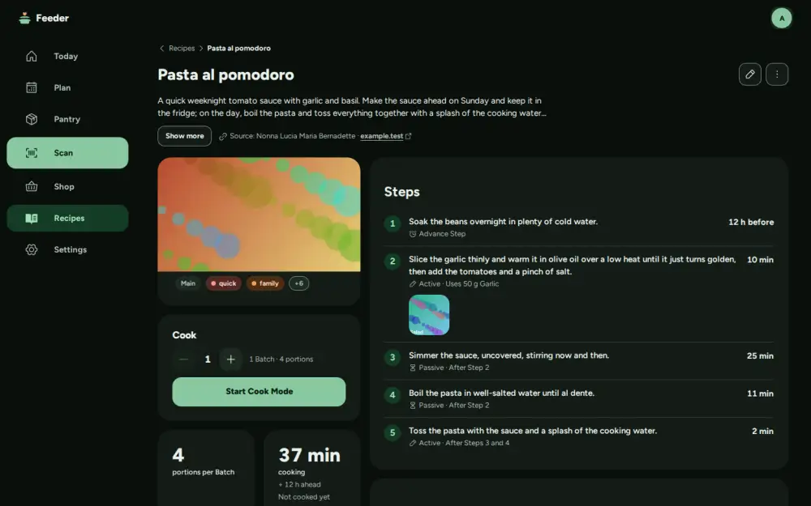 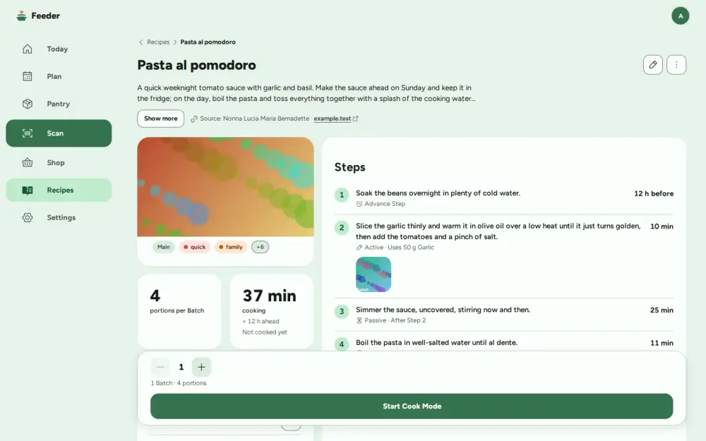

Mocks: [mocks/rx-04-detail.html](mocks/rx-04-detail.html) (decided), [mocks/rx-04-detail-stickybar.html](mocks/rx-04-detail-stickybar.html) (option B).

### Alternatives considered
Decision 2. A shorter sticky aside was rejected: it would put the Ingredients below the Steps.

### Build notes
- `RecipeDetailScreen.tsx`: `hasRail` (1024 px) replaces `wide`; aside order; new `components/CookTile.tsx`.
- `IngredientLinesList.tsx` and `StepsList.tsx`: R-E row markup, shared with Import Review (RX-01).
- `RecipeTags`: `limit` + "+N", fitted.
- Detail CSS: the container rules from the mock. Remove the sticky aside and the 820 px cap.
- The Archive and Delete toasts follow DS's R-D+ Toast; the confirm and Undo are SAFE's.
- New system.md rule (§8): "A detail page's primary action is visible in the first viewport of a 1280×800 screen and up, in a tile; below 1024 px it is in a StickyActionBar."

### Tests and guard
- Unit:
  - Cook tile at ≥ 1024 px, bar below;
  - the aside is never sticky;
  - the "+N" chip is never clipped;
  - Step rows put the time at the end, and untimed Steps say "No time".
- BDD:
  - "On a laptop Start Cook Mode is visible without scrolling"
  - "From 768 px the Steps start beside the Photo"
- Guard (page-layout):
  - `data-primary` inside the first viewport or a `.sticky-action-bar` at 1024×768, 1280×800, 1440×900 and 1920×1080;
  - side-column edges equal (±1 px);
  - no metric value wraps at 320.

### Depends on / unblocks
SHORT, RX-05, RX-13, RX-14 (same package), TB's RECIPES-18, DS (R-A, R-D+, R-E, R-F), SAFE (Delete confirm, Undo).

## RX-05  Recipe detail shows the description, Source and Attribution
**Severity** S2 · **Size** S · **Sources** RECIPES-03 · **Reproduced** Confirmed. Recipe 1's 230-character description, its URL and "Nonna Lucia Maria Bernadette" are absent from `main.innerText` at every size.

**Where** /recipes/:id; all sizes

### Problem
What people type, and the credit for imported Recipes, are visible only in the editor. Cause: `RecipeDetailScreen.tsx:88-189` never reads `r.description` or `r.source`.

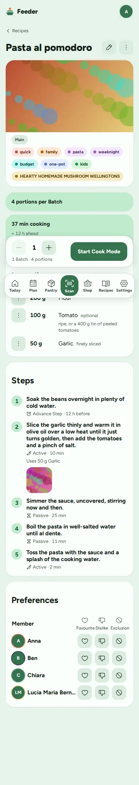

### Design
- A **lede** under the PageHeader, full page width, `max-inline-size: 70ch`. It is not a tile.
  - **Description** in `body`, clamped to 3 lines in one column and 2 lines from 45 rem.
  - **One row under it** (flex, wrapping):
    - a secondary sm button "Show more" / "Show less" (R-A, `aria-expanded`, `aria-controls`), shown only when the text is clamped (`useIsClamped`);
    - the **Source line** (`meta`, muted, LinkSimple icon).
  - Source line content:
    - with both: "Source: Nonna Lucia Maria Bernadette · example.test", where the host is an underlined `TextLink` (`target="_blank" rel="noopener noreferrer"`, ArrowSquareOut icon, accessible name "Source: example.test, opens in a new tab");
    - only an attribution: "Source: <attribution>";
    - only a URL: "Source: <host>";
    - neither: no line; with no description either, no lede.
  - Only `http:` and `https:` become links.
- Long attribution: up to 2 lines.
- Dark: same tokens.

  

Mock: [mocks/rx-04-detail.html](mocks/rx-04-detail.html) (`.rx-about`).

### Build notes
New `components/RecipeAbout.tsx`, `lib/sourceLine.ts` and `ui/useIsClamped.ts`. The Import Review preview reuses `sourceLine` (RX-01).

### Tests and guard
- Unit: `sourceLine` for all four cases and a non-http URL; `RecipeAbout` renders nothing when empty; no "Show more" when the text is not clamped.
- BDD: "A Recipe's description and its Source are on its page"; "Source opens in a new tab".

### Depends on / unblocks
RX-04; same package.

## RX-06  Base recipe detail states its Yield with its unit
**Severity** S2 · **Size** XS · **Sources** RECIPES-06 · **Reproduced** Confirmed, wider. /recipes/16 (Yield 800 g) reads "Yield 800 g", "Not used yet" (as a heading), "800 portions per Batch" and "1 Batch · 800 portions".

**Where** /recipes/:id for a Base recipe; all sizes

### Problem
The page states two wrong facts (portions) beside the right one, against GLOSSARY's Yield ("A Base recipe's Yield is an amount with a unit").

Cause:
- `RecipeDetailScreen.tsx:130` passes `yieldText={String(r.yield)}`.
- `strings.ts:118` `portionsPerBatch` and `:125` `batchesHint` always say "portions".
- `CookEntry.tsx:313` uses `batchPortions`.
- `BaseRecipeSection` sets `usedInText(0)` ("Not used yet") as an `h2`.

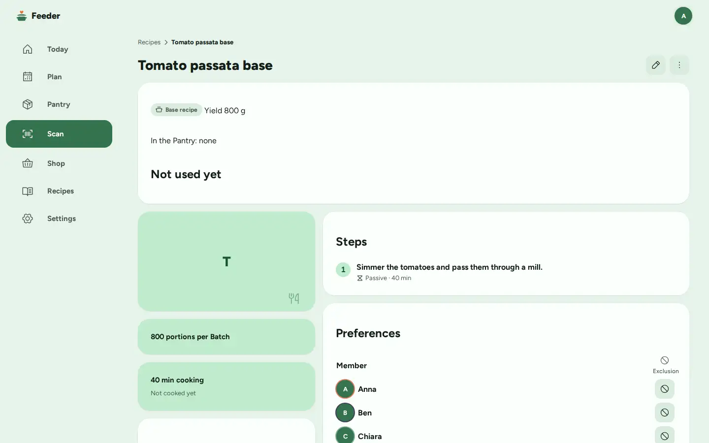

### Design
- **Metric**:
  - plannable Recipe: value "4", label "portions per Batch";
  - Base recipe: value `yieldText(yield, yieldUnit)`, label "per Batch" ("800 g per Batch", or "8 portions per Batch" when the unit is portion).
- **Cook hint**: "1 Batch · 800 g", "2 Batches · 1.6 kg". The amount is scaled and shown in the User's display units through the same formatter as the Ingredient lines (`useDisplayUnitSystem`).
- **Base recipe section**:
  - the badge; the Stock line as today;
  - the heading "Used in" (`title-3`), always;
  - then either the links or the `meta` sentence "Not used in any Recipe yet. Link it from a Recipe's ingredient line.";
  - drop the duplicate "Yield 800 g" line, which the metric now carries.

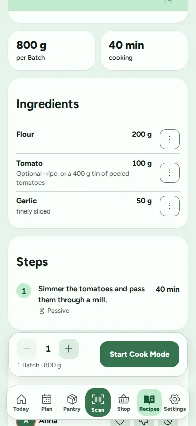 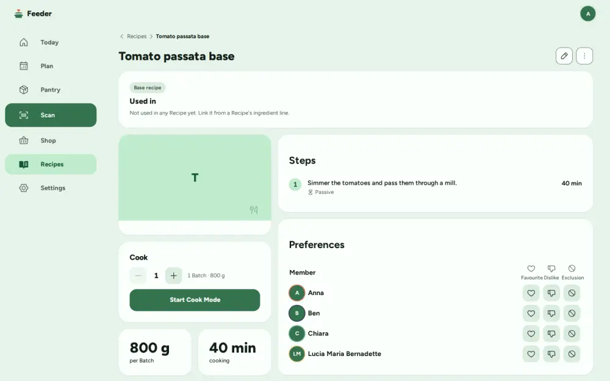

Mock: [mocks/rx-06-base-detail.html](mocks/rx-06-base-detail.html).

### Build notes
- `components/RecipeMetrics.tsx`: takes `yieldValue`, `yieldUnit`, `baseRecipe`.
- `components/CookEntry.tsx`: takes `yieldUnit`.
- `lib/cookEntry.ts`: `batchAmount(yield, unit, n)` returns the quantity in base units for formatting.
- `strings.ts`: `yieldMetric`, `cook.batchesHint(n, amountText)`, `baseRecipe.usedInTitle`, `baseRecipe.notUsedYet` (the new sentence).
- `RecipeDetailScreen.tsx` passes `r.yieldUnit`.

### Tests and guard
- Unit: `batchAmount` for g, kg roll-over, ml, piece and portion; `RecipeMetrics` with `baseRecipe` + `yieldUnit:'g'` renders "800 g" and never "portions".
- BDD: "A Base recipe of 800 g says 800 g per Batch".
- Guard: none.

### Depends on / unblocks
RX-13 (same component, same package).

## RX-07  Untimed Steps are not "No Steps"
**Severity** S3 · **Size** S · **Sources** FLOW-22 · **Reproduced** Confirmed. "Green salad" has 2 Steps without a Duration (`steps-list__item` count 2), yet its metric and its list card read "No Steps".

**Where** /recipes/:id metric; /recipes card meta

### Problem
The page contradicts itself directly above the Steps it lists.

Cause:
- `lib/timeSummary.ts:15` returns `total: null` for `totalMinutes 0`.
- `RecipeMetrics.tsx:33` and `RecipeTile.tsx:46` then print `recipeStrings.noSteps`, without knowing whether Steps exist.

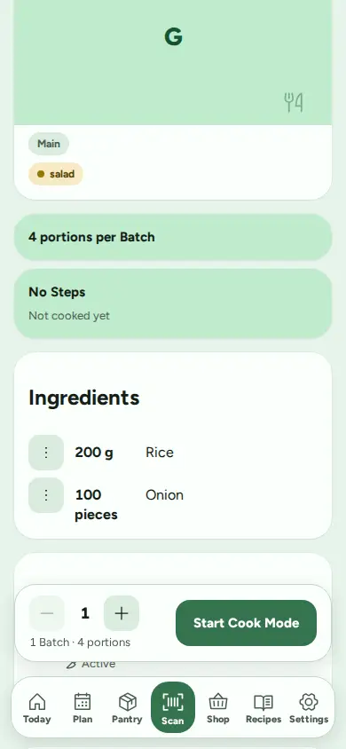

### Design
- `timeSummary({totalMinutes, advanceMinutes, stepCount})` gains `untimedSteps: number | null`.
- **Detail metric**:
  - value "No time set", label "2 Steps, none timed" (1 Step: "1 Step, not timed");
  - "No Steps" stays only when there are none;
  - an Advance Step alone keeps today's lead metric.
- **List card meta**: ListNumbers 14 px icon + "2 Steps, no time set".
- Choose a Recipe (RX-08) and Import Review rows use the same wording.

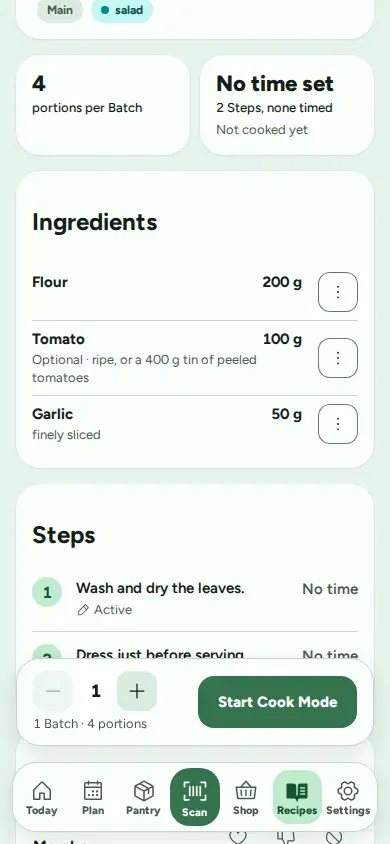

Mock: [mocks/rx-07-untimed-detail.html](mocks/rx-07-untimed-detail.html). The list card is in [mocks/rx-03-list-compact.html](mocks/rx-03-list-compact.html) ("Green salad").

### Build notes
- **API**: the Recipe list summary gains `stepCount` (Go: the Recipe list query in `internal/recipe/store` and its DTO in the recipe httpapi; web `RecipeSummary.stepCount`). The detail uses `r.steps.length`.
- `lib/timeSummary.ts`, `components/RecipeMetrics.tsx`, `components/RecipeTile.tsx`, `strings.ts` (`noTimeSet`, `untimedSteps(n)`, `untimedStepsShort(n)`).

### Tests and guard
- Unit: `timeSummary` for 0 Steps, untimed Steps, timed, and Advance only.
- BDD: "A Recipe whose Steps have no Duration says no time is set, not that it has no Steps".
- Guard: none.

### Depends on / unblocks
The detail part is in WP-RX-A; the tile part is in WP-RX-B, which needs A's `timeSummary` change first.

## RX-08  Focus moves to Quantity after a pick; Lead time and Duration in min, h or d; Choose a Recipe says "6 h"
**Severity** S3 · **Size** S · **Sources** FLOW-25 · **Reproduced** Confirmed:
- After a keyboard pick of an existing Ingredient on /recipes/new, focus stays on the Ingredient `select__trigger`.
- The Advance Step of Recipe 1 shows "720 min".
- Choose a Recipe was confirmed from code, not driven: `RecipeChooserSheet.tsx:51` prints `s.minutes(r.totalMinutes)` ("360 min" for the 6-hour stew), while `formatMinutes` elsewhere says "6 h". Its `SearchField` (`:38`) gets no initial focus.

**Where** editor lines and Step uses; Step timing; Plan's Choose a Recipe sheet

### Problem
Every line costs an extra click to reach Quantity: the flows reviewer counted 4 of the 37 clicks. A 12-hour soak has to be typed as 720. The same 6-hour Recipe reads "6 h" in one place and "360 min" in another.

Cause:
- `IngredientLineRow.tsx:110-114` focuses Quantity only for `focusAmount`, which `useQuickCreateIngredient` sets after a create, not after `pickIngredient` (`useRecipeEditor.ts:238`).
- `StepsEditor.tsx:115-131` uses `NumberField unit="min"`.

### Design
- **Focus**:
  - picking an Ingredient (pointer or keyboard) moves focus to that line's Quantity and selects its text;
  - the same for a Step's Ingredient use;
  - a pick made by the quick-create sheet behaves as today.
- **`ui/fields/DurationField`** (new):
  - a group labelled by its visible label ("Duration" or "Lead time");
  - a number input (`xs`, decimals allowed: "1.5");
  - a compact unit Select (`6rem`): "min" and "h" for Duration, "min", "h" and "d" for Lead time.
  - On load, `splitMinutes(m)` picks the largest unit that divides evenly: 1440 → "1 d", 720 → "12 h", 90 → "90 min".
  - Changing the unit converts the shown number (12 h → 720 min). The draft keeps minutes.
  - Errors: today's codes, on the group.
- **Choose a Recipe**:
  - meta uses the shared `formatMinutes` ("6 h", "37 min · +12 h ahead"), and RX-07's untimed wording;
  - with a fine pointer (`(pointer: fine)`) the sheet opens with focus in its search field (`BottomSheet initialFocusRef`);
  - on touch, focus goes to the sheet title as A11Y specifies, so no keyboard covers the list.

 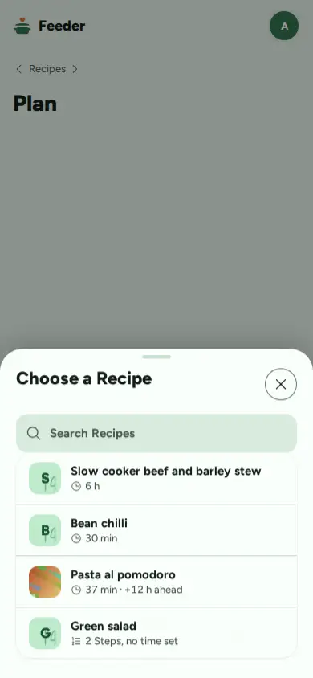 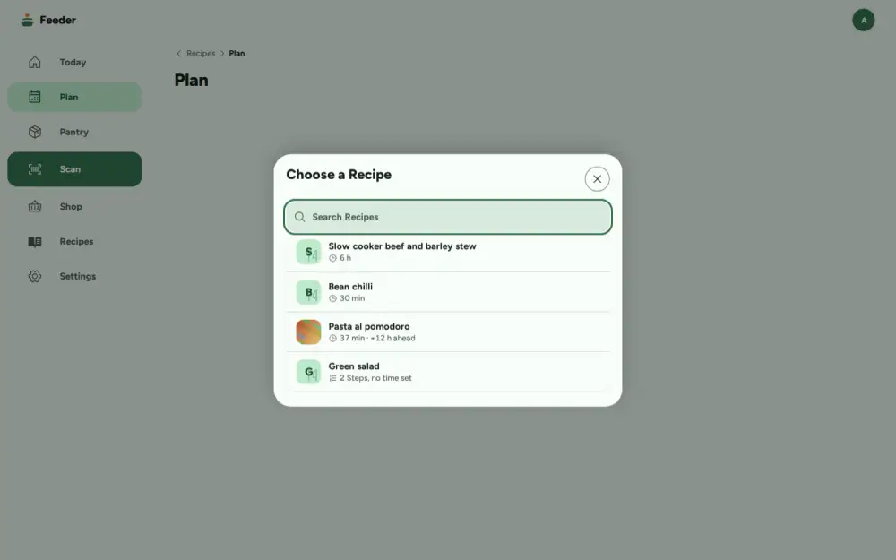

Mocks: [mocks/rx-02-editor.html](mocks/rx-02-editor.html), [mocks/rx-08-choose-recipe.html](mocks/rx-08-choose-recipe.html), [mocks/rx-08-choose-recipe-desktop.html](mocks/rx-08-choose-recipe-desktop.html).

**Accessibility**: the number input is named "Lead time" and the unit Select "Lead time unit". Focus after a pick is announced by the field's label.

### Build notes
- `hooks/useRecipeEditor.ts`: a `focusTarget {lineKey, field: 'quantity'}` set by `pickIngredient`. This generalises `useQuickCreateIngredient.focusLineKey`, and `IngredientLineRow` reads one prop.
- `StepsEditor.tsx` `UseRow`: the same.
- New `web/src/lib/time/duration.ts` (`splitMinutes`, `toMinutes`).
- Move `features/recipes/lib/time.ts` `formatMinutes` to `web/src/lib/time/formatMinutes.ts` and re-export it from the old path.
- New `ui/fields/DurationField.tsx`.
- `features/plan/components/RecipeChooserSheet.tsx` (PC's area): `formatMinutes` and `initialFocusRef`.

### Tests and guard
- Unit:
  - `splitMinutes` and `toMinutes` round trips (90, 720, 1440, 1.5 h);
  - `DurationField` converts on unit change;
  - after `onPick` the Quantity input has focus;
  - `RecipeChooserSheet` shows "6 h" for 360.
- BDD:
  - "After choosing an Ingredient the cursor is in its Quantity"
  - "An Advance Step of 720 minutes reads 12 h"
  - "Choose a Recipe opens with the search ready on a computer"
- Guard: none.

### Depends on / unblocks
The editor part is in WP-RX-C. The Choose a Recipe part is WP-RX-E, coordinated with PC, which owns Plan's sheets.

## RX-09  Tag chooser with an Add Tag row that opens clear of the sticky bar
**Severity** S3 · **Size** M · **Sources** RECIPES-14 · **Reproduced** Confirmed. At 390×844, typing "e" in the Tag field opens 8 suggestions from y 629 to 1,005 while the Save bar's top is at y 624 and the viewport ends at 844. Typing "zzweekend" shows nothing: the list is `hidden`, and there is no "Add …" row.

**Where** editor Tags; phone; both themes

### Problem
Suggestions are covered by the Save bar and run off the screen. A new Tag can only be made by knowing that Enter, a comma or leaving the field adds it.

Cause: `TagInput.tsx:98` renders an in-flow `ul` under the field, `open` only when `suggestions.length > 0` (`:28`), with no create option. The chosen Tags are filter chips you tap to remove (`:66-76`), with no ×.

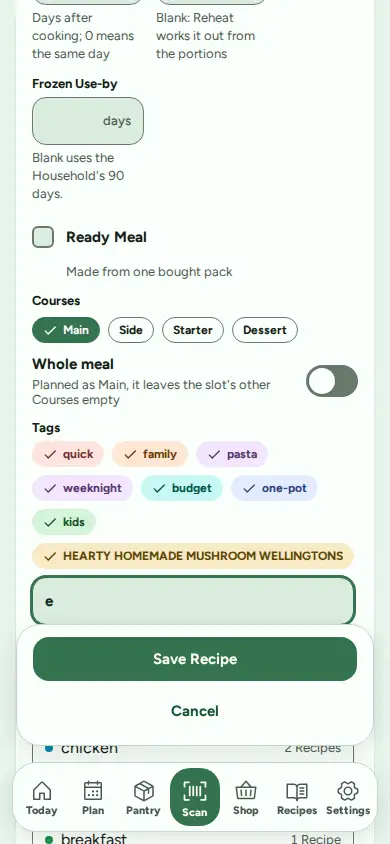

### Design
**Option A (recommended)**:
- The Tags field (in Planning) shows the chosen Tags as **removable Tag-colour chips** ("quick ×"; `Chip onRemove`, remove label "Remove Tag quick"), then a secondary sm Button **"Add Tag"** (`aria-haspopup="dialog"`).
- "Add Tag" opens the **Tag chooser**: a BottomSheet below 768 px and a Popover anchored to the button from 768 px, the same split as the Recipes Filters panel. Title "Tags".
- Inside: the shared `OptionList`, `multiple`:
  - the search field "Search or add a Tag";
  - Tags by name, each with its Tag dot and "3 Recipes";
  - chosen Tags first, with a check;
  - when the query is not empty and matches no Tag exactly, a **create row** (`.select__option--create`, Plus icon) at the end: "Add Tag "spic"", meta "New Tag, gets the next Tag colour".
- **Keyboard**: arrows move, Enter toggles the active option or adds on the create row, and Enter with no active option chooses the exact match or adds the query. A comma does the same, so "quick, family" types fast. Esc closes, and focus returns to "Add Tag".
- Footer: secondary sm "Done". The sheet body has the line "Chosen: quick, family, pasta, weekend".
- Choosing never closes the list, and the chips update live. A new Tag's chip is neutral, with the "New" marker until saved (today's rule).
- **Empty Household**: no Tags yet; the list shows only the create row once something is typed. Before typing: "No Tags yet. Type a name to add one."

**Accessibility**:
- The search is a `combobox` over a `listbox aria-multiselectable`. The create row is an `option`.
- Sheet focus on open follows A11Y; Popover focus goes to the search.
- Chips' remove buttons have a 44 px hit area.

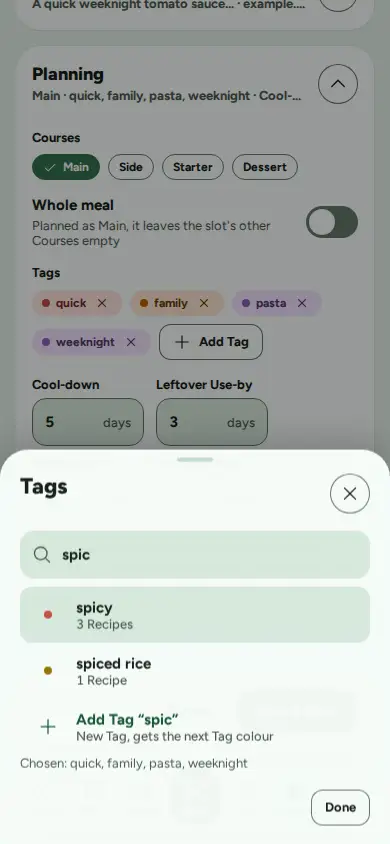  

Mocks: [mocks/rx-09-tag-chooser.html](mocks/rx-09-tag-chooser.html), [mocks/rx-09-tag-chooser-desktop.html](mocks/rx-09-tag-chooser-desktop.html).

### Alternatives considered
Option B: keep the inline combobox, flip it above the field when less than 240 px remain above the bar's top, and add the create row. It is fewer files, but it is a second Tag picker in the app and still competes with the bar. See Decision 6.

### Build notes
- New `features/recipes/components/TagChooser.tsx` (renders; built on `RecipeFiltersPanel`'s responsive Popover/BottomSheet pattern) and `hooks/useTagChooser.ts` (query, options from `lib/tags.suggestTags` and `canonicalTag`, create).
- Remove `components/TagInput.tsx`.
- **Shared**: `ui/Select/OptionList.tsx` gains `onCreate` and `createLabel(query)`, mirroring `Select`'s create row (same `.select__option--create` CSS). This touches every OptionList user only when `onCreate` is passed, so no other screen changes.
- Reuse `ui/Select/TagSelect.tsx`'s `tagOptions` (by name, dot, Recipe count) after adapting it to take names.

### Tests and guard
- Unit:
  - `useTagChooser` offers the create row only without an exact match (case and space insensitive);
  - Enter on the create row adds;
  - `OptionList` with `onCreate` renders the row last;
  - removing a chip calls `onChange` without the Tag.
- BDD:
  - "A new Tag can be added from the Tag chooser"
  - "The Tag list is never covered by the Save bar on a phone"
- Guard: the page-layout guard's editor scenario opens the Tag chooser at 390×844 and checks P12-style that no option box intersects `.sticky-action-bar`.

### Depends on / unblocks
RX-02 (it lives in Planning). A11Y (sheet focus). WP-RX-C.

## RX-10  One control style for kind and flags; a visible Optional control
**Severity** S3 (raised from S4: ui-review-2 §3.7 decided that "Optional" must be a visible label or chip, and today it can only be set from inside a menu) · **Size** S · **Sources** RECIPES-23 · **Reproduced** Confirmed:
- Ready Meal is a `.checkbox`; Base recipe and Whole meal are switches.
- Optional is only a checkable item in the line's "Actions for …" menu (`IngredientLineRow.tsx:209-214`), shown afterwards as a floating chip.
- Helper texts wrap to 3 or 4 lines under 112 px fields.

**Where** editor Details and lines; all sizes

### Problem
The same kind of decision uses three different controls. Two of them (Ready Meal and Base recipe) exclude each other but look independent. A frequent line property is hidden behind a menu.

 

### Design
- **Kind**:
  - a Segmented (radiogroup "Kind") in the Recipe section: "Recipe", "Ready Meal", "Base recipe" (labels `nowrap`);
  - footnote "A Ready Meal is one bought pack. A Base recipe is used inside other Recipes and never planned.";
  - changing to or from Base recipe on a saved Recipe still asks on Save (today's `KindChange`); Ready Meal keeps its pack line behaviour;
  - the selected state follows A11Y's Segmented fix.
- **Whole meal** stays a Switch, in Planning, shown when today's rule shows it.
- **Optional** is a `Checkbox` on every line:
  - visible label "Optional" on a phone;
  - from 42 rem, a visually hidden label under the visible column caption "Optional";
  - accessible name "Optional: Basil".
  - The detail keeps its "optional" text after the name.
- **Helpers** for Cool-down, Leftover Use-by, Reheat time and Frozen Use-by become the one footnote under their FieldRow (RX-02), with the Household's values in it.
- **Tags**: removable chips (RX-09).

  

Mock: [mocks/rx-02-editor.html](mocks/rx-02-editor.html).

### Build notes
- New `components/RecipeKindControl` (reuse the list's component name pattern; a new `RecipeEditorKind.tsx`) with `lib/baseRecipe.ts`: `kindOf(draft)`, `setKind(draft, kind)` built on `setBaseRecipe` and the Ready Meal rule.
- `IngredientLineRow.tsx`: Checkbox; remove the menu item.
- `RecipeDetailsFields.tsx` split (RX-02).
- `strings.ts`: `fields.kind`, `fields.kindHelp`, `fields.householdDefaults(…)`.

### Tests and guard
- Unit: `setKind` from Ready Meal to Base recipe clears Ready Meal and its pack line as today; the Optional checkbox toggles `line.optional`.
- BDD: "A line can be marked Optional without opening a menu"; "Choosing Base recipe hides Courses and asks on Save for a saved Recipe".
- Guard: `native-controls.test.ts` already forbids native controls.

### Depends on / unblocks
A11Y's Segmented selected state. RX-02 and WP-RX-C.

## RX-11  Import starts with a choice of two paths, not four numbered steps
**Severity** S3 · **Size** S · **Sources** RECIPES-20 · **Reproduced** Confirmed:
- "Step 1" to "Step 4" show at 390, although Read and the Recipe File are alternatives.
- After a read the numbering shifts to "Step 1" and "Step 2".
- Three filled primaries: "Read recipe", "Copy Agent Prompt" and "Review".

**Where** /recipes/import before a review; all sizes; both themes

### Problem
The page reads as a mandatory sequence, its numbers shift, and three primaries compete. This overlaps ui-review-2 S-05. Cause: `ImportScreen.tsx:121-141` with `stepOverline(n)` (`AgentPromptStep.tsx:9`).

### Design
- **Two choice tiles**, stacked below 45 rem and side by side from 45 rem:
  1. **Recipe Assistant**:
     - overline "Recipe Assistant", title "Read a recipe";
     - `meta` "From a web page, some text or photos of a cookbook page. You check everything before anything is saved.";
     - the Read from Segmented (never wraps) and its fields;
     - the page's one primary "Read recipe", with the reads-left meta beside it.
     - When the Recipe Assistant is unavailable, the tile states why and the file tile comes first.
  2. **Recipe File**:
     - overline "Recipe File", title "Import a Recipe File";
     - `meta` "A .feeder.json file exported from Feeder, or made by another AI assistant.";
     - a secondary "Choose a file". On a fine pointer it sits in a dashed drop zone with "or drop it here";
     - a secondary sm "Paste the JSON instead" (`aria-expanded`) that opens the TextArea "Recipe File JSON" and a secondary "Review";
     - under a divider: the Agent Prompt sentence and a secondary sm "Copy Agent Prompt".
     - Every action here is an outlined button (R-A).
- While reviewing or done, neither tile shows; the PageHeader has "Start over".
- `#read` focuses "Read a recipe".

  

Mock: [mocks/rx-11-import-start.html](mocks/rx-11-import-start.html) (rendered with a fine pointer).

### Build notes
- `ImportScreen.tsx`.
- `ReadRecipeStep.tsx` keeps only its overline and heading.
- `ImportSource.tsx` becomes `RecipeFileTile.tsx`.
- Remove `AgentPromptStep.tsx` and the step strings.
- `CopyAgentPromptButton` becomes secondary sm.

### Tests and guard
- Unit: no "Step N"; exactly one primary before a review; no tertiary button inside either tile.
- BDD: "Import offers reading a recipe or importing a Recipe File as two choices"; "Without the Recipe Assistant the Recipe File comes first".

### Depends on / unblocks
WP-RX-D, RX-01, DS (R-A).

## RX-12  Import Review: Ingredient matches as rows with their answer
**Severity** S3 · **Size** S · **Sources** RECIPES-21 · **Reproduced** Confirmed at 390:
- Ingredient tiles are 135 to 194 px with a `title-2` name.
- The first status pill is 294 px wide.
- "Matches" shows plain text where the others show chips.
- The status colours include leftover teal.

**Where** /recipes/import while reviewing

### Problem
Nine tall tiles of equal weight hide the two that need an answer. The pills stretch, the chosen answer is unclear, and the tones are misused (system.md §2 and §6). Cause: `IngredientMatchTile.tsx:145-163` and `statusColour` (`:124-130`).

### Design
- The **Ingredients** tile: title "Ingredients" and meta "9 · 1 to answer".
- One R-E `ListRow` per Ingredient:
  - key: the `displayName`, with a 40 px Picture or monogram;
  - state at the end, in `body-strong`;
  - detail: muted, with a tone icon;
  - then the answer controls in the row's footer.
- **Rows by status:**

| Status | State | Detail | Answer controls |
|---|---|---|---|
| suggested | "Create new" | "Similar to Chicken" | ChoiceChips "Use Chicken" / "Create Chicken thighs", pressed with a check |
| new | "New" | "Base unit g" | none |
| undefined | "1 question" (info) | "Choose its base unit" | ChoiceChips g / ml / piece |
| conflict | "1 question" (info) | "In g here, in ml in your Ingredients" | "Use <existing>" plus the name field and a secondary "Create" |
| unit question | "1 question" (info) | "How many g is 1 tbsp?" | an `xs` NumberField "1 tbsp of Garam masala is", suffix "g" (`UnitPromptTile` goes) |
| adds a Picture | as for its status | "Adds a Picture to Garlic" | as for its status |

- **Exact matches** collapse into one closing row, "5 match your Ingredients" (CheckCircle in success-fg, names in meta, an outlined 40 px caret). It expands to their rows.
- Questions come first; the rest follow by name.

 

Mock: [mocks/rx-01-import-review.html](mocks/rx-01-import-review.html).

### Build notes
- `IngredientMatchTile.tsx` becomes `IngredientMatchRow.tsx`; `UnitPromptTile.tsx` folds into it.
- `lib/reviewSummary.ts`: `ingredientRowState`, `ingredientRowMeta`, `orderIngredientRows`.
- `strings.ts`.

### Tests and guard
- Unit: state and detail per status; questions first; the match group's count.
- BDD: "Ingredients that need an answer come first in Import Review"; "A unit question is asked on its Ingredient".

### Depends on / unblocks
RX-01; same package. DS (R-E).

## RX-13  Detail metric tiles on surface; the Ready Meal chip moves to the chip line
**Severity** S3 · **Size** XS · **Sources** RECIPES-12 · **Reproduced** Confirmed:
- Both metric tiles are `data-variant="soft"`, background `rgb(191,235,205)` (`--color-soft`, light).
- On /recipes/10 the Ready Meal chip is 326 px wide in a 358 px tile.

**Where** /recipes/:id; all sizes; both themes

### Problem
system.md §2 and §4 say metric tiles are neutral or status-toned, never accent-soft. With a Tomato or Saffron accent they read as an alarm. A chip stretched across a tile breaks §6.

Cause:
- `RecipeMetrics.tsx:24-29` uses `BentoGrid min="card"` and `Tile variant="soft"`.
- The Chip sits in a column flex tile.

 

### Design
- A **metric strip**: `BentoGrid min="metric"` with surface Tiles using `TileMetric` (value + label).
  - Yield: value "4", label "portions per Batch" (RX-06 for Base recipes).
  - Time: value "37 min", label "cooking", then `meta` lines "+ 12 h ahead" and "Not cooked yet".
- Two tiles fit side by side from 316 px of column width.
- The Ready Meal chip moves to the hero's chip line (RX-04).
- No new contrast pair: the muted label on surface is already checked.

 

Mock: [mocks/rx-04-detail.html](mocks/rx-04-detail.html).

### Build notes
`components/RecipeMetrics.tsx` (variant, `min="metric"`, `TileMetric`); remove `.recipe-metric` overrides in `recipes.css`.

### Tests and guard
- A ds test (`RecipeMetrics.ds.test.tsx`): no `data-variant="soft"` inside the metric strip.
- Chip-width probe: in the page-layout guard, no `.chip` wider than its content plus padding inside a metric tile (P13 family).

### Depends on / unblocks
RX-04 and RX-06 (same package).

## RX-14  Ingredient line actions at the row's end
**Severity** S4 · **Size** XS · **Sources** RECIPES-22 · **Reproduced** Confirmed. At 1440, "Actions for Flour" (40×40) starts each row (left edge 306 = the row's left edge).

**Where** /recipes/:id Ingredients; all sizes

### Problem
A leading ⋮ before the quantity breaks system.md §3 and §5.5, and pushes the content in. Cause: `recipes.css:388-411` puts `.ingredient-lines__actions` in grid column 1.

### Design
- The line is an R-E row (RX-04): name, then quantity at the end (tabular), then the outlined ⋮ last. Its grid is `minmax(0, 1fr) auto 44px`.
- The muted detail (note, "Optional") spans the first two tracks underneath.
- The ⋮ spans both lines, centred.
- A line without actions keeps the empty third track, so the quantities line up.
- When focused, the ⋮ draws its ring inside itself (R-C+).

 

Mock: [mocks/rx-04-detail.html](mocks/rx-04-detail.html).

### Build notes
`components/IngredientLinesList.tsx` (DOM order: name, quantity, actions, detail) and the detail CSS.

### Tests and guard
`recipes.layout.css.test.ts`: the actions track is last. Unit: the `dt`/`dd` order.

### Depends on / unblocks
WP-RX-A, RX-04.

## RX-15  No-result and Export give a next step
**Severity** S4 · **Size** S · **Sources** RECIPES-24 · **Reproduced** Confirmed:
- Searching "zzzz" shows "No Recipe matches." with 0 actions.
- /recipes/export shows no action until a Recipe is ticked; "All Recipes" is a Switch; the button reads "Export Recipe File" with no count.
- The Import result is covered in RX-01.

**Where** /recipes no-result; /recipes/export; all sizes; both themes

### Problem
Each state ends the flow without a way on.

Cause:
- `RecipesScreen.tsx:80` renders `EmptyState` with a title only.
- `ExportPicker.tsx:38` uses a `Switch`, and `:62-72` renders the bar only when `href`, with no count.

 

### Design
**No result** (`EmptyState`, MagnifyingGlass duotone). Actions are whole buttons, centred, wrapping.
- **Search only**:
  - title "No Recipe matches "roast lamb"";
  - text "Check the spelling, or start a new Recipe with this name.";
  - secondary "Clear search" (X icon), secondary "New Recipe "roast lamb"" (Plus; opens `/recipes/new?name=roast%20lamb`). New Recipe in the header stays the page's one primary.
- **Filters only**: title "No Recipe has all these filters", text "Remove a filter, or clear them all.", secondary "Clear filters".
- **Both**: title "No Recipe matches "roast lamb" with these filters", text "Clear the filters to search every Recipe, or check the spelling.", and all three buttons.
- **Base recipes tab**: "No Base recipe matches "…"" and "New Base recipe "…"" (`/recipes/new?kind=base&name=…`).
- **Focus**: after "Clear search", to the search field; after "Clear filters", to the Filters button.

**Export**:
- Tile "Choose Recipes". A search field when there are more than 12 Recipes.
- First row "All Recipes" with a **tri-state** `Checkbox` as its leading control (`mixed` when some are chosen) and meta "3 of 16 chosen" ("None chosen", "All 16 chosen").
- Then one `ListRow` per Recipe with its Checkbox as the **leading control** (system.md §3 anatomy), RecipeThumb at 40 px and the name. The whole row toggles.
- The Base recipe note stays ("Also exports the Base recipe Tomato passata base, which Pasta al pomodoro calls for.").
- **The sticky bar is always there**:
  - meta "3 Recipes and 1 Base recipe";
  - primary "Export 3 Recipes" (1: "Export 1 Recipe"; UploadSimple icon), the download link;
  - with none chosen: a disabled Button "Export Recipes", with the meta "Choose at least one Recipe" as its `aria-describedby`.

    

Mocks: [mocks/rx-15-list-noresult.html](mocks/rx-15-list-noresult.html), [mocks/rx-15-list-noresult-nofilter.html](mocks/rx-15-list-noresult-nofilter.html), [mocks/rx-15-export.html](mocks/rx-15-export.html).

**Accessibility**: the tri-state Checkbox is the native input with `indeterminate` (`aria-checked="mixed"` is exposed), named "All Recipes". The row count is in the bar's meta and is announced on change (`role="status"`).

### Build notes
- **List**:
  - `RecipesScreen.tsx`: no-result variants from `useRecipeFilters` (q, count, `clear`); new `lib/noResult.ts` returns `{title, text, actions}`;
  - `RecipeEditorScreen` / `lib/draft.ts` read `?name=` and `?kind=base` for a new Recipe.
- **Export**:
  - `features/import/components/ExportPicker.tsx` (Checkbox `indeterminate`, `ListRow control`, always-on bar);
  - `lib/exportSelection.ts` gains `selectionState(ids, selected) → 'none'|'some'|'all'`;
  - `strings.ts`: `exportCount(n)`, `exportNone`, `chosenOf(n, total)`.

### Tests and guard
- Unit: `noResult` for each of the four cases; `selectionState`; Export's button label and disabled state.
- BDD:
  - "A search with no result offers to clear it or start a Recipe with that name"
  - "Export can select every Recipe at once and says how many it exports"
- Guard: none.

### Depends on / unblocks
The list part is WP-RX-B (after RX-03's tile); the Export part is WP-RX-D. A11Y's focus-after-action pattern.

## Review round 1 (2026-11-14)

- **Shared rules.** Every RX mock now carries the same round-1 rules block as the PC mocks, in `<style data-proposed>`.
- **R-A (buttons look like buttons).**
  - Secondary buttons have a surface fill and an outline everywhere.
  - Bare text actions became secondary buttons: editor Cancel, "Change Photo", "Show more", Import "Start over", "Next question", "Import more", "Paste the JSON instead", "Copy Agent Prompt", and "Open the existing Recipe".
  - These icon controls are outlined: Ingredient line and Step actions, the detail header's Edit and ⋮, Import Review's expand buttons, the result's Edit, the "+N" Tag chip, and the caret of each editor disclosure and of the "5 match your Ingredients" row.
- **R-B (Close).** The Tag chooser and Choose a Recipe sheets have the 40 px circular outline Close. Neither sheet has Cancel, so Close stays.
- **R-C (focus rings).** Sheet bodies and the detail chip line keep 5 px of room.
- **R-D (toasts).** No RX mock shows a toast.
- **Round-1 taste.**
  - No Segmented option wraps: Kind, Step kind and Read from all use `nowrap`.
  - "Show more" shares its row with the Source line instead of taking a line of its own.
- **Found beyond the four rules.**
  - Import Review's sticky bar wrapped to two rows on a phone. "Next question" is now icon-only below 600 px, still named "Next question".
  - The detail's "+N" Tag chip was clipped at 1440.
- **SAFE 1.** No RX text assumed an always-kept draft. RX-02 now names SAFE-01's blocking "Leave without saving?" dialog. The only thing the editor remembers is which sections are open, which is not draft content.
- **Re-rendered.** 18 mocks, same file names.
- **Left as is.** The metric value keeps `TileMetric`'s display weight; type roles are DS's.

## Review round 2 (2026-11-14)

- **R-E (structured rows).** These are now rows: key in `body-strong`, state at the row's end in `body-strong` with tabular figures, detail muted underneath.
  - Recipe detail: Ingredient lines (name, then quantity, then note or "Optional") and Steps (text at weight 600, then time, then kind and uses).
  - Import Review: the Recipe rows (state "New" or "Choose"), the expanded preview's lines and Steps, and the Ingredient matches ("1 question" in the info tone, "Create new", "New").
  - The import result: rows "Created" and "Replaced". The "Also added" sentence became two rows: Ingredients created 3, Unit Conversions added 1.
- **R-F (bottom bar under 360 px).** The list and the detail at 320, light and dark, use the icon-only squircle bar. Two new renders: `rx-04-after-320x568-light/dark` and `rx-03-after-compact-320x568-dark`.
- **R-C+ (nested focus rings).** Each nested control is shown focused, with its ring inside itself on a soft fill:
  - a Tag chip's remove button: `rx-02-after-planning`;
  - a Step's drag handle: new `rx-02-after-focus-handle-390x844-light`;
  - an Ingredient line's ⋮: new `rx-02-after-focus-line-1440x900-dark`.
  - The chip's remove button no longer overhangs the chip edge (margin was −6 px).
- **R-D+ (toast icon).** No RX mock has a toast. RX-04 now specifies the Archive, Delete and import toasts.
- **Craft defects fixed.**
  - The metric value "37 min" wrapped at 320. It is now `nowrap`, at `title-2` in one column (system.md §1).
  - Compact cards cut a Tag chip down to one letter at 320. Chips that do not fit are now left out.
  - Preview notes were indented by the default `dd` margin.
  - The result rows' chevron squeezed the meta. The whole row is the link, so the chevron is gone.
  - The base and untimed mocks showed the pasta Recipe's Steps. They now show their own.
- **Re-rendered.** 18 mocks under the same names, plus 4 new renders. The RX shots total 1.41 MB.
- **Left for SHORT.** At 320 the sticky Cook bar still wraps the stepper over Start Cook Mode. Its one-row rule is SHORT's (RECIPES-04).

## Work packages for this theme

| Package | Items | Files owned | Size | Merge first | Parallel with |
|---|---|---|---|---|---|
| **WP-RX-0** Split shared files | none (enabling) | `features/recipes/recipes.css` split into `recipes-list.css`, `recipe-detail.css`, `recipe-editor.css`; `features/recipes/strings.ts` split into `strings/list.ts`, `strings/detail.ts`, `strings/editor.ts`, re-exported by `strings.ts` | XS | before A, B and C | D, E |
| **WP-RX-A** Recipe detail | RX-04, RX-05, RX-06, RX-07 (lib, API and detail), RX-13, RX-14 | `screens/RecipeDetailScreen.tsx`, `components/{RecipeMetrics,CookEntry,CookTile,RecipeAbout,IngredientLinesList,RecipeTags}.tsx`, `lib/{timeSummary,cookEntry,sourceLine}.ts`, `recipe-detail.css`, `strings/detail.ts`; Go: Recipe list summary `stepCount` | M | WP-RX-0 | C, D, E (B waits for its `timeSummary` and `RecipeTags`) |
| **WP-RX-B** Recipes list | RX-03, RX-07 (tile line), RX-15 (no-result) | `screens/RecipesScreen.tsx`, `components/RecipeTile.tsx`, `lib/noResult.ts`, `recipes-list.css`, `strings/list.ts`; DS: the `ui/PageHeader.css` basis change, merged by DS or with DS's consent | M | WP-RX-0, then A's `lib/timeSummary.ts` and `RecipeTags` | C, D, E |
| **WP-RX-C** Recipe editor | RX-02, RX-08 (editor part), RX-09, RX-10 | `screens/RecipeEditorScreen.tsx`, `components/{IngredientLineRow,StepsEditor,StepPhoto,PhotoPicker,RecipeDetailsFields→split,TagChooser,RecipeEditorKind}.tsx`, `hooks/{useRecipeEditor,useTagChooser,useQuickCreateIngredient}.ts`, `lib/{draft,baseRecipe}.ts`, `recipe-editor.css`, `strings/editor.ts`; new shared `ui/Disclosure.*`, `ui/fields/DurationField.*`, `ui/Select/OptionList.tsx` (create row), `web/src/lib/time/*` | L | WP-RX-0 and SAFE's editor package (guard, Cancel, validation focus, Undo); the shared `ui/` files are serialised by the main session against DS and A11Y work on `ui/` | A, B, D |
| **WP-RX-D** Import and Export | RX-01, RX-11, RX-12, RX-15 (Export) | `features/import/**`; Go `internal/recipefile/plan.go` (+ tests) | L | none inside this theme (§3.7: `features/import/**` is serialised; the Recipe Assistant's WP-E/WP-G have shipped) | A, B, C |
| **WP-RX-E** Choose a Recipe | RX-08 (Choose a Recipe part) | `features/plan/components/RecipeChooserSheet.tsx` | XS | C's move of `formatMinutes` to `web/src/lib/time` (or E does the move if it goes first); PC's Plan package if it touches the same file. Hand to PC if PC prefers. | A, B, D |

Total: A (M), B (M), C (L), D (L), E (XS), plus the XS split. A, C and D can run as three teams at once after WP-RX-0. B follows A's library change.

## Not reproduced / dropped

None. Every assigned id reproduced.

## What could not be checked

- **Not driven**:
  - Pointer drag-sorting of lines and Steps, so the new layouts' handle hit areas were not dragged.
  - The real Recipe Assistant on a web page or photo: the fake API returns a canned Recipe, so Import Review was driven with the pasted example Recipe File.
  - The file chooser.
  - Choose a Recipe: its "360 min" and the unfocused search are from `RecipeChooserSheet.tsx` and `features/plan/strings.ts:59`.
- **Not tested at all**:
  - WebKit and Firefox renders of the mocks.
  - Real 200 % zoom.
  - Offline and loading states of Import Review (RES's patterns apply).
- **Mock limits**:
  - The mocks are static HTML on the real `app.css`, rendered with a fine pointer. Coarse-pointer rules (no drop zone on touch) are written in `<style data-proposed>` but not rendered.
  - Recipe Photos in the mocks are downscaled copies of the review server's generated images.
  - The before/after click counts for the editor are a breakdown of stage 1's total of about 37 plus this design's count, not a timed user test.

