# Resilience and perceived performance

This theme covers what a User sees when data hasn't arrived yet, can't arrive, or arrives broken: first launch on a slow phone, opening Feeder in a shop with no signal, a server that answers 500, a tile that throws while it renders, and a new version that lands while the app is open. Every finding was reproduced on the d-res server (`main` @ 834ea743) with Playwright and Chromium, using CDP throttling where speed mattered. Each item below gives its numbers.

The causes are few, and each one shows up on several screens:

1. **TanStack Query runs with library defaults** (`web/src/app/providers.tsx:7`, `new QueryClient()`):
   - `networkMode: 'online'` pauses every query while the phone is offline. A list that was never loaded then has `data === undefined` with no error, and the screens read that as "nothing matches".
   - The Scan screen's saved-copy fallback never runs when the screen opens offline.
   - `retry: 3` with 1-2-4 s backoff makes every failure, including a 404, appear after 7.1–7.6 s.
2. **Nothing known before the first response is cached:**
   - The household time zone is not cached, so Today shows the device date and the offline banner shows device time.
   - The User's theme is not cached, so boot goes light Basil, then a bare "Loading", then a light app, then the dark Tomato app.
   - Today has no reserved layout, so tiles arrive in any order and shift the page (CLS 0.20 on desktop, 0.26 on a slow phone).
3. **The serving layer was never tuned:**
   - The 1.55 MB script goes out uncompressed and without cache headers.
   - The service worker precaches `index.html` as a redirect: Go's `ServeFileFS` answers `/index.html` with a 301. The browser refuses to use a redirected response for a page load, so **Feeder cannot open at all offline**. This is new in stage 2 and the most severe item.

The fix is mostly shared:

- A query policy in `providers.tsx`: `offlineFirst`, one retry for 5xx and timeouts only, none for 4xx.
- A pure `lib/dataState.ts` with a `LoadState` primitive: an "unknown" state that is never presented as empty.
- `Skeleton` reserves its size from the first frame.
- A small cache of the household time zone and theme, read before first paint.
- Three serving changes: `spa.go`, `sw.ts`, and precompressed assets.

Together these close all nine source findings. Offline Ticks (FLOW-09) also need one backend addition: hand Ticks travel through the existing ordered, idempotent Scan sync queue.

| Item | Severity | Size | Title | Sources | Status after reproduction |
|---|---|---|---|---|---|
| RES-01 | S1 | S | Feeder cannot open offline: the cached page is a redirect | new in stage 2 (CROSS-06 reported the blank page, unverified) | Confirmed, cause found |
| RES-02 | S2 | M | One state model for data screens: unknown is not empty | CROSS-06 | Confirmed; Today part narrower (error does show, at 7.6 s) |
| RES-03 | S2 | L | Offline shopping: queued Ticks, pending and failed rows, conflicts | FLOW-09 (+ new: Scan opened offline cannot resolve barcodes) | Confirmed, wider |
| RES-04 | S2 | S (+M optional) | First load: compress and cache the assets | CROSS-07 | Confirmed (same numbers) |
| RES-05 | S3 | M | Today while loading: household date, reserved tiles, no layout shift | SHELL-12, CROSS-15 | Confirmed |
| RES-06 | S3 | S | Errors in about 1 s; failed saves say what failed | CROSS-17 | Confirmed, narrower (no doubled toast) |
| RES-07 | S3 | S | Offline banner: sticky, in the gutter, beside the rail, household time | SHELL-18 | Confirmed |
| RES-08 | S3 | S | Boot: the User's theme before first paint, and a shell skeleton | CROSS-14 | Confirmed; root cause corrected |
| RES-09 | S3 | S | A crashed tile or page: per-tile boundary and a Try again that works | SHELL-19 | Confirmed |
| RES-10 | S3 | S | A new version is ready: the update prompt | new in stage 2 (asked for in the theme brief) | Confirmed (no prompt exists; worker swaps silently) |

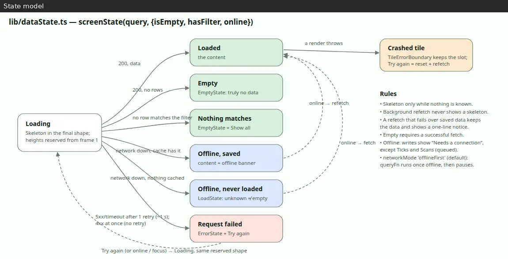
Diagram: [mocks/res-02-state-model.html](mocks/res-02-state-model.html)

## Decisions for the user

The user took these decisions on 2026-11-14; `decisions.md` records them.

1. **RES 1: hand Ticks offline.** Queued, like Scans (option A, as recommended). Mocks: [res-03-shop-offline.html](mocks/res-03-shop-offline.html), states "Offline: Tick waiting to sync" and "Change while waiting". Option B, which was not chosen, is the state "Not chosen: Needs a connection".
2. **RES 2: an offline Tick syncs after someone else already ticked that Line.** **Changed:** option B. Always add the Stock Lot, because both people bought it, and the row says so. Mock: same file, states "Synced: ticked twice (B)" and "Line sheet: take one back". RES-03 is revised to match.
3. **RES 3: a new version while the app is open.** An info toast with **Reload** (option A, as recommended). A11Y 4 was the same question and now refers to RES-10. Mock: [res-10-update-prompt.html](mocks/res-10-update-prompt.html).

## RES-01  Feeder cannot open offline: the cached page is a redirect
**Severity** S1 · **Size** S · **Sources** new in stage 2 (CROSS-06 noted "an offline reload … gave `net::ERR_FAILED` and a blank page; verify on a device") · **Reproduced** Confirmed. With the worker controlling the page, going offline and loading `/`, `/recipes` or `/recipes/1` fails with `net::ERR_FAILED` every time.
**Where** every route; every size; first launch with no signal (a car park, a shop basement)

### Problem
Functional spec §10.3 says the PWA caches the app shell so scanning works with no signal. In practice, a User who opens Feeder offline gets the browser's error page. Feeder never starts, so the Shop's saved list and the Scan queue are out of reach.

Cause:
- `curl /index.html` returns `301 Location: ./`. The cause is `internal/app/spa.go:59`: `http.ServeFileFS` redirects any path ending in `/index.html`. Go documents this as a special case.
- The precache (`web/src/sw/sw.ts:24-27`, `cache.addAll(… {cache: 'reload'})`) follows the redirect and stores the response with `redirected: true`. I confirmed this in the cache: `http://…/index.html 200 redirected=true`.
- `networkFirstPage` (`sw.ts:31-36`) answers a navigation with that cached response when `fetch` fails. Browsers refuse a redirected response for a navigation request whose redirect mode is `manual`, so the page load fails.

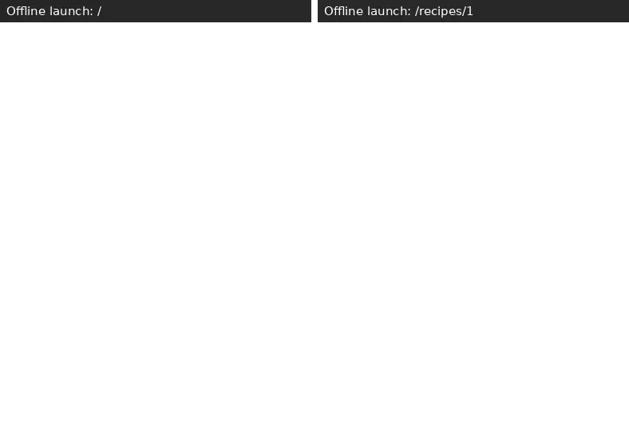

### Design
No mock: non-visual. After the fix, opening Feeder offline shows the shell with the User's theme (RES-08), the offline banner (RES-07) and the screens' saved or unknown states (RES-02).

Rules:
- `spa.go`: when the cleaned path is `index.html`, write the index bytes directly. The SPA fallback already does this. Use the same `Cache-Control: no-cache`, with no `ServeFileFS` and no redirect.
- `sw.ts`:
  - Precache the shell from `/` rather than `index.html`. The manifest still lists `index.html`; map it to the scope URL in `uniquePrecacheUrls`.
  - On install, if a fetched response has `redirected === true`, store `new Response(await res.blob(), {status: 200, headers: res.headers})`. This is defence in depth.
- `sw.ts`: `networkFirstPage` answers from the cache when `fetch` throws, and also after 4 s with no response on a navigation. This is the "lie-fi" case, where the phone believes it is online.
- The cache name goes to `feeder-shell-v2`, so the poisoned entry is dropped on activation.

### Build notes
- `internal/app/spa.go` and `spa_test.go`.
- `web/src/sw/sw.ts` and `cache.ts` (pure: `shellUrl(scope)`, `isUsableShell(response)`) with `cache.test.ts`.
- No API change.

### Tests and guard
- Go: `GET /index.html` → 200, `text/html`, `no-cache`, no `Location`.
- Unit: `uniquePrecacheUrls` maps `index.html` to the scope root; `isUsableShell` rejects a redirected response.
- BDD: "Scenario: Feeder opens offline after one visit": visit, go offline, reload → the Today heading is visible.
- Guard: add an offline-launch probe to `scripts/check-ui.sh`: Chromium with the service worker on, `setOffline(true)`, `goto('/shop')`, then assert there is no navigation error and a `main` element exists.

### Depends on / unblocks
Unblocks RES-02, RES-03, RES-07 and RES-08 when offline. Ship it first.

## RES-02  One state model for data screens: unknown is not empty
**Severity** S2 · **Size** M · **Sources** CROSS-06 · **Reproduced** Confirmed, Today part narrower.
- Offline, with Recipes and Pantry never loaded: "No Recipe matches." and "Nothing in Stock matches. Try another word or show all of Stock.", while the banner says Offline.
- Recipe detail offline: "The Recipe could not be loaded." with a Try again that cannot work.
- The Plan says "The plan could not be loaded."
- Today with `/api/plan*` and `/api/today/*` returning 500 is not silent, as stage 1 said. It shows "Today could not be loaded." after **7.6 s** (22 requests). Stage 1 waited 4 s.
**Where** `/recipes`, `/pantry`, `/plan`, `/recipes/:id`, `/`, every list and detail screen; all sizes; light and dark

### Problem
A User in a shop with no signal opens Recipes and reads that they have none, or that no Recipe matches. This is the worst message Feeder can give: their data looks gone.

Causes:
- The default `networkMode: 'online'` pauses the query, so `data` stays `undefined` without an error.
- The screens branch "data → list; `isEmpty` → empty; **else → no match**" (`features/recipes/screens/RecipesScreen.tsx:68-80`). Unknown data falls into "no match".
- Each screen decides loading, empty and error on its own, so the same situation reads differently on Recipes (no match), on the detail (error) and on the Shop (saved list, correct).

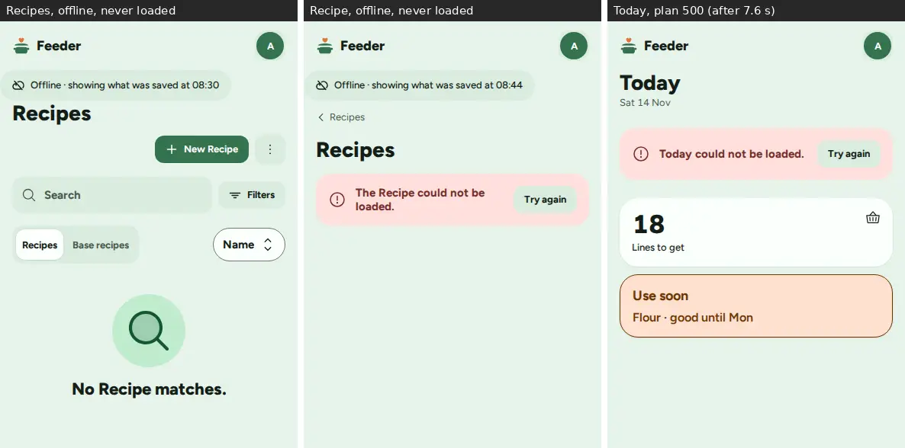

### Design
**One model, seven states.** `web/src/lib/dataState.ts` is plain TypeScript. Its function `screenState(q, {online, isEmpty, hasFilter})` returns:

| State | When | What shows |
|---|---|---|
| `loading` | no data, fetching, nothing known | the screen's skeleton, in the final shape, heights reserved from the first frame |
| `ready` | data | the content |
| `empty` | a successful fetch, no rows, no filter | the EmptyState with the screen's create action |
| `filteredEmpty` | a successful fetch, rows exist, none match the search or filters | "No Recipe matches “lasagne”." plus **Show all Recipes** |
| `offlineSaved` | offline, data in the cache | the content; the banner (RES-07) says it is the saved copy |
| `offlineUnknown` | offline, nothing ever loaded | **LoadState**: unknown, never empty |
| `failed` | online, the request failed (after the RES-06 retry policy) | ErrorState with **Try again** |

Rules (add to `docs/design/system.md`, a new section "Loading, empty, offline and error"):
- An EmptyState or "matches" text appears only after a successful response. "Unknown is not empty."
- A skeleton appears only while nothing is known. A background refetch never brings it back.
- A refetch that fails over saved data keeps the data. The Shop's existing "Showing the last list you loaded" line is the pattern, and the banner covers other screens.
- Offline, write actions whose result would be lost show the spec's "Needs a connection": muted button, `aria-disabled="true"`, reason in `aria-describedby`. Ticks and Scans are queued instead (RES-03).
- `QueryClient` default `networkMode: 'offlineFirst'`. The query function runs once offline, so snapshot fallbacks such as `useOfflineData` work, and only retries pause. `refetchOnReconnect` stays on, so `offlineUnknown` turns into `ready` by itself when the connection returns.

**LoadState** is a new shared primitive, `ui/LoadState.tsx` and `.css`:
- A 96 px circle in `--color-info-bg` holding a 48 px Phosphor **CloudSlash** in `--color-info-fg`.
- A title in the title-2 role, a body line in muted body, and a status line "Waiting for a connection" in the meta role.
- No button: the screen refills by itself.
- `data-in="tile"` gives a dashed-outline tile version for Today slots and detail asides.

Copy, in GLOSSARY terms:

| Screen | Title | Text |
|---|---|---|
| Recipes | "Your Recipes aren’t on this phone yet" | "Feeder loads them the first time this phone is online. They’ll appear here as soon as the connection is back." |
| Recipe detail | "This Recipe isn’t on this phone yet" | "Feeder needs a connection to load it the first time. It will appear here as soon as the connection is back." The title is kept from the list cache when it is known. |
| Pantry | "Your Stock isn’t on this phone yet" | same pattern as Recipes |
| Plan | "The plan isn’t on this phone yet" | same pattern as Recipes |
| Today | "Today’s plan isn’t on this phone yet" | "It will appear as soon as the connection is back." |
| Settings pages | "Your settings aren’t on this phone yet" | same pattern as Recipes |

- Failed, per screen: keep the existing sentences ("The Recipes could not be loaded.", "The Recipe could not be loaded.", "Stock could not be loaded.", "The Shopping List could not be loaded.") with **Try again**.
- Filtered-empty: "No Recipe matches “{query}”." plus "Try another word, or show all Recipes." plus **Show all Recipes**, which clears search and filters.
- Empty: "No Recipes yet" plus "Add your first one, or import a Recipe File." plus **New Recipe** and **Import Recipes**.

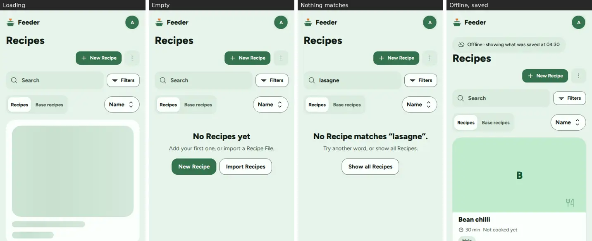
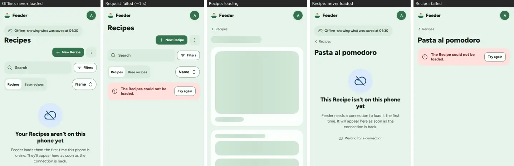
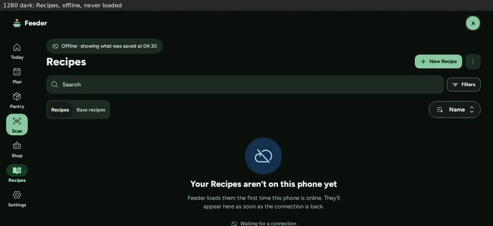
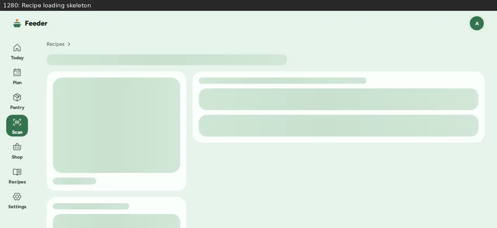
Mocks: [res-02-states-recipes.html](mocks/res-02-states-recipes.html) (seven states, light and dark through the switcher), [res-02-states-detail.html](mocks/res-02-states-detail.html).

Per size class: LoadState is centred in the list region at every size, capped at a 40ch text measure. At 1024 and wider it sits in the content column beside the rail. In a Today slot or a detail aside it uses the tile version.

Accessibility:
- LoadState is `role="status"`, so it is announced once, politely. Its heading level follows the page: h2 in a page, h2 in a Today slot.
- Skeleton groups keep `role="status" aria-busy="true"` with one hidden label ("Loading Recipes"), as today.
- Focus does not move when the state changes.
- Contrast:

| Pair | Light | Dark |
|---|---|---|
| `--color-info-fg` on `--color-info-bg` | 7.37 | 8.37 |
| Muted text on surface | 7.23 | 8.75 |

- The skeleton shimmer is already off under reduced motion.

### Alternatives considered
- Persisting the whole query cache to IndexedDB (`persistQueryClient`), so every screen has saved data offline. That is a larger change: storage limits, sign-out wipe, schema migration. LoadState is needed anyway for a first visit. Keep it as a later step.
- Showing ErrorState for offline-unknown, as the detail does today. Rejected: it tells the User something broke, and its Try again does nothing while offline.

### Build notes
- **New:**
  - `lib/dataState.ts` and its test.
  - `ui/LoadState.tsx` and `.css`.
  - `hooks/useOnline` (reuse `app/useConnectivity`).
- **Shared changes:**
  - `ui/Skeleton.tsx`: render the block from the first frame with `data-shown="false"`, so space is reserved and only the shimmer waits for `delayMs`. This replaces `if (!shown) return null` at `Skeleton.tsx:21`.
  - New variants `card`, `hero`, `title` and `meta` in `Skeleton.css`, with the CSS in the mock's `<style data-proposed>`.
  - This change touches every screen that uses Skeleton; all of them benefit.
- `app/providers.tsx`: `new QueryClient({ defaultOptions: { queries: { networkMode: 'offlineFirst', retry: retryPolicy, retryDelay: 1000 }, mutations: { networkMode: 'offlineFirst', retry: 0 } } })`, where `retryPolicy` lives in `lib/dataState.ts` (RES-06).
- **Screens:**
  - `RecipesScreen.tsx`, `StockScreen.tsx`, `PlanScreen`, recipe detail, `IngredientsScreen`, Products, Supplies and the settings lists switch on `screenState`.
  - `features/plan/hooks/queryFailed.ts` is replaced by `dataState`.
  - Each list hook returns `{ data, state }` and never a bare `isEmpty`.
- **Copy:** each feature's `strings.ts` gains `offlineUnknownTitle` and `offlineUnknownText`.
- No API change.

### Tests and guard
- Unit, `screenState`: one case per state, including "paused with no data → offlineUnknown, never empty".
- Unit, `retryPolicy`: 500 and timeout retry once, 404 and 422 never.
- Hook test: `useRecipes` offline with no cache gives `offlineUnknown`.
- BDD:
  - "Recipes offline before first load say they aren't on this phone yet"
  - "Recipes come back by themselves when the connection returns"
  - "A filter with no result offers Show all Recipes"
  - "A Recipe that failed to load offers Try again"
- Guard: a page-layout scenario `offline-unknown` for `/recipes`, `/pantry`, `/plan` and `/recipes/:id`, opened in-app after `setOffline(true)`. It asserts no `.empty-state` and no text matching `/match|Nothing in/`, and that one `.load-state` is present.

### Depends on / unblocks
- Depends on RES-01 when the app is opened offline.
- Unblocks RES-03 (the `offlineFirst` mode fixes the Scan screen's saved-copy fallback), RES-05 and RES-06.
- The RX chapter's list redesign (RECIPES-xx filters) must keep the filtered-empty copy here.

## RES-03  Offline shopping: queued Ticks, pending and failed rows, Lines ticked twice
**Severity** S2 · **Size** L · **Sources** FLOW-09; new in stage 2: the Scan screen opened offline cannot resolve a barcode · **Reproduced** Confirmed, and wider than reported:
- **Offline Tick.** Shop → Tick Carrot → "Tick and add to Stock" shows a danger tile with the raw client message "The network is unreachable". There is no toast, nothing is queued, and the row stays open.
- **Scan screen already open when the phone goes offline.** A typed barcode works as the spec says: the toast "Added Rice organic pack", the row "500 g · Waiting to sync", and the banner "1 Scan waiting to sync".
- **Scan screen opened offline** (in-app navigation). A typed barcode gives **nothing**: "Scanned 0" and no toast. It synced only after reconnecting ("Added Flour pack").

**Where** `/shop`, `/scan`; phone first, every size; light and dark

### Problem
In a shop with patchy signal, a User cannot tick by hand, which is the second way to shop next to Scan, and the error reads like a crash. Opening Scan in the dead zone also looks broken.

Causes:
- `useShoppingActions.tick` posts `/api/shopping/ticks` directly. Its `clientUuid` already makes the Stock Lot idempotent (`internal/stock/store/store.go:142-165`), but nothing queues the call.
- `ShoppingScreen.tsx:34-36` shows `err.message` straight from the HTTP client.
- `useOfflineData` (`features/scan/hooks/useOfflineData.ts:26-37`) has a saved-copy fallback, but it never runs while offline. Under the default `networkMode: 'online'`, TanStack Query v5 says queries "will not fire unless you have network connection". Barcode resolution therefore has no Products, and the typed Scan waits for the connection.

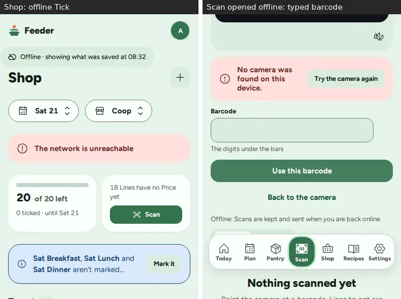

### Design
This item follows the decisions taken: RES 1 (A), RES 2 (B), SSP 1, SSP 2 and SSP 3. A queued Tick is the same Tick that SSP-01 and SSP-02 design, made while offline. It has the same default amount, the same toast, the same Change sheet and the same "covers an amount" rule. Only the sending is deferred.

**What a queued Tick records**
- **The added amount** is SSP-01's `defaultTickAmount(line)`, computed on the phone from the saved Shopping List. That is the last-bought pack (`pack.count × pack.size`), or the Line's remaining need when no pack is known (SSP 1).
  - In the mocks, Carrot has no pack, so the amount is 50 g.
  - A free-text extra queues a Tick with no amount.
- **The covered amount** is the Line's remaining quantity as the phone showed it at the moment of the Tick (SSP-02's Q0), sent as `covers`.
  - The server uses `covers`, not the need at sync time.
  - If the need grew in between, SSP-02's "More since your tick" row appears after the sync, exactly as for an online Tick.

**Tick offline**
- One tap (SSP 2) ticks the Line at once, and the row moves to Ticked.
  - The tick button gets a 14 px clock badge.
  - The meta reads **"Waiting to sync · 50 g to Stock"** (compact "Waiting to sync" when the text column is under 12 rem, SSP-05's rule). This is the spec's Scan wording, with Phosphor **Clock** 14.
- **The toast** follows R-D/R-D+:
  - headline **"Carrot ticked"** with a 16 px Clock in the headline line (a status: waiting to sync);
  - muted subline "Waiting to sync · 50 g goes to Stock when it syncs";
  - outline buttons **Undo** and **Change**;
  - the circular Dismiss, top-aligned.
- **Undo while waiting** removes the Tick from the queue. Nothing reaches the server and no Stock Lot is ever made.
- **Change while waiting** opens SSP-01's "Carrot: how much?" sheet, with R-B's circular Close and no Cancel.
  - Its line reads **"Waiting to sync · 50 g goes to Stock when it syncs"** (muted, Clock 16), and its chips are SSP-01's.
  - A hint reads "Changes the waiting Tick. Nothing is sent until the phone is back online."
  - **Save** rewrites the amount of the queued Tick in place.
  - **Tick without adding** (secondary, outlined) sets the queued amount to 0 and keeps the Tick.
  - If the Tick left the queue while the sheet was open, Save falls back to SSP-01's `PATCH /api/shopping/ticks` on the synced Tick. The User sees no difference.
- **Untick offline** of a Tick that already synced queues an untick. On sync, the server takes back what is left of that Tick's Stock Lot (ADR 0019).

**Banner and metrics**
- The banner's second line counts everything waiting: "1 Tick waiting to sync", "2 Scans and 1 Tick waiting to sync" (RES-07).
- The Shop metrics count the queued Tick ("18 of 20 left") and add "· 1 waiting" after "ticked".

**Sync**
- Sync runs on `online`, on reconnect of the live stream, and on the existing backoff (1, 2, 4 … 30 s; `lib/queue.ts:113`).
- Ticks and Scans go **in the order they were made, in one batch**.
- Each result clears its row's pending mark. The Shopping List refetches once (`liveRefreshFor`), and Stock is invalidated.
- A one-line toast says **"Back online · 1 Tick synced"**. It has no icon, because it is a plain success (R-D+). The noun follows what synced: "2 Scans and 1 Tick synced".

**Ticked twice (decision RES 2 = B)**
This is the case where the Line was already ticked when the queued Tick synced: by another User's Tick by hand, by a Scan, or by this User on another phone.
- **The server always adds this Tick's own Stock Lot.** It records the Tick as a second *addition* on the same Line, and the Line stays ticked once.
- **The row**, wherever the Line shows (every phone, live), keeps the strike and the Line's need as its value.
  - Its success-tone meta (Phosphor **ArrowClockwise** 14) says who added what: **"Added twice · Sam 50 g, you 50 g"**.
  - Compact form: "Added twice · 100 g". With three additions: "Added 3 times · 150 g".
  - "you" names the viewing User. A Scan's addition reads "Sam scanned 50 g".
- **The phone whose Tick synced late** gets an info SyncNotice, kept until dismissed, because the sync can happen while nobody is looking. It is set as R-E rows:
  - headline **"Carrot was ticked twice"**;
  - muted subline "Both Stock Lots were added · 100 g in all";
  - one row per addition: the key in body-strong ("Sam", "You"), the amount at the row's end in `--color-info-fg` with tabular figures ("50 g"), and the time muted underneath ("Ticked at 10:12", "Ticked offline at 10:20 · synced 10:31");
  - actions **Take mine back** and **Dismiss**, both outlined secondary buttons on the info tint (R-A).
  - Other phones get no notice; their row shows the same meta.
- **The Line sheet.** Tapping the row opens it.
  - Its title states the one thing: **"Carrot was ticked twice"**, with a muted subline "Each Tick added its own Stock Lot · 100 g in all" and R-B's circular Close, top-aligned.
  - It lists the same R-E rows (who, amount at the end, time muted underneath). Each row ends in its own outlined **Take back**, centred across both of the row's lines.
  - Its footer has **Untick Carrot** (secondary).
- **Take back**
  - Take back applies ADR 0019 to **that addition only**. It removes what is left of that addition's Stock Lot, up to what that Tick added; if part was used by a Cooked Planned Meal, only the rest goes. The other addition, and the Tick itself, stay.
  - "Take mine back" in the notice does the same for the User's own addition.
  - The confirming toast is a one-line success with no icon: "Your 50 g of Carrot was taken back from Stock". Its outline **Undo** puts the same amount back on the same Stock Lot.
  - **Untick Carrot** takes back every hand addition, as an untick does today.
  - A Scan's addition has no Take back here; it is undone from that User's Scanned list, as the spec already says.
- **How long Take back is offered.** For as long as the Tick exists: until the User unticks the Line, or until the end date of the Shopping List range has passed and the Tick is purged at the household day change.
  - The sheet says: "Take back removes what is left of that Stock Lot. It is offered while Carrot is on this Shopping List."
  - After that, the Stock Lot is corrected from Pantry like any other.
- **Coverage with several additions (SSP-02).** The covered amount is the largest `covers` of the additions, and the added amount is their sum. A second purchase therefore also shrinks any "More since your tick" row.

**Refused on sync** (the Line was Swapped, marked Not needed, or the range moved past it)
- The row goes back to open, with a 3 px inset bar in `--status-danger-fg` and the meta **"Tick not synced"** (WarningCircle 14, danger fg, strong weight).
- A danger SyncNotice above the metrics says one fact, so it stays a sentence: **"Couldn’t sync the Tick of Carrot."** It is no longer on the Shopping List for this range. Its Stock Lot was not added.
- Its actions are **Add to Stock** (adds the Stock Lot directly, because the User did buy it) and **Dismiss**, both outlined secondary buttons.
- Notices stack newest first, at most 3, then "and 2 more".

**Scan screen opened offline**
- With `offlineFirst` (RES-02), the offline-data query runs once and falls back to the saved copy. A typed or scanned barcode then resolves as the spec describes: a "Waiting to sync" row, a toast, and the banner count.
- If no saved copy exists either (this phone never scanned at this Shop), the screen shows LoadState: "This Shop’s barcodes aren’t on this phone yet" and "Scans need them once. They’ll load as soon as the connection is back."
- **A Scan refused on sync** keeps spec §10.1: the row leaves and a notice stays ("Couldn’t sync a Scan: Rice organic pack. That barcode now belongs to an archived Product.") with an outlined **Dismiss**. It uses the same SyncNotice component.

**Idempotency: a retried sync never adds a third Stock Lot**
- Each Tick has one `clientUuid`, minted at the tap. The same uuid is kept:
  - when an online Tick fails (status 0, 5xx or timeout) and drops into the queue;
  - when the queue resends after backoff;
  - when the batch is replayed after an app restart.
- The server keys the Stock Lot by `clientUuid` (existing, `stock/store.AddLot`), and the addition row has `client_uuid UNIQUE`. A replay returns the first result with `created: false`.
- Two Users each ticking once give two Stock Lots, by design. One Tick sent three times gives one.

**Rules**
- **`ui/SyncNotice`** is a new primitive: a notice tile in the danger tone (`--status-danger-bg/fg`) or the info tone (`--color-info-bg/fg`).
  - It has `--radius-tile-sm`, padding `--space-4`, a 24 px icon and a body-strong headline.
  - It has an optional muted subline and optional R-E rows.
  - Its actions are always `Button` `secondary` `sm` with the R-A outline on a `--color-surface` fill.
- **`ListRow`** gains `sync?: 'pending' | 'failed'`, which renders the meta and the inset bar.
  - The clock badge is an `Icon` in a 14 px circle in `--color-surface` with a 1 px `--color-line` ring. The mock draws it with a data URI, but that is only a stand-in.
- **The ticked-twice meta** uses the existing `list-row__meta[data-status=success]` with SSP-05's compact form.
- **The Line sheet's additions** use DS's R-E row with an action column, a new small part of `shop/components/LineSheet.tsx`. Each Take back is named "Take back your 50 g of Carrot" or "Take back Sam’s 50 g of Carrot".
- Toasts follow R-D/R-D+; sheets follow R-B.
- **Contrast:**

| Pair | Light | Dark |
|---|---|---|
| Danger fg on surface | 9.58 | 11.09 |
| Muted on surface | 7.23 | 8.75 |
| Info fg on info bg | 7.37 | 8.37 |
| Success fg on surface (SSP-01) | 8.7 | 11.75 |
| Outline boundary on the info tint (R-A) | 3.7 | 3.8 |
| Muted row detail on info bg (R-E) | 6.1 | 6.7 |

`--status-danger-solid` is not used for the bar: it reaches only 2.95 in dark.

**Accessibility**
- The pending row's tick is named "Tick Carrot, waiting to sync" and stays `aria-pressed="true"`.
- The ticked-twice meta is part of the row's accessible description ("Added twice, Sam 50 grams, you 50 grams").
- The notice's rows are a `ul`.
- Sync results are announced once through the notice: `role="alert"` when refused, `role="status"` for ticked twice. Focus stays where it was.
- In the Line sheet, focus opens on the title. After Take back, focus moves to the remaining addition's button, or to Untick when none remains.
- Every action is 44 px tall on touch. Focus rings keep their 5 px of room (R-C).

The mock keeps the Carrot row in place for comparison with the before image. In the app it sits in SSP-01's Ticked section.

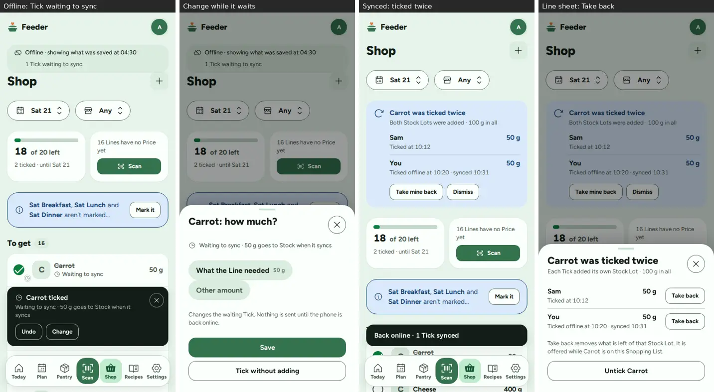
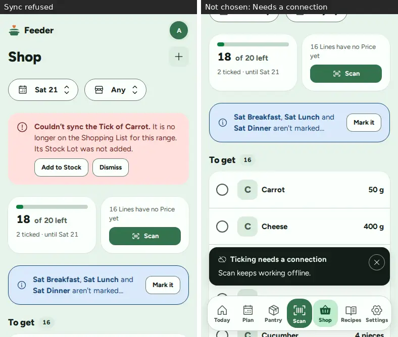
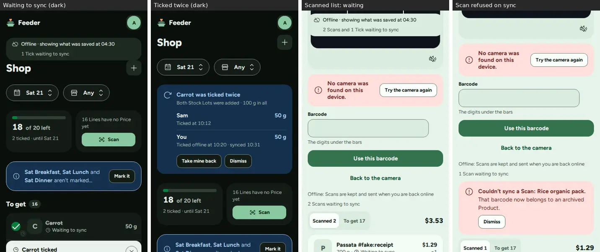
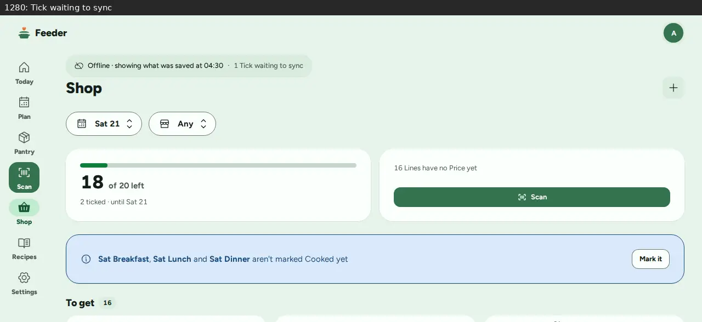
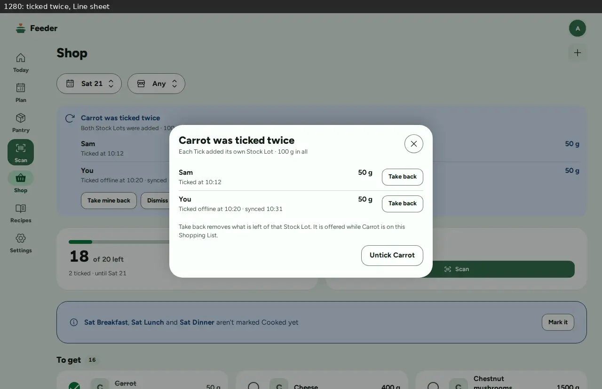
Mocks: [res-03-shop-offline.html](mocks/res-03-shop-offline.html) (six states, light and dark), [res-03-scan-offline.html](mocks/res-03-scan-offline.html).

### Alternatives considered
- **A separate queue for Ticks.** Rejected. Ticks and Scans of one shop must apply in the order they were made (a Scan after a Tick of the same Line, an untick after a Tick). The existing queue already gives order, persistence, backoff, idempotency and Picture handling.
- **Replaying `POST /api/shopping/ticks` from the client.** Rejected: it has no batch, no result per operation, and no way to report "ticked twice".
- **Keeping the first Tick and skipping the second Stock Lot.** This was option A of decision RES 2; it was not chosen.

### Build notes
**Backend** (handlers stay thin; the logic lives in services)
- **New `Op` kinds in `internal/scan`**, validated in `scan.go` next to `shop_scan`:
  - `shop_tick`: `ingredientId` or `extraId`, `quantity` (the amount added), `covers`, `rangeTo`, `shopId`;
  - `shop_untick`: `tickClientUuid`, or `ingredientId` plus `rangeTo`.
  - The scan service calls the shopping service through a port, never over HTTP.
  - `ScannedAt` becomes the Tick's time.
- **The sync result for a Tick** is `{status: 'applied', tick: {lotId, added, alsoTickedBy: [{name, quantity, by: 'hand'|'scan'}]}}`, or `{status: 'rejected', code: 'not_on_list'}`. There is no "already ticked" refusal.
- **Additions in `internal/shopping`.** A Tick gets one or more additions.
  - New table `shopping_tick_additions(range_to, ingredient_id | extra_id, lot_id, quantity, covers, user_id, client_uuid UNIQUE, ticked_at, synced_at)`.
  - A migration moves the existing `shopping_ticks.lot_id` and `lot_quantity` into the first addition.
  - `Service.Tick` appends an addition when the Line is already ticked.
  - `Derive` (SSP-02) uses the largest `covers` and the sum of `quantity`.
- **List API.** SSP-01's `tick: {by, added}` gains `additions: [{who, mine, by, quantity, clientUuid, tickedAt, syncedAt}]`.
- **Change and Take back.** SSP-01's `PATCH /api/shopping/ticks` gains an optional `clientUuid` that addresses one addition.
  - `quantity: 0` is Take back (ADR 0019, for that addition's Stock Lot only); the previous quantity is its Undo.
  - Without `clientUuid` it addresses the User's own latest addition, as SSP-01 has it.
  - The untick takes back every hand addition.
- **Docs:**
  - A **new ADR**, "A Line can be ticked more than once; each Tick by hand keeps its own Stock Lot". It amends ADR 0019: Undo and Take back act per addition, and untick acts on all of them. It sits beside SSP 3's ADR "A Tick covers an amount".
  - A GLOSSARY Tick note: "a Line ticked by two people keeps both Stock Lots".
  - Spec §10.3: "Ticks made offline are queued with the Scans, in one order".
  - Spec §9: the ticked-twice rule.

**Frontend**
- **`features/scan/lib/queue.ts`:**
  - the `Op` union gains the two kinds;
  - new `updateTick(clientUuid, quantity)`, under the queue lock like `updatePrice`, returns false once the Tick has left the queue;
  - Picture handling is unchanged.
- **`useSyncQueue`** is lifted out of `useScanController` into a feature-level `useSyncQueue`, mounted once under the shell, so Shop and Scan share it. `useShellStatus` returns `pendingTicks`.
- **SSP-01's `shop/hooks/useTickFlow.ts`:**
  - when offline, or when a send fails with status 0 or 5xx, it enqueues with the **same** `clientUuid`;
  - Undo cancels from the queue while the Tick is waiting;
  - Change calls `updateTick` while waiting, and PATCH afterwards.
- **`shop/lib/pendingTicks.ts`** (pure): `applyPending(list, ops)`.
- **`shop/lib/tickAmount.ts`** (SSP-01): `tickedMeta(tick)` gives "Added twice · …", its compact form, and "Waiting to sync · …".
- **`shop/components/LineSheet.tsx`:** the R-E additions with Take back.
- **`ShoppingScreen.tsx`:** the raw `errorMessage(err)` text goes; the copy comes from RES-06.
- **`useOfflineData`:** no change once `offlineFirst` is on; it gets a test.
- **New `ui/SyncNotice.tsx` and `.css`** (headline, subline, optional rows, actions), and the `sync` prop on `ui/ListRow`. These touch the Shop and the Scanned list only.

### Tests and guard
**Go**
- `shop_tick` applies and adds one Stock Lot.
- The same `clientUuid` sent three times gives one Stock Lot and one addition.
- A Tick by Ana, then Sam's queued Tick of the same Line, gives two Stock Lots, one Tick and two additions; `alsoTickedBy` names Ana.
- A queued Tick after Sam's Scan gives two Stock Lots, with the addition `by: 'scan'`.
- PATCH with `clientUuid` and `quantity: 0` takes back only that Stock Lot. After a partial Cooked, it takes back only what is left.
- Untick takes back every hand addition.
- `covers` is used for SSP-02's "More since your tick".
- A Tick of a Line not on the list gives `rejected/not_on_list`.
- `shop_untick` after `shop_tick` in one batch leaves no Stock Lot.
- The migration moves `lot_id` and `lot_quantity` into the first addition.

**Unit**
- `applyPending`.
- The queue keeps the order of Ticks and Scans.
- `updateTick` before and after sending.
- `tickedMeta` for 1, 2 and 3 additions, and the compact forms.
- `syncNotices` copy, with rows for ticked twice.

**Component**
- The queued-Tick toast has the Clock in its headline line and two outline buttons (R-D+).
- The synced toast has no icon.
- SyncNotice renders its rows as a list and no tertiary button.

**BDD**
- "Ticking by hand offline adds the last-bought pack when it syncs"
- "Change while a Tick waits to sync changes the amount sent"
- "Undo of a waiting Tick sends nothing"
- "Ticks made offline sync in order when the phone is back online"
- "A Line Sam already ticked keeps both Stock Lots and says Added twice"
- "Take mine back removes only my Stock Lot"
- "A retried sync never adds a third Stock Lot"
- "A Tick refused on sync shows Tick not synced with Add to Stock"
- "Scan opened offline resolves a known barcode from the saved data"

**Guard**
- An offline scenario in `check-ui.sh`: open `/shop` offline, tick the first row, and assert `[data-sync=pending]` and no `.error-state`.

### Depends on / unblocks
- Depends on RES-02 (`offlineFirst`).
- Depends on SSP-01: `defaultTickAmount`, `useTickFlow`, the Change sheet, `PATCH /api/shopping/ticks`, and the `tick` field.
- Depends on SSP-02 (`covers`, `Derive`) and SSP 3's ADR.
- Depends on SAFE's Undo-toast pattern, and on DS's R-A, R-B, R-D/R-D+ and R-E primitives.
- The banner line is RES-07's.

## RES-04  First load: compress and cache the assets
**Severity** S2 · **Size** S (headers and compression), M (optional route splitting) · **Sources** CROSS-07 · **Reproduced** Confirmed, same numbers:
- `index-By3A_ueO.js` is 1,553,604 bytes, served with no `Content-Encoding`, no `Cache-Control`, no `ETag` and no `Last-Modified`. Gzip -9 would be 450,974 bytes and brotli 11 366,762. The CSS is 175,007 bytes, 26,734 gzip and 22,420 brotli.
- At 400 kbit/s, 400 ms RTT, CPU ×4, 390 px, service worker blocked: Today **FCP 7,700 ms, JS done 34,833 ms, LCP 36,324 ms, CLS 0.26**.
- Through a local proxy doing exactly the proposed serving (brotli plus immutable): **FCP 1,792 ms, JS 8,700 ms, LCP 10,188 ms**, CLS unchanged (RES-05 fixes it).
- `/sw.js` has no `Cache-Control`.
**Where** first visit, and the first launch after a deploy before the worker updates; all routes

### Problem
The first launch on a phone in a car park takes over half a minute. The service worker makes repeat visits fast, but every new phone and every browser without the worker pays the full cost. `internal/app/spa.go:52-58` sets cache headers only for icons and the manifest.

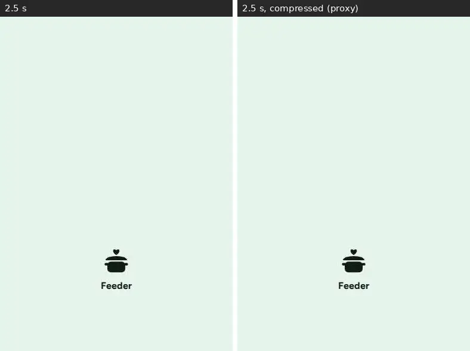
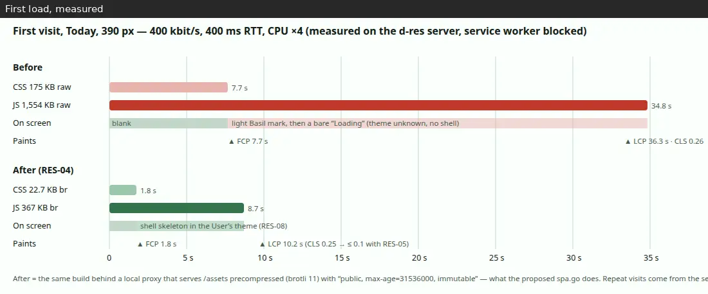
Diagram: [mocks/res-04-first-load-timeline.html](mocks/res-04-first-load-timeline.html)

### Design
No mock: non-visual. The User sees the RES-08 shell at about 1.8 s instead of a blank screen until 7.7 s.

Rules:
- **Build:** a small Vite plugin in `web/vite.config.ts` (`closeBundle`, Node `zlib`, no new dependency) writes `*.br` (quality 11) and `*.gz` (level 9) next to every `.js`, `.css`, `.svg`, `.webmanifest` and `.html` over 1 KB.
- **`spa.go`:**
  - For a path under `/assets/` with `Accept-Encoding` containing `br` (else `gzip`), serve the precompressed sibling with `Content-Encoding`, `Vary: Accept-Encoding`, the original `Content-Type`, and `Cache-Control: public, max-age=31536000, immutable`. The names are content-hashed.
  - `/sw.js` and `/registerSW.js` get `no-cache`.
  - Fonts under `/assets` are already compressed formats; they get immutable with no encoding.
  - HEAD and Range behave as now.
- **API JSON (optional):** a gzip middleware for `/api/*` responses over 1 KB, excluding `/api/events`. The SSE stream must never be compressed or buffered.
- **Helm** (`deploy/helm/feeder/README.md`): ingress-nginx compression is a controller-wide ConfigMap setting (`use-gzip`), not a per-Ingress annotation, so the chart cannot turn it on. Feeder compresses its own assets, so the ingress needs nothing beyond what the chart sets. Add a sentence that a proxy must pass `Content-Encoding` and `Cache-Control` through unchanged and keep `proxy-buffering: "off"` for `/api/events`.
- **Route splitting (optional, M):**
  - Turn the feature routes in `app/features.ts` `buildRoutes` into `lazy()` routes for the heavy, rarely first screens: the Recipe editor, Import and Export, receipt reading, the Recipe Assistant, Settings, the Kitchen board and the photo editor. Today, Shop, Scan and Plan stay in the entry chunk.
  - Measure the entry chunk before and after with `vite build` and the budget below.
  - **Only after RES-10:** today's `skipWaiting` lets a new worker delete old chunks under an open page.
- **Budget:** a check that the entry chunk's brotli size stays at or under 400 KB, and warns at 350 KB.

### Build notes
- `internal/app/spa.go` and `spa_test.go`, `web/vite.config.ts` (plugin), `deploy/helm/feeder/README.md`.
- Optional: `app/features.ts`.
- Out of this stage's scope but needed: a size-budget line in `scripts/check.sh`.

### Tests and guard
- Go:
  - `/assets/x.js` with `br` gives a `br` body equal to the `.br` file, plus immutable and `Vary`.
  - Without `Accept-Encoding` it gives the raw bytes.
  - `/sw.js` gives `no-cache`.
  - `/api/events` is never encoded.
- Build: precompressed siblings exist for the entry JS and CSS.
- Guard: the bundle budget in `check.sh`, and a curl probe in `check-ui.sh` for the headers above.

### Depends on / unblocks
- Route splitting depends on RES-10.
- RES-08 makes the remaining wait look like Feeder rather than a blank screen.

## RES-05  Today while loading: household date, reserved tiles, no layout shift
**Severity** S3 · **Size** M · **Sources** SHELL-12, CROSS-15 · **Reproduced** Confirmed:
- With `/api/plan*` delayed 3 s, Today shows "Sat 14 Nov" (device, UTC−6) for 3 s, then "Sun 15 Nov" (household, UTC+14). Use soon says "Flour · good until Mon", then "good until tomorrow".
- "18 Lines to get" and Use soon render first; the hero (193 px at 390) then pops in above them.
- CLS at 1280 unthrottled is **0.2024**: shifts of 0.0125 at 97 ms, 0.0125 at 120 ms, 0.0434 at 164 ms and 0.134 at 204 ms, from tiles. At 390 slow it is 0.2611.
- The 500 case appears at 7.6 s (RES-06).
**Where** `/`; every size; light and dark

### Problem
For the first seconds, Today tells the User the wrong day and that something is "good until Mon", and then everything jumps.

Causes:
- `TodayScreen.tsx:147` uses `data.planToday || localDate(data.now)`, the device date, until `/api/plan` answers.
- `seams.ts:97` computes Use soon against `plan.today`, which is empty until then.
- Skeletons return `null` for 300 ms (`ui/Skeleton.tsx:21`), so nothing reserves space.
- Tiles render as each query lands, in any order.

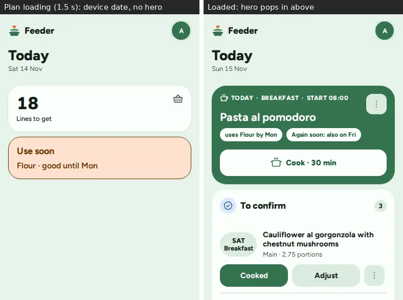

### Design
- **The household date is known before the plan.**
  - `/api/me` returns the household's `timeZone` (an API addition). `meCache` keeps it, so the date is known at boot and offline.
  - Today's subtitle uses `todayIn(timeZone)` from a pure `lib/householdDate.ts`.
  - On a first launch ever (no cache), the subtitle is a `meta` skeleton (18 px, 7em, reserved) and never the device date.
  - Use soon waits for the household date and is never computed against the device date.
- **One reserved shape.**
  - While the plan query has no data, Today renders the skeleton of the **last layout it showed**. `composeToday`'s tile ids and row counts are stored in `localStorage` `feeder.today.layout` on each render with data.
  - For example, hero 193/208/220 px (phone, tablet, desktop: the measured heights), To confirm with three 56 px rows, and the metric tile at 90 px.
  - First launch: hero plus one To confirm row.
  - Tiles from faster queries (Lines to get, Use soon) **wait for the plan** and then appear in their layout order, so nothing is ever inserted above a painted tile.
  - A tile whose own query is still loading after the plan arrives shows its skeleton in its slot.
- **Plan failed:**
  - The hero slot shows ErrorState "Today’s plan could not be loaded." with **Try again**, after one retry (about 1 s).
  - Tiles that did load stay below it.
  - The date stays the household date.
- **Offline, never loaded:** the hero slot shows LoadState (tile version, RES-02). Lines to get stays from the saved Shopping List.
- Skeleton heights come from tokens: `--skeleton-hero` is 193 px, 208 px from 600, and 220 px from 1024. A **new token** in `today.css`, kept in step by a test that compares against TonightHero's rendered height.

Accessibility:
- The Today section stays `aria-busy` while loading, with one hidden "Loading Today" status.
- No focus moves.
- Reduced motion stops the shimmer (existing).

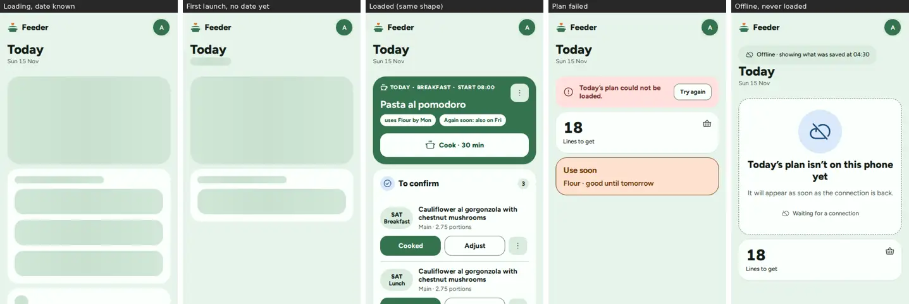
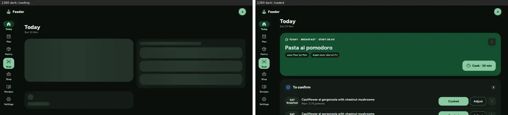
Mock: [res-05-today-states.html](mocks/res-05-today-states.html) (loading with date known, first launch, loaded, plan failed, offline never loaded, crashed tile).

### Build notes
- `features/today/components/TodayScreen.tsx` and `TodayView.tsx`: a skeleton layout and gating on the plan.
- `features/today/hooks/useToday.ts`: exposes `state` from `dataState` and the household date.
- `features/today/lib/compose.ts`: `skeletonLayout(lastLayout)`. Pure, and tested.
- `lib/householdDate.ts` is new and pure. `app/meCache.ts` and `useMe.ts` gain `timeZone`.
- Backend: `GET /api/me` adds `householdTimeZone` (thin handler; the value comes from household settings).
- The Board's `BoardScreen.tsx:61` can then use the same value.
- `ui/Skeleton` changes are in RES-02.

### Tests and guard
- Unit:
  - `todayIn('Pacific/Kiritimati', 2026-11-14T14:30Z)` returns `2026-11-15`.
  - `skeletonLayout` mirrors the stored layout.
  - Use soon is not computed without a household date.
- BDD:
  - "Today shows the household date while the plan loads"
  - "Tiles do not move when the plan arrives"
  - "Today's plan failing shows Try again in the hero place"
- Guard: a perf probe in `check-ui.sh` with CLS ≤ 0.1 on `/` and `/plan` at 390 and 1280, and the page-layout rule "no `.page-header__subtitle` text other than the household date".

### Depends on / unblocks
- Depends on RES-02 (Skeleton, LoadState) and RES-06 (retry).
- TB (Today shell, first run) references this item for Today's loading and offline states.

## RES-06  Errors in about 1 s; failed saves say what failed
**Severity** S3 · **Size** S · **Sources** CROSS-17 · **Reproduced** Confirmed, but narrower than reported.
- On a 500, each screen shows its error only after 4 requests (12 on Pantry):

| Route | Error shown after |
|---|---|
| `/shop` | 7,141 ms |
| `/recipes/1` | 7,136 ms |
| `/pantry` | 7,140 ms |
| `/recipes` | 7,144 ms |
| `/` | 7,627 ms |

- A **404** for `/recipes/99999` is also retried 4 times.
- A Preferences save with a 500 shows **one** toast, "Something went wrong. Please try again." The doubled toast was not reproduced: the stage-1 selector `.toast,[role=alert]` matched both the toast and its live region.
- The generic copy and the 7 s wait are real.

**Where** every data screen; every save (Preferences, Members, Meal Slots, Shop actions)

### Problem
- A User stares at a skeleton for 7 s before learning that nothing will come.
- A missing Recipe takes 7 s to say so.
- A failed save says "Something went wrong" without saying what.
- The Shop shows raw client text ("The network is unreachable", `ShoppingScreen.tsx:34-36`).

Causes:
- the default `retry: 3` with exponential delay (`providers.tsx:7`);
- per-feature `errorMessage()` fallbacks (`features/settings/lib/errors.ts:35`, `access/strings.ts:36`).

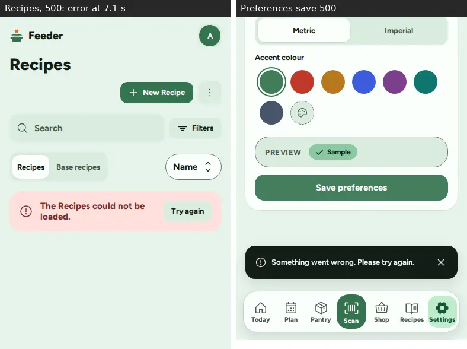

### Design
**Retry policy.** `retryPolicy` lives in `lib/dataState.ts` and is set as the default in `providers.tsx`.
- Queries retry once, after 1 s, on network errors (status 0), timeouts and 5xx.
- Queries never retry a 4xx: a 404 shows Not found, or the failed state, at once.
- Mutations never retry automatically. Ticks and Scans are queued instead (RES-03).
- The ErrorState therefore shows at about 1 to 1.5 s.
- ErrorState's **Try again** is a secondary button with the R-A outline, on a `--color-surface` fill on the danger tint.

**Request timeout.** GETs carry `AbortSignal.timeout(10_000)`, already supported by `lib/http.ts` as `ApiError(0, 'timeout')`. A connection that looks up but carries nothing then ends in the failed state, not an endless skeleton.

**Failed-save toast.** The copy comes from `lib/errorCopy.ts` (pure) and the layout follows R-D/R-D+. The page hook passes the thing being saved, in GLOSSARY words: "your preferences", "Anna", "the Dinner Meal Slot", "the Tags".
- **Server or unknown failure:**
  - the headline line is a 16 px WarningCircle followed by **"Couldn’t save {thing}"**;
  - the body reads "Your choices are still on the screen.";
  - an outline **Try again** re-runs the same save;
  - the circular Dismiss is top-aligned with the headline;
  - the error toast stays until dismissed (an existing rule).
- **Offline, or status 0:**
  - the headline line is a 16 px CloudSlash followed by **"Couldn’t save {thing}"**;
  - a muted subline reads "Feeder is offline";
  - the body reads "Try again when you’re back online. Your choices are still on the screen.";
  - there is no action, since a retry would fail again; only Dismiss.
- **Known 4xx codes** keep their specific messages as a one-line toast with the 16 px icon (`last_admin`, `email_taken` …).
- **Shop actions** use the same anatomy instead of the inline ErrorState. Example: headline "Couldn’t mark Cauliflower Not needed", with Try again. The inline ErrorState is kept for load failures only.

**One failure, one toast.** Mutation hooks (`usePreferences`, …) never toast; the page hook that calls them does, as `usePreferencesPage` does. There is no global `MutationCache.onError` toast.

**Accessibility**
- Error toasts already sit in the `role="alert"` region and are announced once.
- **Try again** is a 40 px outline pill with a 52 px target.
- After Try again runs, focus returns to the control that started the save.
- The focus ring on the inverse toast is `--color-bg` (R-C).
- The error icon on the toast fill is `--status-danger-bg`: 10.9 in light, 9.6 in dark.

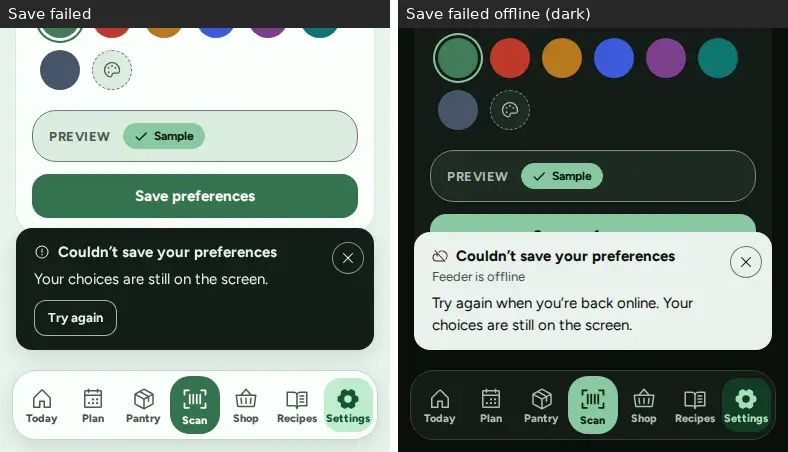
Mock: [res-06-failed-save-toast.html](mocks/res-06-failed-save-toast.html).

### Build notes
- `app/providers.tsx` and `lib/dataState.ts`: the retry policy.
- `lib/http.ts`: a default GET timeout, set through an option rather than a global.
- `lib/errorCopy.ts` (new) returns `{icon, headline, subline?, body}`. The feature `errors.ts` files delegate their fallback to it.
- `features/shop/screens/ShoppingScreen.tsx`: an error from `run()` goes to a toast with the copy above.
- The Toast anatomy (R-D/R-D+) belongs to DS; this item supplies only the copy and the timing. SAFE owns the confirm and Undo patterns.

### Tests and guard
- **Unit:**
  - `retryPolicy`: a 500 retries once, a 404 never, status 0 once.
  - `saveFailed('your preferences', ApiError(500))` and `ApiError(0)` return the expected icon, headline, subline and body.
- **Component:** a failing Preferences save gives exactly one `.toast` in the alert region. It has the 16 px icon in the headline line, the body, and an outline Try again that calls save again.
- **BDD:**
  - "A server error on Recipes shows Try again within two seconds"
  - "A Recipe that does not exist says so at once"
  - "A failed Preferences save names the preferences and offers Try again"
- **Guard:** `check-ui.sh` routes `/api/recipes` to 500 and asserts `.error-state` within 2.5 s.

### Depends on / unblocks
- Shares `lib/dataState.ts` with RES-02.
- Uses DS's R-D/R-D+ Toast.

## RES-07  Offline banner: sticky, in the gutter, beside the rail, household time
**Severity** S3 · **Size** S · **Sources** SHELL-18 · **Reproduced** Confirmed:
- At 390 and 1280 the banner sits at y=64, x=0, 303×40, with a `static` parent. After scrolling 600 px its top is at −265 (390) and −143 (1280).
- At 1280 it sits above the rail at x=0.
- It reads "saved at 08:30" (device, UTC−6) while the household time was 04:30 the next day (UTC+14).
- The time is the moment the connection dropped (`app/useConnectivity.ts:13,18`), not when anything was saved.
**Where** every screen offline; all sizes; light and dark

### Problem
The one line that explains a stale screen scrolls away, ignores the page gutter and the rail, and gives a time in the wrong zone with the wrong meaning.

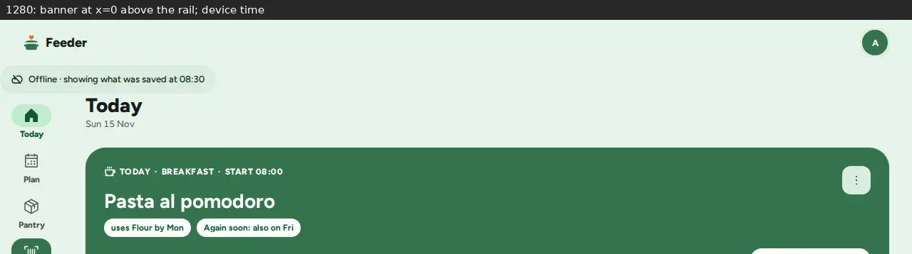

### Design
- **Placement:**
  - `.app-status` is `position: sticky; top: 0; z-index: 9`, below sheets and toasts and above content.
  - Padding is `var(--gutter)` inline and `--space-2` top. The container is click-through; only the pill takes pointer events.
  - From 1024 the shell grid places `.app-status` at column 2, row 2; the rail spans rows 2–3; `main` is at column 2, row 3. The rail stays directly under the top bar, and the banner aligns with the page column.
  - The pill gets `--elev-1`, so it reads over scrolled content.
- **Copy:**
  - "Offline · showing what was saved at 04:30".
  - The time is the **newest successful server answer**, recorded by the HTTP client and kept in `meCache`. It is formatted in the household zone (RES-05).
  - If that moment is not today in the household zone, use a day prefix: "saved Sat 18:05".
- **Queue line:**
  - Below 600 px it sits on its own line, aligned with the text (indent 24 px), and the pill's radius becomes `--radius-tile-sm`.
  - From 600 px it is inline after a "·".
  - Wording: "1 Tick waiting to sync", "2 Scans and 1 Tick waiting to sync" (RES-03).
- **Back online:** the banner disappears. If anything was waiting, a status toast says "Back online. 3 changes synced." The noun follows the queue: "2 Scans and 1 Tick synced."

Accessibility:
- `role="status"` `aria-live="polite"` as now; text changes are announced once.
- Contrast: text on `--color-surface-2` is 14.02 light and 12.95 dark; the queue line (muted on surface-2) is 5.93 and 7.49.
- Sticky chrome at short heights: the banner is 40 px. SHORT's short-viewport rule (CROSS-05) decides whether it collapses to an icon-only chip under 500 px height. This item follows that rule.

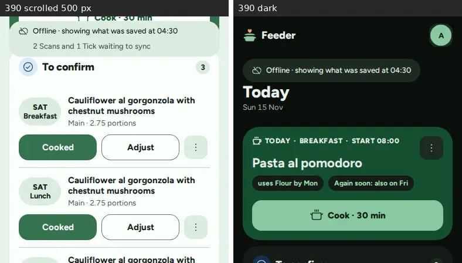
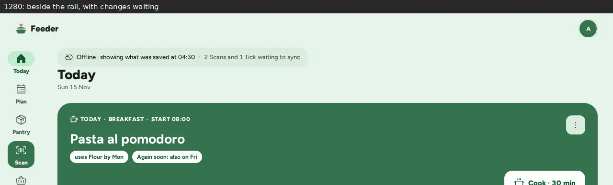
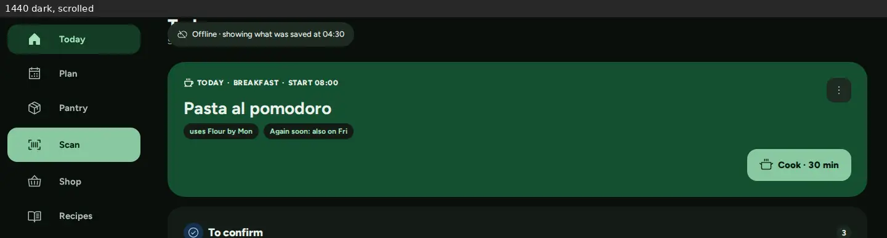
Mock: [res-07-offline-banner.html](mocks/res-07-offline-banner.html).

### Build notes
- `app/shell.css` (`.app-status`, grid placement at ≥ 1024), `ui/OfflineBanner.tsx` and `.css` (layout and copy; formatting through `lib/householdDate.ts`).
- `app/useConnectivity.ts` (`lastServerContact` replaces `savedAt`) and `lib/http.ts` (records the time of each OK response).
- `app/ShellStatus.tsx` (passes `pendingTicks`).

### Tests and guard
- Unit: banner copy with a zone and a day prefix; queue wording for 1 and n of each kind.
- BDD: "The offline banner stays in view while scrolling" and "The offline banner shows household time".
- Guard (page-layout): offline at 390 and 1280, scroll 600 px, assert the `.offline-banner` top is between 0 and 16; at ≥ 1024, its left is at least the rail's right edge.

### Depends on / unblocks
- Depends on RES-05 (time zone in `/api/me`) and RES-03 (Tick count).
- SHORT (CROSS-05) owns the short-height behaviour.

## RES-08  Boot: the User's theme before first paint, and a shell skeleton
**Severity** S3 · **Size** S · **Sources** CROSS-14 · **Reproduced** Confirmed. With Dark + Tomato preferences, OS light, and `/api/me` plus preferences delayed 1.2 s:
- 6 ms: light Basil boot mark.
- 58 ms: a bare "Loading" on light (`app/AppRoot.tsx:33`).
- 1,271 ms: the app in light Basil with the device date.
- 2,483 ms: the app in dark Tomato with the household date.

Stage 1 said `meCache` already holds the scheme and accent. **It does not** (`app/meCache.ts` keeps only `id`, `email`, `displayName` and `isAdmin`). The theme waits for `/api/me` and then `/api/me/preferences`, two round trips in sequence, and while offline the preferences query pauses, so a dark User gets light Basil offline.

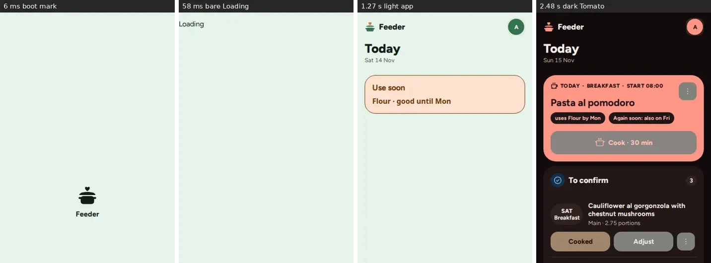

### Design
- **Theme cache:**
  - `features/settings` writes `localStorage` `feeder.theme` whenever preferences load or save: `{scheme: 'light'|'dark'|'system', light: {...}, dark: {...}}`.
  - Each palette has six resolved colours: bg, surface, surface-2, line, text, accent.
  - Sign-out clears it, with `clearCachedMe`.
- **Before first paint:**
  - An inline script in `web/index.html` (about 0.6 KB) reads the cache.
  - It sets `data-scheme`, the six `--boot-*` variables, `theme-color`, and `data-boot="shell"`.
  - Without a cache (first visit) it does nothing, and the existing boot mark shows.
- **Shell skeleton:** for a returning User, index.html's inline CSS draws:
  - the top bar (brand mark in accent, "Feeder", avatar circle);
  - the bottom bar outline below 1024, or the rail with seven 56 px pills from 1024;
  - a title pill and two tiles in the RES-05 heights.
  - It pulses at 1.6 s, with no animation under reduced motion.
- **First React frame:**
  - `main.tsx` calls `applyTheme(document.documentElement, cached, scheme)` before `createRoot`, so the full token set is already right.
  - The preferences query takes the cache as `initialData`.
  - `AppRoot` returns `<BootShell/>` (the same markup and classes as index.html) while `me` is pending, instead of `
Loading
`.
- **Resulting sequence** for a returning User: the first paint is already dark Tomato. There is no light frame and no bare "Loading". On a slow first visit, the shell shows at FCP (1.8 s after RES-04) instead of a blank screen until 7.7 s.

Accessibility:
- The shell is one `role="status"` named "Opening Feeder"; its blocks are `aria-hidden`.
- Contrast of the decorative blocks is not required (they are not information). Brand text on bg is the existing pair.

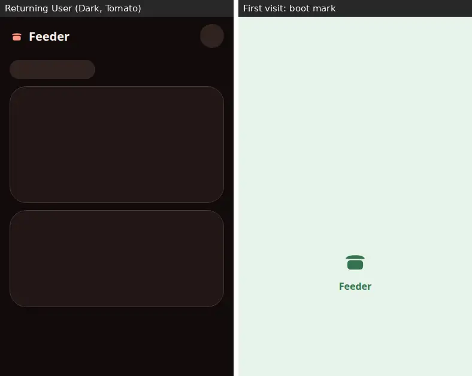
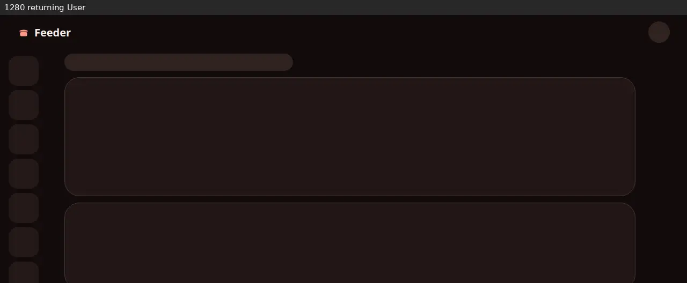
Mock: [res-08-boot-shell.html](mocks/res-08-boot-shell.html) (open with `?seed=tomato-dark`, `?seed=basil-light` or `?seed=none`). This mock is index.html itself: it links no app.css, because none has loaded at that point.

### Alternatives considered
Folding preferences into `/api/me` (one round trip) is worth doing as well, but on its own it still flashes on every launch. The cache is what removes the flash.

### Build notes
- `web/index.html` (script and CSS; extend `bootPaint.test.ts`), `web/src/main.tsx`.
- `app/AppRoot.tsx` and a new `app/BootShell.tsx`.
- `theme/themeCache.ts` (new, pure: build, read and validate the cached shape).
- `features/settings/hooks/usePreferenceTheme.ts` (write the cache, `initialData`), `app/meCache.ts` (clear together).

### Tests and guard
- Unit: `themeCache` round-trip and rejection of a malformed value. AppRoot pending renders BootShell and no "Loading" text.
- `bootPaint.test.ts`: the inline script exists, uses only `localStorage` and `document`, and is under 1 KB.
- BDD: "A dark User's first frame is dark" and "Opening Feeder shows the shell, not a Loading line".
- Guard: a Playwright check that `data-scheme` equals the User's scheme at the first `requestAnimationFrame` after `commit`.

### Depends on / unblocks
- Pairs with RES-04, which moves FCP earlier.
- The skeleton heights come from RES-05.

## RES-09  A crashed tile or page: per-tile boundary and a Try again that works
**Severity** S3 · **Size** S · **Sources** SHELL-19 · **Reproduced** Confirmed:
- With `/api/plan/to-confirm` returning a malformed Planned Meal (`{slots:[{date:null}]}`), Today renders the page error.
- "Go to Today" on `/` does nothing: `navigate('/')`, and `resetKey` is unchanged (`app/PageErrorBoundary.tsx:30,52`).
- Navigating to Plan and back with good data still shows the error, because the cached bad data renders before the refetch.
- Only Reload recovers.
- One bad tile takes down all of Today.
**Where** `/` (tiles), every routed page; all sizes

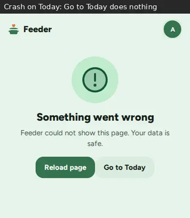

### Design
- **Per-tile boundary on Today and the Kitchen board.**
  - A tile that throws keeps its slot and shows a tile-sized notice. It uses `--color-surface`, a 1 px `--color-line` border and `--radius-tile`, with a minimum height of 96 px (so the grid doesn't jump).
  - It has a **WarningCircle** 24 in danger fg and the text "**{Tile title} couldn’t be shown.** The rest of Today is fine." (for example "To confirm couldn’t be shown.").
  - Its action is **Try again**.
  - The other tiles render normally.
- **Try again** (tile and page) resets the boundary **and** resets the queries the failed subtree used:
  - `queryClient.resetQueries` for the tile's keys, declared by the tile in Today's tile registry (for example `['plan','to-confirm']`); for a page, its route's feature keys.
  - Data is cleared and refetched, so the bad cached data cannot crash it again.
- **Page boundary:**
  - Actions are **Try again** (primary) and **Go to Today** (secondary).
  - On `/`, the secondary is **Reload Feeder** (`location.reload()`), because "Go to Today" from Today is a no-op.
  - The boundary also resets on pathname change (kept). Coming back to a route removes that route's cached queries that errored, through the same reset.
  - The copy "Something went wrong" and "Feeder could not show this page. Your data is safe." is kept.

Accessibility:
- The tile notice is `role="alert"` named by the tile title. Its focus order is the tile's.
- After Try again succeeds, focus goes to the tile's heading (`tabindex=-1`) so a screen-reader User learns it is back.
- The page error moves focus to its heading on render. A11Y owns the page-focus rule.

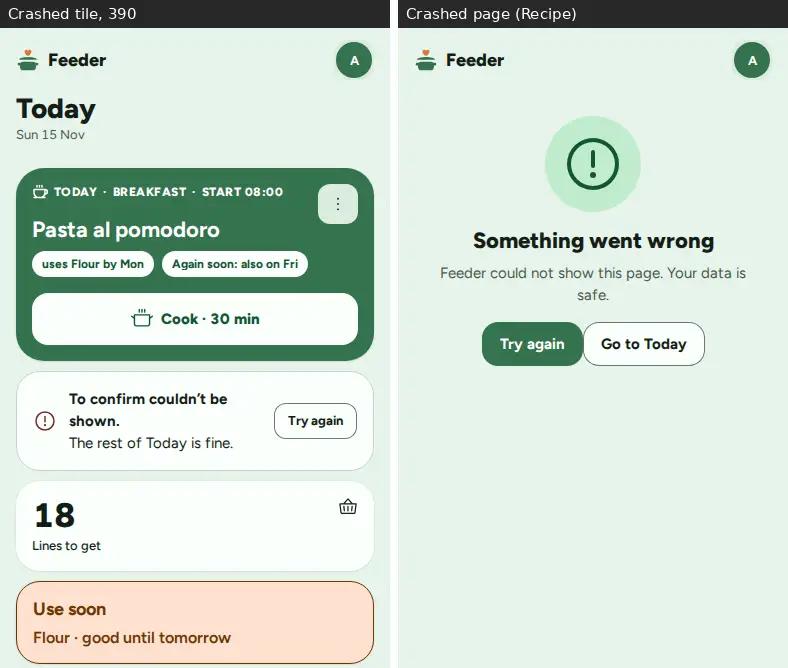
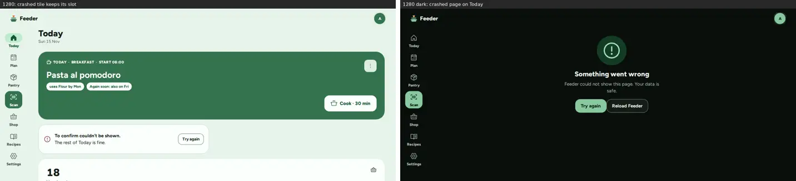
Mocks: [res-05-today-states.html](mocks/res-05-today-states.html) (state "Crashed tile"), [res-09-page-crash.html](mocks/res-09-page-crash.html).

### Build notes
- New `app/TileErrorBoundary.tsx`, a class boundary with `resetKeys` and an `onReset` that calls `queryClient.resetQueries`.
- `features/today/components/TodayView.tsx` wraps each `.today__slot`; the tile registry in `features/today/types.ts` adds `queryKeys`.
- `app/PageErrorBoundary.tsx`: Try again, the `/` exception, and the query reset.
- Also: wrap the Kitchen board tiles (`features/board`).

### Tests and guard
- Component:
  - A throwing tile shows the notice and the other tiles render.
  - Try again after the data is fixed renders the tile.
  - The page boundary on `/` shows Reload Feeder, not Go to Today.
- BDD: "A broken To confirm tile leaves the rest of Today usable" and "Try again recovers a crashed page".
- Guard: a unit test only (no layout rule needed).

### Depends on / unblocks
None.

## RES-10  A new version is ready: the update prompt
**Severity** S3 · **Size** S · **Sources** new in stage 2 (asked for in the theme brief; A11Y 4 asks the same question and refers here) · **Reproduced** Confirmed from the code and the server:
- The worker calls `self.skipWaiting()` on install and `clients.claim()` on activation (`web/src/sw/sw.ts:51,64`), then deletes the old build's cache entries.
- Nothing tells the User, and the open page keeps running old code against a new server.
- This is harmless with one bundle today. It breaks lazy chunks (RES-04) and any API change between versions.

**Where** any open session during a deploy; all sizes

There is no before image: nothing is shown today.

### Design (decision RES 3 / A11Y 4: a toast with Reload)
- **The worker waits.** There is no `skipWaiting` on install. The worker activates on a `{type: 'SKIP_WAITING'}` message, or when every Feeder tab has closed (the browser's default).
- **The page checks for updates.** It calls `registration.update()` when the page becomes visible again and once an hour.
- **When `registration.waiting` exists**, the page shows an **info toast that stays until acted on**. It follows R-D/R-D+:
  - headline **"A new version of Feeder is ready"**, with no icon, because the headline already says it all;
  - two outline buttons, **Reload** and **Later**, with no separate Dismiss.
- **Reload** posts `SKIP_WAITING`; on `controllerchange` the page reloads.
- **Later** hides the toast for this session, and the new version applies at the next launch.
- **The prompt never interrupts.** It waits, and shows on the next navigation instead, while:
  - Cook Mode is open (chromeless);
  - Scans or Ticks are waiting to sync;
  - a form has unsaved changes (SAFE's guard).
- **Placement:** the existing toast region, above the bottom bar on phones and bottom-centre from 1024.

**Accessibility**
- `role="status"`, polite, announced once.
- Reload and Later are 40 px outline pills with a 52 px target. Keyboard: Tab reaches them in reading order.
- The focus ring on the toast is `--color-bg` (R-C).

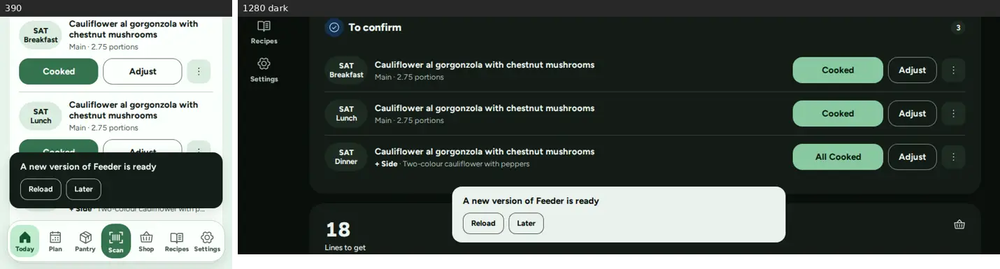
Mock: [res-10-update-prompt.html](mocks/res-10-update-prompt.html).

### Build notes
- `web/src/sw/sw.ts`: remove the automatic `skipWaiting`; add a message listener.
- Move `features/scan/registerSw.ts` to `app/serviceWorker.ts`: registration is an app concern, not Scan's. It stays plain TypeScript, with an `onUpdateReady` callback.
- New hook `app/useAppUpdate.ts`. `app/AppShell.tsx` shows the toast through DS's R-D Toast, and the strings go in `app/strings.ts`.
- `spa.go` serves `/sw.js` with `no-cache` (RES-04).

### Tests and guard
- **Unit:**
  - `serviceWorker.ts` calls `onUpdateReady` when `waiting` appears.
  - Reload posts `SKIP_WAITING` and reloads on `controllerchange`.
  - Later hides the prompt for the session.
  - The prompt is held back while the sync queue is not empty.
  - The toast renders no icon.
- **BDD:**
  - "A new version offers Reload and Later"
  - "The update prompt waits during Cook Mode"
- **Guard:** unit tests only.

### Depends on / unblocks
- Unblocks RES-04's route splitting.
- Uses SAFE's unsaved-changes signal, RES-03's queue count, and DS's R-D/R-D+ Toast.
- A11Y 4 refers here.

## Review round 1 (2026-11-14)
- **Shared CSS:** every RES mock now carries the PC mocks' shared rules block (R-A to R-D) at the top of `<style data-proposed>`, so RES mocks look the same as the other themes'.
- **R-A:**
  - Every Try again (ErrorState, the crashed-tile notice, the crashed page) and every SyncNotice action is now a secondary button with a `--color-surface` fill and a 1 px `--color-outline` boundary.
  - The Dismiss buttons on notices were bare text; they are now secondary buttons.
  - LoadState and the offline banner have no actions, so they needed no change.
- **R-D:** all six toasts in the theme now use the headline / muted subline / body / outline-button anatomy:
  - failed save (server and offline);
  - the update prompt (Reload and Later as outline buttons, no X);
  - the queued Tick (Undo, Change);
  - "Back online · 1 Tick synced";
  - the option that was not chosen.
- **R-B:** both sheets in RES-03 (Change while waiting, and the ticked-twice Line sheet) use the 40 px circular outline Close, top-aligned with the title. Neither sheet has a Cancel, so Close stays.
- **R-C:** sheet bodies keep 5 px of room for the focus ring, through the shared block.
- **Beyond the four rules:** the Line sheet now states one thing. Its title is "Carrot was ticked twice", with a muted subline "Each Tick added its own Stock Lot · 100 g in all", in place of the title "Carrot" plus a lead paragraph.
- **Re-rendered:** 11 mocks rebuilt and 45 states re-rendered, in light and dark where the item has both. 31 WebP shots were recomposed under the same file names.
- **Left as is:**
  - The boot-shell mock and the two diagrams have no actions.
  - The crashed tile's title wraps to two lines at 390 px. It reads well and keeps its 96 px slot.
- **Item text changed:** RES-03, RES-06 and RES-10.

## Review round 2 (2026-11-14)
- **Shared CSS.** Every RES mock now carries the PC mocks' shared rules block from round 2 (R-A to R-F, including R-C+, R-D+, R-E rows and the R-F bottom bar) at the top of `<style data-proposed>`.
- **Toasts (R-D+).** All six now follow the rule:
  - The status icon is 16 px, inside the headline line. It stays only where it carries a status: the queued-Tick toast keeps Clock ("waiting to sync"), the two failed-save toasts keep WarningCircle and CloudSlash, and the option that was not chosen keeps CloudSlash.
  - "Back online · 1 Tick synced" and the update prompt now have no icon.
  - Dismiss is top-aligned with the headline.
- **Structured rows (R-E).**
  - The ticked-twice SyncNotice was one long sentence. It is now a headline ("Carrot was ticked twice"), a muted subline ("Both Stock Lots were added · 100 g in all"), and one row per addition: who in body-strong, the amount at the end in info-fg with tabular figures, and the time muted underneath.
  - The Line sheet's additions use the same rows, with Take back at the end of each row, spanning both of its lines.
  - The other SyncNotices (refused Tick, refused Scan), LoadState and ErrorState hold one fact each, so they keep their sentence.
- **Bottom bar (R-F).** No RES render is under 360 px wide. The rule is in the shared block, so the boot-shell mock and any later 320 render follow it. No picture changed for R-F.
- **Re-rendered.** 11 mocks rebuilt; 45 states re-rendered; 31 WebP shots recomposed under the same file names, light and dark where the item has both.
- **Craft check at full size.** The only defect found and fixed was the Line sheet's addition rows: the button and the amount sat on uneven baselines. They are now one grid, with the button centred across both lines. No touching shapes, unrounded badges or nested focus rings appear in RES renders, so R-C+ changed nothing here.
- **Left as is.** On a 390 px screen the crashed-tile notice still wraps its title onto two lines. It reads clearly and keeps its 96 px slot.
- **Item text changed:** RES-03, RES-06 and RES-10.

## Work packages for this theme

| Package | Items | Files owned | Size | Merge order | Parallel with |
|---|---|---|---|---|---|
| **P1 Serving and offline launch** | RES-01, RES-04 (headers, compression, budget), RES-10 | `internal/app/spa.go` and its tests, `web/src/sw/*`, `web/vite.config.ts`, `features/scan/registerSw.ts` → `app/serviceWorker.ts`, `app/useAppUpdate.ts`, `deploy/helm/feeder/README.md`, the budget line in `scripts/check.sh` | M | first | P2 |
| **P2 State model and errors** | RES-02, RES-06 | `app/providers.tsx`, `lib/dataState.ts`, `lib/errorCopy.ts`, `lib/http.ts` (timeout and time of last server contact), `ui/LoadState.*`, `ui/Skeleton.*`, the list screens and hooks (Recipes, Pantry, Plan, detail screens, Settings lists), the feature `errors.ts` files, `ShoppingScreen.tsx` (error copy only) | M–L | first, with P1 | P1 |
| **P3 Shell chrome** | RES-07, RES-08, RES-09 (page boundary) | `app/shell.css`, `ui/OfflineBanner.*`, `app/useConnectivity.ts`, `app/ShellStatus.tsx`, `web/index.html`, `main.tsx`, `app/AppRoot.tsx`, `app/BootShell.tsx`, `theme/themeCache.ts`, `usePreferenceTheme.ts`, `app/meCache.ts`, `app/PageErrorBoundary.tsx`, `lib/householdDate.ts`, backend `GET /api/me` (`householdTimeZone`) | M | after P2 (it shares `lib/http.ts`) | P4 |
| **P4 Today** | RES-05, RES-09 (tile boundary) | `features/today/**`, `app/TileErrorBoundary.tsx`, the tile wrapping in `features/board` | M | after P2 and P3 (`householdDate`, `meCache`) | none of P3's files |
| **P5 Offline shopping** | RES-03 | `internal/scan/**`, the shopping service's port and `shopping_tick_additions` migration, `features/scan/lib/queue.ts`, `useSyncQueue`, `useShellStatus`, `features/shop/lib/pendingTicks.ts`, the additions list in `shop/components/LineSheet.tsx`, the offline branch of `useTickFlow`, `ui/SyncNotice.*`, the `sync` prop of `ui/ListRow`, the new ADR (ticked twice, amending ADR 0019), spec §9 and §10.3 | L | after P2 (`offlineFirst`) **and after the SSP package that ships SSP-01 and SSP-02** (`useTickFlow`, `tickAmount.ts`, the Change sheet, `PATCH /api/shopping/ticks`, `covers`/`Derive`, SSP 3's ADR). P5 extends those files, so the two packages must not run at the same time | after P3 for the banner count (a small rebase) |

An optional follow-up, P6 (route splitting, `app/features.ts`), comes after P1 has shipped the update prompt.

## Not reproduced / dropped
- **CROSS-17, "a failed save shows a doubled toast":** not reproduced. Exactly one `.toast` appears. Stage 1's selector `.toast,[role=alert]` counted the toast and the `role="alert"` live region that holds it. The generic copy and the 7 s delay were confirmed and are designed in RES-06.
- **CROSS-14, "`meCache` already holds the scheme and accent":** incorrect. It holds identity only (`app/meCache.ts`). The defect is confirmed; the fix adds a theme cache (RES-08).
- **CROSS-06, "Today with its plan requests returning 500 … no error":** narrower. The error appears, but at 7.6 s (stage 1 looked at 4 s). It is folded into RES-02, RES-05 and RES-06.

## What could not be checked
- A real phone: iOS Safari's service-worker and offline behaviour (installed PWA versus tab), Android Chrome on a genuinely bad network, and storage eviction of IndexedDB and Cache Storage under pressure. All timings use CDP throttling on desktop Chromium.
- Production serving through ingress-nginx: whether the controller already gzips (that is a cluster setting). The "after" numbers come from a local proxy that imitates the proposed `spa.go`, not from the real change.
- How much route splitting would save. The JS coverage probe was inconclusive, and this stage cannot build. The budget gives a measurement once it is built.
- The multi-User sync conflict (decision 2) end to end: designed from `internal/shopping/service/service.go` and `internal/scan/scan.go`; no second phone was driven offline.
- WebKit was not run for this theme's states.

