# Safe editing: confirm, Undo, unsaved changes, the save model, form errors and defaults

This chapter covers how Feeder protects people from losing work and from taking back actions too late. It handles four things: whether an action asks first or acts at once and offers Undo, what happens to an edit the person has not saved, when a settings page saves, and how a form says what is wrong with it. All 14 stage-1 findings assigned to this theme reproduce on the stage-2 server (`main` @ 834ea743, :18563). One more defect was found while reproducing them: **Remove Meal Slot** deletes a Meal Slot, with its Planned Meals and its Cooked history, in one tap.

Three root causes sit behind almost every item:
- **No shared rule for destructive actions.** The parts are there: `ui/ConfirmDialog` (danger tone focuses Cancel), the `Toast` action slot, the Swap and Not served Undo toasts, the Scan Undo ledger, and the untick that takes back its Stock (ADR 0019). Each screen chose for itself, so the app has five confirm patterns and many one-tap removals. Of the actions that remove or resolve something, only Swap, Not served, Not needed, Scan and the Base recipe links can be undone.
- **No backend inverse for the plan's resolving actions.** Cooked, Not cooked, Regenerate, Remove Member, Throw out and Stock-take write over or delete what they replace, so no Undo is possible today. Cooked's Stock deduction already computes which Lots it took from (`stock.Deduct` returns `Taken`), but nothing stores that.
- **Forms have no "dirty" or "invalid" model.** The Recipe editor holds its draft only in React state. Errors are announced in three different ways, and focus never moves to the field that is wrong.

The fix is five system rules (R1–R5 below). They are carried by **seven shared changes**: `ConfirmDialog` (focus and a list body), `Toast` plus a new `useUndoToast` hook, `FormActions` (destructive kept apart), `FieldFrame` plus `focusFirstInvalid`, `Select` (placeholder), `BottomSheet` (dirty guard) and a new `DraftNotice`. They close or carry 11 items. There are also four backend inverses: plan **reopen**, **Regenerate snapshot**, **Member restore** and **Stock give-back**. They make Undo possible for Cooked, Not cooked, Regenerate, Remove Member, Throw out and Stock-take.

| Item | Severity | Size | Title | Source ids | Status after reproduction |
|---|---|---|---|---|---|
| SAFE-01 | S1 | M | The Recipe editor loses every unsaved change on navigation or reload | RECIPES-01, FLOW-01 | Confirmed |
| SAFE-02 | S2 | L | Destructive Settings and catalogue actions: one-tap deletes and five confirm patterns | SETTINGS-03, + Remove Meal Slot (new in stage 2) | Confirmed, wider |
| SAFE-03 | S2 | L | Cooked and Not cooked cannot be taken back | PLAN-05, FLOW-10 | Confirmed |
| SAFE-04 | S2 | M | One field-error pattern: message at the field, focus to the first invalid field | SETTINGS-05, RECIPES-13 | Confirmed |
| SAFE-05 | S2 | S | Delete of a planned Recipe promises a delete, then refuses it off-screen | FLOW-11 | Confirmed |
| SAFE-06 | S2 | XS | Editor Cancel is history-back and leaves the app on a deep link | RECIPES-02 | Confirmed |
| SAFE-07 | S3 | M | Regenerate: Enter commits, and the run gives no count and no Undo | PLAN-16 | Confirmed |
| SAFE-08 | S3 (was S2) | S | Your preferences: no live effect, and leaving drops the choice | SETTINGS-06 | Confirmed, severity lowered |
| SAFE-09 | S3 | M | Stock actions: Undo and feedback differ between screens | SHOP-11 | Confirmed |
| SAFE-10 | S3 | S | Remove Step, line or ingredient use in the editor is instant, with no Undo | RECIPES-15 | Confirmed |
| SAFE-11 | S3 | S | Add forms start with an arbitrary Ingredient or none, and the Lot sheet always shows Move | SHOP-16 | Confirmed |

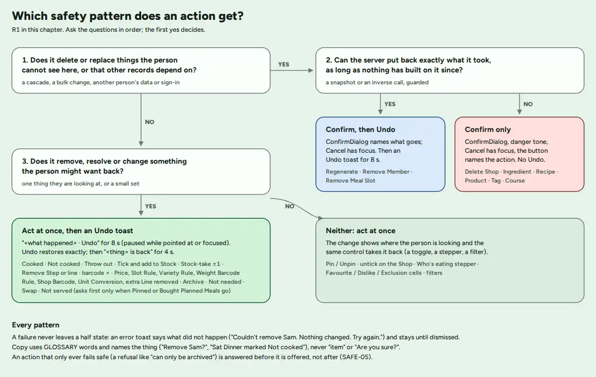
Diagram: [mocks/safe-00-patterns.html](mocks/safe-00-patterns.html)

## Decisions for the user

The user took all seven decisions on 2026-11-14 (`decisions.md`, SAFE 1–7). This chapter now follows them.

1. **The Recipe editor's unsaved changes (SAFE-01). Changed: B.**
   - Every in-app exit from a dirty editor opens a blocking "Leave without saving?" dialog (Keep editing / Discard changes).
   - A local draft is kept only so the changes survive a reload or a crash, and it is restored with a notice. Mocks: [leave](mocks/safe-01-leave-dialog-390-light.html), [restored](mocks/safe-01-draft-restored-390-light.html), [conflict](mocks/safe-01-draft-conflict-390-light.html).
2. **How long Cooked and Not cooked can be undone (SAFE-03). B, as recommended.** From the toast, and from the Planned Meal sheet until the end of the household day. Mocks: [Cooked sheet](mocks/safe-03-cooked-sheet-390-light.html), [Not cooked sheet](mocks/safe-03-notcooked-sheet-390-light.html).
3. **Regenerate (SAFE-07). A, as recommended.** A real Undo from a server snapshot. Mocks: [toast](mocks/safe-07-regenerated-toast-390-light.html).
4. **Remove Member (SAFE-02). A, as recommended.** Confirm first, then an Undo toast. Mocks: [confirm](mocks/safe-02-remove-member-390-light.html), [toast](mocks/safe-02-member-removed-390-light.html).
5. **Undo toast duration. A, as recommended.** 8 s, paused while pointed at, focused or hidden. Scan's 5 s stays.
6. **Your preferences (SAFE-08). Changed: B.** An explicit Save, a live whole-app preview, and a "Leave without saving?" guard. Mocks: [preview 390](mocks/safe-08-preview-dirty-390-dark.html), [820](mocks/safe-08-preview-dirty-820-dark.html), [1440](mocks/safe-08-preview-dirty-1440-dark.html), [leave](mocks/safe-08-leave-dialog-390-dark.html), [saved](mocks/safe-08-saved-390-dark.html).
7. **Removing a Meal Slot that has Cooked history (SAFE-02). Changed: B, designed in this chapter.** Removal keeps the Cooked history, and the removed Meal Slot can be brought back with Undo. Mocks: [confirm](mocks/safe-02-remove-mealslot-390-light.html), [toast](mocks/safe-02-mealslot-removed-390-light.html).

## System rules (the patterns)

These rules go into `docs/design/system.md` as a new **§12 Safe editing**. SHORT takes §11. They build on review rules R-A to R-F (DS owns system.md §3 and §5, A11Y owns the focus rule). The table after the rules is the full inventory.

### R1. Confirm, Undo or neither

Ask the questions in order; the first yes decides (diagram above).

1. **Confirm first** (`ConfirmDialog`) when the action deletes or replaces things the person cannot see on this screen, or that other records depend on: a cascade, a bulk change, or another person's data or sign-in.
   - If the server can put it all back exactly, a guarded Undo toast follows: **Confirm, then Undo**. Regenerate, Remove Member and Remove Meal Slot work this way.
   - Otherwise it is **Confirm only**.
2. **Act at once, then an Undo toast** when the action removes, resolves or changes one thing (or a small set) the person is looking at and might want back.
3. **Neither** when the change shows where the person is looking and the same control takes it back.

**ConfirmDialog rules** (a primitive change):

- **One question, with visible hierarchy:**
  - **Title.** The question, naming the thing: "Remove Sam?", "Delete Coop?", "Leave without saving?". Never "Are you sure?".
  - **Lead line.** One sentence (`body`, 600) saying what happens: "Sam no longer counts towards portions."
  - **What goes and what stays.** Only when needed. They are **R-E rows** under a small uppercase label (**Goes**, **Stays**, or "Goes with Sam"), never bullet sentences. Each row has:
    - the **key** in `body-strong` (for example "Sign-in");
    - the **state** at the row's end, in `body-strong` with tabular figures ("Ends", "7", "21 Meal Slots", "Kept");
    - the **detail** in muted `meta` under the key ("sam@example.com · not on the Allowlist").
  - Rows are separated by a 1 px line at 18 %. Counts come from a read-only impact call made before the dialog opens.
  - A longer set opens from a one-line summary (`
`, drawn chevron, 32 px row): "1 Bought Planned Meal is replaced". It opens to the same rows.
  - **Note.** One muted `meta` line: "You can undo it straight after.", or "This can't be undone." for Confirm only.
  - No paragraph walls. The new `ConfirmOptions.groups` and `ConfirmOptions.details` take `{ key, state, detail }` rows.
- **Buttons are real buttons (R-A):**
  - The **safe button** ("Cancel", or "Keep editing" in a leave or discard dialog) is an outline button: surface fill, 1 px `--color-outline` boundary (4.5:1 light, 4.9:1 dark), `--color-text` label.
  - The **confirming button** is filled, `danger` or `primary`. Its label repeats the verb and the thing.
  - Never "OK" or "Yes", and never a bare text button.
- **No Close (R-B).** Cancel is in the footer, so there is no Close. Escape and Cancel close the dialog. The scrim closes it only in `default` tone.
- **Tone.** `danger` (warning or trash icon, danger button, the scrim does not dismiss) or `default`.
- **Focus:**
  - The safe button has focus on open, in every confirm.
  - `focus: 'confirm'` only for questions that lose nothing.
  - Escape chooses the safe button.
  - On close, focus returns to the opener.
  - Rings are never clipped (R-C).

**Undo toast rules** (`Toast` plus a new `useUndoToast` hook):

- **No success icon (R-D+).** An Undo toast reports what just happened, so it has **no status icon**. An icon appears only when it carries a status the words might not: an error, a warning, offline, waiting to sync. It is 16 px, first in the headline line, centred on its text, never in a column of its own.
- **One sentence → one line.** The message in past tense, naming the thing ("Sat Dinner marked Not cooked", "Sam removed", "Carrot ticked · 500 g added to Stock"). Then **Undo** as an outline pill (R-A): 40 px, transparent fill, `--color-bg` label, 1 px `--color-bg` at 70 %. Then Dismiss: a 32 px circular outline.
- **More than one sentence → R-D anatomy:**
  - **headline** (`body-strong`): "Cooked, nice one!";
  - **muted subline** (`meta`): "Sat Breakfast · Slow cooker beef and barley stew";
  - **body** (`body`): "1.25 portions kept as a Leftover, good until Tue.";
  - the buttons;
  - Dismiss, top-aligned with the headline.
- **Accessible name.** Undo's name says what it undoes (`actionAriaLabel`): "Undo Not cooked for Sat Dinner".
- **Duration (decision 5).** 8 s, paused on `pointerenter`/`focusin` and while `document.hidden`. With reduced motion, no slide.
- **Focus.** Focus never moves to the toast. Ctrl+Z / ⌘Z runs the newest visible Undo when focus is not in a text field. The ring on the toast is `--color-bg` (R-C).
- **After Undo.** Undo is one-shot. Success shows "<thing> is back" for 4 s. Failure shows an error toast (icon in the headline line) that says "Nothing changed" and stays.
- **Server window.** At least as long as the toast: snapshots for 10 minutes; plan reopen until the end of the household day (decision 2).

### R2. Unsaved changes

**Dirty** means the form's value differs from the value it was opened with.
- It is decided by a pure `same…` function.
- Leading and trailing spaces do not count; a reordered list counts; an upload in progress counts.
- Scrolling and the section index do not count.
- After a successful Save the form is clean.

**Page-level editors with the leave guard** (decision 1 B): the Recipe editor (SAFE-01), Your preferences (SAFE-08), the Household page, Recipe Assistant settings, Import Review (RX), and Receipt review (SSP).
- While dirty, every in-app navigation away opens the leave dialog, through `useLeaveGuard(dirty, { what })` (`useBlocker`).
- The dialog:
  - title "Leave without saving?";
  - lead "Your changes to <what> are not saved.";
  - note "If you leave, they are lost.";
  - **Keep editing** (outline, focused) and **Discard changes** (danger);
  - no Close.
- **Exits it covers:**
  - the bottom bar and the rails;
  - breadcrumbs and the header back link;
  - links inside the page;
  - Your menu, Sign out included;
  - browser Back and Forward, and the Android back gesture when there is in-app history;
  - notification taps that route in-app.
- **Exits it does not cover:**
  - hash changes;
  - the form's own Save;
  - Cancel (SAFE-06);
  - leaving the page itself: reload, tab close, the back gesture from a deep-linked first entry, the system killing the tab, a crash.
- There is no `beforeunload` prompt: it is a generic native prompt, and unreliable on mobile.
- The Recipe editor and Import Review keep a **reload draft** instead:
  - IndexedDB `feeder-drafts`, keyed `<userId>:<record>`;
  - written 500 ms after a change and on `pagehide`;
  - removed on Save or Discard, and after 7 days;
  - restored with a `DraftNotice` (info tile, outline buttons).
- **Keyboard (SHORT 2).** While typing, the bottom bar is hidden. Opening the dialog closes the keyboard. Keep editing returns focus to the control that started the navigation, or to the page title, never to a text field.

**Form sheets** ask "Discard changes?" (Keep editing / Discard changes) before any dismissal while dirty, through `BottomSheet`'s `confirmDismiss`. A sheet with Cancel in its footer shows no Close (R-B).

**Cancel** discards on purpose:
- When dirty, it asks "Discard your changes?".
- When clean, it leaves at once.
- It goes to a known route with `replace`, never `navigate(-1)`.

### R3. The save model

- **Explicit Save is the default** for every settings page and sheet, Your preferences included (decision 6 B).
- **Apply at once** only for a single control whose effect is visible right there and that the same control takes back: a notification switch, a preference cell, Pin, a filter.
- **Where Save sits:**
  - **Sheets:** the footer `FormActions`.
  - **Pages:** SHORT-06's `StickyActionBar`. It floats only while dirty, as one row: **Revert** (outline), then **Save <thing>** (primary).
    - Phone: 12 px above the bottom bar.
    - Tablet and desktop: the width of the form column.
    - With the keyboard up: at the keyboard's edge.
    - While clean: in the flow, with both buttons disabled.
- **Save is never disabled for validity (R4).** It is disabled only while busy (with the reason) or while clean.
- **Feedback.** Success shows a toast with no icon: "Your preferences are saved". Failure keeps the changes and shows an error toast that stays.
- **Live preview** (Your preferences only). It shows unsaved values across the app, marked "Not saved yet" in an info-tone line. It ends on Save, Revert, Discard changes, a reload or sign-out.

### R4. Field errors

- **When.** Validate on submit; after that, a field re-checks itself as it changes. Submit is never disabled for validity.
- **Where.**
  - Under the field (`ui-field__error`), with `aria-invalid="true"` and `aria-describedby`.
  - A section's error sits under its heading.
  - A field-less error goes in `FormError` (`role="alert"`) above the actions.
- **Focus.**
  - `focusFirstInvalid(form)` centres and focuses the first invalid field.
  - `.ui-field` has `scroll-margin-block`.
  - Field messages are not alerts.
  - A field nested in a bounded container rings inside itself (R-C+).
- **Copy.** Say what to do, sentence case, a full stop, GLOSSARY words.

### R5. Defaults in add forms

- Preselect only a value known to be right: the context, today, the main Course, "Where it usually goes".
- Never preselect the first item of a list.
- An empty `Select` shows a muted placeholder.
- A dependent field says what it depends on in its helper.

### Inventory: every destructive, resolving or bulk action and every long form

Legend:
- **C** confirm only
- **C+U** confirm, then Undo
- **U** act at once, then Undo toast
- **N** neither
- **G** leave guard
- **D** reload draft
- **S** explicit Save
- ✓ already meets the rule

| Area | Action (code) | Now | Target | Item / owner |
|---|---|---|---|---|
| Plan / Today | Cooked, one tap (`useCookFlow.ts:62`) | Success toast, no Undo; the sheet has only Close | U (R-D toast, no icon) + sheet Undo | SAFE-03 |
| Plan / Today | Mark as Cooked / Mark all Cooked | Same | U + sheet Undo | SAFE-03 |
| Plan / Today | Not cooked: a Course, a whole slot, To confirm ⋮ | At once, no toast | U + "Cooked after all" / "Undo Not cooked" | SAFE-03 |
| Plan | Regenerate (`usePlanScreen.ts:107`) | Confirm focused; no feedback | C+U, Cancel focused | SAFE-07 |
| Plan | Swap | U (6 s) | ✓ (8 s) | — |
| Plan | Choose a Recipe | At once | U; PC-01 summary | PC-01 |
| Plan | Pin / Unpin | At once | N ✓ | — |
| Plan / Today | Not served | Confirm on Pinned / Bought; U | ✓ | — |
| Plan / Today | Leftover answers | Confirm only on replans | U (API) | PC |
| Recipes | Leave the editor in-app | Edits lost | G | SAFE-01 |
| Recipes | Reload, tab close or crash | Edits lost | D | SAFE-01 |
| Recipes | Editor Cancel (`RecipeEditorScreen.tsx:355`) | `navigate(-1)` | Discard dialog + replace | SAFE-06 |
| Recipes | Remove a line, Step or use | Instant | U (local) | SAFE-10 |
| Recipes | Delete Recipe (`useRecipeActions.ts:40`) | Refused after a misleading confirm | C, answered up front | SAFE-05 |
| Recipes | Archive / Unarchive | At once | U | SAFE-05 |
| Recipes | Base recipe change, take-over, Course loss | Confirm, Cancel focused | ✓ | — |
| Recipes | Base recipe link / unlink | U | ✓ | — |
| Recipes | Recipe Assistant key Remove | Danger confirm | ✓ | — |
| Recipes | Recipe Assistant settings | Dirty bar | S + G | SHORT-06 + R2 |
| Recipes | Import Review | — | G + D | RX |
| Shop | Tick and add / Tick without adding | No toast | U | SAFE-09 |
| Shop | Untick | At once | N ✓ | — |
| Shop | Not needed | U | ✓ | — |
| Shop | Delete an extra Line | At once | U | SAFE-09 |
| Scan | Scan in a Shop | U 5 s | ✓ | — |
| Scan | Remove a Scanned row | Confirm + Put back | ✓ | — |
| Scan | Stock-take ±1 / Set total | Toast without Undo | U (API) | SAFE-09 |
| Scan | Receipt photos / review | Header Back only | G | SSP |
| Pantry | Throw out | At once | U (API) | SAFE-09 |
| Pantry | Keep | At once | U | SSP-17 |
| Pantry | Delete a Stock Lot | Danger confirm | ✓ | — |
| Pantry | Move a Lot | Form always open | "Move…" | SAFE-11 |
| Pantry | Used up | U | ✓ | — |
| Pantry | Add a Stock Lot | Basil preselected | R5 | SAFE-11 |
| Settings | Remove Member | At once | C+U (API) | SAFE-02 |
| Settings | Remove Meal Slot | At once; history deleted | C+U, history kept | SAFE-02 |
| Settings | Delete Shop | Focused danger button | C | SAFE-02 |
| Settings | Delete Ingredient / Supply | Focused accent button | C | SAFE-02 |
| Settings | Archive Product | Confirm, confirm focused | U | SAFE-02 |
| Settings | Change to Supply / food | Confirm, confirm focused | C, Cancel focused | SAFE-02 |
| Settings | Delete Product, Tag, Storage Place, Course; Allowlist; deny | Danger confirm | ✓ | — |
| Settings | Merge | Preview | ✓ | — |
| Settings | Barcode ×, Price, Shop Barcode, Weight Barcode Rule, Unit Conversion, Restock level / Shelf Life clear, Slot / Variety Rule remove | At once | U (inverse call) | SAFE-02 |
| Settings | Remove another device | At once | C | SAFE-02 |
| Settings | Your preferences | Save without effect | S + preview + G | SAFE-08 |
| Settings | Household page | Explicit Save | S + G | R2 |
| Settings | Preference cells, notification switches | At once | N ✓ | — |
| Settings | Member, Meal Slot, Shop, rule sheets | Explicit Save | S + sheet guard + R4 | SAFE-04 |

### What the backend has, and what each Undo needs

| Undo of | What exists (code) | What it needs | API |
|---|---|---|---|
| **Cooked**, fresh | `Runner.CookedUsing` (`plan/runner/actions.go:745`): the Stock deduction (`Taken` is not stored), `MarkResolved` (deletes Bought rows), `AddLeftover`, `unpinMisfits`, replan | `cooked_takes` (with `lot_json`); `stock.GiveBack`; stored Bought rows and unpinned dependants; Leftover removed only if untouched; replan. ADR 0020 | `POST …/{course}/reopen`, `…/all/reopen` |
| **Cooked** from a Leftover | Lowers the Leftover's portions | Store the portions taken | `reopen` |
| **Not cooked** | `Runner.NotCooked` (`actions.go:942`) | Store the dependants and Bought rows; re-pin; replan | `reopen` |
| **Regenerate** | `Runner.Regenerate` (`runner.go:218`) | `plan_state.revision`, `plan_snapshots`, a `changed` count, a guarded restore | `POST /api/plan/regenerate` → `{ changed, undoToken }`; `…/{token}/undo` |
| **Remove Member** | `DeleteMember` (`household/store/store.go:160`): 6-table cascade; Photo released at once | `member_removals` snapshot; deferred `ReleasePhoto`; same-id restore; a read-only impact for the dialog rows | `GET /api/members/{id}/impact`; `POST /api/members/removed/{token}/restore` |
| **Remove Meal Slot** | `DeleteSlot` (`household/store/store.go:321`): hard delete, cascade | Soft removal (`removed_at`), partial unique index, Undo record. ADR 0021 | `GET …/impact`; `DELETE` → `{ undoToken }`; `POST /api/meal-slots/{id}/restore` |
| **Throw out** | `ThrowOut` (`stock/service/service.go:417`) | `lot_json` on waste; same-day Undo | `POST /api/stock/waste/{id}/undo` |
| **Stock-take** | `scan/service/service.go:688` refuses | The ledger records the Lot or the takes; `GiveBack` | Existing scan `undo` |
| Tick, light removals | Untick (ADR 0019); add calls | Nothing | Existing |

## SAFE-01  The Recipe editor loses every unsaved change on navigation or reload
**Severity** S1 · **Size** M · **Sources** RECIPES-01, FLOW-01 · **Reproduced** Confirmed at 390×844:
- On `/recipes/1/edit` I changed Name and tapped Plan in the bottom bar. The app went to `/plan` with 0 dialogs. Back showed the Name reset to "Pasta al pomodoro".
- On `/recipes/new` I typed "Draft lasagne" and reloaded. Name was empty.

**Where** `/recipes/new`, `/recipes/:id/edit`; every size; both themes; every exit

### Problem
A Recipe takes 30+ taps and 15+ typed fields (flows H). One stray tap on the bottom bar, the rail or a breadcrumb throws all of it away without a word, and so does a reload.
- `useRecipeEditor` keeps the draft only in `useState` (`features/recipes/hooks/useRecipeEditor.ts:120`).
- Nothing tracks dirtiness, blocks navigation or keeps the draft.

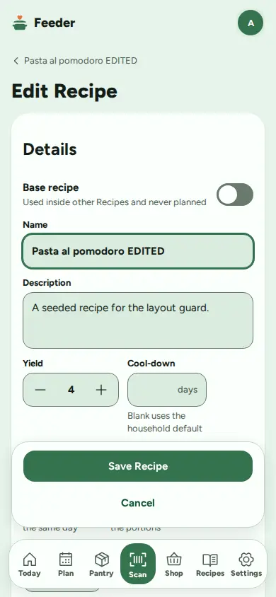

### Design (decision 1 B)
**Dirty** (R2) is computed by a pure `sameDraft(a, b)` in `features/recipes/lib/draft.ts`, which compares `draftToInput` of the current draft with the opened Recipe.
- The comparison starts from `draftFromRecipe(stored)`, or for a new Recipe from `emptyDraft()` with the main Course already set.
- An upload in progress counts as dirty.
- Leading and trailing spaces, the section index and scrolling do not.

**The leave guard.** While dirty, every in-app exit opens the danger dialog **"Leave without saving?"** It covers the exits listed in R2: bottom bar, rails, breadcrumbs, links inside the editor, Your menu (Sign out included), browser Back and Forward, and the Android back gesture whenever there is in-app history.
- Body: "Your changes to Pasta al pomodoro are not saved. If you leave, they are lost." For a new Recipe: "This new Recipe is not saved. If you leave, it is lost."
- **Keep editing** has focus and is the Escape action. It cancels the navigation and returns focus to the control that started it, or to the page title. It never focuses a text field, so the keyboard stays down (SHORT 2).
- **Discard changes** removes the reload draft and continues to the destination.
- On a phone, the dialog can only be triggered once typing stops, because the bottom bar is hidden while a field has focus (SHORT 2).

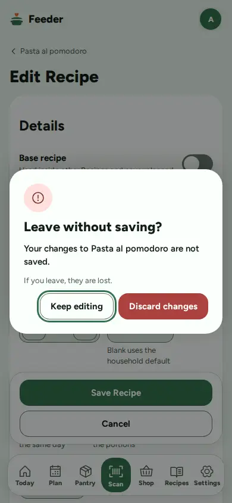 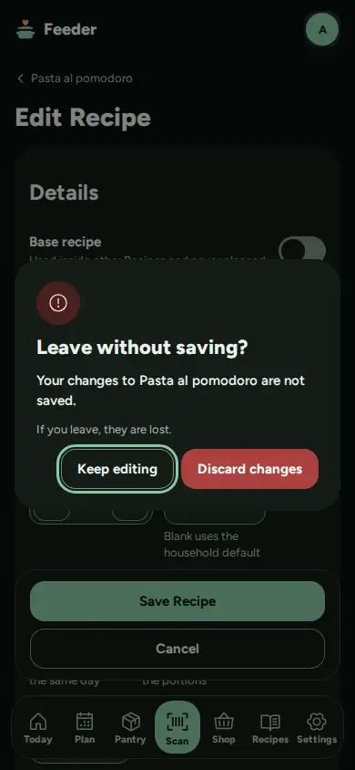 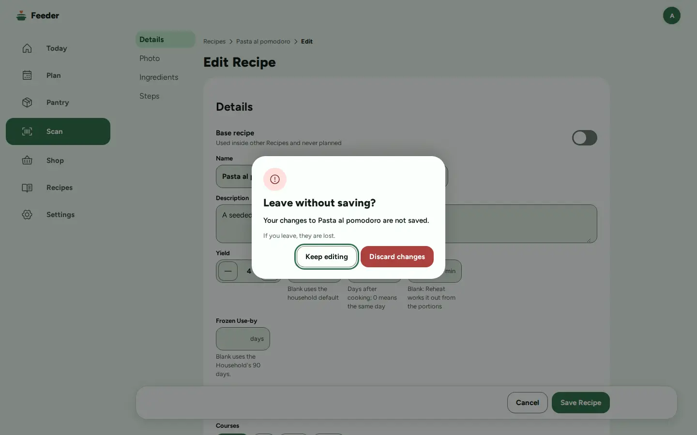

**Save** marks the editor clean before it navigates, so the guard never fires on Save. A Save that is waiting for the Unit Conversion prompt or the take-over question is still dirty.

**The reload and crash draft** covers what the guard cannot block: a reload, closing the tab, the back gesture from a deep-linked editor, the operating system killing the tab, a crash. No `beforeunload` prompt is used (R2 says why).
- **Storage:** IndexedDB `feeder-drafts`, store `recipe`, key `<userId>:<recipeId|new>`. The value is `{ draft, baseUpdatedAt, savedAt }`, where `baseUpdatedAt` is the stored Recipe's `updatedAt`.
- **Writes:** 500 ms after the last change, and on `pagehide` and `visibilitychange` (hidden).
- **Removed:** on Save, on Discard changes (the guard or Cancel), and after 7 days.
- **On the next open of that editor:**
  - **The stored Recipe is unchanged:** the draft is restored with a `DraftNotice` (info status tile): "Your unsaved changes are back", meta "The page closed before you saved, on Sat 14 Nov at 15:02. Feeder kept them on this phone." ("…on this computer" on a computer), and **Discard changes**, which uses the SAFE-06 dialog.
  - **The stored Recipe changed meanwhile** (`updatedAt > baseUpdatedAt`): nothing is restored until the person chooses. The notice reads "You have unsaved changes from Sat 14 Nov, 15:02", meta "Anna saved this Recipe since then (Sat 14 Nov, 16:10). Restoring puts your version in the editor; it replaces Anna's changes only when you save.", with **Restore my changes** and **Discard them**.
  - **A new Recipe's draft** is offered on `/recipes` as "New Recipe draft: Lasagne", with **Continue** and **Discard**.
- **Photos:** a restored draft whose uploaded Photo was swept (24 h orphan grace) drops it, and the notice meta adds "The photo you added was not kept; add it again."
- **No IndexedDB** (private mode): the guard still works; a reload loses the changes.

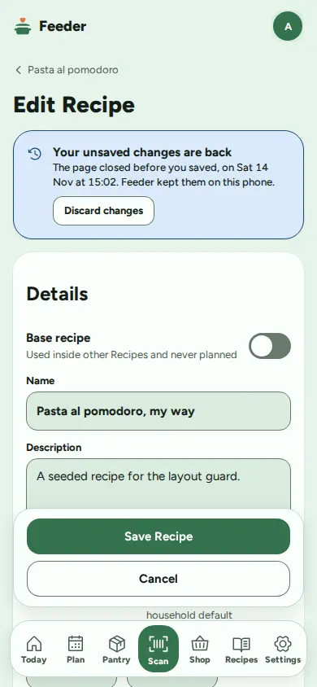 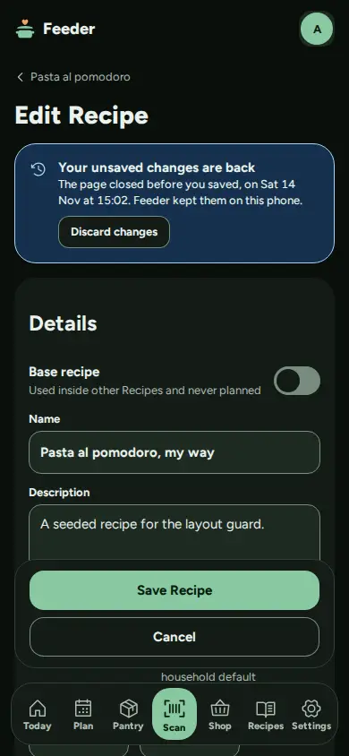 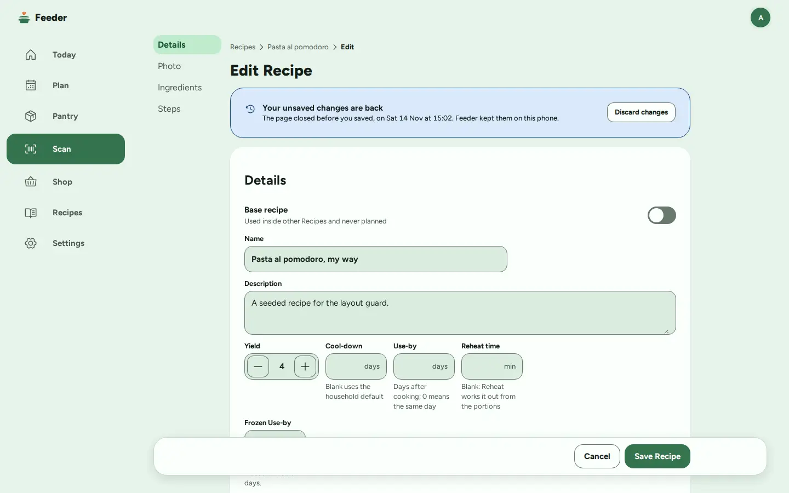 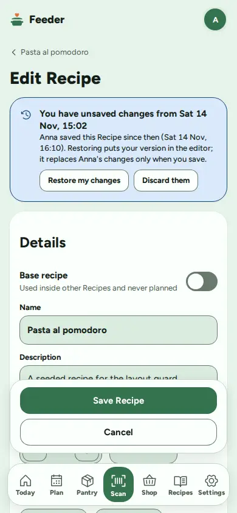

**Accessibility**
- The dialog follows R1.
- The notice is `role="status"`, labelled by its title, and does not take focus.
- The info tile pairs are already covered by `Tile.statusBorder.test.ts` and `contrast.test.ts`.

### Alternatives considered
- A, a draft always kept with no dialog (recommended in the first draft). Not chosen by the user.
- C, the dialog only. Rejected: a reload still loses everything.

### Build notes
- **New** `ui/useLeaveGuard.ts`: `useBlocker`, the R2 dialog through `useConfirm`, and an exemption for same-path hash changes. It is shared by the six page editors in R2.
- **New** `lib/drafts/draftStore.ts` (`idb`) and `lib/drafts/draftDecision.ts` (pure: restore / ask / none).
- **New** `features/recipes/hooks/useRecipeDraft.ts`: dirty state, debounced writes, a `pagehide` flush, the notice and `discard()`.
- `features/recipes/lib/draft.ts`: `sameDraft`.
- **New** `ui/DraftNotice.tsx`.
- `RecipeEditorScreen.tsx` wires them.
- No backend change.
- Mocks: [leave](mocks/safe-01-leave-dialog-390-light.html), [1440](mocks/safe-01-leave-dialog-1440-light.html), [dark](mocks/safe-01-leave-dialog-390-dark.html), [restored](mocks/safe-01-draft-restored-390-light.html), [1440](mocks/safe-01-draft-restored-1440-light.html), [dark](mocks/safe-01-draft-restored-390-dark.html), [conflict](mocks/safe-01-draft-conflict-390-light.html).

### Tests and guard
**Unit tests:**
- `sameDraft` (spaces, reordering, uploads);
- `draftDecision`;
- `draftStore` with `fake-indexeddb`;
- `useLeaveGuard` blocks a router navigation while dirty, does not block hash changes, and lets Save through;
- the `pagehide` flush.

**BDD:**
- "Leaving a changed Recipe by the bottom bar asks first"
- "Keep editing stays in the editor with nothing lost"
- "Discard changes leaves and forgets the changes"
- "Browser Back from a changed Recipe asks first"
- "A reload brings unsaved changes back with a notice"
- "A draft older than someone else's save asks before restoring"
- "Saving never asks"

**Guard:** a page-layout scenario `recipe-editor-guard` edits the Name, clicks the Plan link, asserts a dialog whose focused button is "Keep editing", then reloads and asserts the notice.

### Depends on / unblocks
- Depends on WP-P1, SAFE-06, and SHORT (keyboard and bar behaviour).
- Unblocks the R2 guard for Your preferences (SAFE-08), the Household page, Recipe Assistant settings, Import Review (RX) and Receipt review (SSP).

## SAFE-02  Destructive Settings and catalogue actions: one-tap deletes and five confirm patterns
**Severity** S2 · **Size** L · **Sources** SETTINGS-03; Remove Meal Slot is new in stage 2 · **Reproduced** Confirmed, and wider, at 390×844:
- **Remove Member:** 0 dialogs, 0 toasts, focus lost; the Member is gone.
- **Delete Shop:** its only button, "Yes, delete Shop", has focus, and there is no Cancel.
- **Delete Ingredient:** an accent primary button has focus.
- **Slot Rule Remove** and **barcode ×:** they act at once.
- **New: Remove Meal Slot** deleted "Snack", with a Planned Meal of today, at once. The `meal_slots(id)` cascade also reaches:
  - `planned_meals`, Cooked rows included (`1400_courses.sql:84`), so Last cooked and Cool-down lose history;
  - `plan_unfilled`, `slot_rules` and `meal_slot_dates`;
  - the Course and Attendance tables.

**Where** `/settings/members`, `/settings/meal-slots`, `/settings/shops/:id`, `/ingredients/:id`, `/supplies/:id`, `/products/:id`, `/settings/planning`; every size

### Problem
- **Remove Member** drops their Favourites, Dislikes, Exclusions, Attendance and possibly their sign-in, in one tap beside Save (`MemberEditor.tsx:152–158`).
- **Remove Meal Slot** erases Cooked history.
- **Delete Shop** focuses its destructive button (`ShopScreen.tsx:162`).
- **Delete Ingredient** confirms with an accent primary (`IngredientScreen.tsx:228`).
- The same action behaves five different ways.

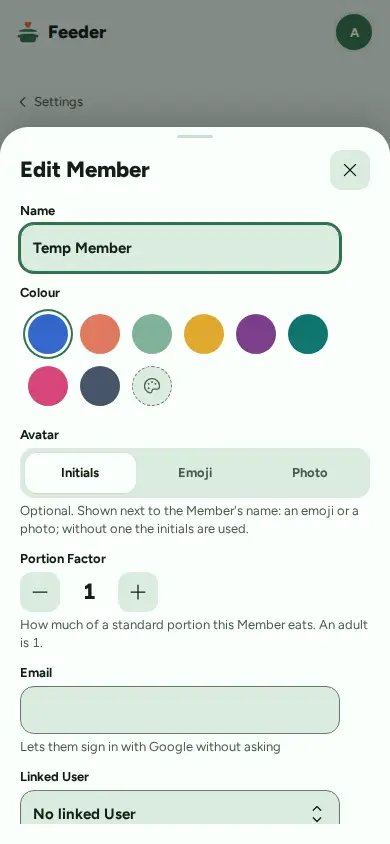 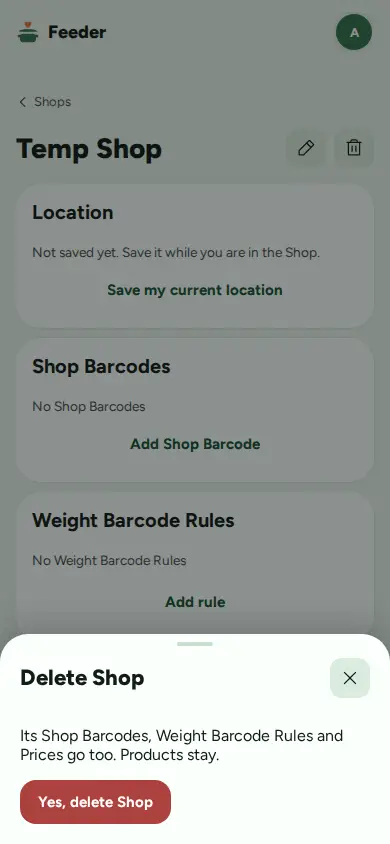 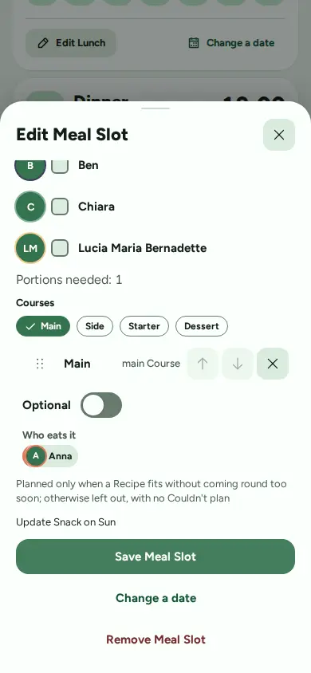 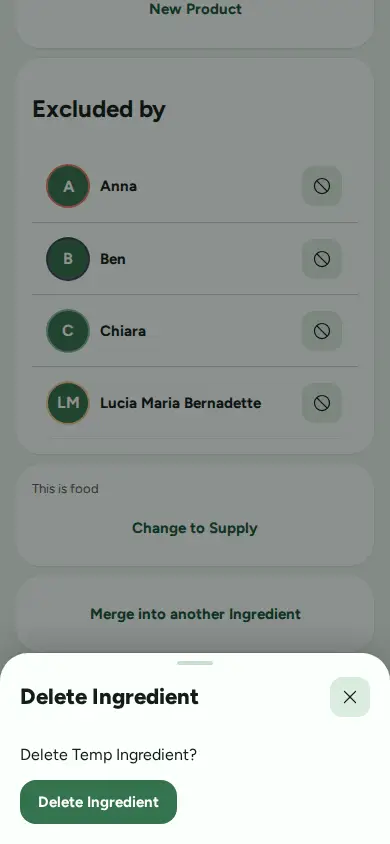

### Design

**Remove Member: confirm, then Undo (decision 4).** A danger dialog with the UserMinus icon and no Close.
- Title "Remove Sam?"; lead "Sam no longer counts towards portions."
- **Goes with Sam**, as R-E rows:
  - **Preferences** · 3 · Favourites, Dislikes and Exclusions
  - **Attendance** · 21 Meal Slots · Every Meal Slot Sam eats at
  - **Sign-in** · Ends · sam@example.com · not on the Allowlist (only when true)
- The counts come from a new read-only `GET /api/members/{id}/impact`.
- Note: "Planned Meals from today are worked out again. You can undo it straight after."
- **Cancel** (outline, focused) and **Remove Sam** (danger).
- Afterwards:
  - a one-line toast with no icon: "Sam removed" · Undo ("Undo: put Sam back");
  - focus moves to the Members heading;
  - Undo restores Sam and replans, then shows "Sam is back".

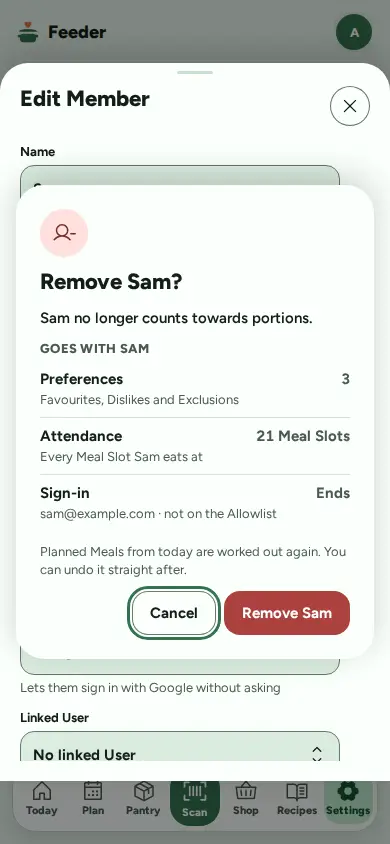 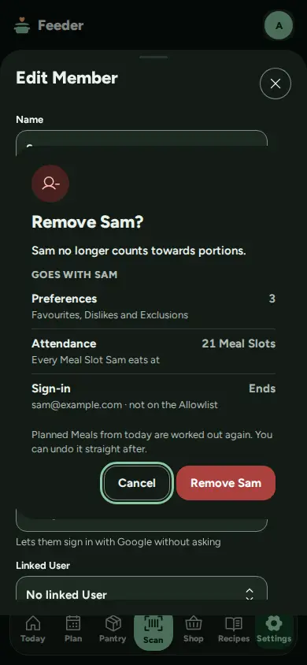 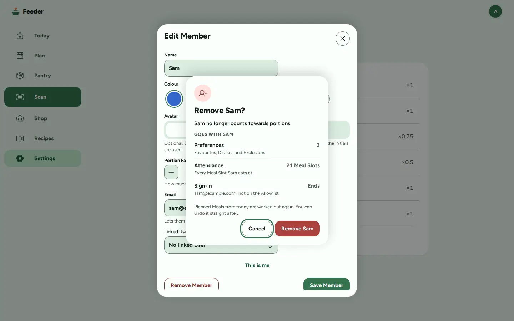 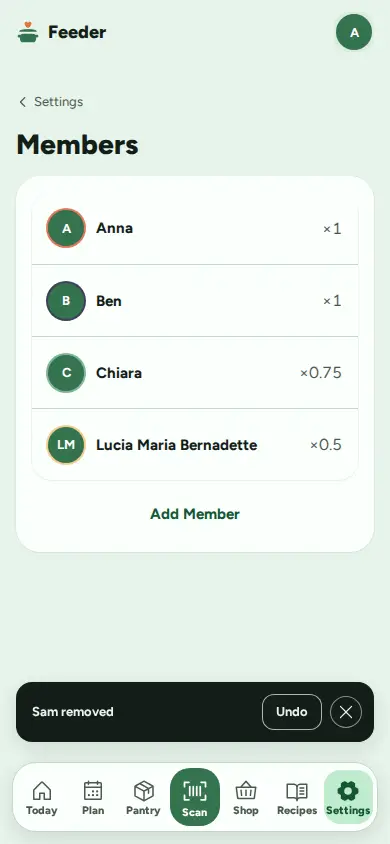

**Sheet footers.**
- The destructive button sits in `FormActions`' destructive slot, as an outlined danger button (R-A).
- Below 600 px it is the last row, under a 1 px `--color-line` divider. From 600 px it sits at the far start.
- SHORT P2 delivers it.
- Edit Member keeps its circular outline Close (R-B), since it has no Cancel.

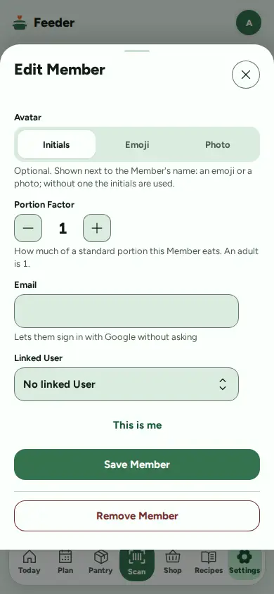 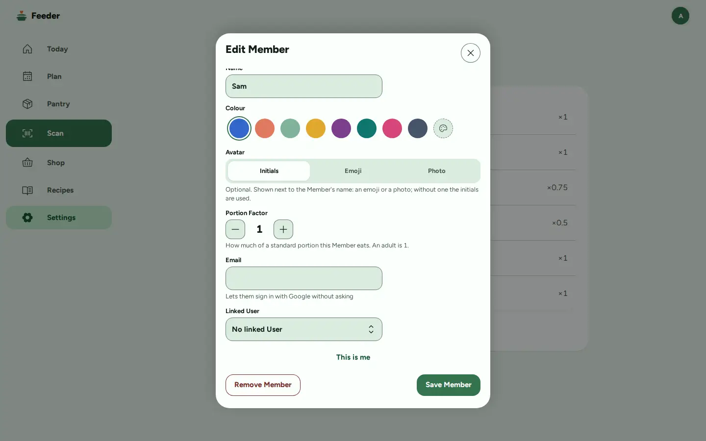

**Remove Meal Slot keeps its Cooked history, then Undo (decision 7 B).**

*Data change.*
- **Migration `1570_meal_slot_removed.sql`** rebuilds `meal_slots` with `removed_at TEXT`. It replaces `UNIQUE (weekday, name)` with `CREATE UNIQUE INDEX meal_slots_active_name ON meal_slots (weekday, name) WHERE removed_at IS NULL`. This is a parent-table rebuild with `foreign_keys=OFF`, like migrations 1100 and 1400.
- **`DeleteSlot` becomes `RemoveSlot`.** In one transaction it:
  - sets `removed_at`;
  - deletes the slot's unresolved Planned Meals and `plan_unfilled` rows, recording the To confirm rows in `meal_slot_removals`;
  - keeps Cooked and Not cooked rows, `slot_rules`, Attendance, Courses and date changes.
  - Then it replans.
- **Restore** (`POST /api/meal-slots/{id}/restore`, Admin):
  - clears `removed_at`;
  - puts the To confirm rows back within 10 minutes;
  - replans;
  - refuses with 409 `meal_slot_name_taken` ("There is already a Dinner on Monday.") when the name is taken.

*Reads.*
- **Active slots only:**
  - `Store.Slots` (`household/store/store.go:207`);
  - `batch.go:74`;
  - `DBSources` (`plan/runner/sources.go:83–164`), which feeds Plan, Today, To confirm, the board and reminders.
- **A removed slot is refused** by `slotdate.go:123` and `courses.go:296`.
- **Impact counts ignore removed slots:** course `:479`, tag `:279`, recipe `base.go:825,847`.
- **`Store.Slot(id)` still returns a removed slot** with `Removed: true`, so history keeps its names: cook `adapters.go:256,335`, `shopping/httpapi/wiring.go:186`, and `plan/httpapi/names.go:77` via `AllSlots`.

*Effects.*
- Last cooked (`plan/store/lastcooked.go`) and Cool-down are unchanged.
- The Zero-waste streak is unaffected.
- Leftovers keep their source meal.
- Nothing of the slot remains in To confirm.
- Plan and Today show active slots only.

*Confirm.* A danger dialog with the CalendarX icon and no Close.
- Title "Remove Dinner on Monday?"; lead "Dinner stays on the other days."
- **Goes:**
  - **Planned Meals** · 7 · From today, Mon 16 to Mon 30
  - **Slot Rule** · 1 · Dinner = Pasta al pomodoro stops applying
  - **To confirm** · 1 · Sat Dinner (only when present)
- **Stays:** **Cooked history** · Kept · Last cooked and Cool-down don't change
- Counts come from `GET /api/meal-slots/{id}/impact`.
- **Cancel** (outline, focused) and **Remove Meal Slot**.
- Then the toast "Dinner on Monday removed" · Undo ("Undo: put back Dinner on Monday"), and after Undo "Dinner on Monday is back".

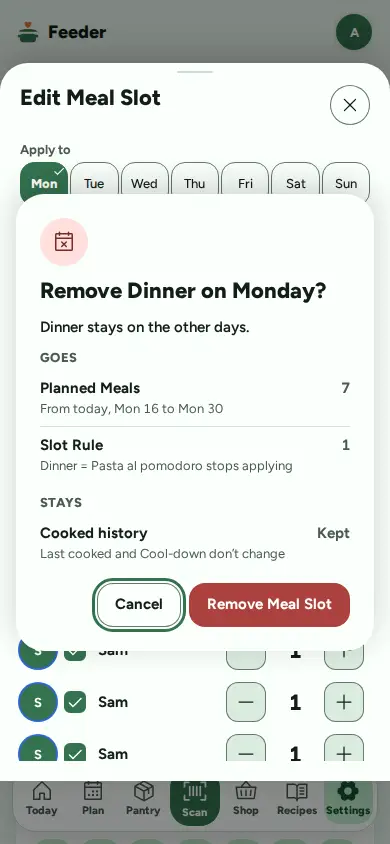 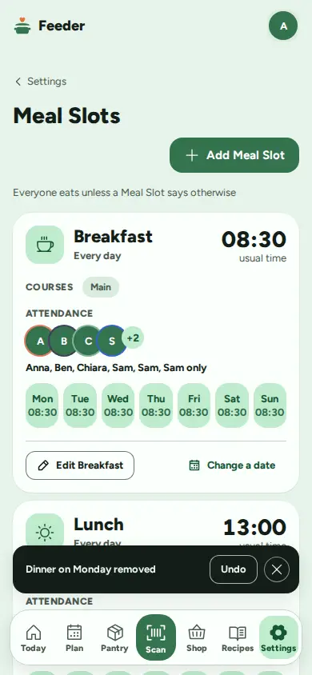 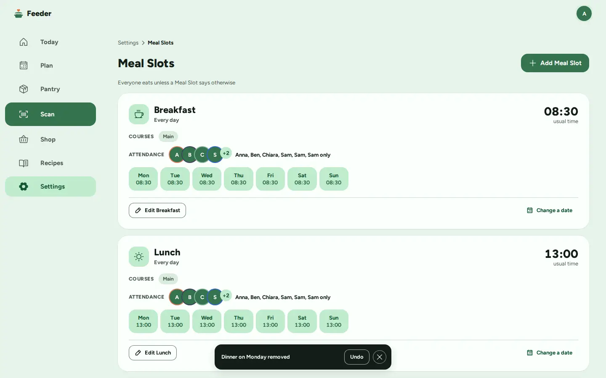

*ADR 0021, "A removed Meal Slot keeps its history".* The decision is soft removal plus a partial unique index. Rejected:
- a history table (every reader would change);
- blocking removal.

*Migration safety (b5–b8, `docs/dev/design/b8-snap.md`).*
- Take `feeder-pre-1570.db` before any 157x migration:
  - `backup.PreSnapshot1570File`;
  - `db.Pre1570Prefixes = {"157"}`;
  - `db.NeedsPre1570Snapshot`;
  - a sixth `preSnapshots` row with `keep: true`.
- A failure migrates nothing.
- The rebuild checks `PRAGMA foreign_key_check` before commit.

**Delete Shop: confirm only.** "Delete Coop?"; lead "It has no Shop Barcodes, Weight Barcode Rules or Prices yet." (with counts as rows when there are some); note "Products stay. This can't be undone."; **Cancel** and **Delete Shop**.
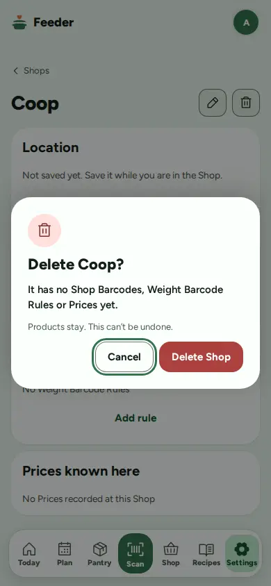

**Delete Ingredient / Supply: confirm only.** "Delete Temp Ingredient?"; lead "It is on no Recipe, Product or Shopping List."; note "Nothing else changes. This can't be undone."; **Cancel** and **Delete Ingredient** (or **Delete Supply**).
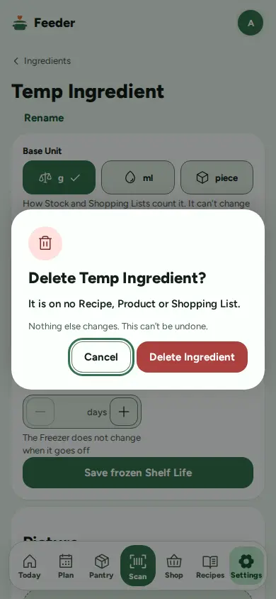

**Light removals: act at once, then Undo through the inverse call.**
- One-line toasts with no icon: "Barcode 8 000000 001009 removed", "Slot Rule Mon Breakfast = Pasta al pomodoro removed", "Variety Rule for fish removed", "1 clove removed", "Restock level cleared".
- **Archive Product** becomes "Flour archived" · Undo.
- **Change to Supply** keeps its confirm with Cancel focused.

**Accessibility.**
- R1 focus and Escape.
- Undo has full names.
- Outline boundaries are 3:1 or more.
- Row text on surface passes AA: key 17.1 / 15.2, muted detail 7.0 or more.

### Build notes
- **Frontend**
  - `ui/ConfirmDialog.tsx`: outline Cancel focused; `focus`, `groups`, `details` (R-E rows); no Close.
  - `ui/FormActions.css`: via SHORT P2.
  - `features/settings/components/MemberEditor.tsx`, `MealSlotEditor.tsx`.
  - `features/settings/hooks/useMembersPage.ts`, `useMealSlotsPage.ts`.
  - `features/shops/screens/ShopScreen.tsx`, `hooks/useShop.ts`.
  - `features/ingredients/screens/IngredientScreen.tsx`, `hooks/useIngredient.ts`.
  - `features/products/hooks/useProduct.ts`, `useProductActions.ts`.
  - `features/plan/hooks/useRules.ts`.
- **Backend**
  - `internal/household`: Member snapshot and restore; Member and Meal Slot impact reads; `RemoveSlot` and `RestoreSlot`; read filters.
  - `plan/runner/sources.go`, `plan/httpapi/names.go`.
  - The `course`, `tag`, `recipe` and `cook` reads.
  - Migration 1570, snapshot wiring, ADR 0021.
- **Mocks**
  - Remove Member: [390](mocks/safe-02-remove-member-390-light.html), [1440](mocks/safe-02-remove-member-1440-light.html), [dark](mocks/safe-02-remove-member-390-dark.html).
  - Footer: [390](mocks/safe-02-member-footer-390-light.html), [1440](mocks/safe-02-member-footer-1440-light.html).
  - Member removed: [toast](mocks/safe-02-member-removed-390-light.html).
  - Meal Slot: [confirm](mocks/safe-02-remove-mealslot-390-light.html), [removed](mocks/safe-02-mealslot-removed-390-light.html), [removed 1440](mocks/safe-02-mealslot-removed-1440-light.html).
  - Delete: [shop](mocks/safe-02-delete-shop-390-light.html), [ingredient](mocks/safe-02-delete-ingredient-390-light.html).

### Tests and guard
- **Go**
  - Member restore gives back the same rows; the Photo is kept until expiry; Member impact counts.
  - `RemoveSlot` keeps resolved rows and deletes unresolved ones.
  - `LastCooked` and history are unchanged.
  - `Slots` excludes removed slots; `Slot(id)` returns them.
  - A removed name can be reused; restore is refused when it is taken; restore puts the To confirm rows back.
  - The migration copies every row with an empty `foreign_key_check`.
  - `pending1570_test.go`, `snapshot_named_1570_test.go`, `startup_pre1570_test.go`; `b5-snap_test.sh` accepts `157*`.
- **Unit (web)**
  - The focused button is the outlined safe one, and there is no Close.
  - The groups render as rows (key, state, detail), not `<li>` sentences.
  - Undo restores once.
- **BDD**
  - "Removing a Member asks first and lists what goes"
  - "Undo puts a removed Member back"
  - "Removing a Meal Slot keeps its Cooked history"
  - "Last cooked is unchanged after a Meal Slot is removed"
  - "A removed Meal Slot can be put back with Undo"
  - "A new Dinner on Monday can be added after the old one was removed"
  - "Delete Shop has a focused Cancel"
  - "Removing a barcode can be undone"
- **Guard**
  - `check-ui` rule `danger-sheet`.
  - A page-layout scenario per confirm: Cancel has focus and there is no Close.

### Depends on / unblocks
- Depends on WP-P1, SHORT P2, and DS's R-A/R-B/R-E primitives.
- Unblocks SET's Meal Slots follow-ups.

## SAFE-03  Cooked and Not cooked cannot be taken back
**Severity** S2 · **Size** L · **Sources** PLAN-05, FLOW-10 · **Reproduced** Confirmed on Today at 390×844:
- Not cooked from ⋮ "More for Sat Dinner": 0 dialogs and 0 toasts at 300 and 900 ms, focus lost.
- Cooked on Sat Breakfast: "Cooked, nice one! 1.25 portions kept, good until Tue" with no action.
- No route reverses either (`internal/plan/httpapi/httpapi.go:76–84`).

**Where** Today's To confirm row and hero; Plan's slot and Course menus; Mark as Cooked and Mark all Cooked; Cook Mode's "Mark all Cooked"; every size

### Problem
- Not cooked sits one row from Who's eating. One mistap throws away the plan and replans the Leftover chain, with no way back.
- A wrong Cooked deducts Stock, makes a Leftover and unpins dependants; its sheet offers only Close.
- Swap and Not served already have Undo.
- In the code:
  - `usePlanActions.ts:66` and `useNotCooked` (`useCookFlow.ts:105`) show no toast;
  - `useCookFlow.ts:62` has no action;
  - `CookedUsing` (`actions.go:745`) and `NotCooked` (`actions.go:942`) store nothing to undo with.

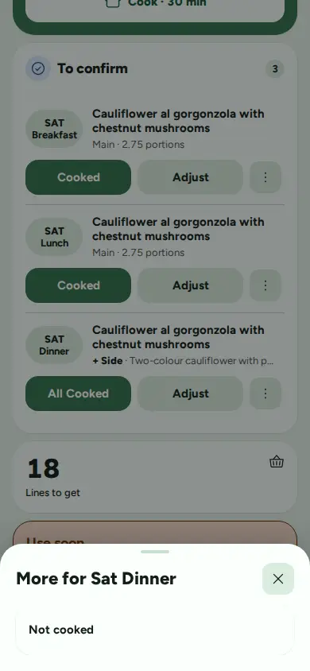 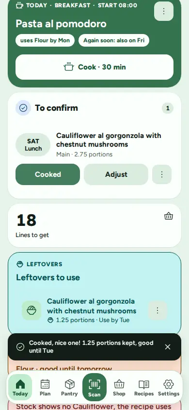

### Design (decision 2)

**Not cooked** (a Course, the whole slot, To confirm ⋮) acts at once, with no confirm, because reopen restores everything.
- One-line toast, no icon (R-D+): "Sat Dinner marked Not cooked" ("Sat Dinner, Side marked Not cooked" for one Course).
- Outline **Undo** ("Undo Not cooked for Sat Dinner") reopens every Course the action resolved, then shows "Sat Dinner is back in To confirm".

**Cooked** shows a rich toast (R-D, no icon, R-D+):
- headline "Cooked, nice one!";
- subline "Sat Breakfast · Slow cooker beef and barley stew";
- body "1.25 portions kept as a Leftover, good until Tue.";
- outline **Undo** ("Undo Cooked for Sat Breakfast");
- Dismiss, top-aligned with the headline.

Undo also removes PC's shortfall notice.

**The Planned Meal sheet of a resolved meal** offers Undo until the end of the household day. It keeps the circular outline Close (no Cancel).
- **Cooked**
  - Success chip "Cooked".
  - "Marked Cooked today at 08:40 by Anna. 1.25 portions were kept as a Leftover."
  - Muted hint: "Undo Cooked puts back the Stock it used and removes its Leftover. You can undo it until the end of today, while nobody has had any of the Leftover."
  - Outline **Undo Cooked**.
  - When no longer possible, the hint says why and the button is not shown: "Some of its Leftover was already had, so Cooked can't be undone." or "Marked on Fri, so it can no longer be undone."
- **Not cooked**
  - Danger chip.
  - "Marked Not cooked today at 08:40 by Anna. Its Leftover for Thu was planned again."
  - **Cooked after all** (primary: reopen, then the Mark as Cooked sheet).
  - **Undo Not cooked** (outline).

**States.**
- Offline: not offered (RES).
- Undo failure: an error toast with its 16 px icon in the headline line: "Couldn't undo Cooked: some of its Leftover was already had. Nothing changed." It stays.
- A Lot that is gone: "1 Stock Lot was already gone, so its Stock was not put back."

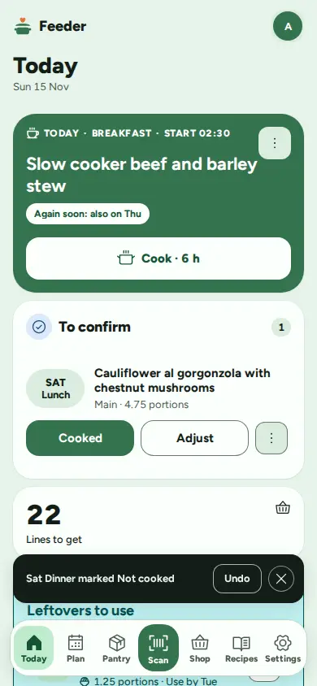 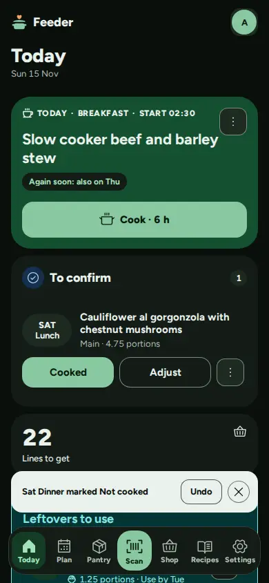 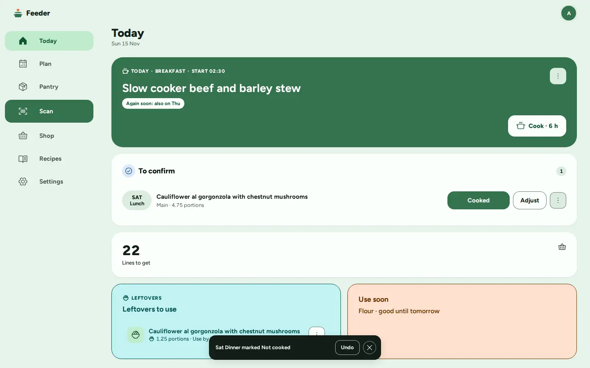 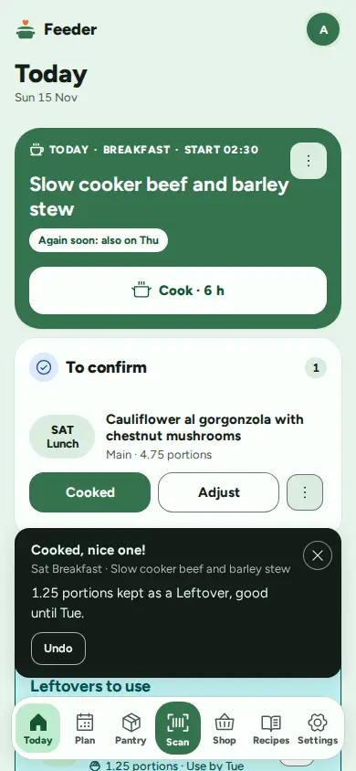
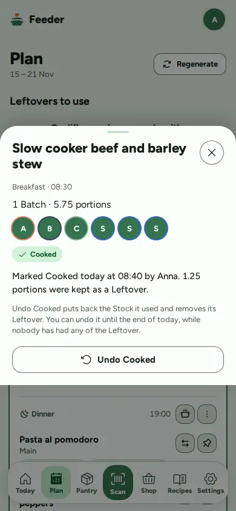 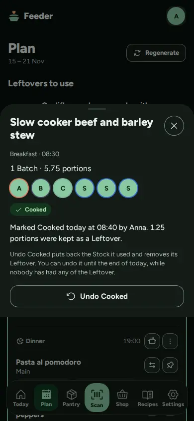 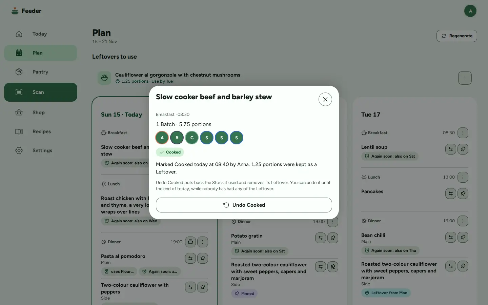 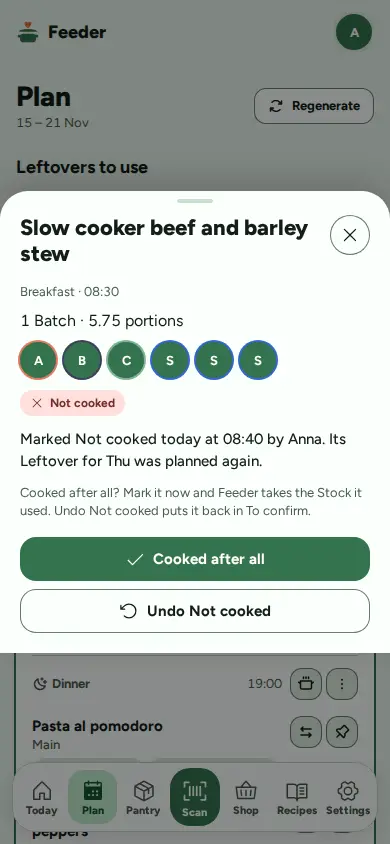

**Accessibility.**
- After Not cooked, focus goes to the next To confirm row, or to the tile heading (A11Y).
- After Undo, focus goes to the restored row, only if focus was in the toast.
- Ctrl/⌘Z works.
- The ring on the toast is `--color-bg`.

### Alternatives considered
Toast-only Undo (decision 2 A).

### Build notes
- **Backend**
  - `internal/plan`: pure `MayReopen`; `runner.Reopen` and `ReopenAll`.
  - `CookedUsing` and `NotCooked` record `cooked_takes`, the Leftover portions, unpinned dependants and Bought rows.
  - Migration 1571.
  - `internal/stock`: `stock.GiveBack`, `Service.GiveBackTx`.
  - Thin `reopen` handlers.
  - ADR 0020.
- **Frontend**
  - `features/plan/hooks/useCookFlow.ts`, `useNotCooked`, `usePlanActions.ts`, `useAllCookedFlow.ts`.
  - `api.ts`.
  - `components/PlannedMealSheet.tsx`, with a new pure `lib/resolved.ts`.
  - `features/today` wiring.
  - The rich toast uses `useUndoToast({ headline, subline, body })`, with no icon.
- **Mocks**
  - Not cooked toast: [390](mocks/safe-03-notcooked-toast-390-light.html), [dark](mocks/safe-03-notcooked-toast-390-dark.html), [1440](mocks/safe-03-notcooked-toast-1440-light.html).
  - Cooked toast: [390](mocks/safe-03-cooked-toast-390-light.html).
  - Cooked sheet: [390](mocks/safe-03-cooked-sheet-390-light.html), [dark](mocks/safe-03-cooked-sheet-390-dark.html), [1440](mocks/safe-03-cooked-sheet-1440-light.html).
  - Not cooked sheet: [390](mocks/safe-03-notcooked-sheet-390-light.html).

### Tests and guard
- **Go**
  - `GiveBack`: Lot exists / emptied / deleted since.
  - Reopen restores Stock, Leftover, Pins and Bought rows.
  - Refusals: `leftover_used`, `reopen_window_over`.
  - NotCooked + Reopen gives the same plan rows.
  - Reopen is idempotent.
- **Unit (web)**
  - `lib/resolved.ts`.
  - The success toasts have no icon.
  - The rich Cooked toast has headline, subline, body and outline Undo.
  - `useCookFlow` reopens once.
- **BDD**
  - "Not cooked from To confirm can be undone from the toast"
  - "A wrong Cooked can be undone the same day from its sheet"
  - "Undo Cooked gives the Stock back"
  - "Undo Cooked is refused once the Leftover was had"
  - "Cooked after all from a Not cooked meal"
- **Guard**
  - Scenario `to-confirm-not-cooked`: within 500 ms, a `.toast` with Undo appears and no icon precedes its message.

### Depends on / unblocks
- Depends on WP-P1 and DS's R-D/R-D+ `Toast`.
- PC owns the shortfall notice and Cook Mode's step.
- Unblocks SAFE-09 (`GiveBack`).

## SAFE-04  One field-error pattern: message at the field, focus to the first invalid field
**Severity** S2 · **Size** M · **Sources** SETTINGS-05, RECIPES-13 · **Reproduced** Confirmed:
- **Add Member**, Save with no name: focus stays on "Save Member"; 0 `aria-invalid`; the message "Enter a name for the Member." is a `p.settings__error[role=alert]` at the bottom of the sheet.
- **Planning rules**, Add Slot Rule: focus on "Add Slot Rule"; `.plan__error` "Choose a Recipe."; 0 `aria-invalid`. Save Variety Rule: "Choose a Tag.", same.
- **New Recipe**, Save with nothing filled: focus on "Save Recipe"; `scrollY` 347; the Name label top −38 px (off-screen); **three** `role=alert` messages ("Give the Recipe a name.", "Add at least one ingredient line.", "Check the fields marked above."); only Name has `aria-invalid`.
- The Unit Conversion and Product barcode cases are from stage 1; the same code was read.

**Where** Member sheet, Planning rules, Ingredient conversions, Product barcode, Recipe editor, and every other form through the shared fields; every size

### Problem
A screen-reader user hears an alert but not which field is wrong. On a phone, the Member message sits below the fold, far from Name. Three patterns coexist:
- field errors done right (Course, Household, Weight Barcode Rule, Restock level);
- loose paragraphs (`MemberEditor.tsx:146`, `RulesEditors.tsx`, `RecipeEditorScreen.tsx:206,283`);
- disabled-until-valid with no message (Add Shop, Add Tag, Save Storage Place, and the Lot sheet's Move).

`FieldFrame` gives every field error `role="alert"` (`ui/fields/FieldFrame.tsx:63`), so a form with three errors fires three alerts. The Product barcode accepts "123". The Weight Barcode Rule message "prefix must be one or more digits" is lower case and jargon.

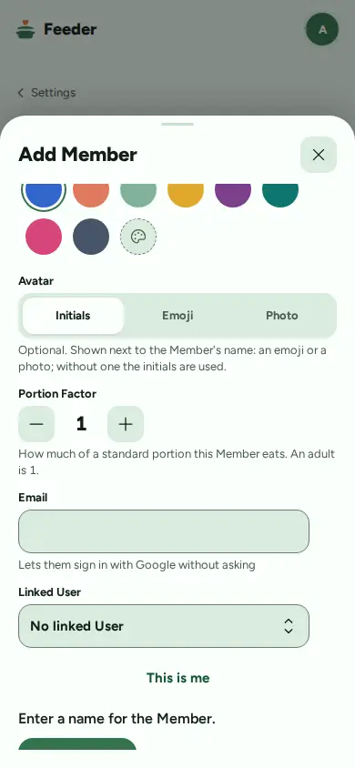 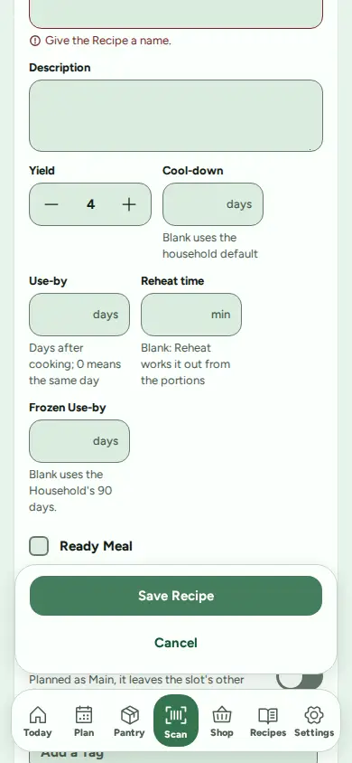 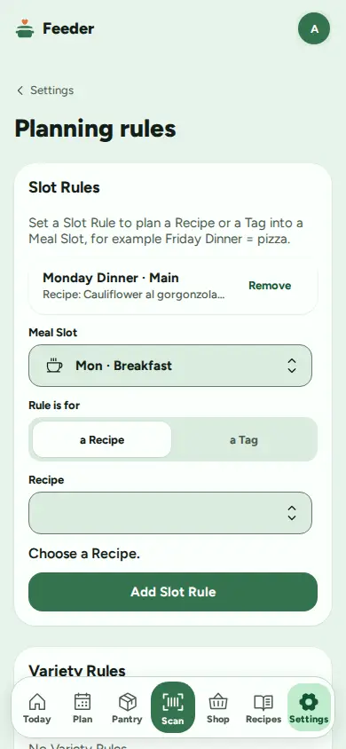

### Design
**Behaviour (R4).**
- Submit validates.
- On failure, focus moves to the first invalid control, centred clear of the app bar and any sticky bar. Its error is under it, and the field reads the error through `aria-describedby`.
- The form-level "Check the fields marked above." is removed.
- Errors clear as each field is fixed.
- Submit stays enabled.
- At 1440 the same; in dark, the error uses `--status-danger-fg` (dark pairs already pass, `theme/contrast.test.ts`).

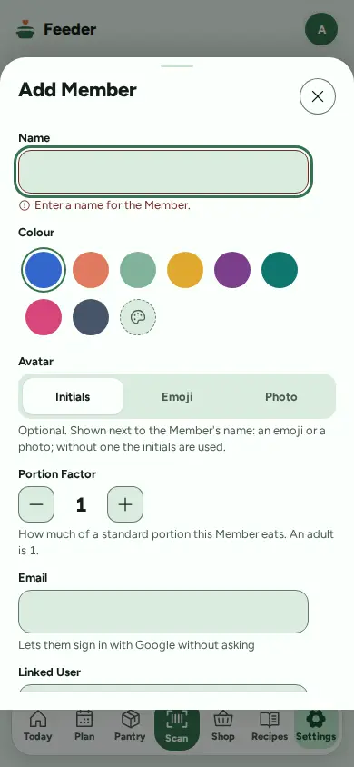 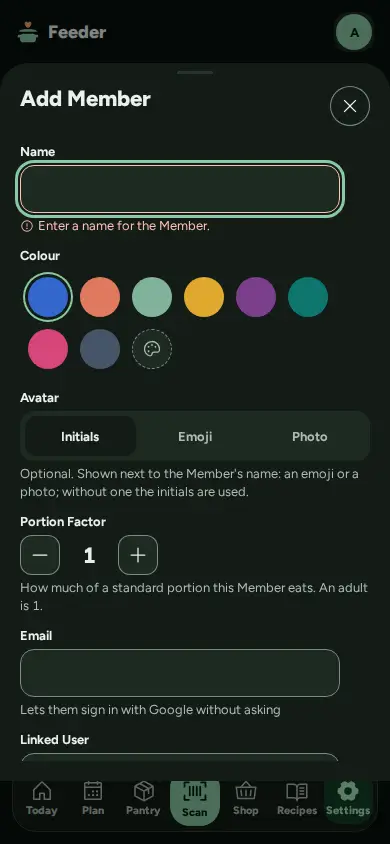 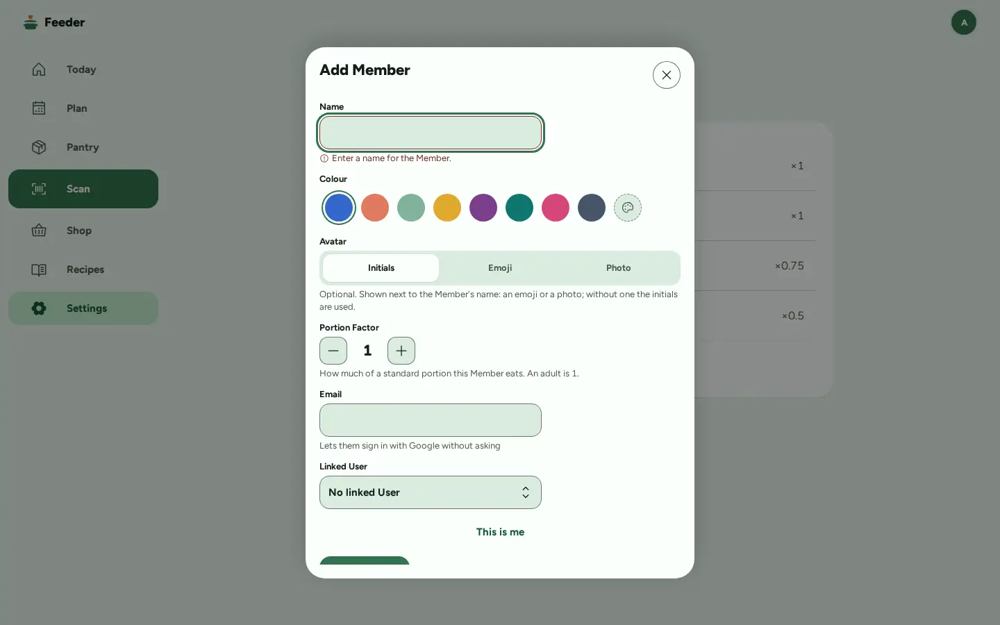
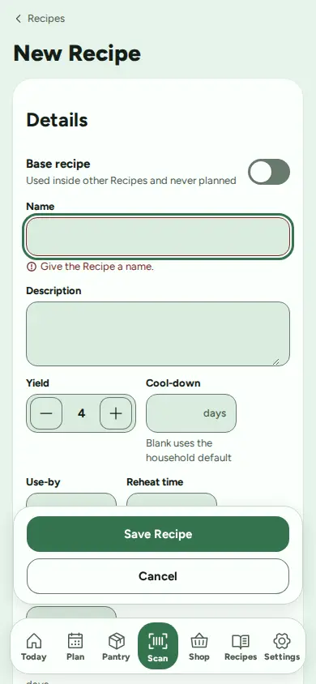 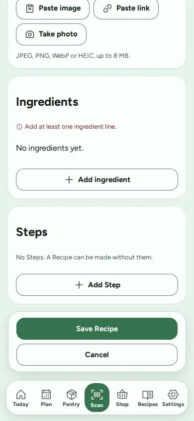 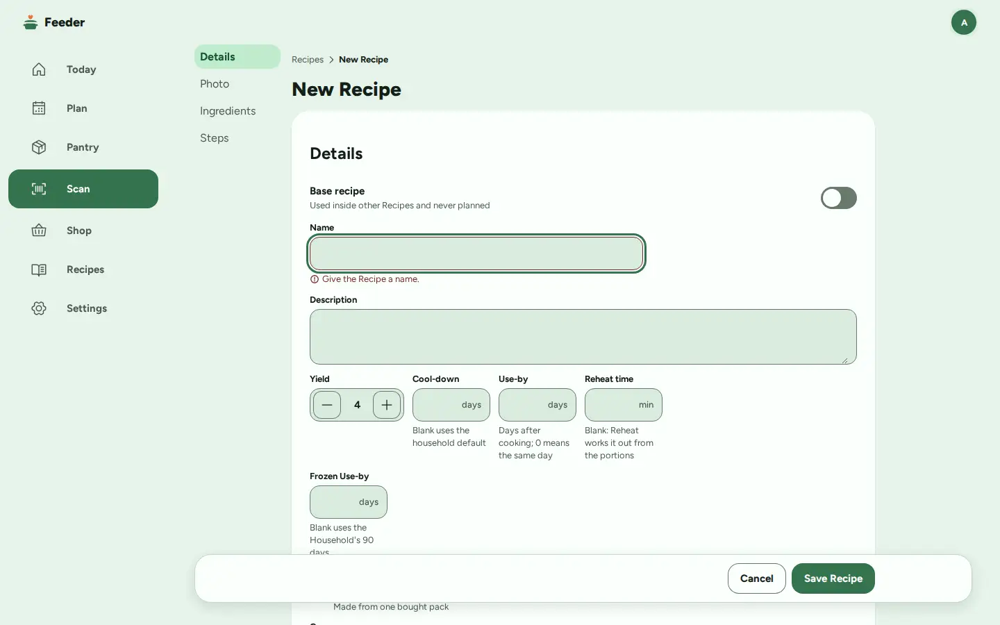 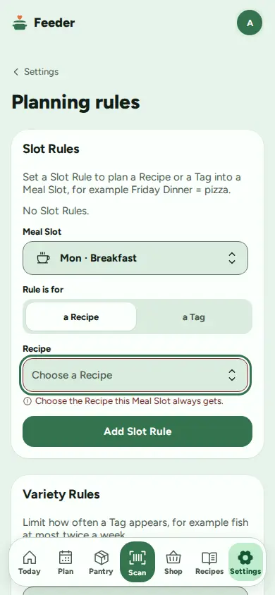

**Copy** (each sits under its field):

| Form | Field | Message |
|---|---|---|
| Member | Name | Enter a name for the Member. |
| Slot Rule | Recipe | Choose the Recipe this Meal Slot always gets. |
| Slot Rule | Tag | Choose the Tag this Meal Slot always gets. |
| Variety Rule | Tag | Choose a Tag for the rule. |
| Unit Conversion | Unit | Enter a unit, for example clove. |
| Product | Barcode | Enter the 8, 12, 13 or 14 digits under the bars. / The last digit doesn't match the others. Check the number. (server and client both use `barcode.Canonical`, `internal/barcode/barcode.go:76`) |
| Weight Barcode Rule | Prefix | Enter the prefix as digits, for example 21. |
| Recipe | Name | Give the Recipe a name. (unchanged) |
| Recipe | Ingredients (section) | Add at least one ingredient line. (under the heading; "Add ingredient" is the focus target) |
| Add Shop / Add Tag / Storage Place / Move a Lot | Name / Storage Place | Enter a name for the Shop. / Enter a name for the Tag. / Enter a name for the Storage Place. / Choose where to move it. (these buttons are no longer disabled) |

**Accessibility.**
- Field errors are not alerts; focus does the announcing.
- A server error with no field uses the new `FormError` (`role="alert"`) above the actions.
- The invalid field's border is A11Y's (A11Y-05).
- `scroll-margin-block` keeps the focused field visible (SHORT owns the keyboard-open case).

### Build notes
- **Shared:**
  - `ui/fields/FieldFrame.tsx`: drop `role="alert"`.
  - **New** `ui/fields/focusFirstInvalid.ts`: a DOM helper that finds `[aria-invalid="true"], [data-invalid-target]` in DOM order.
  - **New** hook `ui/fields/useFocusFirstInvalid(formRef, errors, submitCount)`: runs after commit when `submitCount` grows and errors exist.
  - **New** `ui/fields/FormError.tsx`.
  - `ui/fields/Field.css`: `scroll-margin-block`.
  - `Select`, `DateField` and `Segmented` already pass `aria-invalid` when given `error`; check each.
- **Screens:** `features/settings/components/MemberEditor.tsx`, `features/plan/components/RulesEditors.tsx` + `hooks/useRuleForms.ts`, `features/ingredients/components/ConversionEditor.tsx`, `features/products/components/ProductBarcodes.tsx`, `features/shops` (rule message), `features/recipes/screens/RecipeEditorScreen.tsx` (section error; drop the summary), `features/stock/components/LotSheet.tsx`, and the Add Shop, Tag and Storage Place forms.
- **Validation:** pure in each feature's `lib` (`lib/draft.validateDraft` already is).
- **Backend:** the product barcode handler validates with `barcode.Canonical` and answers 422 `invalid_barcode`.
- Mocks: [member](mocks/safe-04-member-error-390-light.html), [dark](mocks/safe-04-member-error-390-dark.html), [1440](mocks/safe-04-member-error-1440-light.html), [recipe](mocks/safe-04-recipe-errors-390-light.html), [ingredients](mocks/safe-04-recipe-errors-ingredients-390-light.html), [1440](mocks/safe-04-recipe-errors-1440-light.html), [slot rule](mocks/safe-04-slotrule-error-390-light.html).

### Tests and guard
- Unit:
  - `focusFirstInvalid` order and groups;
  - `FieldFrame` has no alert role;
  - per form: submit empty → `aria-invalid="true"` on the field, focus on it, `aria-describedby` → message;
  - the barcode check.
- BDD:
  - "Saving a Member without a name focuses Name and says why"
  - "Saving an empty Recipe focuses Name and marks Ingredients"
  - "Add Shop with no name explains instead of being disabled"
- Guard:
  - a `check-ui` rule `alert-in-form`: fail on `role="alert"` inside a component that renders a `<form>` unless it is `FormError`;
  - a rule `submit-disabled-for-validity`: warn on `disabled={!can…}` on a `type="submit"` Button;
  - a page-layout scenario `recipe-new-empty-save` asserts the focus is in the viewport.

### Depends on / unblocks
- Depends on WP-P1; A11Y-05 (field boundary); SHORT (keyboard).
- Unblocks every form owned by RX, SET and SSP.

## SAFE-05  Delete of a planned Recipe promises a delete, then refuses it off-screen
**Severity** S2 · **Size** S · **Sources** FLOW-11 · **Reproduced** Confirmed on `/recipes/1`:
1. ⋮ → Delete opened "Delete Pasta al pomodoro? It is removed from future Planned Meals. Archive keeps it for history."
2. Delete: no navigation, and focus moved to "More actions".
3. The refusal "This Recipe was planned, so it can only be archived." appeared at y 1470, on a 1756 px page in an 844 px viewport.

**Where** Recipe detail; every size

### Problem
- The dialog promises an outcome that cannot happen, then fails where nobody looks.
- `useRecipeActions.ts:40–75` only learns of the 409 `already_planned` (`internal/recipe/store/store.go:918`) after the person has confirmed.
- The body copy (`strings.ts:66–71`) is wrong for both kinds of Recipe.

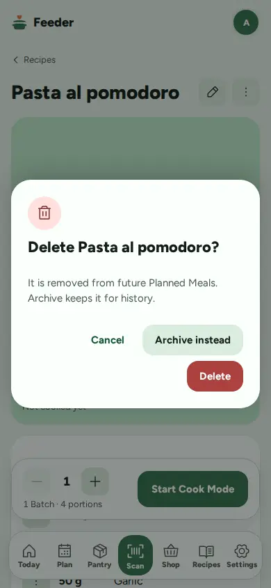 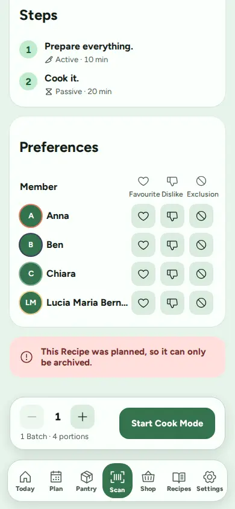

### Design

**The detail response gains `deletable`.** It is false when the Recipe was ever planned (`PlannedChecker`), or when it is a Base recipe in use.

**Delete on a Recipe that is not deletable** opens this dialog at once:
- **Title:** "Pasta al pomodoro can't be deleted"
- **Lead line:** "It was planned before, so Feeder keeps it in the history of what was Cooked."
- **Note:** "Archive takes it out of the Recipes list, the pickers and the plan. You can unarchive it later."
- **Buttons:** **Cancel** (outline, focused) and **Archive** (primary).
- It shows no Close.

**Delete on a deletable Recipe** keeps the danger dialog:
- **Lead line:** "Nobody has planned it yet."
- **Note:** "Nothing else changes. This can't be undone."
- **Buttons:** Cancel, Archive instead (outline), Delete.

**Archive and Unarchive** act at once. The toast is "Pasta al pomodoro archived", with an outline Undo.

**Errors.** Any remaining failure is an error toast.

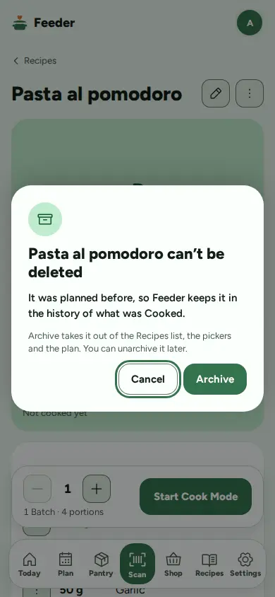 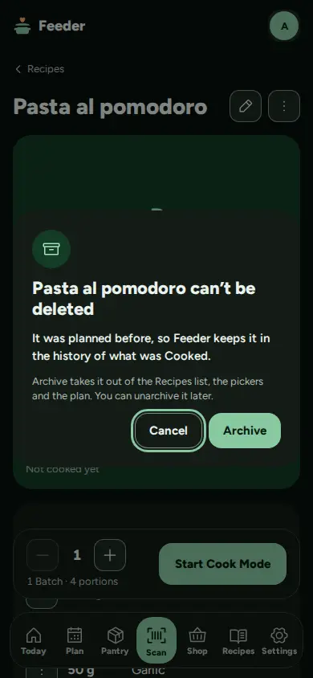 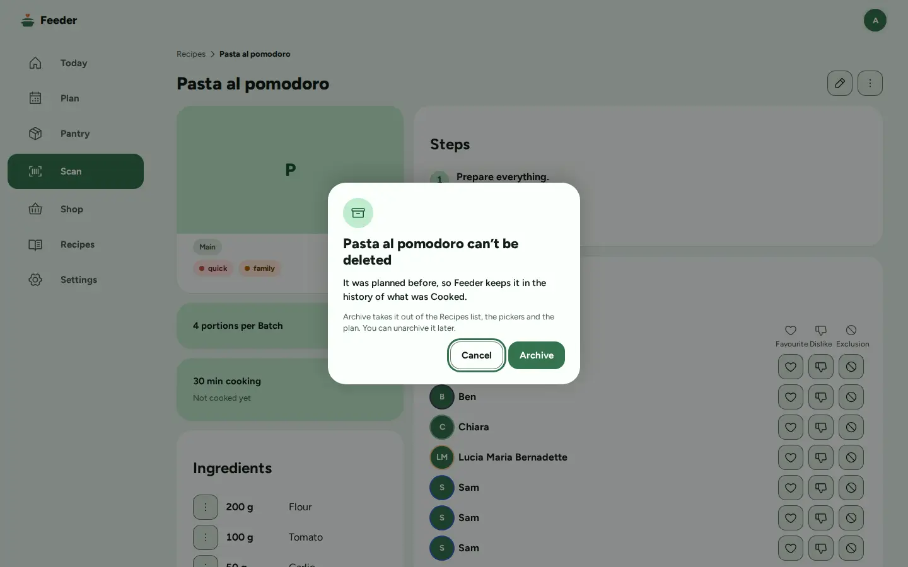 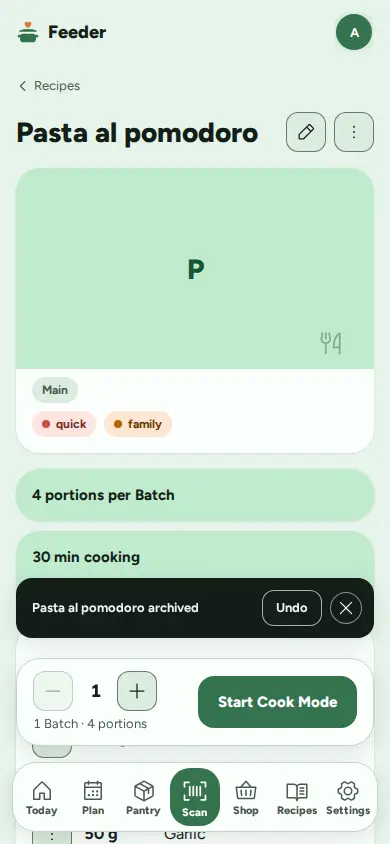

### Alternatives considered
Hiding Delete. Rejected: people would not learn why it is missing.

### Build notes
- `internal/recipe/httpapi`: add `deletable` to the detail response.
- `features/recipes/hooks/useRecipeActions.ts`.
- `strings.ts`.
- `RecipeDetailScreen.tsx`: drop the error paragraph.
- Mocks: [dialog](mocks/safe-05-cannot-delete-390-light.html), [1440](mocks/safe-05-cannot-delete-1440-light.html), [dark](mocks/safe-05-cannot-delete-390-dark.html), [toast](mocks/safe-05-archived-toast-390-light.html).

### Tests and guard
- **Go:** `deletable` is false for a planned Recipe.
- **Unit:** when `deletable` is false, the archive dialog opens without calling `remove`.
- **BDD:**
  - "Deleting a planned Recipe offers only Archive"
  - "Archiving a Recipe can be undone"

### Depends on / unblocks
- Depends on WP-P1.
- RX owns the rest of the Recipe detail.

## SAFE-06  Editor Cancel is history-back and leaves the app on a deep link
**Severity** S2 · **Size** XS · **Sources** RECIPES-02 · **Reproduced** Confirmed. I opened `/recipes/1/edit` in a fresh tab at 390×844 and pressed Cancel: it went to `about:blank`.
**Where** Recipe editor; every size

### Problem
`RecipeEditorScreen.tsx:355` calls `navigate(-1)`, so Cancel goes back in history.
- After a reload, a PWA launch or a shared link there is no in-app history, and Cancel closes Feeder.
- It also bypasses the R2 guard.

### Design
Cancel is an explicit discard, so it uses its own dialog rather than the leave guard; it never shows two dialogs.
- **While dirty** (R2 dirty): a danger dialog, title "Discard your changes?".
  - Body: "Your changes to Pasta al pomodoro are lost." For a new Recipe: "This new Recipe is lost."
  - Buttons: **Keep editing** (focused) and **Discard changes**.
  - **Discard changes** removes the reload draft, marks the editor clean so the guard lets it through, and goes to `/recipes/:id`, or `/recipes` for a new Recipe, with `replace`.
- **While clean:** it goes there at once.

The DraftNotice's **Discard changes** opens the same dialog, then stays in the editor with the stored Recipe.

 

### Build notes
- `RecipeEditorScreen.tsx`: Cancel calls `useRecipeDraft().cancel()`.
- A pure `editorExitRoute(recipeId)` in `features/recipes/lib/`.
- Mocks: [390](mocks/safe-06-cancel-discard-390-light.html), [1440](mocks/safe-06-cancel-discard-1440-light.html).

### Tests and guard
- Unit, using a `MemoryRouter` that starts at the edit route:
  - Cancel when clean goes to `/recipes/1`;
  - Cancel when dirty shows the dialog, and Keep editing stays;
  - Discard does not trigger the leave guard.
- BDD: "Cancel in an editor opened from a link goes to the Recipe"; "Cancel with changes asks once".
- Guard: `check-ui` rule `no-history-back`.

### Depends on / unblocks
Ships with SAFE-01.

## SAFE-07  Regenerate: Enter commits, and the run gives no count and no Undo
**Severity** S3 · **Size** M · **Sources** PLAN-16 · **Reproduced** Confirmed:
- Focus starts on "Regenerate" (`ConfirmDialog.tsx:56`).
- Enter regenerated the plan: 18 of 28 cells changed, 0 toasts, focus lost.

**Where** `/plan` Regenerate; every size

### Problem
One Enter replaces most of the week, Bought Planned Meals included. Nothing echoes what changed, and nothing goes back.

### Design (decision 3)

**The confirm**, with no Close:
- Title "Regenerate the plan?"; lead "26 unpinned Planned Meals will change."
- Note "Pinned and Cooked ones stay. You can undo it straight after."
- A one-line summary with a drawn chevron, "1 Bought Planned Meal is replaced". It opens to R-E rows: **Wed Lunch** · Carrot bought · Roast chicken with lemon, garlic and thyme…
- **Cancel** (outline, focused) and **Regenerate** (primary).

**After the run:**
- A one-line toast with no icon: "Plan regenerated: 18 Planned Meals changed", with outline Undo ("Undo Regenerate").
- Undo restores the plan, then shows "Your previous plan is back".
- If the plan changed since: an error toast "Couldn't undo Regenerate: the plan changed since. Nothing changed."
- When nothing changed: "Plan regenerated: nothing needed to change", with no Undo.
- PC-01's replan summary is the sibling pattern.

  
  

### Alternatives considered
A count-only toast (decision 3 B).

### Build notes
- **Backend:** `plan_state.revision` bumped by every write; `plan_snapshots` (migration 1572); `runner.Regenerate` returns `changed`; the handler answers `{ changed, undoToken }`; `POST /api/plan/regenerate/{token}/undo`.
- **Frontend:** `features/plan/hooks/usePlanScreen.ts`; `lib/regenerate.ts` (lead, note, and `details` rows from the dry run's Bought list); `api.ts`.
- **Mocks:**
  - Confirm: [390](mocks/safe-07-regenerate-confirm-390-light.html), [1440](mocks/safe-07-regenerate-confirm-1440-light.html), [dark](mocks/safe-07-regenerate-confirm-390-dark.html).
  - Toast: [390](mocks/safe-07-regenerated-toast-390-light.html), [1440](mocks/safe-07-regenerated-toast-1440-light.html), [dark](mocks/safe-07-regenerated-toast-390-dark.html).

### Tests and guard
- **Go:** restore gives back the pre-run rows and generation; it is refused after any other write.
- **Unit:**
  - The outlined Cancel has focus, and there is no Close.
  - The Bought list renders as rows.
  - The toast count comes from the response, and the toast has no icon.
- **BDD:**
  - "Enter on the Regenerate question does not regenerate"
  - "Regenerate can be undone straight after"
- **Guard:** the scenario `regenerate` asserts Cancel has focus.

### Depends on / unblocks
- Depends on WP-P1.
- Runs after P3 (shared runner, store and migration files).

## SAFE-08  Your preferences: no live effect, and leaving drops the choice
**Severity** S3 (stage 1 said S2: the loss is one re-tap of a display choice) · **Size** M · **Sources** SETTINGS-06 · **Reproduced** Confirmed:
- Choosing Dark leaves `html[data-scheme="light"]`; only the 82×26 "Sample" chip changes.
- Leaving gives no prompt.
- `/api/me/preferences` stays `{"scheme":"system",…}`.

**Where** `/settings/preferences`; every size and theme

### Problem
Someone picks Dark and nothing happens. If they leave, the choice is silently lost.
- `PreferencesForm.tsx` keeps a local draft that only the tiny preview chip shows.
- Save is disabled until something changes.
- Nothing guards leaving.

### Design (decision 6 B)
**A live whole-app preview with an explicit Save (R3)**
- Each choice applies to the **whole app at once, without saving**:
  - **Colour mode** (`html[data-scheme]`, including System following the OS);
  - **Accent colour** (the theme variables);
  - **Units** (every quantity: Shop, Pantry, Recipes, Cook Mode).
- The tile gains:
  - the intro "You see each choice across the app at once. Save keeps it on every phone and computer you sign in on.";
  - while dirty, an info-tone status line naming what is previewed and what returns: "Not saved yet: Dark is a preview. Save it or put back System." For several changes: "Not saved yet: Dark and Tomato are a preview."
- The small preview tile goes, because the app itself is the preview.

**Save and Revert sit in SHORT-06's `StickyActionBar`,** sticky only while dirty, one row, side by side: **Revert** (tertiary), then **Save preferences** (primary).
- **Phone:** 12 px above the bottom bar; at the keyboard's edge when the Custom colour's hex field has focus.
- **Tablet (820):** the width of the narrow form column, above the bottom bar.
- **Desktop (1440):** the width of the form column at the page bottom.
- **While clean:** the bar sits in the flow at the end of the tile, with both buttons disabled.

**Revert** puts back the saved values at once.

**Save:**
- PUTs `/api/me/preferences`.
- On success: the bar settles, "Not saved yet" goes, and the toast "Your preferences are saved" shows.
- On failure: the preview stays, and the error toast "Couldn't save your preferences. Nothing changed. Try again." stays until dismissed.

   

**Leaving with a preview:**
- Every in-app exit, **Sign out** included, opens the R2 guard "Leave without saving?" with the body "Dark is only a preview. If you leave, Feeder goes back to System."
- Buttons: **Keep editing** (focused) and **Discard changes**, which reverts the preview and then leaves.

**What ends a preview without the guard:**
- **Reload or closing the tab:** the preview is in memory only, so the app opens with the saved preferences. There is no draft (R2) and no prompt.
- **Signing out from another tab, or a session expiry:** the preview is dropped with the session.
- **Another device saving preferences meanwhile:** the preview stays on screen, and on Save, the last save wins.
- The Kitchen board never follows a User's preview or choice (ui-review-2 §3.7, L-11).

**Accessibility**
- The Segmented and swatch radios keep arrow-key behaviour (A11Y-06 states).
- "Not saved yet" is `role="status"`, announced when it appears and when its text changes.
- The bar's group is named "Preferences actions".
- Contrast: the preview applies the same audited palettes (`theme/contrast.test.ts`), so there is no new pair. The info line uses the info status pair, already tested.

### Alternatives considered
A, apply and save at once (recommended in the first draft). Not chosen by the user.

### Build notes
- **New** `features/settings/lib/preferencePreview.ts`: a plain store with `set`, `clear` and `subscribe`, no React.
- `hooks/usePreferences.ts` returns `effective = preview ?? saved`, plus `saved` and `dirty`.
  - Every consumer reads `effective`: `PreferenceThemeProvider` (scheme, accent), `useDisplayUnitSystem` (`features/ingredients`), `useCookContext` (`features/plan`).
- `components/PreferencesForm.tsx` renders only.
- `hooks/usePreferencesPage.ts` owns Save, Revert, `useLeaveGuard`, and `clear()` on unmount and on sign-out (`app/YourMenu.tsx` sign-out passes through the guard).
- No backend change.
- Mocks: [390](mocks/safe-08-preview-dirty-390-dark.html), [820](mocks/safe-08-preview-dirty-820-dark.html), [1440](mocks/safe-08-preview-dirty-1440-dark.html), [leave](mocks/safe-08-leave-dialog-390-dark.html), [saved](mocks/safe-08-saved-390-dark.html).

### Tests and guard
**Unit:**
- Choosing Dark sets `documentElement.dataset.scheme` to dark with no PUT.
- Choosing Imperial changes a quantity elsewhere (a `useDisplayUnitSystem` consumer).
- Revert restores the saved values.
- Save PUTs once and clears the preview.
- A failed Save keeps the preview.
- Unmount clears the preview.

**BDD:**
- "Choosing Dark previews the whole app before saving"
- "Leaving with a preview asks first and Discard puts the saved look back"
- "A reload drops an unsaved preview"
- "Save keeps the preferences on every device"

**Guard:** a page-layout scenario `preferences-preview` asserts that the sticky bar exists only while dirty and stays within the SHORT P17 budget.

### Depends on / unblocks
- Depends on WP-P1 (`useLeaveGuard`), SHORT-06 (sticky-while-dirty bar), SHORT P2 (one-row `FormActions`), and A11Y-06.
- Unblocks the Household page guard.

## SAFE-09  Stock actions: Undo and feedback differ between screens
**Severity** S3 · **Size** M · **Sources** SHOP-11 · **Reproduced** Confirmed at 390×844:
- Shop: Tick → "Tick and add to Stock" → 0 toasts, focus on `<body>`.
- Pantry, on a seeded spoiled Basil Lot: **Throw out** → 0 dialogs, 0 toasts.
- Stock-take: Flour "+1 pack" → the toast "+1 pack: Flour, 1250 g in Stock" with no action.
- Scan's To get tick shows "Carrot ticked · Undo" (stage 1).

**Where** `/shop`, `/pantry`, `/scan?mode=stocktake`; every size

### Problem
The same tick confirms on one screen and is silent on another. Throw out records waste and resets the Zero-waste streak with no way back. Stock-take is the only Scan action without Undo; the server refuses it (`ErrNotUndoable`, `internal/scan/service/service.go:688`).

  

### Design
Every Stock action acts at once with an Undo toast (R1):

| Action | Toast | Undo does |
|---|---|---|
| Tick and add to Stock | "Carrot ticked · 500 g added to Stock" | untick (ADR 0019) |
| Tick without adding | "Carrot ticked" | untick |
| Delete an extra Line | "Napkins removed from the Shopping List" | re-create the extra |
| Throw out | "500 g Basil thrown out" | `POST /api/stock/waste/{id}/undo`; the streak comes back |
| +1 pack | "+1 pack of Flour: 1250 g in Stock" | remove the Lot it added |
| −1 pack | "−1 pack of Flour: 750 g in Stock" | give back |
| Set total | "Flour set to 750 g" | give back or remove |

The tick wording matches SSP-01's one-tap tick ("Garlic ticked · 500 g added to Stock").

    

### Build notes
- Frontend:
  - `features/shop/screens/ShoppingScreen.tsx` (`onTickSubmit`, `onDelete` via `useUndoToast`; better moved into `hooks/useShoppingActions.ts` so the screen only wires);
  - `features/stock/hooks/useStock.ts` (`throwOut`) and `useSpoiled`;
  - `features/scan/hooks/useScanFlow.ts` (`stockTakeAction` notify with Undo through the existing scan `undo`).
- Backend:
  - waste undo (`internal/stock`, `lot_json` on the waste record);
  - scan stock_take undo (ledger records the Lot or takes; uses `stock.GiveBack` from SAFE-03).
- Mocks: [tick](mocks/safe-09-tick-toast-390-light.html), [dark](mocks/safe-09-tick-toast-390-dark.html), [1440](mocks/safe-09-tick-toast-1440-light.html), [throw out](mocks/safe-09-throwout-toast-390-light.html), [stock-take](mocks/safe-09-stocktake-toast-390-light.html).

### Tests and guard
- Go: waste undo re-inserts the Lot with its id and dates and removes the waste; stock_take undo of +1 removes its Lot; of −1 gives back.
- Unit: each action shows a toast with Undo, and Undo calls the inverse once.
- BDD:
  - "Ticking on the Shop screen can be undone"
  - "Throw out can be undone and the Zero-waste streak returns"
  - "+1 pack in Stock-take can be undone"

### Depends on / unblocks
- Depends on WP-P1, SAFE-03 (`GiveBack`), and SSP-01 (the tick redesign touches the same Shop files: serialise after it).
- SSP-17 owns Keep's toast.

## SAFE-10  Remove Step, line or ingredient use in the editor is instant, with no Undo
**Severity** S3 · **Size** S · **Sources** RECIPES-15 · **Reproduced** Confirmed. "Remove Step" removed Step 1 at once (2 → 1 Steps), with 0 dialogs, 0 toasts and focus on `<body>`. The trash icon is 44 px from the ⋮.
**Where** Recipe editor; every size

### Problem
One mis-tap next to the Step actions menu deletes a Step with its text, timing and Photo. The only way back is Cancel, which loses everything else (SAFE-06). The removal is local: `StepsEditor.tsx:103` and `useRecipeEditor.ts:239` drop it from state.

 

### Design
- Act at once and show "Step 1 removed" · Undo (accessible name "Undo: put Step 1 back"). The same for "Flour line removed" and "Tomato use removed from Step 2".
- Undo puts it back at its index with its content, and the Steps renumber.
- Focus goes to the Step that took the removed one's place (its actions button), or to "Add Step" if none (A11Y rule).
- The draft (SAFE-01) records both changes.

 

### Build notes
- `features/recipes/lib/steps.ts` and `lib/draft.ts`: pure `removeStepWithUndo` / `restoreStep` (they return the removed value and index).
- `hooks/useRecipeEditor.ts` exposes `removeStep(i)` returning a restorer.
- `components/StepsEditor.tsx` and `IngredientLineRow.tsx` call `useUndoToast`.
- Mocks: [390](mocks/safe-10-step-removed-390-light.html), [1440](mocks/safe-10-step-removed-1440-light.html).

### Tests and guard
- Unit: remove then restore yields the original draft; "After step N" references survive.
- BDD: "A removed Step can be put back".

### Depends on / unblocks
WP-P1; the same package as SAFE-01.

## SAFE-11  Add forms start with an arbitrary Ingredient or none, and the Lot sheet always shows Move
**Severity** S3 · **Size** S · **Sources** SHOP-16 · **Reproduced** Confirmed:
- **Add a Stock Lot** preselects **Basil** (the first Ingredient, `AddLotSheet.tsx:33` `?? choices[0]`), with "Bought on" empty ("Choose a date"), and focus on the Basil select.
- **Add to Shopping List** shows an empty Ingredient select with no placeholder and a disabled stepper under an enabled Save.
- **The Lot sheet** always shows the full "Move to" form under Edit / Delete.

**Where** `/pantry` Add to Stock, `/shop` Add to Shopping List, Pantry Lot sheet; every size

### Problem
A person adding milk in a hurry saves 500 g of Basil. The empty select gives no hint, and the stepper looks broken. The Lot sheet leads with a form most people never use.

 

### Design
**Defaults (R5).**
- **Add a Stock Lot:**
  - Ingredient: "Choose an Ingredient" (muted placeholder), focused on open. The Ingredient is preselected only when the sheet is opened from that Ingredient's page.
  - Quantity: empty, with the unit suffix once an Ingredient is chosen.
  - Bought on: "Today, Sun 15 Nov".
  - Storage Place: "Where it usually goes" (unchanged).
  - Save stays enabled; missing fields get R4 errors ("Choose an Ingredient.", "Enter how much.").
- **Add to Shopping List:** the placeholder "Choose an Ingredient"; under the disabled Quantity, the helper "Choose the Ingredient first; the quantity is in its unit."
- **Lot sheet:** **Edit** and **Move…** (secondary, `aria-expanded`) reveal their forms; **Delete** goes to the destructive slot (SAFE-02). The Move form's "Move" is never disabled (R4: "Choose where to move it.").

     

### Build notes
- `ui/Select`: placeholder in `--color-muted` when `data-placeholder` (shared; all Selects gain it).
- `features/stock/components/AddLotSheet.tsx`: no `choices[0]`, today's date, an `initialIngredientId` prop.
- `features/shop/components/ExtraSheet.tsx`.
- `features/stock/components/LotSheet.tsx` (`moveOpen` state in `hooks/useLotSheet`).
- Mocks: [lot](mocks/safe-11-add-lot-390-light.html), [dark](mocks/safe-11-add-lot-390-dark.html), [1440](mocks/safe-11-add-lot-1440-light.html), [extra](mocks/safe-11-add-extra-390-light.html), [lot sheet](mocks/safe-11-lot-sheet-390-light.html), [1440](mocks/safe-11-lot-sheet-1440-light.html).

### Tests and guard
- Unit: AddLotSheet's initial state has no Ingredient and today's date; Save without an Ingredient focuses it with the error; LotSheet hides Move until pressed.
- BDD: "Adding a Stock Lot never assumes the Ingredient"; "Bought on starts at today".
- Guard: a `check-ui` rule `no-first-choice-default`: warn on `?? choices[0]` / `?? options[0]` in `web/src/features`.

### Depends on / unblocks
WP-P1 (Select, FormActions); SSP owns the rest of the Pantry sheets.

## Review round 1 (2026-11-14)

**Mocks re-rendered: 63 of 63.** Each WebP keeps its file name; the patterns diagram needed no change. Every mock now carries PC's shared `RULES_CSS` block unchanged, plus a short SAFE block, in `<style data-proposed>`.

What changed across the theme:

- **R-A, buttons look like buttons.**
  - Undo, Open and Review in a toast are outline pills.
  - Cancel, Keep editing and Revert, in dialogs, sheet footers and sticky bars, are outline buttons on the surface fill.
  - Discard changes and Restore my changes in a DraftNotice are outline buttons on the info tile.
  - Remove Member and the Lot sheet's Delete are outlined danger buttons.
- **R-B, Close.** Every sheet Close is the 40 px circular outline button. The Add to Shopping List sheet has Cancel, so it shows no Close. No ConfirmDialog shows a Close, because each has Cancel.
- **R-C, focus rings.** Sheet bodies keep 5 px of room for focus rings. Toast buttons use the `--color-bg` ring.
- **R-D, toasts with detail.** The Cooked toast was two sentences. It is now a headline ("Cooked, nice one!"), a muted subline (Sat Breakfast and the Recipe), a body (the Leftover), and Undo. Every other toast in the theme is a single sentence and stays on one line, with an outline Undo and a 32 px circular Dismiss.

Beyond the four rules:

- **Dialog bodies.** Some dialogs were a paragraph wall: Remove Sam, Remove Dinner on Monday, Regenerate, Delete Coop and the Recipe archive. Each now states one question:
  - a title;
  - one bold lead line;
  - then short "Goes" and "Stays" lists in `meta`, or a one-line summary that opens to the list ("1 Bought Planned Meal is replaced");
  - then the buttons.
- **R1 text.** The ConfirmDialog and Undo toast rules in R1 now say this, so the primitives are built that way.

Left as they are:

- The Lot sheet's long Storage Place line is SSP's.
- The editor's stacked sticky bar at 390 is SHORT-04's one-row bar; SHORT P2 changes it.
- The before images are left as they are.

## Review round 2 (2026-11-14)

All 63 SAFE mocks were re-rendered under the same file names. Every mock now carries the PC theme's current shared rules block, which includes R-C+, R-D+, R-E and R-F.

**R-D+ (toast status icons).** No success toast in the theme shows an icon any more. That covers every one-line Undo toast and the rich Cooked toast. An error toast keeps a 16 px icon in its headline line. The R1 Undo-toast rule now says this.

**R-E (rows, not bullet lists).** The ConfirmDialog "Goes" / "Stays" lists are now key / state / detail rows. For example: "Sign-in · Ends · sam@example.com · not on the Allowlist", and "Planned Meals · 7 · From today, Mon 16 to Mon 30". Regenerate's Bought disclosure is now a row: "Wed Lunch · Carrot bought · the Recipe". The R1 ConfirmDialog rule now says this. Remove Member gains a read-only impact call so its rows can show counts.

**R-C+ (nested focus rings).** The focused Segmented option in Your preferences now draws its ring inside itself, within the track. No other mock shows a nested control with focus.

**R-F (bottom bar under 360 px).** It does not apply: no SAFE mock is narrower than 390 px.

**Craft defects found and fixed:**
- The Regenerate dialog showed the browser's native disclosure triangle. It is now a drawn chevron in a 32 px summary row.
- The leave dialogs were one run-on body paragraph. They now have a lead line and a muted note, like every other confirm.
- The Cancel-discard dialog repeated its title in its body. It is now one lead line.

**Left as is:** the info "Not saved yet" line keeps its icon in its own column. It is a notice, not a toast, and R-D+ governs toasts only.

## Work packages for this theme

| Package | Items | Files owned | Size | Merges after | Parallel with |
|---|---|---|---|---|---|
| **P1 Safety primitives** | R1–R5 primitives; the system.md **§12** text | `ui/ConfirmDialog.tsx`, `ui/Toast.tsx`/`.css`, new `ui/useUndoToast.ts`, new `ui/useLeaveGuard.ts`, `ui/BottomSheet.tsx` (`confirmDismiss`), `ui/fields/FieldFrame.tsx`, new `focusFirstInvalid.ts`, `useFocusFirstInvalid.ts`, `FormError.tsx`, `Field.css`, `ui/Select` (placeholder), new `ui/DraftNotice.tsx`, new `lib/drafts/**`, `scripts/check-ui.rules`, `docs/design/system.md` §12. The `FormActions` divider is handed to SHORT P2 | M | SHORT P1's token commit; serialised with the A11Y, DS and SHORT P2 packages that touch `ui/` | P3 and P4 backend parts |
| **P2 Recipe editor safety** | SAFE-01, SAFE-06, SAFE-10, SAFE-04 (Recipe part), SAFE-05 | `features/recipes/**`, `internal/recipe/httpapi` (`deletable`) | L | P1 | P3, P5, P6 |
| **P3 Plan reopen and Stock give-back** | SAFE-03 | `internal/plan/**` (runner `actions.go`, store, httpapi), `internal/stock` (`GiveBack`), migration 1571 + ADR 0020, `features/plan/hooks/useCookFlow.ts`, `usePlanActions.ts`, `useAllCookedFlow.ts`, `components/PlannedMealSheet.tsx`, new `lib/resolved.ts`, `features/plan/api.ts`, `features/today` wiring | L | P1 (UI half); **P5a's snapshot commit** (it owns the pre-1570 snapshot) | P2, P5b |
| **P4 Regenerate Undo** | SAFE-07 | `internal/plan/runner/runner.go`, plan store (revision, snapshots), migration 1572, `features/plan/hooks/usePlanScreen.ts`, `lib/regenerate.ts` | M | P3 (same runner, store and migration files) | P2, P5b |
| **P5a Members, Meal Slots and preferences** | SAFE-02 (Member, Meal Slot), SAFE-08, SAFE-04 (Member sheet) | `features/settings/**` (incl. `PreferenceThemeProvider`, new `lib/preferencePreview.ts`), `features/ingredients/hooks/useDisplayUnitSystem.ts` and `features/plan/hooks/useCookContext.ts` (one-line reads of `effective`), `app/YourMenu.tsx` (sign-out through the guard); `internal/household/**`, `internal/plan/runner/sources.go`, `internal/plan/httpapi/names.go`, the meal-slot reads in `internal/course`, `internal/tag`, `internal/recipe/store/base.go` and `internal/cook/service/adapters.go`; migrations 1570 + 1573, the pre-1570 snapshot (`internal/db`, `internal/backup`, `cmd/feeder`), ADR 0021 | L | P1. Lands the snapshot commit first; P3, P4 and P6 rebase on it | P2. **Not** with P3 or P4 while `plan/runner/sources.go` and `names.go` change: do this package's plan-folder commit first |
| **P5b Catalogue and rules** | SAFE-02 (Shop, Ingredient, Product, light removals), SAFE-04 (rules, conversions, barcode, Shop/Tag/Storage Place forms) | `features/shops/**`, `features/ingredients/**` (except `useDisplayUnitSystem`), `features/products/**`, `features/plan/components/RulesEditors.tsx`, `hooks/useRules.ts`, `useRuleForms.ts`, product barcode handler | M | P1 | P2, P3, P4, P5a |
| **P6 Stock Undo and defaults** | SAFE-09, SAFE-11 | `features/shop/**` (ShoppingScreen, LineSheet, ExtraSheet), `features/stock/**`, `features/scan/hooks/useScanFlow.ts`, `internal/stock` (waste undo, migration 1574), `internal/scan` (stock_take undo) | M | P1, P3 (`GiveBack`), SSP-01 (same Shop files) | P2, P5b |

All 157x migrations ship in one release, under the one `feeder-pre-1570.db` snapshot (`Pre1570Prefixes = {"157"}`). If they are split across releases, each release takes its own named snapshot, as in the b5–b8 pattern.

## Not reproduced / dropped
- None. Every source id reproduced.
- One suspicion was checked and dropped: the Regenerate confirm's multi-line body (count, then Bought lines) looked from the code like it might run together, because it is joined with `\n` in one `
`. It renders on separate lines, because the body keeps line breaks. The list in SAFE-07 is a polish, not a fix.

## What could not be checked
- **The Planned Meal sheet of a Cooked or Not cooked meal on `/plan`.** The seeded household is on UTC+14, so at review time "today" (Sun 15 Nov) had no resolved meals, and the Plan starts at today. The sheet design is from the code (`PlannedMealSheet.tsx`) and FLOW-10's evidence.
- **Product barcode "123" and the Unit Conversion error.** Taken from stage 1 (`probe-errors.mjs`) and the code; not re-driven.
- **Other browsers.** WebKit and Firefox were not run. IndexedDB drafts, `useBlocker` and Ctrl/⌘Z need a WebKit check at 390 and 820 when built.
- **The on-screen keyboard with a focused invalid field** (SHORT owns it), and **offline Undo** (RES owns it).
- **Stock-take −1 and Set total.** Only +1 was driven.
- **Shared tablets with more than one User.** Concurrent edits of one Recipe on two devices are designed (the draft conflict notice), not tested.

