# Settings and catalogue

This theme covers the Admin's and the catalogue's pages: Members, Meal Slots, Planning rules, Household, Shops and a Shop's page, Products and a Product's page, Ingredients and Supplies, Tags, the Allowlist and Sign-in requests. I reproduced all 14 source findings on my own seeded server (`main` @ 834ea743, http://127.0.0.1:18570). Each one holds, and three are narrower or wider than stage 1 described. The pages themselves are sound: lists use `ListRow`, nothing scrolls sideways at page level, dark mode is consistent. The defects sit in four places:
- **Sheets, which the page-layout guard never opens.** The Add Shop Barcode sheet is scrolled 48 px sideways on every phone.
- **Rows that put several controls beside a long text.** Allowlist emails shrink to 58 px. Sign-in requests wrap their meta. Tags make the count the title. Course rows and Attendance rows break apart.
- **Pages that grew one tile per field.** The Ingredient page has four Saves and an orphan tile. The Product page leads with an empty Picture, and its Price rows are run-on strings.
- **One data bug.** "Prices known here" asks only about Products with a Shop Barcode, so Coop, with 12 Prices, says it has none.

Five shared changes close most of the theme:
1. **The crafted `Select` (ui/Select).** One chip line with "+N" (reusing `useFittingChips` from FilterBar), option titles on two lines, the active option scrolled into view, and a sheet body that no longer cuts focus rings. This closes SET-06 and makes SET-01 and SET-07 possible.
2. **A `ListRow` `actions` slot.** It sits at the end of a wide row and takes its own line below 35 rem, which carries out system.md §5.4 for controls that are not an ActionGroup. It closes SET-03 and SET-12.
3. **Field sizes.** A size token limits a field's control, never its label, helper or error (ui/fields/Field.css). This closes the squeezed errors of SET-07 and of every `xs`/`sm` field elsewhere.
4. **`CoursePicker` rows laid out by container width, not viewport width.** This closes SET-09 everywhere the picker is used.
5. **One new read endpoint, `GET /api/shops/{id}/prices`.** This closes SET-02 and replaces N requests with one.

The rest are screen changes with no new primitive:
- the Product and Ingredient pages ordered by use;
- the Meal Slot cards and their week strip;
- Attendance rows with a fixed stepper column;
- Tags with the Tag as title;
- small copy items.

Things other themes own that this chapter references:
- **SAFE:** confirm and Undo for destructive actions, the save model, the field-error pattern and `focusFirstInvalid`.
- **SHORT:** sheet footers and the Recipe Assistant sticky bar.
- **A11Y:** the Exclusion toggle, the Segmented selected state, focus after actions and touch-target minimums.
- **DS:** `.pg__*` type drift, the warn tone and PageHeader wrapping.
- **PC:** the "Who's eating" range and "Away" chip (FLOW-12) and the silent replan after editing a Meal Slot (FLOW-04).

Section J of the flows report (household admin) lands here as follows:
- the free-text Time zone is SET-07;
- the Allowlist giving the Admin nothing to send is SET-03;
- "Change a date only in Settings" and the per-date Who's eating are PC's FLOW-12;
- the blocked Notifications are not a defect of this theme.

| Item | Severity | Size | Title | Source ids | Status after reproduction |
|---|---|---|---|---|---|
| SET-01 | S1 | S (after SET-06) | Add Shop Barcode sheet scrolled sideways; rebuild it on the crafted Select | SETTINGS-01 | Confirmed at 320, 360 and 390 |
| SET-02 | S2 | M | "Prices known here" is wrong; read Prices by Shop; Price rows with a value column | SETTINGS-02 | Confirmed (12 Prices, tile says none) |
| SET-03 | S2 | S + M (ListRow slot) | Allowlist rows keep the email readable; "Copy sign-in message" | SETTINGS-08, FLOW-29 | Confirmed (58 px title at 320) |
| SET-04 | S3 | M | Product page: order, Price rows, history, Save beside its field, removable barcode chips, barcode check | SETTINGS-16 | Confirmed, wider (barcode × is a separate button; history duplicates the latest) |
| SET-05 | S3 | M | Ingredient and Supply page: one "Keeping" tile, Rename in a sheet, no orphan, one Stepper | SETTINGS-11 | Confirmed (orphan from 760 px; Rename leaves focus on `BODY`) |
| SET-06 | S3 | M | Crafted Select: one chip line, two-line options, Home/End that show the option, focus ring not cut | SETTINGS-14 | Confirmed, with a narrower cause for End (plus one item new in stage 2) |
| SET-07 | S3 | M | Household: searchable Time zone and Currency Selects; field errors as wide as the field | SETTINGS-17 | Confirmed (Currency error 112 × 54 px, 3 lines) |
| SET-08 | S3 | S | Meal Slot cards and week strip from 320 to wide | SETTINGS-15 | Confirmed (31 px cells at 320; 1120 px cards at 1440) |
| SET-09 | S3 | S | Meal Slot editor: Course rows as one anatomy | SETTINGS-18 | Confirmed at 820 (560 px dialog) |
| SET-10 | S3 | XS–S | Meal Slot sheet: Attendance rows with long Member names | SETTINGS-13 | Confirmed at 390 |
| SET-11 | S3 | XS | Tags rows: the Tag is the title, the count is the value | SETTINGS-12 | Confirmed at 320 |
| SET-12 | S3 | S | Sign-in requests rows: neutral monogram, no nested tile, readable at 320 | SHELL-21 | Confirmed (with mocked requests) |
| SET-13 | S4 | XS (decision) | Desktop layout of narrow Settings and catalogue pages | stage-1 settings summary point 10 (no id) | Confirmed (720 px column; 240 px empty on each side at 1440) |
| SET-14 | S4 | S (sum of XS) | Small consistency and copy items | SETTINGS-22 | 7 of 8 confirmed; Notifications on iPhone Safari from code only |
| SET-15 | S3 | S | Removed Meal Slots keep their Cooked history: where it shows | decision SAFE 7 | New item after the decisions |
| SET-16 | S3 | S | "Away" on the Members list and in the Member sheet | decision PC 3, FLOW-12 | New item after the decisions |

## Decisions for the user

The user took these decisions on 2026-11-14 (docs/design/ui-review-3/decisions.md). The plan below follows them.

1. **SET 1, Typed Product barcodes:** option B. A code made only of digits needs 8, 12, 13 or 14 digits and a valid check digit; a code with letters is still accepted. Option mock: [mocks/set-04-product.html](mocks/set-04-product.html). Built in SET-04.
2. **SET 2, Width of catalogue detail pages on desktop:** option A. The narrow column stays, and cards sit two-up inside it. Option mocks: A in [mocks/set-04-product.html](mocks/set-04-product.html), B in [mocks/set-13-product-default.html](mocks/set-13-product-default.html). See SET-13.
3. **SET 3, Allowlist sign-in message (CHANGED):** option B. "Copy sign-in message" plus a Share item wherever the device has a share sheet (`navigator.share`). Mock: [mocks/set-03-allowlist.html](mocks/set-03-allowlist.html). Designed in SET-03.
4. **SET 4, "New Product" on the Products list:** added. Mock: [mocks/set-14-small.html](mocks/set-14-small.html). See SET-14a.
5. **SET 5, Edit from an "Every day" Meal Slot card:** the editor starts with all days of that name selected. See SET-14h.

Two decisions from other themes also land on these screens:
- **SAFE 7 (changed): removing a Meal Slot keeps its Cooked history.** SAFE-02 designs the confirm and the data change. SET-15 (new) designs how a removed Meal Slot and its history show.
- **PC 3 (changed): a Member can have an "Away" record covering a range of dates.** PC-08 designs the record and the Away sheet. SET-16 (new) designs where Away shows and is reached on the Members list and in the Member sheet.

## SET-01  Add Shop Barcode sheet scrolled sideways; rebuild it on the crafted Select
**Severity** S1 · **Size** S (after SET-06) · **Sources** SETTINGS-01 · **Reproduced** Confirmed. At 320, 360 and 390 the sheet body has `scrollWidth` 441 against `clientWidth` 296, 336 and 366, and it opens at `scrollLeft` 48 every time. The widest chip ("Dishwasher tablets, lemon fresh, …") is 433 px. The search field spans x 12 to 393. The labels "Code" and "Search Products" are cut at the left.
**Where** `/settings/shops/:id` → Add Shop Barcode, at every phone width. From 768 px it is a dialog that fits. Light and dark.

### Problem
On a phone the sheet opens panned sideways: its labels read "le" and "Products", and the Product chips are cut at both edges. Only the first 12 Products are offered (`products.slice(0, 12)`).

Cause:
- `features/shops/components/AddShopBarcodeSheet.tsx:56-62` puts a wrapping `.pg__row` of filter Chips inside a `form.pg__stack`.
- `features/products/products.css:11-14` makes `.pg__stack` a `display: grid` with an implicit `auto` track. That track grows to the min-content of its widest item, so the Chip's own `max-inline-size: 100%` cannot help.
- Focusing the search field on open then scrolls the body sideways by 48 px.

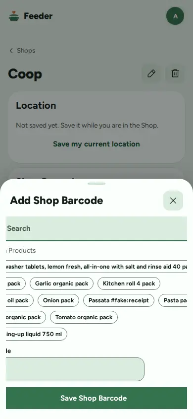 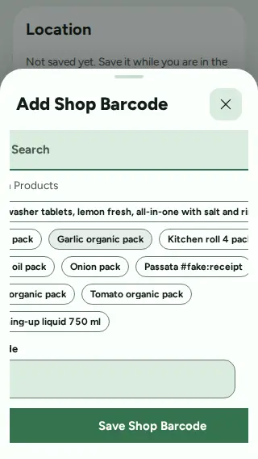

### Design
**Behaviour.** The sheet is a short form of three full-width fields, the same at every size: a sheet below 768 px, a dialog from 768 px.

1. **Product**, a crafted `Select` (a new `ProductSelect`).
   - The trigger shows the chosen Product's Thumb and name. The helper says what it is: "Sold at Coop · Supply · 40 pieces".
   - The list opens as a sheet on a phone and as a popover from 768 px.
   - The list has search, the filters "Sold at <Shop>", "Food" and "Supplies", and every Product (not just 12).
   - Options are grouped "Sold at <Shop>" first, then "Other Products". Each option shows a Thumb or monogram, the name on up to two lines, and the meta "<Ingredient> · <pack size>" (for a Supply, "Supply · <pack size>").
2. **Weight Barcode Rule**, a Select shown only when the Shop has rules. The first option is "No rule: a plain code".
3. **Code**, or **Item code** when a rule is chosen. A full-width TextField with the helper "The code printed on the Shop's own label."

**Footer** (SHORT owns its behaviour): an outlined secondary **Cancel** and the primary **Save Shop Barcode**.
- From 600 px they sit on one line at the end, with Save last.
- On a phone they stack, with Save first.
- Because the footer has Cancel, the sheet shows **no Close** (R-B). Esc, the scrim and the grip still close it.

**States.**
- No Products at all: "No Product to choose. Add one from an Ingredient or a scan." with a link to `/products`.
- No search match: "No Product matches 'xyz'".
- Save failed: the server message as a field error on Code (SAFE's pattern).
- Offline: RES's pattern.

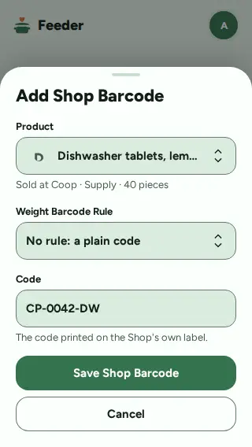 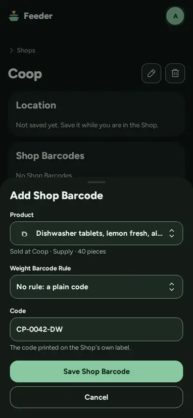 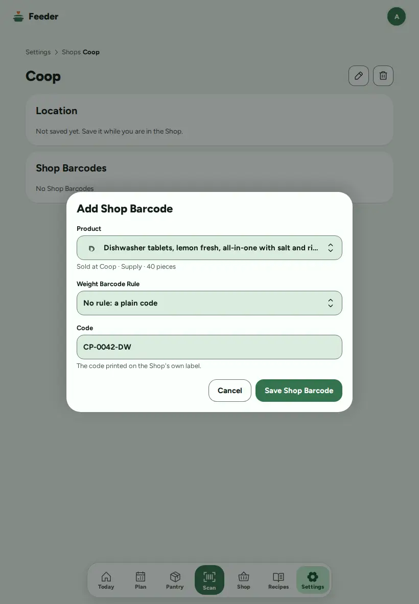
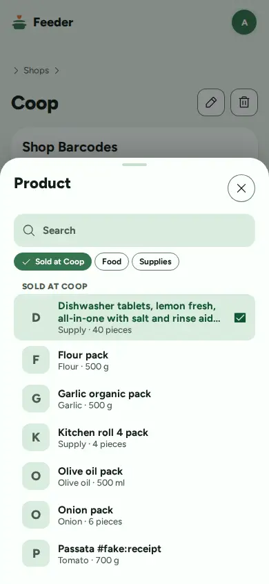 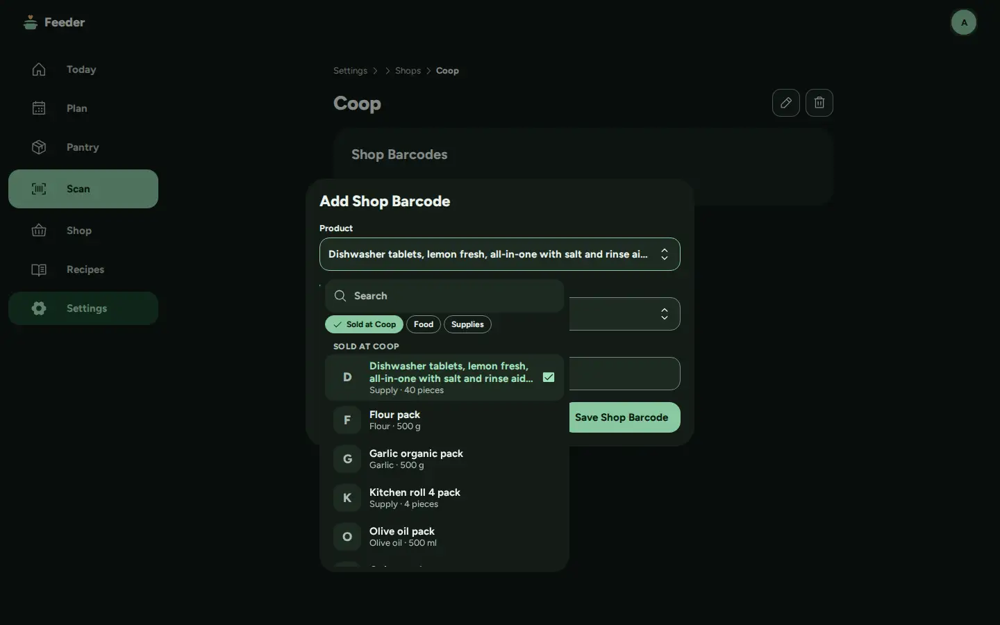

Mocks: [mocks/set-01-shop-barcode.html](mocks/set-01-shop-barcode.html), [mocks/set-01-product-select.html](mocks/set-01-product-select.html).

**Rules.**
- The form is `display: grid; grid-template-columns: minmax(0, 1fr); gap: var(--space-4)`.
- In `products.css`, `.pg__stack` gets `grid-template-columns: minmax(0, 1fr)`. This one line is agreed with DS, which owns SETTINGS-21.
- The round-1 rules apply: R-A secondary outline, R-B Close, R-C 5 px body padding.
- No new tokens.

**Copy.** "Product"; the helper "Sold at <Shop> · <Ingredient or "Supply"> · <pack size>"; "No rule: a plain code"; "Code"; the helper "The code printed on the Shop's own label."; "Item code"; "Save Shop Barcode"; "Cancel".

**Accessibility.**
- Focus on open goes to the Product combobox, so nothing scrolls.
- Esc closes the Select first, then the sheet.
- After Save, focus returns to "Add Shop Barcode", and a polite toast says "Shop Barcode added".

### Build notes
- `AddShopBarcodeSheet.tsx`: replace the SearchField, the Chip row and `p.pg__muted` with `ProductSelect`. Drop the header Close because the footer has Cancel.
- New `ui/Select/ProductSelect.tsx`, with a pure option builder `productOptions(products, shopId)` in `ui/Select/options.tsx`.
- `products.css`: change the `.pg__stack` track.
- No API change.

### Tests and guard
Unit tests:
- `productOptions` groups "Sold at Coop" first and keeps every Product (13 in, 13 out).
- The sheet renders a combobox named "Product" and no Chip.
- The sheet has no Close button.

Gherkin:
- Scenario: Add a Shop Barcode for a Product beyond the first twelve.
- Scenario: The Add Shop Barcode sheet never scrolls sideways on a 320 px phone.

Guard:
- A new `shop-barcode-sheet` scenario: open Coop → Add Shop Barcode at 320, 360, 390 and 834, with P1 and P13 measured inside `dialog[open]`.
- A ds test: a `.pg__stack` holding a 600 px nowrap Chip inside a 200 px parent stays 200 px wide.

### Depends on / unblocks
- Depends on SET-06.
- SHORT owns the footer.
- SAFE owns the error pattern.
- DS owns R-A and R-B in `Button` and `BottomSheet`.

## SET-02  "Prices known here" is wrong; read Prices by Shop; Price rows with a value column
**Severity** S2 · **Size** M · **Sources** SETTINGS-02 · **Reproduced** Confirmed. `/settings/shops/1` (Coop) says "No Prices recorded at this Shop", yet the database holds a Coop Price dated 2026-11-14 for 12 Products (Butter $3.74 … Washing-up liquid $2.49). Coop has 0 Shop Barcodes.
**Where** `/settings/shops/:id`, every size and theme.

### Problem
The page states something false.

Cause:
- `features/shops/screens/ShopScreen.tsx:38` calls `useShopPrices(id, [...new Set(shop.barcodes.map((b) => b.productId))])`, so it only asks about Products that have a Shop Barcode.
- `features/shops/hooks/useShopPrices.ts` then makes one `GET /api/products/{pid}/prices/latest?shop=` request per Product (N requests).
- `latestPrice` (`internal/product/httpapi/httpapi.go:563`) falls back to another Shop's Price.
- The rows are run-on titles with ISO dates (`ShopScreen.tsx:113-124`).

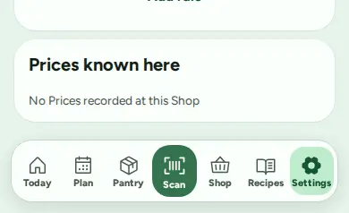

### Design
**The tile.**
- Header "Prices known here", with the count "12 Products" at the end.
- Under it, the meta note "The latest Price of each Product at Coop."

**The rows** (system.md §3), sorted by Product name, archived Products left out:
- leading: the Product's Thumb or monogram;
- title: the Product name, up to two lines;
- meta: the locale date ("14 Nov"; the year only when it is not this year);
- value: the price;
- sub-value: "$3.98 / kg" when known;
- chevron: opens the Product page.

**Many rows.** The first 8 show, then an outlined secondary **"Show all 12 Prices"** (`aria-expanded`), which expands the list in place.

**Other states.**
- Empty: "No Prices recorded at <Shop> yet. A Price is recorded when a receipt from <Shop> is read, or when you add one on a Product."
- Loading: three skeleton rows.
- Error and offline: RES's pattern.

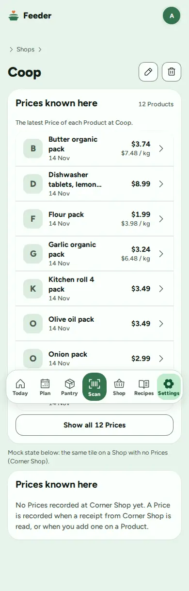 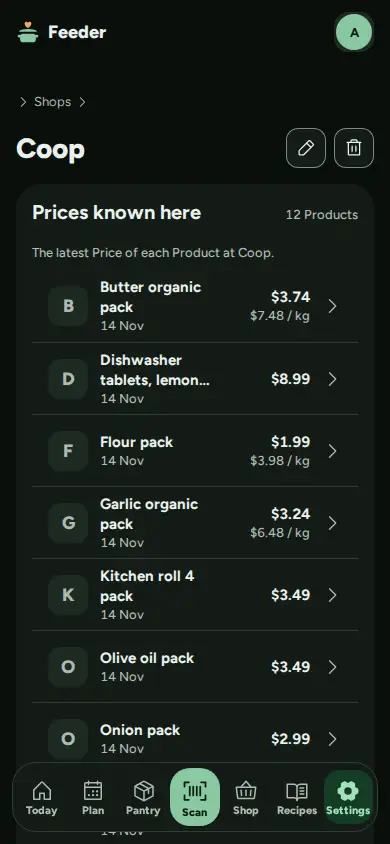 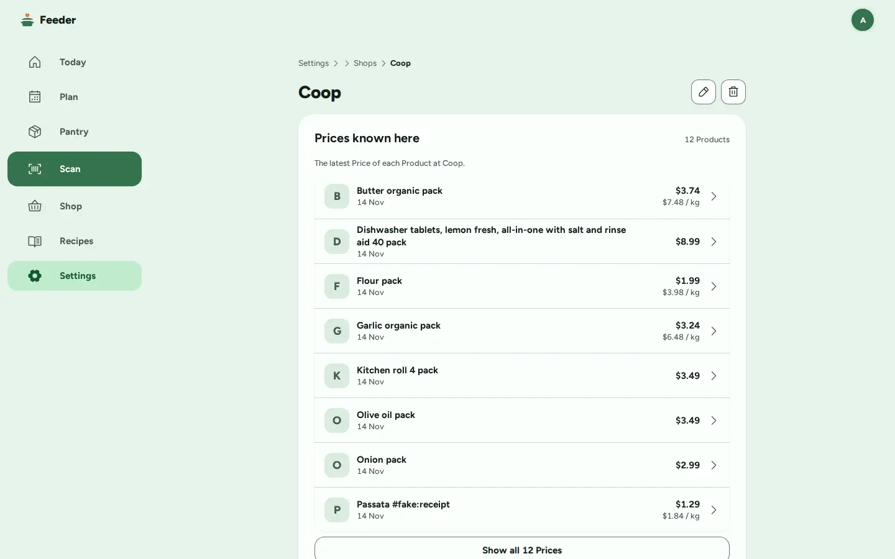

Mock: [mocks/set-02-shop-prices.html](mocks/set-02-shop-prices.html). Its last tile shows the empty state.

**Rules.** `ListRow` with `leading`, `meta`, `value` and `subValue`. The header count and note use `meta` in `--color-muted`. "Show all" is a secondary button (R-A). No new tokens.

**Accessibility.** The row link is named "<Product>, <price> on <date>". After "Show all", focus moves to the first newly shown row.

### Build notes
**Backend (new):** `GET /api/shops/{id}/prices`, for any User (`r.User`).
- It answers `[{ "product": {"id","name","image"}, "price": Price }]`, sorted by name, and 404 for an unknown Shop.
- Store method `ShopPrices(ctx, shopID)` in `internal/product/store/store.go`:

```sql
SELECT p.id, p.product_id, p.shop_id, p.date, p.price_cents, p.price_per_kg_cents,
       pr.name, pr.image, pr.pack_size, i.base_unit
FROM prices p
JOIN products pr ON pr.id = p.product_id AND pr.archived_at IS NULL
JOIN ingredients i ON i.id = pr.ingredient_id
WHERE p.shop_id = ?
  AND p.date = (SELECT MAX(p2.date) FROM prices p2 WHERE p2.shop_id = p.shop_id AND p2.product_id = p.product_id)
ORDER BY pr.name COLLATE NOCASE;
```

- It uses the index `prices_shop_product_date`.
- The per-kg price comes from `priceOut`'s pure function, given the pack size and the Base Unit.
- The handler is thin.
- The `products` live-update topic invalidates `['shops', id, 'prices']`.

**Frontend:**
- `useShopPrices(shopId)` becomes one `useQuery`.
- A pure `features/shops/lib/shopPrices.ts` builds the rows.
- `ShopScreen.tsx` renders `ListRow`s.

### Tests and guard
- Go store tests: the latest Price only; an archived Product is left out; another Shop's Price is never returned. Go handler test: an unknown Shop gives 404.
- Unit tests: `shopPriceRows` formats "14 Nov" and "$3.98 / kg"; ShopScreen passes `value`.
- Gherkin: Scenario: A Shop lists the Prices recorded there even when it has no Shop Barcodes.
- Gherkin: Scenario: A Shop with no Prices says so and says how one is recorded.
- Guard: a `shop-page` scenario asserts that the Prices tile holds at least one `.list-row`.

### Depends on / unblocks
None. It unblocks SSP's FLOW-16.

## SET-03  Allowlist rows keep the email readable; "Copy sign-in message" and Share
**Severity** S2 · **Size** S (screen) + M (shared ListRow `actions` slot) · **Sources** SETTINGS-08, FLOW-29 · **Reproduced** Confirmed. The email title is 58 px wide at 320 ("admin@ / examp…") and 128 px at 390. FLOW-29 is also confirmed: after adding an email, the Admin has no way to tell the person.
**Where** `/settings/allowlist`. At 320 the email is unreadable; from 360 to 430 it breaks mid-word. Light and dark.

### Problem
The email is the only text that identifies a row. At 320 you cannot tell whom you are about to remove or make Admin. After adding someone, the Admin has to write their own message to tell them.

Cause: `features/settings/components/AllowlistPanel.tsx:84-98` puts the Switch and the Remove IconButton in `trailing`. The ListRow's narrow-row rule (system.md §5.4) only wraps an `.action-group` (`ui/ListRow.css:88-91`), so the trailing controls squeeze the title.

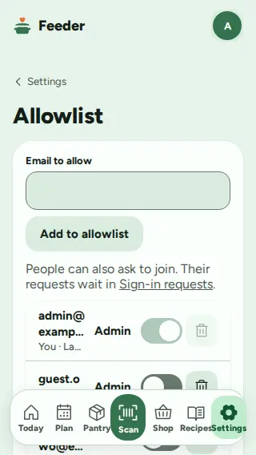 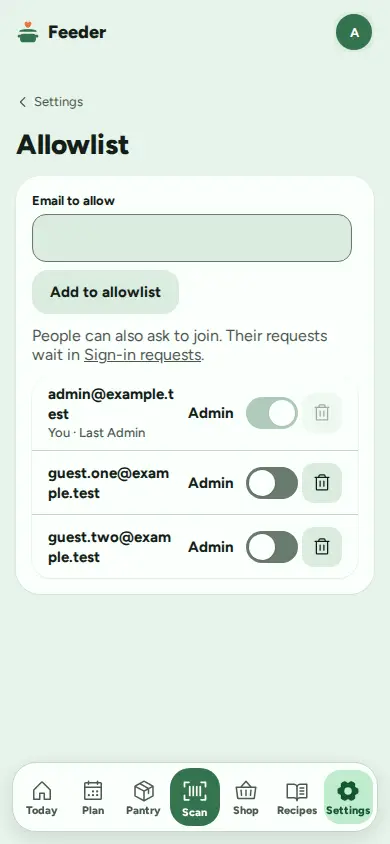

### Design
**The row.**
- **Line 1:** the email is the title. It breaks only before the "@" (a `<wbr>`) and ends in an ellipsis after two lines.
- **Meta:**
  - your own row: "You · Admin · Last Admin";
  - others: their display name, or "Not signed in yet".
- **Actions:** in the new `actions` slot.
  - In a container of at least 35 rem they sit at the end of line 1. Below 35 rem (every phone) they take their own line.
  - The Admin Switch comes first. Last comes a set of exactly two 44 px outlined IconButtons (R-A), so the row has the same width with or without Share.

**The icon set** (ActionGroup, system.md §5: at most two visible actions; anything rarer or destructive goes into ⋮):

| Device | First icon | Second icon | ⋮ "More for <email>" |
|---|---|---|---|
| Has a share sheet (`navigator.share` exists and `navigator.canShare(data)` is not false) | **Share sign-in message** (Phosphor `ShareNetwork`) | **⋮** (`DotsThreeVertical`) | "Copy sign-in message" (`Copy`), a divider, "Remove <email>" (`Trash`, danger) |
| No share sheet | **Copy sign-in message** (`Copy`) | **Remove** (`Trash`) | none |
| Your own row | — | Remove (disabled while you are the Last Admin) | — |

On a phone the ⋮ is DS's Menu-as-sheet; from 768 px it is the Menu popover.

**By size.**
- **320 and 390:** the email is on line 1; the Switch and the icon pair are on line 2.
- **Tablet (820):** one line per row; the menu opens below ⋮.
- **Desktop (1440):** one line per row; Share + ⋮ where the browser can share, otherwise Copy + Remove.

**The message** comes from a new pure function `signInMessage(email, origin)`.
- **Copy text:**
  > You can now sign in to Feeder, our Household's meal planner.
  > Open https://<origin> and choose "Continue with Google", then use <email>.
- **Share payload:**
  - `title`: "Sign in to Feeder";
  - `text`: "You can now sign in to Feeder, our Household's meal planner. Choose "Continue with Google" and use <email>.";
  - `url`: "https://<origin>". The link goes in `url` because many share targets append `url` themselves.
- `<origin>` is `window.location.origin`.
- The message uses no word from the _Avoid_ lists.

**Outcomes and toasts.** All toasts follow R-D and R-D+: a headline, a muted subline, outline pill actions and a 32 px circular Dismiss aligned with the top of the headline. A success toast has no status icon.
- **After "Add to allowlist":**
  - headline "<email> can sign in now";
  - subline "Send them where and how to sign in.";
  - one outline action: "Share sign-in message" where the device can share, otherwise "Copy sign-in message".
- **Copy succeeds:** one line, "Sign-in message copied".
- **Share succeeds:** no toast.
- **Share is cancelled** (`AbortError`): nothing happens, and focus returns to Share.
- **Share fails another way:** the app copies the text instead and shows a toast with headline "Sign-in message copied" and subline "The share sheet did not open." It has no icon, because the outcome is a success.
- **The clipboard is unavailable too:** a sheet "Sign-in message" opens. It holds the text in a read-only TextArea, already selected, with the helper "Select the text and copy it."
  - Its footer has one primary button, "Done".
  - It has no Cancel, so it keeps the R-B circular Close.

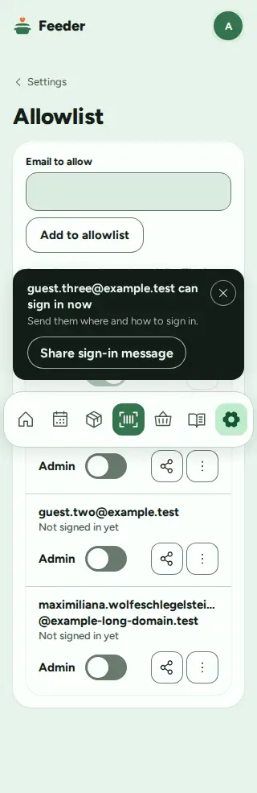 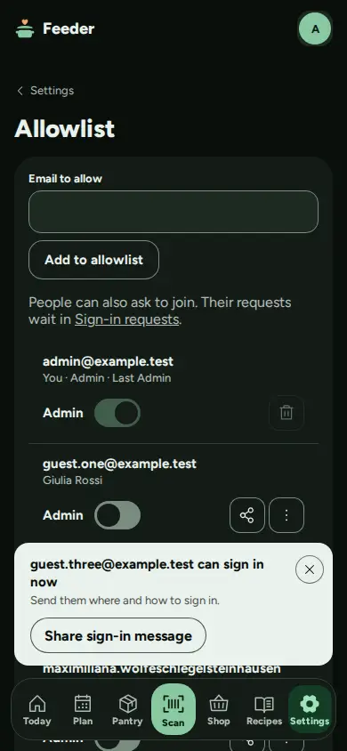 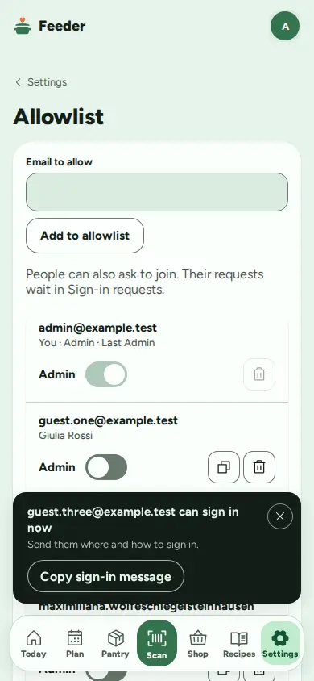
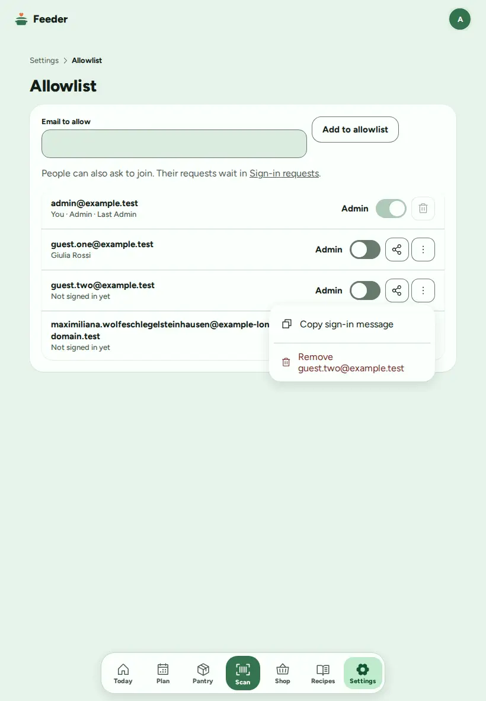 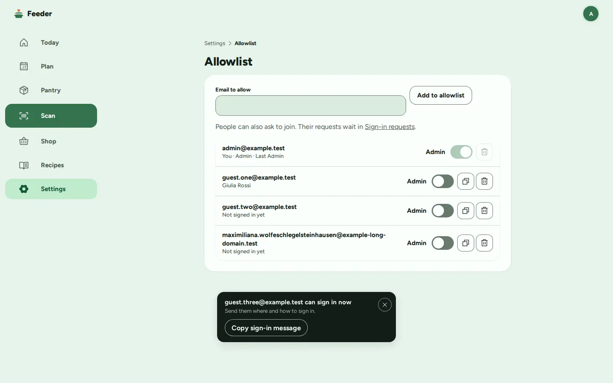

Mock: [mocks/set-03-allowlist.html](mocks/set-03-allowlist.html). `html[data-state]` picks the view: `share`, `copy` or `share-menu`. At 320 the bottom bar follows R-F.

**Rules.** New shared rule text for `ui/ListRow.css` and system.md §3:
> **Row actions.** Controls that belong to a row but are not an ActionGroup (a Switch, two IconButtons, Deny/Approve) go in `actions`. In a container of at least 35 rem they sit at the row's end; below it they take their own line under the text (`flex-basis: 100%`). A row's icon set has at most two IconButtons, each with the R-A outline; a third action goes into a ⋮ Menu.

**Accessibility.**
- The Switch is named "Admin: <email>".
- The IconButtons are named "Share sign-in message for <email>", "Copy sign-in message for <email>", "More for <email>" (with `aria-haspopup="menu"` and `aria-expanded`) and "Remove <email>". Each has a `title`.
- The toast's Dismiss is named "Dismiss". Its focus ring is `--color-bg`.
- After a share, cancel or copy, focus returns to the button that started it.
- Whether the device can share is decided once per page load.

### Alternatives considered
- A text button "Copy sign-in message": at 320 it wraps and pushes Remove off the row.
- Three IconButtons: they do not fit at 320, and ActionGroup allows only two.

### Build notes
- `ui/ListRow.tsx` gets an `actions` prop and `data-actions="true"`. This is shared; SET-12 and SET-15 use it too.
- `AllowlistPanel.tsx` uses the slot.
- `features/settings/lib/allowlist.ts` gets `emailBreak()`, `signInMessage()` and `sharePayload()`.
- New hooks: `ui/lib/useShareText.ts` and `ui/lib/useCopyText.ts`.
- The toasts use DS's R-D/R-D+ Toast.
- No API change.

### Tests and guard
Unit tests:
- `signInMessage` contains the origin and the email, and neither "invite" nor "account".
- `sharePayload` puts the link in `url`.
- `useShareText` maps `AbortError` to "cancelled" and `NotAllowedError` to "failed".
- With share support the row shows Share and ⋮, and the menu holds Copy and Remove. Without it, the row shows Copy and Remove.
- Your own row has no Share or Copy.
- The after-Add toast has a headline, a subline, one action and no icon.

Gherkin:
- Scenario: An Admin adds an email and shares a sign-in message from the toast.
- Scenario: On a device without a share sheet the Admin copies the sign-in message.
- Scenario: Cancelling the share sheet does nothing and returns focus to Share.
- Scenario: When sharing fails, the sign-in message is copied instead.
- Scenario: Without clipboard access, the sign-in message opens selected in a sheet.
- Scenario: At 320 px the Allowlist shows each email at full width above its controls.

Guard:
- New page-layout rule **P31**: a `.list-row__title` narrower than 120 px is a finding (system.md §5.4). It runs on `/settings/allowlist` and `/settings/access-requests` at 320 and 360.
- The existing `glossary` rule already fails "invite".

### Depends on / unblocks
- Unblocks SET-12 and SET-15.
- SAFE: the Remove confirm.
- A11Y: focus after removal.
- DS: Menu-as-sheet, R-A, R-D+ and R-F.

## SET-04  Product page: order, Price rows, history, Save beside its field, removable barcode chips, barcode check
**Severity** S3 · **Size** M · **Sources** SETTINGS-16 · **Reproduced** Confirmed, and wider than reported:
- the empty Picture (≈330 px) comes first;
- Price titles are run together and cut at 390;
- the history repeats the latest Price;
- at 1440, "Save pack size" sits about 400 px from its field;
- the barcode × is a separate IconButton;
- "123" is accepted as a barcode.
**Where** `/products/:id`, all sizes.

### Problem
The page leads with its least-used part. Prices cannot be scanned down a list, and the history looks like a bug.

Cause:
- `features/products/screens/ProductScreen.tsx:79-146`: the tile order, and every tile is `span="full"`.
- `components/PriceList.tsx:21-33`: one joined title and no `value`.
- `ProductBarcodes.tsx`: a static Chip plus a separate IconButton.
- `lib/productForm.ts:58`: `barcodeError` accepts any opaque code.

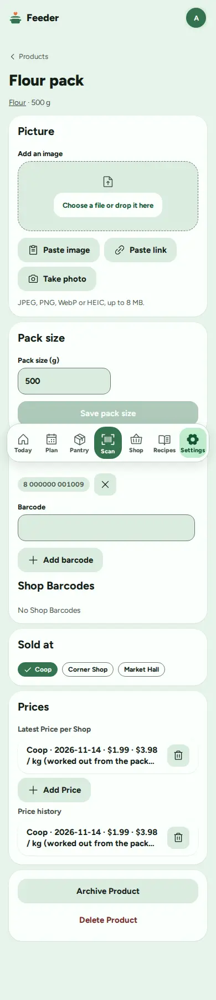 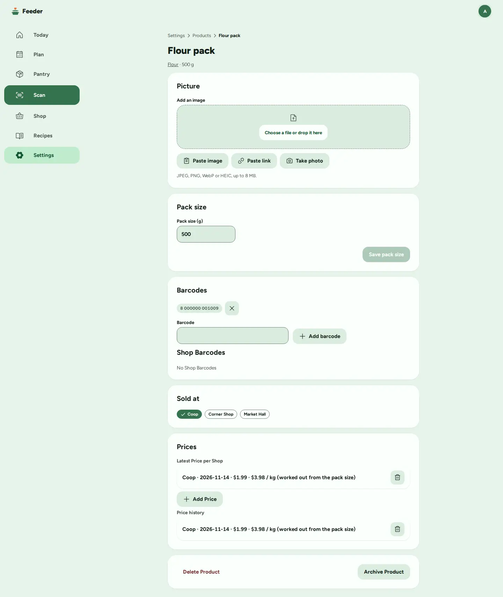

### Design
**Behaviour, in order of use.**
1. **Header.** The Product name, with the subtitle "<Ingredient link> · 500 g pack". An outlined ⋮ "More for <Product>" holds Archive Product and Delete Product (SAFE).
2. **Prices** (full width). The subhead is "Latest at each Shop", followed by R-E rows:
   - key: the Shop;
   - state (value column, tabular): the price;
   - sub-value: the price per kg;
   - detail (meta): the locale date, plus "per kg from the pack size" when that is how the per-kg price was worked out.
   - A row opens the Price sheet, which holds Delete Price (with SAFE's Undo).
   - **"Price history · N older"** is an outlined disclosure button with `aria-expanded`; its CaretRight turns down when open. It shows only when there are older Prices. It lists them newest first, as the same rows, and never repeats a latest row.
   - An outlined **"Add Price"** follows.
3. **Sold at** and **Pack size**, side by side when two cards fit; stacked on a phone.
   - Pack size puts its `xs` field and the primary **"Save pack size"** in one `FieldRow align="end"`.
   - Save is disabled until the value changes. Then a one-line hint shows: "Was 500 g; per-kg Prices update on Save."
4. **Barcodes** (full width).
   - Removable Chips, "8 000000 001009 ×", using `Chip onRemove` with a 44 px target. Removing one shows SAFE's Undo toast.
   - A focused Chip draws its ring inside itself on a soft fill (R-C+).
   - Then the Barcode field with an outlined **"Add barcode"**.
   - Then **Shop Barcodes** as R-E rows:
     - key: the code ("2100 0042");
     - state: the Shop;
     - detail: "Weight Barcode Rule 21 · item code 0042", or "The Shop's own label".
     - When there are none: "None yet. Add one on a Shop's page."
5. **Picture** (last, compact).
   - Empty: the 72 px monogram, "No Picture yet.", and outlined "Choose a file" and "Take photo".
   - With a Picture: the picture with "Change" and "Remove".

**Barcode check (decided: SET 1 = B).**
- A typed code made only of digits must be 8, 12, 13 or 14 digits long with a valid check digit. Otherwise the field shows "Enter the 8, 12 or 13 digits under the bars."
- A code with letters is accepted.

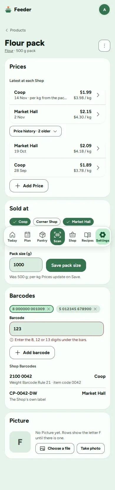 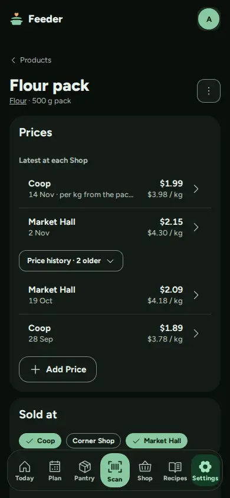 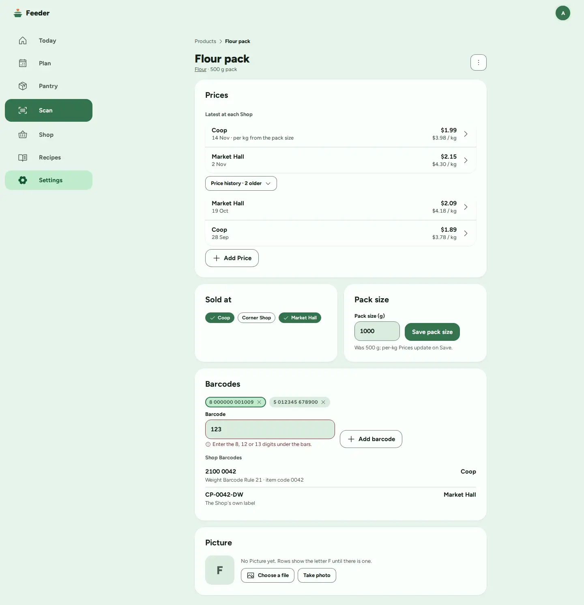

Mock: [mocks/set-04-product.html](mocks/set-04-product.html). The history is shown open and the first barcode Chip is shown focused.

**Rules.**
- Only Prices, Barcodes and Picture use `span="full"`.
- Subheads use `label`, muted. Hints use `meta`.
- Every action other than the primary is an R-A secondary.
- Rows follow R-E with tabular figures.
- No new tokens.

**Accessibility.**
- Price rows are named "<Shop>, <price>, <date>" and have `aria-haspopup="dialog"`.
- A removable Chip is one button named "Remove barcode <code>". After a removal, focus moves to the next Chip, or to the field when none is left.
- The history button has `aria-controls`.

### Build notes
- `ProductScreen.tsx`.
- `PriceList.tsx`, with `priceRows()` in `features/products/lib/priceRows.ts`.
- `ProductBarcodes.tsx`: the removable Chip and the Shop Barcode rows.
- `typedBarcodeError`.
- `ImagePicker compact`, shared with SET-05.
- No API change.

### Tests and guard
Unit tests:
- `priceRows` puts the Shop in the title and the price in `value`.
- History leaves out the latest Price per Shop; there is no history button when there is no history.
- `typedBarcodeError('123')` is an error; `'4006381333932'` and a code with letters pass.
- Removing a barcode Chip calls `onRemove`.
- Shop Barcode rows show the code as key and the Shop as state.

Gherkin:
- Scenario: A Product page shows the latest Price at each Shop in a value column.
- Scenario: Price history appears only when there are older Prices.
- Scenario: A mistyped 3-digit barcode is refused with a field error.
- Scenario: A Shop's own code with letters is accepted as a barcode.

Guard: `PriceList` passes `value`; `check-ui.rules` fails for `products`.

### Depends on / unblocks
- SAFE: Undo and field errors.
- DS: `.pg__*`, R-A and R-E.
- A11Y: R-C+.
- Shares `ImagePicker compact` with SET-05.

## SET-05  Ingredient and Supply page: one "Keeping" tile, Rename in a sheet, no orphan, one Stepper
**Severity** S3 · **Size** M · **Sources** SETTINGS-11 · **Reproduced** Confirmed:
- At 1024, Frozen Shelf Life sits alone beside an empty cell, and Delete Ingredient sits alone at the bottom.
- Two accent primaries are side by side.
- Rename leaves focus on `BODY`, and the inline Name field has no Cancel.
**Where** `/ingredients/:id` and `/supplies/:id`, at all sizes. The orphan appears from 760 px.

### Problem
Three tiles each ask for their own Save. Two accent primaries compete (system.md §2). The grid leaves half-empty rows (§4).

Cause:
- `features/ingredients/screens/IngredientScreen.tsx:95-123` (the inline Rename) and `:125-213` (one Tile per setting, plus the Kind, Merge and Delete tiles).
- `ShelfLifeEditor.tsx` has its own Save.
- `NewIngredientSheet.tsx:195-225` uses a TextField for Shelf Life.

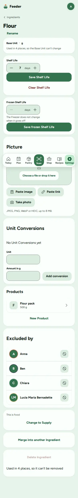 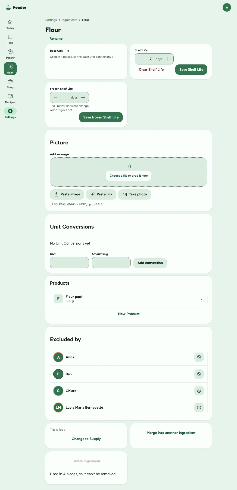 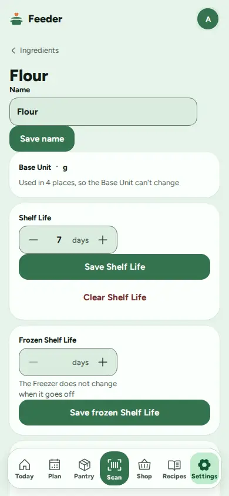

### Design
**Behaviour.**
- **Header.** The name, with the subtitle "Food" or "Supply". Two outlined IconButtons:
  - Rename ("Rename <name>", Phosphor `PencilSimple`);
  - ⋮ "More for <name>", holding Merge into another Ingredient, Change to Supply / Change to food, and Delete Ingredient. Delete is disabled, with the second line "Used in 4 places, so it can't be removed".
  - The Kind, Merge and Delete tiles go away.
- **Keeping** (one tile, full width, first). Each row has a label and hint at the start and a control at the end:
  - **Base Unit:** the value, or the picker while unreferenced; hint "Used in 4 places, so it can't change".
  - **Shelf Life:** a Stepper (md, "days"); hint "Changed from 7 days" while dirty; an outlined small **"Clear"** while set.
  - **Frozen Shelf Life:** a Stepper; hint "Not set: moving a Stock Lot into a Freezer does not change when it goes off".
  - **A Supply** shows Base Unit and Restock level instead (SSP owns the wording).
  - **One Save:** the primary **"Save changes"** is the only accent on the page, disabled until something changes. Beside it, an outlined secondary **"Cancel"** shows while there are changes.
  - Saving shows the toast "Saved Keeping for Flour". SAFE's guard handles unsaved changes.
- **The other tiles.** Products and Unit Conversions are two-up, with outlined "New Product" and "Add conversion". Excluded by is full width (A11Y owns its row states). Picture is last and compact. There is no orphan at any width.
- **Rename** opens a sheet "Rename <name>":
  - a full-width Name field, focused and selected;
  - the helper "Recipes, Stock and the Shopping List show the new name.";
  - a footer with an outlined Cancel and the primary "Save name";
  - no Close, because the footer has Cancel (R-B);
  - focus returns to the Rename button.
- **New Ingredient and New Supply** use the same `StepperField`.

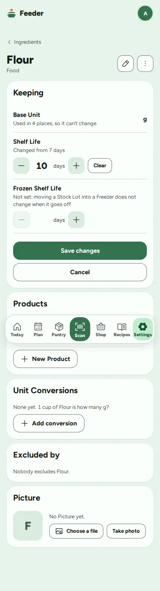 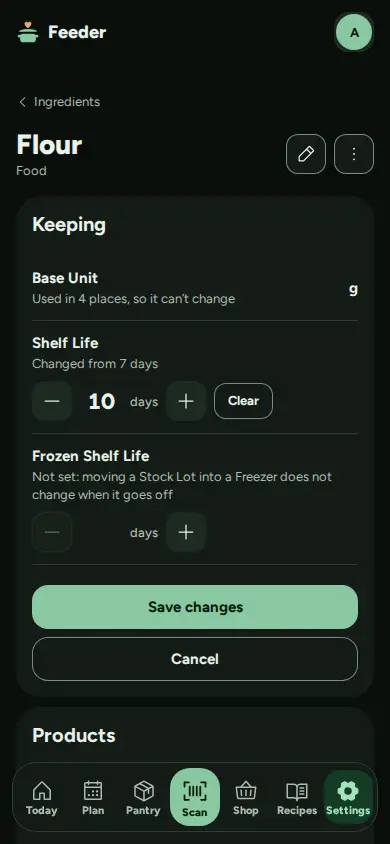 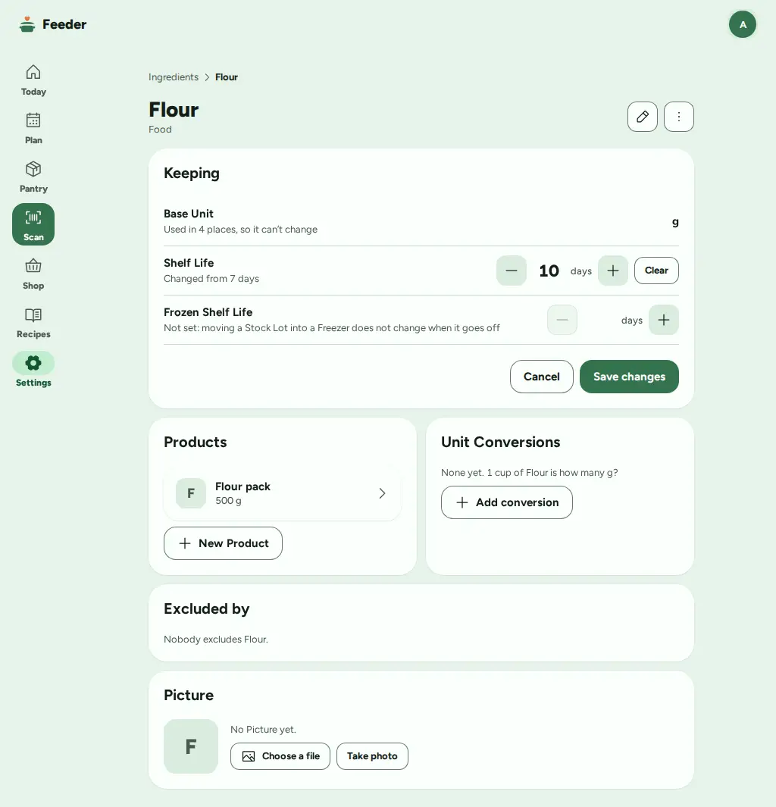
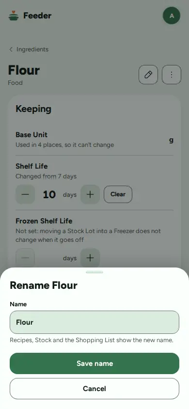 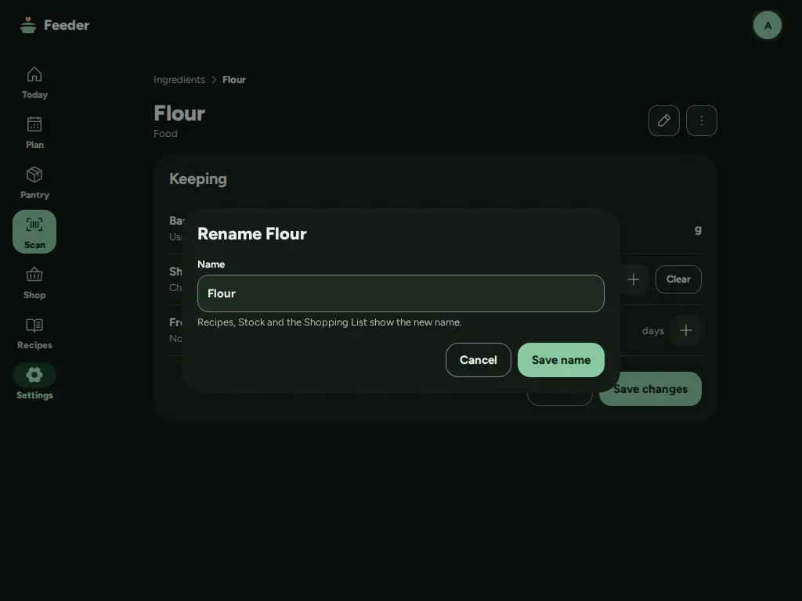

Mocks: [mocks/set-05-ingredient.html](mocks/set-05-ingredient.html), [mocks/set-05-rename.html](mocks/set-05-rename.html).

**Rules.**
- Keeping rows: label `body-strong`, hint `meta` muted, separated by 1 px `--color-line`.
- The value has a minimum width of `--row-value-min`.
- New system.md §4 sentence: "A detail page lists half-width tiles only in pairs; a tile without a pair spans the row."

**Accessibility.**
- Each Stepper is a group named for its row; "Clear" is named "Clear Shelf Life".
- The Rename sheet focuses its field.
- A disabled Save changes has the description "No changes to save".

### Build notes
- `IngredientScreen.tsx`: the layout.
- New `components/KeepingTile.tsx`, `hooks/useKeepingForm.ts` (one PATCH) and `lib/keeping.ts`.
- `ShelfLifeEditor.tsx` and `RestockLevelTile.tsx` lose their own Save.
- `KindTile.tsx`: its action moves into the Menu.
- `NewIngredientSheet.tsx`: uses `StepperField`.
- If the Ingredient PATCH does not accept all three values at once, `useKeepingForm` sends them in sequence and reports a single result. No new endpoint.

### Tests and guard
Unit tests:
- The Keeping draft is dirty after one change and clean after Cancel.
- One Save sends both Shelf Lives.
- The page renders exactly one accent-solid Button.
- Rename opens a dialog whose focused element is the Name input, with no Close.

Gherkin:
- Scenario: Change Shelf Life and Frozen Shelf Life and save both at once.
- Scenario: Rename an Ingredient in a sheet and return to the Rename button.

Guard: a ds test for no lone half-width tile at a 1024 px container.

### Depends on / unblocks
- SAFE: the save model, the guard and Delete.
- A11Y: SETTINGS-07.
- SSP: the Restock wording.
- SET-04: `ImagePicker compact`.

## SET-06  Crafted Select: one chip line, two-line options, Home/End that show the option, focus ring not cut
**Severity** S3 · **Size** M · **Sources** SETTINGS-14 · **Reproduced** Confirmed:
- the filter row is 160 px tall (5 lines) at 390 and at 1440;
- options are cut to one line;
- the search field's ring is cut by 2 px;
- **End: the cause is narrower than reported.** End does move the active option, but the option is never scrolled into view (`OptionList.tsx:36-38` does this; `SelectCore` does not);
- **new in stage 2:** Recipe options show "360 min" and "0 min".
**Where** every crafted Select (Recipe, Ingredient, Tag, Shop, Meal Slot, Unit, Course, Product, Time zone, Currency): a sheet below 768 px, a popover above.

### Problem
On a phone, finding a Recipe starts below five lines of filters. Similar Recipes cannot be told apart. End appears to do nothing.

Cause:
- `ui/Select/Select.css`: `.select__tools { flex-wrap: wrap }` (line 94) and `.select__label { white-space: nowrap }` (line 183).
- `Select.tsx`: no `scrollIntoView`.
- `ui/BottomSheet.css:60-66`.
- `recipeOptions`.

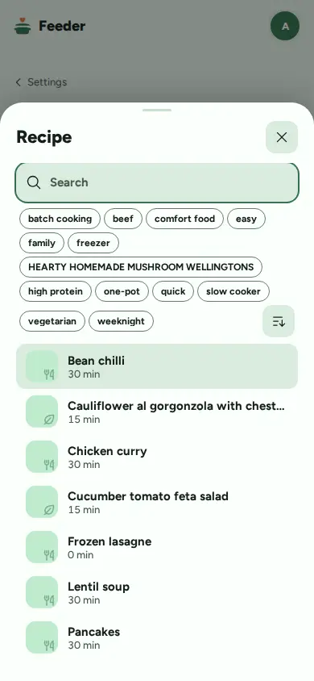 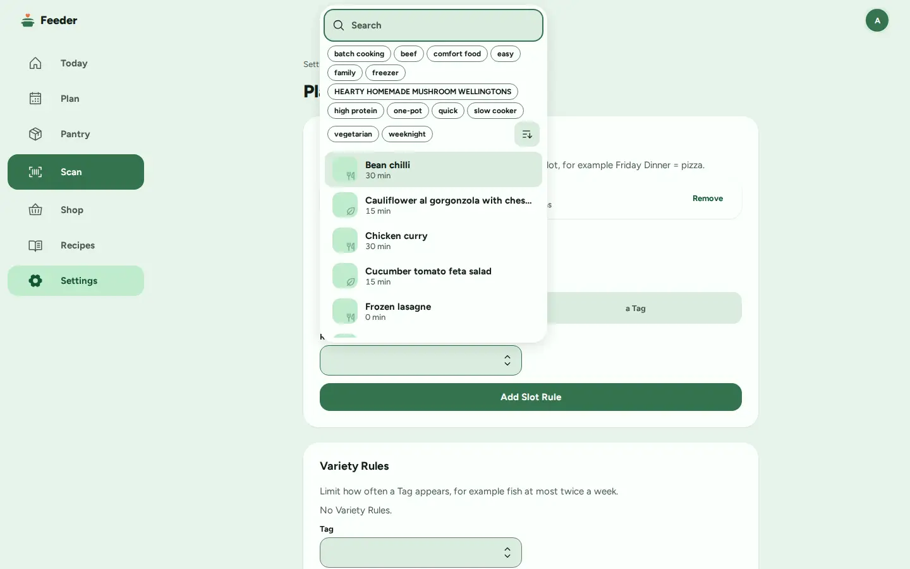

### Design
- **One chip line.** Active filters come first, then as many other filters as fit, then **"+N"** (`aria-expanded`, "Show N more filters").
  - The outlined sort IconButton keeps its place at the end and never shrinks.
  - "+N" expands the line in place, and the expanded line ends with "Fewer".
  - Each chip is at most 12 rem wide; the full text is in its `title`.
- **Options.**
  - The title wraps to at most two lines, at word boundaries.
  - The meta is one line: "30 min", "6 h", "1 h 15 min" or "Ready Meal".
- **Keyboard.** Arrow keys, Home/End and type-ahead move the active option, and it is always scrolled into view (`block: 'nearest'`, `scroll-padding-block: var(--space-2)`).
- **Focus (R-C, R-C+).**
  - Sheet bodies keep 5 px of ring room, so the search field's outer ring (3 px at a 2 px offset) shows in full.
  - The chip strip clips its overflow, so it pads by 5 px and pulls back by 5 px.
  - Chips and the sort button sit inside that strip, so a focused one draws its ring inside itself on a soft fill and never touches a neighbour (R-C+).
- **Close (R-B).** No footer, so the sheet keeps the 40 px circular outline Close.

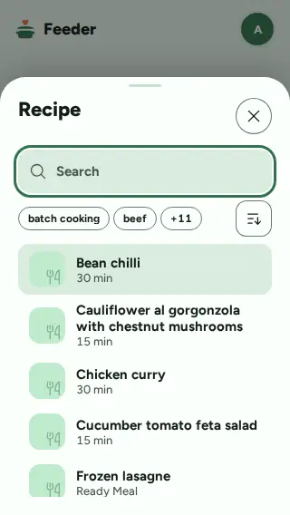 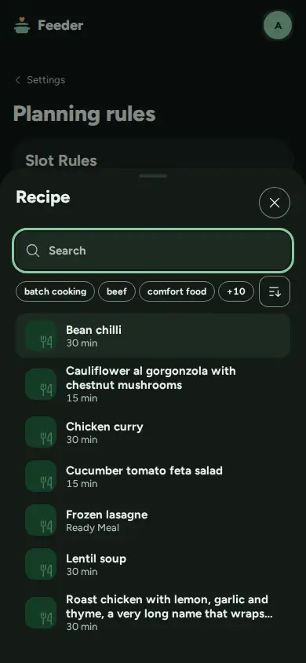 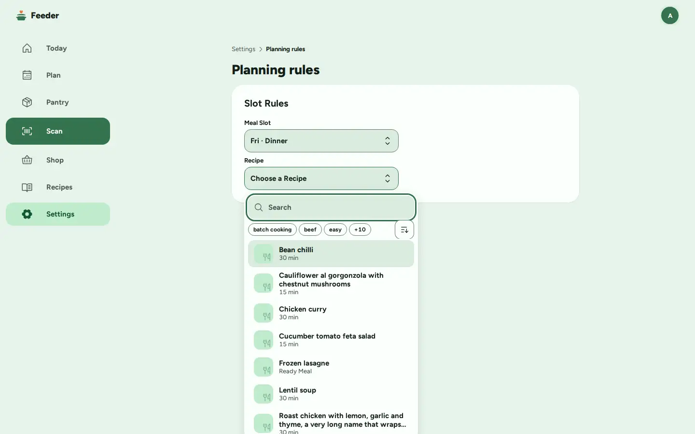 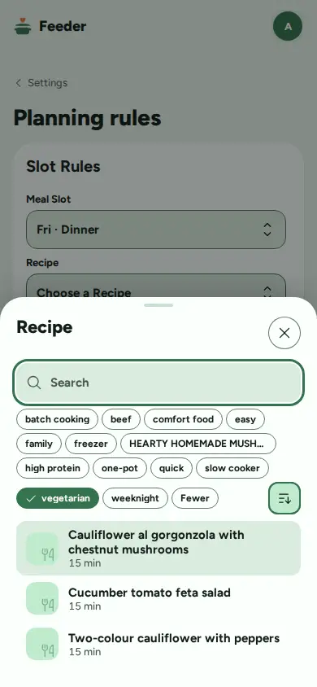

Mocks: [mocks/set-06-recipe-select.html](mocks/set-06-recipe-select.html) (search focused), [mocks/set-06-recipe-select-expanded.html](mocks/set-06-recipe-select-expanded.html) (sort focused).

**Rules.**
- `Select.css`:
  - `.select__tools { flex-wrap: nowrap; overflow: hidden; padding: 5px; margin: -5px }`;
  - `[data-expanded='true'] { flex-wrap: wrap }`;
  - `.select__tools > .chip { flex: none; max-inline-size: 12rem }`;
  - `.select__sort { flex: none }`;
  - nested focus `outline: 2px solid var(--color-accent); outline-offset: -2px; background: var(--color-soft)` (R-C+);
  - `.select__label { white-space: normal; -webkit-line-clamp: 2 }`;
  - `.select__list { scroll-padding-block: var(--space-2) }`.
- `BottomSheet.css`: `.sheet__body { padding-block: 5px; scroll-padding-block: 5px }`.

**Accessibility.**
- "+N" is a button with `aria-expanded`; focus stays on it as it becomes "Fewer".
- The accent ring on soft is 3.4:1 (light) and 3.6:1 (dark).

### Alternatives considered
- A horizontally scrolling chip line: rejected, because it gives no cue on desktop.
- Home/End moving the caret in the search field: rejected, for consistency.

### Build notes
- `Select.tsx`: a scroll-into-view effect.
- `SelectPanel.tsx`: "+N"/"Fewer", using `useFittingChips`, moved to `ui/lib/` and re-exported.
- `Select.css`, `BottomSheet.css`, `options.tsx`.
- Shared primitive: every Select changes.

### Tests and guard
- Unit tests:
  - End makes the last option active and scrolls it into view;
  - "+N" renders when the chips do not all fit;
  - `recipeOptions` gives "6 h";
  - the search field sits at least 5 px inside the sheet body.
- Gherkin:
  - Scenario: The Recipe picker shows one line of Tag filters and a "+N" for the rest.
  - Scenario: Pressing End in the Recipe picker shows the last Recipe.
- Guard: a `planning-recipe-select` scenario at 320, 390, 834 and 1440, running P17 and P18 inside the open Select.

### Depends on / unblocks
- Unblocks SET-01 and SET-07.
- RX's IngredientSelect changes as well.
- A11Y: R-C and R-C+.
- DS: R-B.

## SET-07  Household: searchable Time zone and Currency Selects; field errors as wide as the field
**Severity** S3 · **Size** M · **Sources** SETTINGS-17 · **Reproduced** Confirmed:
- Time zone is free text, and "Rome" is refused;
- the Currency error is 112 × 54 px over three lines;
- focus stays on Save after an invalid save.
**Where** `/settings/household`, all sizes.

### Problem
The Admin must know IANA names and ISO codes. Errors under small fields are squeezed.

Cause:
- `HouseholdSettingsForm.tsx:42` and `:118`.
- `ui/fields/Field.css:23-37`.

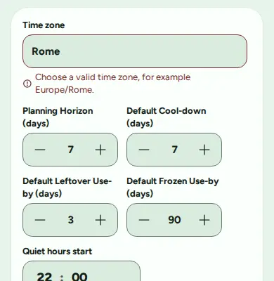

### Design
- **Time zone** is a searchable `TimeZoneSelect`.
  - Options come from `Intl.supportedValuesOf('timeZone')`, grouped by region. The first group is "This device".
  - Each option: label is the city; meta is "<IANA> · UTC+1 · 21:14"; leading is a neutral globe.
  - Search matches the city, the IANA name and "UTC+1".
  - The trigger reads "Rome · Europe/Rome".
  - Helper: "Today, the Plan and notifications use it. It is 21:14 there now."
  - When the zone changes and a Plan exists, a notice says: "Changing the time zone can move today's meals to another day." What happens to the Plan is PC's FLOW-04.
- **Currency** is a searchable `CurrencySelect` (`sm`).
  - Options come from `Intl.supportedValuesOf('currency')` with `Intl.DisplayNames`.
  - Label is "Euro"; meta is "EUR · €".
  - Groups: "Common", then "All currencies".
- **Errors** span the field's track. Focus after an invalid save follows SAFE's `focusFirstInvalid`.
- **Fallback:** a static list when `Intl.supportedValuesOf` is missing.
- The Select sheets keep the R-B Close and the R-C ring room (SET-06).
- At 320 the bottom bar follows R-F.

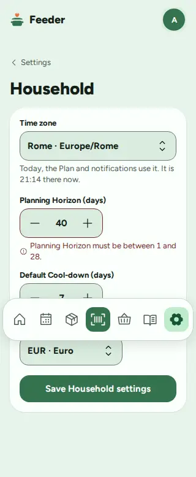 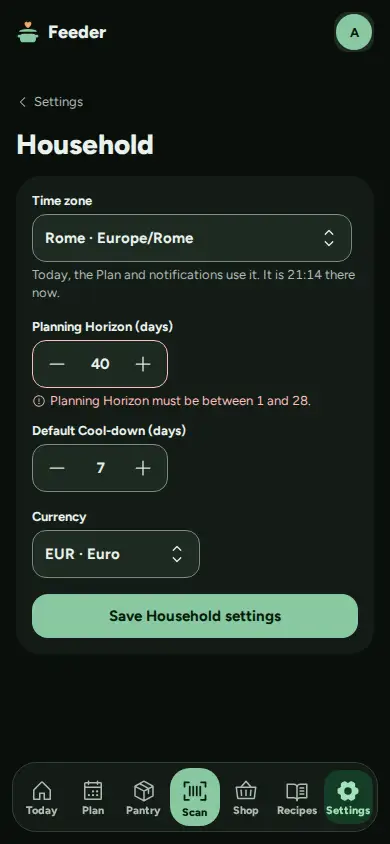 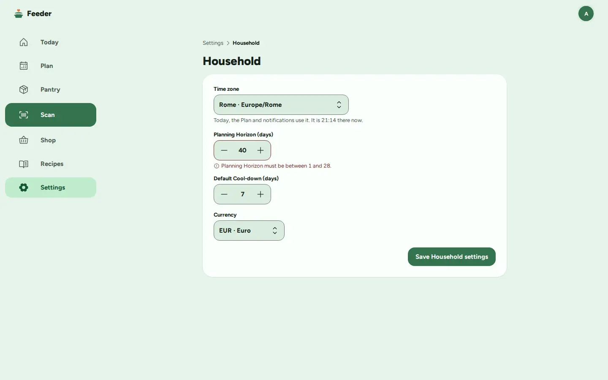
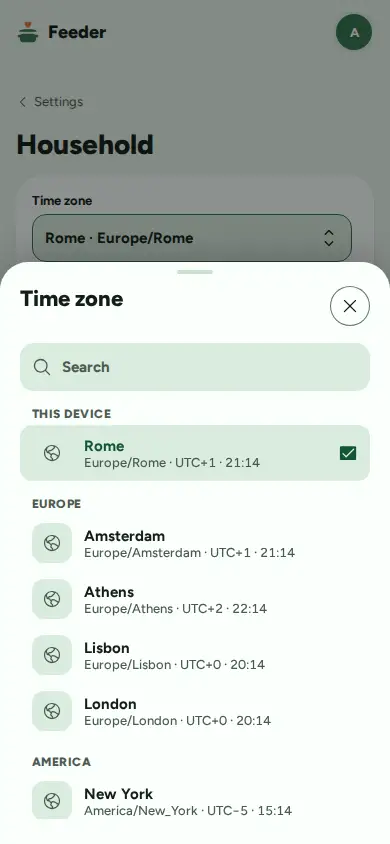 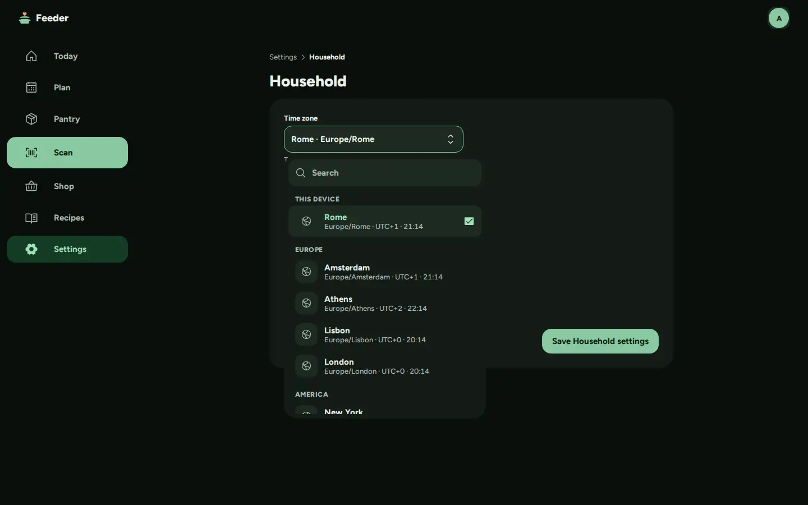

Mocks: [mocks/set-07-household.html](mocks/set-07-household.html), [mocks/set-07-timezone-select.html](mocks/set-07-timezone-select.html).

**Rules.** New system.md §1 text: "**A field's size token limits its control, never its label, helper or error.** The error and helper take the field's full track, at most 60 ch."
- `.ui-field[data-size]` loses `max-inline-size`; the control and the Select take `--field-size-*` instead.
- This is shared by every `xs`, `sm` and `md` field. Update `fieldSize.css.test.ts`.

**Accessibility.** The comboboxes are named "Time zone" and "Currency". Option descriptions carry the IANA name and offset.

### Build notes
- `ui/Select/TimeZoneSelect.tsx` and `CurrencySelect.tsx`, with option builders in `options.tsx`.
- `HouseholdSettingsForm.tsx`, `lib/settingsForm.ts`, `Field.css`.
- No backend change.

### Tests and guard
- Unit tests: the option builders; the Time zone control is a combobox; an `xs` error spans its track.
- Gherkin:
  - Scenario: An Admin finds Rome by typing "Rom" and saves the Household's time zone.
  - Scenario: A Planning Horizon of 40 shows its error on at most two lines at 320 px.
- Guard: a `household-errors` scenario at 320 and 390. **P31** flags an error box narrower than 120 px.

### Depends on / unblocks
- SET-06.
- SAFE: `focusFirstInvalid`.
- PC: FLOW-04.

## SET-08  Meal Slot cards and week strip from 320 to wide
**Severity** S3 · **Size** S · **Sources** SETTINGS-15 · **Reproduced** Confirmed:
- At 320 a day cell is 31 px wide, while its "13:00" needs 36 px.
- "Edit <slot>" and "Change a date" are 36 px high on touch.
- At 1440 the cards are 1120 px wide but use only ≈520 px.
- An "Every day" slot repeats the same time seven times.
**Where** `/settings/meal-slots`: 320 and 360, every touch size, and 1024 to 2560.

### Problem
The strip is unreadable at 320 and repeats itself. The actions are small. On desktop the cards are mostly empty.

Cause:
- `lib/mealSlotCards.ts` gives `span: 'full'`, which `MealSlotCard.tsx:35` passes on. `MealSlotCards.tsx:30` uses `min="card"`.
- `MealSlotWeekStrip.tsx` always renders the time.
- `mealSlotCards.css:205-260`.
- The buttons are `size="sm"` (`MealSlotCard.tsx:94-98`), and "Change a date" is a bare tertiary.

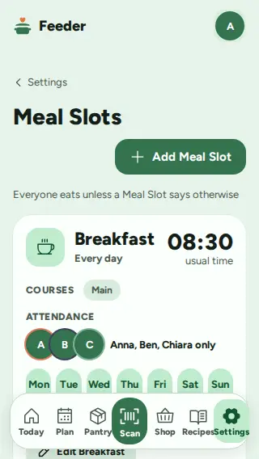 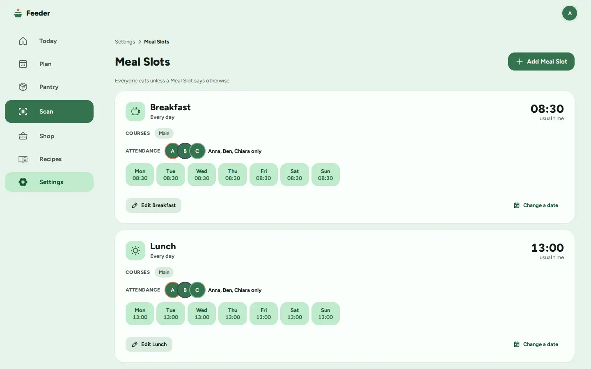

### Design
**Strip.**
- A cell shows the weekday, and a time only on a day that differs from the usual one (marked with the existing dot).
- Below a card width of 22 rem, cells show the weekday and the dot only. The "Differs on" list under the strip carries the times.
- Cells are 44 px high. On a phone they are at least 31 px wide.
- A free day stays the dashed "+".

**Card foot.** "Edit <name>" and "Change a date" are both outlined secondary buttons (R-A), 44 px high on touch.

**Clock.** The usual-time clock keeps its `title-1` size at weight 600, not 800 (the round-1 rule for display text).

**Grid.** `BentoGrid min="wide"` (28 rem), and cards never span the full width:
- one column below about 940 px of content;
- two columns at 1024 and wider;
- a third card starts a new row.

**Empty state.** Unchanged.

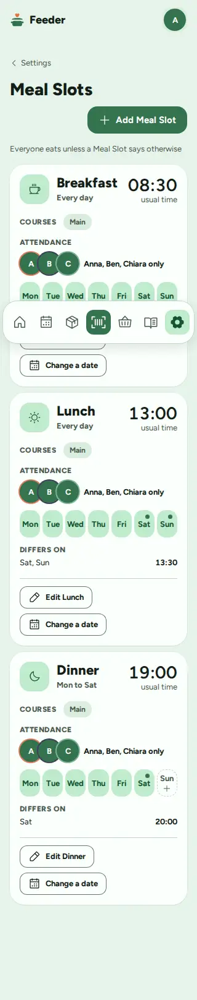 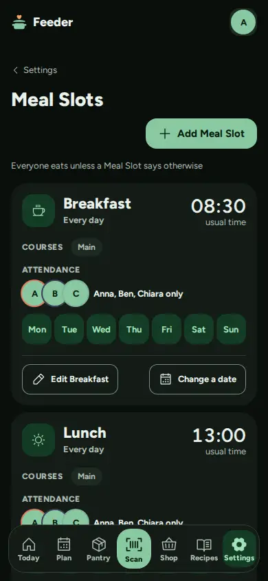 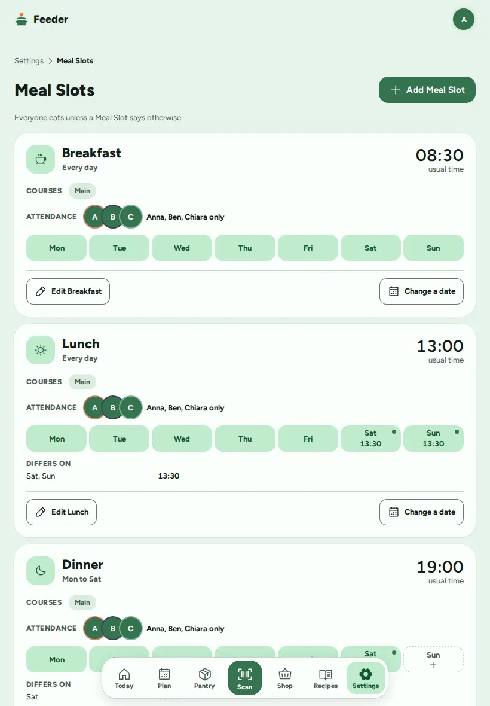 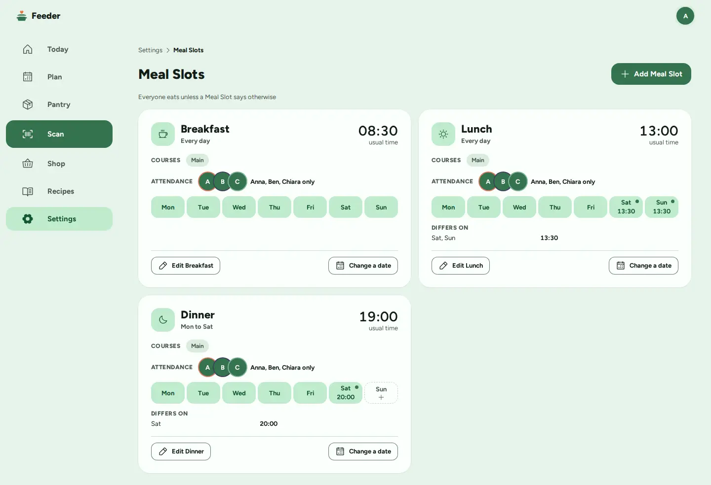

Mock: [mocks/set-08-meal-slots.html](mocks/set-08-meal-slots.html).

**Rules.**
- `.ms-card { container-type: inline-size }`
- `@container (max-width: 22rem) { .ms-day__time { display: none } }`
- `.ms-day { min-block-size: 44px }`
- the time uses `meta` at full opacity
- `.ms-card__clock { font-weight: 600 }`

At 320 the two foot buttons each take a line, because the card is 248 px wide inside.

**Accessibility.** Each cell keeps its full name, "<slot> on <weekday>, <time>".

### Build notes
- `lib/mealSlotCards.ts` gives no full span.
- `MealSlotCards.tsx` uses `min="wide"`.
- `MealSlotWeekStrip.tsx` renders the time only when the day differs.
- `MealSlotCard.tsx`: secondary buttons with a touch size.
- `mealSlotCards.css`.

### Tests and guard
- Unit: there is never a `span: 'full'`.
- Unit: no time shows for an every-day slot; a time shows only on a differing day.
- Unit: "Change a date" is a secondary button.
- Gherkin: Scenario: At 320 px the week strip shows weekdays only and the differing times underneath.
- Gherkin: Scenario: On a desktop the Meal Slot cards sit two to a row.
- Guard: a ds test of the strip at a 288 px container; P13 at 320.

### Depends on / unblocks
- A11Y: target sizes.
- PC: FLOW-12 / PC-08.
- SET-15 adds the Removed Meal Slots tile under the cards.

## SET-09  Meal Slot editor: Course rows as one anatomy
**Severity** S3 · **Size** S · **Sources** SETTINGS-18 · **Reproduced** Confirmed at 820 (560 px dialog). The lower-case "main Course" is by design (GLOSSARY).
**Where** Edit / Add Meal Slot → Courses; Change a date → Courses; the Recipe editor's Courses. From 600 to 1023 px, and in the 560 px dialog.

### Problem
You cannot tell which controls belong to which Course.

Cause: `ui/CoursePicker/CoursePicker.css:29-37`, together with a viewport media query (`:73-78`).

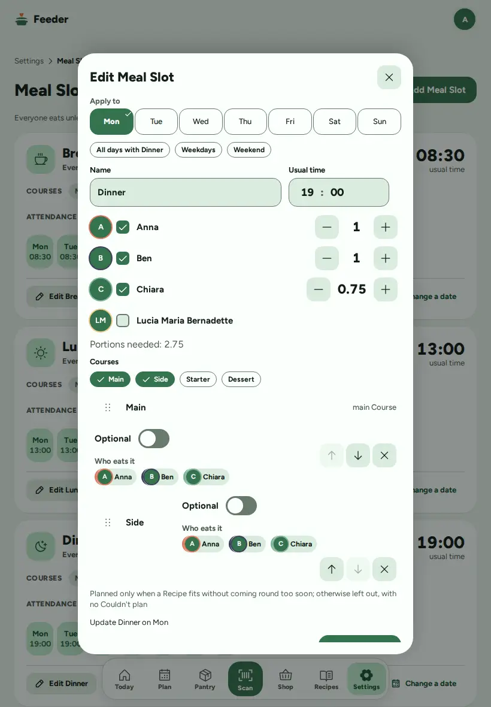

### Design
Every chosen Course is a bordered row laid out on one grid, driven by the container's width:

```
[handle 44] [name, body-strong / meta: "main Course" or "Chiara does not eat it"] [↑ ↓ ×]
            [Optional switch]  [Who eats it: Member pills ...........................]
```

- Below 26 rem the second line stacks.
- The icon set is outlined (R-A) and stays in a fixed order at the row's end. A disabled ↑ or ↓ keeps its place.
- The row has its own boundary, so a focused ↑, ↓ or × draws its ring inside itself on a soft fill (R-C+), and the row's 1 px boundary stays neutral.
- The footer has an outlined Cancel and the primary "Save Meal Slot", so there is no Close (R-B).

  

Mock: [mocks/set-09-course-rows.html](mocks/set-09-course-rows.html). Main's ↓ is shown focused.

**Rules.**
- `.course-picker__list { container-type: inline-size }`.
- Row grid `44px minmax(0, 1fr) auto`, with areas `'handle text actions' '. extras extras'`.
- `@container (max-width: 26rem)` stacks the extras.
- The viewport media query is removed.
- Border: 1 px `--color-line`; `--color-outline` while a child has focus.
- Nested focus follows R-C+.

**Accessibility.** The DOM order is unchanged. The Switch is named "Optional: <Course>"; the pills are named "Who eats <Course>".

### Build notes
- `ui/CoursePicker/CoursePicker.css` and `CourseRow.tsx` (shared).
- `SlotCoursesField.tsx`, with the meta from `lib/slotCourses.ts`.
- `MealSlotEditor.tsx` drops the Close.

### Tests and guard
- Unit test: `slotCourseMeta`.
- ds test: action buttons align at the same x in a 520 px container.
- Unit test: no Close when there is a Cancel.
- Gherkin: Scenario: In the Meal Slot editor every Course row has its move and remove buttons in the same place.
- Guard: a `meal-slot-editor` scenario at 390, 820 and 1440, with P13.

### Depends on / unblocks
- SHORT: the footer.
- DS: R-B.
- A11Y: R-C+.

## SET-10  Meal Slot sheet: Attendance rows with long Member names
**Severity** S3 · **Size** XS–S · **Sources** SETTINGS-13 · **Reproduced** Confirmed at 390: "Lucia Maria Bernadette" pushes her stepper onto an orphan line.
**Where** Add / Edit Meal Slot → Attendance, from 320 to 430. Change a date's "Who's eating" reuses it.

### Problem
The stepper reads as belonging to nobody.

Cause: `AttendanceEditor.tsx:31-44` and `settings.css:66-74`.


### Design
Each Member is one row using the ListRow anatomy:
- control: the checkbox, 44 px;
- picture: the Avatar, 40 px;
- title: the name, at most two lines;
- end: the Portion Factor Stepper, or a muted "Not eating".

A one-word name too long to fit ends in an ellipsis. Below 20 rem, every row puts its stepper on a second line under the name; all rows switch together.

The footer has an outlined Cancel and the primary "Add Meal Slot", so there is no Close (R-B). At 320 the bottom bar under the sheet follows R-F.

  

Mock: [mocks/set-10-attendance.html](mocks/set-10-attendance.html).

**Rules.**
- `.attendance { container-type: inline-size }`.
- Grid `44px 40px minmax(0, 1fr) auto`.
- `@container (max-width: 20rem)` uses areas `'check av name name' '. . step step'`.
- Rows are at least `--row-min` high.

**Accessibility.** The checkbox is labelled by the Member's name. The Stepper is named "Portion Factor for <name>".

### Build notes
`AttendanceEditor.tsx` and `settings.css`. `DateAttendancePanel` gets the same change.

### Tests and guard
- Unit test: the checkbox comes before the Avatar.
- Gherkin: Scenario: A long Member name keeps its portion stepper in its own row.
- Guard: the `meal-slot-editor` scenario at 320 and 390, with P13 and **P31**.

### Depends on / unblocks
PC-08.

## SET-11  Tags rows: the Tag is the title, the count is the value
**Severity** S3 · **Size** XS · **Sources** SETTINGS-12 · **Reproduced** Confirmed at 320: the leading Tag chip is cut (132 of 280 px) and the title "1 Recipe" wraps.
**Where** `/settings/tags`, from 320 to 430, light and dark.

### Problem
The row's identity, the Tag, is the part that gets cut.

Cause: `features/tags/screens/TagsScreen.tsx:34-36`.


### Design
Each row:
- leading: a 40 px square in the Tag's colour pair, with the Tag fill icon;
- title: the Tag name, at most two lines;
- value: the count, with tabular figures ("12 Recipes", "1 Recipe", "None");
- chevron: opens Edit Tag.

"Add Tag" is an outlined secondary (R-A). The Edit Tag Name field is full width. At 320 the bottom bar follows R-F.

 

Mock: [mocks/set-11-tags.html](mocks/set-11-tags.html).

**Rules.** Uses the chip's colour pair, which is already contrast-tested. No new tokens.

**Accessibility.** The row is named "<Tag>, <count>".

### Build notes
- `TagsScreen.tsx`.
- New `ui/TagColour/TagSwatch.tsx` (decorative).
- `tags.css`.
- The Edit Tag field uses `size="full"`.

### Tests and guard
- Unit test: the name is the title and the count is the value.
- Gherkin: Scenario: The Tags list shows each Tag's full name at 320 px.
- Guard: **P31** on `/settings/tags`.

### Depends on / unblocks
None.

## SET-12  Sign-in requests rows: neutral monogram, no nested tile, readable at 320
**Severity** S3 · **Size** S · **Sources** SHELL-21 · **Reproduced** Confirmed with a mocked `/api/access-requests`:
- accent monograms;
- a two-line meta;
- a tile nested in a tile;
- the long name is cut at 320.
New in stage 2: `access.css:3-23` uses `overflow-wrap: anywhere`.
**Where** `/settings/access-requests`, from 320 to 430, light and dark.

### Problem
The accent monograms tint every row. The two-line meta and the nested tile waste width. Words break mid-word.

Cause: `AccessRequestList.tsx:34-50`, `RequestAvatar.tsx` and `access.css`.


### Design
Each request is an R-E row:
- leading: a neutral monogram (muted on `--color-surface-2`), or the Google photo;
- key (title): the name, or the email with meta "No name from Google";
- detail (meta): the email;
- state (value, tabular): "12 days left", with the sub-value "asked 2 days ago". With 2 days or fewer left, the state takes the spoil tone until DS's warn tone exists;
- actions (SET-03's slot): **Deny** as an outlined danger secondary and **Approve** as an outlined secondary.

Below 35 rem a row has three lines:
1. the monogram, the name and the email;
2. "12 days left · asked 2 days ago", under the name;
3. Deny and Approve, at the end.

The list sits in the page's ListGroup, with no outer tile. At 320 the bottom bar follows R-F.

  

Mock: [mocks/set-12-access.html](mocks/set-12-access.html).

**Rules.**
- The neutral monogram is 5.93:1 (light) and 7.49:1 (dark).
- The spoil state is 9.45:1 (light) and 11.19:1 (dark).
- Deny follows R-A for danger.
- Remove the `access.css` phone block and `overflow-wrap: anywhere`.

**Accessibility.** The buttons are named "Deny <email>" and "Approve <email>".

### Build notes
- `AccessRequestList.tsx`.
- `ui/Avatar` gets `tone="neutral"`.
- `access.css`.
- `requestWhen(r, now)` in `lib/requests.ts`.

### Tests and guard
- Unit tests: `requestWhen`; the neutral Avatar; Deny is a danger secondary.
- Gherkin: Scenario: At 320 px a sign-in request shows the full name, its email and both actions.
- Guard: **P31** on `/settings/access-requests`; `check-ui.rules` fails `overflow-wrap: anywhere`.

### Depends on / unblocks
- SET-03.
- DS: the warn tone, R-A and R-F.

## SET-13  Desktop layout of narrow Settings and catalogue pages
**Severity** S4 · **Size** XS (built by SET-04 and SET-05) · **Sources** stage-1 settings summary, point 10 (no id) · **Reproduced** Confirmed. At 1440 every Settings, Product and Ingredient page is a 720 px column centred in the 1200 px main area, with 240 px empty on each side.
**Where** `/settings/*` (except Meal Slots), `/products/:id`, `/ingredients/:id`, `/supplies/:id`, `/settings/shops/:id`; 1024 to 2560.

### Problem
List pages read well at 720 px. Detail pages, however, give every tile the full width, so a short tile such as "Sold at" becomes a wide, mostly empty card. ui-review-2 recorded the narrow width (`app/pageWidths.ts`).


### Design
**Decided (SET 2 = A).** Keep `narrow`. Detail pages place short tiles two-up inside the column (`BentoGrid min="card"`, without `span="full"`), as SET-04 and SET-05 design. List pages are unchanged. Option B (`default` width) is not built.

 

### Build notes
Nothing beyond SET-04 and SET-05. `app/pageWidths.ts` is unchanged.

### Tests and guard
The SET-05 ds test (no half-width orphan at a 1024 px container) also covers the Product page.

### Depends on / unblocks
SET-04, SET-05.

## SET-14  Small consistency and copy items
**Severity** S4 · **Size** S (eight XS items) · **Sources** SETTINGS-22 · **Reproduced** Items a–f and h confirmed. Item g (Notifications on iPhone Safari) was read from code only, in `features/notifications/strings.ts:18`.

 

### Design
a. **Products list (decided: added):** a primary "New Product" in the PageHeader. It opens the existing New Product sheet with an Ingredient Select first. Files: `features/products/screens/ProductsScreen.tsx`, `strings.ts`.

b. **Shops list:** every row gets a meta line, e.g. "12 Prices · Location saved" or "No Prices yet · Location not saved". The count comes from a `priceCount` added to `GET /api/shops`, computed in the same query with `COUNT(DISTINCT product_id)`. Files: `features/shops/components/ShopList.tsx`, `internal/product/store` (listShops).

c. **Courses:** the main Course row drops its "Main" badge. Its meta reads "main Course · 12 Recipes · 21 Meal Slots". Files: `features/settings/components/CourseRow.tsx:36-41`, `coursesStrings.ts:12`.

d. **Planning rules:** the "Rule is for" options read "Recipe" and "Tag". Files: `features/plan/strings.ts:96-97`.

e. **Ingredients, empty search:** "No Ingredient matches "Chickpeas"." followed by a secondary button "New Ingredient "Chickpeas"", which opens New Ingredient with the name already filled in. Supplies get the same. Files: `IngredientsScreen.tsx`, `SuppliesScreen.tsx`.

f. **Recipe Assistant, Model:**
   - Refresh models sits directly after the Select, in one `FieldRow align="end"`.
   - The "$" glyph becomes a meta label "Price per 1M tokens".
   - SHORT owns that page's sticky bar.

g. **Notifications on iPhone Safari:** the line becomes "Safari on iPhone sends notifications only to Feeder added to the Home Screen. Use Share, then Add to Home Screen, then open Feeder from there." It shows only for iOS Safari; other browsers keep the old line. Files: `features/notifications/strings.ts`, plus a pure user-agent check in `features/notifications/lib`.

h. **Edit from an "Every day" card (decided: all days):**
   - The card's "Edit <name>" opens the editor with "All days with <name>" selected, so a time change applies to every day.
   - A day cell of the week strip still opens that day only (spec r15).
   - Files: `features/settings/hooks/useSlotForm.ts`, `lib/slotForm.ts`.


Mock: [mocks/set-14-small.html](mocks/set-14-small.html) shows items a–e. Items f–h change copy or behaviour only, so they have no mock.

### Tests and guard
Unit tests:
- The main Course row has no "Main" chip.
- The `ruleKind` strings read "Recipe" and "Tag".
- An empty search renders the create button with the query.
- `isIosSafari` is true for the iPhone user agent.
- `slotFormFromCard` selects every day for an every-day name.
- `slotFormFromCell` selects that day only.

Gherkin:
- Scenario: Create an Ingredient from an empty search.
- Scenario: Create a Product from the Products list.
- Scenario: Editing an every-day Meal Slot from its card changes every day.

### Depends on / unblocks
- A11Y owns the Segmented selected state.
- Item b reads data like SET-02.

## SET-15  Removed Meal Slots keep their Cooked history: where it shows
**Severity** S3 · **Size** S (frontend) on top of SAFE-02's data change · **Sources** decision SAFE 7 B (Remove Meal Slot, new in stage 2, SAFE-02) · **Reproduced** Confirmed by SAFE: the `meal_slots` cascade deletes Cooked Planned Meals (`internal/db/migrations/1400_courses.sql:84`). See SAFE-02's `shots/safe-02-before-mealslot-390x844-light.webp`.
**Where** `/settings/meal-slots`, Recipe history and Last cooked, Cook Mode names.

### Problem
Removal now keeps the Cooked meals. The Admin should see that this history was kept and be able to put the Meal Slot back. Every screen that names a past meal needs a rule for it.

### Design
**What SAFE-02 decides, and this item follows.**
- `RemoveSlot` sets `removed_at` on that weekday's Meal Slot.
- It deletes the slot's **unresolved** Planned Meals and `plan_unfilled` rows, so **nothing of a removed Meal Slot remains in To confirm**.
- It keeps Cooked and Not cooked rows, Slot Rules, Attendance, Courses and date changes.
- **Plan and Today show active Meal Slots only**, so a removed slot does not appear on past Plan days. An earlier version of this item added a "· Meal Slot removed" mark there; that mark is withdrawn.
- `Store.Slot(id)` still returns a removed slot with `Removed: true`, so history and Cook Mode keep its name.
- Restore is `POST /api/meal-slots/{id}/restore`. It refuses with 409 `meal_slot_name_taken` ("There is already a Dinner on Monday.").

**Meal Slots page.** After the cards comes a tile, "Removed Meal Slots". It shows only when a removed Meal Slot holds Cooked or Not cooked meals.
- One sentence, said once: "Their Cooked meals stay in the history, so Last cooked and Cool-down still count them."
- Rows follow R-E. A name removed on several weekdays at once is one row.
  - key: "Snack · Mon to Fri";
  - state (value, tabular): "6 Cooked";
  - detail: "16:30 · removed 14 Nov";
  - action (SET-03's `actions` slot, Admin only): an outlined secondary **"Put back"**. It calls SAFE-02's restore for each weekday's Meal Slot in the row and replans. The toast reads "Snack is back".
- If a name has been taken in the meantime, the error toast (R-D+, 16 px warning icon in the headline) reads "There is already a Snack on Monday." with the subline "Rename or remove that Meal Slot first." The row stays.
- Rows are sorted newest removal first. Plain Users see the tile without "Put back".
- SAFE's Undo toast right after removal does the same restore.

**Elsewhere.**
- Recipe Cooked history and Last cooked (RX) are unchanged, for example "Mon 3 Nov · Snack".
- Cook Mode and Shopping names come from `Store.Slot` and are unchanged.
- Cool-down and Variety Rules keep counting these meals.

  

Mock: [mocks/set-15-removed-meal-slots.html](mocks/set-15-removed-meal-slots.html).

**Rules.**
- `ListRow` with `value` and `actions`; "Put back" takes its own line below 35 rem.
- The sentence is `meta`, muted.
- R-A, R-E. No new tokens.

**Copy.** "Removed Meal Slots"; "Their Cooked meals stay in the history, so Last cooked and Cool-down still count them."; "<name> · <days>"; "<time> · removed <date>"; "N Cooked"; "Put back"; "<name> is back".

**Accessibility.**
- The tile is a labelled section.
- "Put back" is named "Put back <name> · <days>".
- After a restore, focus moves to the restored card.

### Build notes
- **API:** `GET /api/meal-slots?removed=with-history` returns `[{ids, name, weekdays, time, removedAt, cookedCount}]`, grouped by name and removal time. It is a thin handler over `internal/household`. Restore is SAFE-02's endpoint.
- **Frontend:**
  - `features/settings/components/RemovedMealSlots.tsx`;
  - `hooks/useRemovedMealSlots.ts`, which restores every id in the row in one call sequence and reports one result;
  - `MealSlotsPage.tsx` renders the tile.
- No change is needed in PC's or TB's files.

### Tests and guard
- Go tests:
  - a removed slot with history is listed, grouped by name, with its count;
  - a removed slot without history is not listed;
  - active queries never return a removed slot.
- Unit tests:
  - "Put back" restores every id in the row;
  - the tile is empty when nothing is removed;
  - a 409 shows the error toast and keeps the row.
- Gherkin:
  - Scenario: After removing a Meal Slot, its Cooked meals are listed under Removed Meal Slots.
  - Scenario: An Admin puts back a removed Meal Slot from its row.
  - Scenario: A Recipe's Last cooked date is unchanged after its Meal Slot is removed.

### Depends on / unblocks
- SAFE-02 (data, confirm, restore, Undo).
- SET-03 (the `actions` slot).
- DS: R-D+.

## SET-16  "Away" on the Members list and in the Member sheet
**Severity** S3 · **Size** S · **Sources** decision PC 3 (FLOW-12). PC-08 designs the Away record, its dialog, its toasts and its endpoints. · **Reproduced** Confirmed by PC: there is no way to mark a Member away for several days. Today the Members list shows only the Portion Factor (`shots/set-13-before-1440x900-light.webp`).
**Where** `/settings/members` (the list) and Edit Member (the sheet); all sizes.

### Problem
PC-08 defines an **Away**:
- a first day and, when known, a last day, each optionally starting or ending at a named Meal Slot;
- it applies even past the Planning Horizon;
- a Member's Aways do not overlap;
- every write gives an Undo toast.

PC-08 also asks the Member's page in Settings to list the Member's Aways, with **Add an Away**.

### Design
**Members list.** A Member with a current or upcoming Away gets a meta line in the info tone:
- "Away 20–27 Nov";
- "Away until Sun 16 Nov" when the Away has started;
- "Away from Tue 1 Dec" when it has no last day yet;
- "Away 20–27 Nov · +1 more" when there are more.

Only the next Away is named, and past Aways never show. The value column keeps "×1". The row opens the Member sheet.

**Member sheet.** An "Away" section comes after the existing fields; it is PC-08's "Away tile". Each current or future Away is an R-E row, soonest first:
- key (title): the range, e.g. "Thu 20 – Thu 27 Nov" or "From Tue 1 Dec";
- state (value, tabular): "in 6 days", "in 17 days", or "now" for a running Away;
- detail (meta): "24 Meal Slots · whole days", "From Dinner · 7 Meal Slots", or "No last day yet";
- chevron: opens PC-08's Away dialog to edit. Ending and deleting happen inside that dialog (Save, End today or Delete, ⋮).

Below the rows, an outlined secondary **"Add an Away"** (Phosphor `Plus`) opens PC-08's dialog with this Member already chosen.
- Empty state: "Not away on any day." and the button.
- The toasts are PC-08's (R-D, R-D+).
- The sheet's footer has an outlined Cancel and the primary "Save Member", so there is no Close (R-B). SAFE-02 owns the footer and Remove Member.

   

Mock: [mocks/set-16-members-away.html](mocks/set-16-members-away.html). `html[data-state=sheet]` shows the sheet; the other Member fields are not drawn.

**Rules.**
- ListRow gets `metaStatus` `'info'`: `.list-row__meta[data-status='info'] { color: var(--color-info-fg) }`, at least 4.5:1 on surface.
- The section heading is `title-3`.
- R-E with tabular figures.

**Copy.** "Away <d>–<d> <Mon>", "Away until <day d Mon>", "Away from <day d Mon>", "+N more", "Away", "in N days", "now", "Add an Away", "Not away on any day."

**Accessibility.**
- The Members row is named "<Member>, Away 20–27 Nov".
- The list is labelled "<Member>'s Aways".
- Each Away row is named "Away <range>, <state>, <detail>", with `aria-haspopup="dialog"`.
- Focus returns to the element that opened the dialog.

### Build notes
- `MemberList.tsx`, with `awayMeta(aways, today)` in `features/settings/lib/away.ts`.
- `MemberEditor.tsx` gets a new `MemberAwaySection.tsx` that uses PC-08's `useAway(memberId)` and its dialog.
- `ui/ListRow`: the `info` status.
- **API:** PC-08's `GET /api/members/{id}/away`. The list needs each Member's next Away, either as `nextAway` on `GET /api/members` or from PC-08's endpoint; PC-08 decides.

### Tests and guard
- Unit tests:
  - `awayMeta` returns the range, "until", "from" and "+1 more" forms, and nothing for past Aways;
  - the state reads "in N days" or "now";
  - the section opens the dialog with the Member already chosen.
- Gherkin:
  - Scenario: A Member away next week shows "Away" on the Members list.
  - Scenario: An Admin adds an Away from the Member sheet.
- Guard: **P31** on `/settings/members` at 320.

### Depends on / unblocks
PC-08, SAFE-02 (footer), SET-03 (ListRow changes).

## Review round 1 (2026-11-14)

- **Shared rules in every mock.** All 20 SET mocks now carry the round-1 rules R-A to R-D from PC's `RULES_CSS`, as a marked block at the top of each `<style data-proposed>` (source: `build/ui-review-3/d-settings2/frag/_rules.css`). All 56 "after" shots and option shots were re-rendered under the same file names and checked by eye in light and dark.
- **R-A, real buttons.** Every Cancel in a footer, "Show all 12 Prices", "Add Price", "Price history · N older", "Clear", "New Product", "Add conversion", "Change a date", "Add Tag", "Add Member", "Add again" and "Add an Away" is now an outlined secondary button. Deny on Sign-in requests is an outlined danger secondary. No bare text button is used as an action anywhere in the theme.
- **R-A extended to icon buttons (beyond the four rules).** Icon buttons that are actions on a plain surface also get the 1 px outline: page-header actions, row actions, the Course row's ↑ ↓ × and the Select's sort button. Before, their surface-2 fill showed about 1.2:1 against a surface row. This is proposed to DS as part of R-A.
- **R-B, Close.** Close is removed from every sheet whose footer has Cancel: Add Shop Barcode, Rename, Edit Meal Slot, Add Meal Slot and Edit Member. The Select sheets (Product, Recipe, Time zone) keep a 40 px circular outline Close.
- **R-C, focus rings.** Sheet bodies keep 5 px of ring room, which replaces my earlier 4 px. The Select's one-line chip strip pads by 5 px. The mocks draw the ring as 3 px at a 2 px offset. The sort button no longer squashes at 320.
- **R-D, toasts.** The Allowlist toast has a headline, a muted subline ("Send them where and how to sign in."), an outline pill action and a circular Dismiss. The Share-failure toast follows the same anatomy.
- **Other round-1 taste.** The Meal Slot clock drops from weight 800 to 600. SET-16 follows PC-08's reworked Away: whole-day ranges, open-ended Aways, "Add an Away", and rows that open the Away dialog instead of deleting.
- **Renumbered.** The page-layout rule "ListRow title narrower than 120 px" is renamed **P29** everywhere, because DS uses P24.
- **Left as is.** At 320 the two Meal Slot card actions ("Edit <name>", "Change a date") each take a line. Their labels are needed, and the card is 248 px inside, so both cannot fit on one line.

## Review round 2 (2026-11-14)

- **Shared rules added to every SET mock.** All 20 mocks now carry the round-2 rules in their `<style data-proposed>`, below the round-1 block: R-C+, R-D+, R-E, R-F, written exactly as the PC mocks write them (source: `build/ui-review-3/d-settings2/frag/_rules.css`). All 56 "after" and option shots were re-rendered under their existing file names, light and dark.
- **R-F, bottom bar under 360 px.** Every 320 render of SET-03, 06, 07, 08, 10, 11 and 12 now shows the icon-only bar, with the current page and Scan as 40 px squircles that stay inside the bar.
- **R-D+, toast icon.** The Allowlist toasts are success toasts, so they lose their check icon, and Dismiss is top-aligned with the headline. The Share-failure toast is designed with no icon. A real error toast would get the 16 px icon in its headline line.
- **R-E, row structure.**
  - Price rows, Removed Meal Slot rows and the Member's Away rows are ListRows: key as title, state in the value column with tabular figures, detail as meta.
  - The Away rows now carry their state ("in 6 days") at the end.
  - On the Product page, Shop Barcodes are R-E rows (code, Shop, detail), not a sentence.
  - The Pack size hint is now one short line.
- **R-C+, nested focus rings.** Three mocks now show a focused control drawing its ring inside itself on a soft fill:
  - a focused removable barcode Chip (SET-04);
  - the focused sort button in the Select's chip strip (SET-06, expanded view);
  - a focused ↓ in a bordered Course row (SET-09). The row's boundary stays neutral, so only one accent line shows.
  - Tag rows have no remove chip, so no Tag mock needed this.
- **SET-15 now agrees with SAFE-02.** Removal deletes the slot's unresolved Planned Meals, so nothing of a removed Meal Slot stays in To confirm. Plan and Today show active Meal Slots only. "Add again" becomes "Put back", which uses SAFE-02's restore endpoint.
- **Rule renamed.** The page-layout rule "a ListRow title narrower than 120 px" is renamed **P31** everywhere in this chapter.
- **Left as is.** In the Member sheet the Away list sits flush under its heading with the list group's own top edge. That is the real `ListGroup` style; changing it would be DS's work, not a SET mock fix.

## Work packages for this theme

| Package | Items | Files owned | Size | Must merge first | Parallel with |
|---|---|---|---|---|---|
| **SET-A Select primitive** | SET-06 | `ui/Select/*` (`Select.tsx`, `SelectPanel.tsx`, `Select.css`, `options.tsx`), `ui/BottomSheet.css` (R-C body padding; agree with DS, which owns R-B there), `ui/lib/useFittingChips.ts` (moved from `ui/FilterBar/`, re-exported) | M | — | B, D, E, G |
| **SET-B Row actions and Allowlist** | SET-03, SET-12 | `ui/ListRow.tsx`, `ui/ListRow.css` (`actions` slot, `info` meta status), `ui/Avatar.*` (neutral tone), `ui/lib/useCopyText.ts`, `ui/lib/useShareText.ts`, `features/settings/components/AllowlistPanel.tsx`, `features/settings/lib/allowlist.ts`, `features/settings/strings.ts` (allowlist block only), `features/access/*` | M | DS's R-A `Button`/`IconButton` and R-D/R-D+ `Toast` (or adopt them in a follow-up commit) | A, C, D, E |
| **SET-C Shop and Product** | SET-01, SET-02, SET-04, SET-14a, SET-14b | `features/shops/*`, `features/products/*`, `ui/Select/ProductSelect.tsx`, `ui/ImagePicker/*` (compact), `internal/product/store`, `internal/product/httpapi` | L | SET-A (for SET-01) | B, E, F |
| **SET-D Ingredient page** | SET-05, SET-14e | `features/ingredients/*` | M | `ImagePicker compact` from SET-C, or a follow-up commit | A, B, E |
| **SET-E Meal Slots** | SET-08, SET-09, SET-10, SET-14h, SET-15 | `features/settings/components/MealSlot*`, `RemovedMealSlots.tsx`, `AttendanceEditor.tsx`, `SlotCoursesField.tsx`, `features/settings/lib/mealSlotCards.ts`, `slotForm.ts`, `slotCourses.ts`, `mealSlotCards.css`, `settings.css` (`.attendance*`), `ui/CoursePicker/*`, the removed-slots read in `internal/household` | M | SET-B (`actions` slot) and SAFE-02's `RemoveSlot`/restore, for SET-15 only | A, C, D |
| **SET-F Household fields** | SET-07 | `ui/fields/Field.css`, `ui/fields/fieldSize*.test.ts`, `ui/Select/TimeZoneSelect.tsx`, `ui/Select/CurrencySelect.tsx`, `features/settings/components/HouseholdSettingsForm.tsx`, `features/settings/lib/settingsForm.ts`, `timezone.ts` | M | SET-A | B, C, D, E |
| **SET-G Small items** | SET-11, SET-14c, d, f, g | `features/tags/*`, `ui/TagColour/TagSwatch.tsx`, `features/settings/components/CourseRow.tsx`, `coursesStrings.ts`, `features/plan/strings.ts` (two strings; tell PC), `features/recipe-assistant/*` (Model field only; serialise with SHORT), `features/notifications/*` | S | — | all |
| **SET-H Members and Away** | SET-16 | `features/settings/components/MemberList.tsx`, `MemberAwaySection.tsx`, `MemberEditor.tsx` (Away section only), `features/settings/lib/away.ts` | S | SET-B (`info` meta status) and PC-08 (Away dialog, `useAway`, endpoints); serialise `MemberEditor.tsx` with SAFE-02 | A, C, D, F, G |

SET-13 has no package of its own: SET-C and SET-D build it.

The guard work lands with SET-A, which merges first: the new scenarios `shop-barcode-sheet`, `planning-recipe-select`, `household-errors` and `meal-slot-editor`, and rule **P31** (a ListRow title narrower than 120 px). Every other package adds its scenario to `scripts/lib/page-layout-rules.mjs` only after SET-A has merged.

The round-1 and round-2 rules (R-A to R-F) live in shared primitives:
- DS owns them in `Button`, `IconButton`, `BottomSheet`, `Dialog`, `Toast`, `ListRow` rows and the bottom bar.
- A11Y owns them in the focus ring, including R-C+.

SET packages use these rules and do not restyle those primitives.

## Not reproduced / dropped
- **SETTINGS-18, the lower-case "main Course".** By design: GLOSSARY spells the term "main Course". The misalignment part of SETTINGS-18 is SET-09.
- **SETTINGS-22 item g (Notifications on iPhone Safari).** Not reproduced in a browser: Chromium only, and WebKit has no `Notification`. Kept as SET-14g from the code string.
- **FLOW-29's suggested label "Copy invite".** Not used: GLOSSARY lists "Invite" under _Avoid_ for Access Request and "Invite list" for Allowlist. The action is "Copy sign-in message" (SET-03).

## What could not be checked
- **Sign-in requests with real pending requests.** The dev login signs in allowlisted users only. SET-12 was reproduced with `/api/access-requests` served by a route mock (the stage-1 shell script's data).
- **The clipboard on a deployed origin.** `navigator.clipboard.writeText` needs a secure context and a user gesture. Localhost qualifies. A LAN deployment over plain HTTP would take SET-03's fallback sheet; not tested.
- **Whether `AllowedUser.displayName` is empty until first sign-in** (SET-03's "Not signed in yet" meta). Inferred from the type; confirm in `internal/auth` before building.
- **Whether one Ingredient PATCH accepts both Shelf Lives and the Restock level at once** (SET-05). Not read in the Go handler.
- **WebKit** was not re-run in this stage. Stage 1 reports WebKit identical to Chromium on these screens. `Intl.supportedValuesOf` support on the oldest WebKit the household uses is unverified; SET-07 includes a static fallback list.
- **Mock renders** use a static page with a stand-in scrim for the modal top layer, and a small script that imitates `useFittingChips`. Spacing and type are the real `app.css`; animation and live focus are not shown.

