# Shopping and stock: Shop, Scan, receipt reading, Pantry, Supplies

This theme covers how bought food becomes Stock. The person writes a Shopping List, ticks or scans it one-handed in a Shop, reads the receipt and puts the shopping away. The Pantry then has to show where everything is and what needs attention. I reproduced all 25 source findings on the theme's own server (`main` @ 834ea743, http://127.0.0.1:18568). I took the chain end to end: 20 Lines ticked by hand, typed barcodes, a Weight Barcode Rule added to Coop, a receipt read through the fake assistant, and three spoiled Stock Lots.

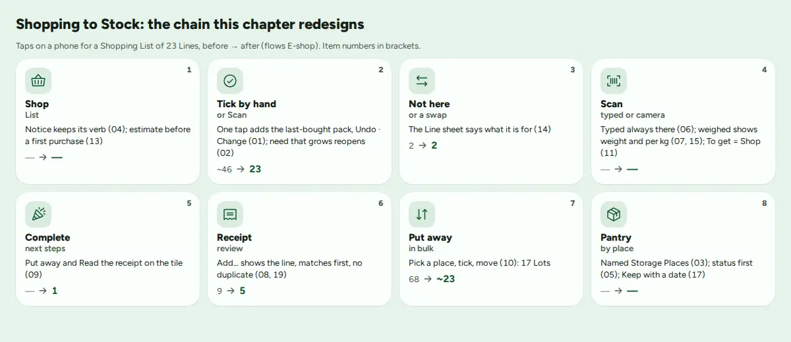
*The chain and the taps it costs for a 23-Line list (from the flows walk). Mock: [mocks/ssp-00-chain.html](mocks/ssp-00-chain.html).*

**Root causes.** Five causes explain nearly every item:

1. **A tick by hand says nothing about Stock.** It adds the Line's remaining need, never the pack that was bought. A ticked row looks the same whether it added Stock, added nothing or was ticked by a Scan. A tick also covers "the Ingredient for this range", not an amount, so need that grows later disappears (01, 02, 18).
2. **Shared primitives choose their compact forms by the viewport, not by their own width.**
   - `ListGroup` has no visible title.
   - The row's value column and the Restock text switch at 600 px and 420 px of viewport, so a 320 px card on a 1120 px screen gets the desktop widths.
   - Meta lines put the quantity before the status, so the status is what gets cut (03, 04, 05).
3. **The Scan screen assumes a working camera.** The dead viewfinder keeps its 244 px, typing is a fallback hidden behind a failure, and toasts pile up over the list (06, 12).
4. **Data the server already has never reaches the screen.**
   - The weighed flag is dropped for a new weighed Product.
   - Products that have a Price but were never bought give no estimate.
   - To get leaves out manual extras.
   - The receipt's printed line is not passed to Add… (07, 08, 11, 13).
5. **Every step ends without a next step.**
   - "Shopping List complete" offers neither Put away nor Read the receipt.
   - Putting away takes 4 taps per Stock Lot.
   - Keep moves a go-off date by one day at a time.
   - A ticked Line's sheet has no actions (09, 10, 17, 18).

**The shape of the fix.** Three shared changes close 9 findings:

- **`ListGroup` gets an optional visible title** (heading, kind icon, count, one action). It closes SHOP-01 and FLOW-03, and Shop's section titles move onto it.
- **`ListRow` chooses compact forms from its own text column.** The text column becomes a size container. A meta line can carry a compact form. The 14 px meta icon is dropped below 9 rem. The narrow-row padding becomes every list's. This closes SHOP-05, SHOP-13, SHOP-17 and SETTINGS-20.
- **One Restock formatter.** It closes SHOP-17 and SETTINGS-20 on Shop, Pantry and Supplies.

Everything else is a change to one screen or one flow, plus four server changes:

- the tick records and reports what it added, and can be changed;
- a Line can reopen for what is needed since its tick;
- a priced Product gives an estimate before its first purchase;
- bulk Put away, and Keep with a date.

| Item | Sev. | Size | Title | Source ids | Status after reproduction |
|---|---|---|---|---|---|
| SSP-01 | S2 | M | Tick by hand: what it adds, one tap with Undo · Change, and a ticked row that says what reached Stock | FLOW-07 | Confirmed |
| SSP-02 | S2 | M | Need that grows after a tick is hidden | FLOW-08 | Confirmed; by design (spec §9), now decision D3 |
| SSP-03 | S2 | S | The Pantry never names its Storage Places | SHOP-01, FLOW-03 | Confirmed |
| SSP-04 | S2 | S | The Shop notice cuts its own verb on phones | SHOP-04 | Confirmed |
| SSP-05 | S2 | M | Status first and never cut; the Restock reason said one way | SHOP-05, SHOP-13, SHOP-17, SETTINGS-20 | Confirmed; SHOP-13 wider (Shop hints are cut too) |
| SSP-06 | S2 | M | Scan without a working camera, and the tablet split | SHOP-06, SHOP-15 | Confirmed |
| SSP-07 | S2 | S | Weighed barcodes: show the weight, price per kg | SHOP-07 | Confirmed, narrower (the row shows the weight; the sheet and keypad do not) |
| SSP-08 | S2 | M | Receipt review: Add… with receipt context, matches first, a truthful Accept all, no duplicate Product | SHOP-08, FLOW-20 | Confirmed (duplicate Product not re-run) |
| SSP-09 | S3 | S | "Shopping List complete" offers the next steps | SHOP-12 | Confirmed |
| SSP-10 | S3 | M | Put away a whole shop at once | FLOW-19 | Confirmed |
| SSP-11 | S3 | S | Scan's To get leaves out manual extras | SHOP-09 | Confirmed |
| SSP-12 | S3 | S | The Price keypad: toasts cover the row being priced | SHOP-20 | Confirmed |
| SSP-13 | S3 | M | No estimate before a first purchase, and no Price from a Line | FLOW-16 | Confirmed; spec §9, now decision D5 |
| SSP-14 | S3 | M | "Not available": what the Line is for, and a substitute | FLOW-17 | Confirmed |
| SSP-15 | S3 | S | A weight-style code with no Weight Barcode Rule silently becomes a Product | FLOW-27 | Confirmed |
| SSP-16 | S3 | S | Big quantities in the Base Unit, digits ungrouped | SHOP-21 | Confirmed; spec §9, now decision D7 |
| SSP-17 | S3 | S | Keep moves a go-off date one day at a time | new in stage 2 (stage-1 shop question 2) | Confirmed; spec §6 and GLOSSARY, now decision D8 |
| SSP-18 | S4 | XS | A ticked Line's sheet is a dead end | SHOP-23 | Confirmed |
| SSP-19 | S4 | XS | Receipt photos: the first action is the small button | SHOP-24 | Confirmed |
| SSP-20 | S4 | XS | An unknown barcode shows 14 digits nobody typed | SHOP-22 | Confirmed |

## Decisions for the user

> **Decided on 2026-11-14.** The user chose the recommended option in every decision below. The record is in [decisions.md](decisions.md); the options stay here for reference.

1. **What does a tick by hand add to Stock?** ([mocks/ssp-01-decision-amount.html](mocks/ssp-01-decision-amount.html), 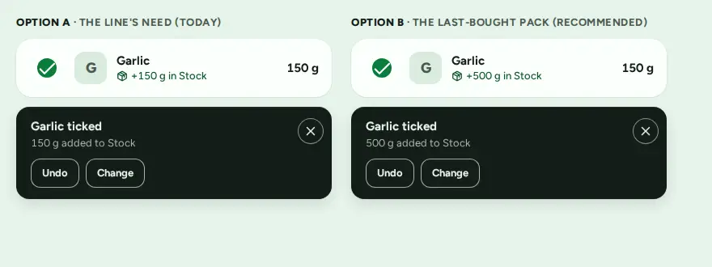)
   - **A**, the Line's remaining need (today): Garlic +150 g.
   - **B**, the last-bought pack the Line already suggests: 1 × Garlic organic pack, +500 g. With no pack, B falls back to A.

   **Recommendation: B.** It is what the person actually carried home, and spec §9 already sends the pack remainder to Ingredient Overlap. Under A, Stock understates what is at home and the next list asks for Pasta again. **Default assumed: B.** It amends shop-scan-proposals §13.11 ("adds the Line's remaining quantity") for Scan's To get as well, so both screens add the same amount.

2. **One-tap tick on Shop, or "How much?" every time?**
   - **A**: one tap ticks with D1's amount and shows the toast "Garlic ticked · 500 g added to Stock" with **Undo** and **Change** ([mock](mocks/ssp-01-tick-one-tap.html)).
   - **B**: the "How much?" sheet on every tick (today).

   **Recommendation: A.** For 23 Lines, ticking goes from about 46 taps to 23. Accidental ticks while scrolling are covered by Undo (SAFE's Undo-toast pattern) and by a 44 px tick target that is the only thing that ticks on Shop (the row body opens the sheet). It also settles stage-1 shop question 3: Scan's To get keeps "the row is the tick", and both screens show the same toast with Change, so functional-spec §10.1 "To get … unchanged" is updated. **Default assumed: A.**

3. **Need that grows after a tick** (spec §9: "Ticked state is kept per Ingredient for the current list range"). ([mocks/ssp-02-decision.html](mocks/ssp-02-decision.html), 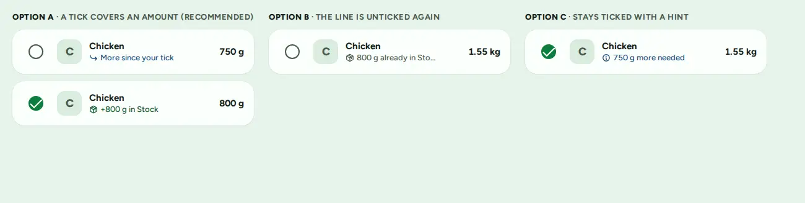)
   - **A**: a tick covers an amount. The extra reappears in To get as "Chicken 750 g · More since your tick" while the ticked row stays ticked.
   - **B**: the Line is unticked again.
   - **C**: it stays ticked with an info hint.

   **Recommendation: A.** It keeps what was bought visible and puts only the difference on the list. **Default assumed: A**, with a new ADR ("A tick covers an amount") that amends spec §9.

4. **The Restock reason.**
   - **A**: the spec's wording, "Below 4 · 2 in Stock", compact "2 in Stock"; not below: "Restocks below 20".
   - **B**: "2 of 4 in Stock", compact "2/4" (b8-polish's compact form).

   **Recommendation: A.** It says why the Line is there, and the compact form still says what the number is. The b8-polish compact "2/4" is the form stage 1 found unclear, so this is your call. **Default assumed: A.** Mocks: [mocks/ssp-05-supplies.html](mocks/ssp-05-supplies.html), [mocks/ssp-01-tick-one-tap.html](mocks/ssp-01-tick-one-tap.html).

5. **Use a Product's Price before it has ever been bought?** (spec §9: "If no Product has been bought yet, the line shows the exact amount".)
   - **A**: yes. With no purchase, the pack suggestion and estimate use the Ingredient's Product that has a Price at the selected Shop (else at any Shop): the most recent Price, ties broken by the lowest price per Base Unit.
   - **B**: no (today).

   **Recommendation: A.** On the seed, 4 of 18 unpriced Lines have a priced Product. **Default assumed: A.** [mocks/ssp-13-line-sheet.html](mocks/ssp-13-line-sheet.html).

6. **"Not available" in the Shop.**
   - **A**: no new state. The Line sheet lists the Planned Meals the Line is for, offers **Get something else…** (adds another Ingredient and makes this Line Not needed, with one Undo), and **Not needed** says what it leaves short ([mock](mocks/ssp-13-line-sheet.html)).
   - **B**: also a **Not here today** state that keeps the Line on the list for the next Shop but out of this trip's count ([mock](mocks/ssp-14-not-here-option.html), 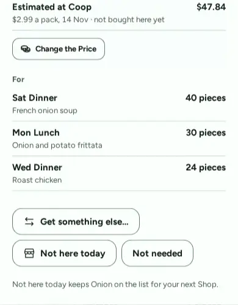).

   **Recommendation: A**; B adds a third Line state for a rare case. **Default assumed: A.**

7. **Big quantities.** ([mocks/ssp-16-quantities.html](mocks/ssp-16-quantities.html), 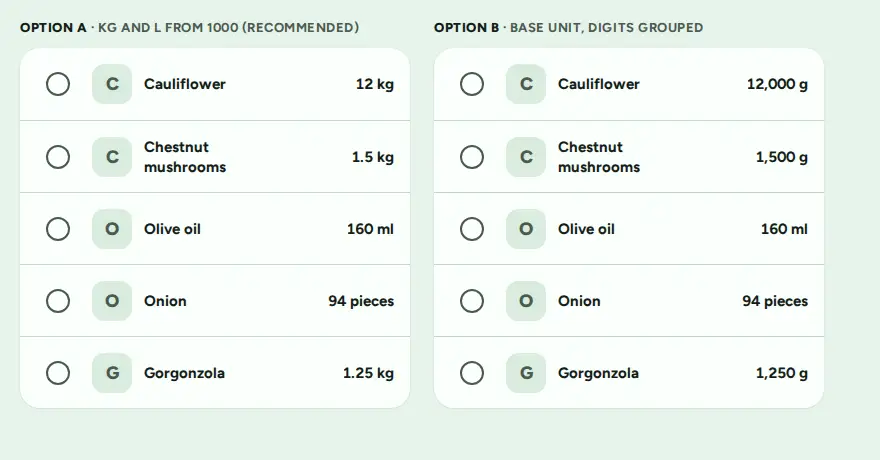)
   - **A**: show kg and l from 1000 g / 1000 ml ("12 kg", "1.5 kg", "1.25 l"). The Base Unit stays the stored and entered unit, as imperial already converts for display (GLOSSARY: Base Unit).
   - **B**: keep the Base Unit and group digits ("12,000 g").

   **Recommendation: A.** **Default assumed: A**, with spec §9 "Display: the quantity in Base Unit" amended. Pieces are only grouped ("1,250 pieces").

8. **Keep.**
   - **A**: one tap makes the Stock Lot "Good until today", with a toast whose **Change** offers Today, Tomorrow, In 3 days, In a week and Pick a date.
   - **B**: always ask for the date.
   - **C**: as today (+1 day from the old go-off date, spec §6).

   **Recommendation: A.** A Stock Lot that went off 13 days ago leaves the tile in one tap, not 13. **Default assumed: A.** GLOSSARY "Throw out / Keep" and spec §6 change. [mocks/ssp-17-keep.html](mocks/ssp-17-keep.html), [mocks/ssp-17-keep-date.html](mocks/ssp-17-keep-date.html).

## SSP-01  Tick by hand: what it adds, one tap with Undo · Change, and a ticked row that says what reached Stock
**Severity** S2 · **Size** M · **Sources** FLOW-07 · **Reproduced** Confirmed. On `/shop` at 390, Tick Garlic opens "How much?" prefilled with **150** g, although "Garlic organic pack" (500 g) exists and is priced at Coop. After "Tick and add to Stock" (Garlic), "Tick without adding" (Carrot) and a free-text tick (Napkins), the three ticked rows are identical: struck name, value, no meta. No toast appears. In the sheet, "Tick without adding" comes before "Tick and add to Stock" in DOM order.
**Where** `/shop` all sizes; Scan's To get (shares the amount); light and dark

### Problem
In the Shop, the person cannot tell from the list which ticks put food into Stock. The amount added is the recipe's need (150 g of garlic), not the 500 g pack in the bag, so Stock is wrong from the first tick and the next Shopping List asks again. Every Line costs two taps and a sheet, about 46 taps for 23 Lines.

Causes:
- the prefill is the Line's remaining need (`web/src/features/shop/lib/lines.ts:80` `quantity: line.ticked ? 0 : line.quantity`, passed as `defaultQuantity` at `screens/ShoppingScreen.tsx:177`);
- the ticked row's value is the need and its meta is empty (`lib/lines.ts:76`, `components/LineRow.tsx`);
- the list API does not say how a Line was ticked or what it added, although `shopping_ticks.lot_id` and `lot_quantity` are stored (ADR 0019).

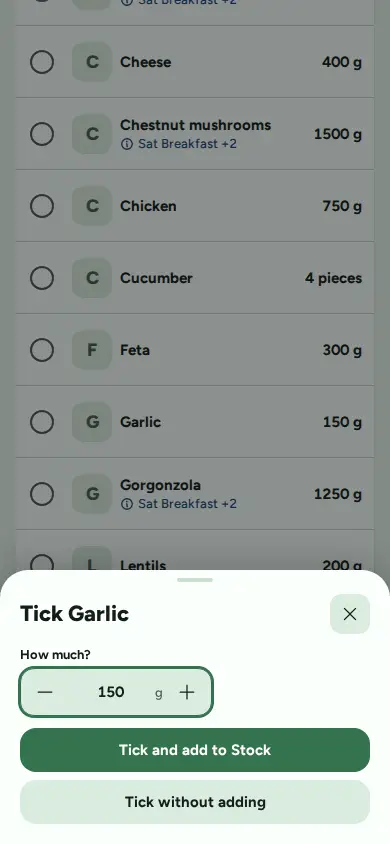 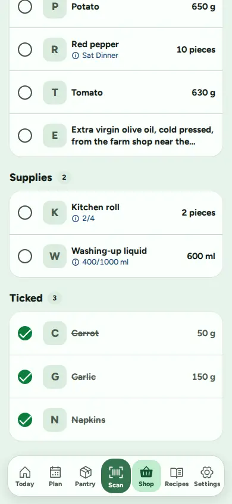

### Design
**Behaviour, all sizes** (decided: SSP 1 and SSP 2):
- **One tap on the tick** ticks the Line with its default amount:
  - the Line's pack suggestion (`pack.count × pack.size`) when it has one, else the remaining quantity;
  - free text ticks with no amount, as today.
- The row moves to Ticked at once (busy while the request runs; the tick cannot be pressed twice).
- **Focus** moves to the next row's tick (A11Y's "focus after a row leaves a list"). The tick follows R-C+: its visible 24 px circle becomes the ring (3 px `--color-accent` on a `--color-soft` fill), and the 44 px button draws no outline of its own. Only one ring shows, inside the row card.
- **The toast** follows R-D and R-D+: no status icon (it is a success), the headline **"Garlic ticked"**, the muted subline **"500 g added to Stock"**, then the outline buttons **Undo** and **Change**, and the 32 px circular Dismiss top-aligned with the headline. With no Stock added (free text) it is one line, "Napkins ticked", with an outline Undo.
- **Undo** is the untick (ADR 0019: it takes the Stock back). **Change** opens the sheet below. The toast follows SAFE's Undo-toast pattern (one toast at a time; a new tick replaces it).
- **Change sheet** "Garlic: how much?" ([mock](mocks/ssp-01-tick-change.html)):
  - the title is the one question;
  - under it, one R-E row: key **"Added when you ticked it"**, state **"+500 g"** (success-fg, tabular), detail "Ticked at 10:12 · Not sorted";
  - one radiogroup of choice chips: **1 × Garlic organic pack · 500 g** (selected), **What the Line needed · 150 g**, **Other amount** (reveals the existing NumberField, focused, with the Base Unit suffix);
  - primary **Save**; outlined secondary **Tick without adding** (keeps the tick and takes the Stock back);
  - Close is the 40 px circular outline button (R-B).
  - Save sends the new amount to the tick's own Stock Lot. When the Line was ticked twice (RES 2, RES-03), Change and Tick without adding act on the viewer's own addition only.
- **The ticked row's meta line** says what the tick did:
  - success tone, Package icon: **"+500 g in Stock"**;
  - muted, MinusCircle icon: **"Not added to Stock"** (compact below 12 rem: "No Stock added");
  - muted, Barcode icon: **"Scanned · 700 g"** when a Scan ticked it;
  - a Line with two additions uses RES-03's meta: "Added twice · Sam 50 g, you 50 g", compact "Added twice · 100 g".
  - The value stays the Line's need, muted, so the list keeps its column.
- **Scan's To get:** the row stays the tick (beta.8). It sends the same default amount and shows the same toast with Undo and Change; Change opens the same sheet over Scan.
- Phone, tablet and desktop differ only in layout: the toast sits bottom centre, above the bottom bar below 1024 px, and 420 px wide from 1024 px. Dark mode uses the same tokens.

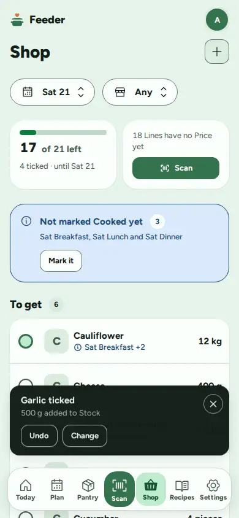 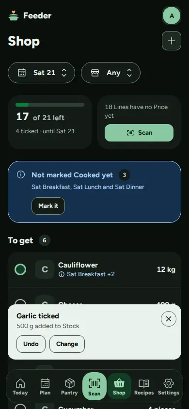 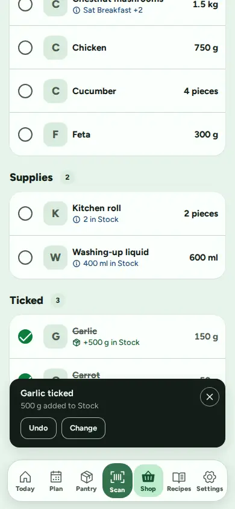 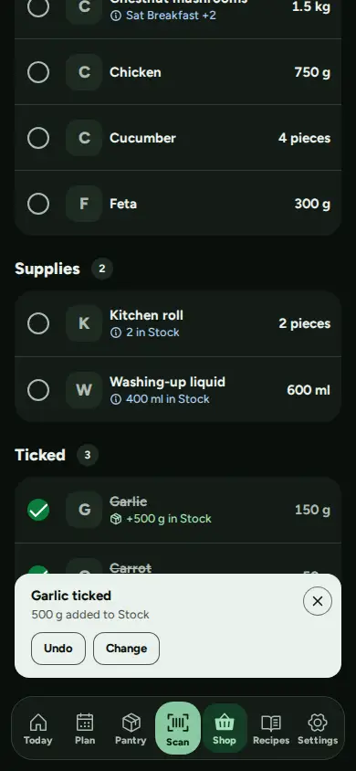
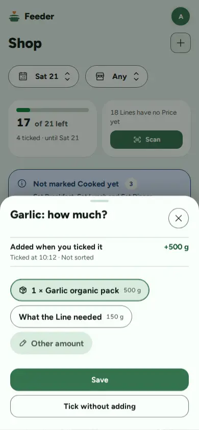
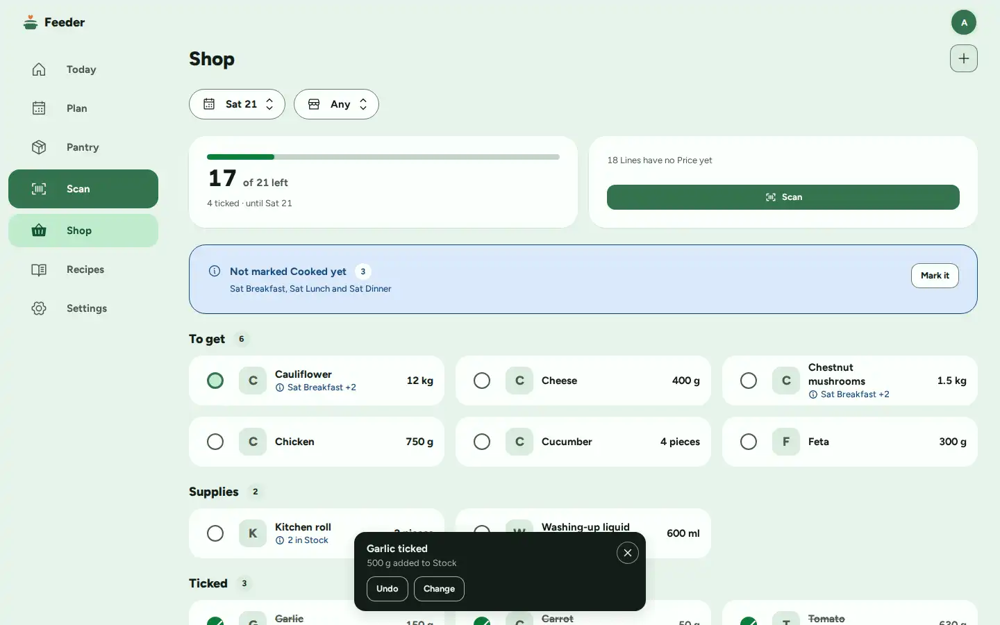
Mocks: [mocks/ssp-01-tick-one-tap.html](mocks/ssp-01-tick-one-tap.html), [mocks/ssp-01-tick-change.html](mocks/ssp-01-tick-change.html).

**Copy:**
- toasts: headline "{Line} ticked", subline "{amount} added to Stock"; "Undo", "Change";
- Change sheet: title "{Line}: how much?", row "Added when you ticked it" / "+{amount}" / "Ticked at {time} · {Storage Place or Not sorted}", chips "{n} × {Product}", "What the Line needed", "Other amount", buttons "Save", "Tick without adding";
- row meta: "+{amount} in Stock", "Not added to Stock" / "No Stock added", "Scanned · {amount}".
- On failure the existing "Couldn't tick {line}. Try again." still applies.

**Accessibility:**
- The tick keeps `aria-pressed` and its stable name "Tick Garlic".
- The toast is in the polite live region ("Garlic ticked, 500 g added to Stock"). Its outline buttons are 40 px tall; on the inverse toast the focus ring is `--color-bg` (R-C).
- The focused tick's accent ring on soft is 3.4:1 (light) and 3.6:1 (dark) (R-C+).
- The Change chips are one `radiogroup` with roving tabindex; Other amount moves focus into the field.
- The ticked meta joins the row's accessible description (A11Y, SHOP-18).
- Contrast:
  - success-fg on surface: 8.7:1 light, 11.75:1 dark;
  - muted on surface: 7.23:1 and 8.75:1.

### Alternatives considered
- Keeping the sheet but prefilling the pack: it fixes the amount but not the taps.
- A long-press to open "How much?": it cannot be discovered and has no equivalent on a keyboard.

### Build notes
- **Pure lib `shop/lib/tickAmount.ts`** (new): `defaultTickAmount(line)` returns the pack quantity or the need; `tickedMeta(tick)` returns the meta and its compact form. Both are used by `lib/rows.ts` and by `scan/lib/toGet.ts` `tickRequest`.
- **Hook `shop/hooks/useTickFlow.ts`** (new): tick, toast, Undo, Change, focus to the next tick. `useShoppingActions` gains `changeTick(ingredientId, to, quantity)`.
- `components/TickSheet.tsx` gets a `mode: 'change'` with the R-E row and the chip radiogroup (shared `ChoiceChip`). `LineRow.tsx` passes the compact meta text (see SSP-05).
- `shop.css` `.line-row__tick:focus-visible`: no outline; the circle (`::before`) takes the 3 px accent border and the soft fill.
- **API:**
  - each ticked Line in `GET /api/shopping/list` gains `tick: {by: 'hand' | 'scan', added: number | null}`, from `shopping_ticks.lot_quantity`;
  - a ticked extra gains the same;
  - new `PATCH /api/shopping/ticks {ingredientId, to, quantity}` sets the quantity of the caller's own tick's Stock Lot (0 takes it back, as ADR 0019 point 2, and keeps the tick);
  - `PATCH /api/shopping/extras/{id}/tick` does the same for extras;
  - RES-03 extends this with additions (`shopping_tick_additions`), and the two packages are sequenced as RES-03 says.
  - The handler stays thin: the domain is `shopping.Service.ChangeTick`, with Stock's existing `TakeBack` and an `AdjustLot`.
- The toast uses DS's R-D and R-D+ Toast anatomy. The rows use DS's R-E row.
- Docs: spec §9 "Tick by hand" and §10.1 To get, and the shop-scan-proposals §13.11 note.

### Tests and guard
- Unit tests:
  - `defaultTickAmount` with a pack, without a pack, for free text and for a Supply;
  - `tickedMeta` for hand-added, not added, scanned and added-twice ticks;
  - `TickSheet` in change mode: the row, chips, Other, Tick without adding;
  - Go `ChangeTick`: up, down, to 0, idempotent, tick by Scan refused, only the caller's addition changed.
- BDD (`bdd/features/shop/tick.feature`):
  - "One tap ticks a Line with the last-bought pack";
  - "Undo of a one-tap tick takes its Stock back";
  - "Change sets the amount the tick added";
  - "Tick without adding from Change keeps the tick and removes the Stock";
  - "A ticked row says whether Stock was added";
  - "Scan's To get adds the same amount as Shop";
  - "Focus moves to the next row's tick after a tick".
- Guard: page-layout scenario `shop-ticked` (P23 cut-meta probe on ticked rows at 360, 390 and 1120).

### Depends on / unblocks
- Depends on SAFE's Undo-toast pattern, DS's R-D/R-D+ Toast and R-E rows, and A11Y focus-after-row and R-C+.
- Unblocks SSP-02 and SSP-18. RES-03 (offline ticks, ticked twice) builds on it.

## SSP-02  Need that grows after a tick is hidden
**Severity** S2 · **Size** M · **Sources** FLOW-08 · **Reproduced** Confirmed. I ticked Garlic (+150 g) and then set Garlic's Stock to 100 g. The API answers `need 600, available 100, quantity 500, ticked: true`. The row stays in Ticked showing "600 g" struck through, and 500 g more never reaches To get. By design today: spec §9 "Ticked state is kept per Ingredient for the current list range".
**Where** `/shop`, Scan's To get; all sizes

### Problem
A Recipe import, a Swap or Stock used before shopping raises a Line that was already ticked. The list hides the shortfall, and the person goes home without the extra 750 g of Chicken (flows E-shop/50). Cause: `internal/shopping/shopping.go:190–216` (`Derive`) marks every ticked Ingredient `Ticked` whatever its new quantity. `Tick.Needed` (the quantity at tick time) and the tick's `lot_quantity` are stored but not compared.

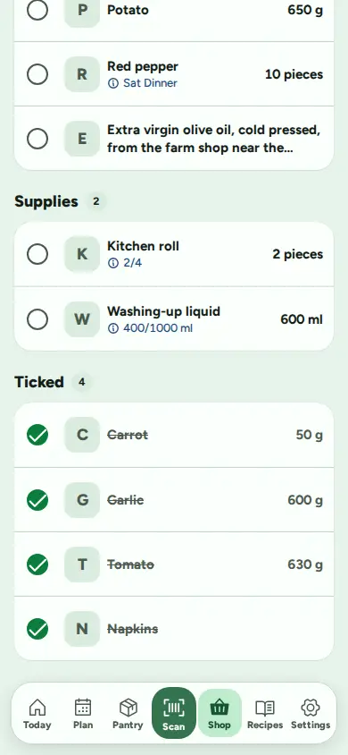

### Design
**Behaviour (D3-A):**
- A tick covers an amount: the Line quantity at tick time, Q0. When the Line's quantity now, Q2, is more than what the tick left uncovered (`max(0, Q0 − added)`), the difference reappears.
- The difference shows as an open row in To get, **"Chicken · 750 g"**, with the info meta **"More since your tick"** (ArrowBendDownRight icon; compact "More needed"). Its pack suggestion and estimate work as for any Line.
- The ticked row stays in Ticked ("+800 g in Stock").
- Ticking the new row ticks only the difference. Progress counts it as an open Line, and "Shopping List complete" waits for it.
- A Scan of that Ingredient matches it like any open Line.
- Not needed on it takes only the difference off.

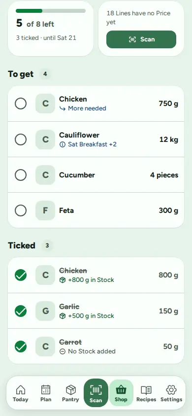 Mock: [mocks/ssp-02-need-grows.html](mocks/ssp-02-need-grows.html).

**Copy:** "More since your tick" / "More needed".

**Accessibility:** the open row is named "Chicken"; its description reads "750 g, more since your tick". No new controls.

### Alternatives considered
- B, untick: loses what was bought.
- C, a hint on the ticked row: the shortfall is still not in To get, nor in Scan's matching.
- Both are in the decision board.

### Build notes
- Pure Go in `internal/shopping/shopping.go`: `Derive` emits a ticked Line with `More float64` (> eps). Use a function `moreSinceTick(q0, added, q2)`.
- The `ShoppingLine` JSON gains `more` (Base Units, absent when 0). `Progress.Total` counts a Line with `more` once more; `Complete` stays false.
- The scan path (`internal/scan`) treats `more > 0` as open for matching.
- Client: `shop/lib/lines.ts` `listEntries` emits an extra open entry `key: "more:<ingredientId>"`; `scan/lib/scannedList.ts` `toGetLines` includes it.
- Docs: a new ADR (it amends spec §9's per-Ingredient tick) and a GLOSSARY Tick note.

### Tests and guard
- Go: `moreSinceTick` table (added ≥ Q0, Tick without adding, shrinking need, float dust).
- `Derive` test: ticked Chicken whose need grows by 750 g.
- BDD:
  - "Need that grows after a tick reappears as More since your tick";
  - "Ticking the extra row ticks only the difference";
  - "Shopping List complete waits for a reopened Line".
- Guard: unit-level.

### Depends on / unblocks
- Depends on D3 and SSP-01 (the tick's `added`).
- PC's replans (FLOW-04) are what grow the need; this item makes that visible.

## SSP-03  The Pantry never names its Storage Places
**Severity** S2 · **Size** S · **Sources** SHOP-01, FLOW-03 · **Reproduced** Confirmed. `/pantry` at 390, 360 and 1440, light and dark: 11 groups, each a `ul.list-group__list` with `aria-label="Kitchen Fridge, 5 Stock Lots"`, 0 visible headings. After shopping, "Not sorted, 17 Stock Lots" is unlabelled too.
**Where** `/pantry` Storage Place view; all sizes; light and dark

### Problem
The default Pantry view groups by Storage Place but shows eleven nameless cards, and with grouping on the row hides its own place (`web/src/features/stock/screens/StockScreen.tsx:188`). `ui/ListRow.tsx:218` `ListGroup` renders no visible label. Sighted people cannot tell the fridge from the freezer, and screen-reader users get no headings to jump between.

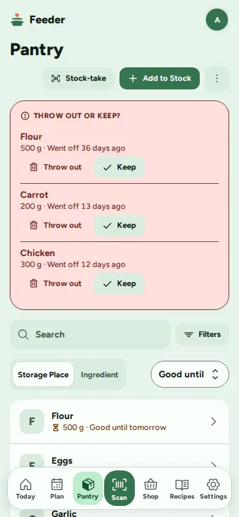 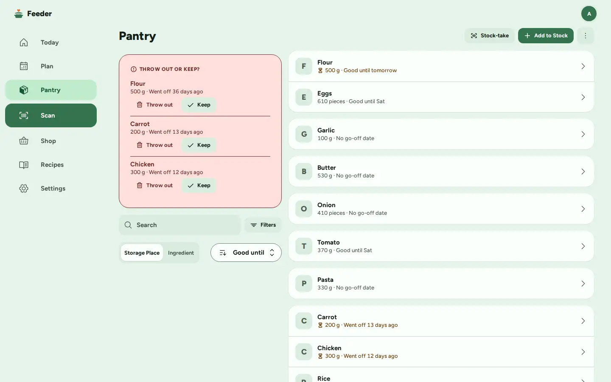

### Design
**Behaviour:**
- Each group gets a heading row above its card:
  - the kind icon (pantry Package, fridge ThermometerCold, freezer Snowflake, Not sorted Tray, all through the shared Icon);
  - the Storage Place name in title-3, wrapping at a word, two lines at most;
  - a count chip;
  - optionally one action at the end (Not sorted: **Put away**, SSP-10).
- Order stays as today, with Not sorted last. A group of Leftovers only counts Leftovers ("2 Leftovers").
- Long names (60 characters) wrap to two lines on a phone and stay on one at 1440.
- Headings are not sticky (SHORT owns sticky rules).
- Rows drop their chevron. A Stock Lot row opens a sheet, as Shop rows do, which have none.

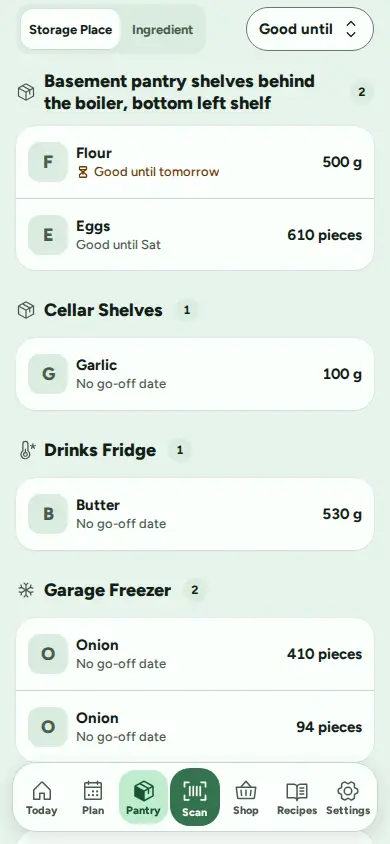 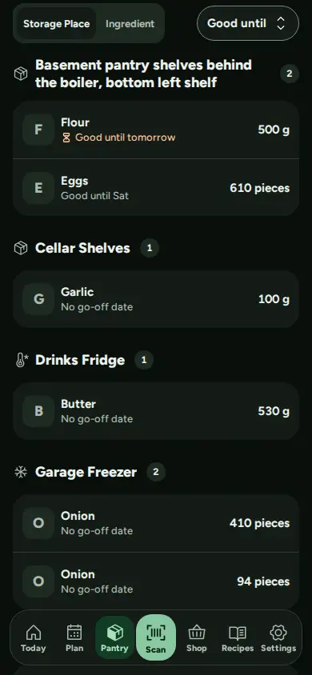
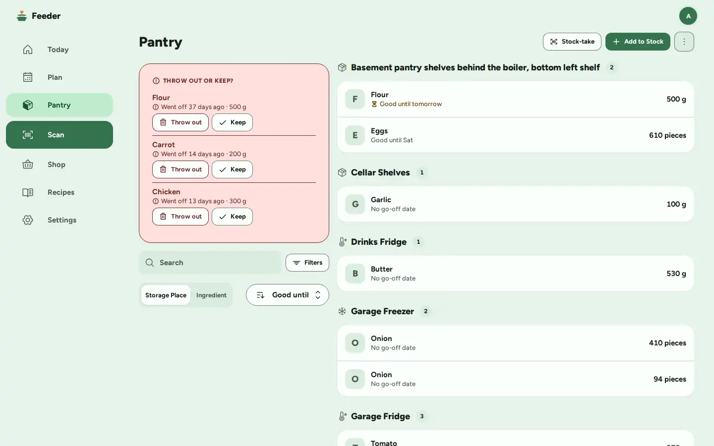
Mock: [mocks/ssp-03-pantry-headings.html](mocks/ssp-03-pantry-headings.html).

**Rules (new `ListGroup` props `title`, `count`, `icon`, `action`, CSS in `ui/ListRow.css`):**
- `.list-group__title`: title-3; `--space-3` between header and card; `--section-gap` between groups.
- Count chip: chip size, `surface-2` / `text`, as Shop's `.shop-section__count`.
- New system.md §3 rule: "A list that is grouped shows each group's name in a ListGroup title; a group is never named only for assistive technology."

**Copy:**
- Storage Place names as entered; "Not sorted"; "Put away".
- Counts read "{n} Stock Lots" through visually hidden text.

**Accessibility:**
- The title is an `h2` (the page `h1` is Pantry), and the `ul` is `aria-labelledby` it. That replaces the `aria-label`; the count is spelled out in visually hidden text.
- The icon is decorative.
- The heading text is `--color-text` on the page background (an existing pair).

### Build notes
- `ui/ListRow.tsx` `ListGroup` gets `title?: string`, `count?: number`, `countLabel?: (n) => string`, `icon?: IconName`, `action?: ReactNode`; with a title it renders `<section class="list-group-section">` and the heading.
- `StockScreen.tsx` passes them. `PantryLotRow.tsx` drops `chevron`. The `stock/strings.ts` `groupLabel` becomes the count label.
- Shop's `.shop-section__title` sections move onto the same prop (work package S4): shop.css loses its copy.
- Other users of `ListGroup` are unaffected unless they pass a title.

### Tests and guard
- `ListGroup.ds.test.tsx`: a title renders `h2` plus `aria-labelledby`; count text; action slot.
- `StockScreen.test.tsx`: one heading per Storage Place, Not sorted last.
- BDD: "The Pantry names each Storage Place it groups by".
- Page-layout guard: a new probe that fails when a `.list-group` has an `aria-label` and no visible heading inside a grouped list (`/pantry`, `/shop`).

### Depends on / unblocks
- Unblocks SSP-10 (the Put away action) and SSP-05's Pantry rows.
- DS owns the 320 px PageHeader overflow (SHOP-03; still 7 px of sideways scroll at 320 in this mock).

## SSP-04  The Shop notice cuts its own verb on phones
**Severity** S2 · **Size** S · **Sources** SHOP-04 · **Reproduced** Confirmed. At 390 the text needs 66 px but is clamped to 44 ("Sat Breakfast, Sat Lunch and Sat Dinner aren't marked…"). At 320 it needs 88 px and shows "… and Sat…". The full sentence is only in `title`, which touch screens never show.
**Where** `/shop` notice, 320–430 px; any size with 3+ slots

### Problem
The sentence that explains every row's info hint and the Mark it button loses its predicate and becomes a list of slot names. Causes: `web/src/features/shop/shop.css:141` (`-webkit-line-clamp: 2` on the whole sentence) and `lib/notice.ts` (slots first, verb last).

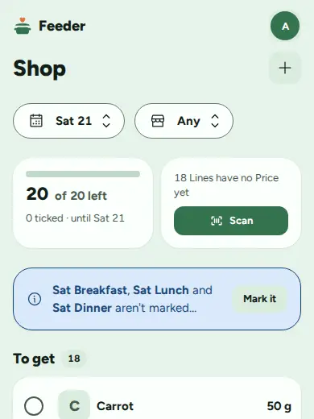

### Design
**Behaviour:**
- The notice says its predicate first, as a title: **"Not marked Cooked yet"** plus a count chip ("3", the slot-dates).
- Under it is a meta line with the slots: "Sat Breakfast, Sat Lunch and Sat Dinner", or "… and 2 more". This line may clamp to two lines; the verb is never cut.
- With one slot the meta is that slot alone ("Tue Dinner").
- Mark it sits under the text when the tile is narrower than 26 rem (container query on the notice), and at the end from 26 rem.

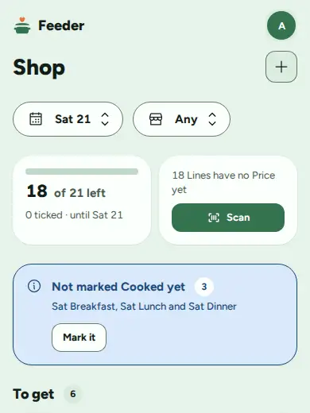 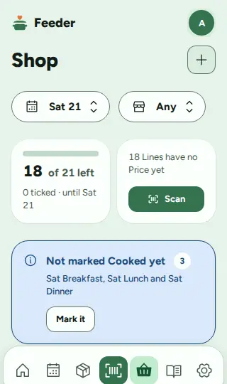 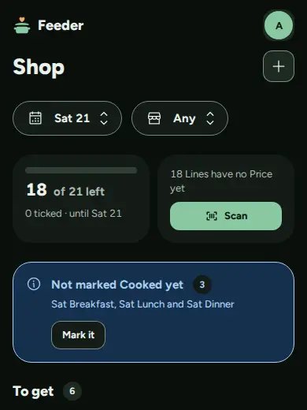
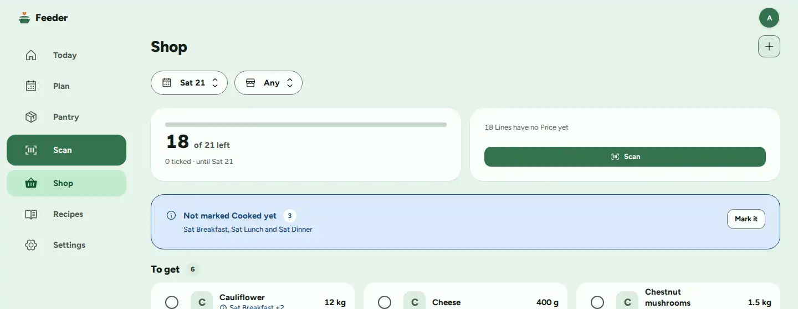
Mock: [mocks/ssp-04-notice.html](mocks/ssp-04-notice.html).

**Rules:**
- Title: body-strong.
- Count chip: chip type role, `--color-surface` fill, `--color-info-fg` text (9.0:1 light, 10.81:1 dark).
- Slots: meta role.
- Tile: unchanged info status tile.

**Copy:** "Not marked Cooked yet", "{slots}", "and {n} more", "Mark it". The strings `isnt` and `arent` are retired.

**Accessibility:**
- The tile is a `section` with `aria-labelledby` on the title.
- Count: visually hidden " Meal Slots to mark".
- Mark it: unchanged (44 px tall on touch, A11Y).

### Build notes
- `shop/lib/notice.ts` returns `{title, count, slots: NoticeSegment[], markIt}`.
- `components/UnconfirmedNotice.tsx` renders title, count and slots.
- `shop.css`: the notice block (the clamp moves to the slots).

### Tests and guard
- `notice.test.ts`: one slot, three slots, five slots ("and 2 more").
- BDD: "The Shop notice says Not marked Cooked yet before the slots".
- Guard: extend P23's cut-meta probe to `.shop-notice__title` (never cut) at 320 and 360.

### Depends on / unblocks
None; it can run first.

## SSP-05  Status first and never cut; the Restock reason said one way
**Severity** S2 · **Size** M · **Sources** SHOP-05, SHOP-13, SHOP-17, SETTINGS-20 · **Reproduced** Confirmed. Measurements:
- `/pantry` at 360: "400 ml · below Restock level 1000 ml" is cut at 194 of 219 px.
- `/supplies` at 390:
  - "2 pieces · below Restock level 4" at 172 of 186 px;
  - "400 ml · below Restock level 1000 ml" at 172 of 219 px.
- `/supplies` at 360 adds "60 pieces · restocks below 20" (160 of 175 px).
- Spoiled and Use soon share the hourglass icon.
- `/shop` at 1120 (SHOP-13), wider than reported: "400 of 1000 ml" (82 of 92 px) and three "Sat Breakfast +2" hints (82 of 99 px) are cut.
- The Restock reason is worded four ways: Shop "2/4" or "2 of 4", Pantry "below Restock level 4" and "restocks below 20", Supplies the same, Scan "0 of 2" (the session cover, a different meaning).

**Where** `/pantry`, `/supplies`, `/shop` (360, 390, 1104–1150); light and dark

### Problem
The part cut is the reason the row is there (the status or the Restock reason), because the quantity comes first:
- `stock/components/PantryLotRow.tsx:42` builds "500 g · Good until Thu";
- `stock/strings.ts:147–148` builds the Restock phrases.

The compact Shop forms switch on the viewport, not on the row:
- `shop/hooks/useNarrowChips.ts:7`, 420 px;
- `--row-value-min` switches at 600 px.

A 320 px card on a 1120 px screen therefore gets desktop widths.

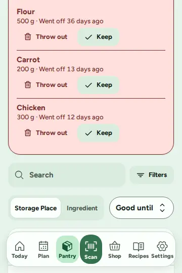 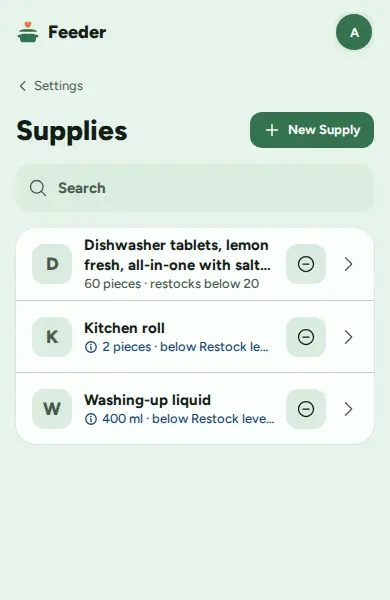
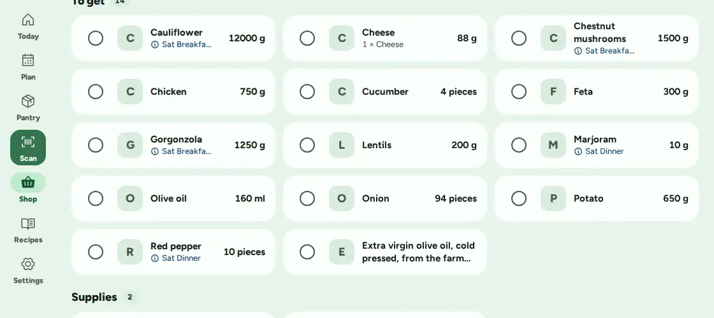

### Design
**One rule, in `ListRow`:**
- **The row's text column is a size container** (`container: row-text / inline-size` on `.list-row__text`, a flex: 1 item with a definite width, so system.md §5's warning does not apply).
- A meta line may carry a **compact form**: both texts are rendered, and below **12 rem** of text column the compact one shows (the long one stays as the accessible text).
- Below **9 rem** of text column (320 px phones, a 360 px Pantry row) the meta's 14 px icon is dropped; the tone colour stays on the text.
- Shop's narrow-row rule (below 420 px: 12 px padding, 8 px gaps) moves from `shop.css` into `ListRow.css` for every list.

**Pantry:**
- The Stock Lot's quantity moves to the value column (tabular, as Shop).
- The meta holds the status alone: "Went off 14 days ago" (spoil tone, **WarningCircle**, the registered `spoiled` icon), "Good until tomorrow" (spoil tone, hourglass, Use soon), "Good until Sat", "No go-off date".

**Restock reason** (D4-A), one formatter for Shop, Pantry and Supplies:

| Case | Long | Compact |
|---|---|---|
| Below the Restock level | "Below 4 · 2 in Stock" | "2 in Stock" |
| Not below (Pantry, Supplies) | "60 in Stock · Restocks below 20" on `/supplies`; "Restocks below 20" on a Pantry Stock Lot (its quantity is in the value column) | "60 in Stock" |

- Scan keeps its cover "0 of 2" (shop-scan-proposals §13.3, decided). It is now the only "x of y" in the app and means what this session's Scans cover.

**Shop's card grid** takes a row minimum of **21.5 rem** (a new token `--tile-min-row`), so a card row is never narrower than the 360 px phone row P23 measures. At 1104–1200 px that is 2 columns instead of 3.

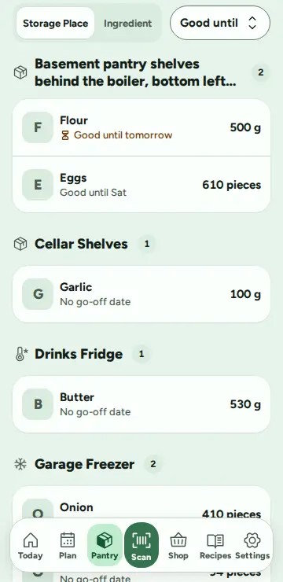 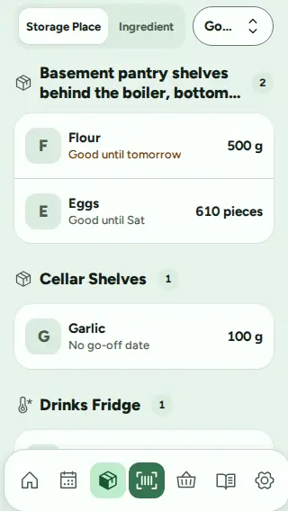
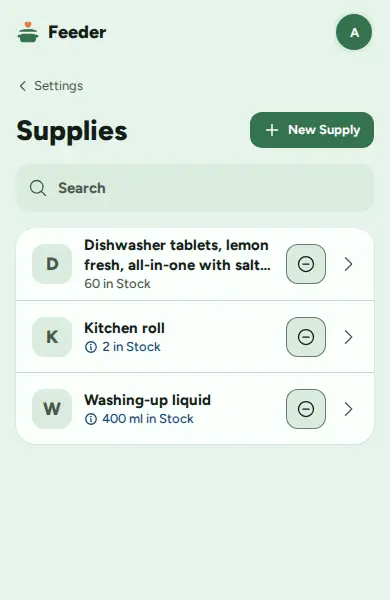 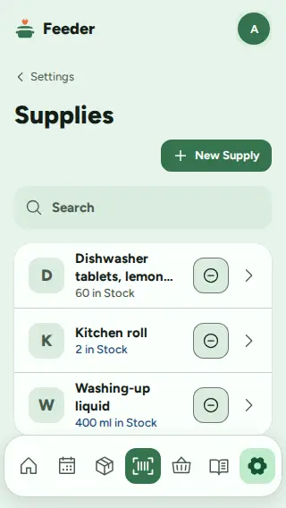
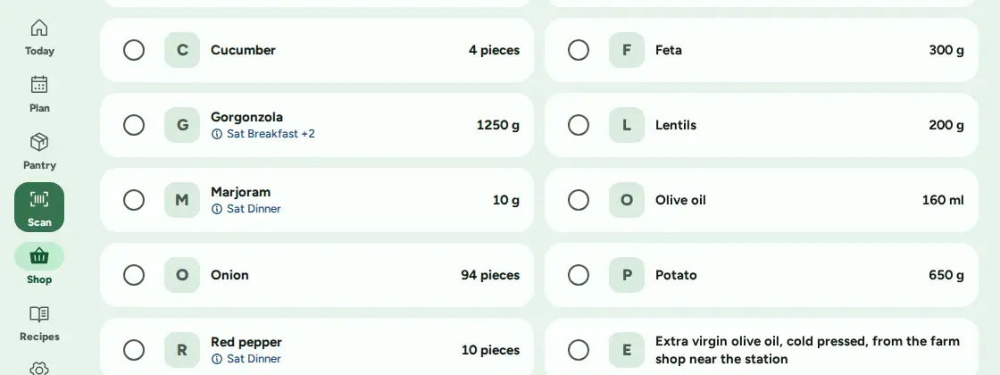
Mocks: [mocks/ssp-03-pantry-headings.html](mocks/ssp-03-pantry-headings.html), [mocks/ssp-05-supplies.html](mocks/ssp-05-supplies.html), [mocks/ssp-05-shop-1120.html](mocks/ssp-05-shop-1120.html).

Measured in the mocks with the proposed CSS, no meta is cut at 320, 360, 390, 1120 or 1440. At 390 the Shop Supplies rows show the compact "2 in Stock"; the full reason is in the accessible text and the Line sheet.

**New system.md rules:**
- §3: "A row chooses its compact meta and drops its meta icon by the width of its own text column (12 rem and 9 rem), never by the viewport. A status leads its meta line."
- §4 table: `row` | `--tile-min-row` | 21.5 rem | the Shop card grid.

**Accessibility:**
- The compact span is `aria-hidden`; the long text is the accessible text (the pattern LineRow already uses).
- The value column joins the row description (A11Y, SHOP-18).
- Spoiled now has its own icon shape, not only a colour.

### Build notes
- `ui/ListRow.tsx`: a `metaCompact` prop. `ui/ListRow.css`: the container rules and the narrow-row rule. This is a shared primitive change and touches every list; compact forms only appear where a caller passes one.
- New `lib/restock.ts` `restockReason(stock, level, base, system) → {long, compact}`. It replaces `stock/lib/supplies.ts` `restockPhrase`, `shop/lib/supplies.ts` `restockText` and `lib/amountOf` for Restock; `amountOf` stays for the Scan cover.
- `PantryLotRow.tsx`, `IngredientLotsRow.tsx`, `SuppliesScreen.tsx`, `shop/components/LineRow.tsx` and `stock/lib/view.ts` (status icon) use it.
- `useNarrowChips` stays for the header chips only. shop.css gets the grid min. `styles.css` gets `--tile-min-row`.

### Tests and guard
- `restock.test.ts`: below, at the level, above; pieces, ml, imperial.
- `ListRow.ds.test.tsx`: compact rendered `aria-hidden`.
- `scripts/test/ds-layout_test.sh`: a fixture row at 11 and 13 rem shows compact and long.
- Page-layout guard: widen P23 `cutMetaProbe` to every visible `.list-row__meta-text` on `/pantry`, `/supplies` and `/shop` at 320, 360, 390 and **1120**.

### Depends on / unblocks
- Depends on D4.
- DS owns the 320 px PageHeader and the Sort chip ("Go…", SHOP-03), visible in the 320 render.

## SSP-06  Scan without a working camera, and the tablet split
**Severity** S2 · **Size** M · **Sources** SHOP-06, SHOP-15 · **Reproduced** Confirmed.

At 390 with no camera:
- the black viewfinder takes 244 px at y 118, and the failure tile starts at y 374;
- after two typed barcodes the first Scanned row is at y 756–828, under the bottom bar (y 762);
- two "Added…" toasts sit at y 614 and 682 over the field;
- "Type the barcode instead" leaves focus on `<body>`;
- with a working camera there is no way to type a barcode;
- the empty state still says "Point the camera at a barcode".

At 820 the left column is 322 px:
- the failure text wraps to 4 lines;
- "Back to the camera" and "Use this barcode" wrap to 2 lines each.

**Where** `/scan` Shop session; phone, tablet; light and dark

### Problem
One-handed in a Shop, the person types a barcode and cannot see whether it worked: the new row is under the bar and the toasts cover the field. A smudged barcode cannot be typed while the camera works.

Causes:
- `scan/screens/ScanScreen.tsx` always renders the tall `ViewfinderStrip`, then `CameraFailure`, then the list;
- `components/CameraFailure.tsx` and `ManualBarcodeEntry.tsx` stack a full form;
- `scan.css` `.scan-screen__split`.

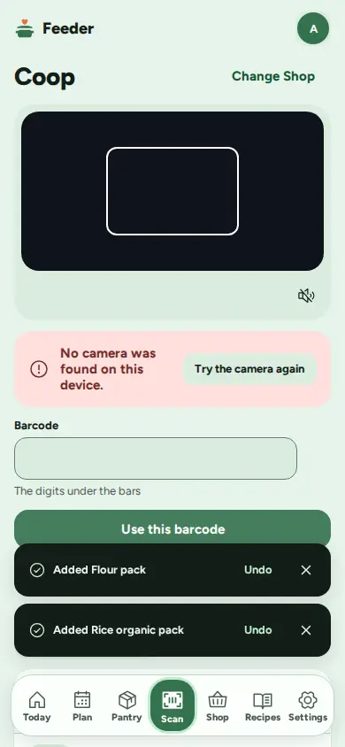 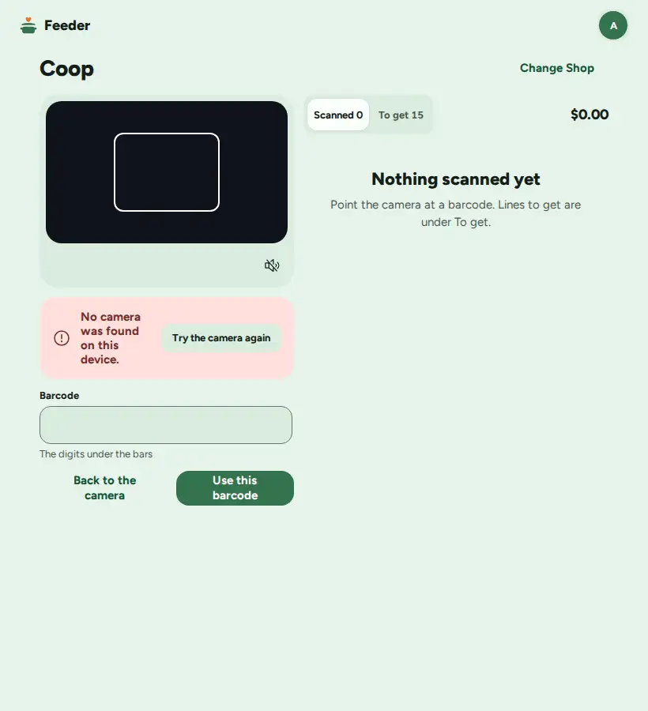

### Design
**Behaviour:**
- **No camera, or permission denied:**
  - the viewfinder collapses to a 56 px **camera bar** (danger status tone, CameraSlash icon, "No camera on this device" or "Feeder may not use the camera");
  - its **Try again** is an outlined secondary button on a `--color-surface` fill (R-A);
  - the typed entry is open below it as one row, the **Barcode** field and **Use** (primary, ArrowRight; accessible name "Use this barcode");
  - after Use the field clears and keeps focus, so several codes can be typed;
  - the new row scrolls into view above the bottom bar (`scroll-margin-block-end: var(--nav-clearance)`);
  - "Back to the camera" appears only when a camera exists.
- **Camera working:** an IconButton **Type a barcode** (Keyboard icon, new registry name `typeBarcode`) sits beside Mute in the strip's control row. It opens the same row under the strip and focuses the field.
- **"+1 without a Price"** beside the total is an outlined secondary button, not bare text.
- **Toasts on Scan:** one at a time. A new "Added …" replaces the previous one (SAFE's pattern). A one-sentence toast keeps one line with an outline Undo and a circular Dismiss (R-D). SSP-12 covers the keypad.
- **Empty state with no camera:** "Nothing scanned yet" / "Type the digits under the bars. Lines to get are under To get."
- **Tablet (600–1023):** the split keeps two columns. With the camera bar and the one-row entry, the 322 px column holds them on one or two lines (measured in the mock), so the grid is unchanged.
- **Phone landscape (844×390):** SHORT owns it (SHOP-25: Mute and torch in the strip's corner, and Type a barcode joins them).

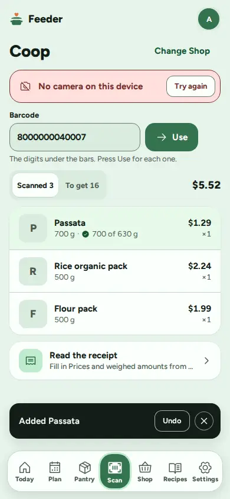 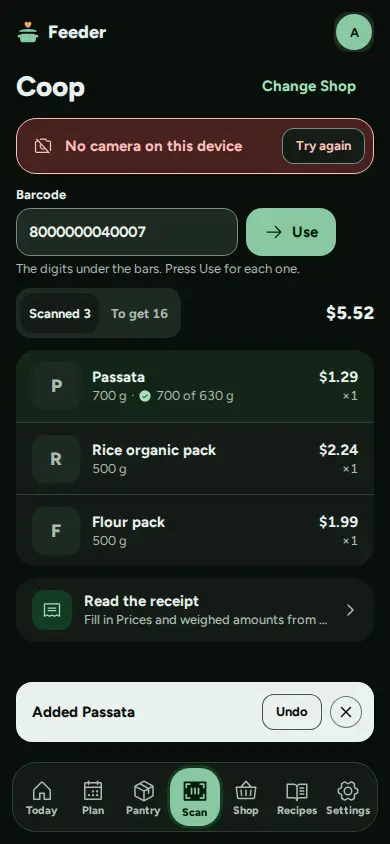 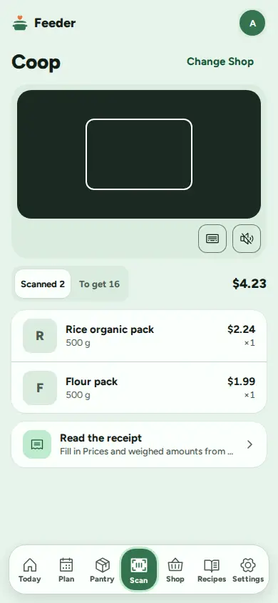
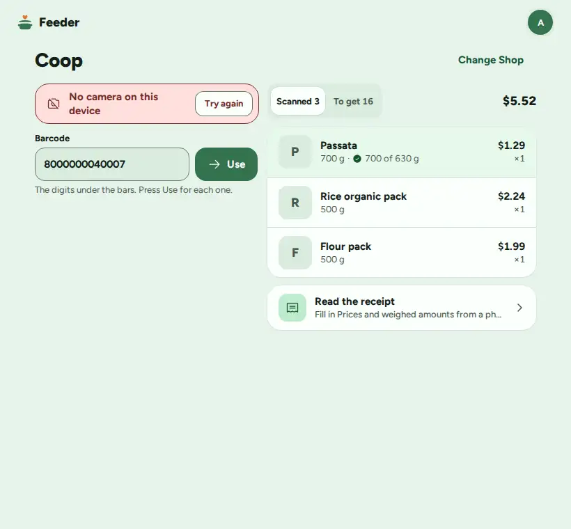
Mocks: [mocks/ssp-06-scan-no-camera.html](mocks/ssp-06-scan-no-camera.html), [mocks/ssp-06-scan-camera-on.html](mocks/ssp-06-scan-camera-on.html).

**Copy:**
- "No camera on this device", "Feeder may not use the camera", "Try again";
- "Barcode", "The digits under the bars. Press Use for each one.", "Use", "Type a barcode";
- empty-state hint "Type the digits under the bars. Lines to get are under To get."

**Accessibility:**
- The camera bar is the `region` "Scanner"; its message is `role="alert"` once, at failure.
- Type a barcode has `aria-expanded` and `aria-controls`.
- Opening the entry focuses the field. After Use, focus stays in the field and the toast announces "Added Passata".
- The camera bar's text is danger-fg on danger-bg (7.82:1 light, 8.89:1 dark). Its 1 px border is danger-fg (8.55:1 against the page). Try again's outline has 3.7:1 or more against the tint (R-A).
- Targets are 40–48 px.

### Build notes
- `ui/ViewfinderStrip.{tsx,css}` gets `size="bar"` for the failed state and a controls slot for Type a barcode. This is a shared primitive; Stock-take uses it too and gets the same behaviour.
- `scan/components/CameraFailure.tsx` renders into the bar; `ManualBarcodeEntry.tsx` becomes the one-row entry.
- New hook `useTypedEntry` (open, focus, keep focus after submit).
- `useScrollAboveSheet` gains "scroll the newest row into view".
- `scan.css`; `strings.ts`.
- Button outlines come from DS's R-A `Button` change.

### Tests and guard
- Component tests:
  - the field is focused on open;
  - it stays focused and clears after Use;
  - the camera bar replaces the strip on failure.
- BDD:
  - "A typed barcode's row is on screen above the bottom bar";
  - "Type a barcode while the camera works".
- Page-layout guard: a `scan-typed` scenario at 360 and 390 (no camera, two typed codes) where P12 fails if the newest `.list-row` intersects the bar; at 820 and 1024 a "button text wraps" check on `.scan-screen__camera .button`.

### Depends on / unblocks
- SAFE (one toast at a time), SHORT (SHOP-25 landscape), A11Y (targets), DS (R-A buttons).

## SSP-07  Weighed barcodes: show the weight, price per kg
**Severity** S2 · **Size** S · **Sources** SHOP-07 · **Reproduced** Confirmed, narrower. With a Weight Barcode Rule on Coop, typing 2000123003122 (312 g):
- "What is this?" shows no weight;
- after "Add · ticks Cheese" the keypad opens on **per pack** at "$0" with no "× 312 g =" line, and the toast covers the row;
- the row itself does show "312 g · 312 of 400 g", which stage 1 had not seen.

**Where** `/scan` What is this? and Price entry; phone and tablet

### Problem
The person cannot check the weight against the label, and has to switch to per kg by hand.

Causes:
- `scan/lib/unknownForm.ts:134` builds the weighed Op without `weighed: true`, so `lib/scannedList.ts` does not treat the row as weighed;
- `ScanScreen.tsx:348` passes `barcode` only in pack mode, so the sheet has no header line.

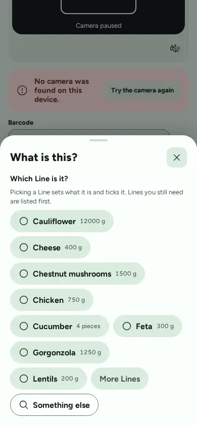 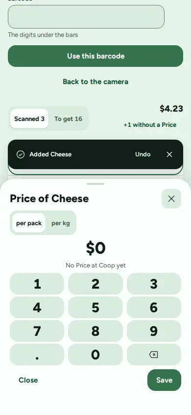

### Design
**Behaviour:**
1. The sheet's header line reads **"312 g · weighed at Coop · item 012300"** (Scales icon). Lines in g are listed first. Close is the R-B circular button.
2. The new weighed row opens Price entry on **per kg**, with the implied line **"× 312 g = $4.65"** under the display and "No Price at Coop yet" stacked under it (spec §10.1 as written).
   - The keypad sheet has no header Close: its footer has **Close** (an outlined secondary, R-A and R-B) and **Save**.
   - The keys are 8 px apart, so a focused key draws its ring inside itself (R-C+): 2 px `--color-accent` at −2 px offset on a `--color-soft` fill. It never overlaps the next key.
3. The saved row shows "$4.65" with the sub-value **"$14.90/kg"**.

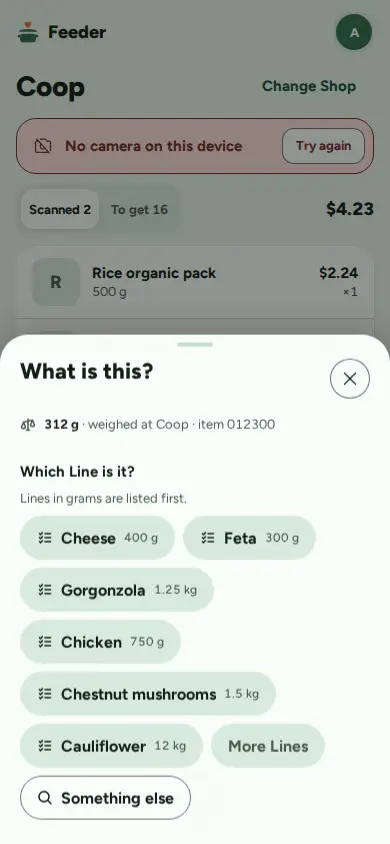 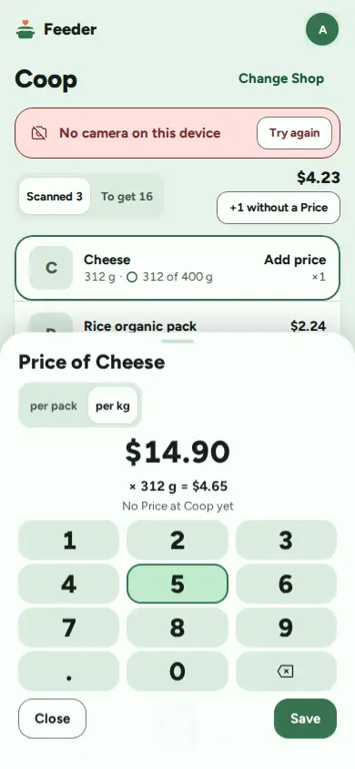 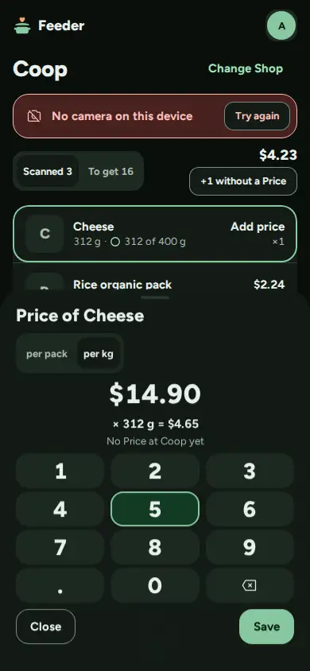 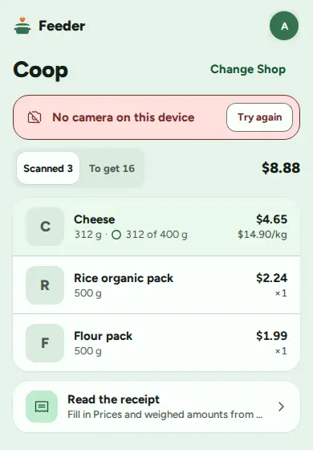
Mocks: [mocks/ssp-07-weighed-sheet.html](mocks/ssp-07-weighed-sheet.html), [mocks/ssp-07-weighed-keypad.html](mocks/ssp-07-weighed-keypad.html), [mocks/ssp-07-weighed-row.html](mocks/ssp-07-weighed-row.html).

**Copy:**
- "{weight} · weighed at {Shop} · item {code}";
- the existing "× {weight} = {price}" and "{price}/kg".

**Accessibility:**
- The header line is the sheet's description (`aria-describedby`).
- The display's live output reads "14.90 dollars per kg, 4.65 dollars for 312 grams".
- The inset key ring on soft is 3.4:1 (light) and 3.6:1 (dark).
- Esc and the grip still close the keypad.

### Build notes
- `unknownForm.ts:134`: add `weighed: true`.
- `NewProductSheet.tsx` gets a `weighed?: {grams, itemCode}` prop.
- `ScanScreen.tsx` passes it.
- `PriceEntrySheet` already handles `weighed`. In `ui/PriceKeypad.css`:
  - the notes stack;
  - Close becomes a secondary button;
  - `.price-keypad__key:focus-visible` takes the inset ring.
- `PriceEntrySheet` drops the header Close.

### Tests and guard
- `unknownForm.test.ts`: a weighed target's Op has `weighed: true`.
- PriceEntrySheet:
  - a weighed row opens on per kg with the × line;
  - no header Close is rendered.
- BDD: "A new weighed Product is priced per kg".
- Guard:
  - a page-layout `scanWeighed` setup that seeds a rule;
  - a focused-key check that the ring box stays inside the key.

### Depends on / unblocks
- SSP-12 (toasts over the row), SSP-15 (a code with no rule); DS (R-B), A11Y (R-C+).

## SSP-08  Receipt review: Add… with receipt context, matches first, a truthful Accept all, no duplicate Product
**Severity** S2 · **Size** M · **Sources** SHOP-08, FLOW-20 · **Reproduced** Confirmed. I scanned 3 Products including "Passata #fake:receipt" and read the receipt. The review lists "Not scanned (2)":
- **Accept all** is the most prominent control, yet "Apply 0 changes" stays at 0 after pressing it;
- each row's checkbox is disabled with no reason given;
- **Add…** on "KITCHEN ROLL 4 PACK ×1 · $3.49" opens the generic "What is this? / Which Line is it?" with no receipt line, and Kitchen roll is hidden behind More Lines;
- the existing Product "Kitchen roll 4 pack" is not offered.

FLOW-20's duplicate Product (a new "Kitchen roll" beside "Kitchen roll 4 pack") follows from that sheet. I did not re-run the apply.

**Where** `/scan/receipt/review`; phone and desktop; light and dark

### Problem
The person must remember what the receipt line said, scroll for the Line and make a new Product that already exists. Accept all lies.

Causes:
- `receipt/lib/reviewState.ts:65` `acceptAll` checks nothing when only Add rows exist, but `screens/ReceiptReviewScreen.tsx:109` always shows it;
- `lib/addDraft.ts:24` `initialFromAdd` passes the name and size but nothing shows the printed line;
- the Line chips are list-ordered (`scan/lib/lineChoice.ts`), not matched to the name;
- `POST /api/scan/receipt/apply` `adds[]` can only create a Product (receipt-reading.md §7.2).

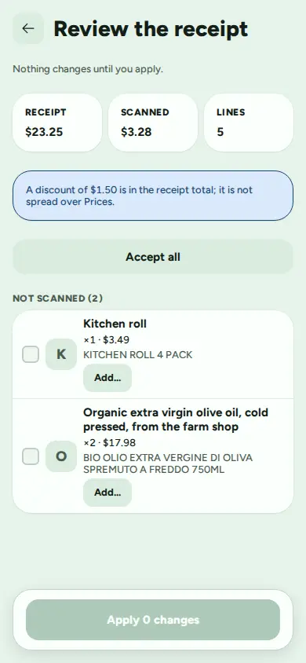 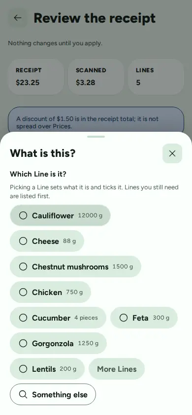

### Design
**Review list:**
- **Accept all** shows only when at least one row needs no choice, and its label counts them ("Accept all 6").
- With none, the quiet note reads "Accept all has nothing to check: every line below needs you to say what it is."
- **Each row is an R-E row:**
  - key: the name read from the receipt (`body-strong`);
  - state at the row's end: "×1 · $3.49" (`body-strong`, tabular);
  - detail, muted under the key: the printed line "KITCHEN ROLL 4 PACK";
  - when the name matches a Product, a second detail line in info-fg reads "Kitchen roll 4 pack is a Product" (Link icon).
- A Not scanned row has **no checkbox until it is set up**. Its control is the outlined **Add…** under the row's detail, which leaves a long name the whole text column. The whole row opens it too. Once set up, the checkbox appears, checked, as receipt-reading §3.4 says.

**Add… sheet:**
- A receipt block on top: overline "On the receipt", then one R-E row with key "KITCHEN ROLL 4 PACK", state "$3.49" and detail "×1 at $3.49".
- Then **"Is it one of these?"**: up to 3 name matches, Products first ("Kitchen roll 4 pack · Product · 4 pieces"), then Lines ("Kitchen roll · Line · 2 pieces").
- Then "Other Lines", More Lines and Something else as before.
- Picking a Product needs nothing more. A note reads "Kitchen roll 4 pack: 1 Scan at $3.49, and it ticks Kitchen roll", and the primary is **"Use Kitchen roll 4 pack"**.
- Something else keeps the short form. Its name step runs the near-duplicate guard against Product names too ("Kitchen roll 4 pack is already a Product. Use it?").
- Close is the R-B circular outline button. At 768 px and wider the sheet is the centred 560 px dialog.

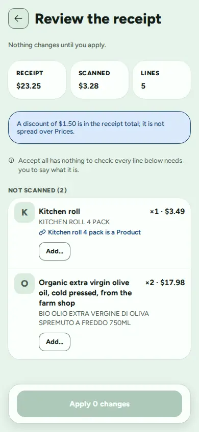 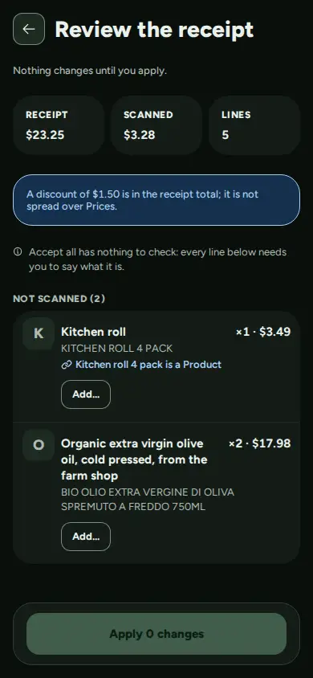 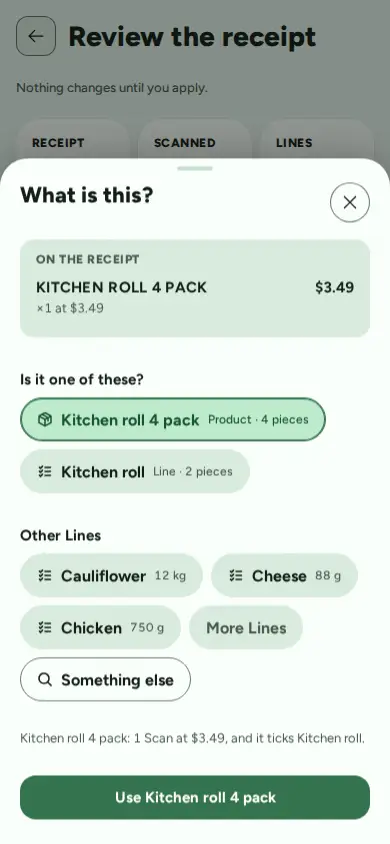 

Mocks: [mocks/ssp-08-review.html](mocks/ssp-08-review.html), [mocks/ssp-08-add.html](mocks/ssp-08-add.html).

**Copy:**
- "Accept all {n}", "Accept all has nothing to check: every line below needs you to say what it is.";
- "{Product} is a Product", "On the receipt", "×{n} at {price}", "Is it one of these?", "Other Lines";
- "{Product}: {n} Scan at {price}, and it ticks {Line}." (without "and it ticks …" when no Line matches);
- "Use {Product}", "{Product} is already a Product. Use it?".

**Accessibility:**
- The receipt block is the dialog's description.
- The matches are a `radiogroup`.
- A row without a checkbox has Add… as its control (40 px), and its accessible name includes the printed line ("Add KITCHEN ROLL 4 PACK").
- Info-fg on surface is 9.0:1 light and 10.81:1 dark; the muted detail on surface is 7.23:1 and 8.75:1.

### Build notes
- Pure lib `receipt/lib/receiptMatches.ts`: normalise names (case, accents, pack sizes stripped) and rank Products then Lines by token overlap; top 3.
- `reviewState.ts`: `acceptableCount`. `ReviewSummary.tsx` / `ReceiptReviewScreen.tsx`.
- `ReviewRow.tsx` becomes an R-E row (key, state, detail, then the control): no checkbox for an unset Add.
- `NewProductSheet` gets a `receiptLine` prop and a `matches` step (only in no-barcode mode).
- **API:** `adds[]` accepts `{id, productId}` (an existing, non-archived Product of the Household) as well as the new-Product shape. The apply plan (`internal/receipt`, §8) records a Scan of that Product at the receipt's price; `422` for an unknown or archived id.

### Tests and guard
- `receiptMatches.test.ts` (exact name, pack-size suffix, accents, no match).
- `reviewState.test.ts` (Accept all count 0, Add rows).
- Go apply: `adds` with `productId` makes a Scan and no Product.
- BDD:
  - "Add… shows the receipt line";
  - "A name-matching Product is offered first";
  - "Accept all is hidden when nothing can be accepted";
  - "Using an existing Product creates no new Product".

### Depends on / unblocks
- SSP-20 (shared header); A11Y (whole-row toggle, SHOP-19); DS (R-E rows).

## SSP-09  "Shopping List complete" offers the next steps
**Severity** S3 · **Size** S · **Sources** SHOP-12 · **Reproduced** Confirmed. With all 20 Lines ticked, the tile reads "Shopping List complete / 20 lines / $10.79 spent / 23 Stock Lots added", with no action and lowercase "lines" (`shop/strings.ts:49`). The accent Scan button stays the only action; 17 of the 23 Stock Lots were left Not sorted. Scan's To get only says "Nothing left to get". Spec §10.1 says the tile offers Read the receipt once a Scan has happened; that is not built.
**Where** `/shop`, Scan's To get; all sizes; light and dark

### Design
**Behaviour:**
- The tile keeps its title. Its summary becomes three R-E rows on the success tint, with figures in success-fg and right-aligned:
  - **Lines ticked · 20**;
  - **Spent at Coop · $10.79** (only when something was spent);
  - **Stock Lots added · 23**, with the muted detail "17 not sorted into a Storage Place yet" when some are.
- When some of this list's Stock Lots are Not sorted, the primary is **Put away 17 Stock Lots** (opens SSP-10).
- **Read the receipt** (outlined secondary on a surface fill, Receipt icon, R-A) shows when this phone has a Scan session today and the assistant is available; it opens `/scan/receipt`.
- With nothing to put away, Read the receipt becomes the primary. With neither, there is no button.
- Scan in the metric strip becomes an outlined secondary, with the caption "Every Line is ticked".
- Scan's empty To get shows the same tile (`CelebrationTile` shared).
- The tile becomes a **success status tile** (bordered, system.md §2: accent containers are only for selected filters and the dark hero).
- The celebration animation stays and is off with reduced motion.

 

Mock: [mocks/ssp-09-complete.html](mocks/ssp-09-complete.html).

**Copy:** "Lines ticked", "Spent at {Shop}", "Stock Lots added", "{n} not sorted into a Storage Place yet", "Put away {n} Stock Lots", "Read the receipt", "Every Line is ticked".

**Accessibility:**
- `role="status"` stays. The rows are a list named "This shop", and the buttons are reachable in order after the title.
- Contrast on success-bg: success-fg is 7.29:1 light and 8.99:1 dark; the key in text colour is above 12:1.

### Build notes
- `shop/components/CelebrationTile.tsx` gets the R-E rows (DS's row) and `actions`.
- `ShopMetrics.tsx` gets the Scan variant.
- Hooks: `useScanSessionActive` (exists) and new `useUnsortedFromList` (Stock Lots this list's ticks and Scans added that are Not sorted). It needs the tick's `lotId` (SSP-01) and the Scan Results' lots.
- `scan/components/ToGetList.tsx` empty state.
- `shop/strings.ts`.

### Tests and guard
- CelebrationTile: rows and buttons per state.
- BDD:
  - "Shopping List complete offers Put away when Stock Lots are not sorted";
  - "Shopping List complete offers Read the receipt after Scans".
- Guard: the existing celebration scenario adds "one primary in the tile".

### Depends on / unblocks
- Depends on SSP-10 and SSP-01; DS (R-E rows).

## SSP-10  Put away a whole shop at once
**Severity** S3 · **Size** M · **Sources** FLOW-19 · **Reproduced** Confirmed. After ticking 20 Lines, `/pantry` shows "Not sorted, 17 Stock Lots". Moving one Stock Lot is row, Move, choose the place, Save: 4 taps, so 68 taps for this shop.
**Where** `/pantry` Not sorted; the complete tile; all sizes

### Problem
New Stock goes where that Ingredient was last put, else to the default Storage Place. Ingredients bought for the first time, in a Household with no default, all land in Not sorted, and sorting them is slow.

### Design
**Behaviour:**
- **Put away** (Not sorted heading action, SSP-03, and the complete tile, SSP-09) opens a sheet, a centred dialog from 768 px: "Put away 17 Stock Lots".
- **Put into**: our Select of Storage Places with their kind icons, preset to the last one used in this sheet, else the default, else the first fridge.
- Under it, the hint "Tick what goes there. Feeder remembers it for next time." and the Not sorted Stock Lots as rows with a leading checkbox (status and quantity as SSP-05).
- The sticky primary **"Move 4 to Kitchen Fridge"** moves the ticked Stock Lots in one request. They leave the list, and the Select stays for the next place.
- When the list empties, the sheet closes with the toast "Every Stock Lot is put away".
- Close keeps what was moved.
- Taps for this shop: about 3 place choices, 17 ticks and 3 moves (about 23, down from 68). The existing "goes where it was last put" rule makes the next shop smaller.

 
Mock: [mocks/ssp-10-put-away.html](mocks/ssp-10-put-away.html).

**Copy:** "Put away", "Put away {n} Stock Lots", "Put into", "Tick what goes there. Feeder remembers it for next time.", "Move {n} to {Storage Place}", "Every Stock Lot is put away". GLOSSARY: a note under Storage Place, "Put away is plain copy for moving Not sorted Stock Lots into a Storage Place".

**Accessibility:**
- The rows are checkboxes with the Ingredient as the label.
- The primary's name includes the count and the place.
- After a move, focus goes to the first remaining row (A11Y), and the result is announced politely.
- The selected-row fill is `--color-soft` with `--color-text` (13.14:1 light).

### Build notes
- Component `stock/components/PutAwaySheet.tsx`, hook `usePutAway`, pure `stock/lib/putAway.ts` (selection, default place).
- **API:** `POST /api/stock/lots/put-away {moves: [{lotId, storagePlaceId}]}` applies all moves or none, through `stock.Service.MoveMany` (domain in `internal/stock`, a thin handler). Each move records "last put" as a single Move does.

### Tests and guard
- `putAway.test.ts`.
- Go `MoveMany` (atomic, unknown place, already-sorted Stock Lot).
- BDD:
  - "Put away moves the ticked Stock Lots to the chosen Storage Place";
  - "The next purchase of that Ingredient goes there".
- Guard: page-layout scenario `pantry-put-away` at 390 and 1440 (sheet footer reachable, P12).

### Depends on / unblocks
- Depends on SSP-03.
- Unblocks SSP-09.

## SSP-11  Scan's To get leaves out manual extras
**Severity** S3 · **Size** S · **Sources** SHOP-09 · **Reproduced** Confirmed. With "Extra virgin olive oil, cold pressed, from the farm shop near the station" open on Shop ("17 of 20 left"), Scan said "To get 16". `scan/lib/toGet.ts:17–24` maps only `list.lines`, and `scan/lib/scannedList.ts:345` `toGetLines` filters Lines only.
**Where** `/scan` To get; all sizes

### Design
**Behaviour:**
- To get lists the open manual extras after the food Lines and before Supplies, in Shop's order, so its count equals Shop's "left".
- A free-text extra's second line is "Added by hand" (NotePencil, the registered `extra` icon); one tap ticks it.
- An Ingredient extra shows its cover ("0 of 500 g"); one tap ticks it with its quantity (SSP-01's toast).
- Supplies keep no subheader here (beta.8 decision).

 Mock: [mocks/ssp-11-toget-extras.html](mocks/ssp-11-toget-extras.html).

**Copy:** "Added by hand".

**Accessibility:** each row's name is "Tick {text}", as the Lines are.

### Build notes
- `toGetRows(lines, extras, …)` with `extraEntry` from `shop/lib/lines.ts`; `toGetLines` → `toGetEntries`.
- `useToGetTick` calls `tickExtra` for extras.
- `ScanScreen.tsx` passes `list.extras`.

### Tests and guard
- `toGet.test.ts` includes extras.
- BDD: "Scan's To get count equals Shop's left".
- Guard: unit.

### Depends on / unblocks
- SSP-01 (same tick amount and toast).

## SSP-12  The Price keypad: toasts cover the row being priced
**Severity** S3 · **Size** S · **Sources** SHOP-20 · **Reproduced** Confirmed. After a new weighed Product, the toast "Added Cheese · Undo" sits at y 284–344 over the outlined row at y 284–356. `ui/Toast.css:20–25` lifts the toast region above the half sheet to the same band where `useScrollAboveSheet` puts the priced row. Stage 1 also saw a typed Scan stack "What is this?" over the keypad; here the typed entry stays usable while the keypad is open.
**Where** `/scan` Price entry, phone

### Design
**Behaviour:**
- While Price entry is open, no toast shows. A toast that arrives then is held, and only the latest is shown when the keypad closes.
- The toast for the Scan that opened the keypad is dropped: the outlined row is the confirmation, and its Remove is in the row's strip.
- The typed entry closes while the keypad is open, as the camera already pauses. **Type a barcode** is disabled with the description "Close the Price first".
- The keypad footer is **Close** (outlined secondary) and the primary. There is no header Close (R-B).

 Mock: [mocks/ssp-12-keypad-no-toast.html](mocks/ssp-12-keypad-no-toast.html).

**Copy:** "Close the Price first".

**Accessibility:** a held toast is announced when shown; the disabled button keeps its description (`aria-describedby`).

### Build notes
- `ui/Toast`: a `hold()` / `release()` on the toast store (shared; nothing else holds today).
- `ScanScreen.tsx` holds while `pricingRow` is set.
- `Toast.css` drops the half-sheet lift rule for Scan.
- `ManualBarcodeEntry` closes on Price entry.

### Tests and guard
- Toast store: hold, latest-only release.
- ScanScreen: no toast while pricing.
- Guard: the `scan-price-keypad` page-layout scenario checks that no `.toast` box intersects `[data-pricing]`.

### Depends on / unblocks
- SAFE's toast pattern; SSP-06; SSP-07 (the same keypad footer).

## SSP-13  No estimate before a first purchase, and no Price from a Line
**Severity** S3 · **Size** M · **Sources** FLOW-16 · **Reproduced** Confirmed. At Coop, Onion pack ($2.99), Garlic organic pack ($3.24), Olive oil pack ($3.49) and Kitchen roll 4 pack ($3.49) all have Prices, yet their Lines answer `pack: null, estimatedCostCents: null`, and Shop says "18 Lines have no Price yet". The Onion sheet shows "Estimated / No Price yet" and only Not needed. Causes: `internal/shopping/service/service.go:253` (`Products.LastBought` only), spec §9.
**Where** `/shop` metric strip and Line sheet; all sizes; light and dark

### Design
**Behaviour (decided: SSP 5):**
- With no purchase, a Line's pack suggestion and estimate use the Ingredient's priced Product at the selected Shop (else any Shop): the most recent Price, ties broken by price per Base Unit.
- The Line sheet opens with two R-E rows:
  - key **To get**, state **94 pieces**, detail "16 × Onion pack (6 pieces)";
  - key **Estimated at Coop**, state **$47.84**, detail "$2.99 a pack, 14 Nov · not bought here yet".
- Under them, **Change the Price** (outlined secondary, Coins icon, start-aligned, R-A) opens the shared Price keypad for that Product at the selected Shop.
- A Line with no Product says "No Product yet: scan one in the Shop" instead of Change the Price.
- The sheet's Close is the R-B circular outline button.
- The metric strip counts only Lines with no priced Product ("14 Lines have no Price yet").

  
Mock: [mocks/ssp-13-line-sheet.html](mocks/ssp-13-line-sheet.html) (the same sheet as SSP-14, whose "For" list is set as rows too: key "Sat Dinner", state "40 pieces", detail "French onion soup").

**Copy:** "To get", "Estimated at {Shop}", "{price} a pack, {date} · not bought here yet", "Change the Price", "No Product yet: scan one in the Shop".

**Accessibility:**
- The rows are a list; each row reads key, state, detail.
- The keypad sheet follows the Scan Price entry; focus returns to Change the Price.

### Build notes
- Go: `Products.PricedPacks(ctx, ingredientIDs, shopID)` (store query on `prices`) as the fallback in `service.input`.
- The `PackSuggestion` JSON gains `bought: boolean`.
- `PUT /api/products/{id}/prices` already exists.
- Client:
  - `shop/components/LineSheet.tsx` uses DS's R-E rows;
  - `lib/lines.ts`;
  - `ui/PriceKeypad` reused in a `PriceSheet` (new shared component lifted from `scan/components/PriceEntrySheet.tsx`).
- Spec §9 changes.

### Tests and guard
- Go: the fallback when nothing was bought, preferring the selected Shop, an archived Product excluded.
- BDD:
  - "A Line is estimated from a Price before the first purchase";
  - "Change the Price from a Line".

### Depends on / unblocks
- SSP-01's default pack amount uses the same suggestion, so it covers more Lines. DS (R-E rows).

## SSP-14  "Not available": what the Line is for, and a substitute
**Severity** S3 · **Size** M · **Sources** FLOW-17 · **Reproduced** Confirmed. The Onion Line sheet offers only **Not needed**. It does not say which Planned Meals need Onion, or what Not needed leaves short.
**Where** `/shop` Line sheet; all sizes

### Design
**Behaviour (D6-A):**
- The Line sheet gains **"For"**: the Planned Meals the Line is for, as weekday and Meal Slot plus Recipe ("Sat Dinner · French onion soup"), up to 5, then "and {n} more".
- **Get something else…** opens Add to Shopping List with the Ingredient select open. On Save it adds the extra and marks this Line Not needed, with one toast "Onion is Not needed; Shallot added", whose Undo reverts both.
- **Not needed** stays, with the line "Not needed leaves these 3 Planned Meals short of Onion."
- Swapping a Planned Meal is PC's (each "For" row may link to it once PC's Swap entry exists).

 Option B: 
Mocks: [mocks/ssp-13-line-sheet.html](mocks/ssp-13-line-sheet.html), [mocks/ssp-14-not-here-option.html](mocks/ssp-14-not-here-option.html).

**Copy:** "For", "and {n} more", "Get something else…", "Not needed leaves {these n Planned Meals / Sat Dinner} short of {Ingredient}.", "{Line} is Not needed; {Ingredient} added".

**Accessibility:** "For" is a list with a heading; the toast is SAFE's pattern.

### Build notes
- **API:** each open Line gains `plannedMeals: [{date, mealSlotId, mealSlotName, courseName, recipeName}]`, from `shopping.Derive`'s needs (it already walks them for `pastPlannedMeals`).
- `LineSheet.tsx` and hook `useSubstitute` (add extra, then Not needed, one Undo).

### Tests and guard
- Go: Lines carry their Planned Meals.
- BDD:
  - "The Line sheet says what the Line is for";
  - "Get something else adds an extra and takes the Line off".

### Depends on / unblocks
- Depends on D6 and SSP-13 (same sheet; one package).

## SSP-15  A weight-style code with no Weight Barcode Rule silently becomes a Product
**Severity** S3 · **Size** S · **Sources** FLOW-27 · **Reproduced** Confirmed. With no rule on Coop, 2100123012503 opened the ordinary "What is this?" ("02100123012503 · not in Feeder yet") with no hint, so every weighed pack would become its own Product.
**Where** `/scan` What is this?

### Design
**Behaviour:**
- When an unknown EAN-13 starts with a GS1 in-store prefix (20–29, or 02 as an EAN-13 lead) and the Shop has no Weight Barcode Rule, the sheet opens with an info tile: **"This looks like a Coop code for weighed goods"** / "Coop has no Weight Barcode Rule, so every weighed pack would become a Product of its own."
- The Admin sees **Set up the rule**, which opens the Shop's page at its Weight Barcode Rules (SET's screen). A User sees "Ask the Admin to set one up."
- The form below continues. Scope defaults to **This Shop only** for such a code (a Shop Barcode).

 
Mock: [mocks/ssp-15-weight-code-no-rule.html](mocks/ssp-15-weight-code-no-rule.html).

**Copy:** "This looks like a {Shop} code for weighed goods", "{Shop} has no Weight Barcode Rule, so every weighed pack would become a Product of its own.", "Set up the rule", "Ask the Admin to set one up."

**Accessibility:** the tile is the sheet's first description; info-fg on info-bg is 7.37:1 light and 8.37:1 dark.

### Build notes
- Pure `scan/lib/barcode.ts` `isInStoreCode(gtin)`.
- `NewProductSheet` gets a `weightCodeHint` prop and a preset scope.
- `useScanFlow` knows whether the Shop has rules (`GET /api/shops/{id}/weight-rules`, already in offline data).

### Tests and guard
- `isInStoreCode` table.
- BDD: "A weighed-goods code at a Shop without a rule says so".

### Depends on / unblocks
- SET owns the rule editor.
- SSP-20 (code shown as printed).

## SSP-16  Big quantities in the Base Unit, digits ungrouped
**Severity** S3 · **Size** S · **Sources** SHOP-21 · **Reproduced** Confirmed: "Cauliflower 12000 g", "Chestnut mushrooms 1500 g", "Gorgonzola 1250 g", and Onion's need "504" pieces. `web/src/lib/units.ts:37–48` (`formatQuantity` metric prints `{n} {base}`, ungrouped; imperial already converts to lb).
**Where** every quantity on Shop, Scan, Pantry; all sizes

### Design
**Behaviour (D7-A):**
- Metric display uses kg and l from 1000 g / 1000 ml, with at most 2 decimals and trailing zeros trimmed ("12 kg", "1.25 kg", "1.5 l").
- Below 1000 nothing changes. Pieces are grouped in the Household locale ("1,250 pieces").
- `amountOf` keeps its rule that a unit is written once when both amounts share it ("800 g of 1.2 kg").
- Inputs stay in the Base Unit (the NumberField suffix stays "g").

Decision board: . Mock: [mocks/ssp-16-quantities.html](mocks/ssp-16-quantities.html). The kg form is also used in every other mock in this chapter.

**Accessibility:** screen readers read "12 kilograms" through `Intl.NumberFormat` unit formatting.

### Build notes
- `lib/units.ts` `formatQuantity`. Shared: it touches every feature's tests that assert quantities (shop, scan, stock, plan, recipes' Stock text), so it is its own package and merges first.
- Spec §9 "Display" and GLOSSARY Base Unit note.

### Tests and guard
- `units.test.ts` new rows (999 g, 1000 g, 1250 g, 12000 g, 1500 ml, 1250 pieces).
- Guard: unit.

### Depends on / unblocks
- Depends on D7.

## SSP-17  Keep moves a go-off date one day at a time
**Severity** S3 · **Size** S · **Sources** new in stage 2 (raised as stage-1 shop question 2) · **Reproduced** Confirmed. `POST /api/stock/lots/18/keep` on a Stock Lot that went off on 2026-10-08 answers `goesOff 2026-10-09, spoiled: true`. It stays in "Throw out or keep?", so a Stock Lot that went off 37 days ago needs 37 Keeps. Spec §6 says Keep "pushes the lot's go-off date out by 1 day from its existing go-off date (not from today)", and GLOSSARY "Throw out / Keep" says the same.
**Where** `/pantry` and Today's "Throw out or keep?"; all sizes; light and dark

### Design
**Behaviour (decided: SSP 8):**
- **Keep** makes the Stock Lot "Good until today" in one tap. It leaves the tile, which shows it again tomorrow if it is still there and has not been used.
- **The toast** follows R-D and R-D+: no status icon, the headline **"Flour kept"**, the muted subline **"Good until today"**, the outline buttons **Change** and **Undo**, and the circular Dismiss top-aligned with the headline.
- Change opens "Flour: good until?":
  - choices Today, Tomorrow, In 3 days and In a week (each with its date), and **Pick a date** (our date picker, not before today);
  - the primary "Keep until {day}";
  - the R-B circular Close.
- In the spoiled tile, **Throw out** is an outlined danger secondary and **Keep** an outlined secondary, both on a `--color-surface` fill (R-A).
- The zero-waste streak treats it exactly as Keep does today: it did not go off.

  
Mocks: [mocks/ssp-17-keep.html](mocks/ssp-17-keep.html), [mocks/ssp-17-keep-date.html](mocks/ssp-17-keep-date.html).

**Copy:** toast headline "{Ingredient} kept", subline "Good until today"; "{Ingredient}: good until?", "Keep means it did not go off. It leaves Throw out or keep? until then.", "Today", "Tomorrow", "In 3 days", "In a week", "Pick a date", "Keep until {day}".

**Accessibility:**
- The choices are a radiogroup.
- After Keep, focus moves to the next spoiled row's Keep (A11Y).

### Build notes
- **API:** `POST /api/stock/lots/{id}/keep {goodUntil?: "YYYY-MM-DD"}` defaults to today and refuses a date before today (`422`). The domain is `stock.KeepOn(lot, date)` (`internal/stock/lot.go:273` already has `KeepOn`).
- `stock/components/SpoiledTile.tsx`, `hooks/useSpoiledLots.ts`. Today's tile (TB) uses the same hook.
- GLOSSARY and spec §6 change.

### Tests and guard
- Go `KeepOn` with a date.
- BDD:
  - "Keep takes a spoiled Stock Lot off the tile until today";
  - "Change sets a later Good until".

### Depends on / unblocks
- Throw out's confirm and Undo are SAFE's (SHOP-11). The toast anatomy is DS's R-D/R-D+ Toast.

## SSP-18  A ticked Line's sheet is a dead end
**Severity** S4 · **Size** S · **Sources** SHOP-23 · **Reproduced** Confirmed. Tapping ticked Carrot opens a sheet with only "Carrot / 50 g". `shop/components/LineSheet.tsx:24` shows actions only for open Lines.
**Where** `/shop` Ticked group; light and dark

### Design
This design is consistent with RES-03 (decision RES 2: a Line ticked twice keeps both Stock Lots). One sheet serves one addition and several.

- **State line** (success tone, `body-strong`): "Ticked · 500 g added to Stock", "Ticked · Not added to Stock" or "Ticked by a Scan". Under it, muted: "The Line needed 150 g."
- **Additions**, one R-E row each, between 1 px lines:
  - key: who ("You", "Sam");
  - state: the amount in success-fg, tabular ("+500 g"); a Scan's addition reads "Sam scanned" with "+50 g";
  - detail, muted under the key: "Ticked at 10:12 · Not sorted", or RES-03's "Ticked offline at 10:20 · synced 10:31";
  - a hand addition has its own outlined **Take back** at the row's end, centred on the row's two lines. A Scan's addition has none: it is undone from that User's Scanned list (ADR 0019 point 6).
- **Footer**, outlined secondaries:
  - **Change amount** opens SSP-01's Change sheet, for the viewer's own addition;
  - **Untick {Line}** takes back every hand addition.
- Then the muted note "Take back removes what is left of that Stock Lot. Untick takes back every addition."
- Take back's toast is RES-03's ("Your 50 g of Carrot was taken back from Stock", with Undo), with no status icon (R-D+).
- Close is the R-B circular outline button.

  Mock: [mocks/ssp-18-ticked-sheet.html](mocks/ssp-18-ticked-sheet.html).

**Copy:** "Ticked · {amount} added to Stock", "Ticked · Not added to Stock", "Ticked by a Scan", "The Line needed {amount}.", "You", "+{amount}", "Ticked at {time} · {Storage Place or Not sorted}", "Take back", "Change amount", "Untick {Line}", "Take back removes what is left of that Stock Lot. Untick takes back every addition."

**Accessibility:**
- The additions are a list named "Added to Stock". Each Take back is named "Take back your 500 g".
- After Untick, focus returns to the row's tick (the row moves back to To get; A11Y's rule).
- After Take back, focus goes to the next addition, else to Change amount.

### Build notes
- `LineSheet.tsx` gets a ticked mode that reads `tick` (SSP-01) and the additions list (RES-03, `shopping_tick_additions`), set with DS's R-E row plus a trailing action slot.
- The additions list component is RES-03's; this item adds the state line and footer. They ship in the order RES-03's package table gives.

### Tests and guard
- LineSheet ticked mode: one addition, two additions, a Scan's addition (no Take back).
- BDD:
  - "Untick from the ticked Line's sheet";
  - "Take back one of two additions".

### Depends on / unblocks
- Depends on SSP-01 and RES-03; DS (R-E rows).

## SSP-19  Receipt photos: the first action is the small button
**Severity** S4 · **Size** XS · **Sources** SHOP-24 · **Reproduced** Confirmed. With 0 photos, "Take a photo" is a small secondary button under the heading, while a disabled "Read the receipt" fills the sticky bar. With 1 photo, the thumbnail is white on white with no frame.
**Where** `/scan/receipt`; phone and desktop; light and dark

 

### Design
**Behaviour:**
- With no photo, the sticky primary is **Take a photo** (Camera icon; "Choose a photo" on a computer), with the hint "Take a photo of the whole receipt. Long receipt? Take it in parts, top to bottom."
- Read the receipt replaces it as the primary from the first photo, and "Add another photo" becomes the secondary in the list.
- Thumbnails get a frame: 1 px `--color-line`, `--radius-thumb`, `--color-surface-2` behind the image.
- The 1-photo state is CSS only, so it has no mock.

 Mock: [mocks/ssp-19-photos-empty.html](mocks/ssp-19-photos-empty.html).

**Accessibility:** focus after a photo is added goes to its row's Edit button (receipt-reading §3.2 pattern).

### Build notes
- `receipt/screens/ReceiptPhotosScreen.tsx`, `components/ReceiptPhotoList.tsx`, `receipt.css`.

### Tests and guard
- Component test: primary per photo count.
- BDD: "Take a photo is the first action".

### Depends on / unblocks
None.

## SSP-20  An unknown barcode shows 14 digits nobody typed
**Severity** S4 · **Size** XS · **Sources** SHOP-22 · **Reproduced** Confirmed. Typing 8000000009999 shows "08000000009999 · not in Feeder yet", and 2100123012503 shows "02100123012503". The GTIN-14 normalisation (`scan/lib/barcode.ts` `gtinOfLength`) reaches the display (`newProductStrings.ts:8`).
**Where** What is this? header (Scan and Stock-take)

### Design
- Show the code as printed under the bars:
  - EAN-13 in 1-6-6 groups ("8 000000 009999");
  - UPC-A in 1-5-5-1;
  - EAN-8 in 4-4;
  - anything else as typed.
- Tabular numerals.
- The 14-digit form stays internal.

See the header line in .

**Accessibility:** the accessible name is the digits without spaces.

### Build notes
- Pure `scan/lib/barcode.ts` `displayCode(scanned)`, used by `NewProductSheet` and `StockTakeSheet`.

### Tests and guard
- `displayCode` table.

### Depends on / unblocks
None.

## Review round 1 (2026-11-14)

- **Shared rules.** Every SSP mock now carries the shared round-1 rules R-A to R-D. The PC mocks' `RULES_CSS` block is copied unchanged into each mock's `<style data-proposed>`, including the decision boards and the chain diagram, so this theme looks the same as PC.
- **R-A, buttons on tinted or inverse surfaces.** Every such action now has a visible boundary and was checked in light and dark:
  - the tick toast's Undo and Change, and the Keep toast's Change and Undo (outline pills);
  - the Shop notice's Mark it;
  - the celebration tile's Read the receipt;
  - the receipt review's Add…;
  - the weighed-goods note's Set up the rule;
  - the Throw out and Keep buttons in the spoiled tile.
- **R-A, former bare-text actions.** These became outlined secondary buttons: Scan's Try again (in the camera bar), "+1 without a Price", the Price keypad's Close, the Line sheet's Change the Price, and option B's Not needed.
- **R-B.** Every sheet's Close is the 40 px circular outline button. The Price keypad has no header Close, because its footer has Close.
- **R-D.** The tick toast and the Keep toast now have the headline, muted subline and buttons anatomy ("Garlic ticked" / "500 g added to Stock"; "Flour kept" / "Good until today"). "Added Passata" stays one line, with outline Undo and a circular Dismiss.
- **R-C.** Sheet bodies keep 5 px of ring room.
- **Consistency with RES 2 / RES-03.** The ticked Line's sheet (SSP-18) is redesigned. It lists each addition (who, amount, when) with its own Take back, then Change amount and Untick. SSP-01's Change applies to the viewer's own addition. A Line with two additions uses RES-03's "Added twice · …" meta.
- **Also fixed:** a squeezed Change the Price button, and the keypad notes, which sat side by side instead of stacked.
- **Left as is:** the captured app's page-header "Change Shop" is still a text button. It is a page-header action that DS owns, not an action in a tile, sheet or toast.
- **Re-rendered:** all 29 SSP mocks, 55 renders under the same file names. New dark renders: `ssp-01-after-onetap-390-dark`, `ssp-07-after-keypad-390-dark`, `ssp-08-after-add-390-dark`, `ssp-13-after-390-dark`, `ssp-17-after-toast-390-dark` and `ssp-18-after-390-dark`.

## Review round 2 (2026-11-14)

- **Shared rules.** Every SSP mock now carries the PC mocks' round-2 shared block (R-C+, R-D+, R-E, R-F) in `<style data-proposed>`. SSP adds three rules of its own:
  - count badges are 24 px round shapes;
  - the tick circle's focus is the circle itself;
  - the keypad keys draw their ring inside themselves.
- **R-D+.** The tick, Keep and "Added …" toasts no longer show a success check. Dismiss is top-aligned with the headline.
- **R-E.** Five places are now set as rows: key in `body-strong`, state at the end with tabular figures, detail muted underneath:
  - the Line sheet: "To get · 94 pieces", "Estimated at Coop · $47.84", and the Planned Meals under "For" with each meal's amount;
  - the receipt review rows and the Add… sheet's receipt line;
  - the Change sheet's "Added when you ticked it · +500 g";
  - the celebration tile's summary (Lines ticked, Spent at Coop, Stock Lots added);
  - the ticked Line's additions.
- **R-F.** Every SSP render under 360 px (Shop 320, Supplies 320, Pantry 320) shows the icon-only squircle bottom bar.
- **R-C+.** Two focused states are now shown:
  - the next row's tick after a one-tap tick: its 24 px circle turns into a 3 px accent ring on a soft fill, the only ring, inside the row card;
  - a Price keypad key (an inset 2 px ring on soft, because the keys are only 8 px apart).
- **Craft defects found and fixed:**
  - "To get", "Ticked", Storage Place and notice counts were 20–22 px ovals; they are now round 24 px badges, 4 px clear of the text;
  - the Change sheet asked its question twice;
  - in the ticked sheet, Take back pushed the detail line down;
  - long receipt names were squeezed to five lines beside the state and Add… (Add… now sits under the row's detail);
  - the keypad's implied price and "No Price at Coop yet" sat side by side instead of stacked.
- **Re-rendered:** all 29 mocks, 55 renders under the same file names.
- **Left as is:** at 320 px, Shop's metric meta wraps "until Sat 21" and the notice's slot list wraps a single word. Both are DS's 320 px type and wrapping rules, and neither cuts the information.

## Work packages for this theme

| Package | Items | Files owned | Size | Merge order / parallel |
|---|---|---|---|---|
| **U · Quantities** | SSP-16 | `web/src/lib/units.ts` + tests; the quantity expectations in every feature's tests | S | First: everything else is reviewed against kg. Short. |
| **S1 · Notice and complete** | SSP-04, SSP-09 | `shop/lib/notice.ts`, `components/UnconfirmedNotice.tsx`, `CelebrationTile.tsx`, `ShopMetrics.tsx`, `hooks/useUnsortedFromList.ts`, `shop.css` (notice and celebration blocks), `scan/components/ToGetList.tsx` (empty state) | S | After U. SSP-09's Put away button waits for P1's sheet route (a stub link until then). Runs beside P1, C1 and R. |
| **S2 · Ticking** | SSP-01, SSP-02, SSP-18 | `shop/lib/tickAmount.ts`, `lib/lines.ts`, `lib/rows.ts`, `components/TickSheet.tsx`, `LineRow.tsx`, `LineSheet.tsx` (ticked mode), `hooks/useTickFlow.ts`, `useShoppingActions.ts`, `shop/strings.ts`, `scan/lib/toGet.ts` (tickRequest only), `scan/hooks/useToGetTick.ts`; `internal/shopping/**` (Derive more, tick JSON, ChangeTick, PATCH ticks); a new ADR; spec §9 and §10.1 | M–L | After S1 (shared shop.css and strings). C2 waits for it on `scan/lib/toGet.ts`. |
| **S3 · Line sheet** | SSP-13, SSP-14 | `shop/components/LineSheet.tsx` (open mode), `hooks/useSubstitute.ts`, `ui/PriceSheet` (lifted from the scan PriceEntrySheet); `internal/shopping/service` (priced fallback, plannedMeals), `internal/product/store` (PricedPacks); spec §9 | M | After S2 (same LineSheet and internal/shopping). |
| **S4 · Shop rows** | SSP-05 (Shop part: grid min, compact Restock on LineRow, section titles onto ListGroup) | `shop.css` (grid), `shop/components/ShoppingBody.tsx`, `lib/supplies.ts` (removed for `lib/restock.ts`) | S | After S2 and P1 (it uses P1's primitives). |
| **P1 · Pantry by place** | SSP-03, SSP-05 (primitive, Pantry and Supplies), SSP-10, SSP-17 | `ui/ListRow.{tsx,css}` + ds tests, `web/src/lib/restock.ts`, `styles.css` (`--tile-min-row`), `stock/**` (StockScreen, PantryLotRow, IngredientLotsRow, SpoiledTile, PutAwaySheet, putAway lib, strings), `ingredients/screens/SuppliesScreen.tsx`; `internal/stock/**` (MoveMany, KeepOn with a date, routes); docs/design/system.md §3 and §4; GLOSSARY Keep and Storage Place notes; spec §6 | M–L | After U. Parallel with S1, C1 and R. Can be split into P1a (ListRow, Pantry headings and meta, Supplies) then P1b (Put away, Keep) if two teams are free. |
| **C1 · Scan without a camera** | SSP-06, SSP-12 | `ui/ViewfinderStrip.{tsx,css}`, `ui/Toast` (hold), `scan/screens/ScanScreen.tsx`, `components/CameraFailure.tsx`, `ManualBarcodeEntry.tsx`, `hooks/useTypedEntry.ts`, `useScrollAboveSheet.ts`, `scan.css`, `scan/strings.ts` | M | After U. Parallel with S1, P1 and R. |
| **C2 · Scan data** | SSP-07, SSP-11, SSP-15, SSP-20 | `scan/lib/unknownForm.ts`, `lib/barcode.ts`, `lib/toGet.ts`, `lib/scannedList.ts` (toGetEntries), `components/NewProductSheet.tsx` (weighed header, weight-code hint), `newProductStrings.ts`, `hooks/useScanFlow.ts` | M | After C1 (ScanScreen) and S2 (`toGet.ts`). |
| **R · Receipt** | SSP-08, SSP-19 | `receipt/**`, `scan/components/NewProductSheet.tsx` (receiptLine and matches props only, coordinated with C2 by merging R after C2), `internal/receipt/**` (adds with productId) | M | The UI can start after U; it merges after C2 because they share NewProductSheet. |
| **Guards** | all | `scripts/check-page-layout.mjs` scenarios (`shop-ticked`, `scan-typed`, `scanWeighed`, `pantry-put-away`, the P23 widening, the ListGroup heading probe), `bdd/features/{shop,scan,stock}/**` | S | Each package adds its own scenario. One guard package folds the scenarios together for the release. |

## Not reproduced / dropped

Nothing was dropped. Every source id reproduced.

**Corrections to stage 1:**
- SHOP-07 is narrower: the Scanned row shows the weight; the sheet and keypad do not.
- SHOP-13 is wider: Shop's "Sat Breakfast +2" hints are also cut at 1120 px.
- FLOW-08, FLOW-16, SHOP-21 and Keep (SSP-17) are by design in the spec today; each is now a decision with a recommended change.

**Related items owned by other themes:**
- the 320 px Pantry header overflow and the "Go…" Sort chip (SHOP-03): DS;
- the leftover menu sheet (SHOP-10, FLOW-02): DS;
- focus after row actions (SHOP-02): A11Y;
- Throw out without Undo and the other Undo gaps (SHOP-11): SAFE;
- landscape Mute (SHOP-25) and the Filters popover (SHOP-14): SHORT;
- offline ticks (FLOW-09): RES.

## What could not be checked

- **A real camera, torch, haptics and the beep.** Headless Chromium has no camera, so the "camera working" mock uses a static strip.
- **WebKit.** Not run in stage 2; stage 1 covered Scan and the Pantry at 390 and 820.
- **Applying a receipt.** I did not apply it, so FLOW-20's duplicate Product is taken from the flows run, not re-run. The read returned only Not scanned lines, so the review's Prices, Weighed, Quantities, Corrections and "Not on the receipt" sections were not seen with real data.
- **A price-valued weighed code** (the Weight Barcode Rule's price kind) and its "asks the weight once" sheet.
- **Offline behaviour** of the new one-tap tick and Put away (RES designs the offline model; both are online-only until then, with the existing "Couldn't …" error).
- **200 % zoom.** Judged from the 320 px measurements in the mocks.
- **The Today tile for "Throw out or keep?".** It uses the same hook as the Pantry tile (TB), but I only looked at the Pantry tile.

