# Short viewports and fixed chrome

This theme covers a phone held sideways (844×390, 568×320), an on-screen keyboard (a text field focused, with roughly 400 px left), 200–400 % zoom (320×256), and notched phones. In all of these the app spends its height on chrome. The floating bottom bar, sticky action bars, Cook Mode's Back/Next and sheet footers each assume a portrait phone at least 560 px tall. Each one is sized for that phone on its own, so together they cover the content. The worst cases are content you cannot reach at all: Cook Mode in landscape shows 0–39 % of the current Step; the Planned Meal sheet's body collapses to 0 px; the Kitchen board clips its hero's Cook button.

There are four root causes, all in shared code:
- **No height breakpoint.** Every layout decision reads the width: `app/shell.css` changes navigation at 1024 px wide, `features/cook/cook.css` switches to 58 px type and tablet tap zones at 768 px wide, and `features/board/board.css` builds its full-height 4×3 grid at 600 px wide. Nothing asks how tall the viewport is.
- **`FormActions` stacks its buttons on phones** (`ui/FormActions.css:8–10`, `column-reverse`). Every sticky bar and sheet footer that holds two buttons is therefore 96–122 px tall instead of 56–70.
- **Free-form sheet footers.** `ui/BottomSheet` takes any footer and makes it sticky. The body has no floor, so a five-button footer leaves 0 px of body. The panel is capped at 85 dvh with a grip and 20 px padding even when only 390 px are available.
- **Safe areas.** `viewport-fit=cover` is on (`web/index.html:5`), but only the bottom bar and sheets read `env(safe-area-inset-*)`. The Page gutters and the top bar ignore the insets.

The fix is **one rule set for short viewports**, written into system.md as a new §11 and carried by five shared primitives. Changing those primitives closes 12 of the 13 source findings; only the Kitchen board (SHORT-03) needs its own change:
- the shell: a compact rail in short landscape, and the bottom bar slides away while the keyboard is up;
- `StickyActionBar`: one row, a 12 px gap, the width of its column, compact when short, sticky only while it has something to do;
- `FormActions`: one row at every width, with a ⋮ "more" slot;
- `BottomSheet`: body floor, a footer limited to primary + secondary + ⋮, short-height sizing, and a flow fallback;
- `Page` and top bar: safe areas.

Cook Mode and the Kitchen board get their own short-height layouts.

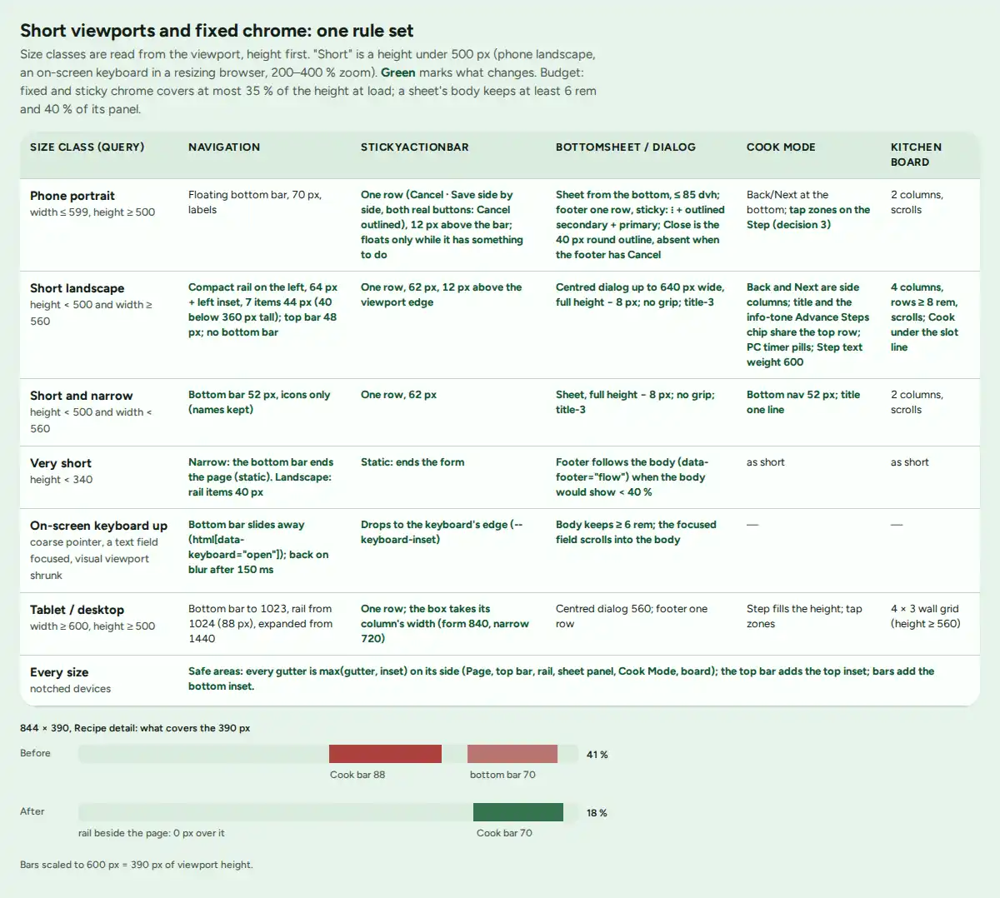
Mock: [mocks/short-00-rules.html](mocks/short-00-rules.html)

| Item | Severity | Size | Title | Source ids | Status after reproduction |
|---|---|---|---|---|---|
| SHORT-01 | S1 | M | Cook Mode on a short viewport hides the Step under Back/Next | PLAN-01 | Confirmed (0 % of the Step text visible at 568×320, 39 % at 844×390); portrait is fine |
| SHORT-02 | S1 | M | Sheets: the body collapses, footers stack, and some primaries sit below the fold | PLAN-02, PLAN-13, SETTINGS-10 | Confirmed (Planned Meal body 0 of 132 px at 844×390); new in stage 2: the 85 dvh cap and grip waste height on short viewports |
| SHORT-03 | S1 | S | Kitchen board clips its hero's Cook button in phone landscape | SHELL-01 | Confirmed (Cook at y 246–322, its cell ends at 248) |
| SHORT-04 | S2 | M | Fixed chrome covers short viewports: navigation in landscape, bars with the keyboard and at zoom | SHELL-22, RECIPES-04, SHOP-25, CROSS-05 | Confirmed (41 % covered on Recipe detail at 844×390, 48 % with the keyboard, 70 % at 320×256); SHELL-22 narrower |
| SHORT-05 | S2 | S | Safe areas: Page gutters and the top bar ignore the insets | CROSS-08 | Confirmed, emulated (h1 at x 24 under a 47 px inset) |
| SHORT-06 | S3 (was S2) | S | Recipe Assistant's sticky bar floats permanently with both buttons disabled | SETTINGS-04 | Confirmed, narrower (34–36 % covered, not 45 %) |
| SHORT-07 | S3 | S | Pantry Filters popover is cramped on a short viewport | SHOP-14 | Confirmed, narrower (fails at 844×390; usable at 1024×768; the upward flip did not reproduce); new in stage 2: a nested scroll inside the sheet |
| SHORT-08 | S4 | XS | Recipe editor's bar is wider than its form at 1440; a 24 px strip shows under it at 820 | RECIPES-25 | Confirmed |

**Size classes used throughout** (queries are written out literally in CSS and kept as constants in a new `web/src/ui/lib/viewport.ts`):

| Name | Query | Typical case |
|---|---|---|
| short | `(max-height: 499px)` | any of the below |
| short landscape | `(max-height: 499px) and (min-width: 560px)` | 844×390, 932×430, 568×320, a desktop window at 200 % zoom |
| short narrow | `(max-height: 499px) and (max-width: 559px)` | 390×450, 400 % zoom of a laptop, split screen |
| very short | `(max-height: 339px)` | 320×256, 568×320 rail items |
| keyboard up | `html[data-keyboard='open']` (set by script, not a media query) | a coarse pointer and a focused text field |

**The budget, a new system.md rule:** at load, fixed and sticky chrome covers at most 35 % of the viewport height. A sheet's body keeps at least `min(6rem, 30dvh)` of height and, at the flow fallback, 40 % of its panel.

## Decisions for the user

> **Decided on 2026-11-14.** The user chose the recommended option in every decision below. The record is in [decisions.md](decisions.md); the options stay here for reference.

1. **Navigation in phone landscape (SHELL-22, CROSS-05; asked by the shell, cross and recipes reviewers).**
   - **A. Compact rail** (recommended). A 64 px rail on the left replaces the bottom bar when the viewport is under 500 px tall and at least 560 px wide. It shows the same seven destinations with icon and label, in 44 px rows (40 px below 360 px tall). The top bar shrinks to 48 px. Nothing floats over the page.
     - Mock: [mocks/short-04-nav-rail.html](mocks/short-04-nav-rail.html), shown at 844×390 light and dark and at 568×320.
     - 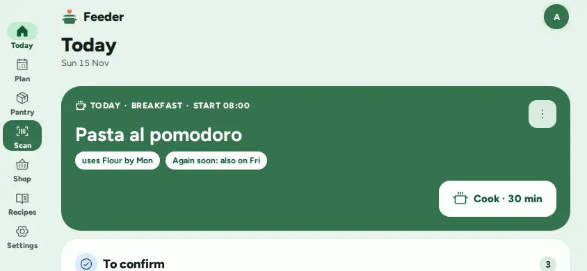
   - **B. Shorter bottom bar.** The bar becomes 52 px, icons only, 8 px inset. It still floats over the page: 60 px, 15 %.
     - Mock: [mocks/short-04-nav-shortbar.html](mocks/short-04-nav-shortbar.html)
     - 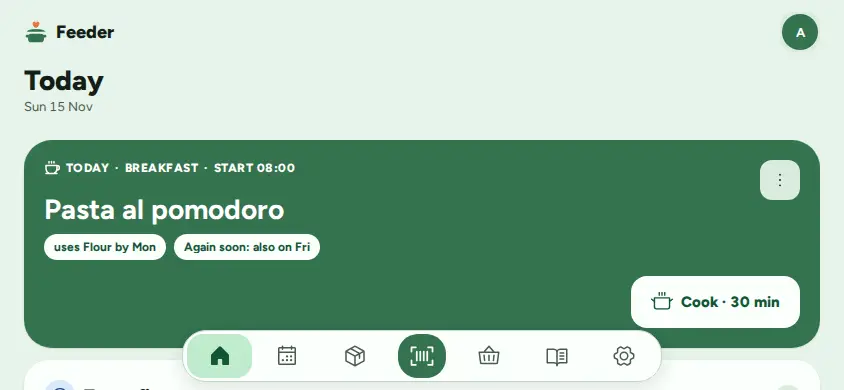
   - **C. Scroll-away bottom bar** (hide while scrolling down, show while scrolling up). Not mocked. It needs a scroll listener and still covers content whenever it is shown.
   - **Recommendation and default: A.** A landscape phone has width to spare and no height. A matches the tablet and desktop rail, which the app already has. It covers 0 px of content (B: 60 px). It also fixes SHOP-25's Mute and the Today hero's Cook button with no per-screen change.

2. **Hide the bottom bar while a text field has focus on a phone (RECIPES-04, CROSS-05).**
   - **A. Yes** (recommended). While a text-entry control has focus on a coarse-pointer device, the bar slides down out of view (180 ms; none with reduced motion). It comes back 150 ms after focus leaves text entry; the delay stops it flickering when moving between fields. The sticky Save bar drops to the keyboard's edge.
     - Recipe editor at 390×400: chrome goes from 192 px (48 %) to 62 px (16 %).
     - Mock: [mocks/short-04-keyboard.html](mocks/short-04-keyboard.html)
     - 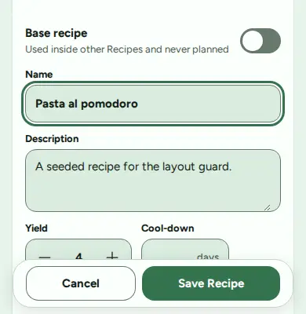
   - **B. No.** Even with the one-row bar, the compact Save bar plus the bottom bar is 62 + 12 + 82 = 156 px, 39 % of 400 px, which is over the budget.
     - Before: 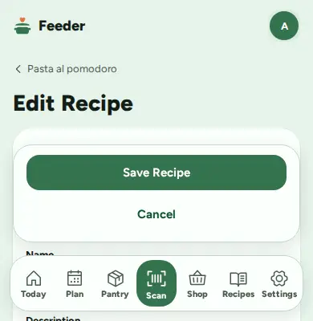
   - **Recommendation and default: A.** Pointer and mouse users are unaffected, and keyboard users on desktop never have a coarse pointer.

3. **Tap zones in Cook Mode on phones (PLAN-01).** The ux-brief says "phone + kitchen tablet: screen-wide tap zones (left half back, right half next)". Functional spec §11 says "on a tablet", and the app turns them on only from 768 px wide (`features/cook/screens/CookScreen.tsx:72`).
   - **A. Phones too, at every width** (recommended). Tapping the left half of the Step tile goes back and the right half goes next. The chevrons and the one-time coach mark appear on phones as they do on tablets. Back/Next stay visible. A tap counts only when the pointer moved less than 10 px, so scrolling a long Step does not change Step.
     - Mock: [mocks/short-01-cook-phone-tapzones.html](mocks/short-01-cook-phone-tapzones.html)
     - 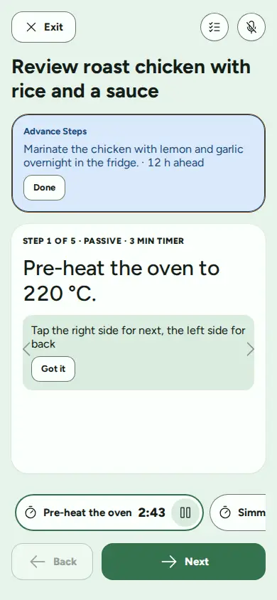
   - **B. Landscape only** (any viewport at least 560 px wide).
   - **C. Tablet only**, as the spec reads now.
   - **Recommendation and default: A.** It is what the brief describes, it helps with wet hands, and it holds Next exactly as the Next tile does. It needs a one-line spec §11 update ("on a phone and a tablet").

## SHORT-01  Cook Mode on a short viewport hides the Step under Back/Next
**Severity** S1 · **Size** M · **Sources** PLAN-01 · **Reproduced** Confirmed. Share of the Step text visible above `.cook-nav` at load (`/cook/recipe/16`, a 5-Step Recipe with an Advance Step):

| Size | Visible |
|---|---|
| 568×320 | 0 % (text at y 359, nav at y 248) |
| 740×360 | 25 % |
| 844×390 | 39 % (58 px type) |
| 932×430 | 96 % |
| 320×568, 390×844 | 100 % |

The stage-1 note that the "Timers" heading sits under the nav at 320×568 is ordinary scrolled content below a sticky nav, not a defect.

**Where** `/cook/recipe/:id`, `/cook/meal/:date/:slotId`; short landscape and short narrow; light and dark.

### Problem
A phone propped sideways on the counter is a normal kitchen posture, and Cook Mode exists for exactly that moment. Above the Step tile sit:
- the top row (44 px);
- the Recipe title (`title-1`, often two lines);
- the full Advance Steps tile (about 100 px).

The sticky Back/Next band (72 px) then covers what is left. At 844 px wide the Step text also jumps to 58 px, because the size is chosen by width (`features/cook/cook.css:231–245`). The cook has to scroll inside Cook Mode with wet hands on every Step. The Back/Next band is `position: sticky; bottom: 0` (`cook.css:117–127`), and nothing reacts to height.

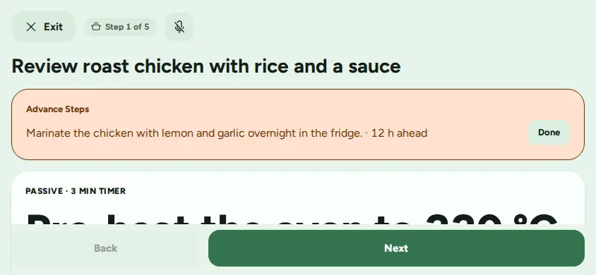 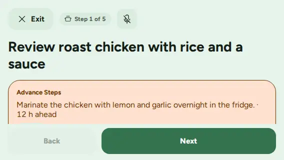

### Design
**Short landscape (height < 500, width ≥ 560): Back and Next become side columns.** PC-03's portrait Cook Mode is the base; this layout only rearranges it.
- **Grid.** `.cook-screen` becomes a grid with columns `clamp(88px, 11vw, 104px) minmax(0,1fr) auto auto clamp(104px, 16vw, 144px)` and rows `auto minmax(0,1fr) auto auto`. Its height is exactly `100dvh`, and padding is `max(space-2/3, safe inset)` on each side.
- **Top row**, PC-03's controls spread across the columns (`.cook-top` is `display: contents`):
  - outlined **Exit** over the Back column;
  - the Recipe title on one line (`title-3`, ellipsis; the full name stays in the `h1`);
  - the **Advance Steps chip**;
  - the round outlined **Ingredients** icon button;
  - the round outlined **Voice** icon button over the Next column.
- **Step count.** As in PC-03 it moves into the Step tile's overline: "Step 1 of 5 · Passive · 3 min timer".
- **Advance Steps chip.** It uses the **info tone** (DS 3): a 40 px pill with an info-fg boundary, the alarm icon and "1 Advance Step to do" / "2 Advance Steps to do". Contrast: 7.37:1 light, 8.37:1 dark. Below 700 px wide it shows the icon and the count only. Its name is always "Advance Steps: 1 to do". Pressing it opens a BottomSheet "Advance Steps" with the existing rows and their Done buttons (outlined secondaries). When none is left to do, the chip is absent.
- **Middle.** The Step tile fills the remaining height. Step text:
  - size: the phone size, 1.875 rem / 1.2, rather than 58 px;
  - a long Step (more than 25 words) uses `title-2`, PC-03's length rule;
  - weight: **500 (Medium)**, the `--text-step-weight` token shared with PC-03 (the user's choice).

  A long Step scrolls inside the tile (`overflow-y: auto; align-content: safe center; padding-block: 5px`). The one-time coach mark is one row: meta text and an outlined "Got it" that never wraps. In this layout the tap-zone chevrons are not drawn: they would sit on the text, and the side columns are the visible Back/Next. The zones themselves still work.
- **Timers** are **PC-03's timer pills** (`ui/TimerPill`) in one 48 px line under the Step.
  - **Only whole pills are shown:** two from 700 px wide, sharing the width; one below 700 px.
  - The last whole pill carries **PC-04's "+N" badge**: 28 px, fully rounded, a `surface-2` fill with a 1 px outline, at least 6 px inside the pill's edge. Here it is a button named "1 more timer. Show all timers", with a 44 px hit area, and it opens the Timers sheet.
  - Pills are ordered by urgency, as in PC-03.
  - The pill a held Next waits for has the accent boundary.
  - **Nested focus (R-C+):** a focused Pause or "+N" draws a 2 px accent ring inside itself on a soft fill, and the pill's accent boundary steps back to the neutral outline, so only one accent ring shows.
- **Back** is the left column, an outlined secondary tile; **Next** is the right column, the primary. Both run full height below the top row, with the arrow icon (Phosphor ArrowLeft/ArrowRight, 28 px) above the label. They are 88–104 px and 104–144 px wide: easy wet-hand targets.
- **Held Next** keeps the spec copy in a line under the pills: "Next waits for Step 1 · Pre-heat the oven: 4:12 left. Cancel its timer to go on now." The Next column is disabled, as the tile is today.

**Short narrow (height < 500, width < 560).** PC-03's portrait layout stays, with 52 px Back/Next tiles; the title is `title-3`.

**Phone portrait and tablet.** PC-03's layout, plus decision 3 (decided): tap zones and the coach mark on phones at every width. The Advance Steps tile is shown in the info tone (DS 3).

**States.**
- A long Step scrolls inside the tile.
- With no timers, the pill strip is absent; with one timer, there is no badge.
- Before Step 1 with no Advance Steps, the chip is absent.
- The Cooked confirmation screen is not affected.
- Contrast, light / dark: Next (on-accent on accent) 5.73 / 9.26; the nested ring on soft 3.4 / 3.6; outlines per R-A.

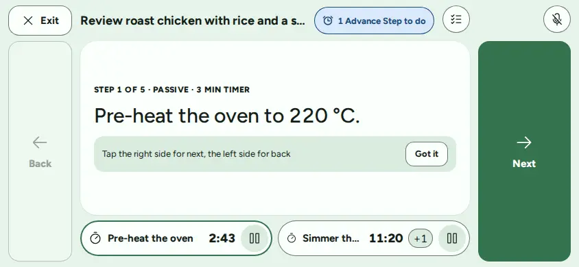 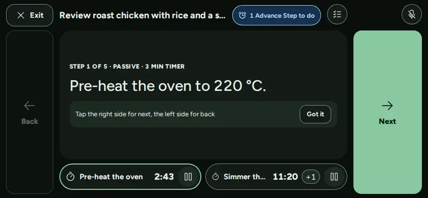
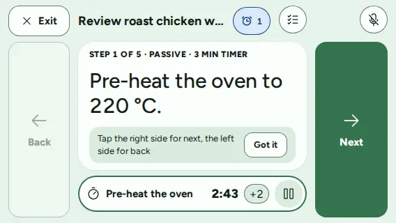 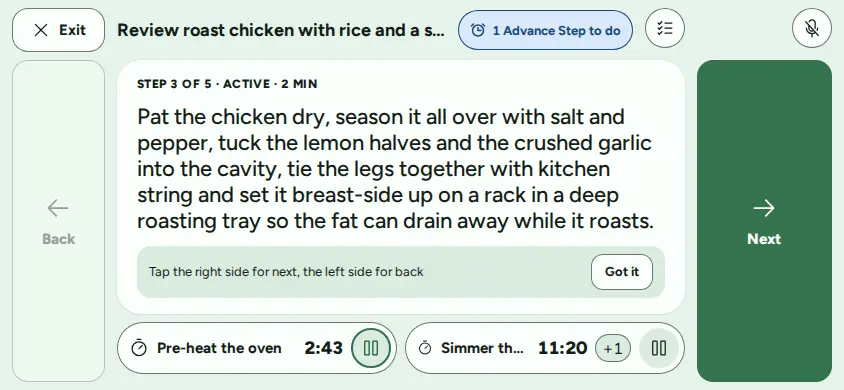
Mocks: [mocks/short-01-cook-landscape.html](mocks/short-01-cook-landscape.html) (also rendered at 932×430: `shots/short-01-after-932x430-light.webp`), [mocks/short-01-cook-landscape-long.html](mocks/short-01-cook-landscape-long.html), [mocks/short-01-cook-phone-tapzones.html](mocks/short-01-cook-phone-tapzones.html) (`shots/short-01-tapzones-390x844-light.webp`, `…-dark.webp`)

**Accessibility.**
- The DOM order is unchanged: top row, Step, then the nav (pills, Back, Next). Only the grid placement moves; `.cook-top` and `.cook-nav` become `display: contents`. Both are plain `div`s, so no role is lost; Back/Next stay real buttons and the pills keep `role="timer"`.
- Timers hidden behind "+N" stay reachable through its button and the Timers sheet. Their alarms still ring and announce.
- The chip is a `button` with `aria-haspopup="dialog"` and the name "Advance Steps: 1 to do". Its sheet returns focus to the chip on close.
- Tap zones are pointer-only.
- Reduced motion: no animation is added.

### Alternatives considered
- **B. Keep Back/Next at the bottom, 52 px**, with the same top row, chip and pill strip. It shows the Step, but the band spends vertical space a landscape phone lacks and puts the targets away from the hands at the screen's sides.
  - [mocks/short-01-cook-landscape-b.html](mocks/short-01-cook-landscape-b.html) 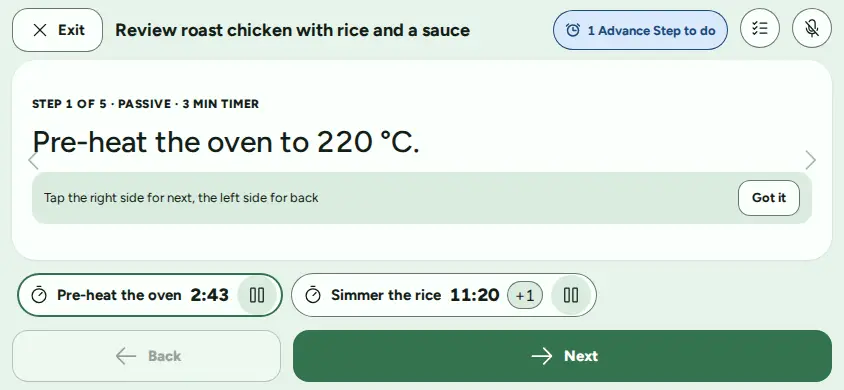
- **A sideways-scrolling strip of every pill.** Rejected: at these widths it cut the second pill mid-control.
- **A one-line Advance Steps tile instead of a chip.** Rejected: it still costs a full row.

### Build notes
- `features/cook/cook.css`: the short blocks (the proposed CSS is in the mock's `<style data-proposed>`), and the `--text-step-weight: 500` token shared with PC-03.
- `features/cook/components/AdvanceStepsTile.tsx`: a `compact` rendering (info chip plus sheet), chosen by `useMediaQuery(SHORT)` in `CookScreen.tsx` and `TimelineCookScreen.tsx`. Its label comes from a pure `features/cook/lib/` function, `advanceChipLabel(n)`.
- The timer strip is PC-03's `CookTimerStrip` with `ui/TimerPill`.
  - In short landscape the strip takes a `maxPills` prop. The count is a pure `features/cook/lib/timers.ts` function, `visiblePillCount(width)`: 2 from 700 px, else 1.
  - The last pill renders PC-04's badge as a button (`TimerPill` gets `moreCount`, `onShowAll`).
- `CookTopRow.tsx` (PC-03): add the `cook-ingredients` and `cook-voice` hooks the grid places.
- `CookNavTiles.tsx`: the arrow icons through the shared `Icon` (`back`, `next`); Back is a secondary.
- `CookScreen.tsx:72`: tap zones at every width (decision 3). The tap or scroll threshold is in a pure `features/cook/lib/tapZone.ts` (`isTap(down, up)`).
- No API change.

### Tests and guard
- Unit tests:
  - `advanceChipLabel(1) === '1 Advance Step to do'` and the plural.
  - `visiblePillCount(844) === 2` and `visiblePillCount(568) === 1`.
  - `TimerPill` with `moreCount={1}` renders a button named "1 more timer. Show all timers".
  - `isTap` rejects moves of 10 px or more.
  - `AdvanceStepsTile compact` renders a button that opens a dialog and returns focus to it.
  - The `cook.css` test asserts `font-weight: var(--text-step-weight)` and the token's value of 500.
- BDD:
  - Scenario: A cook in phone landscape sees the whole current Step without scrolling
  - Scenario: Back and Next are the side columns in phone landscape
  - Scenario: With three timers running in phone landscape, the strip shows whole pills and a "+1" that opens all timers
  - Scenario: The Advance Steps chip opens the Advance Steps and marks one done
  - Scenario: A held Next explains what it waits for in phone landscape
  - Scenario: Tapping the right half of the Step tile on a phone goes to the next Step
  - Scenario: Scrolling a long Step on a phone does not change the Step
- Guard:
  - Add both Cook routes to `scripts/lib/page-layout-rules.mjs` ROUTES at 844×390, 568×320 and 390×844.
  - New rule **P19, Cook Step visible**: `.cook-step__text` intersects the viewport outside every `.cook-nav__tile` at load, at least 80 % of its first line.
  - P13 already fails a pill clipped by the strip.

### Depends on / unblocks
- Uses the tokens from SHORT-04 (`--safe-*`).
- Builds on PC-03 (top row, `ui/TimerPill`, `--text-step-weight`) and PC-04 (the "+N" badge) in the same files; serialise with PC's Cook package (P4), which merges first.
- R-C+ is A11Y's rule.
- Decision 3 amends spec §11.

## SHORT-02  Sheets: the body collapses, footers stack, and some primaries sit below the fold
**Severity** S1 · **Size** M · **Sources** PLAN-02, PLAN-13, SETTINGS-10 (the sheet half of CROSS-05 is also closed here; the id is filed under SHORT-04)

**Reproduced** Confirmed:
- **Planned Meal sheet at 844×390.** The panel is 332 px, the footer 264 px, and `.sheet__body` **0 px** of 132 (slot/Course line, portions, Attendance, chips all invisible). At 320×568 the body shows 111 of 132 px.
- **Mark as Cooked at 844×390.** The body shows 80 of 274 px: the Leftover portions stepper is hidden while "Mark as Cooked" is fully visible.
- **Who's eating at 390×844.** "Save for this date" is at y 876, inside the scrolling body, left-aligned and 159 px wide.
- **Add Member at 390×400.** "Save Member" is at y 837 (the panel ends at 400).
- **Add Meal Slot.** "Save Meal Slot" is at y 972 at 390×400, and at y 897 at 1440×900 against a panel ending at 833.
- **New Ingredient at 390×400.** Its sticky stacked footer is 108 px, leaving 139 px of body.
- **Narrower than reported:** Add Member at 1440×900 shows Save (body 673 of 678 px).

**Where** every BottomSheet (42 feature sheets) and Dialog; short sizes above all, but the footer rule applies at every size; light and dark.

### Problem
The sheet exists to show context and ask a question; the footer only commits it. Today the footer wins:
- `.sheet__footer` is sticky and flex-wraps (`ui/BottomSheet.css:72–75`), while `.sheet__body` has `flex: 1 1 auto; min-height: 0` (line 61), so a tall footer squeezes the body to nothing.
- `FormActions` stacks on phones (`ui/FormActions.css:8–10`).
- Plan's sheets build their own column of full-width buttons (`PlannedMealSheet.tsx:118`, `MarkCookedSheet.tsx:37`, `MarkAllCookedSheet.tsx:32`, `.plan-sheet__actions`).
- Other sheets put their primary inside the body. `DateAttendancePanel.tsx:98–103` holds "Save for this date"; `MemberEditor.tsx:150` puts Save in a `.settings__row`; `MealSlotEditor.tsx:126` and `WeightRuleEditor.tsx` use FormActions inside the form, so Save scrolls away.
- In Mark as Cooked, the person confirms a Leftover default they cannot see. That is a Stock and Leftover write.
- At 390 px tall the panel is still capped at 85 dvh (`BottomSheet.css:8, 28`), with a 16 px grip and 20 px padding. This is new in stage 2.

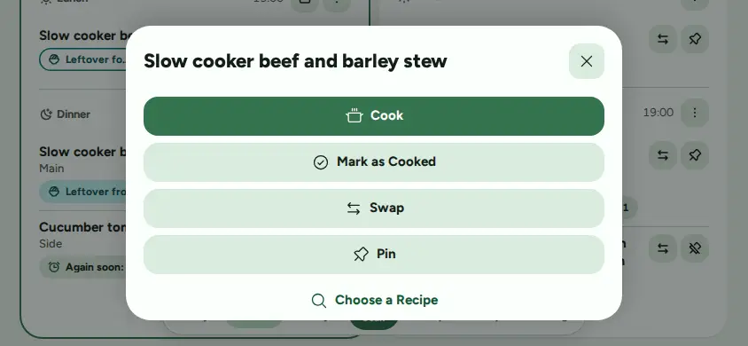 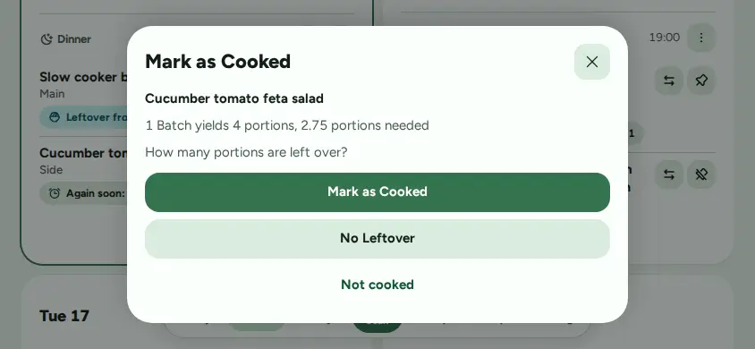
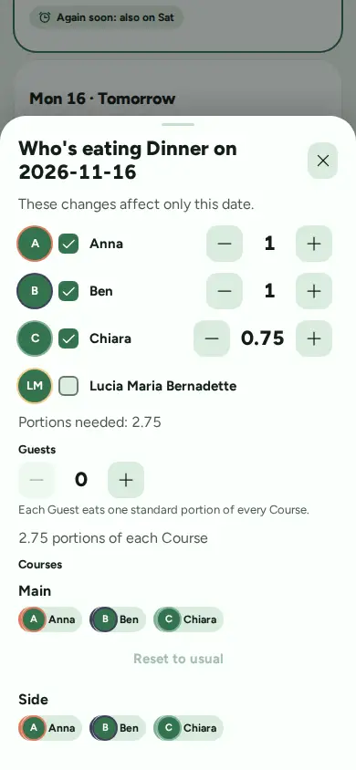 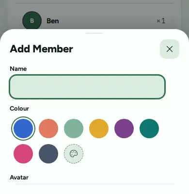 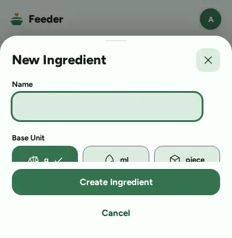

### Design
**The BottomSheet rule** (new system.md §11.3; R-A, R-B and R-C+ from the review rounds apply):
1. **A sheet's footer holds one FormActions row:** at most one primary, one secondary, and a ⋮ "More for <label>" Menu. This matches ActionGroup in system.md §5.
   - It is one row at every width, never stacked.
   - Every non-primary action is a **real button with a boundary** (R-A): Cancel and other secondaries are outlined secondaries, and the ⋮ is an outlined 44 px icon button. A bare-text tertiary is never a footer action.
2. **Every form sheet puts its commit in the footer**, so it is always sticky and always in reach.
   - A submit button outside its form gets `form="<form id>"`.
   - **A footer with Cancel shows no Close** (R-B): BottomSheet gets `closeButton={false}`, and Esc, the scrim and the grip still close the sheet.
   - Otherwise Close is the 40 px round outline button, top-aligned with the title. The title's first line is centred on it (`padding-block-start: (40px − line height) / 2`), so the gap under a one-line title is even.
3. **The body never collapses.** `.sheet__body { min-block-size: min(6rem, 30dvh) }`, with 5 px block padding so focus rings are not clipped (R-C). Header and footer are `flex: none`. A status chip in the body keeps its natural width.
4. **Short viewports (height < 500):**
   - panel max height `calc(100dvh − 8px − top inset)`;
   - no grip;
   - panel padding `12px max(20px, side insets)`;
   - title `title-3`;
   - footer top padding 8 px;
   - from 768 px wide the centred dialog widens to `min(640px, 100vw − 48px)`.
5. **Flow fallback.** When the body would still show less than 40 % of the panel (400 % zoom, a very long label), BottomSheet sets `data-footer="flow"`. The footer then follows the body and the whole panel scrolls. A ResizeObserver in `BottomSheet.tsx` decides this; the decision itself is a pure `footerShouldFlow({ panel, body, bodyScroll })` in `ui/lib/sheetLayout.ts`.
6. **Initial focus** stays "the first control in the body", scrolled into view with `block: 'nearest'`. In Mark as Cooked that is the Leftover portions stepper, the question.
7. **Context above the title.** A sheet about one date and Meal Slot puts that context in a muted `meta` line above the title (PC-10's pattern), not inside the title.
8. **Dialog** (`ui/Dialog.css`) follows the same short rule: `max-block-size: calc(100dvh − 16px)`, a scrolling body, and padding `space-4` below 500 px tall.

**The FormActions rule:**
- One row at every width.
- On a phone (≤ 599 px) each button starts from its natural width (`flex: 1 1 auto`) and the row shares what is left. A label wraps to two lines (the existing Button rule) only when the whole row cannot fit.
- **On a phone a destructive action is a danger-tone item of the row's ⋮ Menu, never a third button.** From 600 px it is an outlined danger secondary at the far left, as R-A specifies.
- A new `more` slot (`more={[{ id, label, onSelect, tone? }]}`, `moreLabel`) renders the shared ⋮ Menu at the row start.

**Per sheet in this theme** (the action sets of Plan's sheets belong to PC's PLAN-15 design; shown here as the primitive renders them):

| Sheet | Footer after the change |
|---|---|
| Planned Meal | ⋮ "More for Sun Dinner" (Swap, Pin, Choose a Recipe) · Mark as Cooked (outlined) · Cook (primary) |
| Mark as Cooked | ⋮ "More for Cucumber tomato feta salad" (Not cooked) · No Leftover (outlined) · Mark as Cooked |
| Who's eating (PLAN-13) | **"Reset to usual"** (outlined; accessible name "Reset to usual Attendance"; disabled with no date override) · Save for this date. The title is **"Who's eating"** under the context line **"Mon 16 Nov · Dinner"**; the per-Course "Reset to usual" in the body is a small outlined button at its natural width |
| Add / Edit Member, Add rule (SETTINGS-10) | Save … (with an outlined Cancel where the sheet has one; then no Close) |
| Edit Meal Slot | ⋮ "More for Dinner" (Change a date, Delete Meal Slot in the danger tone) · Save Meal Slot |
| New Ingredient, New Supply, New Product, Add Price | Cancel (outlined) · Create / Save, one row (89 px less than today at 390×400), no Close |

**After, as measured in the mocks:**
- Planned Meal at 844×390: body 186 px, every line visible.
- Mark as Cooked at 844×390: the stepper and "Use by Wed" are visible above the footer.
- Who's eating at 390×844: Save is in the footer at y 780.
- Add Member at 390×400: Save is at the foot of the panel.

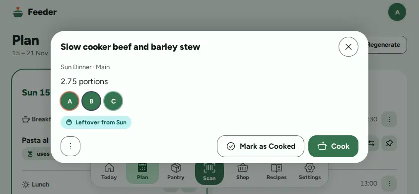 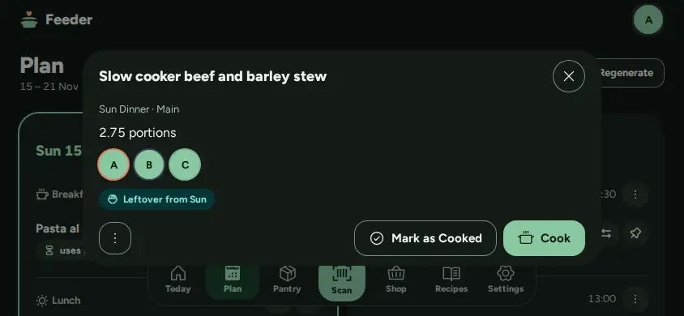 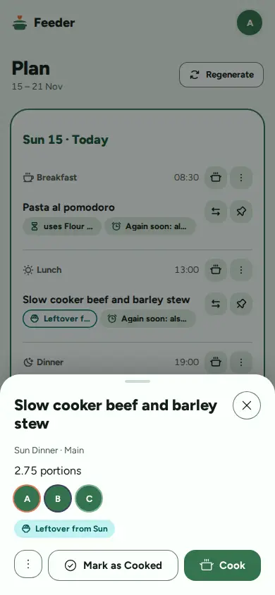
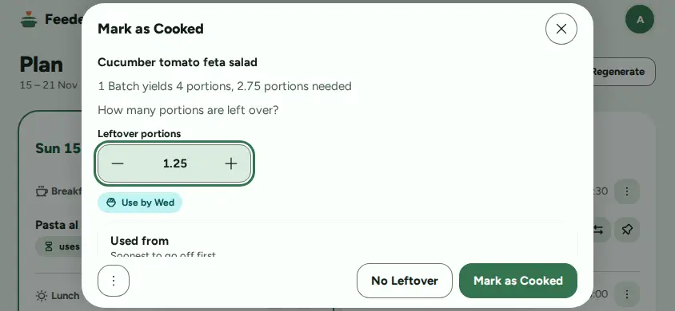 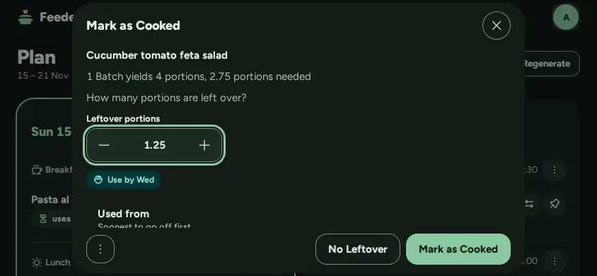 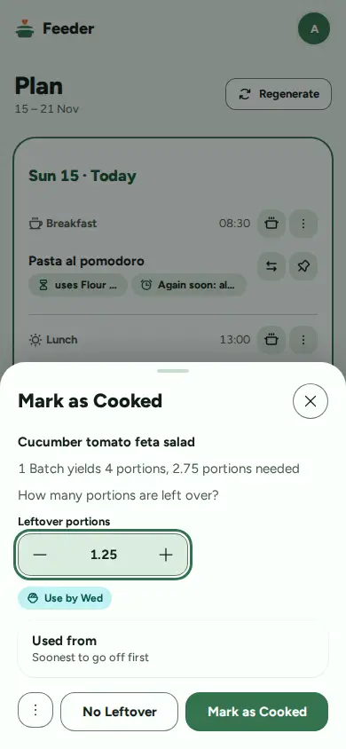 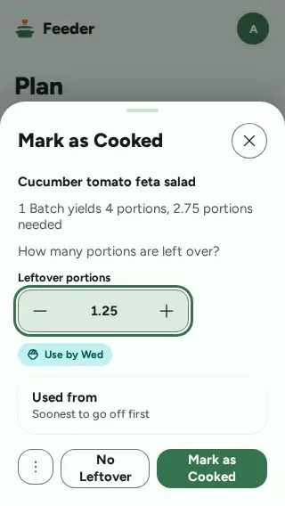
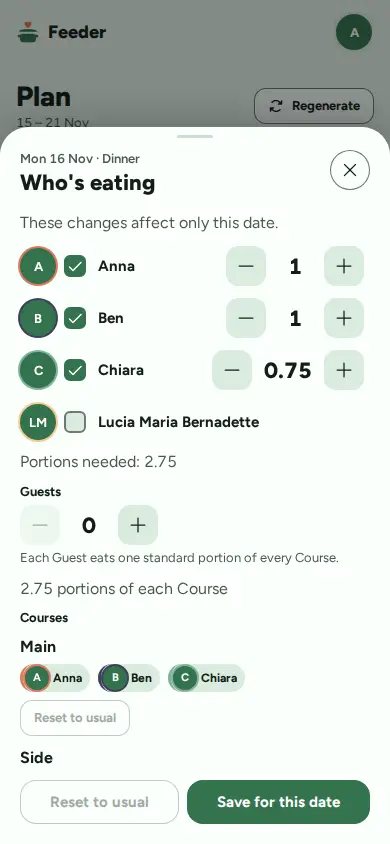 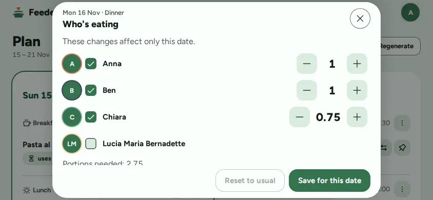
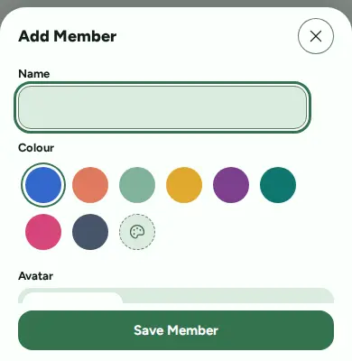 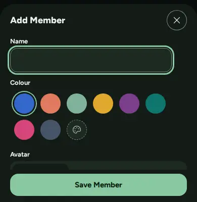 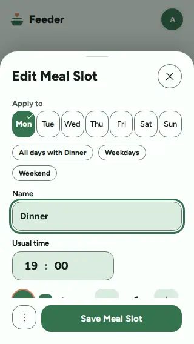 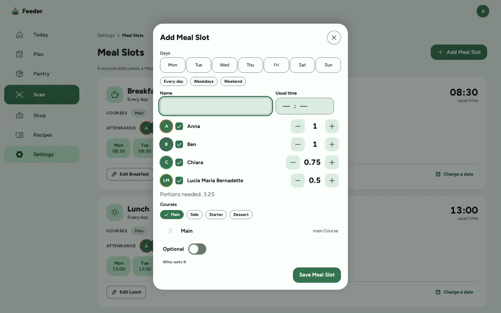
Mocks:
- [mocks/short-02-planned-meal-844.html](mocks/short-02-planned-meal-844.html), [mocks/short-02-planned-meal-390.html](mocks/short-02-planned-meal-390.html)
- [mocks/short-02-mark-cooked-844.html](mocks/short-02-mark-cooked-844.html), [mocks/short-02-mark-cooked-390.html](mocks/short-02-mark-cooked-390.html)
- [mocks/short-02-whos-eating-390.html](mocks/short-02-whos-eating-390.html), [mocks/short-02-whos-eating-844.html](mocks/short-02-whos-eating-844.html)
- [mocks/short-02-member-390.html](mocks/short-02-member-390.html), [mocks/short-02-edit-slot-390.html](mocks/short-02-edit-slot-390.html), [mocks/short-02-slot-1440.html](mocks/short-02-slot-1440.html)

(At 320 px, Mark as Cooked's two labels wrap inside their buttons; its action set is PC's.)

**Accessibility.**
- The ⋮ is an IconButton named "More for <label>" with `aria-haspopup="menu"`, keyboard operable through the shared Menu. The destructive item keeps its full name ("Delete Meal Slot").
- Footer order in the DOM: more, tertiary/secondary, primary (primary last, as now).
- Focus on open goes to the first body control; on close, back to the opener.
- The focus ring (3 px at a 2 px offset) is drawn on the field control and keeps 5 px of room in the body. A stepper's inner buttons follow R-C+.
- All targets are at least 44 px tall.
- Outline boundaries follow R-A's measured table (at least 3:1 on every surface).

### Alternatives considered
- **Make the footer non-sticky below 500 px tall** (stage 1's suggestion). Rejected as the default: on a form sheet it puts Save below the fold exactly when the keyboard is up. It survives as the flow fallback (rule 5).
- **An icon-only trash for a destructive action on a phone** (this chapter's first version). Replaced by the ⋮ item: a third button crowded the row at 320 px and put Delete one thumb away from Save.
- **Icon-and-label row for Swap/Pin/Choose a Recipe instead of ⋮.** That is PC's call in PLAN-15. The primitive allows either, as long as the footer stays one row.

### Build notes
- `ui/BottomSheet.css`, `.tsx`: body floor, title centring, natural-width chips, short block, flow fallback, the R-B Close and `closeButton`.
- New `ui/lib/sheetLayout.ts`, a pure function.
- `ui/FormActions.css`, `.tsx`: one row, natural-width tracks, the `more` slot; destructive moves into ⋮ below 600 px.
- `ui/Dialog.css`: short block.
- `ui/Popover` passes through (see SHORT-07).
- Migrations owned here:
  - `features/settings/components/DateAttendancePanel.tsx` (PLAN-13): actions into `footer`, the context line, the "Reset to usual" label;
  - `MemberEditor.tsx`, `MealSlotEditor.tsx` (⋮ with Change a date and Delete Meal Slot), `features/shops/components/WeightRuleEditor.tsx` (SETTINGS-10): pass FormActions as `footer`, with `form` ids.
- Migrations owned by PC (they reference this item): `PlannedMealSheet.tsx`, `MarkCookedSheet.tsx`, `MarkAllCookedSheet.tsx` drop `.plan-sheet__actions` for FormActions with `more`.
- The FormActions change touches every form on a phone (29 files). All of them get shorter; none loses an action.
- DS owns the `Button` and `IconButton` looks (R-A) and the Close (R-B); A11Y owns R-C+. This item consumes them.
- No API change.

### Tests and guard
- Unit tests:
  - `footerShouldFlow` flows at 39 % and not at 41 %.
  - BottomSheet sets `data-footer="flow"` when the observer reports a squeezed body.
  - BottomSheet renders no Close when `closeButton={false}`.
  - FormActions renders one row at 390 px (no `column-reverse`: a `.css.test.ts`).
  - FormActions `more` renders a Menu button named "More for X", and below 600 px the destructive action appears as a Menu item.
  - DateAttendancePanel and the three editors pass their actions as `footer`.
- BDD:
  - Scenario: The Planned Meal sheet shows its slot, portions and Attendance in phone landscape
  - Scenario: Mark as Cooked shows the Leftover portions before its commit button in phone landscape
  - Scenario: Who's eating keeps Save for this date in reach
  - Scenario: Saving a Member with the keyboard up needs no scrolling to find Save
  - Scenario: Deleting a Meal Slot on a phone starts from the More menu
  - Scenario: A sheet whose body would be squeezed scrolls as one
- Guard:
  - Add scenarios that open Planned Meal, Mark as Cooked, Who's eating and Add Member at 844×390, 390×844 and 390×400.
  - New rule **P18, sheet body floor**: `.sheet__body` client height is at least `min(96px, 30 % of innerHeight)`. Where the footer is sticky, no focusable footer control may be visible while the body's first required control is fully clipped.
  - New `ui/BottomSheet.ds.test.tsx` contract: the footer holds at most two text buttons, and no `data-variant="tertiary"` button.

### Depends on / unblocks
- Unblocks PC's PLAN-15 (footer content) and every theme's sheet designs (they say "uses SHORT-02").
- Shares `FormActions` with SHORT-04's sticky bar: one team (package P1/P2 order).

## SHORT-03  Kitchen board clips its hero's Cook button in phone landscape
**Severity** S1 · **Size** S · **Sources** SHELL-01 · **Reproduced** Confirmed. At 844×390:
- cell heights are 224 / 106 / 106 / 106 px;
- the hero's Cook runs y 246–322 while its cell ends at y 248, so it is fully clipped;
- the document is 390 px tall, so nothing scrolls;
- the clock, Next Advance Step, Timers, Tomorrow and the streak are cut.

At 1024×600 and 1280×800 the grid works.

**Where** `/board`; 600 px wide and up with a height under 560; day and night schemes.

### Problem
The wall grid is `height: calc(100vh − 48px)` with three `minmax(0,1fr)` rows from 600 px **wide** (`features/board/board.css:26–35`; `BoardScreen.tsx:55`, `useMediaQuery('(min-width: 600px)')`). Every tile is `overflow: hidden`. A phone held sideways gets the wall layout but only a third of the height it needs, and the hero's Cook is pushed to the tile's foot (`margin-block-start: auto`, `board.css:171`).

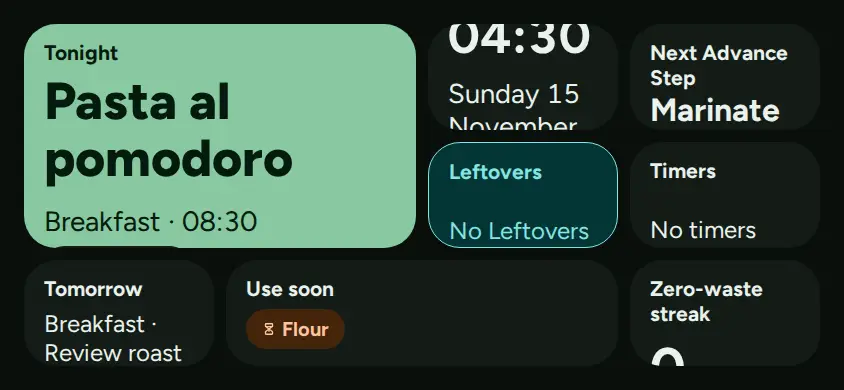

### Design
- **The wall grid needs height ≥ 560 as well as width ≥ 600.** In the gap between the two queries (`(min-width: 600px) and (max-height: 559px)`), the board stays four columns, but rows take their content height (`grid-auto-rows: minmax(8rem, auto)`), tiles stop clipping, and the board scrolls.
- **Layout in this "scroll" case** (`lib/layout` variant `scroll`): hero 2×2; clock and Next Advance Step; Leftovers and Timers; then **Tomorrow across two columns**, Use soon, Zero-waste streak. A long Tomorrow wraps across the double width instead of becoming a narrow column.
- **The hero's Cook** follows the slot line (`margin-block-start: space-4`, 64 px tall), so it is on screen at first view: y 255–318 at 844×390.
- **Next Advance Step tile.** The mocks show it in the **info tone**, as DS 3 decided (TB owns the tile's design), with its Done as an outlined secondary.
- **Padding** is `max(space-4, safe inset)` on each side.
- **Day and night schemes** are unchanged (the sunset rule from ui-review-2 §3.7 stands).
- 1024×600 and larger are unchanged; the 1280×800 render is identical to today apart from DS 3.

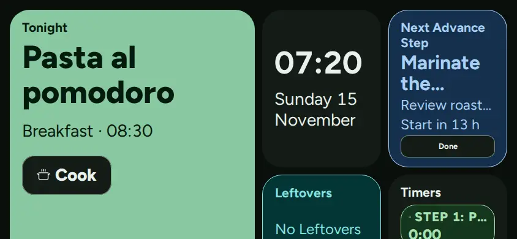 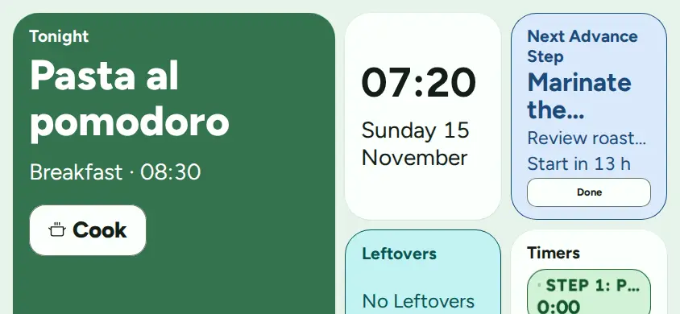 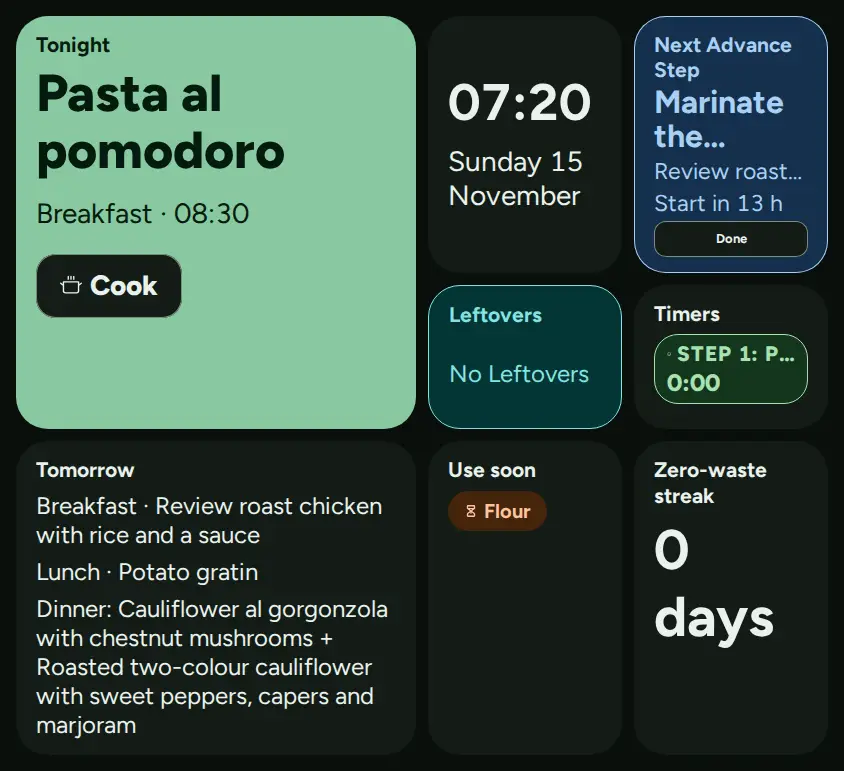
Mock: [mocks/short-03-board-landscape.html](mocks/short-03-board-landscape.html)

**Accessibility:** the DOM order is unchanged and the tiles become reachable by scrolling. Info fg on info bg is 7.37:1 light and 8.37:1 dark.

### Build notes
- `features/board/board.css`: the short block.
- `features/board/screens/BoardScreen.tsx`: `const wall = useMediaQuery('(min-width: 600px) and (min-height: 560px)')` and `const scroll = useMediaQuery('(min-width: 600px) and (max-height: 559px)')`, then `boardLayout(scroll ? 'scroll' : wall ? 4 : 2)`.
- `features/board/lib/layout.ts`: the `scroll` placement.
- The info tone on the Next Advance Step tile is TB's and DS's change, not this item's.
- TB owns the board's other items (SHELL-03, SHELL-11). Serialise.

### Tests and guard
- Unit test: `boardLayout('scroll')` places Tomorrow at row 3, columns 1–2, and Use soon at row 3, column 3.
- BDD:
  - Scenario: The Kitchen board on a phone held sideways shows the Cook button at first view
  - Scenario: The Kitchen board on a phone held sideways scrolls to every tile
- Guard: add `/board` at 844×390 to the page-layout sizes (P13 already fails clipping by `overflow: hidden`).

### Depends on / unblocks
Uses `--safe-*` from SHORT-04/05. Coordinate with TB.

## SHORT-04  Fixed chrome covers short viewports: navigation in landscape, bars with the keyboard and at zoom
**Severity** S2 · **Size** M · **Sources** SHELL-22, RECIPES-04, SHOP-25, CROSS-05

**Reproduced:**

| Screen, size | Chrome before |
|---|---|
| Recipe detail, 844×390 | Cook bar 88 + bottom bar 70 = 158 px (41 %) |
| Recipe detail, 320×568 | 222 px (39 %); the Cook bar wraps to 152 px |
| Recipe detail, 320×256 | 180 px (70 %) |
| Recipe editor, Name focused, viewport 390×400 | bar 122 + bottom bar 70 = 192 px (48 %) |
| Recipe editor, 390×450 | 192 px (43 %) |
| Scan, 844×390 | Mute at y 316–356 sits under the bar (y 308–378); `elementFromPoint` hits the bar |

**SHELL-22, narrower:** the fixed chrome on Today at 844×390 is the 70 px bar plus its 12 px inset (21 %), not 146 px; the 64 px top bar scrolls away. The bar still covers the hero's Cook (y 276–328) by 20 px.

**Where** every bottom-bar route; `StickyActionBar` routes (`/recipes/:id`, `/recipes/:id/edit`, `/recipes/new`, `/settings/recipe-assistant`, import, export, receipt); `/scan`; short landscape, short narrow and keyboard up; light and dark.

### Problem
- **The bottom bar is fixed at every height** (`app/shell.css:97–117`). The rail exists only from 1024 px wide (`shell.css:170`).
- **StickyActionBar** floats `--page-gutter` above the bar (`ui/StickyActionBar.css:23`) and holds a stacked FormActions. Its clearance default assumes two rows (line 7).
- **The Recipe detail Cook entry** wraps its stepper above the button (`features/recipes/recipes.css:879–885`, `flex-wrap: wrap`).
- **Nothing reacts to the on-screen keyboard.**

Together these hide the content the person is acting on: the Recipe while choosing Batches, the field being typed, the Mute button.

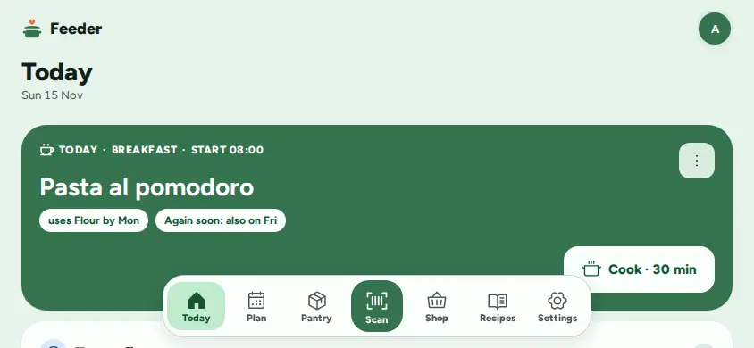 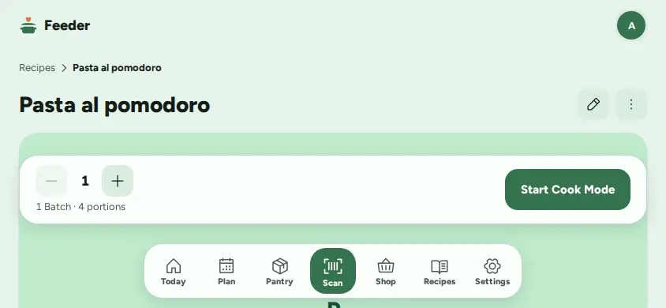 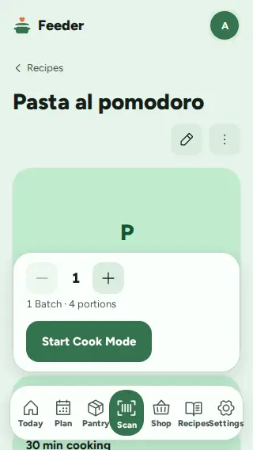  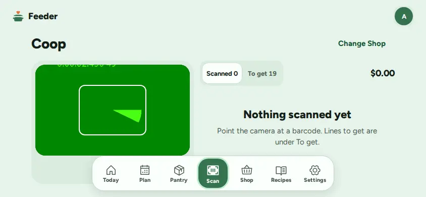

### Design
**Navigation by size class** (decisions SHORT 1 and SHORT 2, both taken as recommended):
- **Short landscape (height < 500, width ≥ 560):**
  - The bottom bar is not shown; the **compact rail** takes column 1 of the shell grid across all rows: 64 px plus the left inset, sticky, `100dvh` tall.
  - Seven destinations in 44 px rows (40 px below 360 px tall), each 56 px wide, with a 20 px icon and the 11 px nav label below.
  - **Well-formed shapes:**
    - the current page shows a **44 × 26 capsule** (radius 13) behind its icon;
    - **Scan** is a **56 × 44 rounded rectangle** (radius 14; 56 × 40 below 360 px tall) in the accent fill, never stretched;
    - like R-F, Scan **drops its ring** when it is the current page.
  - The top bar sits beside the rail and shrinks to 48 px.
  - `--nav-top` becomes the bottom inset; `--nav-clearance` becomes `space-6` plus that inset.
  - A short desktop window (≥ 1024 wide) keeps its 88 or 240 px rail, with 44 px rows.
- **Short narrow (height < 500, width < 560):** the bottom bar stays, compact.
  - 52 px tall with an 8 px inset, `padding-inline: 6px`, no column gap.
  - **Icons only, with R-F's shapes:** the current-page highlight and Scan are **40 × 40 squircles** (radius 12), centred in their track and 6 px clear of the bar's top and bottom, so nothing pokes out.
  - Scan keeps its accent fill and has no ring.
  - Each label stays the link's accessible name and its tooltip.
- **Below 360 px wide at any height**, the bar follows R-F (DS 1, decided; DS owns it): icons only, the same 40 px squircles, inside a 70 px bar.
- **Very short and narrow (height < 340):** the bottom bar stops floating and ends the page (`position: static`).
- **Keyboard up:** `html[data-keyboard='open']` slides the bar away and sets `--nav-top` to the bottom inset.

**StickyActionBar:**
- **One row** at every width (FormActions from SHORT-02). **Cancel is an outlined secondary, a real button (R-A)**; the primary is filled.
- **Gap:** it floats `--bar-gap` (= `--nav-inset`, 12 px) above whatever is below it: the bottom bar, the viewport edge, or the keyboard (`+ var(--keyboard-inset)`). That replaces `--page-gutter` and the separate rule from 1024.
- **Height:** 70 px; 62 px below 500 px tall (`padding-block: space-2`). The clearance default becomes 70 px.
- Below 340 px tall it is static: it ends the form.
- New props: `sticky?: boolean` (SHORT-06) and the box width per column (SHORT-08).

**The Cook entry on Recipe detail:**
- One row: Batches stepper, then **Start Cook Mode** taking the rest (`flex: 1 1 auto`).
- **Below 360 px wide the button reads "Cook"**, with the accessible name "Start Cook Mode" (label-in-name holds), so it never wraps beside the stepper.
- On short viewports the "1 Batch · 4 portions" line becomes the stepper's visually hidden description (`aria-describedby`); on tall phones it stays under the stepper.
- RX decided (RX 2) a Cook tile from 1024 px; this bar is the entry below that width.

**Keyboard detection** (a new pure library plus hook):
- `ui/lib/keyboard.ts`:
  - `isTextEntry(el)`: input types text, search, email, url, tel, password and number; `textarea`; contenteditable.
  - `keyboardOpen({ coarse, textEntryFocused })`.
  - `keyboardInset({ innerHeight, vvHeight, vvOffsetTop }) = max(0, innerHeight − vvHeight − vvOffsetTop)`.
- `ui/lib/useKeyboardInset.ts`, mounted once in `AppShell`:
  - listens to `focusin`/`focusout` (focusout restore after 150 ms) and `visualViewport` resize and scroll;
  - sets `data-keyboard` on `<html>` and `--keyboard-inset`.
- `web/index.html` viewport meta adds `interactive-widget=resizes-content`, so Chrome on Android shrinks the layout viewport and the bar sits on the keyboard natively. Safari ignores it and uses `--keyboard-inset`.

**Scan.** With the rail in landscape nothing covers Mute. The viewfinder's Mute and torch icon buttons sit on a tinted strip, so they get the R-A surface fill and outline.

**After, measured on the mocks:**

| Screen, size | Before | After |
|---|---|---|
| Today 844×390 | 82 px | 0 px over content (the rail is beside it); the hero's Cook is clear |
| Recipe detail 844×390 | 158 px (41 %) | 70 px (18 %) |
| Recipe detail 320×568 | 222 px (39 %) | 158 px (28 %) |
| Recipe detail 320×256 | 180 px (70 %) | 0 px (both bars in flow) |
| Recipe editor, keyboard, 390×400 | 192 px (48 %) | 62 px (16 %) |
| Scan 844×390 | Mute covered | Mute at y 300–340, uncovered |

 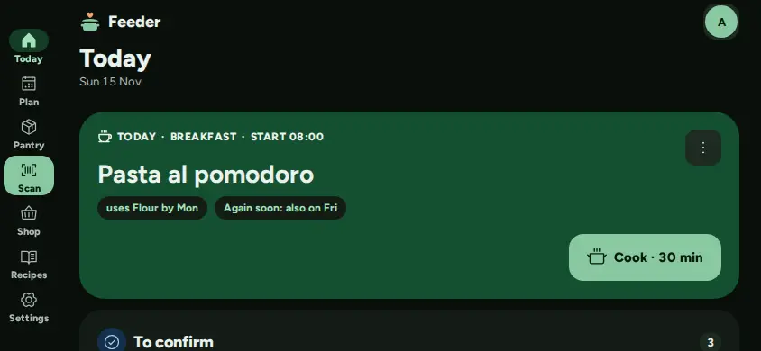 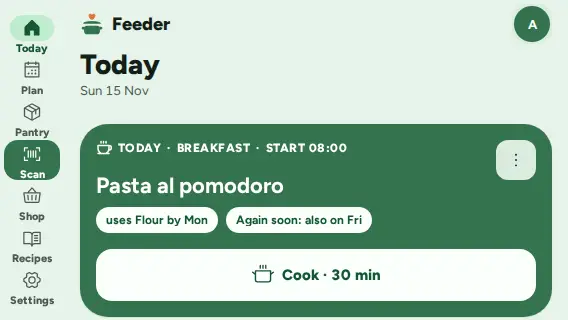 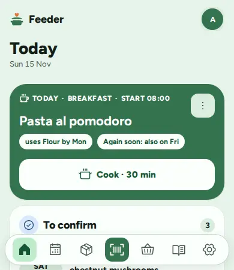
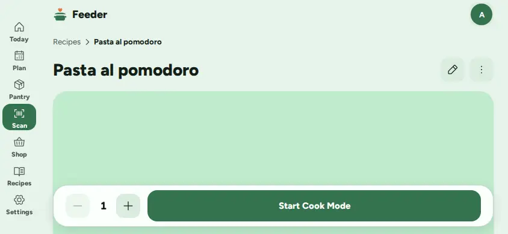 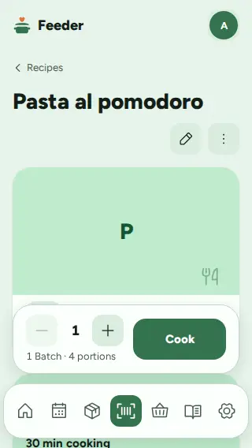 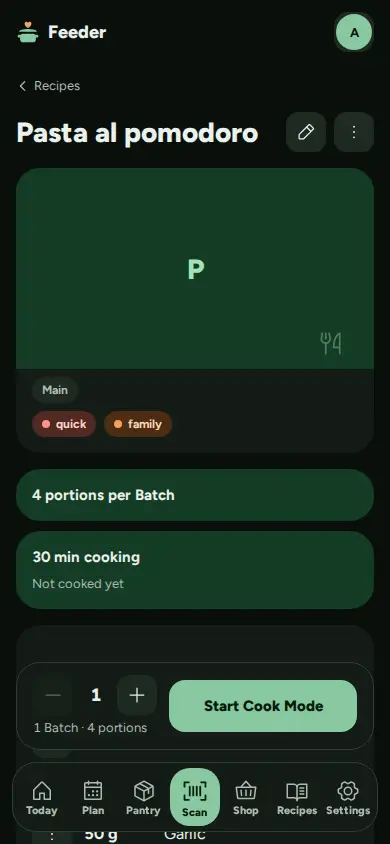 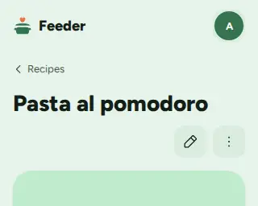
 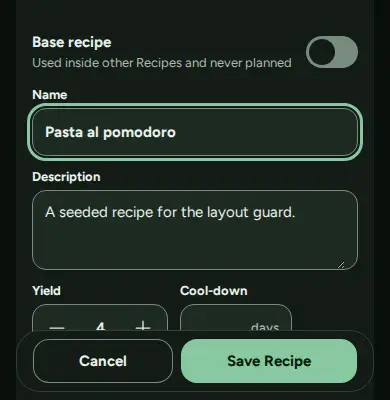 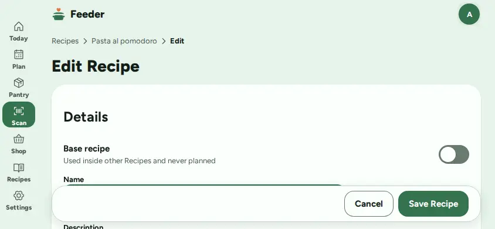 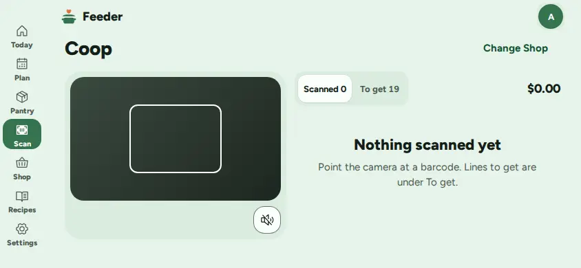
Mocks: [mocks/short-04-nav-rail.html](mocks/short-04-nav-rail.html), [mocks/short-04-nav-shortbar.html](mocks/short-04-nav-shortbar.html) (option B, not chosen), [mocks/short-04-recipe-cook-bar.html](mocks/short-04-recipe-cook-bar.html), [mocks/short-04-keyboard.html](mocks/short-04-keyboard.html), [mocks/short-04-scan-landscape.html](mocks/short-04-scan-landscape.html)

**Accessibility.**
- Only one navigation landmark is ever rendered visible: rail or bar; the other is `display: none`. `aria-current="page"` as now.
- **Targets:**
  - rail targets are 56×44 (56×40 below 360 px tall);
  - in the icon-only bar the whole track (about 43 × 52 px, 43 × 64 px in the 70 px bar) stays the target, not just the squircle.

  All are above the 24 px minimum of WCAG 2.5.8.
- **Contrast:**
  - current highlight (`accent-text` on `soft`): 6.73:1 light, 8.35:1 dark;
  - Scan (`on-accent` on `accent`): 5.73:1, 9.26:1;
  - labels (`muted` on `bg`): 6.45:1, 9.73:1;
  - outlined Cancel: R-A's measured table.
- The hidden bar is `visibility: hidden` (out of the tab order) only while focus is in a text field on a coarse pointer, so no keyboard user loses it.
- The focused field's ring is drawn on the field control, clear of the sticky bar through `scroll-padding` (R-C).
- Reduced motion: no slide transitions.
- WCAG 1.4.10: at 320×256 nothing is fixed over the content.

### Alternatives considered
- Decision options not taken: the shorter bottom bar and the scroll-away bar for landscape; keeping the bar while typing.
- **Make the StickyActionBar non-sticky below 500 px tall** (stage 1). Rejected: with one row and the bar gone, a 62 px sticky Save is within budget, and it keeps Save in reach while typing.

### Build notes
- `app/shell.css`: the short-landscape (rail shapes included), short-narrow (squircles), very-short and keyboard blocks, plus tokens `--rail-compact`, `--bar-gap`, `--keyboard-inset` and `--safe-*` (the last also in SHORT-05). The under-360 px bar is DS's R-F block; the short-narrow block uses the same squircle values, so the two never disagree.
- `app/AppShell.tsx`: mount `useKeyboardInset()`. The rail markup is unchanged; it is already rendered.
- New `ui/lib/keyboard.ts`, `ui/lib/useKeyboardInset.ts`, and `ui/lib/viewport.ts` with the query constants.
- `ui/StickyActionBar.css`, `.tsx`, `ui/useStickyBarClearance.ts` (default 70 px).
- `ui/Toast.css:7, 16` use `--bar-gap` and the new `--nav-top` semantics.
- `ui/ViewfinderStrip.css`: the outlined icon buttons.
- `features/recipes/recipes.css` (`.cook-entry` in the bar, the short label below 360 px) and `features/recipes/components/CookEntry.tsx` (`aria-describedby`, the two label spans and `aria-label`): small edits in RX's files; RX references this item.
- `web/index.html`: the viewport meta.
- No API change.

### Tests and guard
- Unit tests:
  - `isTextEntry` covers text, search, number and textarea, and rejects a checkbox and a button.
  - `keyboardInset` is 0 when the visual viewport equals the layout viewport, and 300 for an innerHeight of 844 with a visual viewport of 544.
  - `useKeyboardInset` sets and clears `data-keyboard`, with the 150 ms restore.
  - `shell.css.test.ts`:
    - the bottom bar is `display: none` and the rail shown under `(max-height: 499px) and (min-width: 560px)`;
    - the short-narrow `.bottom-bar__link` is 40 × 40 with a 12 px radius, the accent one included;
    - no `box-shadow` on the current Scan in the rail.
  - `StickyActionBar.test.tsx`: `bottom` uses `--bar-gap` and `--keyboard-inset`.
  - `CookEntry` keeps the name "Start Cook Mode" with the short label.
- BDD:
  - Scenario: A phone held sideways shows the compact rail instead of the bottom bar
  - Scenario: The Today hero's Cook button is not covered in phone landscape
  - Scenario: The bottom bar steps aside while typing a Recipe name on a phone
  - Scenario: The bottom bar returns after leaving the field
  - Scenario: Recipe detail shows Batches and Start Cook Mode on one row
  - Scenario: Scan's Mute can be pressed in phone landscape without scrolling
  - Scenario: At 400 % zoom nothing is fixed over the page
- Guard:
  - Add 844×390, 568×320, 390×450 and 320×256 to the page-layout guard's full size list, plus 390×400 with the first text field focused.
  - New rule **P17, chrome budget**: the union of the boxes of `position: fixed|sticky` elements outside dialogs, intersected with the viewport, is at most 35 % of `innerHeight` at load.
  - DS's R-F check (each `.bottom-bar__link` box lies inside the bar with at least 4 px to spare) also runs at 390×450.

### Depends on / unblocks
- Uses FormActions from SHORT-02 (same package or after it), DS's R-A `Button` look and DS's R-F bar.
- Unblocks SHORT-06 and SHORT-08, and closes the "shell decision" questions of RX, SET and SSP for keyboards.

## SHORT-05  Safe areas: Page gutters and the top bar ignore the insets
**Severity** S2 (emulated with a CDP inset override; not seen on a device) · **Size** S · **Sources** CROSS-08 · **Reproduced** Confirmed:
- With insets left/right 47 px and bottom 21 px at 844×390, the `h1`, the brand and the first tile start at x = 24 on `/` and `/shop` (23 px inside the inset), and the avatar ends at x = 820 (23 px into the right inset).
- The bottom bar does respect the insets (182–662).
- With a top inset of 47 px at 390×844, the top bar still starts at y = 0.
- `grep safe-area-inset-top web/src` finds nothing.

**Where** every chrome route, Cook Mode, the board, sheets; landscape on notched iPhones (Safari, `viewport-fit=cover` at `web/index.html:5`); the installed app (`display: standalone`, `web/vite.config.ts:24`).

### Problem
In landscape the notch or Dynamic Island covers the start of titles and row pictures on the left. On the right, the avatar and the row ends sit under the rounded corner. In an installed app with a translucent status bar, the brand and avatar can sit under the status bar. The cause: `ui/Page.css:7` uses only `--page-gutter`, and `.top-bar` (`app/shell.css:34`) uses only `--gutter`.

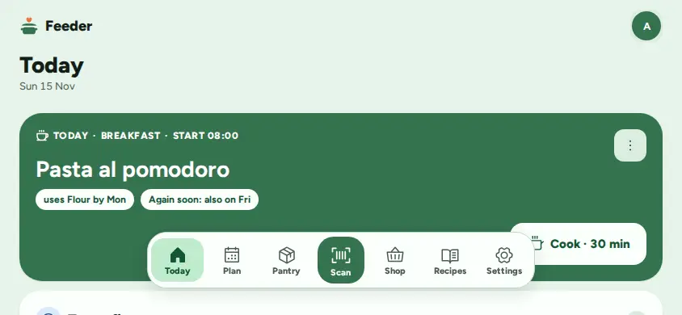

### Design
**The rule** (system.md §11.5): every gutter is `max(gutter, inset)` on its own side.
- New tokens `--safe-top`, `--safe-right`, `--safe-bottom`, `--safe-left` (`env()` with 0 fallbacks).
- `.page` uses `padding-inline: max(--page-gutter, --safe-left) max(--page-gutter, --safe-right)`.
- `.top-bar` is `64px + --safe-top` tall, padded on top by the top inset and on each side by `max(--gutter, inset)`.
- In short landscape the rail takes the left inset (its column is `64px + --safe-left`), so `.app-main` and `.top-bar` set `--safe-left: 0px` and the page does not double it.
- Sheet panel, Cook Mode and the board use the same `max()` form (SHORT-01, SHORT-02, SHORT-03).
- Bars keep their existing bottom inset.

After, at 844×390 with 47 px insets: the page runs x 135–797 beside the rail (which starts after the inset), the avatar ends at x 797, and Cook Mode's Back column starts at x 47. In portrait with a 47 px top inset, the top bar's content starts at y 47.

    
Mocks: [mocks/short-05-safe-landscape.html](mocks/short-05-safe-landscape.html), [mocks/short-05-safe-landscape-shop.html](mocks/short-05-safe-landscape-shop.html), [mocks/short-05-safe-portrait.html](mocks/short-05-safe-portrait.html). The black shapes are mock-only drawings of the sensor housing.

**Accessibility:** none affected beyond content no longer being hidden; no colours.

### Build notes
- `styles.css` (tokens), `ui/Page.css`, `app/shell.css` (`.top-bar`; the rail column in SHORT-04), `ui/BottomSheet.css` (SHORT-02), `features/cook/cook.css` (SHORT-01), `features/board/board.css` (SHORT-03).
- Toasts and OfflineBanner: check `ui/Toast.css` and `ui/OfflineBanner.css` take `max(gutter, inset)` sideways.
- If an iOS status-bar meta (`black-translucent`) is ever added, this rule is what makes it safe; none is added here.

### Tests and guard
- Unit test: `Page.ds.test.tsx` and `shell.css.test.ts` assert the `max(…, var(--safe-*))` forms.
- BDD:
  - Scenario: In landscape on a notched phone the page title starts clear of the notch
  - Scenario: The installed app's top bar starts below the status bar
- Guard: run the page-layout guard once at 844×390 with `Emulation.setSafeAreaInsetsOverride` (47/47/21). New rule **P20, safe gutters**: no content box of `<main>` starts at an x lower than the left inset or ends past `innerWidth − right inset`.

### Depends on / unblocks
Tokens shared with SHORT-04 (same package). Unblocks SHORT-01, SHORT-02 and SHORT-03's inset rules.

## SHORT-06  Recipe Assistant's sticky bar floats permanently with both buttons disabled
**Severity** S3 (corrected from S2: content scrolls clear of it, and the figures are smaller than reported) · **Size** S · **Sources** SETTINGS-04 · **Reproduced** Confirmed, narrower:
- On a clean page both Cancel and Save are disabled.
- At 320×568 the stacked bar (122 px) plus the bottom bar cover 192 px (34 %; stage 1 said 39 %).
- At 844×390 they cover 140 px (36 %; stage 1 said 45 %).
- At 1440×900 the bar floats over the activity list.

**Where** `/settings/recipe-assistant` (`features/recipe-assistant/screens/RecipeAssistantSettingsPage.tsx:106–119`); all sizes.

### Problem
A permanently floating block of disabled buttons carries no information until something changes, and on a small phone it hides a third of the form.

### Design
- **StickyActionBar gains `sticky?: boolean`** (default `true`). The page passes `sticky={page.dirty}`.
- **Clean:** the actions are the form's last row, in flow, not floating and without elevation, so nothing covers the form. Cancel and Save are still disabled there, which tells the person that this page saves with Save.
- **Dirty:** the bar becomes sticky and rises in (`translateY(16px)` and fade, `--dur-2`, none with reduced motion): one row, 70 px, 12 px above the bottom bar.
- After Save or Cancel it returns to the form's end.
- The SAFE theme owns the save model (Save versus apply-at-once, the unsaved-changes guard); this item only stops the bar covering a clean page.

    
Mocks: [mocks/short-06-assistant-clean.html](mocks/short-06-assistant-clean.html), [mocks/short-06-assistant-dirty.html](mocks/short-06-assistant-dirty.html), [mocks/short-06-assistant-1440.html](mocks/short-06-assistant-1440.html)

After (dirty): 140 px (25 %) at 320×568 and 62 px (16 %) at 844×390. Clean: 82 px (bottom bar only).

**Accessibility:** focus is not moved when the bar becomes sticky. The group keeps its name ("Recipe Assistant actions"), its DOM position is unchanged, and the buttons enable as now.

### Alternatives considered
- **Render the bar only while dirty** (stage 1's `onlyWhenDirty`). Rejected: Save then appears and disappears, and on a clean page there is no hint that the page has a Save.

### Build notes
- `ui/StickyActionBar.tsx` (prop, `data-sticky`, `data-entering`) and `.css`.
- `RecipeAssistantSettingsPage.tsx`: pass `sticky={page.dirty}`.
- The prop is available to Preferences and Household if SAFE keeps an explicit Save there.

### Tests and guard
- Unit tests:
  - `StickyActionBar sticky={false}` renders `data-sticky="false"` and registers no clearance.
  - Switching to `true` sets `data-entering` once.
- BDD:
  - Scenario: The Recipe Assistant page shows no floating bar until something changes
  - Scenario: Changing the model brings Cancel and Save into reach
- Guard: P17 (chrome budget) at 320×568 on this route.

### Depends on / unblocks
Depends on SHORT-04 (bar rules). SAFE references it for the save model.

## SHORT-07  Pantry Filters popover is cramped on a short viewport
**Severity** S3 · **Size** S · **Sources** SHOP-14 · **Reproduced** Confirmed, narrower:
- **At 844×390** the floating popover is 166–374 px (208 px tall), and the Storage Place section heading is at y 462, outside the panel. The person has to scroll inside a 208 px box to find the list.
- **At 1024×768** the panel is 586 px tall and shows about 2.5 Storage Places in its capped list. Cramped, but usable; not a defect at this size.
- **At 1280×800, scrolled by 400 px,** the popover moves up to y 70, but the header has scrolled away, so nothing is covered. The upward flip over Stock-take and Add to Stock did not reproduce.
- **New in stage 2:** inside a sheet, the Storage Place list keeps its own capped scroll (`features/stock/stock.css:37`, `ui/FilterBar/FilterBar.css:132`), a scroll inside a scroll.

**Where** `/pantry` Filters (and Recipes' Filters, the same primitive); short landscape.

### Problem
`ui/Popover/Popover.tsx:26` chooses popover or sheet by width only (`min-width: 768px`). Phone landscape therefore gets a desktop popover with no height to place it.

### Design
- **The Popover renders as the BottomSheet when `(max-width: 767px), (max-height: 599px)`.** On a short landscape viewport that is the centred dialog of SHORT-02 (640 px wide, full height − 8 px), with the R-B Close.
- **Inside a sheet on a short viewport**, filter lists drop their own cap, so there is one scroll container.
- **From 768 px wide on a short viewport**, the Filters body is two columns: the chip sections (Show, Food or Supplies, Kind, Group by Storage Place) on the left, and the Storage Place search and list on the right.
- **The footer** is the one-row FormActions: **Clear filters (outlined secondary, R-A) and Show Stock (primary)**. Show Stock is the commit, so it is the filled button.
- Tall desktop and tablet keep the popover; its footer uses the same two buttons.

  
Mock: [mocks/short-07-pantry-filters.html](mocks/short-07-pantry-filters.html)

**Accessibility:** the sheet's focus handling applies (first control on open, back to the Filters button on close). The DOM order is unchanged (chip sections, then the list); the two columns are visual only and match reading order left to right.

### Build notes
- `ui/Popover/Popover.tsx` (the query, via `ui/lib/viewport.ts`).
- `ui/FilterBar/FilterBar.css` (the short sheet block) and `ui/FilterBar/FiltersPanel.tsx` (Show Stock as the primary, Clear filters as a secondary).
- `features/stock/stock.css:37` (the Pantry cap is scoped out inside a short sheet).
- This shared change also moves Recipes' Filters to the sheet on short viewports, and gives it the same footer.

### Tests and guard
- Unit tests:
  - `Popover` renders a BottomSheet when `matchMedia('(max-height: 599px)')` matches at 844 px wide.
  - `FiltersPanel`'s footer has no tertiary button.
- BDD:
  - Scenario: Pantry Filters in phone landscape shows every section and the Storage Places
  - Scenario: Choosing a Storage Place in phone landscape needs one scroll at most
- Guard: extend the pantry-filter scenario with 844×390. `popoverAlignProbe` fails when a `[role=listbox]` inside the panel starts below the panel's bottom edge.

### Depends on / unblocks
Depends on SHORT-02 (short sheet sizing). SSP and RX reference it.

## SHORT-08  Recipe editor's bar is wider than its form at 1440; a 24 px strip shows under it at 820
**Severity** S4 · **Size** XS · **Sources** RECIPES-25 · **Reproduced** Confirmed:
- At 1440×900 `.sticky-action-bar` spans x 280–1400, starting under the section index, while the form and the bar's inner row are 420–1260.
- At 820×1180 the bar ends at y 1074 and the bottom bar starts at y 1098: a 24 px strip of content shows between them.

**Where** `/recipes/:id/edit`, `/recipes/new`; 820 and 1280 and up; light and dark.

### Problem
`StickyActionBar` caps only its inner row (`ui/StickyActionBar.css:86–93`), so the card is the full Page width. Its float gap is `--page-gutter` (24 px from 768 px wide) rather than the bottom bar's own 12 px inset.

 

### Design
- **The bar's box takes its column's width:** `data-column="form"` caps the box at 840 px and `narrow` at `--page-narrow` (720 px), centred like the column. The inner row no longer has its own cap.
- At 1440 the bar runs x 420–1260 with the form.
- **The gap above the bottom bar or the edge is `--bar-gap` (12 px)** at every size (SHORT-04), so bar and bottom bar read as one stack and the strip shrinks to the same 12 px as under the bottom bar.

  
Mocks: [mocks/short-08-editor-bar-1440.html](mocks/short-08-editor-bar-1440.html), [mocks/short-08-editor-bar-820.html](mocks/short-08-editor-bar-820.html)

**Accessibility:** no change.

### Build notes
`ui/StickyActionBar.css` only. It touches every StickyActionBar user: Recipe editor (form), Recipe Assistant (narrow), import, export and receipt (page width, unchanged).

### Tests and guard
- Unit test: `StickyActionBar.css.test.ts` asserts `max-inline-size` on `.sticky-action-bar[data-column='form']`.
- BDD: Scenario: The Recipe editor's Save bar lines up with the form on a wide screen
- Guard: a page-layout check at 1440×900 that `.sticky-action-bar` lies within the horizontal extent of the editor's form column, to within 1 px.

### Depends on / unblocks
Same package as SHORT-04.

## Review round 1 (2026-11-14)

- **Shared rules.** Every SHORT mock now carries the PC mocks' shared R-A to R-D block (copied unchanged) in `<style data-proposed>`, plus a few SHORT additions:
  - **Close (R-B):** the 40 px round outline button in every sheet header.
  - **Bare-text actions (R-A):** none remain in any sheet footer or sticky bar. Cancel, "Reset to usual", "Clear filters" and the footer ⋮ are outlined buttons.
  - **Focus rings (R-C):** a focused field now carries a 3 px ring at a 2 px offset on the whole field control, not a clipped box inside it.
  - **Close vs Cancel (R-B):** the rule that a footer with Cancel shows no Close is now in the design. None of this theme's sheets has Cancel in its footer, so every mock keeps its Close.
  - **Toasts (R-D):** none in this theme.
- **Re-rendered.** 28 mocks re-saved and the rule-table diagram updated (all 29 SHORT files); 56 WebP renders replaced under the same file names.
- **Coordinator's points:**
  - Cook Mode landscape now uses the 600 Step weight (`--text-step-weight`).
  - It uses PC's timer pill strip and PC-03's top row: outlined Exit; the Step count in the overline; Ingredients and Voice at the end.
  - The Advance Steps chip is info tone (DS 3); so is the board's Next Advance Step tile.
- **Fixes beyond the four rules:**
  - FormActions buttons now start from their natural width, so "Mark as Cooked" no longer wraps at 390.
  - On a phone a destructive action goes into the row's ⋮ instead of becoming an icon-only trash; this removes a third button.
  - Edit Meal Slot's footer is now ⋮ (Change a date, Delete Meal Slot) and Save Meal Slot.
  - Who's eating: the ISO date in the title is gone. The title is "Who's eating" under a muted context line "Mon 16 Nov · Dinner", using PC-10's pattern. "Reset to usual Attendance" now reads "Reset to usual" (full name kept as the accessible name).
  - Pantry Filters: "Show Stock" is now the primary.
  - Recipe detail below 360 px: the button reads "Cook" (accessible name "Start Cook Mode"), so it does not wrap.
  - Cook Mode landscape: below 700 px wide the Advance Steps chip shows only its count, so the title keeps room. A long Step uses PC's long-Step size (`title-2`). The coach mark's "Got it" stays on one line.
  - The bottom bar renders icons only below 360 px, as DS 1 decided.
- **Left as they are:**
  - At 320 px, Mark as Cooked's "No Leftover" and "Mark as Cooked" still wrap to two lines. Buttons are allowed to wrap by the existing Button rule, and the action set is PC's (PLAN-15).
  - The full-width "Use by Wed" chip in the Mark as Cooked mocks is still an artefact of the static mock.
  - The rule-table image is 75 KB, over the 60 KB aim; a smaller file makes the text unreadable.

## Review round 2 (2026-11-14)

- **Shared rules.** All 28 SHORT mocks now carry the refreshed shared rules block from the PC mocks (R-A to R-F) and were re-rendered under the same file names: 56 renders, light and dark where the item has both. The rule-table diagram did not change.
- **Step text weight.** Cook Mode's Step text is now **Medium (500)** (`--text-step-weight: 500`) in every SHORT-01 render.
- **Timer pills in landscape** (SHORT-01):
  - R-C+: a focused Pause draws its ring inside itself, and the gating pill's accent boundary steps back to the neutral outline (the long-Step render shows it).
  - PC-04's "+N" badge: 28 px round, 1 px outline, a button that opens the Timers sheet.
  - The strip now shows only whole pills: two from 700 px wide, one below 700, the last carrying "+N". Before this, a second pill was cut off at the strip's edge.
- **R-F shapes:**
  - The short-narrow compact bar (52 px, icons only) uses 40 px squircles, radius 12, centred and 6 px clear of the bar's edges. Scan is the same squircle with no ring.
  - Every 320 px render (Recipe detail, Recipe Assistant) uses R-F.
  - The compact rail's current-page pill is a 44×26 capsule, and Scan is a 56×44 rounded rectangle (radius 14) that drops its ring when current.
  - All of these were checked in close-up crops.
- **R-D+ and R-E:** not applicable. The theme has no toasts and no list that holds key, state and detail.
- **Craft defects found and fixed:**
  - Tap-zone chevrons overlapped the Step text in landscape. They are no longer drawn there; the side columns are the affordance and the zones still work.
  - Sheet titles now sit centred on the 40 px Close, so the gap under a one-line title is even (it was 31 px).
  - The "Use by Wed" chip in Mark as Cooked was stretched full width; it now keeps its natural width.
  - Who's eating: the per-Course "Reset to usual" button was stretched full width, and the context line sat apart from the title. Both fixed.
- **Left as it is:** in the second landscape pill, a long timer name still ends in an ellipsis ("Simmer th…") beside its time and "+1". The full name is in the pill's accessible name and in the Timers sheet.

## Work packages for this theme

| Package | Items | Files owned | Size | Merge order | Parallel with |
|---|---|---|---|---|---|
| **P1 Shell, bars and safe areas** | SHORT-04, SHORT-05, SHORT-06, SHORT-08 | `app/shell.css`, `app/AppShell.tsx`, `styles.css` (tokens), new `ui/lib/viewport.ts`, `ui/lib/keyboard.ts`, `ui/lib/useKeyboardInset.ts`, `ui/StickyActionBar.*`, `ui/useStickyBarClearance.ts`, `ui/Toast.css`, `ui/OfflineBanner.css`, `ui/Page.css`, `web/index.html`, `features/recipe-assistant/screens/RecipeAssistantSettingsPage.tsx`; small edits in `features/recipes/recipes.css` and `CookEntry.tsx` (agree with RX); `docs/design/system.md` new §11 | M–L | **First.** Land the tokens (`--safe-*`, `--bar-gap`, `--keyboard-inset`, `--rail-compact`) and `viewport.ts` as the first commit so the other packages can rebase on it | — |
| **P2 Sheets and FormActions** | SHORT-02, SHORT-07 | `ui/BottomSheet.*`, new `ui/lib/sheetLayout.ts`, `ui/FormActions.*`, `ui/Dialog.css`, `ui/Popover/Popover.tsx`, `ui/FilterBar/FilterBar.css`, `features/stock/stock.css` (one rule), `features/settings/components/DateAttendancePanel.tsx`, `MemberEditor.tsx`, `MealSlotEditor.tsx`, `features/shops/components/WeightRuleEditor.tsx` | M | After P1's token commit. FormActions must merge **before** P1's StickyActionBar row change is verified (or P1 and P2 run as one team in sequence) | P3, P4 |
| **P3 Cook Mode short layout** | SHORT-01 | `features/cook/**` (cook.css, CookScreen, TimelineCookScreen, AdvanceStepsTile, CookNavTiles, new `lib/tapZone.ts`, `lib/advanceChip.ts`), `ui/TimerTile.*` (`density` prop) | M | After P1's tokens; serialise with PC's Cook package (same folder) | P2, P4 |
| **P4 Kitchen board short layout** | SHORT-03 | `features/board/board.css`, `features/board/screens/BoardScreen.tsx`, `features/board/lib/layout.ts` | S | After P1's tokens; serialise with TB's board items | P2, P3 |

PC's Plan sheets (`PlannedMealSheet`, `MarkCookedSheet`, `MarkAllCookedSheet`) adopt P2's FormActions `more` slot in PC's own package, after P2 merges.

**system.md §11 text to add (P1 owns it):**

> **11. Short viewports and fixed chrome.**
> **11.1 Size classes:** short `(max-height: 499px)`; short landscape `and (min-width: 560px)`; short narrow `and (max-width: 559px)`; very short `(max-height: 339px)`; keyboard up `html[data-keyboard='open']`.
> **11.2 Budget:** at load, fixed and sticky chrome covers at most 35 % of the viewport height (guard P17).
> **11.3 Sheets:** the footer is one FormActions row (one primary, one secondary or tertiary, a ⋮); the body keeps `min(6rem, 30dvh)`; on short viewports the panel takes the height (minus 8 px), with no grip and a `title-3` title; when the body would show less than 40 % of the panel, the footer flows (guard P18).
> **11.4 Navigation:** short landscape uses the 64 px compact rail; short narrow uses the 52 px icon bar; very short narrow puts the bar at the end of the page; while the keyboard is up the bar steps aside. A StickyActionBar is one row, `--bar-gap` above what is below it, as wide as its column, and floats only while it has something to do.
> **11.5 Safe areas:** every gutter is `max(gutter, inset)` on its side; the top bar adds the top inset (guard P20).
> **11.6 Cook Mode and the Kitchen board:** sized by height as well as width; in short landscape Cook Mode's Back and Next are side columns (guard P19), and the board's wall grid needs a height of at least 560 px.

## Not reproduced / dropped
- **SHOP-14, 1280×800 upward flip** ("the popover flips to y 16 and covers Stock-take and Add to Stock"). Not reproduced: scrolled 400 px, the popover sat at y 70 and the header had scrolled away. Dropped; the guard extension in SHORT-07 would catch it if it returns.
- **PLAN-01, 320×568 "Timers heading under the nav".** Not a defect: the current Step is 100 % visible, and content below a sticky nav scrolls into view as intended (L-08).
- **SETTINGS-04 severity S2.** Corrected to S3 (SHORT-06) on the measured 34–36 %.

## What could not be checked
- **Real devices.** All measurements are Chromium with mobile emulation.
  - The on-screen keyboard was emulated by focusing a field and shrinking the viewport (the `resizes-content` behaviour). Safari's `visualViewport` behaviour with a sticky bar and `--keyboard-inset`, and Chrome on Android with `interactive-widget=resizes-content`, need checking on an iPhone and an Android phone.
  - Notch and Dynamic Island insets were emulated with `Emulation.setSafeAreaInsetsOverride`. The exact insets of an installed iOS app depend on the status-bar style, which the app does not set.
- **WebKit and Firefox.** WebKit was not re-run in stage 2. `align-content: safe center` (Cook Mode) and `:has()` in the Filters rule need a WebKit check at 844×390.
- **Real 200–400 % zoom.** Emulated as viewport sizes (320×256, 390×450), not with browser zoom on a desktop.
- **The Kitchen board in daylight** was rendered by switching the scheme in the mock; the server clock was before sunrise.
- **Plan sheet content.** The Planned Meal and Mark as Cooked mocks show the footer as the primitive will render it. Their exact action sets and initial focus belong to PC (PLAN-15), and that design was not checked against this one.
