# Shell, Today, Kitchen board, first run and notification landings

This theme covers the screens a Household meets first and most often: Today (the home), the Kitchen board on the wall, the first-run checklist, the navigation shell around them, and where a push notification lands. Eighteen stage-1 findings were assigned. All but one reproduced. While reproducing them I found five closely related defects; they are folded into the items below and marked "new in stage 2".

The defects come from five root causes:

1. **The hero's choice of meal and the Advance Step list each have two implementations that disagree.**
   - Today and the board pick their hero with different code, and both keep a past Meal Slot for two hours.
   - Today lists Advance Steps by the date of the Planned Meal, not by when the Step is due, and ignores done marks. The board uses a third, mark-aware function.
2. **Today's layout was never designed beyond a phone.** It sits in a `BentoGrid min="wide"` at the `wide` page width, so it stretches on a desktop and flips between one and two columns as the rail appears. Its tiles have four header styles and three that lead nowhere.
3. **The Kitchen board was built as a fixed 1280 × 800 picture.** Its sizes are rem constants, it has no way out, and its dark hero rule never applies. That rule keys on a `data-theme` attribute that nothing sets; the app sets `data-scheme`.
4. **First run and notifications were wired to list pages rather than to actions.** The checklist sends people to empty settings lists, and four of the six notification types land on `/plan`.
5. **The shell marks only Plan and Settings as owning their sub-pages,** so the Recipes item loses its current state on detail and edit.

The fix is mostly a few shared changes:

- **Shared hero selection.** One `heroSelection` in `features/plan/lib/hero.ts`, used by Today and the board, closes FLOW-15 and the board's half of SHELL-11.
- **One marks-aware Advance Step source.** A function in `internal/cook` serves Today, the board and push (FLOW-05, the Done half of SHELL-16, and a new done-mark defect).
- **The hero's dark rule moves into `ui/Tile.css`,** keyed on `data-scheme` (SHELL-04, widened).
- **A Today grid by container width** with an aside, honouring ui-review-2 L-01/L-07 (SHELL-07, SHELL-15, SHELL-17).
- **Board type tokens** driven by one board unit (SHELL-09, SHELL-10).
- **The DS theme's tile header,** used on every Today tile (SHELL-16).

The rest are small, local designs.

| Item | Severity | Size | Title | Source ids | Status after reproduction |
|---|---|---|---|---|---|
| TB-01 | S2 | S | The hero shows the next Meal Slot, not a past one; Today and the board agree | FLOW-15 | Confirmed, wider (the board has its own copy of the rule) |
| TB-02 | S2 | M | Advance Steps due in the next 24 h, with Done, from one marks-aware source | FLOW-05 | Confirmed, wider (done marks ignored; new in stage 2) |
| TB-03 | S2 | M | Today's Bento at every size class | SHELL-07, SHELL-15, SHELL-17 | Confirmed (SHELL-17 narrower) |
| TB-04 | S2 | S | A way out of the Kitchen board | SHELL-03 | Confirmed |
| TB-05 | S2 | S | The hero's dark rule lives in `ui/Tile` and keys on `data-scheme` | SHELL-04 | Confirmed, wider (Today glares too; new in stage 2) |
| TB-06 | S2 | L | First run as a flow: steps open the action, time zone and currency confirmed, stays until done | FLOW-14 | Confirmed |
| TB-07 | S3 | M | Kitchen board at wall scale: type, Tomorrow, Done and chips, portrait | SHELL-09, SHELL-10 | Confirmed |
| TB-08 | S3 | S | One vocabulary on Today and the board | SHELL-11 | Confirmed |
| TB-09 | S3 | S | One tile header on Today | SHELL-16 | Confirmed |
| TB-10 | S3 | S | The hero's name, Course names and why chips open the Planned Meal sheet | SHELL-13 | Confirmed |
| TB-11 | S3 | S | Use soon and Leftovers lead somewhere | FLOW-26 | Confirmed, wider (invalid list markup; new in stage 2) |
| TB-12 | S3 | S | The Scan session on Today | SHELL-20 | Confirmed |
| TB-13 | S3 | XS | The current nav item on sub-pages | RECIPES-18 | Confirmed |
| TB-14 | S3 | M | Where each notification lands | FLOW-28 | Confirmed from code, wider (the service worker reloads any window, Cook Mode included; new in stage 2) |
| TB-15 | S4 | S | Polish: Notifications button, hero eyebrow, error tone, board `h1`, access badge | SHELL-23 | (a) confirmed from the stage-1 shot, (b)–(e) confirmed |

## Decisions for the user

All eight decisions were taken on 2026-11-14 (`docs/design/ui-review-3/decisions.md`). The plan builds what is listed here.

1. **TB 1, Today on a desktop: A.** From 60 rem of page, the hero and To confirm span two of three tracks, with an aside beside them. This honours ui-review-2 L-01 and L-07, and adds one sentence to system.md §4 (see TB-03). Mock: `mocks/tb-today.html`, 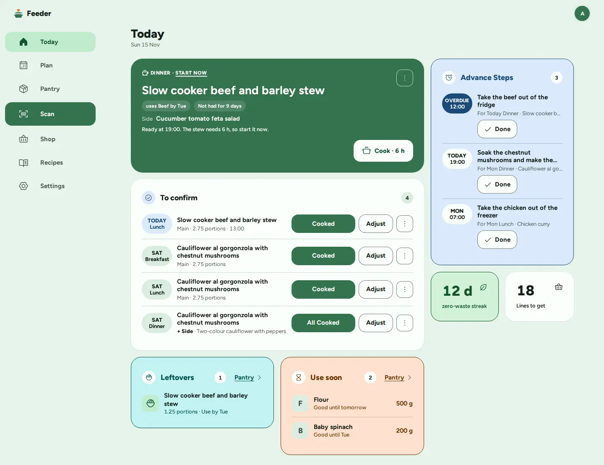. The option not taken, B, is `mocks/tb-03-option-b.html`, 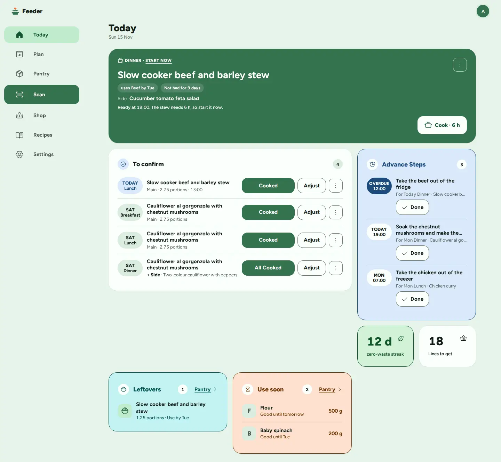.
2. **TB 2, when the hero moves on: A.** At the slot time. The past Meal Slot goes to the top of To confirm, and the Confirm Cooked push stays at slot time + 2 h. Diagram: `mocks/tb-01-hero-timeline.html`, 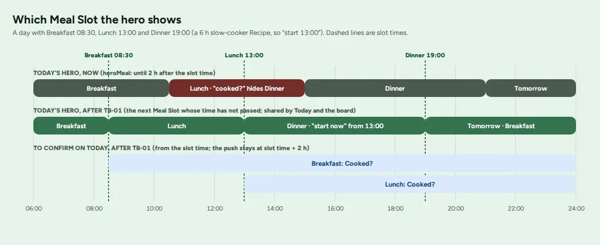.
3. **TB 3, the Zero-waste streak at 0: A.** Today hides it; the board shows "0 days".
4. **TB 4, leaving the Kitchen board: A.** A visible 56 px "Close kitchen board" control that dims after 10 s. Mocks: `mocks/tb-board.html`, `mocks/tb-board-idle.html`.
5. **TB 5, the Scan session on Today: B.** A persisted session, shown as a "Shopping at <Shop>" tile with Back to Scan, and the ux-brief line is reworded. Mock: `mocks/tb-12-b-resume.html`. The options not taken: A is `mocks/tb-12-a-switch.html`; C (remove the branch) is `mocks/tb-today.html`.
6. **TB 6, first run: five Recipes.** The Recipes step completes at 5 Recipes. The checklist stays until every step is done or the Admin hides it, and Settings > Household can show it again. Mocks: `mocks/tb-06-step1-zone.html` to `mocks/tb-06-step5-planned.html`.
7. **TB 7, the board hero's heading: A.** The same eyebrow as Today's hero ("TODAY · DINNER · 19:00"). Mock: `mocks/tb-board.html`.
8. **TB 8, the Start cooking notification: A.** It lands in Cook Mode for that slot. Since PC 6, Cook Mode opens on Get ready, or on the resumed Step when that Cook Mode is already under way. Diagram: `mocks/tb-14-landings.html`.

These decisions from other themes also shape this chapter:

- **DS 3:** Advance Steps tiles use the **info** tone, on Today and on the Kitchen board, including an overdue Advance Step (see TB-02, TB-07 and TB-09).
- **SHORT 1:** phone landscape gets a 64 px compact rail.
- **SAFE 2:** Undo for Cooked is offered from the toast and from the Planned Meal sheet until the end of the household day.
- **PC 3:** a Member can have an "Away" record.

None of the three changes this theme's designs.

## TB-01  The hero shows the next Meal Slot, not a past one; Today and the board agree

**Severity** S2 · **Size** S · **Sources** FLOW-15 · **Reproduced** Confirmed, and wider than reported:
- With the household clock at Sun 14:44 (UTC+14), Today's hero read "TODAY · LUNCH · 13:00 … cooked?" with Cooked/Adjust.
- Tonight's Dinner, a 6 h slow-cooker stew that should start at 13:00, was nowhere on the page. The tiles were `nextMeal, toConfirm, metrics, useSoon`.
- The board has its own copy of the rule (`features/board/lib/tiles.ts:28`, also a 2 h floor, today only). So after 21:00 the board says "Nothing planned tonight" while Today already shows tomorrow.

**Where** the `/` hero and To confirm; the `/board` hero; every size; both schemes

### Problem
For two hours after a Meal Slot's time, the hero keeps asking "… cooked?". During that time the next Meal Slot, possibly one that must be started now, is invisible.

The cause:
- `features/plan/lib/days.ts:111` `heroMeal` keeps any slot whose `at + HERO_GRACE_MS` is in the future.
- `features/board/lib/tiles.ts:28` `tonightMeal` repeats this with `TWO_HOURS_MS`.
- To confirm (`internal/plan/cook.go:90`, `ConfirmAfter = 2 h`) only takes the slot after those two hours.

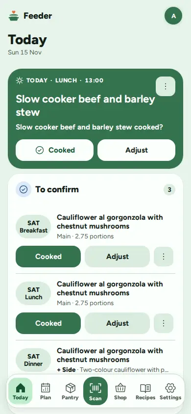

### Design
**Behaviour.**
- The hero is always the earliest Meal Slot, today or later, that has a Planned Meal still to cook or reheat and whose **slot time has not passed**.
- A past, unconfirmed Meal Slot leaves the hero at its slot time and appears at once as the **first row of To confirm**:
  - badge "TODAY / Lunch" in the info tone;
  - meta "Main · 2.75 portions · 13:00";
  - Cooked (or All Cooked) · Adjust · ⋮.
- The Confirm Cooked push stays at slot time + 2 h.
- Cooked marked there can be undone from the toast or the Planned Meal sheet until the end of the household day (SAFE 2).

**The eyebrow.** It states the urgency:

| When | Eyebrow |
|---|---|
| Before the start time | "DINNER · START 18:15" |
| From the start time until the slot time | "DINNER · START NOW" ("start now" underlined, 2 px) |
| A tomorrow slot | "TOMORROW · BREAKFAST" |
| A later slot | "WED · LUNCH · 13:00" |

- On Today a today slot carries no "Today" day word: the page title and date already say it, and dropping it keeps the eyebrow on one line at 320.
- The board keeps "TODAY · …", because it has no page title (TB-08).
- The eyebrow wraps only between its parts, and a "·" separator travels with the part after it (`flex-wrap: wrap`, each part `nowrap`).

**The hint.** When the timeline is longer than the time left, a line under the Courses reads:
- one Course: "Ready at 19:00. The stew needs 6 h, so start it now.";
- several Courses: "Ready at 19:00. Start with the stew now."

**Same choice everywhere.** The board's hero uses the same selection (TB-08).

**States.**
- Nothing ahead: today's Not served rows, or nothing.
- Loading and offline: RES.

**Rules.**
- A new pure function, `heroSelection(slots, now, today)`, in `features/plan/lib/hero.ts`, used by Today and the board. The board's `tonightMeal` is deleted.
- A new pure function, `justServed(slots, now, today)`, returns today's past slots that still have a planned Course.
- `ToConfirmTile` receives `[...justServed, ...server]`, de-duplicated by `date/mealSlotId`.

**Copy.** "start now"; "Ready at 19:00. The stew needs 6 h, so start it now."; the badge "Today" over the Meal Slot name.

**Accessibility.**
- The hero `section` is named by its Recipe name.
- A slot moving into To confirm takes no focus. A polite live region says "Lunch moved to To confirm."
- The hero's ⋮ is an outline button in the hero's text colour. Focused, its ring is drawn inside it (R-C+).
- Contrast: the hero text is 5.73:1 in light and 8.33:1 in dark.

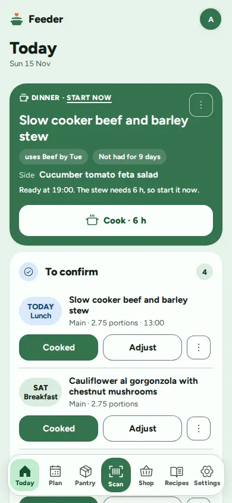 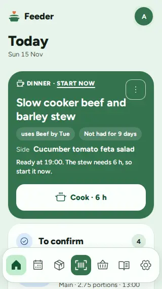
Mock: `mocks/tb-today.html`. Diagram: `mocks/tb-01-hero-timeline.html`.

### Alternatives considered
Keeping the 2 h grace and switching when the next start time arrives (TB 2, option B). It was rejected because it means two clocks, and the past slot can't be confirmed in its usual place.

### Build notes
- `features/plan/lib/days.ts`: remove `HERO_GRACE_MS`.
- `features/plan/lib/hero.ts`:
  - `heroEyebrow(sel, now, {onToday})` omits the day word for a today slot on Today;
  - `heroPhase` becomes `'upcoming' | 'start-now' | 'past'`;
  - add `heroHint` and `justServed`.
- `TonightHero.tsx`:
  - render the eyebrow parts as separate `nowrap` items, each with its leading separator;
  - render the hint;
  - drop the "cooked?" branch.
- `features/today/seams.ts` and `TodayScreen.tsx`: prepend `justServed` to To confirm.
- `features/board/lib/tiles.ts`: use `heroSelection`.
- No API change.

### Tests and guard
- **Unit:**
  - `heroSelection` at 08:29, 08:30, 12:59, 13:00, 19:00 and 23:59;
  - "start now" at the start time;
  - the eyebrow omits "Today" on Today and keeps it on the board;
  - `justServed` exclusions;
  - de-duplication.
- **BDD:**
  - "The hero moves to Dinner at Lunch's slot time";
  - "An unconfirmed Lunch appears first in To confirm at its slot time";
  - "The hero says start now when the timeline must start";
  - "The board and Today show the same Meal Slot".
- **Guard:**
  - scenario `today-after-lunch` (clock at 14:44): the eyebrow contains "Dinner";
  - at 320, the eyebrow is one line or never ends a line with "·".

### Depends on / unblocks
- Unblocks TB-08.
- PC's Stock-shortfall notice sits under To confirm.

## TB-02  Advance Steps due in the next 24 h, with Done, from one marks-aware source

**Severity** S2 · **Size** M · **Sources** FLOW-05 · **Reproduced** Confirmed, and wider than reported:
- I added an Advance Step with a 24 h lead to Recipe 14, planned for Mon Dinner 19:00. On Sun at 04:31, `GET /api/today/advance-steps` returned `{"steps":[]}`, while `GET /api/board` returned it as `nextAdvance` ("Start in 14 h").
- **New in stage 2 (from code):** Today and the push read `notify.Facts`, which never consults done marks (`internal/notify/facts/facts.go:140`). A Step done on the board stays listed on Today, and its push is still sent.

**Where** `/` (phone, tablet, desktop), `/board`, the Advance Step push

### Problem
On a phone, the cook never learns tonight that tomorrow's meat must come out of the freezer. Today shows only Steps whose **Planned Meal** is today, and it has no Done. Three different functions decide what is due:
- `internal/notify/compute.go:283` (`m.Date != day`);
- `internal/cook/advance.go:31` (marks-aware);
- `internal/notify/compute.go:44` (no marks).

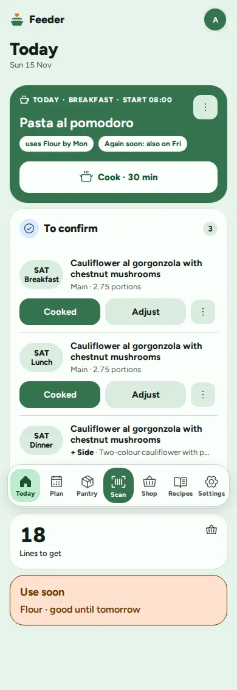

### Design
**The tile.** An **info status tile** (`variant="status" status="info"`, DS 3). It lists every **not-done** Advance Step due within the **next 24 h**, plus any overdue Step whose Planned Meal hasn't been served, soonest first.

**Each row** uses the To confirm anatomy:
- **When badge**, 4.5 rem. The top line is "Today", "Mon" or "Overdue"; the bottom line is the due time.
  - A normal badge is `--color-surface` with `--color-text`.
  - An overdue badge is solid info (`--color-info-fg` fill, `--color-surface` text), and its word uses the overline size so it keeps room inside the badge.
- **Step text**: `body-strong`, at most 2 lines.
- **Meta**: "For Mon Dinner · Cauliflower al gorgonzola…".
- **Done**: a secondary md button, 44 px, Phosphor `check`, with a surface fill and a 1 px outline (R-A). Focused, its ring is drawn inside it (R-C+), because the tile has its own boundary.
  - Under 30 rem of tile, Done sits under the text, start-aligned. From 30 rem it sits at the row's end.

**Done.** It calls `PUT /api/cook/marks`, the board's call, and the row leaves. A toast follows R-D and R-D+:
- no status icon (a plain success);
- headline: "Advance Step done";
- muted subline: "For Mon Dinner · Cauliflower al gorgonzola";
- body: the Step text;
- an outline **Undo** pill, which clears the mark;
- a 32 px circular Dismiss, top-aligned with the headline.

**Other states.**
- Offline: Done is disabled with the title "Needs a connection" (RES).
- More than 4 rows: the first 4, then a secondary "Show 2 more".
- No rows: the tile is not rendered.
- The board's Next Advance Step shows the first row, in the same tone (TB-07).

**Placement.**
- Phone: after To confirm.
- Tablet: a half tile.
- Desktop: the first tile of the aside (TB-03).

**Copy.**
- Title: "Advance Steps".
- Badge top lines: "Today", "Mon", "Overdue".
- Meta: "For <Day> <Meal Slot> · <Recipe>".
- Button: "Done", accessible name "Done: <Step text>".
- Toast: headline "Advance Step done", subline "For <Day> <Meal Slot> · <Recipe>", body "<Step text>", button "Undo".

**Accessibility.**
- The tile is a `section` named by its header; each row is an `li`.
- After Done, focus moves to the next row's Done, or to the header when the list is empty.
- The toast is `role="status"`, with a `--color-bg` focus ring.
- Contrast (light / dark):

| Pair | Light | Dark |
|---|---|---|
| Title | 7.37:1 | 8.37:1 |
| Meta | 5.91:1 | 6.78:1 |
| Overdue badge | 9.00:1 | 10.81:1 |
| Normal badge | 14.02:1 | 12.95:1 |
| Tile border on the page | 8.03:1 | 12.01:1 |

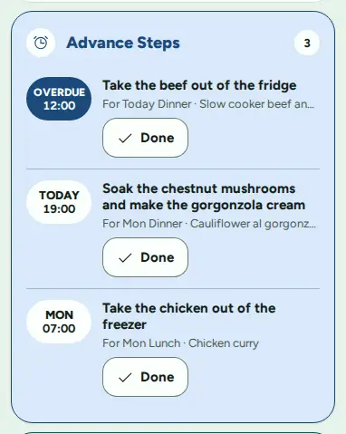 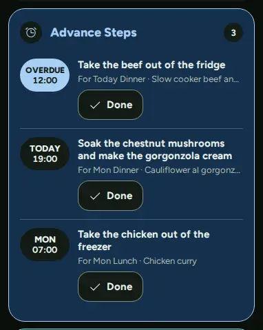 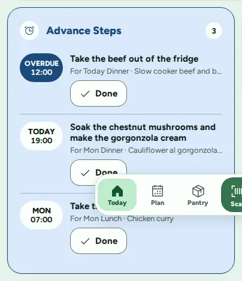 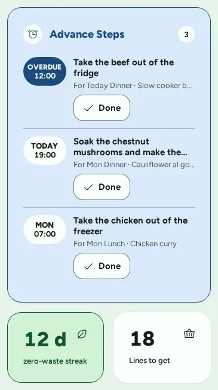 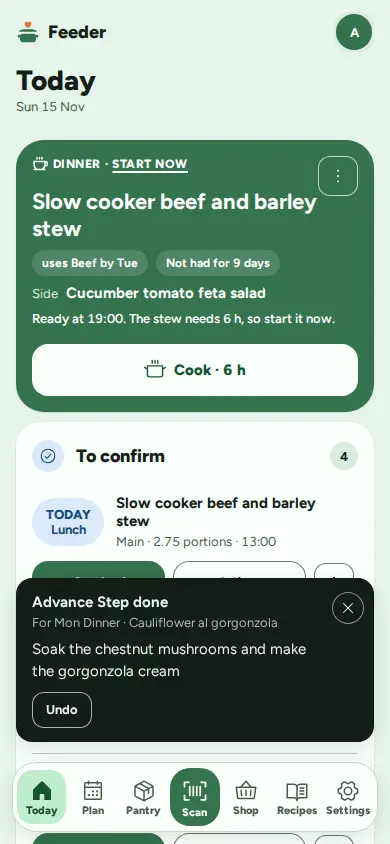 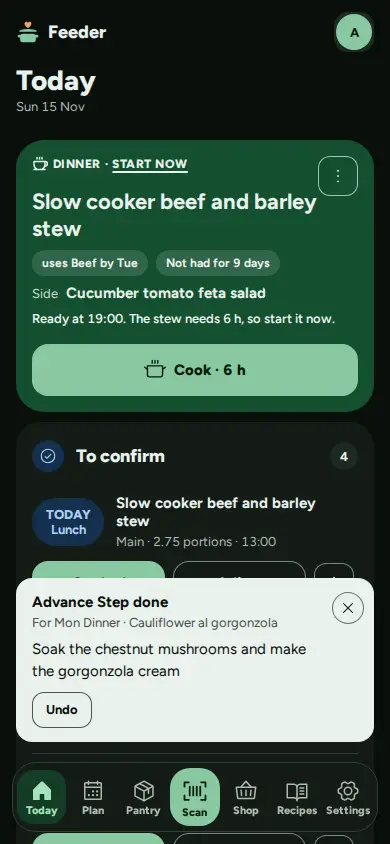
Mocks: `mocks/tb-today.html`, `mocks/tb-02-toast.html`.

### Build notes
**Backend**
- Add `cook.AdvanceDueWithin(cands, now, window)` in `internal/cook/advance.go`.
  - It returns the not-done candidates with `DueAt <= now+window` and `MealAt > now`, in `NextAdvance` order.
  - `NextAdvance` becomes its first element.
- `GET /api/today/advance-steps` (`internal/today/httpapi/httpapi.go:51`) builds its list through `Service.advanceCandidates`, extracted from `nextAdvance`.
  - Each row carries `scope`, `step`, `overdue`, `mealDate`, `mealSlotName`, `courseName`, `recipeName`, `description`, `dueAt` and `dueTime`.
- `internal/notify/facts` fills `AdvanceStepFact.Done` from `cook_marks`, and `Compute` skips done Steps.

**Frontend**
- `features/today/components/AdvanceStepsTile.tsx`: an info `Tile` with `TileHeader` (TB-09).
- `features/today/hooks/useAdvanceStepsDue.ts`: `markDone` and `undo` through the cook seam. The toast uses DS's `Toast` (R-D/R-D+).
- New `features/today/lib/advanceSteps.ts`: `badgeFor`, `metaFor`, `splitShown`.
- DS-C changes the tone of the Cook Mode Advance Step tiles to match.

### Tests and guard
**Go**
- `AdvanceDueWithin`:
  - due in 23 h: in;
  - due in 25 h: out;
  - overdue with the meal still ahead: in;
  - meal already past: out;
  - done: out.
- The Today endpoint returns tomorrow's Step.
- The push skips a done Step.

**Vitest**
- `badgeFor` and `metaFor`.
- The tile has `data-status="info"`.
- The tile is hidden when empty.
- Done calls `setMark` and shows the toast with no status icon.

**BDD**
- "Tomorrow's 24 h Advance Step shows on Today tonight"
- "Done on Today removes the Step from Today and the board"
- "A Step marked done on the board is not pushed"
- "An overdue Advance Step is drawn in the info tone"

**Guard**
- The seed gains a 24 h Advance Step.
- Scenario `today-advance` checks:
  - the tile is info;
  - Done is at least 44 × 44 and has a boundary;
  - a focused Done shows one inner ring.

### Depends on / unblocks
- Depends on TB-09, DS 3, DS's `Toast` and A11Y's R-C+.
- RES owns the offline state.
- TB-14 links the Advance Step push to `/?step=…`.

## TB-03  Today's Bento at every size class

**Severity** S2 · **Size** M · **Sources** SHELL-07, SHELL-15, SHELL-17 · **Reproduced** Confirmed (SHELL-17 narrower than reported):

- **Widths.** Every Today tile is 1136 px wide at 1440, and 1480 px at 1920. `pageWidths.ts:12` sets Today to `wide`, while L-01 said `default`.
- **Width walk, 600→1480 px, "full" state:**
  - The Cook button is at the left up to 800 px and at the right from 840 px.
  - Use soon, Leftovers and Advance Steps are full width up to 920, half width at 960–1000, full width at 1040, and half again from 1080.
- **SHELL-17, at 320.** The streak's icon box (x 118–138) overlaps the value box (x 33–138). But the glyphs "12 d" end at x 111, so they are 7 px clear. They would only collide for wider values, so SHELL-17 is S4.

**Where** `/`, 320–2560, both schemes

### Problem
On a desktop, Today is a stretched phone. A To confirm row's name ends 700 px before its Cooked button. A lone metric spans 1480 px, with its icon 1400 px from its number. Between 600 and 1100 px the page reshuffles at three seams for no reason the person can see.

The causes:

- `TodayView.tsx` lays Today out with `BentoGrid min="wide"` (28 rem). Its column count flips when the rail takes width at 1024.
- `plan.css:347` places Cook by **viewport** (`@media (min-width: 820px)`), while the button stops being full width at 600 (`data-block="phone"`).
- `today.css:58` positions the metric icon absolutely, over the value.

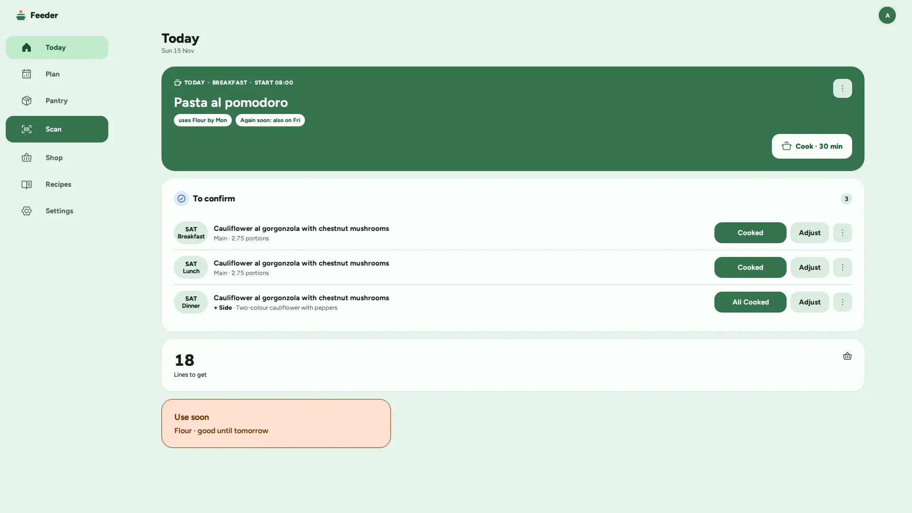 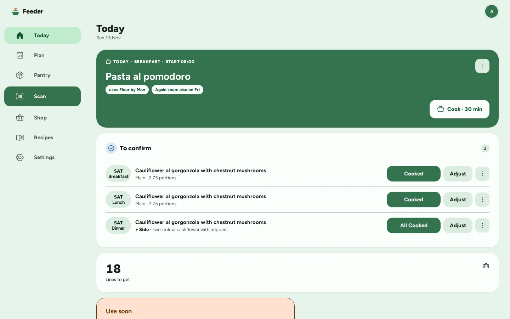

### Design
**Page.** Today uses the `default` width (`--page-default`, 1120 px), per L-01. At 1920 and 2560 the page is centred in the space right of the rail. The distance to the top bar is L-12's and is accepted.

**Grid.** Today has its own grid inside `.today`, which becomes a size container named `today`. Columns come from the container's width, never from the viewport, so the rail can no longer flip them.

| Container width | Columns | Placement |
|---|---|---|
| < 40 rem (phones; tablets in split view) | 1 | Setup → hero → To confirm → Advance Steps → Couldn't plan → Throw out or keep? → Leftovers → Use soon → metric strip |
| 40–60 rem (600–1023 viewports, and 1024 with the rail) | 2 | The hero, To confirm and the metric strip span both columns. The other tiles are half tiles in the order above, with `align-items: start`. |
| ≥ 60 rem (from about 1180 px, so at 1280, 1440, 1920 and 2560) | 3 | Areas `hero hero aside` / `confirm confirm aside`. The aside stacks Advance Steps, then the metric strip. The other tiles follow in rows of three tracks. |

- Each tile is as tall as its own content, so a short tile never stretches to match its neighbour (SHELL-15).
- An odd last half tile keeps its width and starts at the line start. It is not a metric, so system.md's no-orphan rule for metrics does not apply.

**Hero.** Below 35 rem of **hero**, Cook is full width. From 35 rem it is an auto-width `lg` button at the tile's bottom end. This is a container query on `.plan-hero`, as the hero title already uses. One rule replaces the viewport rule, so Cook sits at the end from about 600 px of viewport and never switches sides.

**Metric strip.**

- The icon sits in the value's row (`flex`, `justify-content: space-between`; the value gets `min-inline-size: 0` and an ellipsis), so it can never cover the number.
- On phone and tablet the strip closes the page. On a desktop it lives in the aside as two tiles side by side.
- "Lines to get" becomes a link to `/shop`. The streak stays a non-interactive `div`.

**Rows inside tiles.** Rows in Use soon and Leftovers take the tile's padding instead of adding their own inset, as To confirm rows already do. Their value column shrinks with the row's own width (TB-11), so at the one-third track a one-line meta such as "Good until tomorrow" is never cut.

**Tones.** Advance Steps is an info status tile, per DS 3 (TB-02).

**States.**

- Empty Household: TB-06's checklist.
- Nothing to show: the existing EmptyState above the grid.
- Loading: owned by RES.
- Long names: the hero uses `title-1` from 35 rem with a 2-line clamp; rows follow system.md §3.

**New system.md text, §4.** Add after "The hero, when it spans, spans the full row":

> "Exception, Today from 60 rem of page: the hero and To confirm span two of three tracks, and an aside in the third track stacks Advance Steps and the metric strip. Columns on Today come from the page's container width (40 rem → 2, 60 rem → 3), never from the viewport."

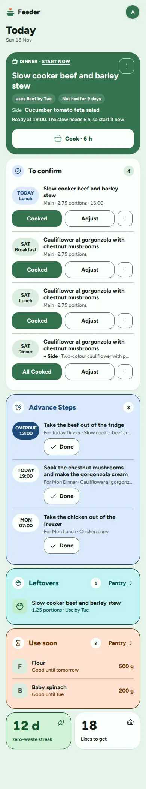 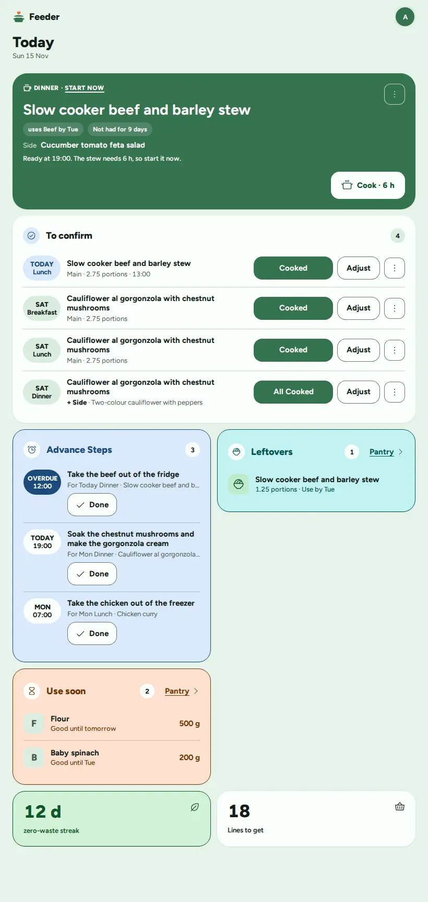 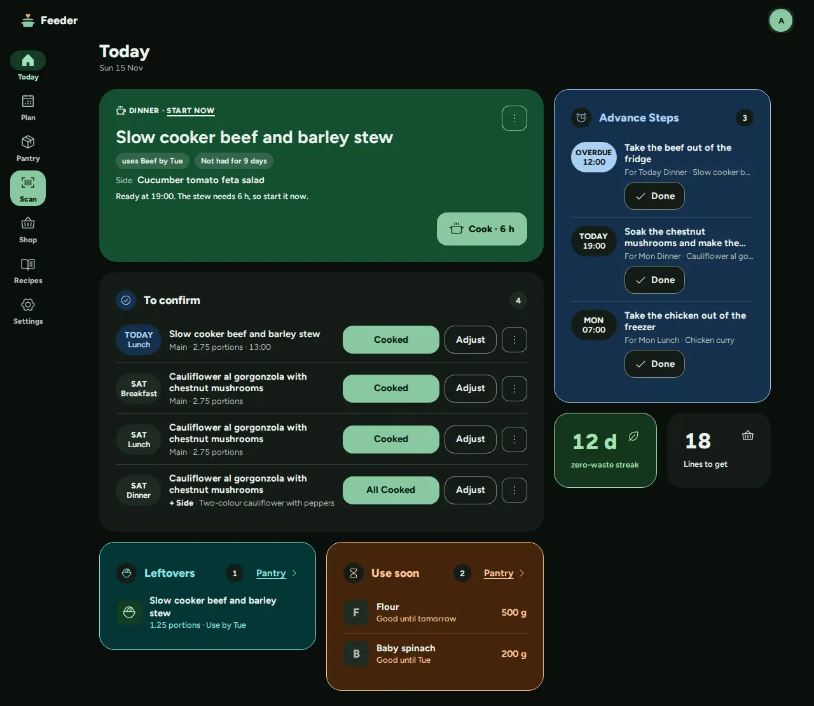  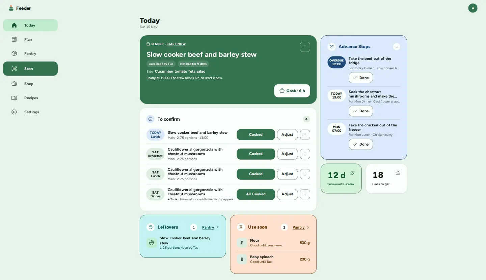
Mock: `mocks/tb-today.html` (resize it; the proposed CSS is in `<style data-proposed>`).

**Accessibility.**

- The grid stays `role="group"`, named "Today".
- DOM order is the reading order at every width. The aside follows To confirm in the DOM, and only CSS `order` moves the metric strip on phone and tablet.
- The only new colour pairs are the info-tone pairs in TB-02.

### Alternatives considered
`BentoGrid min="card"` (20 rem) would give three columns at 1120. But the hero would still be a full-width banner, and the aside could not hold the time-bound tiles beside it. This was Decision 1 option B, which was not taken.

### Build notes
- `app/pageWidths.ts`: change `'/'` to `default`, and mirror it in `scripts/lib/page-layout-rules.mjs`.
- `features/today/components/TodayView.tsx`: render `.today__grid` with an `.today__aside` wrapper instead of `BentoGrid`. Drop the `today__slot` wrappers around tiles that are not shown.
- `features/today/lib/compose.ts`: the new tile order, with `aside: ['advanceSteps', 'metrics']`.
- `features/today/today.css`: the grid and the metric head.
- `features/today/components/MetricStrip.tsx`: put the icon inside `.today-metric__head`; render "Lines to get" as an `<a>` through `Link`.
- `features/plan/plan.css:347`: replace the media query with `@container (min-width: 35rem)`.
- No shared primitive changes, because Today owns its grid. Record this in ADR 0016's consequences with a one-line amendment ADR ("Today composes its own grid by container width").

### Tests and guard
**Vitest**

- `composeToday`: tile order and aside membership.
- `TodayView` renders the aside.
- CSS test: `.today` is a size container, and `plan.css` has no viewport query on `.plan-hero__actions`.

**BDD**

- "Today is three tracks wide on a 1440 screen"
- "The Cook button keeps its side from 600 to 1440"
- "The streak icon never covers its number"

**Guard.** Add three page-layout rules on `/` to the resize-walk scenario (600→1480 px, every 40 px):

1. The Cook button's side never changes after 600.
2. At ≥ 1280, no tile other than the hero is wider than two-thirds of the page.
3. A metric value's text box never intersects its icon.

The ListRow meta truncation rule is in TB-11.

### Depends on / unblocks
- Uses the TB-09 headers and DS's breakpoint table. There is no clash, because Today's grid is container-based.
- SHORT designs Today in phone landscape (844 × 390) with its 64 px compact rail (SHORT 1). Today's grid follows from its container width there too.
- Unblocks the placement in TB-11 and TB-12.

## TB-04  A way out of the Kitchen board

**Severity** S2 · **Size** S · **Sources** SHELL-03 · **Reproduced** Confirmed. At 1280 × 800, `/board` has exactly two controls, `["Cook","Done"]`, and no `h1`. The board is chromeless (`app/chromeless.ts`).
**Where** `/board`, every size

### Problem
A User who opens the board from Your menu, on an installed PWA or a wall tablet, has no control back to the app. Only the system back gesture can leave it, if there is one.

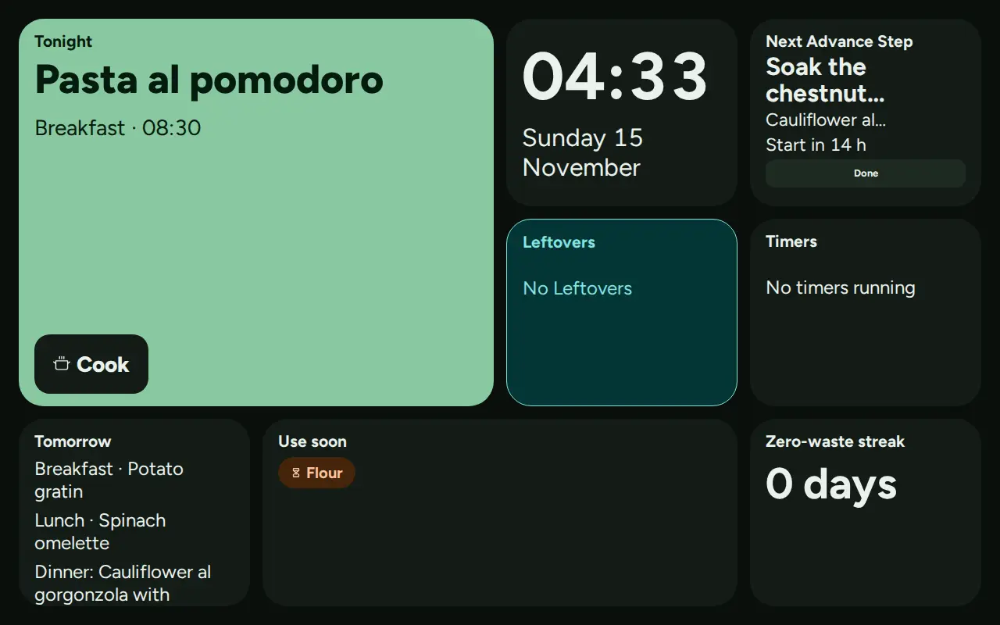

### Design
**Behaviour.**
- A round "Close kitchen board" button (Phosphor `x`) sits in the top-end corner of the clock tile. The date moves to the top of the tile beside it, and the time sits below.
- It is always visible. After 10 s with no pointer, touch or key input it dims to 45 % opacity, and returns to full on any input.
- Activating it goes back one history entry when the board was opened from inside the app (`location.key !== 'default'`); otherwise it goes to `/`.
- `Esc` does the same.
- The board gets a visually hidden `h1`, "Kitchen board".

**Rules.**
- It is R-B's Close at board scale: a circle of max(56 px, 3.5 board units) (TB-07), a transparent fill, a 1 px `--color-outline` boundary and a `--color-text` X at 45 % of the button. It is `flex: none`, so it never stretches or squashes.
- Measured: the icon is 14.02:1 in light and 12.95:1 in dark; the boundary on the tile surface is 4.5:1 in light and 4.9:1 in dark.
- Because the tile clips its overflow, the button sits 5 px inside the tile's padding, so its 5 px focus ring is never cut (R-C).
- Reduced motion: no fade transition; the opacity changes at once.

**Accessibility.**
- It is a real `<a>` (to `/`) when there is no history, otherwise a `<button>`, named "Close kitchen board".
- It is the first focusable element of the board, with a 56 px target.

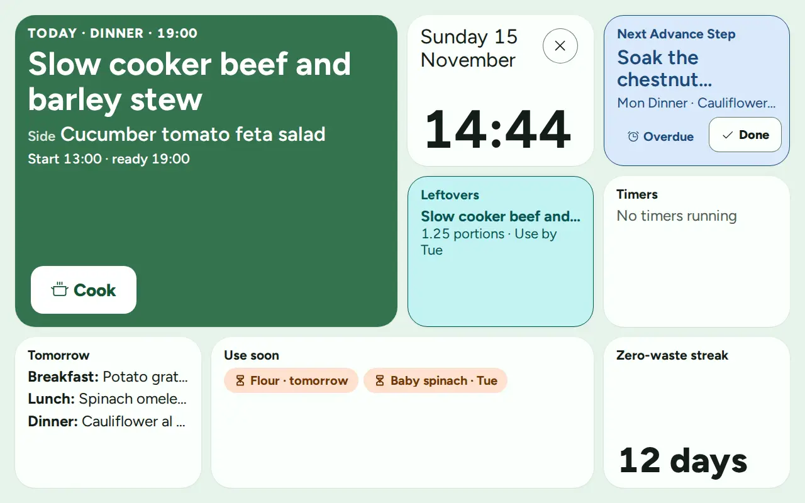 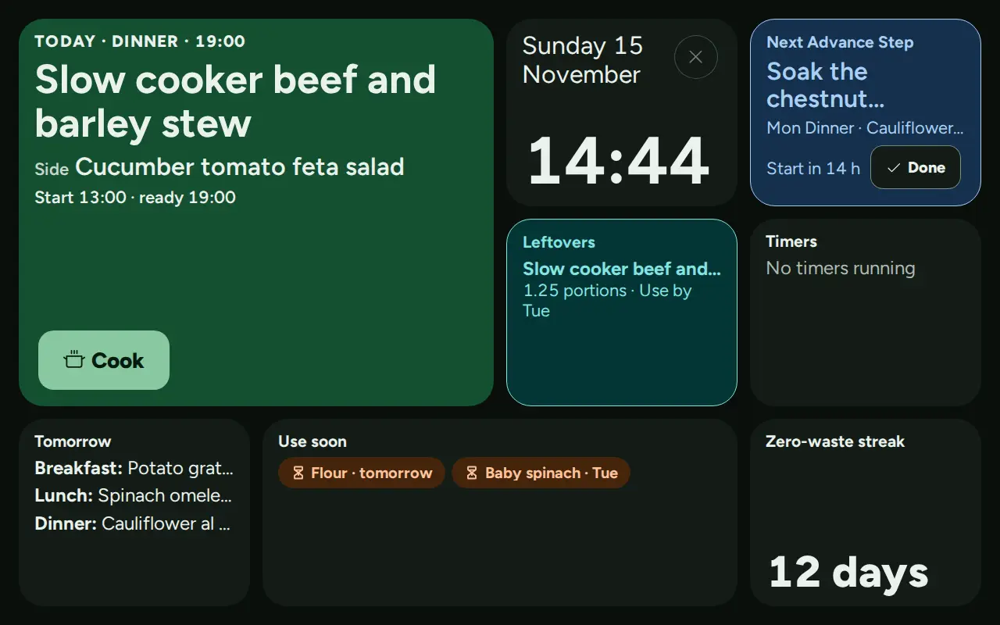
Mocks: `mocks/tb-board.html`, `mocks/tb-board-idle.html`.

### Alternatives considered
- A hidden long-press on the clock (Decision 4, option B): undiscoverable.
- A top bar: it costs 56–72 px of the 800 px wall height.

### Build notes
- `features/board/components/BoardTiles.tsx` `ClockTile`: add the control, using DS's R-B `IconButton` with a board-scale size.
- New `features/board/hooks/useIdle.ts`: 10 s, returns a boolean.
- `features/board/screens/BoardScreen.tsx`: the `h1`, `Esc`, and leaving through `features/board/lib/leave.ts` (pure: `leaveTarget(locationKey)`).
- `features/board/board.css`.
- Icon `x` through `ui/icons`.

### Tests and guard
- **Vitest:**
  - a link or button named "Close kitchen board" exists and is circular with a boundary;
  - `leaveTarget`;
  - `useIdle` with fake timers;
  - `Esc` leaves the board.
- **BDD:**
  - "Close kitchen board returns to where the board was opened";
  - "Opened directly, Close goes to Today".
- **Guard:** a page-layout probe on `/board` checks that there is at least one focusable control besides Cook, that there is an `h1`, and that no control's ring box crosses its tile's clip edge.

### Depends on / unblocks
- TB-07 supplies the board unit.
- DS owns R-B; SHORT owns the board in phone landscape.

## TB-05  The hero's dark rule lives in `ui/Tile` and keys on `data-scheme`

**Severity** S2 · **Size** S · **Sources** SHELL-04 · **Reproduced** Confirmed, wider.
- At night the board's hero is `rgb(137,200,160)` on a page of `rgb(9,15,11)` (`data-scheme="dark"`).
- **New in stage 2:** with the app set to Dark on a device in light mode, **Today's** hero glares in the same way (`rgb(137,200,160)` on `rgb(9,15,11)`).
- The cause: `features/plan/components/TonightHero.css:164–181` selects `:root[data-theme='dark']` and `:root:not([data-theme='light'])` inside `prefers-color-scheme`. Nothing sets `data-theme`; `theme/apply.ts:10` sets `data-scheme`. So the rule follows the operating system, never the app's or the board's scheme.

**Where** `/` hero (app scheme different from the OS scheme), `/board` at night, the sign-in card in dark

### Problem
The brightest object in a dark kitchen is the board's hero. It also contradicts system.md §2 ("in dark mode it is the accent container").

 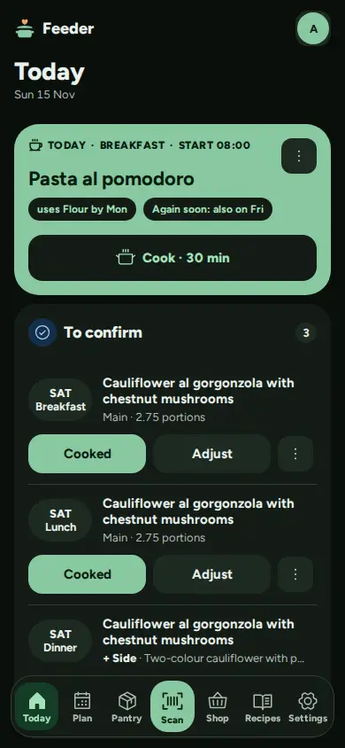

### Design
**Rule in `ui/Tile.css`** (the primitive, so the board hero, Today's hero and the sign-in card all inherit it):

```
:root[data-scheme='dark'] .tile[data-variant='hero'] { background: var(--color-soft-strong); color: var(--color-text); }
:root[data-scheme='dark'] .tile[data-variant='hero'] .button[data-variant='primary'] { background: var(--color-accent); color: var(--color-on-accent); }
.tile[data-variant='hero'] .chip[data-kind='why'] { background: color-mix(in srgb, currentColor 14%, transparent); color: inherit; }
```

- Delete the four `data-theme` blocks in `TonightHero.css` and `.board-tonight { --color-muted: … }` in `board.css`.
- Course captions use `color-mix(currentColor 85%)` so they work on both heroes.
- The board's Cook becomes `variant="primary"`, so the hero rule styles it: on-accent by day, accent solid by night.
- The focus ring inside any hero is `currentColor` (fixing A11Y's SHELL-05 in the same primitive; A11Y owns the ring pattern itself).

Measured:

| Pair | Light | Dark |
|---|---|---|
| Hero text on the hero | 5.73:1 | 8.33:1 |
| Today's Cook label on its fill | 8.75:1 | 17.76:1 |
| The Cook fill against the hero (a UI component) | 5.67:1 | 9.48:1 |

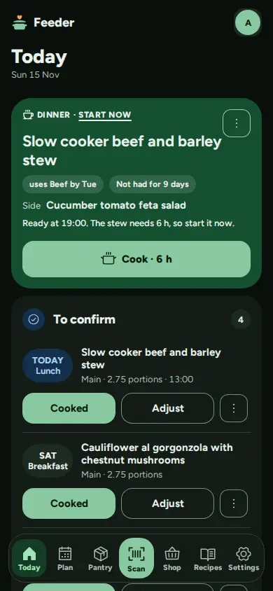 
Mock: `mocks/tb-today.html`, `mocks/tb-board.html` (render with `data-scheme="dark"`).

### Build notes
- Edit `ui/Tile.css`, `features/plan/components/TonightHero.css` and `features/board/board.css`.
- Other screens it touches: the sign-in card (`features/auth`, `variant="hero"`). Check its Google link in dark.
- `theme/contrast.test.ts` gains the hero pairs from `palette.golden.ts`.

### Tests and guard
- Vitest: `Tile.css` contains the `data-scheme='dark'` hero rule; no CSS file in `web/src` contains `data-theme` (a grep test).
- Contrast test for hero text on soft-strong and the Cook fill on soft-strong for every palette, dark.
- BDD: "With the app set to Dark on a light device the hero is the dark accent container"; "The board's hero at night is not brighter than its tiles".
- Guard: `check-ui.sh` rule "no `data-theme` selector".

### Depends on / unblocks
Merge before TB-03, TB-07 and TB-10 (they edit the same hero CSS). A11Y owns SHELL-05's ring.

## TB-06  First run as a flow: steps open the action, time zone and currency confirmed, stays until done

**Severity** S2 · **Size** L · **Sources** FLOW-14 · **Reproduced** Confirmed on an unseeded server (port 18575, browser zone Europe/Rome):
- Today showed "Set up your Household · 0 of 4 steps set up".
- "Add Members" went to `/settings/members` with no sheet open.
- `GET /api/household/settings` returned `timeZone: "UTC"`, `timeZoneConfigured: false` and `currency: "USD"`, against spec §3's "from the browser at first setup".
- `features/today/lib/setup.ts:294` hides the checklist once one Planned Meal exists, which happens right after the first Recipe.

**Where** `/` on a new Household, and the Member, Meal Slot and Recipe entry points; phone first, every size

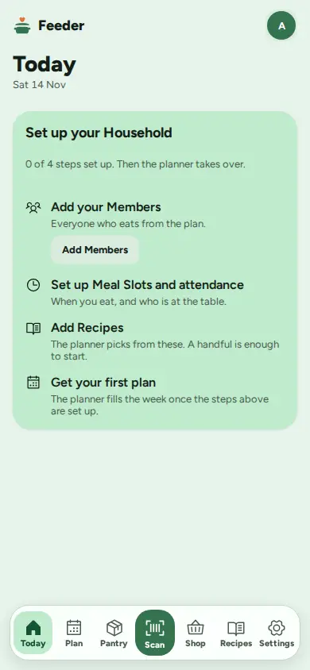 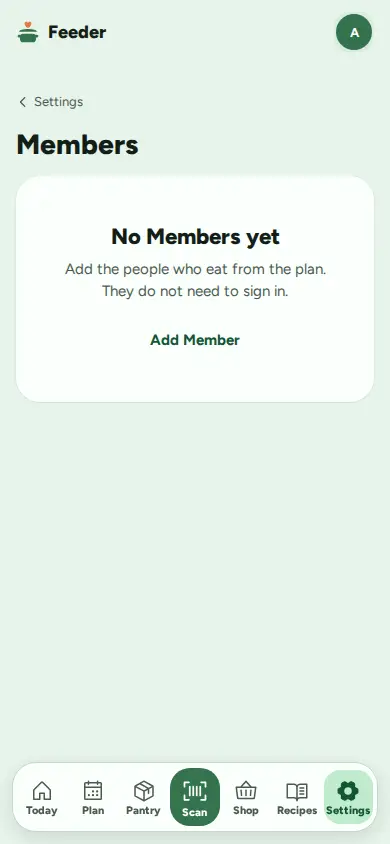 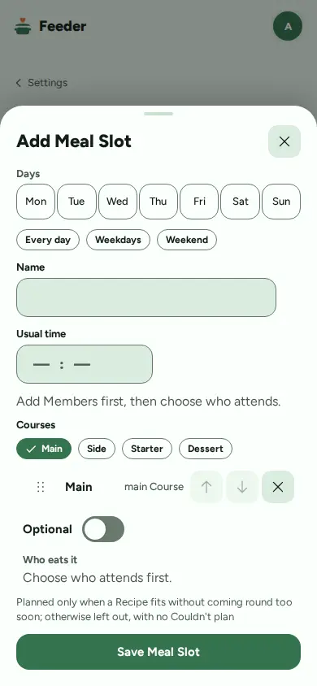

### Problem
The checklist promises a handful of Recipes but vanishes after one. It hands the person off to empty list pages, which costs 33 taps over 8 screens on a phone (FLOW-14). It never asks about the two settings that shift every time and every Price.

### Design
**The tile.** A soft tile, "Set up your Household", with:
- the DS tile header (Phosphor `sparkle`, a round count badge "N of 5");
- a progress bar;
- five numbered steps.

How the steps show:
- **Done steps** show a success tick and a one-line summary.
- **The current step** is expanded and holds the only controls.
- **Later steps** are muted.
- Every control is a real button (R-A).
- A plain User sees "Ask an Admin to do this." on steps 1–3.

**The five steps**, one mock each:

1. **Check time zone and currency.** The detected values are **R-E rows** set directly on the soft tint, separated by a 1 px line at 18 %. Each row has:
   - the key ("Time zone", "Currency") in `body-strong`;
   - the value as the **state** at the row's end ("Europe/Rome", "Euro (€)"), in `body-strong`;
   - the detail, muted `meta` on one line under the key ("From this device · 15:44 now", "From Italy");
   - a secondary **Change** at the end of the detail line, which opens SET's crafted pickers.

   Nothing wraps beside Change.

   **Looks right** (primary) saves both values through `PUT /api/household/settings` with `timeZoneConfigured: true`. Detection:
   - the time zone comes from `Intl.DateTimeFormat().resolvedOptions().timeZone`;
   - the currency comes from the locale's region through `features/today/lib/currencyGuess.ts`, falling back to USD.

   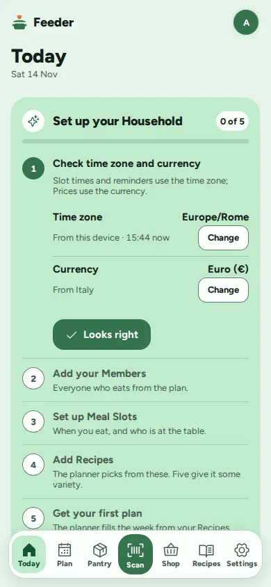 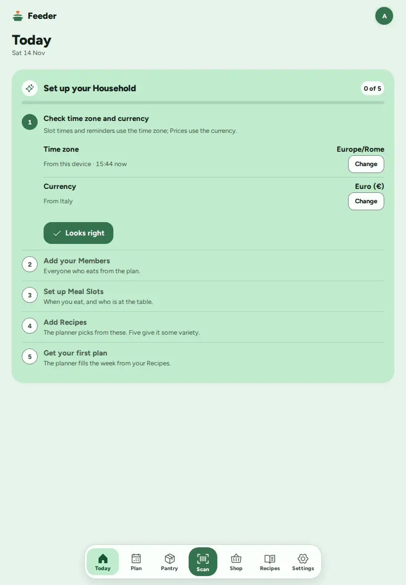 `mocks/tb-06-step1-zone.html`

2. **Add your Members.** **Add a Member** opens the Member sheet over Today, with the caption "Set up · step 2 of 5 · 1 Member so far".
   - The sheet has R-B's Close; its footer has no Cancel.
   - The footer holds **Save and add another** (secondary) and **Save** (primary). Each button sizes to its label and keeps it on one line.
   - Save returns focus to the step, whose summary becomes "3 Members: Anna, Ben, Chiara".

   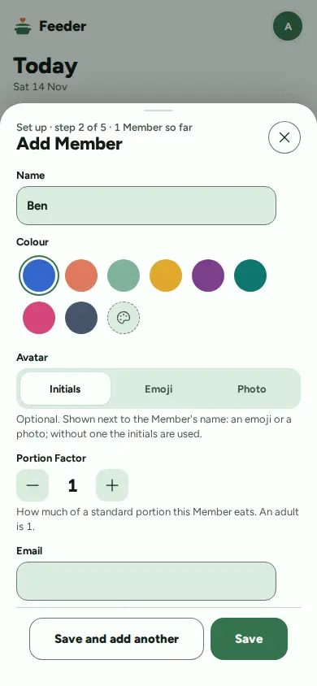 `mocks/tb-06-step2-members.html`

3. **Set up Meal Slots.** The sheet "When do you eat?" (R-B Close).
   - Toggle rows (`role="checkbox"`) for Breakfast 07:30, Lunch 13:00 and Dinner 19:30, each with an outlined time button. Lunch and Dinner are on by default.
   - A secondary **Add another Meal Slot**.
   - "At the table: Anna, Ben, Chiara".
   - Footer: **Set up by hand** (secondary; opens `/settings/meal-slots` with every weekday preselected) and **Create 2 Meal Slots** (primary).

   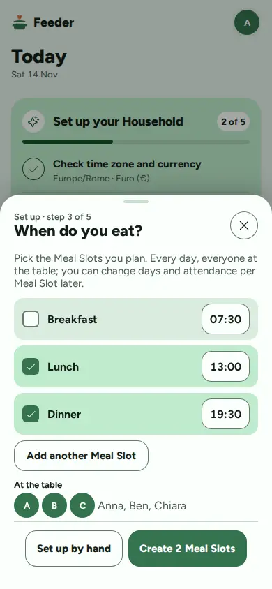 `mocks/tb-06-step3-slots.html`

4. **Add Recipes.** "1 of 5 Recipes" and three outlined 56 px row-buttons:
   - **New Recipe**;
   - **Read a recipe** (`/recipes/import?from=photo`);
   - **Import Recipes** (`/recipes/import?from=file`).

   Then the line "You can see your first plan now; it repeats until you add more." The step is done at 5 Recipes (TB 6).

   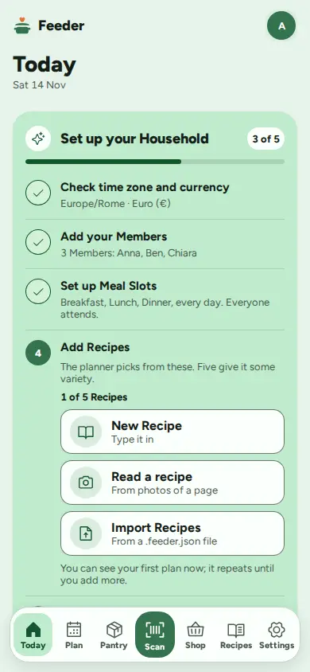 `mocks/tb-06-step4-recipes.html`

5. **Get your first plan.** Done automatically. From then on the checklist is compact and sits after the hero:
   - "Add 4 more Recipes and the planner has more to choose from. 1 of 5 so far.";
   - **Add a Recipe** and **Hide for now**, both secondary.

   Hide for now stores `setupHidden`, and Settings > Household gains "Setup checklist · Show on Today".

   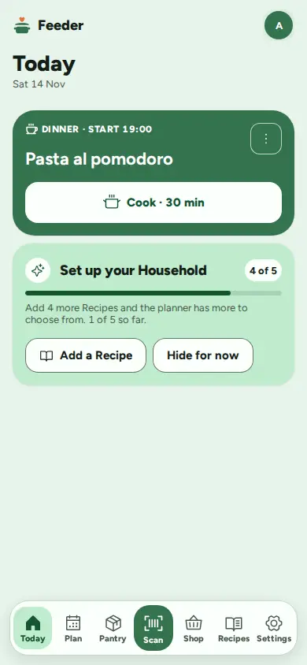 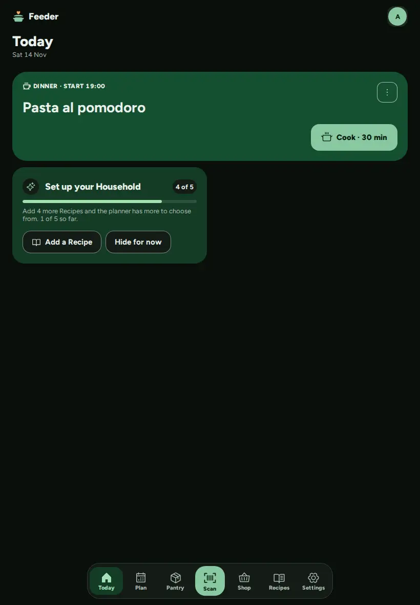 `mocks/tb-06-step5-planned.html`

**Copy.**
- Tile title: "Set up your Household"; count "<n> of 5".
- Step labels: "Check time zone and currency", "Add your Members", "Set up Meal Slots", "Add Recipes", "Get your first plan".
- Fact keys: "Time zone", "Currency". Fact details: "From this device · <time> now", "From <country>".
- Hints:
  - "Slot times and reminders use the time zone; Prices use the currency."
  - "Everyone who eats from the plan."
  - "When you eat, and who is at the table."
  - "The planner picks from these. Five give it some variety."
  - "The planner fills the week from your Recipes."
- Buttons: "Looks right", "Change", "Add a Member", "Save and add another", "Save", "Create <n> Meal Slots", "Set up by hand", "Add another Meal Slot", "New Recipe", "Read a recipe", "Import Recipes", "Add a Recipe", "Hide for now".
- Toast: "Time zone and currency saved."
- Plain User: "Ask an Admin to do this."

**Accessibility.**
- The steps are an `ol` with `aria-current="step"`.
- The facts are a `ul` named "Detected settings". Each Change is named "Change time zone" or "Change currency".
- Sheets return focus to the step's button when they close.
- When a step completes, focus moves to the next step's primary, with a polite "Step 2 of 5 done."
- Contrast (light / dark):

| Pair | Light | Dark |
|---|---|---|
| Progress fill | 6.69:1 | 8.32:1 |
| Muted text | 5.56:1 | 6.20:1 |

### Build notes
- `features/today/lib/setup.ts`: five steps, with the new facts `timeZoneConfigured`, `recipes` and `setupHidden`, plus `visible` and `compact`.
- `SetupChecklistTile.tsx`: split into `SetupStepRow`, `ZoneStep` (the fact rows) and `RecipeWays`.
- `useSetupChecklist.ts`: actions go through `setupSeam.ts` to the settings feature's `MemberSheet` and a new `MealSlotQuickStartSheet` (built with SET).
- `currencyGuess.ts`.
- API:
  - `PUT /api/household/settings` (already exists);
  - new `POST /api/meal-slots/batch`;
  - new `setupHidden` field.
- Spec §3 wording: "proposed from the browser on the first-run checklist and confirmed by the Admin".

### Tests and guard
- **Unit:** `setupChecklist` from 0 to 5, compact, hidden and plain User; `currencyGuess` for it-IT, en-GB, en-US, fr-CH and unknown.
- **Go:** the batch endpoint sets everyone to attend and rejects an empty name.
- **BDD:**
  - "Looks right saves the device time zone and currency"
  - "Add a Member opens the Member sheet on Today"
  - "Create 2 Meal Slots makes Lunch and Dinner every day"
  - "The checklist stays after the first plan until five Recipes"
  - "Hide for now hides it until shown again from Settings"
- **Guard:**
  - on an empty Household, the current step has a control;
  - no step links to a list page;
  - no tile action is tertiary;
  - each fact's detail is one line.

### Depends on / unblocks
- SET owns the pickers and the Meal Slot sheet's defaults.
- SAFE owns the guard on the sheets.
- RX owns Read a recipe and Import.
- DS owns R-A, R-B and R-E in `Button`, `BottomSheet` and `ListRow`.

## TB-07  Kitchen board at wall scale: type, Tomorrow, Done and chips, portrait

**Severity** S3 · **Size** M · **Sources** SHELL-09, SHELL-10 · **Reproduced** Confirmed:
- Tomorrow's last line runs 239 px past its tile at 1024 × 768, and 144 px at 1280 × 800.
- At 2560 × 1440 the Recipe name is still 52 px, the headings 21 px and the lists 24 px, the same as at 1280.
- Done is 256 × 36 px with a 13 px label. The Overdue chip is 89 × 26 px at 12 px.
- At 820 × 1180 (portrait) the 4 × 3 grid makes cells 190 px wide.

**Where** `/board` from 768 to 2560 px, and portrait tablets; both schemes

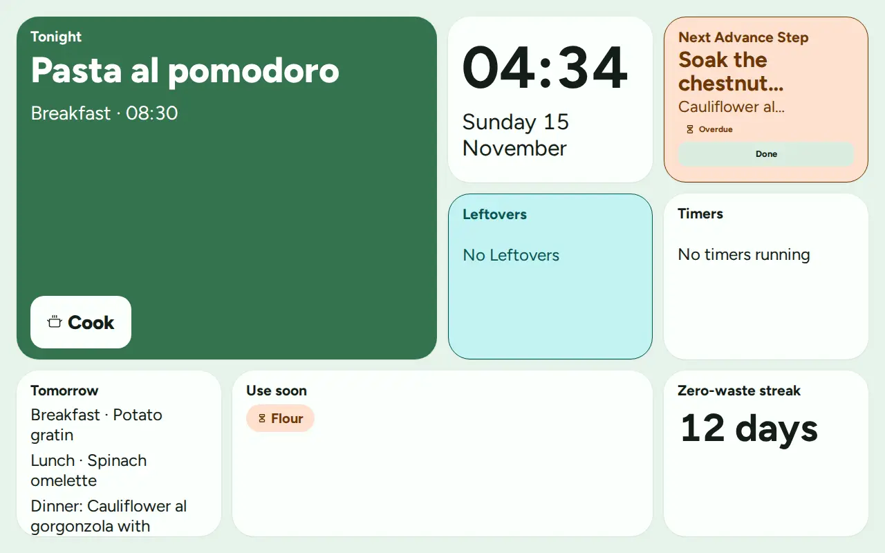 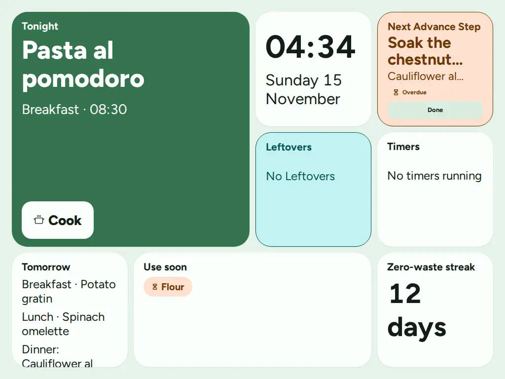 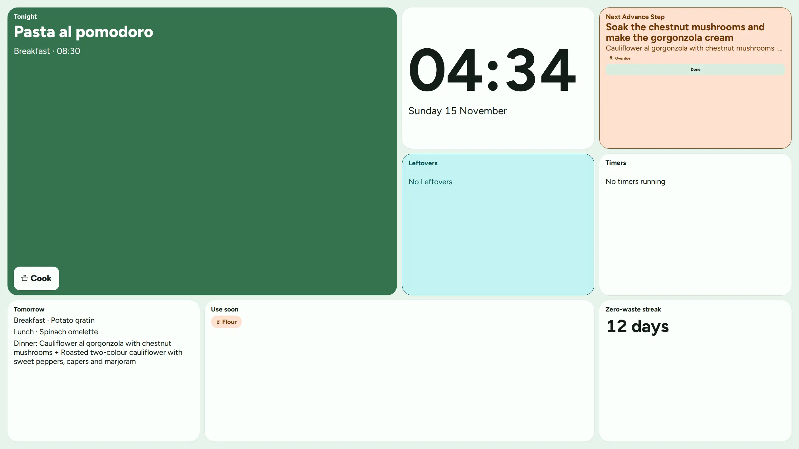

### Problem
The board is read from 2 m (spec §11), yet:
- its type doesn't grow on a big screen;
- its Tomorrow tile is cut mid-word with no ellipsis;
- its Done is a phone-sized control on a wall.

The causes, all in `features/board/board.css`:
- sizes are rem constants;
- heights are fixed (`height: 4.2rem` on `.board-next__text`);
- `.board-next .button` uses the `sm` size;
- the Overdue chip is the 26 px phone chip.

### Design
**One board unit** (new tokens in `styles.css`):

```
--board-unit: clamp(13px, min(1.25vw, 2vh), 36px)    /* landscape */
@media (orientation: portrait) { --board-unit: clamp(13px, min(2vw, 1.25vh), 36px) }
```

What the unit comes to:

| Screen | Unit |
|---|---|
| 1280 × 800 | 16 px (today's sizes, unchanged) |
| 1920 × 1080 | 21.6 px |
| 2560 × 1440 | 28.8 px |
| 1024 × 768 | 13 px (the floor) |
| 820 × 1180 | 14.75 px |

**Board type roles.** These are new tokens, and system.md §1 gets a "Board roles" table:

| Token | Size | Weight | Used for |
|---|---|---|---|
| `--text-board-hero` | 3.25 u | 700 | The hero Recipe name (2 lines, then an ellipsis). Display text is large, not extra-bold. |
| `--text-board-title` | 2 u | 600 | Course rows, the Advance Step text (2 lines), the clock date (regular) |
| `--text-board-body` | 1.5 u | | List rows |
| `--text-board-meta` | 1.375 u | | Meta, the slot line |
| `--text-board-heading` | 1.3125 u | | Tile headings, the hero eyebrow |
| `--text-board-metric` | 3.5 u | | The streak |
| `--text-board-control` | max(20 px, 1.25 u) | | Button and chip labels |
| `--board-control` | max(56 px, 3.5 u) | | Done, the Close control |
| `--board-chip` | max(40 px, 2.5 u) | | Chip height |

- Cook is max(76 px, 4.75 u), at the bottom of the hero.
- The clock keeps its container-query sizing, now also capped by cell height (`55cqh`).
- Every board control sits 5 px inside its tile's padding, because tiles clip their overflow (R-C).

**The tiles.**
- **Next Advance Step** is always an **info status tile** (DS 3), whether the Step is upcoming or overdue.
  - It shows the Step text (2 lines), then "Mon Dinner · Cauliflower …" (1 line).
  - A foot row holds the due state and **Done**: a secondary `lg` button at `--board-control`, with a surface fill and an outline (R-A).
  - The due state is either "Start in 14 h" or the **"Overdue" chip**: an info status chip (`kind="status" status="info"`, Phosphor `alarm`) at `--board-chip`.
  - Below 16 rem of cell (1024 × 768), the Recipe line gives way.
  - Overdue is told by the chip's word, not by a warning colour. This follows the coordinator's instruction, because the DS chapter's revised overdue text was not yet in `ds.md`.
- **Tomorrow:** one line per Meal Slot, Meal Slot in bold, in spec §7.5's form: "Dinner: Cauliflower al gorgonzola + Roasted two-colour cauliflower". Each line ends in an ellipsis, with the full text in `title`.
- **Leftovers:** the name (bold, 1 line) over "1.25 portions · Use by Tue".
- **Use soon:** spoil chips with the day: "Flour · tomorrow".
- Nothing spills, clips mid-line or scrolls.

**Portrait tablets** (portrait orientation, width ≥ 600 px): two columns and five rows, filling one screen. The rows are `2fr 1.3fr 1fr 0.7fr 1fr`:

| Row | Cells |
|---|---|
| 1 | Hero (full row) |
| 2 | Clock, Next Advance Step |
| 3 | Leftovers, Timers |
| 4 | Use soon (full row) |
| 5 | Tomorrow, streak |

**Timers** stay as they are now; PC designs their content (FLOW-06).

**Accessibility.**
- Every tile is a `section` named by its heading.
- Done is named "Done: <Step text>".
- Every target is at least 56 px.
- Measured: Next Advance Step's text and the Overdue chip are 7.37:1 (light) and 8.37:1 (dark); Done's boundary on the info tile is 3.7:1 (light) and 3.8:1 (dark).

 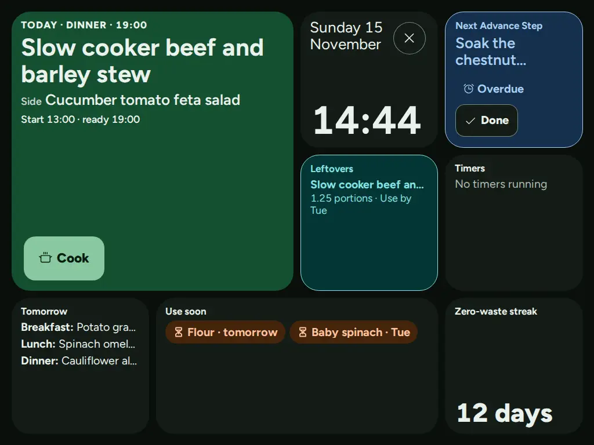 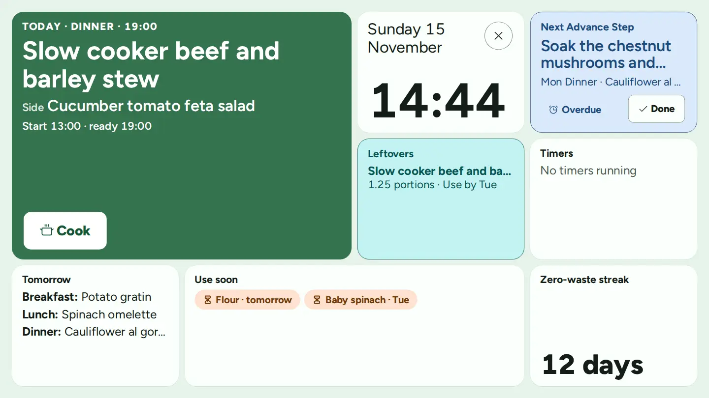 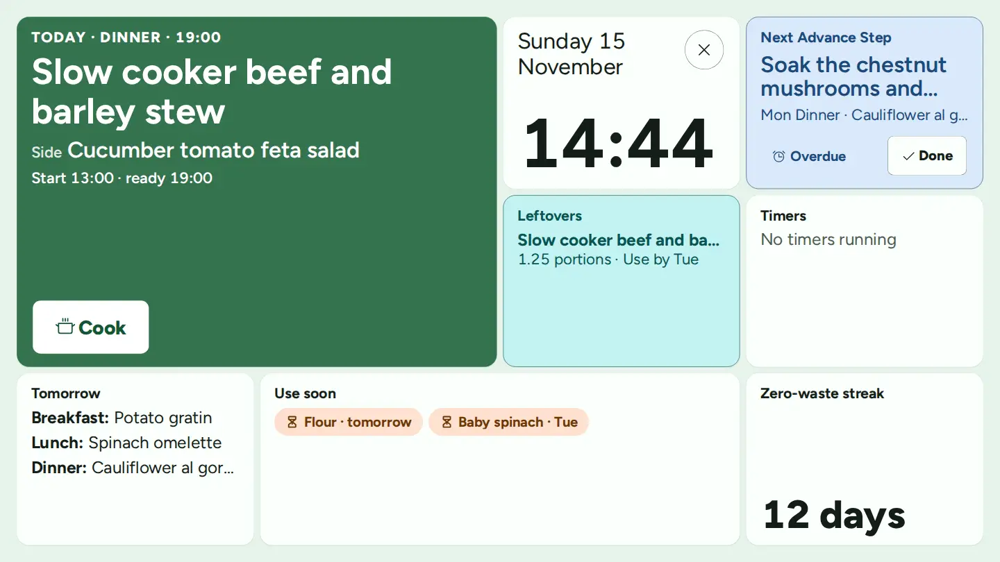 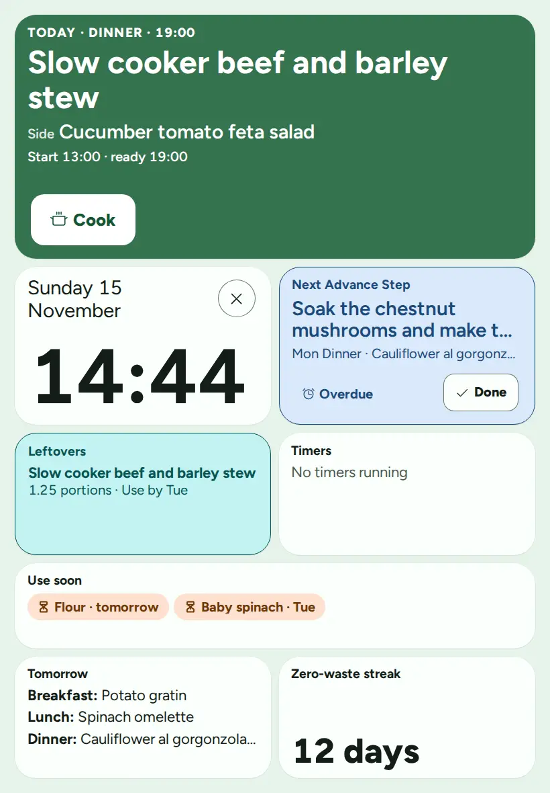
Mock: `mocks/tb-board.html` (resize it). The idle state is `mocks/tb-board-idle.html`.

### Build notes
- `web/src/styles.css`: add the board tokens in a token block.
- `features/board/board.css`:
  - rewrite it with the tokens;
  - remove the fixed heights and the `scripts/check-ui` exemptions;
  - add the 5 px control inset.
- `features/board/lib/layout.ts`: use grid areas, and add a third layout, `portrait`.
- `BoardScreen.tsx`: choose `wall | portrait | phone` with `useMediaQuery`. SHORT plugs the short-landscape rule into the same switch.
- `BoardTiles.tsx`:
  - `NextAdvanceTile` is `variant="status" status="info"` in every state, and its Overdue chip is `status="info"` (DS-C owns this file's tone change; coordinate with them);
  - Done becomes `lg`;
  - Tomorrow lines use `strong` plus `title`.
- `features/board/lib/tiles.ts` `tomorrowLine`: one format.

### Tests and guard
**Vitest**
- `boardLayout('portrait')` has 8 cells and none overlap.
- `tomorrowLine` covers one Course, several Courses, Not served and Not planned.
- `NextAdvanceTile` is info in both states.
- `board.css` uses only `--text-board-*` sizes.

**BDD**
- "Tomorrow never runs past its tile"
- "Done is at least 56 px on the board"
- "The board fills a portrait tablet without scrolling"
- "An overdue Advance Step on the board is info, with an Overdue chip"

**Guard**
- P13 clipping on `/board` at 1024 × 768, 1280 × 800, 820 × 1180 and 2560 × 1440, with the long-name seed.
- `.board-screen button` is at least 56 px, and its ring box stays inside its tile.

### Depends on / unblocks
- Depends on TB-05, DS 3, and DS's R-A `Button`.
- SHORT owns the board at 844 × 390; PC owns the Timers content.

## TB-08  One vocabulary on Today and the board

**Severity** S3 · **Size** S · **Sources** SHELL-11 · **Reproduced** Confirmed (board at Sun 04:33):
- The hero heading reads "Tonight" above "Pasta al pomodoro · Breakfast · 08:30".
- Tomorrow mixes "Breakfast · Potato gratin" with "Dinner: Cauliflower …".
- The Leftover line says "use by Tue" (`BoardTiles.tsx:136`).
- The board shows "0 days", while Today hides the streak at 0 (`features/today/lib/metrics.ts:33`).

**Where** `/board`, `/`

### Problem
The same household facts read differently on the wall and on the phone. "Tonight" over a breakfast is simply wrong.


### Design

| Fact | Today | Board (after) |
|---|---|---|
| Hero heading | eyebrow "DINNER · START 18:15". A today slot needs no day word, because the page is Today; "TOMORROW · BREAKFAST" for tomorrow. | The same eyebrow parts at board scale, with the day word (the board has no page title): "TODAY · DINNER · 19:00". The start time is on the line under the Courses: "Start 13:00 · ready 19:00". |
| Tomorrow | n/a | "Breakfast: Potato gratin", and "Dinner: X + Y" for every Meal Slot (spec §7.5) |
| Leftover meta | "1.25 portions · Use by Tue" | the same string |
| Use soon | "Good until tomorrow" | the chip "Flour · tomorrow". Its accessible name is the full "Flour, good until tomorrow". |
| Streak | hidden at 0; from 1 day, "12 d" (accessible name "12 days") | "0 days", "1 day", "12 days" (TB 3) |
| Tile names | "Leftovers", "Use soon", "Advance Steps" | "Leftovers", "Use soon", "Next Advance Step" |

The board's hero follows TB-01's selection, and both eyebrows come from one function.

### Build notes
- `features/board/strings.ts`: delete `tonight`; add `useBy`.
- `BoardTiles.tsx`: build the eyebrow from `heroEyebrow(sel, now, {onToday: false})` through the board's plan seam.
- `features/board/lib/tiles.ts`: `tomorrowLine` and `leftoverLine`.
- `features/today/lib/streak.ts`: show days only ("12 d").
- No API change.

### Tests and guard
- **Vitest:**
  - the board's eyebrow equals Today's, plus the day word;
  - `leftoverLine` matches Today's meta;
  - `streakMetric(12).value === '12 d'`.
- **BDD:** "At breakfast time the board says Breakfast, not Tonight".
- **Guard:** `features/board/strings.ts` contains no "Tonight" and no lowercase "use by".

### Depends on / unblocks
Depends on TB-01 and TB-07.

## TB-09  One tile header on Today

**Severity** S3 · **Size** S · **Sources** SHELL-16 · **Reproduced** Confirmed. Today's tiles use five headers in four styles:
- `nextMeal`: `P.tile__overline`;
- `toConfirm`: `H2.to-confirm__heading` with a badge and a count;
- `advanceSteps`: a bare `H2.today__tile-title`;
- `leftovers`: the overline "LEFTOVERS" **and** the H2 "Leftovers to use";
- `useSoon`: a bare H2 in the tile's tone.

The other half of SHELL-16, Done on Today, is designed in TB-02.

**Where** `/`, every size

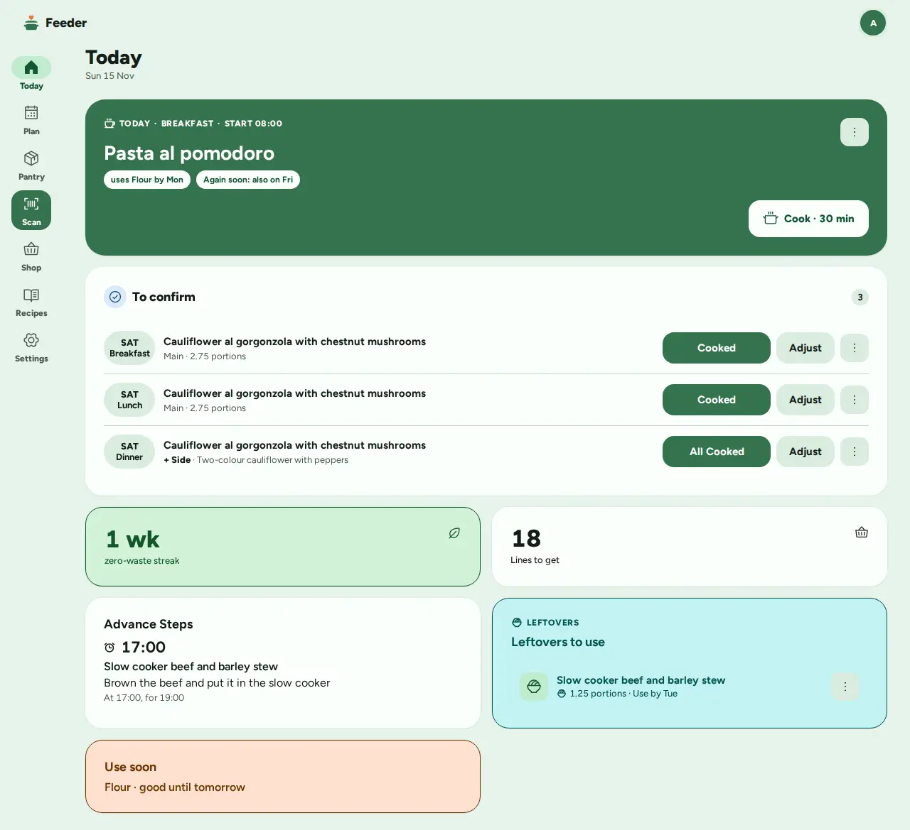

### Design
Every Today tile except the hero uses DS's `TileHeader`, as follows:

| Tile | Tile tone | Badge (icon, tone) | Title | Count | Trailing link |
|---|---|---|---|---|---|
| To confirm | surface | `check-circle`, info | To confirm | slots | none |
| Advance Steps | **info** (DS 3) | `alarm`, info on surface | Advance Steps | rows | none |
| Leftovers | leftover | `bowl-food`, leftover | Leftovers | Leftovers | "Pantry ›" → `/pantry?leftovers=1` |
| Use soon | spoil | `hourglass`, spoil | Use soon | Ingredients | "Pantry ›" → `/pantry?status=useSoon` |
| Throw out or keep? | danger | `trash`, danger | Throw out or keep? | Lots | "Pantry ›" → `/pantry?status=spoiled` |
| Couldn't plan | by cause (DS warn or info) | DS cause icon | Couldn't plan | causes | none |
| Set up your Household | soft | `sparkle`, neutral on soft | Set up your Household | "n of 5" | none |
| Shopping at Coop (TB-12) | soft | `basket`, neutral on soft | Shopping at Coop | none | none |

- **Title:** `title-3` (18/22, 800), on one line with an ellipsis.
- **Count:** a neutral pill with tabular numerals.
- **Badge:** 2 rem. On a status tile its fill is `--color-surface`, with the icon in the tile's tone.
- **Trailing link:** it navigates rather than acts, so it **stays a link and reads as one** (allowed by R-A):
  - underlined text (1 px, 3 px offset, 2 px on hover) and a `caret-right`;
  - a 44 px target;
  - no button fill.
- **Icon buttons** inside any tile, such as To confirm's ⋮, have a surface fill and a 1 px outline (R-A). The hero's ⋮ uses a boundary in the hero's own text colour (5.7:1 light, 8.3:1 dark).
- The overline "LEFTOVERS" and the title "Leftovers to use" are dropped.

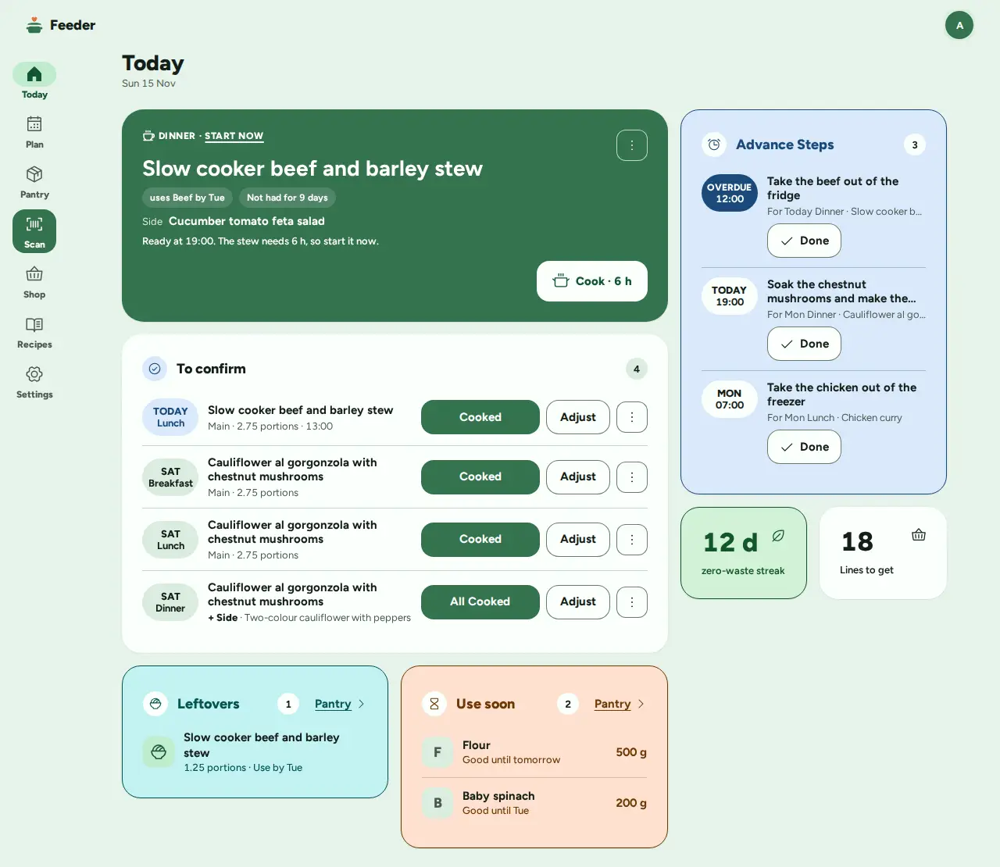
Mock: `mocks/tb-today.html`.

**Accessibility.**
- The title is the `h2` that names the tile's `section` (`aria-labelledby`).
- The count's accessible name is "<n> items".
- The link's name includes its target, e.g. "Pantry, Use soon".
- Measured:

| Pair | Light | Dark |
|---|---|---|
| Link on Leftovers | 7.34:1 | 9.07:1 |
| Link on Use soon | 7.68:1 | 8.90:1 |
| Advance Steps title | 7.37:1 | 8.37:1 |

### Build notes
- Use `ui/TileHeader` (DS) in `features/today/components/{AdvanceStepsTile,UseSoonTile}.tsx`, `features/plan/components/{ToConfirmTile,LeftoversTile,CouldntPlanNotice}.tsx` and `features/stock/components/SpoiledTile.tsx`.
- Remove `.today__tile-title` and `.to-confirm__head/__badge/__heading/__count`.
- Plan's Leftovers section and the Pantry's Throw out or keep? share these tiles, so they change too.

### Tests and guard
- **Vitest:**
  - each tile's title names its section;
  - the Advance Steps badge tone is info;
  - the header link is an `a` with an underline.
- **Guard:**
  - every `.today__grid > * > .tile` except the hero has exactly one `.tile-header`;
  - no tile contains a `.button[data-variant="tertiary"]`.

### Depends on / unblocks
- Depends on DS's `TileHeader`, DS 3, and R-A.
- Unblocks TB-11.

## TB-10  The hero's name, Course names and why chips open the Planned Meal sheet

**Severity** S3 · **Size** S · **Sources** SHELL-13 · **Reproduced** Confirmed. The chips are `SPAN`s, not focusable; the Recipe name is an `H2` with no action. `SingleHero` (`features/plan/components/TonightHero.tsx:72`) ignores `rowHandlers`, which only `SeveralCoursesHero` (`:139`, wired at `:219`) uses. The hero ⋮ has only Who's eating / Time today / Not served.
**Where** `/` hero, every size


### Problem
system.md §6 says "A why chip's press opens its sheet". On the hero, the planner's reasons and the Planned Meal sheet (Swap, Pin, Mark as Cooked) are unreachable, and at 320 the chip text is cut with no way to read the rest.

### Design
**Behaviour.**
- The hero's Recipe name is a button (it keeps its `h2` wrapper) that opens the Planned Meal sheet for the main Course.
- Each Course name opens its Course's sheet.
- Each why chip is a `button` that opens the same sheet, scrolled to its "Why this Recipe" section, with that reason highlighted for 2 s.
- The chips are `chip` 26 px. The touch target is extended to 44 px with an `::after` overlay (inset −9 px block) that doesn't overlap the name above.
- The ⋮ "Dinner actions" menu gains, before the per-date items: **Swap**, **Pin** / **Unpin**, **Open Recipe** (PC owns Open Recipe on the sheet, FLOW-13; the menu calls the same action), then the existing Who's eating, Time today, Not served, Mark all Cooked, Not cooked: whole slot.

**Copy.** Menu items "Swap", "Pin", "Unpin", "Open Recipe". Chip accessible name "Why: uses Beef by Tue. Open the Planned Meal".

**Accessibility.**
- Tab order: ⋮, name, chips (left to right), Course names, Cook.
- On sheet close, focus returns to the control that opened it.
- Hover underline on names; focus ring `currentColor` (TB-05).

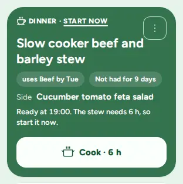
Mock: `mocks/tb-today.html`.

### Build notes
- `features/plan/components/TonightHero.tsx`: `SingleHero` takes `rowHandlers`; the name, chips and Courses become buttons.
- `features/plan/components/TonightHero.css`: the button reset, `::after` target.
- `ui/Chip.tsx`: allow `as="button"` (DS confirms; Plan's day tiles use the same).
- `TodayScreen.tsx` already passes `rowHandlers`.
- The menu items come from `features/plan/lib/heroMenu.ts` (new, pure).

### Tests and guard
- Vitest: a chip press calls `onOpen` with the main Course key; the menu lists Swap and Pin for a single-Course hero.
- BDD: "Tapping a why chip on the hero opens the Planned Meal sheet at Why this Recipe".
- Guard: the A11Y target rule (chips ≥ 24 px, hit area ≥ 44 px on coarse pointers).

### Depends on / unblocks
- TB-05 first (same CSS file).
- PC's Planned Meal sheet (FLOW-13).
- A11Y's target sizes.

## TB-11  Use soon and Leftovers lead somewhere

**Severity** S3 · **Size** S · **Sources** FLOW-26 · **Reproduced** Confirmed, and wider than reported:
- The Use soon tile contains no link or button (`useSoonLinks: 0`).
- The Leftovers tile's whole surface opens `/plan`: it is a `tile__stretch` named "Leftovers to use" (`TodayScreen.tsx:136`, `onOpen={openPlan}`). Its row also has a ⋮.
- **New in stage 2:** the Leftovers tile puts its `li.list-row` directly inside an `article`, with no `ul`. That is invalid list markup, and screen readers announce no list.

The "Use one lives only under Settings" half of FLOW-26 is about Supplies and belongs to SSP.

**Where** `/` (and the same tiles on Plan), every size

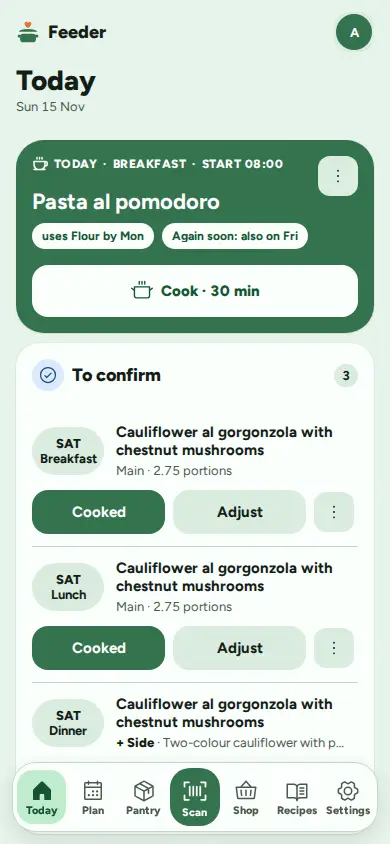

### Design
**Use soon.** A spoil status tile with the TB-09 header and its "Pantry ›" link.
- Rows are `ListRow`s inside a `ul`. Each row has:
  - a monogram or Picture;
  - the Ingredient name;
  - the meta "Good until tomorrow" in the spoil tone (spec §6.1 wording);
  - the value "500 g", the total quantity that is good until soon.
- Pressing anywhere on a row opens the Pantry's existing `LotSheet` (Use some, Throw out, Move, Edit) over Today, for the Lot that goes off soonest. It goes through the stock seam.
- The tile shows at most 3 rows. Beyond that, "+2 more" is a tertiary button to `/pantry?status=useSoon`.

**Leftovers.**
- The header link "Pantry ›" goes to `/pantry?leftovers=1`.
- Each row is a `ListRow`. Pressing anywhere on it opens the Leftover's action sheet (Had it, Threw it out, Freeze it). The sheet's 0 × 0 targets are DS's to fix (FLOW-02).
- The ⋮ and the tile-wide stretch to `/plan` are removed.

**Rows inside a tile.** These rules keep the one-line meta whole. In the reproduction, the desktop mock cut "Good until tomorrow" to "Good until tom…".
- A `ListRow` inside a tile takes the tile's padding instead of adding its own inset: `padding-inline: 0`, as To confirm rows already do.
- The value column's minimum follows the **row's own width**: under 20 rem of row it is `--row-value-narrow` (4.25 rem). System.md §3 already uses that value below 600 px of viewport; this applies it by container (`@container (max-width: 20rem)` on `.list-row__value`).
- In the 1/3 desktop track (a 287 px row) this gives the text column 155 px instead of 123 px, so "Good until tomorrow" fits on its line.

Add this rule text to system.md §3, under "The value column":
> "Inside a row narrower than 20 rem (a tile in a narrow track), the minimum is `--row-value-narrow`, whatever the viewport. A row inside a tile has no inline padding of its own."

**Copy.** The Use soon row's accessible name is "Flour, 500 g, good until tomorrow". The Leftover row's is "Slow cooker beef and barley stew, 1.25 portions, Use by Tue. Had it, Threw it out or Freeze it".

**Accessibility.** Lists are real `ul`s and rows are 64 px. When an action removes a row, focus follows A11Y's pattern. The meta measures 7.68:1 in light and 8.90:1 in dark.

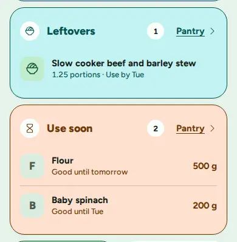 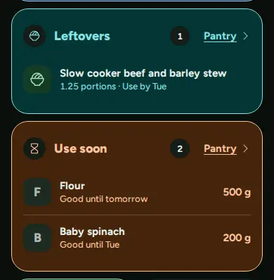 
Mock: `mocks/tb-today.html`.

### Build notes
- `features/today/components/UseSoonTile.tsx`: render rows. `features/today/lib/useSoon.ts`: add `quantity` and `soonestLotId`.
- `features/plan/components/LeftoversTile.tsx`: wrap rows in a `ul`, make the whole row the target, and remove the stretch.
- `features/today/seams.ts`: expose the stock `LotSheet`.
- `ui/ListRow.css`: add the narrow-row value rule. This is a shared primitive. It also helps Pantry and Shop rows placed in narrow tiles, and does not change rows wider than 20 rem. Coordinate with DS (DS-A).
- The Pantry needs a `lot=<id>` parameter that opens a Lot's sheet on arrival; TB-14 uses it too. Add it in `features/stock/hooks/usePantryFilters.ts` and `StockScreen.tsx`.

### Tests and guard
- **Vitest:**
  - pressing a row opens `LotSheet` with the soonest Lot;
  - the header links go to the right targets;
  - the Leftovers tile has a `ul`;
  - `ListRow.css` has the narrow-row rule.
- **BDD:**
  - "Tapping Flour in Use soon opens its Lot";
  - "Pantry › on Leftovers opens the Pantry filtered to Leftovers";
  - "Use soon's meta is not cut on a desktop".
- **Guard:**
  - an HTML-validity probe in page-layout: no `li` outside a `ul` or `ol`;
  - a page-layout rule on `/` at 1280 and 1440: a ListRow meta of 20 characters or fewer is never truncated (`scrollWidth <= clientWidth`).

### Depends on / unblocks
- Depends on TB-09 and on DS's fix for the Leftover sheet (FLOW-02).
- SSP owns the Pantry filter UI.

## TB-12  The Scan session on Today

**Severity** S3 · **Size** S · **Sources** SHELL-20 · **Reproduced** Confirmed. On `/scan` I picked Coop (Shop mode), then tapped Today. Today showed its tiles, never the Shopping List.
- `useScanSessionActive` (`features/scan/hooks/useScanSessionActive.ts`) counts a session only while `ScanSession` is mounted.
- So `composeToday`'s first line (`features/today/lib/compose.ts:11`) can never fire.

**Where** `/` on a phone during shopping


### Design
**Decided (TB 5, B): a persisted session, shown as a resume tile.**

**When a session is active.** All three hold:
- this phone's persisted Scanned list (`features/scan/lib/sessionStore.ts`, IndexedDB record `scan-session`) belongs to today's household day;
- it has at least one entry;
- its last Scan is less than **60 min** old.

**What Today shows.** While a session is active, a full-row soft tile comes first:
- Header: "Shopping at Coop" (TB-09, `basket`).
- Meta: "7 scanned · 11 Lines to get · last Scan 4 min ago".
- **Back to Scan** (primary) opens `/scan` on that Shop.
- **Done shopping** (secondary, with a surface fill and an outline, per R-A) ends the session by clearing the record's "active" flag. It keeps the entries, so the Scanned list survives.

On a desktop the tile spans all three tracks above the hero.

**Options not taken.**
- **A:** Today becomes the Shopping List, with secondary Show Today and Done shopping buttons. Mock: `mocks/tb-12-a-switch.html`, 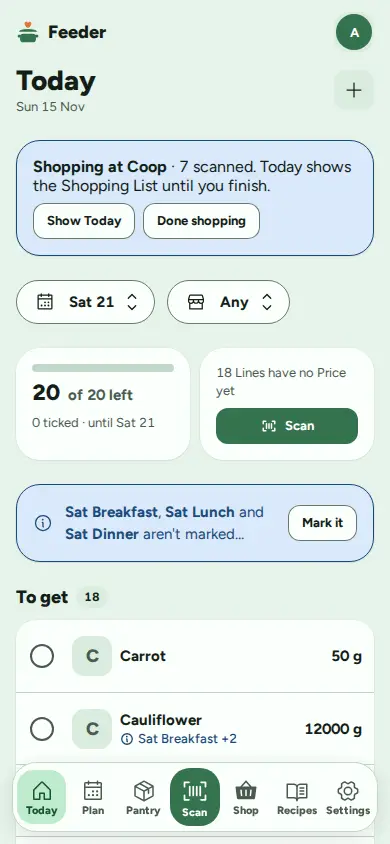.
- **C:** remove the branch.

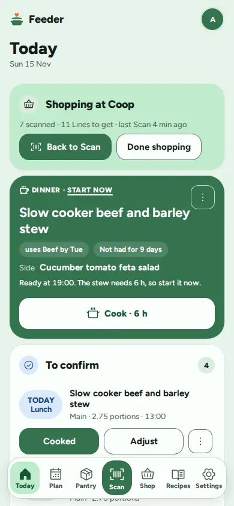 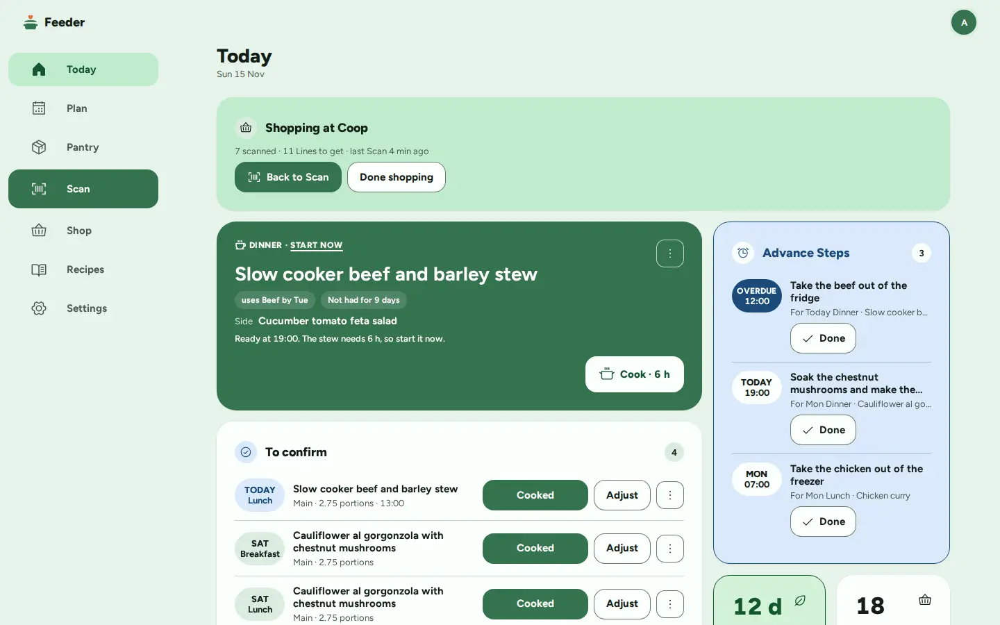
Mock: `mocks/tb-12-b-resume.html`.

**New ux-brief text:**
> "Home = Today, context-aware: next meal, Advance Steps due, Leftovers to use, Cooked to confirm. While a Scan session is active on this phone, Today leads with a Shopping tile that returns to Scan."

**Accessibility.** The tile is a `section` named "Shopping at Coop". The relative time updates each minute without being announced.

### Build notes
- `features/scan/lib/sessionStore.ts`:
  - add `lastScanAt` and `ended` to the record;
  - add a `useScanSession()` hook that returns `{shopName, scanned, lastScanAt} | null`.
- `features/today/lib/compose.ts`: replace `mode: 'shopping'` with a `shopping` tile id.
- `features/today/seams.ts`: drop `ShoppingListSeam` and add the session seam.
- New `features/today/components/ShoppingSessionTile.tsx`.
- Lines to get comes from the existing Shop seam.

### Tests and guard
- **Vitest:**
  - active at 59 min;
  - inactive at 61 min, on another day, with no entries, and after Done shopping;
  - `composeToday` puts `shopping` first;
  - Done shopping is a secondary button.
- **BDD:**
  - "After scanning at Coop, Today offers Back to Scan";
  - "Done shopping removes the tile but keeps the Scanned list".

### Depends on / unblocks
- SSP owns Scan and the Scanned list; coordinate the record change with them.
- Depends on TB-03's grid and DS's R-A `Button`.

## TB-13  The current nav item on sub-pages

**Severity** S3 · **Size** XS · **Sources** RECIPES-18 · **Reproduced** Confirmed. On `/recipes/1` at 390 and 1440, no bottom-bar or rail link has `aria-current`. The accent Scan is then the only filled item. The cause is `app/navCurrent.ts:6`: `OWNS_SUBPAGES = new Set(['plan','settings'])`, so Recipes, Pantry and Scan match only their exact path.
**Where** `/recipes/:id`, `/recipes/:id/edit`, `/recipes/new|import|export`, `/scan/*` (non-chromeless), every size

 

### Design
- Every primary destination except Today (`/`) owns its sub-paths.
- A page whose breadcrumb trail starts at a destination makes it current; this already exists for the Catalogue under Settings.
- The current item looks as it does on its own root: filled pill, `fill` icon weight, `aria-current="page"`.
- Today is current only on `/` exactly.

 
Mock: `mocks/tb-13-nav-current.html` (no new CSS).

### Build notes
`app/navCurrent.ts`: replace `OWNS_SUBPAGES` with `item.path !== '/' && (path.startsWith(item.path + '/') || crumbsFor(path)[0]?.to === item.path)`. No other file changes.

### Tests and guard
- `app/navCurrent.test.ts`: Recipes is current on `/recipes/1/edit`; Today is not current on `/recipes`; Settings is current on `/ingredients/3`; Scan is not current on `/shop`.
- Guard: a page-layout rule that on every routed, non-chromeless page exactly one nav link per nav has `aria-current="page"`.

### Depends on / unblocks
None. A11Y owns the selected-state look.

## TB-14  Where each notification lands

**Severity** S3 · **Size** M · **Sources** FLOW-28 · **Reproduced** Confirmed from code (a push cannot be delivered headless).

Where each notification lands today, in `internal/notify`:

| Notification | Lands on now | Set in |
|---|---|---|
| Advance Step | `/plan` | `compute.go:56` |
| Confirm Cooked | `/plan` | `compute.go:74` |
| Leftover Use-by | `/plan` | `compute.go:88` |
| Start cooking | `/plan` | `compute.go:194` |
| Stock about to spoil | `/pantry` | `compute.go:16` |
| Timer finished | `/board` | `dispatcher.go:77` |

Spec §12 says Confirm Cooked "opens that slot".

**New in stage 2 (from code):** `web/src/features/notifications/sw/push.ts:98–105` focuses `windows[0]`, whatever it shows, and calls `win.navigate(target)`, which is a full reload. So tapping Timer finished on a phone that is in Cook Mode throws the cook out of Cook Mode onto the board.

**Where** every push type, every device

### Problem
A notification asks the person to act. But four of the six types land on a week view, where the person must still find the slot. And one can wreck the screen the person is working in.

### Design
Each landing is shown in the diagram  (`mocks/tb-14-landings.html`):

| Notification | Lands on | What the person sees |
|---|---|---|
| Advance Step due | `/?step=<scope>:<step>` | Today scrolls to Advance Steps and rings that row for 2 s (a 2 px `--color-accent` outline; no animation with reduced motion). Focus goes to the row's Done. If the Step is already done: toast "That Advance Step is already done." |
| Start cooking | `/cook/meal/<date>/<slotId>` | Cook Mode for that slot (TB 8). It opens on **Get ready** (PC 6), or on the Step it was left at when that Cook Mode is already under way. If the slot is already Cooked: Today, with the toast "Dinner is already marked Cooked." |
| Confirm Cooked | `/plan?mark=<date>:<slotId>` | Uses the existing B5-F1 parameter. Opens Mark as Cooked (one Course) or Mark all Cooked (several), the same sheets as To confirm. If nothing is left to mark: "Nothing is left to mark Cooked there." A Cooked recorded by mistake can then be undone from the toast or the Planned Meal sheet until the end of the household day (SAFE 2). |
| Leftover Use-by | `/?leftover=<id>` | Today, with that Leftover's action sheet open. If it is already answered: toast "That Leftover is already answered." |
| Stock about to spoil | `/pantry?status=useSoon&lot=<id>` | The Pantry filtered to Use soon, with that Lot's sheet open (TB-11's `lot` parameter). |
| Timer finished | The timer's Cook Mode: `/cook/meal/<date>/<slot>/<course>` or `/cook/recipe/<id>`, resumed at the timer's Step. A timer with no Cook Mode: `/board`. | Cook Mode at that Step. |
| Access Request | `/settings/access-requests` | Unchanged. |

**Which window opens it** (`sw/push.ts`):
1. A window already showing the target's path is only focused.
2. Otherwise, a window that is **not** chromeless (not `/cook`, `/board` or `/scan/receipt`) is focused and sent `postMessage({type:'navigate', url})`. The app's `useServiceWorkerNavigate` hook then calls the router's `navigate(url)`, with no reload.
3. Otherwise, a new window is opened.

A window in Cook Mode is never navigated away.

### Build notes
**Go**
- `internal/notify/compute.go`: build the deep links with pure helpers: `advanceURL(scope, step)`, `cookURL(date, slot)`, `markURL(date, slot)`, `leftoverURL(id)` and `lotURL(id)`. `MealFact` already carries the date, slot, Course and Step index.
- `dispatcher.go`, `TimerFinished`: build the URL from `TimerEvent.Scope`. `TimerEvent` needs a `Scope` field; `cook.FinishedEvent` already has one.

**Web**
- `features/notifications/sw/push.ts`: the window choice above.
- New `app/useServiceWorkerNavigate.ts`, called from `AppRoot`.
- New `features/today/hooks/useTodayLanding.ts`: reads `step` and `leftover`, then clears them with `replace`.
- The `lot` parameter in `features/stock` (TB-11).
- PC's Cook Mode decides between Get ready and the resumed Step; this item only supplies the URL.
- `safeTargetUrl` keeps rejecting off-origin URLs.

### Tests and guard
**Go**
- Each candidate's URL.

**Vitest (`push.test.ts`)**
- A window on `/cook/...` is never navigated.
- A window already on the target is only focused.
- Otherwise, a non-chromeless window gets `postMessage`.
- Otherwise, `openWindow` is called.
- `useTodayLanding` opens the Leftover sheet and rings the Step.

**BDD**
- "Tapping Confirm Cooked opens Mark as Cooked for that slot"
- "Tapping Start cooking opens Get ready for that slot"
- "A Timer finished never takes the phone out of Cook Mode"

### Depends on / unblocks
- Depends on TB-02 (Today's Step rows) and TB-11 (the `lot` parameter).
- PC 6 owns Get ready and resuming. SET owns the Notifications settings page. PC owns the in-app alert when a timer finishes.

## TB-15  Polish

**Severity** S4 · **Size** S · **Sources** SHELL-23 · **Reproduced** (a) confirmed from the stage-1 shot; (b) to (e) confirmed.
**Where** listed with each point.

- **(a) Notifications page.** The "Turn on notifications on this device" button is a 668 px block at 1440 ().
  - Design: `block="phone"`, so the button is full width below 600 and natural width from 600. As a secondary button it has an outline (R-A).
  - File: `features/notifications/components/NotificationSettingsView.tsx:48`.
  - No mock: a one-prop change to an existing primitive behaviour.
- **(b) Hero eyebrow.** It broke inside "START / 08:00" at 320 to 360, and could also strand a "·" at a line end.
  - Design: the eyebrow is a wrapping flex row (`flex-wrap: wrap; column-gap: 0.4em`). Each part is `white-space: nowrap` and carries its leading "·". It therefore wraps only between parts, and never ends a line with a separator. On Today a today slot drops the redundant day word (TB-01), so at 320 it fits on one line: .
  - File: `features/plan/components/TonightHero.css`, in TB-10's package.
- **(c) Error states.** The page error boundary and the board's load error show an accent EmptyState.
  - Design: both use `ErrorState` (danger tone, `role="alert"`, warning icon).
  - Files: `app/PageErrorBoundary.tsx`, `features/board/screens/BoardScreen.tsx:57`.
  - This lands in RES's change to the boundary (SHELL-19). No mock: it is the existing ErrorState.
- **(d) Kitchen board heading and skip link.**
  - The board has no `h1`; TB-04 designs it.
  - Skip link: "Skip to content", the first focusable element in `AppShell`, visible on focus, targeting `main`. A11Y builds it with its focus-on-navigation work.
- **(e) Access badge announced twice.** `AccessBadge` is `role="img"` with a label, while the avatar button's name already counts the requests.
  - Design: make the badge `aria-hidden="true"`; the avatar's name becomes "Your menu, 3 Sign-in requests waiting".
  - Files: `features/access/components/AccessBadge.tsx`, `app/YourMenu.tsx`.
  - No mock: non-visual.

### Tests and guard
- **Vitest:**
  - the Notifications button has `data-block="phone"`;
  - `AccessBadge` is `aria-hidden`;
  - the avatar's name includes the request count;
  - the error boundary renders `role="alert"`;
  - each eyebrow part is `nowrap` and starts with its separator.
- **Guard:** the A11Y skip-link probe; at 320, no eyebrow line ends in "·".

## Review round 1 (2026-11-14)

**What changed.** Every TB mock now carries PC's shared `RULES_CSS` block (R-A to R-D), plus a short TB block in the same `<style data-proposed>`. Here is how it lands on this theme:

- **R-A.**
  - Every secondary button now has a fill and a 1 px `--color-outline` boundary. On a tinted tile the fill is `--color-surface`. This covers:
    - To confirm's Adjust;
    - Advance Steps' Done on the info tile;
    - the board's Done on its info tile;
    - Done shopping and Show Today;
    - the first run's Change, Hide for now and Add another Meal Slot, which were bare text before.
  - Icon buttons in tiles are outlined, such as To confirm's ⋮, where surface-2 on surface was only 1.2:1.
  - The hero's ⋮ is outlined in the hero's own text colour: 5.7:1 in light, 8.3:1 in dark.
  - The first run's three "way in" rows and its time buttons are outlined.
- **Header links.** "Pantry ›" on Leftovers and Use soon stays a link, because it navigates rather than acts. It now reads as one: underlined, with its caret.
- **R-B.**
  - Sheet Close is the 40 px circular outline button. The first-run sheets keep it, because their footers have no Cancel.
  - The board's Close is the same circular outline shape at board scale: max(56 px, 3.5 board units), with a transparent fill. It is no longer pulled into the tile corner with negative margins.
- **R-C.** Board tiles clip their overflow, so every board control sits 5 px inside the tile's padding.
- **R-D.** The Advance Step Done toast now has the full anatomy: headline "Advance Step done", muted subline "For Mon Dinner · <Recipe>", the Step as body, an outline Undo and a circular Dismiss. New mock: `mocks/tb-02-toast.html`.
- **Round-1 taste.**
  - The board's hero Recipe name drops from weight 800 to 700, and its Advance Step text from 700 to 600.
  - The first-run sheet footers no longer wrap their labels ("Save and add another", "Create 2 Meal Slots").

**Re-rendered.** 36 WebP shots under their old names, light and dark where the item has both, plus 2 new ones: `tb-02-after-toast-390-light/-dark`.

**Beyond the four rules.**
- The renumbered first-run generator was still writing `tb-08-*.html`. It now writes `tb-06-*.html` only.
- The board's Cook had lost its bottom alignment to the new inset rule; this is fixed.

**Left as is.**
- The hero's Cook (on-accent fill on the accent) and To confirm's Cooked are primaries with strong fills, so they need no outline.
- The diagrams (`tb-01-hero-timeline`, `tb-14-landings`) and `tb-13-nav-current` contain no in-tile actions, so they were not re-rendered.

## Review round 2 (2026-11-14)

**What changed.** Every TB mock now carries the PC mocks' round-2 CSS (R-C+, R-D+, R-E, R-F) in `<style data-proposed>`. Here is where each rule touched this theme:

- **R-D+ (toast icon).** The Advance Step Done toast has no success check, and its Dismiss is top-aligned with the headline: .
- **R-F (bottom bar under 360 px).** New views of Today at 320 show the icon-only squircle bar:  .
- **R-C+ (nested focus rings).** New focused views:
  - the board's Close, ;
  - the board's Done on its info tile, ;
  - the hero's ⋮, which rings in the hero's own text colour on an 18 % tint because the accent is the tile itself, ;
  - a ⋮ inside To confirm, .
- **R-E (structured rows).** The first-run time zone and currency facts are now rows (TB-06).
- **Lists checked for bullet-style text.**
  - Today's Use soon, Leftovers, Advance Steps and To confirm were already key/state/detail rows.
  - The board's Leftovers is a name over a muted meta line.
  - The board's Tomorrow stays one line per Meal Slot with the slot name in bold ("Dinner: X + Y"). Spec §7.5 fixes that format, and each line holds one fact, with no state or detail to separate.

**Count.** 34 shots re-rendered under their old names, plus 8 new: `tb-03-after-320-light/-dark` and 6 focused or toast views.

**Craft defects found and fixed.**
- **First-run detail.** "from this device · 15:44 now" wrapped onto three lines beside Change. It is now one muted line under its key, with Change at the end.
- **Hero eyebrow at 320.** It broke as "TODAY · DINNER ·" / "START NOW", leaving a lone separator at the end of a line.
  - A separator now belongs to the part after it.
  - Today's hero drops the redundant day word for a today slot ("DINNER · START NOW"; see TB-01 and TB-08), so it fits on one line.
- **Count badges.** The tile counts were squarish. They are now true round badges (a 1.75 rem circle, a pill beyond one digit).
- **"OVERDUE" badge.** The word touched its badge edges. It now uses the overline size.

**Left as is.** The hero's Cook and To confirm's Cooked are primaries with strong fills, so R-C+ gives them the normal outer ring. They are not nested in a bordered container.

## Work packages for this theme

| Package | Items | Files owned | Size | Must merge first | Parallel with |
|---|---|---|---|---|---|
| **TB-P1 Hero primitive** | TB-05 | `ui/Tile.css`, `features/plan/components/TonightHero.css` (dark blocks only), `features/board/board.css` (`.board-tonight` muted only), `theme/contrast.test.ts` | S | none | TB-P2, TB-P6 |
| **TB-P2 Advance Steps backend** | TB-02 (Go part) | `internal/cook/advance.go`, `internal/cook/service/service.go` (candidate extraction), `internal/today/httpapi/httpapi.go`, `internal/notify/facts/facts.go`, `internal/notify/compute.go` (done filter only) | S | none | everything |
| **TB-P3 Hero and selection** | TB-01, TB-10, TB-15(b) | `features/plan/lib/{days,hero,heroMenu}.ts`, `features/plan/components/TonightHero.{tsx,css}`, `features/plan/plan.css` (hero lines), `features/plan/components/ToConfirmTile.tsx` (prepend), `ui/Chip.tsx` (`as="button"`, with DS) | M | TB-P1 | TB-P2, TB-P6 |
| **TB-P4 Today grid and tiles** | TB-03, TB-09, TB-11, TB-02 (front), TB-12 | `features/today/**` (not `setup*`), `app/pageWidths.ts`, `scripts/lib/page-layout-rules.mjs` (Today), `features/plan/components/LeftoversTile.tsx`, `features/stock/components/SpoiledTile.tsx` (header only), `features/stock/hooks/usePantryFilters.ts` + `StockScreen.tsx` (`lot` parameter), `features/scan/lib/sessionStore.ts` (with SSP) | L | TB-P1, TB-P2, TB-P3, DS's `TileHeader` | TB-P5 |
| **TB-P5 Kitchen board** | TB-04, TB-07, TB-08, TB-15(d `h1`) | `features/board/**`, `styles.css` (board token block), `features/today/lib/streak.ts` (one line, coordinate with TB-P4) | M | TB-P1, TB-P3 (shared `heroSelection`/`heroEyebrow`) | TB-P4 |
| **TB-P6 Shell and notifications** | TB-13, TB-14, TB-15(a, e) | `app/navCurrent.ts`, `app/useServiceWorkerNavigate.ts`, `app/AppRoot.tsx` (one hook call), `app/YourMenu.tsx`, `features/access/components/AccessBadge.tsx`, `features/notifications/**`, `internal/notify/compute.go` (URLs), `internal/notify/dispatcher.go`, `internal/notify/types.go` | M | TB-P2 (both edit `compute.go`: serialise); `useTodayLanding.ts` after TB-P4 | TB-P1, TB-P3 |
| **TB-P7 First run** | TB-06 | `features/today/lib/setup.ts`, `features/today/components/SetupChecklistTile.tsx` (+ step parts), `features/today/hooks/useSetupChecklist.ts`, `features/today/setupSeam.ts`, `features/today/lib/currencyGuess.ts`, `features/settings/components/MealSlotQuickStartSheet.tsx` (with SET), `internal/household` (`setupHidden`), meal-slot batch endpoint | L | TB-P4 (TodayScreen.tsx, compose.ts); SET's pickers | TB-P5, TB-P6 |

Merge order: P1 and P2 first (in parallel), then P3, then P4 and P5 in parallel, then P6's Today landing and P7. Items owned elsewhere that these packages wait for:
- DS: `TileHeader`, the warn tone, Chip as a button, the FLOW-02 sheet.
- SET: the time zone and currency pickers, the Meal Slot sheet defaults.
- SHORT: the board and Today in 844 × 390.
- RES: loading, offline and error states on Today and the board, and SHELL-19.
- PC: the Stock-shortfall notice under To confirm, timers outside Cook Mode and the board's Timers tile, Open Recipe on the Planned Meal sheet.
- SSP: the Scan session record.

## Not reproduced / dropped
None. Every source id reproduced (FLOW-28 and SHELL-23(a) from code and a stage-1 screenshot, as noted).

## What could not be checked
- **Real push delivery and the notification click** (headless Chromium denies permission). TB-14's window behaviour is from `sw/push.ts`, and its tests are specified, not run.
- **The "Turn on notifications" state on my server.** SHELL-23(a) relies on the stage-1 screenshot.
- **WebKit and Firefox renders of the mocks.** All renders are Chromium. The board mocks use container size queries (`cqh`), which WebKit 16+ supports, but this was not rendered.
- **A real wall display at 2 m.** Readability is argued from the type scale (52 → 94 px hero at 2560), not observed.
- **The Scan session timeout (60 min) and the currency guess** are designs; neither exists to test.
- **The 2560 renders** were captured at device scale 0.5625 to stay at 1440 px wide, so they show the proportions, not true pixel sizes.

